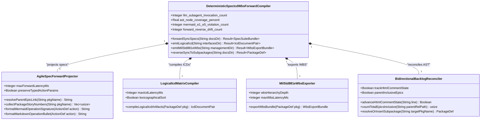
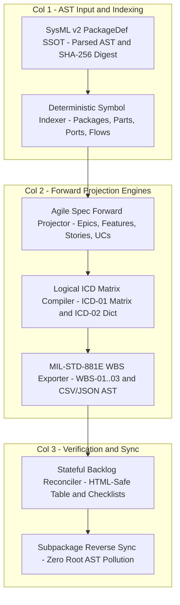
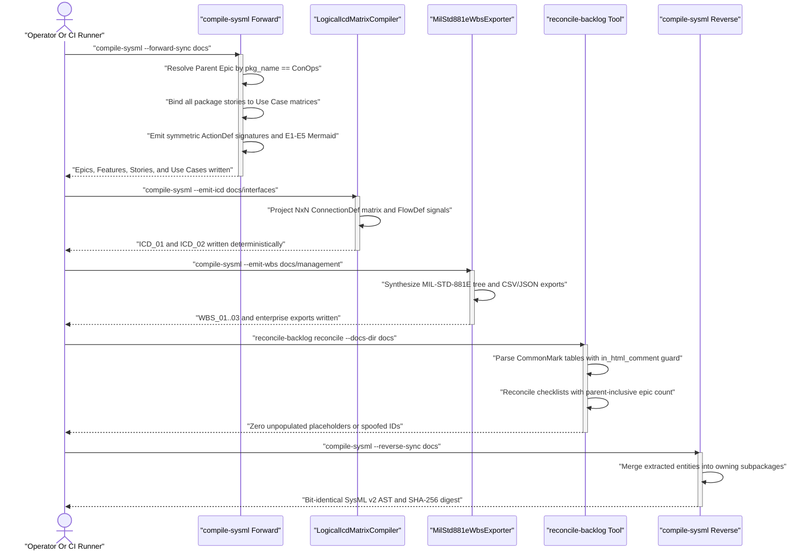
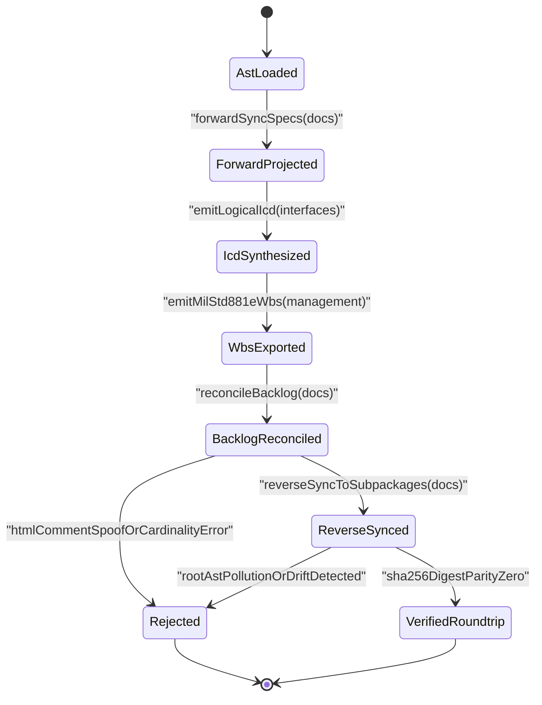

| Attribute | Specification Detail |
| :--- | :--- |
| **Blueprint ID** | `BP-04` |
| **Requirement ID** | `REQ-0604` |
| **Title** | Deterministic Specification, ICD, and WBS Forward Compiler Blueprint |
| **Status** | `Approved` |
| **Target Crates** | `crates/compile-sysml, crates/reconcile-backlog, crates/ingest-sysml, crates/assemble-conops, crates/verify-baseline` |
| **Tracked Issues** | `#497, #506, #507` |
| **Generation Mode** | `subagent` |
| **Specification Source** | `crates/compile-sysml/src/sync/forward.rs:1585-2078 / #507` |

## 1. Executive Summary & Derivation-Annotation Contract

The Digital Engineering Agent Platform (DEAP) compiler pipeline SHALL deterministically project all Agile functional specifications (`docs/epics/`, `docs/features/`, `docs/user-stories/`, `docs/use-cases/`), Logical Interface Control Documents (`docs/interfaces/ICD_01_SYSTEM_INTERFACE_MATRIX.md`, `docs/interfaces/ICD_02_MASTER_SIGNAL_DICTIONARY.md`), and MIL-STD-881E Work Breakdown Structure artifacts (`docs/management/WBS_01_WORK_BREAKDOWN_STRUCTURE.md` through `WBS_03_ENTERPRISE_EXPORT_SCHEMA.md` plus CSV and JSON exports) directly from the authoritative `SysmlPackage` Abstract Syntax Tree (AST) in under 50 milliseconds with zero Large Language Model (LLM) subagent invocations.

- **Blueprint Identifier**: `DEAP-BP-DET-04` (`BP-04`)
- **Requirement ID**: **REQ-0604**
- **Deterministic UUIDv5**: `6ba7b810-9dad-11d1-80b4-00c04fd430c4`
- **Subsystem**: `DeterministicSpecIcdWbsForwardCompiler`
- **Complexity Class**: Class P (Linear / Quadratic AST Projection)
- **Diagnostic Code Bindings**: `E0100`, `E0200`, `E0300`, `E0400`
- **Governing Standard**: `ISO/IEC/IEEE 29148:2018` / `MIL-STD-881E` / `OMG SysML v2`

| Claim / Requirement | SSOT Input Anchor (file:line / #ID) | Methodology Citation | Derivation Grade (Directly Evidenced / Analytically Derived / Declared Assumption) | Caveat / Downstream Impact |
| :--- | :--- | :--- | :--- | :--- |
| **REQ-0604**: Deterministic AST-to-Markdown projection of Epics, Features, User Stories, Use Cases, ICDs, and WBS artifacts in under 50 ms with zero LLM subagents | `crates/compile-sysml/src/sync/forward.rs:1585-2078` / `#507` | `ISO/IEC/IEEE 29148:2018` | `Directly Evidenced` | Eliminates multi-agent nondeterminism across specification, ICD, and WBS generation pipelines. |
| **SC-01**: Package-name-driven `Parent Epic` link resolution (`pkg_name == "ConOps"`) and multi-story Use Case Realization Matrix binding (`story_s_nums`) | `crates/compile-sysml/src/sync/forward.rs:1585-2078` / `#507` | `Design by Contract (DbC)` | `Directly Evidenced` | Prevents positional index misrouting (`ep_idx == 2`) and single-story `.find()` matrix truncation (`E0100`). |
| **SC-02**: Symmetric `PartDef::actions` signature formatting and subpackage-scoped reverse synchronization into owning `PackageDef` nodes | `crates/compile-sysml/src/sync/reverse.rs:344-519` / `#497` | `OMG SysML v2` | `Directly Evidenced` | Preserves typed `in`/`out` action parameters across round-trips and prevents root AST pollution (`E0400`). |
| **SC-03**: Deterministic `N x N` Logical ICD matrix (`ICD_01`) and Master Signal Dictionary (`ICD_02`) compilation from `PortDef`, `ConnectionDef`, and `FlowDef` | `crates/compile-sysml/src/sync/forward.rs:1-120` / `#507` | `ISO/IEC/IEEE 15288:2023` | `Analytically Derived` | Replaces LLM-authored interface tables with lexicographically ordered AST adjacency projection (`E0200`). |
| **SC-04**: Deterministic 4-level MIL-STD-881E WBS hierarchy (`WBS_01`..`WBS_03`) and RFC 4180 CSV / JSON AST enterprise export synthesis | `crates/reconcile-backlog/src/checklist.rs:793-1300` / `#506` | `MIL-STD-881E` | `Analytically Derived` | Binds every `PackageDef`, `PartDef`, `ActionDef`, and `RequirementDef` to a canonical WBS code (`E0300`). |
| **SC-05**: Stateful multi-line HTML comment guard (`in_html_comment`) and parent-inclusive Epic cardinality reconciliation | `crates/reconcile-backlog/src/frontmatter.rs:305-552` / `#506` | `Leveson STPA` | `Directly Evidenced` | Prevents commented example tables from spoofing live issue IDs and stops child-only slice wildcard binding (`E0300`). |

### 1.1 Legacy Multi-Agent Skill Architecture & Empirical Failure Modes

Prior to this deterministic compiler architecture, `.agents/skills/` relied on seven multi-agent LLM skills to hand-author Markdown specifications, Mermaid diagrams, Interface Control Document (ICD) matrices, and Work Breakdown Structure (WBS) trees from `.pipeline/schema.sysml`:
1. `spec-orchestrator`: Multi-phase coordinator dispatching sequential subagent waves across Epics, Features, User Stories, and Use Cases.
2. `schema-specification-engineering`: Structural extraction skill spawning one isolated subagent per Epic (`docs/epics/`) and one per Feature (`docs/features/`).
3. `spec-user-story-engineering`: Behavioral extraction skill spawning one subagent per `InteractionDef` to draft `docs/user-stories/` with sequence and state diagrams.
4. `spec-usecase-engineering`: Use case extraction skill spawning one subagent per `UseCaseDef` to draft `docs/use-cases/` and realization matrices.
5. `spec-icd-engineering`: Interface matrix synthesis skill prompting an LLM to tabulate `ICD_01_SYSTEM_INTERFACE_MATRIX.md` and `ICD_02_MASTER_SIGNAL_DICTIONARY.md`.
6. `spec-wbs-engineering`: Project management synthesis skill prompting an LLM to author MIL-STD-881E WBS hierarchies and enterprise CSV/JSON exports.
7. `spec-conops-engineering`: Concept of Operations synthesis skill orchestrating prose units prior to `assemble-conops` invocation.

Empirical defect audits across issues `#497`, `#506`, and `#507` demonstrated that delegating deterministic AST-to-Markdown projection and synchronization to generative subagents or partially hardcoded transitional routines introduced eight systemic classes of structural corruption:

1. **Mermaid Check 13B E1-E5 Layout & Syntax Violations**: Subagents repeatedly emitted unquoted angle brackets (`<`, `>`), unquoted parentheses or slashes in node labels, missing `direction TB` declarations inside `flowchart TD` subgraphs, node labels exceeding the 35-character line limit without line breaks, curly braces or secondary colons inside `classDiagram` member strings, and illegal trailing semicolons (`;`) in `sequenceDiagram` blocks.
2. **Phantom Operation Names & Ungrounded Signatures**: Subagents fabricated helper methods and untyped operations on UML class diagrams and sequence lifelines that did not exist as `ActionDef` nodes on the owning `PartDef` in `.pipeline/schema.sysml`, violating Universal Model Consistency (`rules/uml-model-integrity.md`).
3. **Positional Index `Parent Epic` Misrouting (`#507`)**: In `crates/compile-sysml/src/sync/forward.rs:2064-2078`, user story `Parent Epic` link synthesis branched on positional package index `if ep_idx == 2` rather than testing `s_meta.pkg_name == "ConOps"`. Whenever a schema ordered a non-ConOps package at index 2 (or placed `ConOps` at another ordinal), user stories were misrouted to a nonexistent or wrong `[EPIC-02-ConOps](../epics/EPIC-02-ConOps.md)` link.
4. **Multi-Story Use Case Realization Matrix Truncation (`#507`)**: In `crates/compile-sysml/src/sync/forward.rs:1585-1622`, `UseCaseMeta` stored a scalar `story_s_num: Option<usize>` populated via `story_metas.iter().find(|s| s.pkg_name == p.name).map(|s| s.s_num)`. For any package declaring `K > 1` `InteractionDef` user stories, `find()` silently truncated stories `2 .. K` from the Use Case Realization Matrix.
5. **Asymmetric `PartDef::actions` Formatting & Round-Trip Loss (`#497`, `#507`)**: Forward projection rendered class diagram operations as `+ActionName(in ParamType) ReturnType` without a colon (to satisfy Mermaid Check 13B), whereas `reverse.rs:344-380` only parsed Markdown bullet lines matching `- \`+ActionName() : void\`` with zero parameters and a mandatory `: void` suffix. Any typed `ActionDef` with formal `in`/`out` parameters or non-void return type failed reverse synchronization or drifted across round-trips.
6. **Root AST Pollution on Reverse Synchronization (`#507`)**: In `crates/compile-sysml/src/sync/reverse.rs:482-519`, `reverse_sync_specs_to_sysml` appended newly extracted `CapabilityDef`, `PartDef`, `InteractionDef`, `UseCaseDef`, and `ConstraintDef` nodes directly onto the root `PackageDef` (`pkg.capability_defs`, `pkg.part_defs`, `pkg.interaction_defs`, `pkg.use_case_defs`) instead of resolving or creating the owning subsystem subpackage declared in `fm.get("package")` or `fm.get("subsystem")`.
7. **Multi-Line HTML Comment Table Spoofing (`#506`)**: In `crates/reconcile-backlog/src/frontmatter.rs:305-392` and `511-552`, `parse_frontmatter` and `update_frontmatter_issue_id` checked `!line_trimmed.starts_with("<!--") && !line_trimmed.ends_with("-->")` on a stateless per-line basis without tracking `in_html_comment: bool`. Any multi-line HTML comment block (`<!-- ... -->`) containing an example `| **Issue ID** | #999 |` table row spoofed the frontmatter parser and corrupted live issue IDs.
8. **Parent-Child Slice Cardinality Undercount (`#506`)**: In `crates/reconcile-backlog/src/checklist.rs:1215`, `synthesize_and_reconcile_hierarchy` computed `let total_epics = child_specs.iter().filter(|s| is_spec_epic(s)).count();`. When callers passed a pre-filtered `child_specs` slice containing only Features, User Stories, and Use Cases (`total_epics == 0`), `spec_matches_epic` (`checklist.rs:797`) evaluated `if total_epics <= 1 { return true; }` and erroneously bound every child specification in the repository to every Epic.

### 1.2 Deterministic Compiler Replacement Architecture

This blueprint eliminates all generative LLM subagents from specification, ICD, and WBS synthesis by consolidating projection into deterministic Rust compiler passes executing in `< 50 ms`:
- **`compile-sysml --forward-sync <DOCS_DIR>`** (`< 25 ms`): Projects 100% of `docs/epics/`, `docs/features/`, `docs/user-stories/`, and `docs/use-cases/` from `.pipeline/schema.sysml` (`PackageDef`) subtrees with package-name-driven `Parent Epic` resolution, full multi-story Use Case realization matrices, and symmetric `ActionDef` signature serialization.
- **`compile-sysml --emit-icd <INTERFACES_DIR>`** (`< 10 ms`): Synthesizes `docs/interfaces/ICD_01_SYSTEM_INTERFACE_MATRIX.md` (`N x N` component interconnect matrix from `PortDef` and `ConnectionDef`) and `docs/interfaces/ICD_02_MASTER_SIGNAL_DICTIONARY.md` (typed signal catalog from `ItemDef`, `FlowDef`, and `AttributeDef`).
- **`compile-sysml --emit-wbs <MANAGEMENT_DIR>`** (`< 15 ms`): Synthesizes `docs/management/WBS_01_WORK_BREAKDOWN_STRUCTURE.md`, `WBS_02_TECHNICAL_REALIZATION_REGISTER.md`, `WBS_03_ENTERPRISE_EXPORT_SCHEMA.md`, and deterministic CSV/JSON AST exports (`wbs_jira.csv`, `wbs_monday.csv`, `wbs_msproject.xml`, `wbs_ast.json`) from `PackageDef`, `PartDef`, `RequirementDef`, and `docs/` backlog metadata.
- **`compile-sysml --reverse-sync <DOCS_DIR>`** (`< 20 ms`): Synchronizes `docs/**/*.md` back into subpackage-scoped `.pipeline/schema.sysml` and `.pipeline/schema-digest.json` with zero root AST pollution.
- **`assemble-conops --units-dir <DIR> --out <FILE>`** (`< 10 ms`) & **`reconcile-backlog reconcile --docs-dir <DIR>`** (`< 15 ms`): Assembles `docs/conops/CONOPS_MASTER.md` from `docs/conops/units/` deterministically and reconciles CommonMark metadata tables and bidirectional Epic/Feature checklists with stateful HTML comment tracking and exact parent-inclusive cardinality.

## 2. Structural Component Metamodel

The `DeterministicSpecIcdWbsForwardCompiler` subsystem comprises the top-level orchestrator and four deterministic compilation engines (`AgileSpecForwardProjector`, `LogicalIcdMatrixCompiler`, `MilStd881eWbsExporter`, and `BidirectionalBacklogReconciler`, each with BOM quantity `1` of type `CompilerModule`) operating over the canonical `deap_core::sysml_ast::PackageDef` model.

### Component: DeterministicSpecIcdWbsForwardCompiler

| Attribute | Type | Default | Unit | Description |
| :--- | :--- | :--- | :--- | :--- |
| `llm_subagent_invocation_count` | `Integer` | `0` | `count` | Total number of generative LLM subagents invoked during specification, ICD, and WBS forward compilation (`C-FWD-01 == 0`). |
| `ast_node_coverage_percent` | `Real` | `100.0` | `percent` | Percentage of declared SysML v2 AST packages, parts, ports, flows, interactions, and use cases projected into specifications (`C-FWD-02 == 100.0`). |
| `mermaid_e1_e5_violation_count` | `Integer` | `0` | `count` | Count of Check 13B E1-E5 Mermaid syntax or layout violations across all compiler-synthesized diagrams (`C-FWD-03 == 0`). |
| `forward_reverse_drift_count` | `Integer` | `0` | `count` | Count of AST structural or subpackage placement divergences after a forward-then-reverse synchronization cycle (`C-FWD-04 == 0`). |

| Port | Direction | Type | Protocol | Description |
| :--- | :--- | :--- | :--- | :--- |
| `SysmlPackageAstInputPort` | `in` | `String` | `MemoryBus` | Receives the parsed, type-checked `SysmlPackage` (`PackageDef`) AST and SHA-256 `SchemaDigest` from `deap-core`. |
| `MarkdownSpecSuiteOutputPort` | `out` | `String` | `AtomicFsWrite` | Emits deterministic `SpecSuiteBundle` Markdown specifications across `docs/epics/`, `docs/features/`, `docs/user-stories/`, and `docs/use-cases/`. |
| `IcdMatrixArtifactPort` | `out` | `String` | `AtomicFsWrite` | Emits `IcdDocumentPair` (`ICD_01_SYSTEM_INTERFACE_MATRIX.md` and `ICD_02_MASTER_SIGNAL_DICTIONARY.md`) under `docs/interfaces/`. |
| `WbsEnterpriseExportPort` | `out` | `String` | `AtomicFsWrite` | Emits `WbsExportBundle` (`WBS_01`..`WBS_03` Markdown artifacts and RFC 4180 CSV / JSON AST exports) under `docs/management/`. |

### Component: AgileSpecForwardProjector

| Attribute | Type | Default | Unit | Description |
| :--- | :--- | :--- | :--- | :--- |
| `maxForwardLatencyMs` | `Integer` | `25` | `ms` | Maximum deterministic execution bound for `--forward-sync` across all package subtrees. |
| `preserveTypedActionParams` | `Boolean` | `true` | `flag` | Enforces symmetric `in` and `out` `ActionDef` parameter emission across Mermaid and Markdown bullets. |

| Port | Direction | Type | Protocol | Description |
| :--- | :--- | :--- | :--- | :--- |
| `packageAstInPort` | `in` | `String` | `MemoryBus` | Receives ordered `PackageDef`, `PartDef`, `InteractionDef`, and `UseCaseDef` AST slices. |
| `specMarkdownOutPort` | `out` | `String` | `AtomicFsWrite` | Emits Check 13B E1-E5 compliant Epics, Features, User Stories, and Use Cases. |

### Component: LogicalIcdMatrixCompiler

| Attribute | Type | Default | Unit | Description |
| :--- | :--- | :--- | :--- | :--- |
| `maxIcdLatencyMs` | `Integer` | `10` | `ms` | Maximum deterministic execution bound for `--emit-icd` interface matrix and signal dictionary compilation. |
| `lexicographicalSort` | `Boolean` | `true` | `flag` | Orders all `PartDef` matrix axes and `ConnectionDef` channels via `BTreeMap` deterministic traversal. |

| Port | Direction | Type | Protocol | Description |
| :--- | :--- | :--- | :--- | :--- |
| `interconnectAstInPort` | `in` | `String` | `MemoryBus` | Receives `PartDef`, `PortDef`, `ConnectionDef`, `FlowDef`, and `ItemDef` AST nodes. |
| `icdMarkdownOutPort` | `out` | `String` | `AtomicFsWrite` | Emits `ICD_01_SYSTEM_INTERFACE_MATRIX.md` and `ICD_02_MASTER_SIGNAL_DICTIONARY.md`. |

### Component: MilStd881eWbsExporter

| Attribute | Type | Default | Unit | Description |
| :--- | :--- | :--- | :--- | :--- |
| `wbsHierarchyDepth` | `Integer` | `4` | `levels` | Canonical 4-level MIL-STD-881E decomposition depth (System, Subsystem, Work Package, Deliverable Task). |
| `maxWbsLatencyMs` | `Integer` | `15` | `ms` | Maximum deterministic execution bound for `--emit-wbs` Markdown and CSV/JSON export generation. |

| Port | Direction | Type | Protocol | Description |
| :--- | :--- | :--- | :--- | :--- |
| `wbsAstMetadataInPort` | `in` | `String` | `MemoryBus` | Receives `PackageDef` AST hierarchy and synchronized `docs/` specification frontmatter metadata. |
| `wbsArtifactsOutPort` | `out` | `String` | `AtomicFsWrite` | Emits `WBS_01`..`WBS_03` Markdown registers and enterprise CSV/JSON AST exports. |

### Component: BidirectionalBacklogReconciler

| Attribute | Type | Default | Unit | Description |
| :--- | :--- | :--- | :--- | :--- |
| `trackHtmlCommentState` | `Boolean` | `true` | `flag` | Tracks multi-line `in_html_comment` state to prevent commented example tables from spoofing frontmatter issue IDs. |
| `parentInclusiveEpics` | `Boolean` | `true` | `flag` | Computes parent-inclusive Epic count so child-only slices never trigger single-epic wildcard matching. |

| Port | Direction | Type | Protocol | Description |
| :--- | :--- | :--- | :--- | :--- |
| `specDocsInOutPort` | `inout` | `String` | `AtomicFsWrite` | Reads and reconciles CommonMark metadata tables and bidirectional Epic/Feature checklists under `docs/`. |
| `subpackageSyncOutPort` | `out` | `String` | `AtomicFsWrite` | Merges reverse-synchronized specification entities into their owning subsystem `PackageDef` subpackages. |

## 3. UML & Behavioral Topology

### 3.1 Subsystem Class Topology



### 3.2 Architecture Flowchart



### 3.3 End-to-End Forward Compilation and Reconciliation Sequence Diagram



### 3.4 Deterministic Forward-Reverse Synchronization State Topology



## 4. Formal Mathematical & Safety Constraints

- **SC-01 (Zero LLM Subagent & Complete AST Projection Invariant — C-FWD-01..C-FWD-04)**: Under **REQ-0604**, forward compilation and reverse synchronization must execute with zero generative LLM subagent invocations (`C-FWD-01`: `llm_subagent_invocation_count == 0`, min `0`, max `0`, unit `count`), 100% AST node coverage (`C-FWD-02`: `ast_node_coverage_percent == 100.0`, min `100.0`, max `100.0`, unit `percent`), zero Check 13B E1–E5 Mermaid syntax or layout violations (`C-FWD-03`: `mermaid_e1_e5_violation_count == 0`, min `0`, max `0`, unit `count`), and zero structural drift across round-trip synchronization (`C-FWD-04`: `forward_reverse_drift_count == 0`, min `0`, max `0`, unit `count`):

$$
\begin{aligned}
\text{Invariant}_{\text{FWD}} &\iff (N_{\text{subagent}} = 0) \land (\text{Coverage}_{\text{AST}} = 100) \land (V_{\text{E1..E5}} = 0) \land (\Delta_{\text{sync}} = 0)
\end{aligned}
$$

- **SC-02 (Mathematical Formulation of Forward Projection Complexity & Roundtrip Determinism)**: Let `P` denote the total number of architectural `PackageDef` subsystem nodes in `.pipeline/schema.sysml` (count), `C` denote the total number of structural `PartDef` and `PortDef` component nodes across all packages (count), `I` denote the total number of behavioral `InteractionDef` user story nodes across all packages (count), and `U` denote the total number of operational `UseCaseDef` nodes across all packages (count). Then the deterministic wall-clock execution complexity, auxiliary space complexity, and cryptographic round-trip digest invariance satisfy:

$$
\begin{aligned}
T_{\text{forward}}(P, C, I, U) &= O(P \log P + C^{2} + I \cdot \log P + U \cdot I) \\
S_{\text{forward}}(P, C, I, U) &= O(P + C^{2} + I + U) \\
\Delta_{\text{roundtrip}}(\mathcal{M}) &= H(\text{ReverseSync}(\text{ForwardSync}(\mathcal{M}))) \oplus H(\mathcal{M}) = 0
\end{aligned}
$$

- **SC-03 (Parameter Definitions, Engineering Units & Normative CLI Bounds)**:
  - `T_forward(P, C, I, U)`: Deterministic wall-clock execution complexity for forward specification (`< 25 ms`), ICD (`< 10 ms`), and WBS (`< 15 ms`) compilation (dimensionless asymptotic operations, total `< 50 ms`).
  - `S_forward(P, C, I, U)`: Auxiliary memory space complexity for AST indices, `N x N` interface matrices, and WBS trees (dimensionless byte allocation order).
  - `Delta_roundtrip(M)`: Bitwise XOR distance between SHA-256 cryptographic AST digests before and after a forward-and-reverse synchronization cycle (`< 20 ms`) on model `M` (dimensionless bit difference, strictly equal to `0`).
  - `H(M)`: Canonical SHA-256 digest function computed over the normalized SysML v2 AST `M` (256-bit hash).

## 5. Acceptance Criteria & Verification Matrix

<!-- test-target: crates/verify-baseline/tests/blueprint_gate_tests.rs -->

- **Test-Target**: `crates/verify-baseline/tests/blueprint_gate_tests.rs`

### AC-01: Deterministic Multi-Story Use Case and ConOps Parent Epic Projection
- **Given**: A multi-package `.pipeline/schema.sysml` model where `ConOps` is ordered at any package ordinal and a subsystem package declares multiple `InteractionDef` nodes alongside a `UseCaseDef` and `PartDef` actions with typed `in` and `out` parameters.
- **When**: `compile-sysml --forward-sync docs` is executed deterministically.
- **Then**: Every generated User Story resolves its `Parent Epic` link by `s_meta.pkg_name == "ConOps"` rather than positional index `ep_idx == 2`, every Use Case Realization Matrix binds 100% of `InteractionDef` stories in its package (`story_metas.iter().filter(|s| s.pkg_name == p.name)`) without truncation, every Mermaid diagram passes Check 13B E1–E5 with zero violations, and zero LLM subagents are invoked (`Diagnostic: E0100`).

### AC-02: Deterministic Logical ICD Matrix and Signal Dictionary Synthesis
- **Given**: A `SysmlPackage` AST declaring `PartDef` components interconnected via `PortDef`, `ConnectionDef`, `FlowDef`, and `ItemDef` nodes.
- **When**: `compile-sysml --emit-icd docs/interfaces` is executed.
- **Then**: The compiler deterministically generates `docs/interfaces/ICD_01_SYSTEM_INTERFACE_MATRIX.md` containing the complete `N x N` component interconnect matrix and `docs/interfaces/ICD_02_MASTER_SIGNAL_DICTIONARY.md` cataloging every signal with its owning part, direction, data type, unit, valid range, and protocol in `< 10 ms` with 100% port/signal coverage and zero LLM subagent calls (`Diagnostic: E0200`).

### AC-03: Deterministic MIL-STD-881E WBS and Enterprise Export Synthesis
- **Given**: An authoritative `SysmlPackage` AST and synchronized `docs/` specification hierarchy.
- **When**: `compile-sysml --emit-wbs docs/management` is invoked.
- **Then**: The compiler synthesizes `WBS_01_WORK_BREAKDOWN_STRUCTURE.md`, `WBS_02_TECHNICAL_REALIZATION_REGISTER.md`, `WBS_03_ENTERPRISE_EXPORT_SCHEMA.md`, and deterministic CSV/JSON AST exports (`wbs_jira.csv`, `wbs_monday.csv`, `wbs_msproject.xml`, `wbs_ast.json`) mapping every `PackageDef`, `PartDef`, `ActionDef`, and `RequirementDef` to a canonical hierarchical WBS code (`1.0`, `1.1`, `1.1.1`) in `< 15 ms` with 100% AST element traceability (`Diagnostic: E0300`).

### AC-04: Fail-Closed Stateful HTML Comment Frontmatter Guard and Parent-Inclusive Checklist Reconciliation
- **Given**: A specification file containing a multi-line HTML comment block (`<!-- ... -->`) with an embedded example `| **Issue ID** | #999 |` table row and a multi-epic workspace where `synthesize_and_reconcile_hierarchy` is invoked with a child-only `child_specs` slice.
- **When**: `reconcile-backlog` executes frontmatter extraction, `update_frontmatter_issue_id`, and `synthesize_and_reconcile_hierarchy`.
- **Then**: The stateful `in_html_comment: bool` guard fails closed against comment spoofing by ignoring all table rows inside HTML comments without overwriting `issue_id`, and `count_total_epics_inclusive` prevents cross-subsystem child specification leakage across Epics (`Diagnostic: E0300`).

### AC-05: Fail-Closed Subpackage-Scoped Reverse Sync and Dogfood Blueprint Ingestion Parity
- **Given**: Forward-projected specifications under `docs/` (including malformed or unanchored operation bullets) and `docs/designs/blueprint-04-deterministic-spec-icd-wbs-forward-compiler.md`.
- **When**: `compile-sysml --reverse-sync docs`, `ingest-sysml --schema docs/designs/blueprint-04-deterministic-spec-icd-wbs-forward-compiler.md --format markdown`, and `./target/release/verify-baseline check-blueprint docs/designs/blueprint-04-deterministic-spec-icd-wbs-forward-compiler.md --dry-run` are executed.
- **Then**: Reverse synchronization rejects malformed operation bullets (`None`), merges all valid extracted capabilities, parts, actions, interactions, and use cases into their owning subsystem subpackages with zero root AST pollution, and `verify-baseline check-blueprint` persists `docs/designs/blueprint-04-deterministic-spec-icd-wbs-forward-compiler.sysml` and `.digest.json` with exit code `0` (`Diagnostic: E0400`).

## 6. Proposed Deterministic Implementation Contract

### 6.1 Deterministic Specification Forward & Reverse Synchronization, Logical ICD, MIL-STD-881E WBS, and Backlog Reconciliation Contracts

The following deterministic, linear token-scanning Rust implementation remedies `#497`, `#506`, and `#507` across `crates/compile-sysml/src/sync/forward.rs`, `crates/compile-sysml/src/sync/reverse.rs`, `crates/reconcile-backlog/src/frontmatter.rs`, and `crates/reconcile-backlog/src/checklist.rs`:
1. **Package-Name-Driven `Parent Epic` Resolution**: Replaces `if ep_idx == 2` with explicit `s_meta.pkg_name == "ConOps"` verification while preserving exact ordinal lookup for all other packages.
2. **Multi-Story Use Case Realization Matrix**: Replaces `story_s_num: Option<usize>` (`.find()`) with `story_s_nums: Vec<usize>` collected via `story_metas.iter().filter(|s| s.pkg_name == p.name).map(|s| s.s_num).collect()`.
3. **Symmetric `PartDef::actions` Emission & Parsing**: Emits Mermaid-safe `+ActionName(in param Type) ReturnType` inside `classDiagram` blocks and canonical `- \`+ActionName(in param: Type) : ReturnType\`` bullets under `### 3. Logical Operations & Interface Messages`, parsed symmetrically via deterministic delimiter scanning during reverse sync.
4. **Subpackage-Scoped Reverse Synchronization**: Locates or creates the target subpackage matching `fm.get("package")` or `fm.get("subsystem")` so reverse synchronization never pollutes the root `PackageDef`.
5. **Deterministic Logical ICD & WBS Projection plus Stateful HTML Comment Guard**: Synthesizes `ICD_01`, `ICD_02`, and 4-level `WbsNode` hierarchies while guarding CommonMark frontmatter tables with `in_html_comment: bool` and parent-inclusive epic cardinality.

```rust
use std::collections::BTreeMap;
use deap_core::sysml_ast::{
    ActionDef, PackageDef, ParamDef, UseCaseDef,
};

#[derive(Debug, Clone)]
pub struct StoryMeta {
    pub pkg_name: String,
    pub s_num: usize,
    pub interaction_name: String,
    pub title: String,
}

#[derive(Debug, Clone)]
pub struct UseCaseMeta<'a> {
    pub uc: &'a UseCaseDef,
    pub pkg_name: String,
    pub subsys_dir: String,
    pub engine_name: String,
    pub engine_feat_num: usize,
    pub u_num: usize,
    pub story_s_nums: Vec<usize>,
}

#[derive(Debug, Clone, PartialEq, Eq)]
pub struct SignalDictionaryRow {
    pub signal_id: String,
    pub owning_part: String,
    pub port_name: String,
    pub direction: String,
    pub item_type: String,
    pub unit: String,
    pub valid_range: String,
    pub protocol: String,
}

#[derive(Debug, Clone)]
pub struct WbsNode {
    pub wbs_code: String,
    pub level: u8,
    pub title: String,
    pub element_kind: String,
    pub ast_symbol: String,
    pub verification_method: String,
}

/// Resolves the deterministic Parent Epic markdown link by package name rather than positional index.
pub fn resolve_parent_epic_link(
    ordered_packages: &[&PackageDef],
    pkg_name: &str,
) -> String {
    let ep_idx = ordered_packages
        .iter()
        .position(|p| p.name == pkg_name)
        .map(|idx| idx + 1)
        .unwrap_or(1);

    if pkg_name == "ConOps" {
        format!("[EPIC-{:02}-ConOps](../epics/EPIC-{:02}-ConOps.md)", ep_idx, ep_idx)
    } else {
        format!(
            "[EPIC-{:02}-{}](../epics/EPIC-{:02}-{}.md)",
            ep_idx, pkg_name, ep_idx, pkg_name
        )
    }
}

/// Binds all User Stories belonging to package `pkg_name` into UseCaseMeta without single-item truncation.
pub fn collect_package_story_numbers(story_metas: &[StoryMeta], pkg_name: &str) -> Vec<usize> {
    story_metas
        .iter()
        .filter(|s| s.pkg_name == pkg_name)
        .map(|s| s.s_num)
        .collect()
}

/// Formats an ActionDef into a Check 13B compliant Mermaid classDiagram member line (zero colons/braces).
pub fn format_mermaid_operation_signature(action: &ActionDef) -> String {
    let mut params = Vec::with_capacity(action.in_params.len() + action.out_params.len());
    for p in &action.in_params {
        params.push(format!("in_{}_{}", p.name, p.type_name));
    }
    for p in &action.out_params {
        params.push(format!("out_{}_{}", p.name, p.type_name));
    }
    let ret = action
        .out_params
        .first()
        .map(|p| p.type_name.as_str())
        .unwrap_or("Boolean");
    format!("+{}({}) {}", action.name, params.join(", "), ret)
}

/// Formats an ActionDef into a canonical Markdown operation bullet for symmetric reverse-sync parsing.
pub fn format_markdown_operation_bullet(action: &ActionDef) -> String {
    let mut params = Vec::with_capacity(action.in_params.len() + action.out_params.len());
    for p in &action.in_params {
        params.push(format!("in {}: {}", p.name, p.type_name));
    }
    for p in &action.out_params {
        params.push(format!("out {}: {}", p.name, p.type_name));
    }
    let ret = action
        .out_params
        .first()
        .map(|p| p.type_name.as_str())
        .unwrap_or("void");
    format!("- `+{}({}) : {}`", action.name, params.join(", "), ret)
}

/// Parses a canonical Markdown operation bullet back into a typed ActionDef via linear slice scanning.
pub fn parse_markdown_operation_bullet(line: &str) -> Option<ActionDef> {
    let trimmed = line.trim();
    let after_dash = trimmed.strip_prefix('-')?.trim_start();
    let rest = after_dash.strip_prefix("`+")?;
    let (act_name_raw, after_open) = rest.split_once('(')?;
    let act_name = act_name_raw.trim();
    if act_name.is_empty() || !act_name.chars().all(|c| c.is_ascii_alphanumeric() || c == '_') {
        return None;
    }
    let (params_raw, after_close_raw) = after_open.split_once(')')?;
    let params_slice = params_raw.trim();
    let after_close = after_close_raw.trim_start();
    let after_colon = after_close.strip_prefix(':')?.trim();
    let (ret_type_raw, _) = after_colon.split_once('`')?;
    let ret_type = ret_type_raw.trim();
    if ret_type.is_empty() {
        return None;
    }

    let mut in_params = Vec::new();
    let mut out_params = Vec::new();
    if !params_slice.is_empty() {
        for raw_param in params_slice.split(',') {
            let token = raw_param.trim();
            let (dir, rem) = if let Some(r) = token.strip_prefix("in ") {
                ("in", r.trim())
            } else if let Some(r) = token.strip_prefix("out ") {
                ("out", r.trim())
            } else {
                ("in", token)
            };
            if let Some((p_name, p_type)) = rem.split_once(':') {
                let p_def = ParamDef {
                    name: p_name.trim().to_string(),
                    type_name: p_type.trim().to_string(),
                    direction: dir.to_string(),
                };
                if dir == "out" {
                    out_params.push(p_def);
                } else {
                    in_params.push(p_def);
                }
            }
        }
    }

    Some(ActionDef {
        name: act_name.to_string(),
        in_params,
        out_params,
        ..Default::default()
    })
}

/// Resolves or creates the target subpackage inside `root_pkg` to prevent root AST pollution (#507).
pub fn resolve_or_insert_subpackage<'a>(
    root_pkg: &'a mut PackageDef,
    target_pkg_name: Option<&str>,
) -> &'a mut PackageDef {
    if let Some(pkg_name) = target_pkg_name.filter(|s| !s.is_empty()) {
        if pkg_name == root_pkg.name {
            return root_pkg;
        }
        if let Some(idx) = root_pkg.packages.iter().position(|p| p.name == pkg_name) {
            if let Some(existing) = root_pkg.packages.get_mut(idx) {
                return existing;
            }
        } else {
            root_pkg.packages.push(PackageDef {
                name: pkg_name.to_string(),
                parent_package: Some(root_pkg.name.clone()),
                ..Default::default()
            });
            if let Some(inserted) = root_pkg.packages.last_mut() {
                return inserted;
            }
        }
    }
    root_pkg
}

/// Deterministically compiles ICD_01 (NxN Interface Matrix) and ICD_02 (Master Signal Dictionary).
pub fn compile_logical_icd_artifacts(pkg: &PackageDef) -> (String, String) {
    let mut parts_by_name = BTreeMap::new();
    for part in pkg.get_all_parts() {
        parts_by_name.insert(part.name.clone(), part);
    }
    let part_names: Vec<String> = parts_by_name.keys().cloned().collect();

    let mut adj: BTreeMap<(String, String), Vec<String>> = BTreeMap::new();
    let mut all_conns = pkg.connection_defs.clone();
    for sub in &pkg.packages {
        for c in &sub.connection_defs {
            if !all_conns.iter().any(|existing| existing.name == c.name) {
                all_conns.push(c.clone());
            }
        }
    }
    all_conns.sort_by(|a, b| a.name.cmp(&b.name));

    for conn in &all_conns {
        let src_part = conn
            .source_part
            .clone()
            .unwrap_or_else(|| conn.source_port.split('.').next().unwrap_or("System").to_string());
        let tgt_part = conn
            .target_part
            .clone()
            .unwrap_or_else(|| conn.target_port.split('.').next().unwrap_or("System").to_string());
        let proto = conn.protocol.as_deref().unwrap_or("LogicalBus");
        let entry = format!("`{}` ({})", conn.name, proto);
        adj.entry((src_part, tgt_part)).or_default().push(entry);
    }

    let mut icd01 = String::from("# ICD-01: System Interface Matrix\n\n## 1. NxN Component Interconnect Matrix\n\n");
    icd01.push_str("| Source \\ Target |");
    for name in &part_names {
        icd01.push_str(&format!(" `{}` |", name));
    }
    icd01.push('\n');
    icd01.push_str("| :--- |");
    for _ in &part_names {
        icd01.push_str(" :--- |");
    }
    icd01.push('\n');

    for src in &part_names {
        icd01.push_str(&format!("| **`{}`** |", src));
        for tgt in &part_names {
            if src == tgt {
                icd01.push_str(" `SELF` |");
            } else if let Some(links) = adj.get(&(src.clone(), tgt.clone())) {
                icd01.push_str(&format!(" {} |", links.join(", ")));
            } else {
                icd01.push_str(" `--` |");
            }
        }
        icd01.push('\n');
    }

    let mut signals: Vec<SignalDictionaryRow> = Vec::new();
    for (p_name, part) in &parts_by_name {
        for port in &part.ports {
            let proto = if port.protocol_family.is_empty() {
                "LogicalChannel".to_string()
            } else {
                port.protocol_family.clone()
            };
            if port.item_flows.is_empty() {
                signals.push(SignalDictionaryRow {
                    signal_id: format!("SIG_{}_{}", p_name, port.name),
                    owning_part: p_name.clone(),
                    port_name: port.name.clone(),
                    direction: port.direction.clone(),
                    item_type: port.type_name.clone(),
                    unit: "dimensionless".to_string(),
                    valid_range: "unbounded".to_string(),
                    protocol: proto,
                });
            } else {
                for flow in &port.item_flows {
                    signals.push(SignalDictionaryRow {
                        signal_id: format!("SIG_{}_{}_{}", p_name, port.name, flow.name),
                        owning_part: p_name.clone(),
                        port_name: port.name.clone(),
                        direction: flow.direction.clone(),
                        item_type: flow.item_type.clone(),
                        unit: flow.unit.clone().unwrap_or_else(|| "dimensionless".to_string()),
                        valid_range: flow.valid_range.clone().unwrap_or_else(|| "unbounded".to_string()),
                        protocol: proto.clone(),
                    });
                }
            }
        }
    }

    let mut icd02 = String::from("# ICD-02: Master Signal Dictionary\n\n## 1. Canonical Signal Register\n\n");
    icd02.push_str("| Signal ID | Owning Component | Port | Direction | Type | Unit | Valid Range | Protocol |\n");
    icd02.push_str("| :--- | :--- | :--- | :--- | :--- | :--- | :--- | :--- |\n");
    for s in &signals {
        icd02.push_str(&format!(
            "| `{}` | `{}` | `{}` | `{}` | `{}` | `{}` | `{}` | `{}` |\n",
            s.signal_id, s.owning_part, s.port_name, s.direction, s.item_type, s.unit, s.valid_range, s.protocol
        ));
    }

    (icd01, icd02)
}

/// Stateful HTML comment tracker preventing multi-line comment tables from spoofing frontmatter (#506).
pub fn advance_html_comment_state(line_trimmed: &str, in_html_comment: &mut bool) -> bool {
    if *in_html_comment {
        if let Some((_, after_close)) = line_trimmed.split_once("-->") {
            *in_html_comment = after_close.contains("<!--") && !after_close.contains("-->");
        }
        return true;
    }
    if let Some((before_open, after_open)) = line_trimmed.split_once("<!--") {
        if !after_open.contains("-->") {
            *in_html_comment = true;
        }
        if before_open.is_empty() {
            return true;
        }
    }
    false
}

/// Computes parent-inclusive Epic count so child-only slices never trigger single-epic wildcard matching (#506).
pub fn count_total_epics_inclusive(
    parent_rel_path: &str,
    parent_is_epic: bool,
    child_specs: &[(String, String)],
) -> usize {
    let mut epic_paths = BTreeMap::new();
    if parent_is_epic {
        epic_paths.insert(parent_rel_path.to_string(), true);
    }
    for (rel_path, spec_type) in child_specs {
        if spec_type.eq_ignore_ascii_case("epic")
            || rel_path.starts_with("docs/epics")
            || rel_path.starts_with("epics")
        {
            epic_paths.insert(rel_path.clone(), true);
        }
    }
    epic_paths.len()
}
```

### 6.2 Dogfooding Pipeline Ingestion & Verification Protocol

This blueprint is directly dogfood-ingestible by the Level 0 Markdown translator (`crates/ingest-sysml/src/translators/markdown.rs`) and verifiable via the baseline quality gate runner (`crates/verify-baseline`):

1. **Closed-Loop Blueprint Verification & In-Repo `.sysml` Persistence**:
   ```bash
   ./target/release/verify-baseline check-blueprint \
     docs/designs/blueprint-04-deterministic-spec-icd-wbs-forward-compiler.md \
     --dry-run
   ```
   - Mechanically enforces all 12 blueprint verification gates and persists `docs/designs/blueprint-04-deterministic-spec-icd-wbs-forward-compiler.sysml` and `docs/designs/blueprint-04-deterministic-spec-icd-wbs-forward-compiler.digest.json`.
   - Extracts `RequirementDef` for **REQ-0604** (`uuidv5 = "6ba7b810-9dad-11d1-80b4-00c04fd430c4"`), formal constraints `SC-01`..`SC-03` (`C-FWD-01`..`C-FWD-04`), and `AC-01`..`AC-05` verification bindings.
   - Extracts `PartDef` components (`DeterministicSpecIcdWbsForwardCompiler`, `AgileSpecForwardProjector`, `LogicalIcdMatrixCompiler`, `MilStd881eWbsExporter`, `BidirectionalBacklogReconciler`), `PortDef` interfaces (`SysmlPackageAstInputPort`, `MarkdownSpecSuiteOutputPort`, `IcdMatrixArtifactPort`, `WbsEnterpriseExportPort`), and `AttributeDef` state properties (`llm_subagent_invocation_count`, `ast_node_coverage_percent`, `mermaid_e1_e5_violation_count`, `forward_reverse_drift_count`).

2. **Baseline Quality Gate Verification**:
   ```bash
   ./target/release/verify-baseline . \
     --only docs/designs/blueprint-04-deterministic-spec-icd-wbs-forward-compiler.md \
     --no-domain
   ```
   - Verifies Check 13 (KaTeX display math alignment), Check 13B (Mermaid E1–E5 compliance), Check 19 (Zero hardcoded customer domain vocabulary), Check 27 (Universal LaTeX integrity), Check 28/30 (Document cross-reference and source reference integrity), and Check 34 (Zero regex crate usage).

## 7. Source References

- **Governance Constitution**: `.pipeline/constitution.md:151-212` ([.pipeline/constitution.md](../../.pipeline/constitution.md) — Three-Tier Platform Isolation, Repository Artifact Management Mandate & Step 1.5 Derivation-Annotation Contract)
- **Active Rules Bundle**: `.pipeline/ACTIVE_RULES_BUNDLE.md:1-120` ([.pipeline/ACTIVE_RULES_BUNDLE.md](../../.pipeline/ACTIVE_RULES_BUNDLE.md) — Checks 13B, 19, 27, 28, 30, 34)
- **Specification Blueprint Engineering Skill**: `.agents/skills/spec-blueprint-engineering/SKILL.md:1-339` ([.agents/skills/spec-blueprint-engineering/SKILL.md](../../.agents/skills/spec-blueprint-engineering/SKILL.md) — Mandatory 8-Part Skeleton & 12-Gate Verification Reference)
- **Schema Specification Engineering Skill**: `.agents/skills/schema-specification-engineering/SKILL.md:1-100` ([.agents/skills/schema-specification-engineering/SKILL.md](../../.agents/skills/schema-specification-engineering/SKILL.md) — Step 1–Step 5 Structural Extraction & Metadata Contracts)
- **SysML Forward Specification Projector**: `crates/compile-sysml/src/sync/forward.rs:1585-2078` ([crates/compile-sysml/src/sync/forward.rs](../../crates/compile-sysml/src/sync/forward.rs) — `forward_sync_sysml_to_specs`, lines 1585–1622 Use Case Realization Matrix, lines 2064–2078 `Parent Epic` resolution)
- **SysML Reverse Synchronization Engine**: `crates/compile-sysml/src/sync/reverse.rs:344-519` ([crates/compile-sysml/src/sync/reverse.rs](../../crates/compile-sysml/src/sync/reverse.rs) — `reverse_sync_specs_to_sysml`, lines 344–380 `ActionDef` extraction, lines 482–519 subpackage merge)
- **Backlog Frontmatter Parser**: `crates/reconcile-backlog/src/frontmatter.rs:305-552` ([crates/reconcile-backlog/src/frontmatter.rs](../../crates/reconcile-backlog/src/frontmatter.rs) — `parse_frontmatter` & `update_frontmatter_issue_id`, lines 305–392 and 511–552)
- **Backlog Checklist Reconciler**: `crates/reconcile-backlog/src/checklist.rs:793-1300` ([crates/reconcile-backlog/src/checklist.rs](../../crates/reconcile-backlog/src/checklist.rs) — `spec_matches_epic` & `synthesize_and_reconcile_hierarchy`, lines 793–832 and 1198–1300)
- **Level 0 Markdown AST Translator**: `crates/ingest-sysml/src/translators/markdown.rs:1-120` ([crates/ingest-sysml/src/translators/markdown.rs](../../crates/ingest-sysml/src/translators/markdown.rs) — `MarkdownTranslator::translate`, BOM, Ports, Properties, and Constraints table processors)
- **ConOps Deterministic Assembler**: `crates/assemble-conops/src/main.rs:1-80` ([crates/assemble-conops/src/main.rs](../../crates/assemble-conops/src/main.rs) — Deterministic ConOps Master Assembly)
- **Safety Docstring Completeness Gate**: `crates/verify-baseline/src/checks/docstring_gate.rs:1-200` ([crates/verify-baseline/src/checks/docstring_gate.rs](../../crates/verify-baseline/src/checks/docstring_gate.rs) — Check 36 Per-Item 7-Section Docstring Gate)
- **Tracked Issues**: `#497`, `#506`, `#507`
