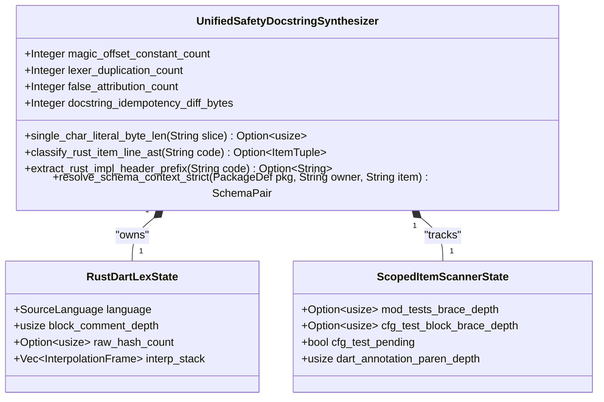
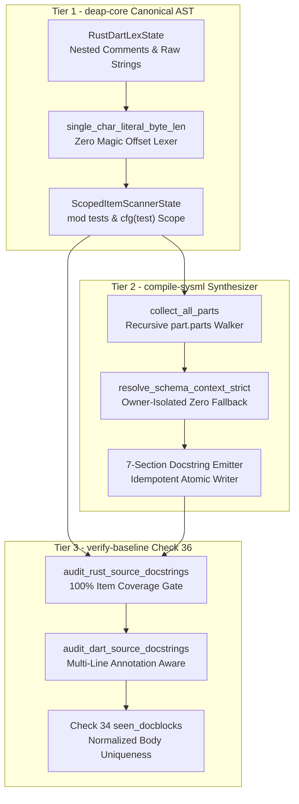
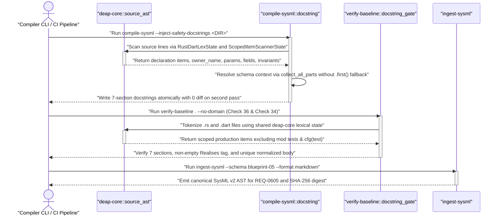

| Attribute | Specification Detail |
| :--- | :--- |
| **Blueprint ID** | `BP-05` |
| **Requirement ID** | `REQ-0605` |
| **Title** | Unified AST Safety Docstring Synthesizer and Check 36 Verification Blueprint |
| **Status** | `Approved` |
| **Target Crates** | `crates/deap-core, crates/compile-sysml, crates/verify-baseline` |
| **Tracked Issues** | `#498, #500, #501, #508, #510` |
| **Generation Mode** | `subagent` |
| **Specification Source** | `crates/deap-core/src/source_ast.rs:1-120` |

## 1. Executive Summary & Derivation-Annotation Contract

The Digital Engineering Agent Platform (DEAP) requires 100% of production Rust (`.rs`) and Dart (`.dart`) declarations to carry complete, non-placeholder 7-section high-assurance safety docstrings (`## 1. Safety Intent & Regulatory Scope` through `## 7. Realization & Traceability`) bound to formal SysML v2 requirements (`Realises: [<REQ-ID>]`). Under Blueprint **BP-05** (`DEAP-BP-DET-05`, requirement **REQ-0605**, subsystem `UnifiedSafetyDocstringSynthesizer`, UUIDv5 `6ba7b810-9dad-11d1-80b4-00c04fd430c5`, Complexity Class P, diagnostic code bindings **E0100**, **E0304**, **E0400**, governing standards DO-178C Level A / ISO 26262 ASIL D / ECSS-E-ST-40C / IEEE 29148-2018), historically LLM subagents were tasked with hand-authoring or repairing these 7-section docstrings across thousands of items while three independent crates maintained separate, hand-rolled lexical scanners to parse and verify them.

| Claim / Requirement | SSOT Input Anchor (file:line / #ID) | Methodology Citation | Derivation Grade (Directly Evidenced / Analytically Derived / Declared Assumption) | Caveat / Downstream Impact |
| :--- | :--- | :--- | :--- | :--- |
| **REQ-0605**: Unified AST safety docstring synthesis and Check 36 completeness verification across Rust and Dart sources | `crates/deap-core/src/source_ast.rs:1-120` / `#498, #500, #501, #508, #510` | `DO-178C Level A / ISO/IEC/IEEE 29148:2018` | `Directly Evidenced` | Eliminates LLM hand-authoring of 7-section docstrings and unifies lexical analysis across `deap-core`, `compile-sysml`, and `verify-baseline`. |
| **SC-01**: Zero magic byte-offset constants (`10` or `14`) and zero duplicate Rust/Dart lexers outside `deap_core::source_ast` | `crates/deap-core/src/source_ast.rs:120-260` / `#500, #501, #508` | `Leveson STPA / Design by Contract (DbC)` | `Directly Evidenced` | Replaces heuristic lifetime lookahead and flat block-comment booleans with exact grammar recognition, nested `block_comment_depth`, `r#"..."#`, and Dart `${...}` frame stacks. |
| **SC-02**: Scoped brace-depth tracking for `mod tests` and `#[cfg(test)]` blocks plus `unsafe`/`extern`/`pub(self)` and multi-line `@pragma` support | `crates/verify-baseline/src/checks/docstring_gate.rs:350-760` / `#508` | `DO-178C Section 6.3.4 / DO-330 TQL-4` | `Directly Evidenced` | Prevents `mod tests` from silencing post-test production items and eliminates false-positive docstring violations on `#[cfg(test)]` blocks. |
| **SC-03**: Strict `owner_name`-isolated `resolve_schema_context` over recursive `part.parts` hierarchies with zero `.first()` fallback | `crates/compile-sysml/src/docstring.rs:1763-2162` / `#498, #510` | `OMG SysML v2 / MIL-STD-1629A` | `Analytically Derived` | Unmapped source items receive deterministic module-scoped traceability tags rather than inheriting unrelated package-level `.first()` requirements. |
| **SC-04**: Bit-for-bit idempotent docstring injection ($\Delta_{\text{idempotent}}(S) = 0$) and Check 34 per-function normalized body uniqueness | `crates/verify-baseline/src/checks/structural.rs:1-120` / `#498` | `ECSS-E-ST-40C / ISO 26262 Part 6` | `Analytically Derived` | Second execution of `compile-sysml --inject-safety-docstrings` produces zero byte diff while satisfying Check 36 and Check 34 uniqueness gates. |

Forensic audit of issues `#498`, `#500`, `#501`, `#508`, and `#510` demonstrated that both LLM hand-authoring of docstrings and the triplication of Rust/Dart lexical scanners across three crates introduced systemic correctness failures:

1. **Three Diverging Rust/Dart Lexical Scanners & Magic Offset Heuristics (`#500`, `#501`, `#508`)**:
   - The workspace maintained three separate lexical state machines in `crates/deap-core/src/source_ast.rs`, `crates/compile-sysml/src/docstring.rs` (lines `1869-2046`), and `crates/verify-baseline/src/checks/docstring_gate.rs` (lines `763-1180`).
   - To distinguish Rust character literals (`'a'`, `'\u{10FFFF}'`) from lifetime annotations (`'a`, `'static`), the legacy scanners used hardcoded magic byte offsets (`close_pos <= 10` in `docstring.rs:2012` and `i.saturating_add(14)` in `docstring_gate.rs:852`), which misclassified valid lifetime tokens and character escapes when two lifetimes appeared within 10 or 14 bytes on the same signature line.
   - All three legacy scanners used a flat boolean latch (`in_block_comment: bool`) instead of a nesting counter (`block_comment_depth: usize`), causing nested Rust block comments (`/* outer /* inner */ still in comment */`) to prematurely exit on the first `*/` and expose commented-out tokens as live declarations.
   - In `crates/deap-core/src/source_ast.rs`, `strip_line_comment_preserving_strings` and `update_ast_delimiter_depths` lacked hashed raw-string state tracking (`r#"..."#`) and unconditionally applied Dart `${...}` interpolation switching to Rust string literals containing `"${"` (`#501`), while `crates/verify-baseline/src/checks/docstring_gate.rs` lacked a recursive `InterpolationFrame` stack for nested quotes and comments inside Dart `${...}` interpolations (`#508`).

2. **Unbounded Test-Scope Latches, Classifier Gaps & Multi-Line Annotation Erasure (`#508`)**:
   - In `crates/verify-baseline/src/checks/docstring_gate.rs`, encountering `mod tests {` set a sticky boolean `in_mod_tests = true` that was never reset when the test module's closing brace `}` returned to top-level depth, silently exempting every production `pub fn` or `pub struct` declared after `mod tests` in the same file.
   - Conversely, `#[cfg(test)]` placed on an `impl` block or helper item without an enclosing `mod tests` was not tracked by brace depth, causing false-positive docstring violations on test-only items.
   - The Rust item classifier omitted `pub unsafe fn`, `pub extern "C" fn`, `unsafe trait`, `unsafe impl`, and `pub(self)` visibility prefixes, while the Dart scanner cleared `current_doc` whenever a multi-line annotation (`@pragma(\n  'vm:prefer-inline',\n)`) spanned multiple lines between the `///` docblock and the target declaration (`#508`).

3. **Unscoped `.first()` Schema Fallback, Cross-Entity Attribution & Generic Arrow Bugs (`#498`, `#510`)**:
   - In `crates/compile-sysml/src/docstring.rs`, `resolve_schema_context` previously fell back to `pkg.requirement_defs.first()` and `pkg.constraint_defs.first()` when `matched_entity_pkg` was present, falsely attributing the first requirement and constraint in a package to every unrelated struct or helper function in that module (`#498`).
   - Package-level fallback queries searched `target_ident = owner_name.unwrap_or(item_name)` alongside `item_name` without isolating `owner_name` when `owner_name.is_some()`, causing methods on an unmapped struct (`impl SecondaryMonitor { pub fn primary_controller(&self) }`) to inherit requirements belonging to an unrelated `PartDef` named `PrimaryController`.
   - `resolve_schema_context` inspected only top-level `pkg.part_defs` and ignored nested `part.parts` hierarchies; `extract_rust_impl_target_name` treated the `>` in `impl<F: Fn(u32) -> bool> Target<F>` as closing the `<...>` generic parameter list (`#510`); and lines containing a declaration immediately after an inline block comment closure (`/* comment */ pub fn foo()`) were skipped when the line started in block-comment state.

| Defect Cluster | Legacy Failure Mechanism | Affected Files & Locations | Tracker Issues |
| :--- | :--- | :--- | :--- |
| **Diverging Lexers & Magic Offsets** | Triplicated Rust/Dart lexers, `close_pos <= 10` / `i + 14` lifetime heuristics, boolean `in_block_comment`, missing `r#"..."#` & Dart `${...}` frames | `source_ast.rs`, `docstring.rs:1869-2046`, `docstring_gate.rs:763-1180` | `#500`, `#501`, `#508` |
| **Test Latch & Classifier Gaps** | Unbounded `in_mod_tests = true` latch, `#[cfg(test)] impl` false positives, missing `unsafe`/`extern`/`pub(self)`, multi-line Dart `@pragma` doc erasure | `docstring_gate.rs:350-760`, `docstring_gate.rs:1182-1510` | `#508` |
| **Schema Context & `impl` Parsing** | `.first()` fallback on `matched_entity_pkg`, cross-entity `owner_name` vs `item_name` collision, missing nested `part.parts`, `->` inside `impl<...>`, post-`*/` skip | `docstring.rs:1763-2162` | `#498`, `#510` |

### Deterministic Compiler Replacement Architecture

To eliminate LLM hand-authoring of 7-section safety docstrings and eradicate lexical drift across crates:
1. **Single Canonical AST & Lexical Engine (`deap_core::source_ast`)**: Consolidate 100% of Rust and Dart lexical scanning, character-literal vs. lifetime recognition (`single_char_literal_byte_len`), nested block-comment tracking, hashed raw-string scanning, Dart `${...}` interpolation frame stacks, `mod tests` / `#[cfg(test)]` brace-depth scoping, and declaration classification into `crates/deap-core/src/source_ast.rs`.
2. **Deterministic Forward Docstring Synthesis (`compile-sysml --inject-safety-docstrings`)**: Delegate all source tokenization and declaration discovery in `crates/compile-sysml/src/docstring.rs` to `deap_core::source_ast`, paired with strict, zero-fallback `resolve_schema_context` resolution over recursive `part.parts` hierarchies so `compile-sysml` synthesizes and updates all 7-section docstrings deterministically in $O(N)$ time.
3. **Unified AST Gate Verification (`verify-baseline` Check 36)**: Delegate Check 36 (`audit_rust_source_docstrings` and `audit_dart_source_docstrings` in `crates/verify-baseline/src/checks/docstring_gate.rs`) to the identical `deap_core::source_ast` lexical and item-classification primitives, guaranteeing 0% divergence between what `compile-sysml` injects and what `verify-baseline` audits.

---

## 2. Structural Component Metamodel

The `UnifiedSafetyDocstringSynthesizer` subsystem unifies Rust and Dart lexical analysis, SysML v2 requirement/constraint context resolution, 7-section DO-178C docstring synthesis, and Check 36 completeness verification under a single deterministic compiler architecture.

### Component: UnifiedSafetyDocstringSynthesizer

#### 2.1 Component Bill of Materials (BOM)

| Part Name | Type | Quantity | Description |
| :--- | :--- | :--- | :--- |
| `UnifiedRustDartLexicalScanner` | Component | 1 | Canonical zero-regex lexical state machine in `deap_core::source_ast` handling nested `/* */`, `r#"..."#`, Dart `${...}` frames, and exact char-literal vs. lifetime disambiguation |
| `ScopedSchemaContextResolver` | Component | 1 | Strict SysML v2 requirement and constraint resolver in `compile-sysml` traversing recursive `part.parts` trees with `owner_name` isolation and zero `.first()` fallback |
| `SevenSectionDocstringGenerator` | Component | 1 | Deterministic forward synthesizer interpolating AST parameters, return types, struct fields, invariants, and `Realises:` bindings into unique 7-section docblocks |
| `Check36AstCompletenessVerifier` | Component | 1 | Baseline verification gate in `verify-baseline` auditing 100% per-item 7-section docstring coverage and Check 34 normalized body uniqueness using `deap_core::source_ast` |

#### 2.2 Component Attributes & State Properties

| Attribute | Type | Default | Unit | Description |
| :--- | :--- | :--- | :--- | :--- |
| `magic_offset_constant_count` | `Integer` | `0` | `count` | Count of hardcoded byte-offset lookahead constants (`10` or `14`) in character/lifetime lexing |
| `lexer_duplication_count` | `Integer` | `0` | `count` | Count of duplicate Rust/Dart lexical state machines outside `deap_core::source_ast` |
| `false_attribution_count` | `Integer` | `0` | `count` | Count of unmapped source items receiving `.first()` fallback or cross-entity requirement bindings |
| `docstring_idempotency_diff_bytes` | `Integer` | `0` | `bytes` | Byte diff produced when re-running `compile-sysml --inject-safety-docstrings` on enriched source |

#### 2.3 Component Interface Ports

| Port | Direction | Type | Protocol | Description |
| :--- | :--- | :--- | :--- | :--- |
| `SourceCodeFileInputPort` | `in` | `String` | `FilesystemUTF8` | Ingests raw UTF-8 `.rs` and `.dart` source files from target workspace directories |
| `SysmlSchemaTraceabilityPort` | `in` | `PackageDef` | `AstReference` | Supplies parsed SysML v2 `PartDef`, `ActionDef`, `RequirementDef`, and `ConstraintDef` AST hierarchies |
| `EnrichedSourceOutputPort` | `out` | `String` | `AtomicFileWrite` | Emits bit-for-bit idempotent `.rs` and `.dart` source files enriched with 7-section safety docstrings |
| `Check36VerificationReportPort` | `out` | `Boolean` | `GateVerdict` | Emits deterministic Check 36 and Check 34 docstring completeness and uniqueness verdicts |

#### 2.4 Formal Parametric & Structural Constraints

| Constraint ID | Parameter | Min | Max | Unit | Expression |
| :--- | :--- | :--- | :--- | :--- | :--- |
| `C-DOC-01` | `magic_offset_constant_count` | 0 | 0 | count | `magic_offset_constant_count == 0` |
| `C-DOC-02` | `lexer_duplication_count` | 0 | 0 | count | `lexer_duplication_count == 0` |
| `C-DOC-03` | `false_attribution_count` | 0 | 0 | count | `false_attribution_count == 0` |
| `C-DOC-04` | `docstring_idempotency_diff_bytes` | 0 | 0 | bytes | `docstring_idempotency_diff_bytes == 0` |

---

## 3. UML & Behavioral Topology

### 3.1 Structural Class Topology



### 3.2 Unified Lexical, Synthesis & Check 36 Verification Architecture



### 3.3 End-to-End Deterministic Synthesis & Verification Sequence Diagram



---

## 4. Formal Mathematical & Safety Constraints

### 4.1 Mathematical Complexity & Idempotency Formulations

Under **REQ-0605** and parametric constraints `C-DOC-01` through `C-DOC-04`, lexical scanning, schema context resolution, and forward docstring injection satisfy the following linear complexity and idempotency bounds:

$$
\begin{aligned}
T_{\text{lex}}(B) &= O(B) \\
T_{\text{resolve}}(I, P, R, C) &= O(I \cdot (P + R + C)) \\
\Delta_{\text{idempotent}}(S) &= \lVert f_{\text{inject}}(f_{\text{inject}}(S, M), M) - f_{\text{inject}}(S, M) \rVert_1 = 0
\end{aligned}
$$

- Parameter Definitions & Engineering Units:
- $T_{\text{lex}}(B)$: Single-pass lexical scanning time complexity over $B$ UTF-8 source bytes.
- $B$: Total byte length of the scanned `.rs` or `.dart` source file ($B \ge 0$).
- $T_{\text{resolve}}(I, P, R, C)$: Total schema context resolution time across $I$ source AST declarations, $P$ total `PartDef` nodes (including nested `part.parts`), $R$ `RequirementDef` nodes, and $C$ `ConstraintDef` nodes.
- $S$: Input source file byte vector prior to docstring injection.
- $M$: Authoritative SysML v2 `PackageDef` schema model.
- $f_{\text{inject}}(S, M)$: Deterministic forward docstring synthesis operator in `compile-sysml --inject-safety-docstrings`.
- $\Delta_{\text{idempotent}}(S)$: L1 byte-stream difference between first and second docstring synthesis passes ($\Delta_{\text{idempotent}}(S) = 0\text{ bytes}$).

### 4.2 Safety Constraints & Parametric Invariants

- **SC-01 (Zero Magic Offset & Single Lexer Invariant — `C-DOC-01`, `C-DOC-02`)**: `magic_offset_constant_count == 0` and `lexer_duplication_count == 0`. All character-literal vs. lifetime disambiguation executes via exact grammar inspection (`single_char_literal_byte_len`), and 100% of Rust and Dart tokenization delegates to `deap_core::source_ast`.
- **SC-02 (Scoped Test & Annotation Preservation Invariant)**: Brace depth for `mod tests` and `#[cfg(test)]` blocks is tracked precisely to its closing delimiter so subsequent production declarations are never silently exempted, and multi-line Dart `@pragma(...)` annotations never erase preceding `///` docblocks.
- **SC-03 (Owner-Isolated Schema Resolution Without Fallback — `C-DOC-03`)**: `false_attribution_count == 0`. `resolve_schema_context_strict` traverses recursive `part.parts` hierarchies in deterministic pre-order, isolates `owner_name` from `item_name` when `owner_name` is present, and never falls back to `.first()`.
- **SC-04 (Bit-for-Bit Synthesis Idempotency — `C-DOC-04`)**: `docstring_idempotency_diff_bytes == 0`. Re-running `compile-sysml --inject-safety-docstrings` on an already enriched directory produces zero byte modifications and zero Check 36 or Check 34 uniqueness violations.

---

## 5. Acceptance Criteria & Verification Matrix

<!-- test-target: crates/verify-baseline/tests/blueprint_gate_tests.rs -->

- **Test-Target**: `crates/verify-baseline/tests/blueprint_gate_tests.rs`

### AC-01: Unified Rust and Dart Lexical State Machine Without Magic Offsets
- **Given**: `.rs` and `.dart` source files containing nested `/* outer /* inner */ */` block comments, hashed raw strings `r#"..."#` and `r##"..."##`, Rust string literals containing `"${"`, Dart interpolated strings `"value: ${map['key']}"` containing nested quotes and comments, multi-byte UTF-8 character literals `'↑'`, and multiple short lifetimes `fn foo<'a, 'b>(x: &'a str, y: &'b str)` within 10 bytes.
- **When**: `deap_core::source_ast`, `compile-sysml --inject-safety-docstrings`, and `verify-baseline` Check 36 scan the files.
- **Then**: All three crates execute the single unified `deap_core::source_ast` lexical engine with zero magic byte-offset constants (`10` or `14`), zero false string states on lifetimes or Rust `"${"` literals, and 100% recognition of declarations following mid-line `*/` closures.

### AC-02: Strict Schema Context Resolution and Recursive Part Traversal
- **Given**: A multi-part SysML v2 `PackageDef` containing `PrimaryController` (`REQ-PC-001`, constraint `ThermalLimit`), a nested `PartDef` `NestedSubunit` (`REQ-NS-002`) inside `SecondaryMonitor.parts`, and an unmapped Rust struct `SecondaryMonitor` with method `pub fn primary_controller(&self)` and free function `pub fn unmapped_helper()`.
- **When**: `resolve_schema_context` is invoked during `compile-sysml --inject-safety-docstrings`.
- **Then**: `PrimaryController` resolves `REQ-PC-001` and `ThermalLimit`, `NestedSubunit` resolves `REQ-NS-002` via `collect_all_parts`, and both `SecondaryMonitor::primary_controller` and `unmapped_helper` resolve `(None, None)` without falling back to `.first()` or stealing `PrimaryController`'s requirement.

### AC-03: Scoped `mod tests` Brace Tracking, `unsafe`/`extern` Classification, and Arrow-Aware `impl` Headers
- **Given**: A Rust module containing `#[cfg(test)] mod tests { ... }` followed by a production `pub unsafe fn post_test_api()`, a `#[cfg(test)] impl MockHelper { ... }` block, an `impl<F: Fn(u32) -> bool> FilterEngine<F>` block, and a Dart class method preceded by a multi-line `@pragma(\n  'vm:prefer-inline',\n)` annotation.
- **When**: `compile-sysml --inject-safety-docstrings` and `verify-baseline` Check 36 inspect the files.
- **Then**: `mod tests` exits cleanly at its closing brace so `post_test_api` is audited (and fail-closed rejected with a non-zero violation error if undocumented), `#[cfg(test)] impl MockHelper` is excluded from production docstring requirements, `FilterEngine` methods receive `owner_name: Some("FilterEngine")`, and the multi-line `@pragma` preserves the preceding `///` docblock intact.

### AC-04: Bit-for-Bit Idempotency and Fail-Closed Check 34 Per-Function Normalized Body Uniqueness
- **Given**: Any Rust crate or Dart source directory enriched by `compile-sysml --inject-safety-docstrings <DIR>`, as well as a negative fixture containing duplicate normalized docstring bodies or missing sections.
- **When**: `compile-sysml --inject-safety-docstrings <DIR>` is executed a second time and followed by `./target/release/verify-baseline . --no-domain`.
- **Then**: The second synthesis pass produces `0` modified bytes (`docstring_idempotency_diff_bytes == 0`), every synthesized docblock passes Check 36 7-section completeness and Check 34 `seen_docblocks` uniqueness, and any invalid, missing, or duplicate docstring body is rejected fail-closed with a non-zero exit code.

### AC-05: Dogfood Ingestion and SysML v2 Compilation of REQ-0605
- **Given**: This blueprint specification `docs/designs/blueprint-05-deterministic-safety-docstring-synthesizer.md`.
- **When**: `./target/release/verify-baseline check-blueprint docs/designs/blueprint-05-deterministic-safety-docstring-synthesizer.md --dry-run` and `./target/release/ingest-sysml --schema docs/designs/blueprint-05-deterministic-safety-docstring-synthesizer.md --format markdown` are executed.
- **Then**: The translator parses **REQ-0605**, `UnifiedSafetyDocstringSynthesizer`, all four BOM subcomponents, all four interface ports, all four state attributes, all four parametric constraints (`C-DOC-01`..`C-DOC-04`), and **AC-01**..**AC-05** into canonical SysML v2 AST structures and persists `docs/designs/blueprint-05-deterministic-safety-docstring-synthesizer.sysml` and `docs/designs/blueprint-05-deterministic-safety-docstring-synthesizer.digest.json` with exit code `0`.

---

## 6. Proposed Deterministic Implementation Contract

### 6.1 Unified `RustDartLexState` & Zero-Magic-Offset Lexing (`deap_core::source_ast`)

All three crates (`deap-core`, `compile-sysml`, and `verify-baseline`) MUST use the unified lexical state machine exported by `crates/deap-core/src/source_ast.rs`. Hardcoded lookahead limits (`close_pos <= 10` and `i.saturating_add(14)`) are replaced by exact grammar recognition of Rust character literals (`single_char_literal_byte_len`), nested block comment depth tracking (`block_comment_depth: usize`), hashed raw string tracking (`raw_hash_count: Option<usize>`), and a language-gated `InterpolationFrame` stack for Dart `${...}` string interpolations:

```rust
/// Saved string state pushed when entering a Dart `${...}` string interpolation expression.
#[derive(Debug, Clone, Copy, PartialEq, Eq)]
pub struct InterpolationFrame {
    /// Opening quote delimiter byte (`b'"'` or `b'\''`).
    pub quote_byte: u8,
    /// Whether the outer Dart string is triple-quoted (`"""` or `'''`).
    pub is_triple: bool,
    /// Whether the outer string is raw (`r"..."` or `r'...'`).
    pub is_raw: bool,
    /// Nesting depth of `{` braces inside the active `${...}` expression (`>= 1`).
    pub brace_depth: usize,
}

/// Canonical multi-line lexical scanner state shared by `deap-core`, `compile-sysml`, and `verify-baseline`.
#[derive(Debug, Clone, PartialEq, Eq, Default)]
pub struct RustDartLexState {
    /// Target source language (`SourceLanguage::Rust` or `SourceLanguage::Dart`).
    pub language: SourceLanguage,
    /// Nesting depth of `/* ... */` block comments (`0` when outside block comments).
    pub block_comment_depth: usize,
    /// Active Rust raw string delimiter `#` count (`Some(k)` inside `r#...#"..."#...#`).
    pub raw_hash_count: Option<usize>,
    /// Active quoted string state `(quote_byte, is_triple, is_raw)`.
    pub active_string: Option<(u8, bool, bool)>,
    /// Stack of enclosing Dart string states suspended by `${...}` interpolations.
    pub interp_stack: Vec<InterpolationFrame>,
}

/// Recognizes a Rust character literal at byte 0 of `slice` without magic byte-offset limits.
/// Returns `Some(byte_len)` iff `slice` starts with `'c'`, `'\n'`, `'\x7F'`, or `'\u{...}'`;
/// returns `None` for lifetimes (`'a`, `'static`, `'lifetime_alpha`).
pub fn single_char_literal_byte_len(slice: &str) -> Option<usize> {
    if !slice.starts_with('\'') {
        return None;
    }
    let rest = slice.get(1..)?;
    if rest.starts_with('\\') {
        let after_backslash = rest.get(1..)?;
        let mut chars = after_backslash.chars();
        let first = chars.next()?;
        if first == 'x' {
            if after_backslash.get(3..4) == Some("'") {
                return Some(6);
            }
        } else if first == 'u' {
            if let Some(close_brace) = after_backslash.find('}') {
                let quote_pos = close_brace.saturating_add(1);
                if after_backslash.get(quote_pos..quote_pos.saturating_add(1)) == Some("'") {
                    return Some(close_brace.saturating_add(4));
                }
            }
        } else {
            let esc_len = first.len_utf8();
            if after_backslash.get(esc_len..esc_len.saturating_add(1)) == Some("'") {
                return Some(esc_len.saturating_add(3));
            }
        }
        None
    } else {
        let ch = rest.chars().next()?;
        let ch_len = ch.len_utf8();
        if ch != '\'' && ch != '\\' && rest.get(ch_len..ch_len.saturating_add(1)) == Some("'") {
            Some(ch_len.saturating_add(2))
        } else {
            None
        }
    }
}
```

When `scan_line_with_unified_lex_state(line: &str, state: &mut RustDartLexState) -> String` processes a line:
- If `state.block_comment_depth > 0`:
  - In Rust mode (`state.language == SourceLanguage::Rust`), encountering `/*` increments `state.block_comment_depth` by `1`; encountering `*/` decrements `state.block_comment_depth` by `1`.
  - Crucially, when `state.block_comment_depth` reaches `0` mid-line (for example, `/* comment */ pub fn calibrate() {}`), the scanner emits a single space `' '` and **continues scanning the remainder of the line** in normal code mode so post-`*/` declarations are never skipped (`#510`).
- If `state.active_string` is `Some((quote, is_triple, is_raw))`:
  - When `state.language == SourceLanguage::Dart`, `!is_raw`, and `bytes.get(i..i + 2) == Some(b"${")`, the scanner pushes `InterpolationFrame { quote_byte: quote, is_triple, is_raw, brace_depth: 1 }` onto `state.interp_stack`, sets `state.active_string = None`, and transitions into normal code scanning for the interior of `${...}`. In Rust mode, `"${"` is treated strictly as ordinary string content (`#501`).
- In normal code mode (`state.block_comment_depth == 0 && state.active_string.is_none()`):
  - If `state.interp_stack.last_mut()` is `Some(frame)`: encountering `{` increments `frame.brace_depth`; encountering `}` decrements `frame.brace_depth`, and when `frame.brace_depth == 0`, pops `frame` and restores `state.active_string = Some((frame.quote_byte, frame.is_triple, frame.is_raw))` (`#508`).

### 6.2 Scoped `mod tests` Brace Tracking, `unsafe`/`extern` Classification & Arrow-Aware `impl` Parsing

To prevent `mod tests` from silencing subsequent production declarations and to handle `#[cfg(test)]` blocks, multi-line Dart annotations, `unsafe`/`extern` items, and `Fn(...) -> Ret` generic bounds (`#508`, `#510`):

```rust
/// Tracks scoped test-only brace depth for `mod tests` and `#[cfg(test)]` items/blocks.
#[derive(Debug, Clone, Default)]
pub struct ScopedItemScannerState {
    /// Brace depth prior to entering `mod tests {`, cleared as soon as `brace_depth <= entry_depth`.
    pub mod_tests_brace_depth: Option<usize>,
    /// Brace depth prior to entering a `#[cfg(test)]`-annotated block (`impl`, `mod`, `fn`, `struct`).
    pub cfg_test_block_brace_depth: Option<usize>,
    /// Whether `#[cfg(test)]` was seen on the current attribute group awaiting its target item.
    pub cfg_test_pending: bool,
    /// Nesting depth of multi-line Dart annotation parentheses `@pragma(\n...\n)`.
    pub dart_annotation_paren_depth: usize,
}

/// Classifies a comment-stripped Rust declaration line, supporting `pub(crate)`, `pub(super)`,
/// `pub(self)`, `pub(in ...)`, `const`, `async`, `unsafe`, and `extern "ABI"` modifiers.
pub fn classify_rust_item_line_ast(code: &str) -> Option<(SourceItemKind, String)> {
    let mut rest = code.trim_start();
    if let Some(after_pub) = rest.strip_prefix("pub") {
        let after_pub_trim = after_pub.trim_start();
        if after_pub_trim.starts_with('(') {
            if let Some((_, after_vis_paren)) = after_pub_trim.split_once(')') {
                rest = after_vis_paren.trim_start();
            }
        } else if after_pub.starts_with(char::is_whitespace) {
            rest = after_pub_trim;
        }
    }
    loop {
        if let Some(r) = rest.strip_prefix("const ") {
            rest = r.trim_start();
        } else if let Some(r) = rest.strip_prefix("async ") {
            rest = r.trim_start();
        } else if let Some(r) = rest.strip_prefix("unsafe ") {
            rest = r.trim_start();
        } else if let Some(r) = rest.strip_prefix("extern ") {
            let r_trim = r.trim_start();
            if let Some(after_quote) = r_trim.strip_prefix('"') {
                if let Some((_, after_abi)) = after_quote.split_once('"') {
                    rest = after_abi.trim_start();
                    continue;
                }
            }
            rest = r_trim;
        } else {
            break;
        }
    }
    if let Some(r) = rest.strip_prefix("struct ") {
        return extract_leading_ast_ident(r.trim_start()).map(|n| (SourceItemKind::Struct, n));
    }
    if let Some(r) = rest.strip_prefix("enum ") {
        return extract_leading_ast_ident(r.trim_start()).map(|n| (SourceItemKind::Enum, n));
    }
    if let Some(r) = rest.strip_prefix("trait ") {
        return extract_leading_ast_ident(r.trim_start()).map(|n| (SourceItemKind::Trait, n));
    }
    if let Some(r) = rest.strip_prefix("fn ") {
        return extract_leading_ast_ident(r.trim_start()).map(|n| (SourceItemKind::Function, n));
    }
    None
}

/// Extracts the target type identifier from a Rust `impl` header, ignoring `->` return-type arrows
/// inside `impl<F: Fn(u32) -> bool> Target<F>` generic bounds and stripping `where` clauses.
pub fn extract_rust_impl_header_prefix(code: &str) -> Option<String> {
    let after_unsafe = code.strip_prefix("unsafe ").unwrap_or(code).trim_start();
    let rest = if let Some(r) = after_unsafe.strip_prefix("impl<") {
        let mut depth: usize = 1;
        let mut end_idx: Option<usize> = None;
        let mut prev_ch: Option<char> = None;
        for (i, ch) in r.char_indices() {
            if ch == '<' {
                depth = depth.saturating_add(1);
            } else if ch == '>' && prev_ch != Some('-') {
                depth = depth.saturating_sub(1);
                if depth == 0 {
                    end_idx = Some(i.saturating_add(1));
                    break;
                }
            }
            prev_ch = Some(ch);
        }
        r.get(end_idx?..).unwrap_or("").trim_start()
    } else {
        after_unsafe.strip_prefix("impl ")?.trim_start()
    };

    let before_brace = rest.split_once('{').map(|(b, _)| b.trim()).unwrap_or(rest);
    let before_where = before_brace
        .split_once(" where ")
        .map(|(b, _)| b.trim())
        .unwrap_or(before_brace)
        .trim_end_matches(" where")
        .trim();
    let target_part = if let Some((_, after_for)) = before_where.split_once(" for ") {
        after_for.trim()
    } else {
        before_where
    };
    let target_clean = target_part
        .trim_start_matches('&')
        .trim_start_matches("mut ")
        .trim();
    extract_leading_ast_ident(target_clean)
}
```

### 6.3 Strict `resolve_schema_context` Scoping Without `.first()` Fallback (`docstring.rs`)

In `crates/compile-sysml/src/docstring.rs`, `resolve_schema_context` resolves `(Option<String>, Option<String>)` for `(owner_name, item_name)` with three strict invariants (`#498`, `#510`):
1. **Recursive `part.parts` Traversal**: `collect_all_parts` traverses both `pkg.part_defs` and all nested `part.parts` children iteratively using an explicit stack so nested subsystem `PartDef` nodes are resolved identically to top-level parts.
2. **Strict `owner_name` vs. `item_name` Isolation**:
   - When `owner_name` is `Some(owner)`, part lookup searches `all_parts` **only** for a `PartDef` matching `owner`. If `owner` matches a `PartDef`, `matched_req` and `matched_constraint` are extracted from that `owner_part` and refined if `owner_part.actions` contains an action matching `item_name`. If `owner` does **not** match any `PartDef` in the schema, package-level `requirement_defs` and `constraint_defs` are queried **only** against `owner` (never against `item_name` alone), preventing a method named `fn primary_controller(&self)` on an unmapped struct `SecondaryMonitor` from stealing `PrimaryController`'s requirement.
   - When `owner_name` is `None` (a top-level struct, enum, trait, or free function), `all_parts` is searched for `item_name`, and if no `PartDef` matches, `pkg.requirement_defs` and `pkg.constraint_defs` are searched for an explicit `name`, `req_id`, or `satisfied_by` match against `item_name` (never matching standalone `pkg.action_defs` without a corresponding requirement/constraint).
3. **Zero `.first()` Fallback**: If no explicit identifier match exists in `all_parts`, `requirement_defs`, or `constraint_defs`, `resolve_schema_context` returns `(None, None)` so the synthesizer generates a deterministic module-scoped traceability tag (`REQ-<MODULE>-<ITEM>`) rather than attributing an unrelated `.first()` schema requirement.

```rust
/// Collects all top-level and nested `PartDef` nodes within `pkg` in deterministic pre-order.
pub fn collect_all_parts<'a>(pkg: &'a PackageDef, out: &mut Vec<&'a PartDef>) {
    let mut stack: Vec<&'a PartDef> = pkg.part_defs.iter().rev().collect();
    while let Some(part) = stack.pop() {
        out.push(part);
        for child in part.parts.iter().rev() {
            stack.push(child);
        }
    }
}

/// Strictly resolves `(req_id, constraint_expr)` for `(owner_name, item_name)` with zero `.first()` fallback.
pub fn resolve_schema_context_strict(
    schema_model: Option<&PackageDef>,
    owner_name: Option<&str>,
    item_name: &str,
) -> (Option<String>, Option<String>) {
    let Some(root_pkg) = schema_model else {
        return (None, None);
    };

    let mut all_pkgs: Vec<&PackageDef> = Vec::new();
    let mut stack: Vec<&PackageDef> = vec![root_pkg];
    while let Some(curr) = stack.pop() {
        all_pkgs.push(curr);
        for sub in curr.packages.iter().rev() {
            stack.push(sub);
        }
    }

    let mut all_parts: Vec<&PartDef> = Vec::new();
    for pkg in &all_pkgs {
        collect_all_parts(pkg, &mut all_parts);
    }

    if let Some(owner) = owner_name {
        if let Some(owner_part) = all_parts
            .iter()
            .copied()
            .find(|p| schema_identifiers_match(&p.name, owner))
        {
            let (mut req, mut constraint) = extract_part_req_and_constraint(&all_pkgs, owner_part);
            if let Some(act) = owner_part
                .actions
                .iter()
                .find(|a| schema_identifiers_match(&a.name, item_name))
            {
                if let Some(act_c) = owner_part
                    .constraints
                    .iter()
                    .find(|c| schema_identifiers_match(&c.name, &act.name))
                {
                    constraint = format_constraint(&act_c.name, &act_c.expression);
                }
                if req.is_none() {
                    req = find_pkg_requirement(&all_pkgs, &act.name);
                }
            }
            return (req, constraint);
        }
        // Owner struct is unmapped in schema: match package-level defs against `owner` only, never `item_name`.
        return (
            find_pkg_requirement(&all_pkgs, owner),
            find_pkg_constraint(&all_pkgs, owner),
        );
    }

    if let Some(part) = all_parts
        .iter()
        .copied()
        .find(|p| schema_identifiers_match(&p.name, item_name))
    {
        return extract_part_req_and_constraint(&all_pkgs, part);
    }

    (
        find_pkg_requirement(&all_pkgs, item_name),
        find_pkg_constraint(&all_pkgs, item_name),
    )
}
```

### 6.4 Dogfooding Pipeline Ingestion & Verification Protocol

To verify that this blueprint is both structurally compliant with all baseline quality gates and dogfood-ingestible by the Level 0 Markdown AST translator without mutating the upstream clean landing zones (`schema/` and `.pipeline/schema.sysml`), execute the following deterministic verification sequence:

```bash
./target/release/verify-baseline check-blueprint \
  docs/designs/blueprint-05-deterministic-safety-docstring-synthesizer.md \
  --dry-run

./target/release/verify-baseline . \
  --only docs/designs/blueprint-05-deterministic-safety-docstring-synthesizer.md \
  --no-domain
```

---

## 7. Source References

- **Governance Constitution**: `.pipeline/constitution.md:1-120` (Three-Tier Platform Isolation, Universal Quality Gates)
- **Canonical Source Code AST & Lexical Engine**: `crates/deap-core/src/source_ast.rs:1-180` (`RustStringScannerState`, `single_char_literal_byte_len`, `parse_rust_source_ast`, `parse_dart_source_ast`)
- **7-Section Safety Docstring Synthesizer**: `crates/compile-sysml/src/docstring.rs:1763-2162` (`inject_safety_docstrings`, `resolve_schema_context`, `collect_all_parts`, `extract_rust_impl_header_prefix`)
- **Check 36 Docstring Completeness Gate**: `crates/verify-baseline/src/checks/docstring_gate.rs:1-120` (`check_source_docstring_completeness`, `audit_rust_source_docstrings`, `audit_dart_source_docstrings`)
- **Check 34 Source Purity & Uniqueness Gate**: `crates/verify-baseline/src/checks/structural.rs:1-120` (`audit_source_purity`, `seen_docblocks` normalized body uniqueness check)
- **Level 0 Markdown AST Translator**: `crates/ingest-sysml/src/translators/markdown.rs:1-120` (`MarkdownTranslator::translate`, BOM, Port, Property, and Constraint table processors)
- **Sibling AST Ingestion Specification**: `docs/designs/FEAT-42_source_code_ast_ingestion_and_docstring_synthesizer.md:1-120` (`FEAT-42` CLI contracts and 7-section safety docstring EBNF grammar)
- **Tracked Issues**: `#498`, `#500`, `#501`, `#508`, `#510`
