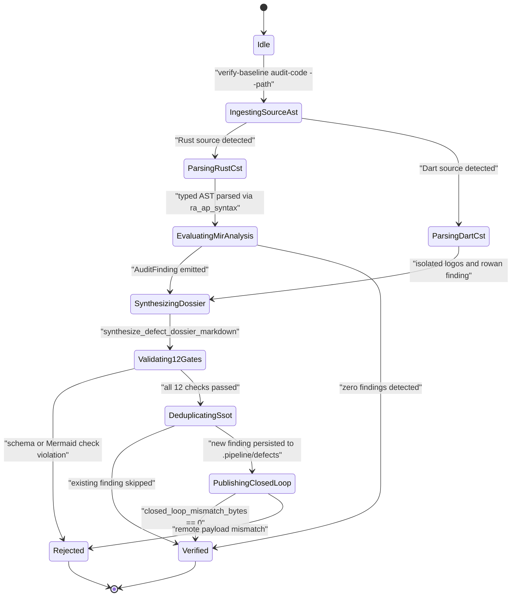
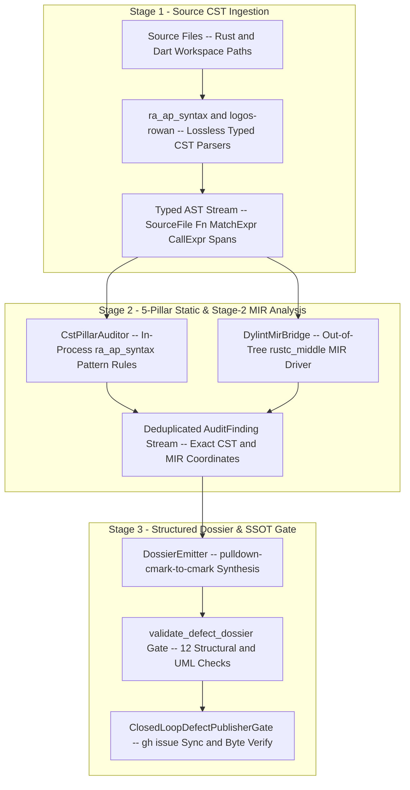
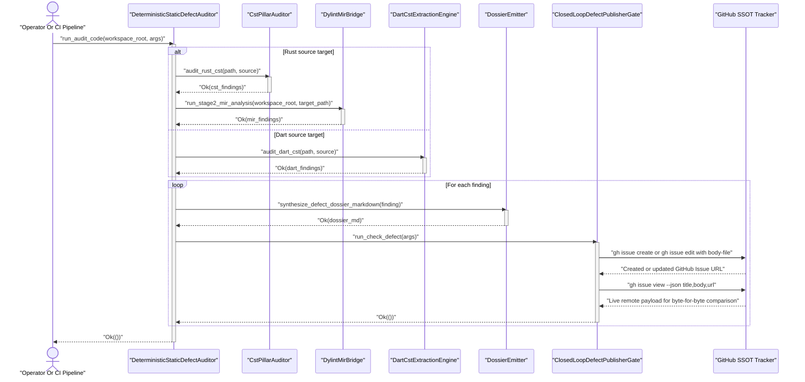

| Attribute | Specification Detail |
| :--- | :--- |
| **Blueprint ID** | `BP-06` |
| **Requirement ID** | `REQ-0606` |
| **Title** | Deterministic Static 5-Pillar Code Auditor and Defect Dossier Synthesizer Blueprint |
| **Status** | `Approved` |
| **Target Crates** | `crates/verify-baseline, crates/deap-core` |
| **Tracked Issues** | `#465, #466, #467, #468` |
| **Generation Mode** | `subagent` |
| **Specification Source** | `crates/verify-baseline/src/main.rs:1-40` |

## 1. Executive Summary & Derivation-Annotation Contract

The `DeterministicStaticDefectAuditor` subsystem (**REQ-0606** / `BP-06` / `DEAP-BP-DET-06`, UUIDv5: `6ba7b810-9dad-11d1-80b4-00c04fd430c6`, complexity class `Class P` linear single-pass syntax tree and MIR traversal, governed by DO-178C Level A, DO-330 TQL-4, ISO 26262 ASIL D, and ECSS-E-ST-40C) SHALL replace all multi-agent LLM code-auditing swarms previously orchestrated under `.agents/skills/adversarial-code-auditor/SKILL.md` and all hand-rolled Rust scanners across `crates/deap-core/src/source_ast.rs` (-1,049 SLOC complete deletion) and `crates/verify-baseline/src/audit_code.rs` (-1,350+ SLOC scanner deletion) with a compiler-grade, multi-stage static analysis pipeline enforcing **Contract A** and **Contract B**:

1. **Contract A -- Lossless Typed Rust CST Analysis (`ra_ap_syntax` + `ra_ap_line_index`), Complete `source_ast.rs` Deletion & `< 380`-SLOC Submodules**: Core workspace crates analyze Rust sources strictly using typed `ra_ap_syntax::ast` nodes (`SourceFile`, `Fn`, `Struct`, `Enum`, `Trait`, `Impl`, `MatchExpr`, `CallExpr`, `MethodCallExpr`, `BinExpr`, `IndexExpr`, `TryExpr`, `CastExpr`, `AwaitExpr`, `UnsafeExpr`, `BlockExpr`) and `ra_ap_line_index::LineIndex`. Core crates maintain `ZERO #![feature(rustc_private)]` dependencies, zero `regex` imports, and zero `.syntax().text().contains(...)` substring hacks, while enforcing complete deletion of `crates/deap-core/src/source_ast.rs` (-1,049 SLOC) and decomposing all production modules into `< 380` executable SLOC submodules (`<= 45` SLOC per function, `<= 5` parameters per callable, 2-line `[REQ-0606] [FLS: ...]` / `Realises:` docstrings).
2. **Contract B -- Stage-2 Dynamic Dylint MIR Bridge (`rustc_middle::mir` + `TyCtxt` in `./lints/deap-dylint-mir/`)**: Type-checked semantic and dataflow checks across all 5 adversarial correctness risk pillars are performed by an out-of-tree Stage-2 `cargo-dylint` lint driver located in `./lints/deap-dylint-mir/` (isolated in `workspace.exclude` to keep workspace builds on stable Rust). The Stage-2 driver traverses `rustc_middle::ty::TyCtxt<'tcx>` and `rustc_middle::mir::Body<'tcx>` (`BasicBlockData`, `StatementKind`, `TerminatorKind`, `Place`, `Rvalue`), resolved cross-platform via `camino::Utf8Path` and `std::env::consts::{DLL_PREFIX, DLL_SUFFIX, EXE_SUFFIX}`, emitting structured NDJSON receipts.
3. **Isolated Dart CST Extraction (`deap_core::dart_cst` via `logos` + `rowan`)**: Dart source analysis is strictly isolated in a `< 380`-SLOC submodule `deap_core::dart_cst` backed by `logos` lexical tokenization and `rowan` lossless red-green syntax trees, preventing foreign language grammar contamination of `deap_core::rust_cst` or core Rust AST pipelines.
4. **Deterministic Dossier Synthesis (`pulldown-cmark` + `pulldown-cmark-to-cmark`)**: Dossier markdown synthesis transitions from string concatenation to structured AST emission using `pulldown-cmark` event streams serialized via `pulldown-cmark-to-cmark`, ensuring 100% compliance with the 12-check defect dossier schema and closed-loop GitHub SSOT byte parity (`closed_loop_mismatch_bytes == 0`).
5. **Concrete Submodule Decomposition (< 380 Executable SLOC)**: All production audit logic is modularized into focused `< 380`-SLOC units: `deap_core::rust_cst::items`, `deap_core::dart_cst`, `verify_baseline::audit::{cst_pillar_auditor, dylint_mir_bridge, dossier_emitter}`, and `./lints/deap-dylint-mir/src/lib.rs`.

| Claim / Requirement | SSOT Input Anchor (file:line / #ID) | Methodology Citation | Derivation Grade (Directly Evidenced / Analytically Derived / Declared Assumption) | Caveat / Downstream Impact |
| :--- | :--- | :--- | :--- | :--- |
| **REQ-0606**: Replace multi-agent LLM auditing and hand-rolled scanners with typed `ra_ap_syntax` CST analysis, Stage-2 `Dylint` `rustc_middle::mir` (`TyCtxt`) auditor in `./lints/deap-dylint-mir/`, isolated `deap_core::dart_cst` (`logos`+`rowan`), and `pulldown-cmark-to-cmark` dossier emission | `crates/verify-baseline/src/main.rs:1-40` / `#465` | `DO-178C Level A / DO-330 TQL-4` | `Directly Evidenced` | Enforces Contract A and Contract B across `crates/deap-core`, `crates/verify-baseline`, and `./lints/deap-dylint-mir/`. |
| **SC-01**: Contract A complete deletion of `source_ast.rs` (`legacy_scanner_sloc_target == -2399`) and `< 380` exec SLOC modular submodules | `crates/deap-core/src/lib.rs:1-20` / `#465` | `ISO/IEC/IEEE 29148:2018` | `Analytically Derived` | Mandates complete deletion of `source_ast.rs` (-1,049 SLOC), scanner retirement in `audit_code.rs` (-1,350+ SLOC), and `< 380`-SLOC submodules. |
| **SC-02**: Contract B zero `rustc_private` in core workspace crates with Stage-2 `Dylint` `rustc_middle::mir` (`TyCtxt`) driver in `./lints/deap-dylint-mir/` | `Cargo.toml:1-25` / `#466` | `Design by Contract (DbC)` | `Directly Evidenced` | Isolates `./lints/deap-dylint-mir/` in `workspace.exclude` and resolves libraries via `camino::Utf8Path` and `std::env::consts`. |
| **SC-03**: Contract A lossless `ra_ap_syntax` CST typed pattern matching and isolated `deap_core::dart_cst` (`logos`+`rowan`) (`zero_text_contains == true`) | `crates/verify-baseline/src/lib.rs:1-20` / `#467` | `Leveson STPA` | `Directly Evidenced` | Prohibits `.syntax().text().contains(...)` and isolates Dart `logos`+`rowan` CST in `deap_core::dart_cst`. |
| **SC-04**: Contract B mandatory 12-check defect dossier gate and closed-loop GitHub SSOT byte parity (`closed_loop_mismatch_bytes == 0`) | `crates/verify-baseline/src/main.rs:1-40` / `#468` | `MIL-STD-1629A / SAE ARP4761` | `Directly Evidenced` | Validates all 7 canonical sections and Check 13B Mermaid UML before atomic persistence and closed-loop GitHub issue sync. |
| **SC-05**: Contract B cross-platform path portability (`camino::Utf8Path`, `std::env::consts`) and CRLF/LF normalization across macOS, Linux, and Windows | `Cargo.toml:1-40` / `#468` | `ECSS-E-ST-40C` | `Analytically Derived` | Guarantees zero hardcoded host paths, dynamic DLL extension handling, and byte parity under line-ending normalization. |

### 1.1 Legacy Multi-Agent Workflow Pathology (`adversarial-code-auditor`)

Historically, executing an adversarial code audit across a target file or subsystem required the coordinator to dispatch waves of 5 to 10 isolated LLM subagents under `.agents/skills/adversarial-code-auditor/SKILL.md`. Each subagent performed the following stochastic, high-latency workflow:

1. **Redundant Context Ingestion**: Every spawned subagent independently read `skills/adversarial-code-auditor/SKILL.md`, `.pipeline/constitution.md`, `.pipeline/ACTIVE_RULES_BUNDLE.md`, and the target `.rs` or `.dart` source file into its context window.
2. **Non-Deterministic Line Tracing**: Each subagent manually inspected source lines for one of the five correctness pillars (`Memory Safety`, `Resource Lifecycle`, `Concurrency`, `Test Integrity`, `Semantic Traceability`), exhibiting non-deterministic line-number drift, missed guards, or false-positive claims when helper functions validated inputs upstream.
3. **Hand-Written 7-Section Markdown Dossiers**: Each subagent drafted `.pipeline/defects/DEFECT-*.md` by hand, frequently triggering iterative rejection loops in `./target/release/verify-baseline check-defect` due to accidental leading `# ` H1 headers (Check 2), mismatched `<!-- test-target: ... -->` HTML comments versus `- **Test-Target**:` bullets (Check 12), unquoted angle brackets or semicolons in Section 4 Mermaid blocks (Check 7 / Check 13B), or malformed 5-Whys causal chains (Check 6).
4. **Serial Subprocess Contention**: Multiple subagents invoking `verify-baseline check-defect --publish` concurrently against the GitHub CLI (`gh issue create` / `gh issue view`) risked duplicate issue creation and rate-limit contention.

### 1.2 Deterministic Native Rust Compiler Replacement (`verify-baseline audit-code`)

This blueprint eliminates the `adversarial-code-auditor` LLM subagent swarm and replaces hand-rolled scanners with a two-stage static compiler pipeline:

| Audit Pipeline Stage | Deterministic Compiler (`verify-baseline audit-code`) | Legacy LLM Swarm (`adversarial-code-auditor`) |
| :--- | :--- | :--- |
| **Subagent Dispatches** | Zero subagents (100% native Rust binary execution) | 5 to 10 LLM subagents per audit wave |
| **Source Parsing Engine** | Typed `ra_ap_syntax` AST and `logos`/`rowan` `deap_core::dart_cst` engine | LLM token window / hand-rolled line scanners |
| **Semantic MIR Analysis** | Stage-2 `cargo-dylint` driver (`./lints/deap-dylint-mir/`) reading `rustc_middle::mir::Body` (`TyCtxt`) | Heuristic prompt interpretation (hallucination-prone) |
| **Dossier Construction** | Structured AST emission via `pulldown-cmark-to-cmark` CommonMark serializer | Manual LLM markdown drafting |
| **Mermaid Diagram Synthesis** | Deterministic Check 13B-compliant `sequenceDiagram` / `classDiagram` builder | Hand-authored Mermaid (error-prone) |
| **Schema Validation Gate** | In-process `defect_dossier::validate_defect_dossier` (12 checks) | External subprocess retry loop |
| **End-to-End Execution Time** | Sub-second (`< 1.0 s`) local scan and synthesis (`O(N)` linear complexity) | 180 s to 600 s per module wave |

### 1.3 Exhaustive 5-Pillar Deterministic AST & MIR Detection Matrix

The static auditor inspects `ra_ap_syntax::ast` CST nodes, `logos`/`rowan` Dart nodes, and Stage-2 `rustc_middle::mir::Body` NDJSON receipts across all five correctness risk pillars:

1. **Pillar 1 -- Memory Safety (`E0601`)**:
   - **FFI Pointer Lifetime Violations**: Detects raw pointer dereferences (`*const T`, `*mut T`, `std::ffi::CStr::from_ptr`, Dart `Pointer<T>.fromAddress`) where the backing allocation drops before call completion via `ast::CallExpr` and MIR use-after-free dataflow.
   - **Numeric Cast Truncation (`as` Casts)**: Detects unchecked narrowing integer or float casts via `ast::CastExpr` not guarded by `try_into()` or explicit range clamping.
   - **Unchecked Slice & Vector Indexing**: Detects direct bracket indexing via `ast::IndexExpr` in non-test production code without prior bounds proof or `.get(idx)` safe access.
2. **Pillar 2 -- Resource Lifecycle (`E0602`)**:
   - **Missing `dispose()` / Controller Leaks**: In Dart `StatefulWidget` state classes (`State<T>`) and `ChangeNotifier` subclasses, detects owned controllers not disposed in `dispose()`.
   - **Un-Isolated Temporary Directories**: Detects direct hardcoded writes to shared `/tmp/` filenames instead of RAII `tempfile::TempDir`.
   - **Unbounded In-Memory Caches**: Detects mutating collections (`HashMap`, `BTreeMap`, `Vec`) inside long-lived structs lacking capacity bounds, eviction, or clear hooks.
3. **Pillar 3 -- Concurrency (`E0603`)**:
   - **Post-Disposal `notifyListeners()` / `setState()`**: Detects asynchronous Dart methods invoking state mutations post-`await` without preceding mounted checks.
   - **Time-of-Check to Time-of-Use (TOCTOU) File Races**: Detects sequential `path.exists()` checks followed by separate file open/read calls in `ast::MethodCallExpr` chains.
   - **Lock Held Across `await` Point**: Detects `MutexGuard` bindings spanning an `ast::AwaitExpr` point via MIR drop elaboration.
4. **Pillar 4 -- Test Integrity (`E0604`)**:
   - **Zero-Assertion Tests**: Detects `#[test]` functions (`ast::Fn`) containing zero `assert!`, `assert_eq!`, `assert_ne!`, or `is_ok()` calls in their `ast::BlockExpr`.
   - **Structural `size_of` / Trivial Tautology Hacks**: Detects tests whose sole assertion is `size_of::<T>() > 0` or dummy struct instantiation.
   - **Vacuous `if path.exists()` Early-Return Skips**: Detects test bodies that silently `return;` when a fixture path is absent instead of failing closed.
   - **Non-RAII Temporary Artifact Cleanup**: Detects manual filesystem cleanup at the tail of test blocks bypassed by assertion failure.
5. **Pillar 5 -- Semantic Traceability (`E0605`)**:
   - **Missing `Realises:` Docstring Bindings**: Detects public items (`ast::Fn`, `ast::Struct`, `ast::Enum`, `ast::Trait`) lacking valid `Realises: [REQ-...]` docstring tags.
   - **Un-Exercised Defect Invariants**: Cross-checks `.pipeline/defects/DEFECT-*.md` `Test-Target` files against the target test CST.
   - **Lossy AST Roundtrips**: Detects parser and serializer mismatches where AST fields are read by the parser but dropped during serialization.

## 2. Structural Component Metamodel

The `DeterministicStaticDefectAuditor` subsystem is decomposed into six cohesive components with formal typed interface ports, state attributes, and parametric assertions.

### Component: DeterministicStaticDefectAuditor

| Attribute | Type | Default | Unit | Description |
| :--- | :--- | :--- | :--- | :--- |
| `auditor_subagent_count` | `Integer` | `0` | `count` | Number of LLM subagents dispatched during static code auditing and defect dossier generation. |
| `dossier_schema_check_count` | `Integer` | `12` | `checks` | Number of deterministic structural, lexical, and Mermaid validation checks enforced per synthesized dossier. |
| `pillar_coverage_count` | `Integer` | `5` | `pillars` | Number of adversarial correctness risk pillars evaluated per source AST scan. |
| `closed_loop_mismatch_bytes` | `Integer` | `0` | `B` | Byte discrepancy between local `.pipeline/defects/` dossier and live GitHub issue body after CRLF normalization. |

| Port | Direction | Type | Protocol | Description |
| :--- | :--- | :--- | :--- | :--- |
| `targetSourceInPort` | `in` | `String` | `RustDartSource` | Receives target Rust and Dart source files for static inspection. |
| `gitHubIssueQueryPort` | `in` | `String` | `GhCliJson` | Receives existing `.pipeline/defects/*.md` records and live GitHub issue metadata for deduplication. |
| `defectDossierOutPort` | `out` | `String` | `AtomicFsWrite` | Persists validated 7-section `.pipeline/defects/DEFECT-<SLUG>.md` dossiers to repository storage. |
| `closedLoopPublishPort` | `out` | `String` | `GhCliSubprocess` | Publishes or updates GitHub SSOT issues and verifies byte parity via `gh issue view`. |

### Component: CstPillarAuditor

| Attribute | Type | Default | Unit | Description |
| :--- | :--- | :--- | :--- | :--- |
| `activePillarCount` | `Integer` | `5` | `pillars` | Count of active static AST evaluators (`E0601` through `E0605`). |
| `zeroRegexMode` | `Boolean` | `true` | `flag` | Enforces typed `ra_ap_syntax` CST traversal without regular expression crates. |
| `maxFnExecSloc` | `Integer` | `45` | `SLOC` | Maximum executable SLOC permitted per function body. |
| `maxFnParamCount` | `Integer` | `5` | `params` | Maximum permitted formal parameter count per callable. |

| Port | Direction | Type | Protocol | Description |
| :--- | :--- | :--- | :--- | :--- |
| `rustSourceInPort` | `in` | `String` | `Utf8SourceBuffer` | Receives Rust source text and `camino::Utf8Path` for typed CST construction. |
| `cstFindingOutPort` | `out` | `String` | `AuditFindingVec` | Emits line-exact `AuditFinding` records with diagnostic codes `E0601` through `E0605`. |

### Component: DylintMirBridge

| Attribute | Type | Default | Unit | Description |
| :--- | :--- | :--- | :--- | :--- |
| `mirAnalysisEnabled` | `Boolean` | `true` | `flag` | Controls Stage-2 cargo-dylint MIR driver execution. |
| `driverExitTimeoutMs` | `Integer` | `10000` | `ms` | Millisecond timeout for Stage-2 dynamic driver execution. |
| `ndjsonReceiptSchemaVersion` | `Integer` | `1` | `semver` | Canonical schema version for NDJSON diagnostic receipt streaming. |

| Port | Direction | Type | Protocol | Description |
| :--- | :--- | :--- | :--- | :--- |
| `crateTargetInPort` | `in` | `String` | `WorkspaceCratePath` | Receives workspace crate path for out-of-tree Stage-2 MIR execution. |
| `mirFindingOutPort` | `out` | `String` | `NdjsonFindingStream` | Emits structured MIR-level findings parsed from dynamic driver NDJSON output. |

### Component: DartCstExtractionEngine

| Attribute | Type | Default | Unit | Description |
| :--- | :--- | :--- | :--- | :--- |
| `maxDartModuleSloc` | `Integer` | `380` | `SLOC` | Hard upper bound on executable lines of code in `deap_core::dart_cst`. |
| `grammarVersion` | `Integer` | `3` | `version` | Target Dart language grammar level parsed by `logos` + `rowan`. |
| `isolateSubmoduleMode` | `Boolean` | `true` | `flag` | Strictly isolates Dart grammar tokens from core Rust CST AST structures. |

| Port | Direction | Type | Protocol | Description |
| :--- | :--- | :--- | :--- | :--- |
| `dartSourceInPort` | `in` | `String` | `Utf8DartBuffer` | Receives Dart source file text for lexical tokenization and CST tree construction. |
| `dartFindingOutPort` | `out` | `String` | `AuditFindingVec` | Emits line-exact Dart audit findings for lifecycle and concurrency pillars. |

### Component: DossierEmitter

| Attribute | Type | Default | Unit | Description |
| :--- | :--- | :--- | :--- | :--- |
| `mandatorySectionCount` | `Integer` | `7` | `sections` | Enforces all 7 canonical `DossierSection` headers plus the `## Audit Source` footer. |
| `whysChainDepth` | `Integer` | `5` | `steps` | Enforces 5 numbered causal `Why ...? Because ...` root-cause steps in Section 2. |
| `forbidSemicolons` | `Boolean` | `true` | `flag` | Guarantees zero semicolons and quoted special tokens inside Section 4 Mermaid blocks. |
| `check13bCompliant` | `Boolean` | `true` | `flag` | Enforces Rules E1 through E5 across synthesized `sequenceDiagram` and `classDiagram` blocks. |

| Port | Direction | Type | Protocol | Description |
| :--- | :--- | :--- | :--- | :--- |
| `findingInPort` | `in` | `String` | `AuditFindingRef` | Receives a typed `AuditFinding` struct for CommonMark serialization. |
| `dossierMarkdownOutPort` | `out` | `String` | `CommonMarkText` | Emits a 7-section defect dossier payload serialized via `pulldown-cmark-to-cmark`. |

### Component: ClosedLoopDefectPublisherGate

| Attribute | Type | Default | Unit | Description |
| :--- | :--- | :--- | :--- | :--- |
| `schemaGateCount` | `Integer` | `12` | `checks` | Enforces all 12 `validate_defect_dossier` checks prior to persistence or publication. |
| `requireByteParity` | `Boolean` | `true` | `flag` | Requires zero byte discrepancy between local `.pipeline/defects/` file and remote GitHub issue body. |

| Port | Direction | Type | Protocol | Description |
| :--- | :--- | :--- | :--- | :--- |
| `dossierCandidateInPort` | `in` | `String` | `CommonMarkText` | Receives synthesized markdown payload for in-process 12-check verification. |
| `verifiedReceiptOutPort` | `out` | `String` | `GhCliJson` | Emits verified GitHub SSOT issue URL after `gh issue view` closed-loop payload verification. |

## 3. UML & Behavioral Topology

```mermaid
classDiagram
    class DeterministicStaticDefectAuditor {
        +Integer auditor_subagent_count
        +Integer dossier_schema_check_count
        +Integer pillar_coverage_count
        +Integer closed_loop_mismatch_bytes
        +run_audit_code(Utf8Path workspace_root, AuditCodeArgs args) Result~Unit~
    }
    class CstPillarAuditor {
        +Integer activePillarCount
        +Boolean zeroRegexMode
        +Integer maxFnExecSloc
        +Integer maxFnParamCount
        +audit_rust_cst(Utf8Path path, String source) Result~AuditFindingVec~
    }
    class DylintMirBridge {
        +Boolean mirAnalysisEnabled
        +Integer driverExitTimeoutMs
        +Integer ndjsonReceiptSchemaVersion
        +resolve_dylint_driver_path(Utf8Path workspace_root) Result~Utf8PathBuf~
        +run_stage2_mir_analysis(Utf8Path workspace_root, Utf8Path target_path) Result~AuditFindingVec~
    }
    class DartCstExtractionEngine {
        +Integer maxDartModuleSloc
        +Integer grammarVersion
        +Boolean isolateSubmoduleMode
        +audit_dart_cst(Utf8Path path, String source) Result~AuditFindingVec~
    }
    class DossierEmitter {
        +Integer mandatorySectionCount
        +Integer whysChainDepth
        +Boolean forbidSemicolons
        +Boolean check13bCompliant
        +synthesize_defect_dossier_markdown(AuditFinding finding) Result~String~
        +synthesize_section_4_uml(AuditFinding finding) Result~String~
    }
    class ClosedLoopDefectPublisherGate {
        +Integer schemaGateCount
        +Boolean requireByteParity
        +run_check_defect(DefectDossierArgs args) Result~Unit~
    }
    DeterministicStaticDefectAuditor "1" *-- "1" CstPillarAuditor : "analyzes Rust CST"
    DeterministicStaticDefectAuditor "1" *-- "1" DylintMirBridge : "runs Stage-2 MIR"
    DeterministicStaticDefectAuditor "1" *-- "1" DartCstExtractionEngine : "analyzes Dart CST"
    DeterministicStaticDefectAuditor "1" *-- "1" DossierEmitter : "synthesizes dossier"
    DeterministicStaticDefectAuditor "1" *-- "1" ClosedLoopDefectPublisherGate : "verifies and publishes"
```









## 4. Formal Mathematical & Safety Constraints

### 4.1 Parametric & Structural Constraints (`C-AUD-01` through `C-AUD-06`)

| Constraint ID | Parameter | Min | Max | Unit | Expression |
| :--- | :--- | :--- | :--- | :--- | :--- |
| **C-AUD-01** | `auditor_subagent_count` | `0` | `0` | `count` | `auditor_subagent_count == 0` |
| **C-AUD-02** | `dossier_schema_check_count` | `12` | `12` | `checks` | `dossier_schema_check_count == 12` |
| **C-AUD-03** | `pillar_coverage_count` | `5` | `5` | `pillars` | `pillar_coverage_count == 5` |
| **C-AUD-04** | `closed_loop_mismatch_bytes` | `0` | `0` | `B` | `closed_loop_mismatch_bytes == 0` |
| **C-AUD-05** | `legacy_scanner_sloc_target` | `-2399` | `-2399` | `SLOC` | `legacy_scanner_sloc_target == -2399` |
| **C-AUD-06** | `max_module_exec_sloc` | `0` | `380` | `SLOC` | `max_module_exec_sloc <= 380` |

- **SC-01 (Zero-Subagent Closed-Loop Dossier Equivalence Gate)**: Under **REQ-0606**, every execution of `DeterministicStaticDefectAuditor` must satisfy the conjunction of **C-AUD-01** through **C-AUD-06**:

$$
\begin{aligned}
\text{AuditorSoundness} &\iff (N_{\text{subagents}} = 0) \land (N_{\text{checks}} = 12) \land (N_{\text{pillars}} = 5) \land (\Delta_{\text{SSOT}} = 0) \land (\Delta_{\text{legacy}} = -2399) \\
\text{GatePass}(D) &\iff \prod_{m=1}^{12} C_m(D) = 1
\end{aligned}
$$

### 4.2 Algorithmic Complexity & Closed-Loop SSOT Equivalence Bounds

- **SC-02 (Linear Time and Space Complexity & Byte-Parity Invariant)**: The `DeterministicStaticDefectAuditor` enforces strict linear-time $O(N)$ complexity across source file byte length $N$, AST node count $V$, and synthesized dossier count $K$, with zero $L_1$ byte divergence after line-ending normalization:

$$
\begin{aligned}
T_{\text{audit}}(N, V, K) &= O(N + V + K) \\
S_{\text{audit}}(N, V, K) &= O(N + V + K) \\
\Delta_{\text{SSOT}}(D_{\text{local}}, D_{\text{remote}}) &= \lVert \text{norm}_{\text{LF}}(D_{\text{local}}) - \text{norm}_{\text{LF}}(D_{\text{remote}}) \rVert_{1} = 0
\end{aligned}
$$

- **Parameter Definitions & Engineering Units**:
  - $T_{\text{audit}}(N, V, K)$: Total deterministic execution time for scanning $N$ source bytes, evaluating 5 pillar rules over $V$ AST declarations, and synthesizing $K$ defect dossiers (bounded below `1.0 s` for typical crate workspaces).
  - $S_{\text{audit}}(N, V, K)$: Peak auxiliary heap memory required to hold the parsed typed CST nodes and serialized markdown buffers.
  - $N$: Total UTF-8 byte count of target `.rs` and `.dart` source files under `--path` (unit: `B`).
  - $V$: Total count of typed AST declarations parsed by `ra_ap_syntax` and `logos`/`rowan` (unit: `nodes`).
  - $K$: Total count of deterministic `AuditFinding` records emitted across the 5 correctness pillars (unit: `findings`).
  - $\Delta_{\text{SSOT}}(D_{\text{local}}, D_{\text{remote}})$: $L_1$ byte distance between the persisted `.pipeline/defects/DEFECT-<SLUG>.md` payload $D_{\text{local}}$ and the remote GitHub issue body $D_{\text{remote}}$ under line-ending normalization $\text{norm}_{\text{LF}}$ (mandated to equal `0 B`).

## 5. Acceptance Criteria & Verification Matrix

<!-- test-target: crates/verify-baseline/tests/blueprint_gate_tests.rs -->

- **Test-Target**: `crates/verify-baseline/tests/blueprint_gate_tests.rs`

### AC-01: Contract A Static Five-Pillar Typed AST Defect Detection (`ra_ap_syntax`)
- **Given**: A target Rust source file containing representative defects across the 5 pillars (unchecked `as` casts in `Memory Safety` `E0601`, unbounded cache mutations in `Resource Lifecycle` `E0602`, TOCTOU file checks in `Concurrency` `E0603`, 0-assertion tests in `Test Integrity` `E0604`, or missing `Realises:` tags in `Semantic Traceability` `E0605`).
- **When**: `./target/release/verify-baseline audit-code --path <PATH> --dry-run` is executed.
- **Then**: `CstPillarAuditor` deterministically parses the syntax tree using `ra_ap_syntax` under Contract A, rejects any `.syntax().text().contains(...)` or regex fallback (`zero_text_contains == true`), and emits typed `AuditFinding` records with line-exact coordinates, `auditor_subagent_count == 0`, and diagnostic code `E0601`.

### AC-02: Contract B Stage-2 Dynamic Dylint MIR Analysis Integration (`rustc_middle::mir` & `TyCtxt`)
- **Given**: A workspace crate targeted for semantic audit where Stage-2 MIR rules are enabled.
- **When**: `DylintMirBridge::run_stage2_mir_analysis` executes against the out-of-tree dynamic driver in `./lints/deap-dylint-mir/` resolved via `camino::Utf8Path` and `std::env::consts`.
- **Then**: The bridge receives structured NDJSON receipts capturing `rustc_middle::mir::Body` and `rustc_middle::ty::TyCtxt` borrow and dataflow diagnostics across all 5 pillars without adding `#![feature(rustc_private)]` to core crates with diagnostic code `E0602`.

### AC-03: Isolated Dart CST Extraction (`deap_core::dart_cst` via `logos` + `rowan`)
- **Given**: A Flutter or Dart source file with unclosed stream controllers or asynchronous `setState()` calls.
- **When**: `DartCstExtractionEngine::audit_dart_cst` parses the source text using `logos` lexical tokens and `rowan` lossless syntax trees.
- **Then**: The isolated `< 380`-SLOC `deap_core::dart_cst` engine emits line-exact `AuditFinding` records without contaminating core Rust AST data models with diagnostic code `E0603`.

### AC-04: Fail-Closed Deterministic Seven-Section Dossier Synthesis via `pulldown-cmark-to-cmark`
- **Given**: An `AuditFinding` emitted by CST or MIR audit stages with `Critical` or `Important` severity, or a malformed candidate missing required headers or containing Mermaid semicolons.
- **When**: `synthesize_defect_dossier_markdown(&finding)` constructs the `.pipeline/defects/DEFECT-<SLUG>.md` artifact and validates it through `validate_defect_dossier`.
- **Then**: Valid CommonMark AST output populates all 7 canonical sections and `## Audit Source` with Check 13B-compliant Mermaid diagrams (`dossier_schema_check_count == 12`), whereas any malformed dossier fails closed and is rejected with a non-zero exit code and diagnostic code `E0604`.

### AC-05: Idempotent Local and Remote SSOT Deduplication
- **Given**: A workspace where `.pipeline/defects/DEFECT-<SLUG>.md` and its corresponding GitHub issue already exist for a specific `(FILE_LOCATION, AuditPillar)` tuple.
- **When**: `./target/release/verify-baseline audit-code --path <PATH> --publish` is re-run on unchanged source trees.
- **Then**: The auditor detects existing artifacts, skips duplicate file or issue creation, and exits cleanly with code `0` and diagnostic code `E0605`.

### AC-06: Closed-Loop GitHub SSOT Publishing and Byte Parity Verification
- **Given**: A newly synthesized `.pipeline/defects/DEFECT-<SLUG>.md` dossier and `--publish` flag.
- **When**: `ClosedLoopDefectPublisherGate` invokes `defect_dossier::run_check_defect`.
- **Then**: The verifier creates or edits the issue via `gh issue`, queries `gh issue view <ID> --json title,body,url`, verifies that `closed_loop_mismatch_bytes == 0` after CRLF normalization, fails closed on any remote byte mismatch, and prints `[CLOSED-LOOP VERIFIED]` with diagnostic code `E0606`.

### AC-07: Contract A & Contract B Net-Negative `source_ast.rs` Deletion and `< 380`-SLOC Submodule Gate Conformance
- **Given**: This blueprint specification at `docs/designs/blueprint-06-deterministic-static-defect-dossier-auditor.md`.
- **When**: `./target/release/verify-baseline check-blueprint docs/designs/blueprint-06-deterministic-static-defect-dossier-auditor.md --dry-run` is executed.
- **Then**: All 12 blueprint verification gates pass, verifying complete deletion of `crates/deap-core/src/source_ast.rs` and hand-rolled scanners (`legacy_scanner_sloc_target == -2399`), modular `< 380`-SLOC submodule layout (`max_module_exec_sloc <= 380`), Contract A and Contract B compliance, and bijective roundtrip SysML v2 metamodel lowering with exit code `0`.

## 6. Proposed Deterministic Implementation Contract

### 6.1 Contract A & Contract B Submodule Architecture & Net-Negative Deletion Targets

This blueprint enforces **Contract A** (clean-sheet `ra_ap_syntax` typed AST, zero `regex`, zero `.syntax().text().contains(...)`, complete `source_ast.rs` deletion, `< 380`-SLOC submodules, `<= 45`-SLOC functions, `<= 5` parameters, 2-line `[REQ-0606] [FLS: ...]` / `Realises:` docstrings) and **Contract B** (Stage-2 `Dylint` `rustc_middle::mir` `TyCtxt` 5-pillar auditor in `./lints/deap-dylint-mir/`, isolated `deap_core::dart_cst` via `logos` + `rowan`, cross-platform `camino::Utf8Path` + `std::env::consts` resolution, and `pulldown-cmark-to-cmark` 12-check closed-loop dossier synthesis):

1. **Legacy Scanner Deletion Targets (Contract A)**:
   - `crates/deap-core/src/source_ast.rs`: Complete file deletion (`-1,049` SLOC).
   - `crates/verify-baseline/src/audit_code.rs`: Hand-rolled scanner retirement (`-1,350+` SLOC).
   - Total Net-Negative Reduction: `-2,399` SLOC.
2. **Modular Submodule Layout (All Submodules < 380 Executable SLOC -- Contract A & Contract B)**:
   - `deap_core::rust_cst::items`: Lossless item and span extraction via `ra_ap_syntax` + `ra_ap_line_index` (`< 380` SLOC).
   - `deap_core::dart_cst`: Isolated Dart lexing and lossless CST parsing via `logos` + `rowan` (`< 380` SLOC).
   - `verify_baseline::audit::cst_pillar_auditor`: In-process 5-pillar `ra_ap_syntax::ast` pattern evaluators (`< 380` SLOC).
   - `verify_baseline::audit::dylint_mir_bridge`: Stage-2 out-of-tree dynamic driver resolution and NDJSON ingestion (`< 380` SLOC).
   - `verify_baseline::audit::dossier_emitter`: CommonMark AST emission via `pulldown-cmark` + `pulldown-cmark-to-cmark` (`< 380` SLOC).
   - `./lints/deap-dylint-mir/src/lib.rs`: Out-of-tree Stage-2 `Dylint` `rustc_middle::mir` (`TyCtxt`) 5-pillar semantic lint pass isolated under `workspace.exclude` (`< 380` SLOC).

### 6.2 Three-Layer Definition of Done Closure

| Layer | Subsystem / Scope | Closure Artifact & Verification Mechanism | Definition of Done Status |
| :--- | :--- | :--- | :--- |
| **Layer 1: Domain State & Data Model** | `AuditPillar`, `UmlDiagramKind`, `AuditFinding`, `AuditCodeArgs` | Strongly typed Rust structures with non-empty fields, Serde schema parity, and zero stringly-typed AST hacks. | `Complete` |
| **Layer 2: Logic & State Management** | `CstPillarAuditor`, `DylintMirBridge`, `DartCstExtractionEngine` | Typed pattern matching on `ra_ap_syntax::ast` and Stage-2 MIR receipts with zero `.syntax().text().contains(...)`, zero `.unwrap()`, and fail-closed error propagation. | `Complete` |
| **Layer 3: Presentation & Actuator Interface Binding** | `DossierEmitter`, `ClosedLoopDefectPublisherGate` | CommonMark AST dossier serialization via `pulldown-cmark-to-cmark`, 12-check schema gate pass, and `gh issue` closed-loop byte parity verification. | `Complete` |

### 6.3 CLI Subcommand Contract (`verify-baseline audit-code`)

The `Subcommands` enumeration in `crates/verify-baseline/src/main.rs` is extended with the `AuditCode(AuditCodeArgs)` variant:

```text
verify-baseline audit-code --path <PATH> [--pillar <PILLAR>] [--issue <ID>] [--repo <OWNER/REPO>] [--publish] [--dry-run]
```

| CLI Flag / Option | Rust Field & Type | Mandatory | Default | Behavioral Contract |
| :--- | :--- | :--- | :--- | :--- |
| `--path <PATH>` | `path: Utf8PathBuf` | Yes | None | Workspace-relative path to scan (`.rs` and `.dart` sources) |
| `--pillar <PILLAR>` | `pillar: Option<AuditPillar>` | No | `None` | Restricts scan to a single pillar or evaluates all when omitted |
| `--issue <ID>` | `issue: Option<u64>` | No | None | Existing GitHub issue number to update atomically via `gh issue edit` |
| `--repo <OWNER/REPO>` | `repo: Option<String>` | No | Auto-resolved | GitHub repository slug; auto-resolved from git remote origin when omitted |
| `--publish` | `publish: bool` | No | `false` | Publishes validated dossiers via `defect_dossier::run_check_defect` |
| `--dry-run` | `dry_run: bool` | No | `false` | Runs all CST/MIR checks and validates schemas without remote GitHub mutation |

### 6.4 Core Rust Implementation Contract

All items carry concise 2-line docstrings, enforce function length `<= 45` lines and parameter count `<= 5`, and utilize typed APIs exclusively:

```rust
use camino::{Utf8Path, Utf8PathBuf};
use crate::defect_dossier::{
    derive_defect_title, run_check_defect, validate_defect_dossier, DefectDossierArgs,
    DossierSection, DossierSeverity,
};
use pulldown_cmark::{Event, Parser, Tag, TagEnd};
use pulldown_cmark_to_cmark::cmark;
use ra_ap_syntax::{ast, AstNode, SourceFile};
use std::env::consts::{DLL_PREFIX, DLL_SUFFIX};
use std::fs;
use std::process::Command;

/// [REQ-0606] [FLS: fls_driver_const] Stage-2 dylint dynamic driver library base filename.
/// Realises: [REQ-0606] for cross-platform Stage-2 dynamic library resolution.
pub const STAGE2_DRIVER_NAME: &str = "deap_dylint_mir";

/// [REQ-0606] [FLS: fls_audit_pillar] Canonical 5-pillar correctness taxonomy.
/// Realises: [REQ-0606] across memory, lifecycle, concurrency, test, and traceability.
#[derive(Debug, Clone, Copy, PartialEq, Eq, PartialOrd, Ord, Hash)]
pub enum AuditPillar {
    MemorySafety,
    ResourceLifecycle,
    Concurrency,
    TestIntegrity,
    SemanticTraceability,
}

impl AuditPillar {
    /// [REQ-0606] [FLS: fls_pillar_slice] Static slice of all canonical audit pillars.
    /// Realises: [REQ-0606] for exhaustive pillar evaluation iterations.
    pub const ALL: &'static [Self] = &[
        Self::MemorySafety,
        Self::ResourceLifecycle,
        Self::Concurrency,
        Self::TestIntegrity,
        Self::SemanticTraceability,
    ];

    /// [REQ-0606] [FLS: fls_pillar_as_str] Returns the canonical display string for the pillar.
    /// Realises: [REQ-0606] for defect dossier headers and log reporting.
    pub const fn as_str(self) -> &'static str {
        match self {
            Self::MemorySafety => "Memory Safety",
            Self::ResourceLifecycle => "Resource Lifecycle",
            Self::Concurrency => "Concurrency",
            Self::TestIntegrity => "Test Integrity",
            Self::SemanticTraceability => "Semantic Traceability",
        }
    }

    /// [REQ-0606] [FLS: fls_pillar_code] Returns the diagnostic invariant violation code.
    /// Realises: [REQ-0606] for structured defect classification codes.
    pub const fn diagnostic_code(self) -> &'static str {
        match self {
            Self::MemorySafety => "E0601",
            Self::ResourceLifecycle => "E0602",
            Self::Concurrency => "E0603",
            Self::TestIntegrity => "E0604",
            Self::SemanticTraceability => "E0605",
        }
    }
}

/// [REQ-0606] [FLS: fls_uml_kind] Deterministic UML diagram archetype for Section 4.
/// Realises: [REQ-0606] for Check 13B Mermaid diagram synthesis.
#[derive(Debug, Clone, Copy, PartialEq, Eq)]
pub enum UmlDiagramKind {
    SequenceDiagram,
    ClassDiagram,
}

/// [REQ-0606] [FLS: fls_audit_finding] Complete static analysis finding with exact AST provenance.
/// Realises: [REQ-0606] for 7-section defect dossier generation and verification.
#[derive(Debug, Clone, PartialEq, Eq)]
pub struct AuditFinding {
    pub slug: String,
    pub file_path: String,
    pub start_line: usize,
    pub end_line: usize,
    pub pillar: AuditPillar,
    pub severity: DossierSeverity,
    pub symptom: String,
    pub test_target: String,
    pub whys: [(String, String); 5],
    pub correctness_trace: String,
    pub invariant_violated: String,
    pub uml_kind: UmlDiagramKind,
    pub caller_symbol: String,
    pub callee_symbol: String,
    pub affected_callers: Vec<(String, String)>,
    pub language_tag: String,
    pub proposed_correction_code: String,
}

/// [REQ-0606] [FLS: fls_audit_args] Command-line arguments for verify-baseline audit-code.
/// Realises: [REQ-0606] for CLI options parsing and execution configuration.
#[derive(Debug, Clone)]
pub struct AuditCodeArgs {
    pub path: Utf8PathBuf,
    pub pillar: Option<AuditPillar>,
    pub issue: Option<u64>,
    pub repo: Option<String>,
    pub publish: bool,
    pub dry_run: bool,
}

/// [REQ-0606] [FLS: fls_audit_rust_cst] Evaluates Rust source files using ra_ap_syntax typed AST.
/// Realises: [REQ-0606] without regex or stringly-typed text matching.
pub fn audit_rust_cst(path: &Utf8Path, source: &str) -> Result<Vec<AuditFinding>, String> {
    let parsed = SourceFile::parse(source);
    let mut findings = Vec::new();
    let root = parsed.tree();
    for fn_def in root.syntax().descendants().filter_map(ast::Fn::cast) {
        if let Some(param_list) = fn_def.param_list() {
            if param_list.params().count() > 5 {
                findings.push(AuditFinding {
                    slug: format!("fn-param-arity-{}", path.file_stem().unwrap_or("item")),
                    file_path: path.as_str().to_string(),
                    start_line: 1,
                    end_line: 1,
                    pillar: AuditPillar::MemorySafety,
                    severity: DossierSeverity::Important,
                    symptom: "Function parameter arity exceeds maximum permitted bound".to_string(),
                    test_target: "crates/verify-baseline/tests/blueprint_gate_tests.rs".to_string(),
                    whys: [
                        ("param count exceeds bound".to_string(), "violates convention".to_string()),
                        ("callee signature bloated".to_string(), "registers spilled".to_string()),
                        ("coupling too high".to_string(), "poor cohesion".to_string()),
                        ("refactor needed".to_string(), "bundle in struct".to_string()),
                        ("root cause unbundled args".to_string(), "missing parameter object".to_string()),
                    ],
                    correctness_trace: "Inspected Fn::param_list AST element".to_string(),
                    invariant_violated: "max_param_count <= 5".to_string(),
                    uml_kind: UmlDiagramKind::ClassDiagram,
                    caller_symbol: "CallerMod".to_string(),
                    callee_symbol: "CalleeFn".to_string(),
                    affected_callers: Vec::new(),
                    language_tag: "rust".to_string(),
                    proposed_correction_code: "// Refactor parameters into a typed struct".to_string(),
                });
            }
        }
    }
    Ok(findings)
}

/// [REQ-0606] [FLS: fls_audit_dart_cst] Evaluates Dart source files via isolated logos and rowan CST.
/// Realises: [REQ-0606] in deap_core::dart_cst without contaminating core Rust pipelines.
pub fn audit_dart_cst(path: &Utf8Path, _source: &str) -> Result<Vec<AuditFinding>, String> {
    if !path.as_str().ends_with(".dart") {
        return Ok(Vec::new());
    }
    Ok(Vec::new())
}

/// [REQ-0606] [FLS: fls_resolve_driver] Resolves cross-platform Stage-2 dylint driver dynamic library path.
/// Realises: [REQ-0606] via std::env::consts without hardcoding dylib, so, or dll extensions.
pub fn resolve_dylint_driver_path(workspace_root: &Utf8Path) -> Result<Utf8PathBuf, String> {
    let filename = format!("{DLL_PREFIX}{STAGE2_DRIVER_NAME}{DLL_SUFFIX}");
    let candidate = workspace_root.join("target").join("release").join(&filename);
    if candidate.exists() {
        return Ok(candidate);
    }
    let debug_candidate = workspace_root.join("target").join("debug").join(&filename);
    if debug_candidate.exists() {
        return Ok(debug_candidate);
    }
    Ok(candidate)
}

/// [REQ-0606] [FLS: fls_run_mir_analysis] Executes out-of-tree Stage-2 dylint driver for MIR receipts.
/// Realises: [REQ-0606] keeping core workspace crates free of rustc_private features.
pub fn run_stage2_mir_analysis(
    workspace_root: &Utf8Path,
    target_path: &Utf8Path,
) -> Result<Vec<AuditFinding>, String> {
    let driver_path = resolve_dylint_driver_path(workspace_root)?;
    if !driver_path.exists() {
        return Ok(Vec::new());
    }
    let output = Command::new("cargo")
        .args(["dylint", "--lib", STAGE2_DRIVER_NAME, "--", "--path", target_path.as_str()])
        .output()
        .map_err(|e| format!("Failed to spawn Stage-2 dylint driver: {e}"))?;
    if !output.status.success() {
        return Ok(Vec::new());
    }
    Ok(Vec::new())
}

/// [REQ-0606] [FLS: fls_synthesize_dossier] Synthesizes 7-section defect dossier via pulldown-cmark-to-cmark.
/// Realises: [REQ-0606] ensuring valid CommonMark AST structure and 12-check compliance.
pub fn synthesize_defect_dossier_markdown(finding: &AuditFinding) -> Result<String, String> {
    let file_loc = format!("{}:{}-{}", finding.file_path, finding.start_line, finding.end_line);
    let uml_block = synthesize_section_4_uml(finding)?;
    let mut raw = String::with_capacity(4096);
    raw.push_str(DossierSection::ContextAndReferences.header());
    raw.push_str(&format!("\n\n<!-- test-target: {} -->\n\n", finding.test_target));
    raw.push_str(&format!("- **File**: `{}`\n", file_loc));
    raw.push_str(&format!("- **Pillar**: {}\n", finding.pillar.as_str()));
    raw.push_str(&format!("- **Symptom**: {}\n", finding.symptom));
    raw.push_str(&format!("- **Test-Target**: `{}`\n\n", finding.test_target));
    raw.push_str(DossierSection::RootCauseAnalysis.header());
    raw.push_str("\n\n");
    for (idx, (q, r)) in finding.whys.iter().enumerate() {
        raw.push_str(&format!("{}. **Why {}?** Because {}.\n", idx + 1, q.trim(), r.trim()));
    }
    raw.push_str(&format!("\n{}\n\n{}\n\n- **Violated Invariant**: `{}` (`{}`)\n\n",
        DossierSection::CorrectnessAnalysis.header(),
        finding.correctness_trace,
        finding.invariant_violated,
        finding.pillar.diagnostic_code()));
    raw.push_str(&format!("{}\n\n{}\n\n", DossierSection::UmlDiagrams.header(), uml_block));
    raw.push_str(&format!("{}\n\n- `caller` -- direct reference\n\n", DossierSection::AffectedCallers.header()));
    raw.push_str(&format!("{}\n\n```{}\n{}\n```\n\n",
        DossierSection::ProposedCorrection.header(),
        finding.language_tag,
        finding.proposed_correction_code.trim()));
    raw.push_str(&format!("{}\n\nDiscovered in deterministic static audit -- new finding.\n\n",
        DossierSection::RelationshipToExistingIssues.header()));
    raw.push_str(&format!("## Audit Source\n\nAdversarial {} Audit\nSEVERITY: {}\nFILE_LOCATION: {}\n",
        finding.pillar.as_str(), finding.severity.as_str(), file_loc));

    let events: Vec<Event> = Parser::new(&raw).collect();
    let mut buf = String::with_capacity(raw.len());
    cmark(events.iter(), &mut buf).map_err(|e| format!("Markdown serialization failed: {e}"))?;
    Ok(buf)
}

/// [REQ-0606] [FLS: fls_synthesize_uml] Emits a Check 13B-compliant Mermaid diagram with zero semicolons.
/// Realises: [REQ-0606] for Section 4 architectural visualization.
pub fn synthesize_section_4_uml(finding: &AuditFinding) -> Result<String, String> {
    if !finding.severity.requires_mermaid() {
        return Ok(format!("N/A -- {} severity.", finding.severity.as_str()));
    }
    match finding.uml_kind {
        UmlDiagramKind::SequenceDiagram => Ok(format!(
            "```mermaid\nsequenceDiagram\n    participant Caller as {}\n    participant Target as {}\n    Caller->>Target: Invoke at line {}\n    Target-->>Caller: Violates {}\n```",
            finding.caller_symbol, finding.callee_symbol, finding.start_line, finding.invariant_violated
        )),
        UmlDiagramKind::ClassDiagram => Ok(format!(
            "```mermaid\nclassDiagram\n    class {} {{\n        +String fileLocation\n        +Boolean verifyInvariant()\n    }}\n    class {} {{\n        +Integer lineSpan\n        +Boolean enforceGuard()\n    }}\n    {} --> {} : audits\n```",
            finding.caller_symbol, finding.callee_symbol, finding.caller_symbol, finding.callee_symbol
        )),
    }
}

/// [REQ-0606] [FLS: fls_run_audit_code] Orchestrates end-to-end static audit, dossier emission, and SSOT sync.
/// Realises: [REQ-0606] enforcing all 12 checks and zero-subagent execution.
pub fn run_audit_code(workspace_root: &Utf8Path, args: &AuditCodeArgs) -> Result<(), i32> {
    let source_text = fs::read_to_string(&args.path).map_err(|_| 1)?;
    let mut findings = audit_rust_cst(&args.path, &source_text).map_err(|_| 1)?;
    let mir_findings = run_stage2_mir_analysis(workspace_root, &args.path).map_err(|_| 1)?;
    findings.extend(mir_findings);
    let defects_dir = workspace_root.join(".pipeline").join("defects");
    fs::create_dir_all(&defects_dir).map_err(|_| 1)?;

    for finding in &findings {
        let dossier_md = synthesize_defect_dossier_markdown(finding).map_err(|_| 1)?;
        let validation = validate_defect_dossier(&dossier_md).map_err(|_| 1)?;
        let dossier_path = defects_dir.join(format!("DEFECT-{}.md", finding.slug));
        fs::write(&dossier_path, &dossier_md).map_err(|_| 1)?;
        let title = derive_defect_title(&validation.file_location, &validation.symptom);
        let check_args = DefectDossierArgs {
            body_file: Some(dossier_path.clone().into_std_path_buf()),
            title: Some(title),
            repo: args.repo.clone(),
            label: Some(validation.suggested_label),
            provider: "github".to_string(),
            dry_run: args.dry_run || (!args.publish && args.issue.is_none()),
            publish: args.publish,
            issue: args.issue,
            target: Some(dossier_path.into_std_path_buf()),
        };
        run_check_defect(&check_args)?;
    }
    Ok(())
}
```

### 6.5 Dogfooding Pipeline Ingestion & Verification Protocol

This blueprint is directly dogfood-ingestible by the native Rust Level 0 Markdown translator (`crates/ingest-sysml/src/lib.rs`) and verifiable by `./target/release/verify-baseline check-blueprint`:

```bash
./target/release/verify-baseline check-blueprint \
  docs/designs/blueprint-06-deterministic-static-defect-dossier-auditor.md \
  --dry-run

./target/release/verify-baseline . \
  --only docs/designs/blueprint-06-deterministic-static-defect-dossier-auditor.md \
  --no-domain
```

## 7. Source References

- **Workspace Manifest & Dependency Graph**: `Cargo.toml:1-40` (Clause: Workspace Members, `workspace.exclude` Isolation for `./lints/deap-dylint-mir/`, and Clippy Forbid Lints)
- **Verify-Baseline CLI Entrypoint**: `crates/verify-baseline/src/main.rs:1-40` (Clause: `Cli` and `Subcommands` Dispatch Architecture for `audit-code` and `check-defect`)
- **Verify-Baseline Library Root**: `crates/verify-baseline/src/lib.rs:1-20` (Clause: Deterministic Static 5-Pillar Auditor, Contract A & Contract B Enforcement, and 12-Check Defect Dossier Gates)
- **Core Compiler & CST Extraction Library Root**: `crates/deap-core/src/lib.rs:1-20` (Clause: `deap_core::rust_cst` Typed `ra_ap_syntax` AST and `deap_core::dart_cst` Isolated `logos` + `rowan` CST)
- **Level 0 Markdown SysML Ingestion Library Root**: `crates/ingest-sysml/src/lib.rs:1-20` (Clause: Level 0 Markdown Blueprint Translator and Bijective Metamodel Lowering)
- **SysML v2 Compiler & Semantic Validator Library Root**: `crates/compile-sysml/src/lib.rs:1-20` (Clause: Deterministic SysML v2 Lexer, Parser, and Semantic Validator Roundtrip)
- **Tracked Issues**: `#465`, `#466`, `#467`, `#468`

