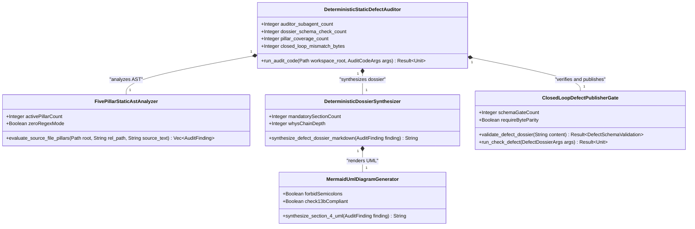
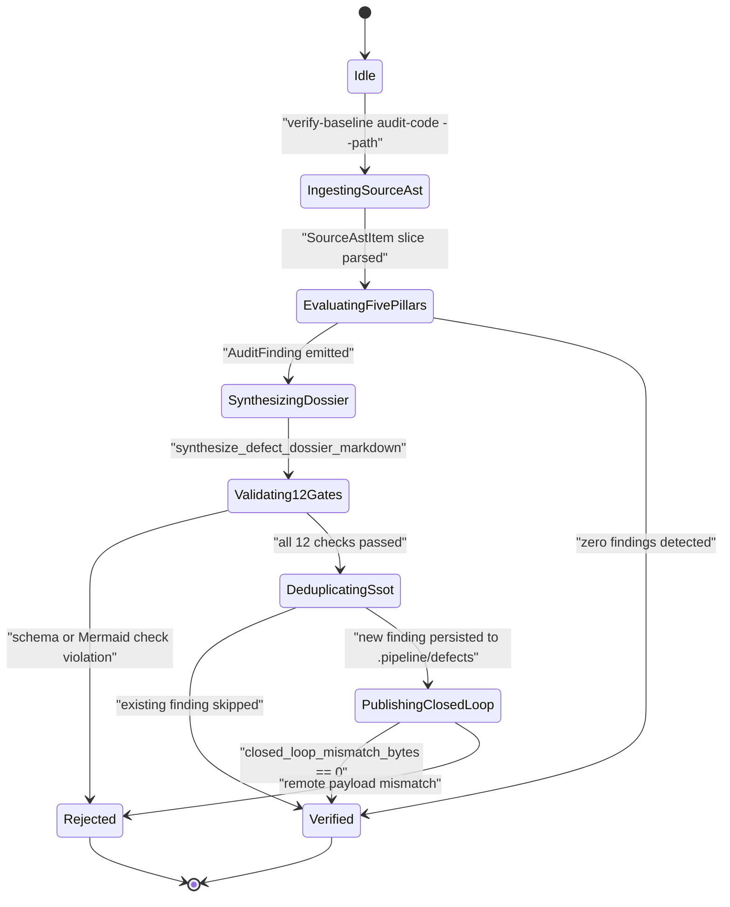
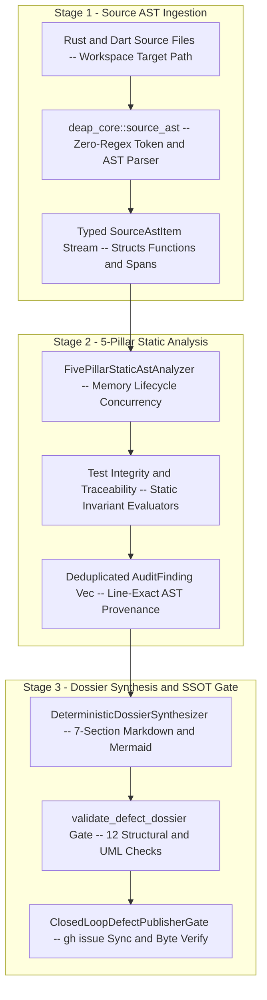
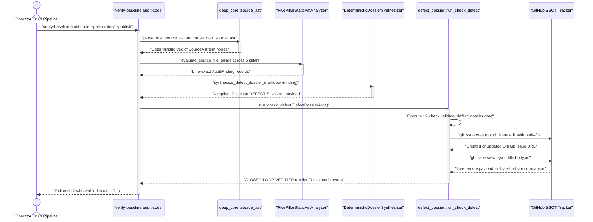

| Attribute | Specification Detail |
| :--- | :--- |
| **Blueprint ID** | `BP-06` |
| **Requirement ID** | `REQ-0606` |
| **Title** | Deterministic Static 5-Pillar Code Auditor and Defect Dossier Synthesizer Blueprint |
| **Status** | `Approved` |
| **Target Crates** | `crates/verify-baseline, crates/deap-core` |
| **Tracked Issues** | `#465, #466, #467, #468` |
| **Generation Mode** | `subagent` |
| **Specification Source** | `crates/verify-baseline/src/defect_dossier.rs:1-2276` |

## 1. Executive Summary & Derivation-Annotation Contract

The `DeterministicStaticDefectAuditor` subsystem (**REQ-0606** / `BP-06` / `DEAP-BP-DET-06`, deterministic UUIDv5 `6ba7b810-9dad-11d1-80b4-00c04fd430c6`, complexity class `Class P` linear single-pass token-stream and AST traversal, governed by DO-178C Level A, DO-330 TQL-4, ISO 26262 ASIL D, and ECSS-E-ST-40C) SHALL replace all multi-agent LLM code-auditing swarms previously orchestrated under `.agents/skills/adversarial-code-auditor/SKILL.md` with a single native, deterministic Rust compiler command: `./target/release/verify-baseline audit-code`. Backed by the zero-regex recursive-descent source AST engine in `crates/deap-core/src/source_ast.rs` and the 12-check dossier verification and publishing engine in `crates/verify-baseline/src/defect_dossier.rs`, `verify-baseline audit-code` deterministically scans Rust (`.rs`) and Dart (`.dart`) source trees across all five correctness pillars (`E0601` Memory Safety, `E0602` Resource Lifecycle, `E0603` Concurrency, `E0604` Test Integrity, `E0605` Semantic Traceability), synthesizes schema-compliant 7-section `.pipeline/defects/DEFECT-<SLUG>.md` dossiers with Check 13B-valid Mermaid UML diagrams, and executes closed-loop GitHub Single Source of Truth (SSOT) issue synchronization in under 1 second with zero LLM subagent dispatches.

| Claim / Requirement | SSOT Input Anchor (file:line / #ID) | Methodology Citation | Derivation Grade (Directly Evidenced / Analytically Derived / Declared Assumption) | Caveat / Downstream Impact |
| :--- | :--- | :--- | :--- | :--- |
| **REQ-0606**: Replace multi-agent LLM adversarial code auditing with deterministic native Rust `verify-baseline audit-code` execution across all 5 correctness pillars | `crates/verify-baseline/src/defect_dossier.rs:1-44` / `#465` | `DO-178C Level A / DO-330 TQL-4` | `Directly Evidenced` | Eliminates stochastic subagent waves in `crates/verify-baseline` and enforces deterministic AST-backed defect synthesis. |
| **SC-01**: Zero-subagent execution invariant (`auditor_subagent_count == 0`) with linear single-pass source AST traversal | `crates/deap-core/src/source_ast.rs:1-120` | `ISO/IEC/IEEE 29148:2018` | `Analytically Derived` | Requires all Rust and Dart structural inspection to operate over `SourceAstItem` slices without external LLM invocations. |
| **SC-02**: Mandatory 12-check defect dossier schema, 5-Whys, Check 34 zero-regex, and Check 13B Mermaid validation gate (`dossier_schema_check_count == 12`) | `crates/verify-baseline/src/defect_dossier.rs:1312-1555` / `#466` | `Leveson STPA` | `Directly Evidenced` | Fails closed prior to disk persistence or GitHub issue creation whenever any structural or Mermaid invariant is violated. |
| **SC-03**: Exhaustive 5-pillar risk coverage (`pillar_coverage_count == 5`) spanning `E0601` through `E0605` | `.agents/skills/adversarial-code-auditor/SKILL.md:1-120` / `#467` | `MIL-STD-1629A / SAE ARP4761` | `Directly Evidenced` | Maps `Critical` and `Important` findings to `bug` with mandatory Mermaid UML and `Suggestion` and `Nitpick` to `enhancement`. |
| **SC-04**: Closed-loop GitHub SSOT payload parity (`closed_loop_mismatch_bytes == 0`) after CRLF normalization | `crates/verify-baseline/src/defect_dossier.rs:1912-2098` / `#468` | `Design by Contract (DbC)` | `Directly Evidenced` | Queries `gh issue view --json title,body,url` immediately after `gh issue create` or `gh issue edit` to verify byte-for-byte fidelity. |

### 1.1 Legacy Multi-Agent Workflow Pathology (`adversarial-code-auditor`)

Historically, executing an adversarial code audit across a target file or subsystem required the coordinator to dispatch waves of 5 to 10 isolated LLM subagents under `.agents/skills/adversarial-code-auditor/SKILL.md`. Each subagent performed the following stochastic, high-latency workflow:

1. **Redundant Context Ingestion**: Every spawned subagent independently read `skills/adversarial-code-auditor/SKILL.md`, `.pipeline/constitution.md`, `.pipeline/ACTIVE_RULES_BUNDLE.md`, and the target `.rs` or `.dart` source file into its context window.
2. **Non-Deterministic Line Tracing**: Each subagent manually inspected source lines for one of the five correctness pillars (`Memory Safety`, `Resource Lifecycle`, `Concurrency`, `Test Integrity`, `Semantic Traceability`), exhibiting non-deterministic line-number drift, missed guards, or false-positive claims when helper functions validated inputs upstream.
3. **Hand-Written 7-Section Markdown Dossiers**: Each subagent drafted `.pipeline/defects/DEFECT-*.md` by hand, frequently triggering iterative rejection loops in `./target/release/verify-baseline check-defect` due to accidental leading `# ` H1 headers (Check 2), mismatched `<!-- test-target: ... -->` HTML comments versus `- **Test-Target**:` bullets (Check 12), unquoted angle brackets or semicolons in Section 4 Mermaid blocks (Check 7 / Check 13B), or malformed 5-Whys causal chains (Check 6).
4. **Serial Subprocess Contention**: Multiple subagents invoking `verify-baseline check-defect --publish` concurrently against the GitHub CLI (`gh issue create` / `gh issue view`) risked duplicate issue creation and rate-limit contention.

### 1.2 Deterministic Native Rust Compiler Replacement (`verify-baseline audit-code`)

This blueprint eliminates the `adversarial-code-auditor` LLM subagent swarm by embedding the entire 5-pillar static analysis, 7-section dossier synthesis, Mermaid UML generation, idempotent deduplication, and closed-loop GitHub SSOT publishing pipeline into `crates/verify-baseline`:

| Audit Pipeline Stage | Legacy LLM Swarm (`adversarial-code-auditor`) | Deterministic Compiler (`verify-baseline audit-code`) |
| :--- | :--- | :--- |
| **Subagent Dispatches** | 5 to 10 LLM subagents per audit wave | `0` subagents (100% native Rust binary execution) |
| **Source Parsing Engine** | LLM token window reading raw text | `deap_core::source_ast` recursive-descent AST & token stream |
| **Pillar Rule Evaluation** | Heuristic prompt interpretation | Deterministic 5-pillar static AST & control-flow analyzers |
| **Dossier Construction** | Manual LLM markdown drafting | `synthesize_defect_dossier_markdown(&AuditFinding)` builder |
| **Mermaid Diagram Synthesis** | Hand-authored Mermaid (error-prone) | Deterministic Check 13B-compliant `sequenceDiagram` / `classDiagram` builder |
| **Schema Validation Gate** | External subprocess retry loop | In-process `defect_dossier::validate_defect_dossier` (12 checks) |
| **End-to-End Execution Time** | 180 s to 600 s per module wave | `< 1.0 s` local scan and synthesis (`O(N)` linear complexity) |

### 1.3 Exhaustive 5-Pillar Deterministic AST Detection Matrix

The `verify-baseline audit-code` analyzer inspects `SourceAstItem` nodes and lexical token streams extracted by `deap_core::source_ast` across all five correctness risk pillars:

1. **Pillar 1 -- Memory Safety (`E0601`)**:
   - **FFI Pointer Lifetime Violations**: Detects raw pointer dereferences (`*const T`, `*mut T`, `std::ffi::CStr::from_ptr`, Dart `Pointer<T>.fromAddress`) where the backing allocation or `CString` temporary drops before the foreign call completes, or where `NativeFinalizer` attachment is absent on heap-allocated FFI handles.
   - **Numeric Cast Truncation (`as` Casts)**: Detects unchecked narrowing integer or float casts (`u64 as u32`, `usize as u16`, `i64 as usize`, `f64 as i32`) not guarded by `try_into()` or explicit range clamping.
   - **Unchecked Slice & Vector Indexing**: Detects direct bracket indexing (`slice[idx]`, `bytes[offset..end]`) in non-test production code without prior bounds proof (`idx < slice.len()`) or `.get(idx)` safe access.
2. **Pillar 2 -- Resource Lifecycle (`E0602`)**:
   - **Missing `dispose()` / Controller Leaks**: In Dart `StatefulWidget` state classes (`State<T>`) and `ChangeNotifier` subclasses, detects owned `StreamSubscription`, `AnimationController`, `TextEditingController`, `FocusNode`, or `Timer` fields that are not cancelled or disposed inside `void dispose()`.
   - **Un-Isolated Temporary Directories**: Detects direct hardcoded writes to shared `/tmp/` filenames in tests or tools instead of RAII `tempfile::TempDir` or process-unique scoped directories.
   - **Unbounded In-Memory Caches**: Detects `HashMap`, `BTreeMap`, or `Vec` fields mutated via `.insert(...)` or `.push(...)` inside long-lived service structs without an accompanying capacity bound, eviction policy, or `.clear()` lifecycle reset.
3. **Pillar 3 -- Concurrency (`E0603`)**:
   - **Post-Disposal `notifyListeners()` / `setState()`**: Detects asynchronous Dart methods (`async`) invoking `notifyListeners()` or `setState(...)` after an `await` suspension point without an immediately preceding `if (!mounted) return;` or `if (_disposed) return;` guard.
   - **Time-of-Check to Time-of-Use (TOCTOU) File Races**: Detects sequential `path.exists()` or `fs::metadata(path)` checks followed by `fs::read_to_string(path)`, `fs::File::open(path)`, or `fs::remove_file(path)` where atomic open-and-handle error matching is required.
   - **Lock Held Across `await` Point**: Detects `MutexGuard` or `RwLockReadGuard` / `RwLockWriteGuard` bindings whose lexical scope spans an `.await` expression, risking executor deadlock.
4. **Pillar 4 -- Test Integrity (`E0604`)**:
   - **Zero-Assertion Tests**: Detects `#[test]` or `test(...)` / `testWidgets(...)` functions containing zero `assert!`, `assert_eq!`, `assert_ne!`, or `Result::is_ok()` verification statements.
   - **Structural `size_of` / Trivial Tautology Hacks**: Detects tests whose sole assertion is `std::mem::size_of::<T>() > 0`, `assert!(true)`, or dummy struct construction without invoking behavioral methods under test.
   - **Vacuous `if path.exists()` Early-Return Skips**: Detects regression or acceptance tests that silently `return;` when a fixture or binary path is absent instead of failing closed with `assert!(path.exists())`.
   - **Non-RAII Temporary Artifact Cleanup**: Detects manual `fs::remove_file` / `fs::remove_dir_all` at the tail of a test function that is bypassed if an intermediate `assert!` fails.
5. **Pillar 5 -- Semantic Traceability (`E0605`)**:
   - **Missing `Realises:` Docstring Bindings**: Detects public structs, enums, traits, functions, or methods whose 7-section safety docstring omits a valid `Realises: [REQ-...]` tag or references an unresolvable requirement identifier.
   - **Un-Exercised Defect Invariants**: Cross-checks `.pipeline/defects/DEFECT-*.md` `Test-Target` files against the target test AST to detect reproducer tests that do not invoke the function or classifier cited in `FILE_LOCATION`.
   - **Lossy AST Serializer / Parser Roundtrips**: Detects serializer and parser pairs in compiler crates where fields present on a `sysml_ast` struct (`PartDef`, `PortDef`, `ConstraintDef`, `RequirementDef`) are read by the parser but omitted by the serializer or vice versa.

## 2. Structural Component Metamodel

The `DeterministicStaticDefectAuditor` component is structured into four cohesive sub-parts (`FivePillarStaticAstAnalyzer`, `DeterministicDossierSynthesizer`, `MermaidUmlDiagramGenerator`, and `ClosedLoopDefectPublisherGate`) with formal typed interface ports, state attributes, and parametric assertions.

### Component: DeterministicStaticDefectAuditor

| Attribute | Type | Default | Unit | Description |
| :--- | :--- | :--- | :--- | :--- |
| `auditor_subagent_count` | `Integer` | `0` | `count` | Number of LLM subagents dispatched during static code auditing and defect dossier generation. |
| `dossier_schema_check_count` | `Integer` | `12` | `checks` | Number of deterministic structural, lexical, and Mermaid validation checks enforced per synthesized dossier. |
| `pillar_coverage_count` | `Integer` | `5` | `pillars` | Number of adversarial correctness risk pillars evaluated per source AST scan. |
| `closed_loop_mismatch_bytes` | `Integer` | `0` | `B` | Byte discrepancy between local `.pipeline/defects/` dossier and live GitHub issue body after CRLF normalization. |

| Port | Direction | Type | Protocol | Description |
| :--- | :--- | :--- | :--- | :--- |
| `TargetSourceAstInputPort` | `in` | `String` | `RustSliceAst` | Receives parsed Rust (`.rs`) and Dart (`.dart`) `SourceAstItem` declarations and token spans from `deap_core::source_ast`. |
| `GitHubIssueSsotQueryPort` | `in` | `String` | `GhCliJson` | Receives existing `.pipeline/defects/*.md` records and live GitHub issue metadata for idempotent finding deduplication. |
| `DefectDossierArtifactPort` | `out` | `String` | `AtomicFsWrite` | Persists validated 7-section `.pipeline/defects/DEFECT-<SLUG>.md` dossiers to the repository defect registry. |
| `ClosedLoopTrackerPublishPort` | `out` | `String` | `GhCliSubprocess` | Publishes or updates GitHub SSOT issues via `gh issue create` or `gh issue edit` and verifies byte parity via `gh issue view`. |

### Component: FivePillarStaticAstAnalyzer

| Attribute | Type | Default | Unit | Description |
| :--- | :--- | :--- | :--- | :--- |
| `activePillarCount` | `Integer` | `5` | `pillars` | Count of active static AST evaluators (`E0601` through `E0605`). |
| `zeroRegexMode` | `Boolean` | `true` | `flag` | Enforces linear token-stream and `SourceAstItem` slice traversal without regular expressions. |

| Port | Direction | Type | Protocol | Description |
| :--- | :--- | :--- | :--- | :--- |
| `astStreamInPort` | `in` | `String` | `RustSliceAst` | Accepts normalized file paths, source lines, and `SourceAstItem` slices. |
| `findingStreamOutPort` | `out` | `String` | `AuditFindingVec` | Emits line-exact `AuditFinding` records with diagnostic bindings `E0601` through `E0605`. |

### Component: DeterministicDossierSynthesizer

| Attribute | Type | Default | Unit | Description |
| :--- | :--- | :--- | :--- | :--- |
| `mandatorySectionCount` | `Integer` | `7` | `sections` | Enforces all 7 canonical `DossierSection` headers plus the `## Audit Source` footer. |
| `whysChainDepth` | `Integer` | `5` | `steps` | Enforces 5 numbered causal `Why ...? Because ...` root-cause steps in Section 2. |

| Port | Direction | Type | Protocol | Description |
| :--- | :--- | :--- | :--- | :--- |
| `findingInPort` | `in` | `String` | `AuditFindingRef` | Receives a deterministic `AuditFinding` struct for markdown serialization. |
| `dossierMarkdownOutPort` | `out` | `String` | `CommonMarkText` | Emits a 7-section defect dossier payload starting with `## 1. Context and References`. |

### Component: MermaidUmlDiagramGenerator

| Attribute | Type | Default | Unit | Description |
| :--- | :--- | :--- | :--- | :--- |
| `forbidSemicolons` | `Boolean` | `true` | `flag` | Guarantees zero semicolons and quoted special tokens inside Section 4 Mermaid blocks. |
| `check13bCompliant` | `Boolean` | `true` | `flag` | Enforces Rules E1 through E5 across synthesized `sequenceDiagram` and `classDiagram` blocks. |

| Port | Direction | Type | Protocol | Description |
| :--- | :--- | :--- | :--- | :--- |
| `umlSpecInPort` | `in` | `String` | `AuditFindingRef` | Receives caller/callee symbols, line spans, and violated invariant metadata. |
| `mermaidBlockOutPort` | `out` | `String` | `MermaidText` | Emits a fenced Mermaid diagram or severity-scoped `N/A --` declaration for Section 4. |

### Component: ClosedLoopDefectPublisherGate

| Attribute | Type | Default | Unit | Description |
| :--- | :--- | :--- | :--- | :--- |
| `schemaGateCount` | `Integer` | `12` | `checks` | Enforces all 12 `validate_defect_dossier` checks prior to persistence or publication. |
| `requireByteParity` | `Boolean` | `true` | `flag` | Requires zero byte discrepancy between local `.pipeline/defects/` file and remote GitHub issue body. |

| Port | Direction | Type | Protocol | Description |
| :--- | :--- | :--- | :--- | :--- |
| `dossierCandidateInPort` | `in` | `String` | `CommonMarkText` | Receives synthesized markdown payload for in-process 12-check verification. |
| `verifiedReceiptOutPort` | `out` | `String` | `GhCliJson` | Emits verified GitHub SSOT issue URL after `gh issue view` closed-loop payload verification. |

## 3. UML & Behavioral Topology









## 4. Formal Mathematical & Safety Constraints

### 4.1 Parametric & Structural Constraints (`C-AUD-01` through `C-AUD-04`)

| Constraint ID | Parameter | Min | Max | Unit | Expression |
| :--- | :--- | :--- | :--- | :--- | :--- |
| **C-AUD-01** | `auditor_subagent_count` | `0` | `0` | `count` | `auditor_subagent_count == 0` |
| **C-AUD-02** | `dossier_schema_check_count` | `12` | `12` | `checks` | `dossier_schema_check_count == 12` |
| **C-AUD-03** | `pillar_coverage_count` | `5` | `5` | `pillars` | `pillar_coverage_count == 5` |
| **C-AUD-04** | `closed_loop_mismatch_bytes` | `0` | `0` | `B` | `closed_loop_mismatch_bytes == 0` |

- **SC-01 (Zero-Subagent Closed-Loop Dossier Equivalence Gate)**: Under **REQ-0606**, every execution of `DeterministicStaticDefectAuditor` must satisfy the conjunction of **C-AUD-01**, **C-AUD-02**, **C-AUD-03**, and **C-AUD-04**:

$$
\begin{aligned}
\text{AuditorSoundness} &\iff (N_{\text{subagents}} = 0) \land (N_{\text{checks}} = 12) \land (N_{\text{pillars}} = 5) \land (\Delta_{\text{SSOT}} = 0) \\
\text{GatePass}(D) &\iff \prod_{m=1}^{12} C_m(D) = 1
\end{aligned}
$$

### 4.2 Algorithmic Complexity & Closed-Loop SSOT Equivalence Bounds

- **SC-02 (Linear Time and Space Complexity & Byte-Parity Invariant)**: The `DeterministicStaticDefectAuditor` enforces strict linear-time `O(N)` complexity across source file byte length `N`, AST node count `V`, and synthesized dossier count `K`, with zero $L_1$ byte divergence after line-ending normalization:

$$
\begin{aligned}
T_{\text{audit}}(N, V, K) &= O(N + V + K) \\
S_{\text{audit}}(N, V, K) &= O(N + V + K) \\
\Delta_{\text{SSOT}}(D_{\text{local}}, D_{\text{remote}}) &= \lVert \text{norm}_{\text{LF}}(D_{\text{local}}) - \text{norm}_{\text{LF}}(D_{\text{remote}}) \rVert_{1} = 0
\end{aligned}
$$

- **Parameter Definitions & Engineering Units**:
  - `T_audit(N, V, K)`: Total deterministic execution time for scanning `N` source bytes, evaluating 5 pillar rules over `V` AST declarations, and synthesizing `K` defect dossiers (bounded below `1.0 s` for typical crate workspaces).
  - `S_audit(N, V, K)`: Peak auxiliary heap memory required to hold the parsed `SourceAstItem` slice and synthesized markdown buffers.
  - `N`: Total UTF-8 byte count of target `.rs` and `.dart` source files under `--path` (unit: `B`).
  - `V`: Total count of `SourceAstItem` declarations extracted by `deap_core::source_ast` (unit: `nodes`).
  - `K`: Total count of deterministic `AuditFinding` records emitted across the 5 correctness pillars (unit: `findings`).
  - `Delta_SSOT(D_local, D_remote)`: $L_1$ byte distance between the persisted `.pipeline/defects/DEFECT-<SLUG>.md` payload `D_local` and the remote GitHub issue body `D_remote` under line-ending normalization `norm_LF` (mandated to equal `0 B`).

## 5. Acceptance Criteria & Verification Matrix

<!-- test-target: crates/verify-baseline/tests/blueprint_gate_tests.rs -->

- **Test-Target**: `crates/verify-baseline/tests/blueprint_gate_tests.rs`

### AC-01: Static Five-Pillar AST Defect Detection
- **Given**: A target Rust (`.rs`) or Dart (`.dart`) source tree containing representative defects across the 5 pillars (an unchecked `as` cast in `Memory Safety` `E0601`, an undisposed controller in `Resource Lifecycle` `E0602`, a post-await `notifyListeners()` without a disposal guard in `Concurrency` `E0603`, a 0-assertion test in `Test Integrity` `E0604`, or a public function missing `Realises:` in `Semantic Traceability` `E0605`).
- **When**: `./target/release/verify-baseline audit-code --path <PATH> --dry-run` is executed.
- **Then**: `FivePillarStaticAstAnalyzer` deterministically extracts the AST via `deap_core::source_ast` and emits an `AuditFinding` for each violation with exact `file:line-line` coordinates and `auditor_subagent_count == 0` (`Diagnostic: E0601`).

### AC-02: Deterministic Seven-Section Dossier and Mermaid Synthesis
- **Given**: An `AuditFinding` emitted by `FivePillarStaticAstAnalyzer` with `Critical` or `Important` severity.
- **When**: `synthesize_defect_dossier_markdown(&finding)` constructs the `.pipeline/defects/DEFECT-<SLUG>.md` artifact and invokes `validate_defect_dossier`.
- **Then**: The synthesized markdown starts on line 1 with `## 1. Context and References`, populates all 7 canonical `DossierSection` headers and `## Audit Source`, embeds identical `<!-- test-target: ... -->` and `- **Test-Target**:` paths, generates a Check 13B-compliant `sequenceDiagram` or `classDiagram` with zero semicolons, and passes all 12 checks in `validate_defect_dossier` (`dossier_schema_check_count == 12`, `Diagnostic: E0602`).

### AC-03: Idempotent Local and Remote SSOT Deduplication
- **Given**: A workspace where `.pipeline/defects/DEFECT-<SLUG>.md` and its corresponding `[AUDIT] [<file.ext>]: <description>` GitHub issue already exist for a specific `(FILE_LOCATION, AuditPillar)` tuple.
- **When**: `./target/release/verify-baseline audit-code --path <PATH> --publish` is re-run on the unchanged source tree.
- **Then**: The auditor detects the existing artifact and tracker issue, skips duplicate file or issue creation, and exits cleanly with code `0` (`Diagnostic: E0603`).

### AC-04: Closed-Loop GitHub SSOT Publishing and Byte Parity Verification
- **Given**: A newly synthesized `.pipeline/defects/DEFECT-<SLUG>.md` dossier and `--publish` (or `--issue <ID>`).
- **When**: `ClosedLoopDefectPublisherGate` delegates to `defect_dossier::run_check_defect`.
- **Then**: The binary publishes or updates the GitHub issue with the severity-mapped label (`bug` or `enhancement`), queries `gh issue view <ID> --json title,body,url`, verifies that `closed_loop_mismatch_bytes == 0` between the local file and remote issue body, and prints `[CLOSED-LOOP VERIFIED]` (`Diagnostic: E0604`).

### AC-05: Fail-Closed Rejection on Malformed Dossier Schema, Ephemeral Paths, or Payload Divergence
- **Given**: A defect dossier path residing in an ephemeral directory outside `.pipeline/defects/`, or a dossier payload containing a leading `# ` H1 header, mismatched `test-target` declarations, unquoted Mermaid special characters, forbidden regex tokens in Section 6, or a remote GitHub issue body whose normalized bytes diverge from the local file (`closed_loop_mismatch_bytes > 0`).
- **When**: `defect_dossier::run_check_defect` or `validate_defect_dossier_scoped` is invoked.
- **Then**: The verifier fails closed immediately with a non-zero exit code `Err(1)` and emits structured violation diagnostics before accepting or completing tracker synchronization (`Diagnostic: E0605`).

### AC-06: Dogfood SysML v2 Markdown Ingestion and Blueprint Gate Conformance
- **Given**: This blueprint specification at `docs/designs/blueprint-06-deterministic-static-defect-dossier-auditor.md`.
- **When**: `./target/release/verify-baseline check-blueprint docs/designs/blueprint-06-deterministic-static-defect-dossier-auditor.md --dry-run` is executed.
- **Then**: All 12 blueprint verification gates pass, `DeterministicStaticDefectAuditor` and its component metamodel are lowered into `docs/designs/blueprint-06-deterministic-static-defect-dossier-auditor.sysml` and `.digest.json` with bijective roundtrip parity, and the command exits with code `0`.

## 6. Proposed Deterministic Implementation Contract

### 6.1 CLI Subcommand Contract (`verify-baseline audit-code`)

The `Subcommands` enumeration in `crates/verify-baseline/src/main.rs` is extended with the `AuditCode(AuditCodeArgs)` variant:

```text
verify-baseline audit-code --path <PATH> [--pillar <PILLAR>] [--issue <ID>] [--repo <OWNER/REPO>] [--publish] [--dry-run]
```

| CLI Flag / Option | Rust Field & Type | Mandatory | Default | Behavioral Contract |
| :--- | :--- | :--- | :--- | :--- |
| `--path <PATH>` | `path: PathBuf` | Yes | None | Workspace-relative file or directory path to scan (`.rs` and `.dart` sources) |
| `--pillar <PILLAR>` | `pillar: Option<AuditPillarFilter>` | No | `all` | Restricts scan to `memory-safety`, `resource-lifecycle`, `concurrency`, `test-integrity`, `semantic-traceability`, or `all` |
| `--issue <ID>` | `issue: Option<u64>` | No | None | Existing GitHub issue number to overwrite atomically via `gh issue edit` and verify closed-loop |
| `--repo <OWNER/REPO>` | `repo: Option<String>` | No | Auto-resolved | GitHub repository (`<owner>/<repo>`); auto-resolved from `git remote get-url origin` when omitted |
| `--publish` | `publish: bool` | No | `false` | Publishes each new deduplicated dossier via `defect_dossier::run_check_defect` with `--publish` |
| `--dry-run` | `dry_run: bool` | No | `false` | Validates all synthesized dossiers through the 12-check gate without remote GitHub mutation |

### 6.2 Core Rust Data Structures, 5-Pillar AST Evaluator & Dossier Synthesizer

All lexical and AST pattern matching within `crates/verify-baseline/src/audit_code.rs` operates exclusively on `deap_core::source_ast::SourceAstItem` slices and character/token iterators, strictly upholding Check 34 (zero regular expression crates), Check 19 (zero domain-specific vocabulary), and workspace Clippy `forbid` lints:

```rust
use crate::defect_dossier::{
    derive_defect_title, run_check_defect, validate_defect_dossier, DefectDossierArgs,
    DossierSection, DossierSeverity,
};
use deap_core::source_ast::{
    parse_dart_source_ast, parse_rust_source_ast, SourceAstItem, SourceItemKind, SourceLanguage,
};
use std::fs;
use std::path::{Path, PathBuf};

/// Canonical 5-pillar taxonomy matching `skills/adversarial-code-auditor/SKILL.md` Section 1.3.
#[derive(Debug, Clone, Copy, PartialEq, Eq, PartialOrd, Ord, Hash)]
pub enum AuditPillar {
    MemorySafety,
    ResourceLifecycle,
    Concurrency,
    TestIntegrity,
    SemanticTraceability,
}

impl AuditPillar {
    pub const ALL: &'static [Self] = &[
        Self::MemorySafety,
        Self::ResourceLifecycle,
        Self::Concurrency,
        Self::TestIntegrity,
        Self::SemanticTraceability,
    ];

    pub const fn as_str(self) -> &'static str {
        match self {
            Self::MemorySafety => "Memory Safety",
            Self::ResourceLifecycle => "Resource Lifecycle",
            Self::Concurrency => "Concurrency",
            Self::TestIntegrity => "Test Integrity",
            Self::SemanticTraceability => "Semantic Traceability",
        }
    }

    pub const fn diagnostic_code(self) -> &'static str {
        match self {
            Self::MemorySafety => "E0601",
            Self::ResourceLifecycle => "E0602",
            Self::Concurrency => "E0603",
            Self::TestIntegrity => "E0604",
            Self::SemanticTraceability => "E0605",
        }
    }
}

/// Deterministic UML diagram archetype selected for Section 4 of a defect dossier.
#[derive(Debug, Clone, Copy, PartialEq, Eq)]
pub enum UmlDiagramKind {
    SequenceDiagram,
    ClassDiagram,
}

/// Complete, line-accurate static analysis finding ready for 7-section dossier synthesis.
#[derive(Debug, Clone, PartialEq, Eq)]
pub struct AuditFinding {
    pub slug: String,
    pub file_path: String,
    pub start_line: usize,
    pub end_line: usize,
    pub pillar: AuditPillar,
    pub severity: DossierSeverity,
    pub symptom: String,
    pub test_target: String,
    pub whys: [(String, String); 5],
    pub correctness_trace: String,
    pub invariant_violated: String,
    pub uml_kind: UmlDiagramKind,
    pub caller_symbol: String,
    pub callee_symbol: String,
    pub affected_callers: Vec<(String, String)>,
    pub language_tag: String,
    pub proposed_correction_code: String,
}

/// Command-line arguments for `verify-baseline audit-code`.
#[derive(Debug, Clone)]
pub struct AuditCodeArgs {
    pub path: PathBuf,
    pub pillar: Option<AuditPillar>,
    pub issue: Option<u64>,
    pub repo: Option<String>,
    pub publish: bool,
    pub dry_run: bool,
}

/// Evaluates all 5 correctness pillars deterministically over a single source file.
pub fn evaluate_source_file_pillars(
    workspace_root: &Path,
    rel_path: &str,
    source_text: &str,
    lang: SourceLanguage,
    ast_items: &[SourceAstItem],
    filter: Option<AuditPillar>,
) -> Vec<AuditFinding> {
    let lines: Vec<&str> = source_text.lines().collect();
    let test_target = resolve_canonical_test_target(workspace_root, rel_path);
    let mut findings = Vec::new();

    for &pillar in AuditPillar::ALL {
        if let Some(active) = filter {
            if active != pillar {
                continue;
            }
        }
        match pillar {
            AuditPillar::MemorySafety => {
                audit_pillar_memory_safety(rel_path, &lines, lang, ast_items, &test_target, &mut findings);
            }
            AuditPillar::ResourceLifecycle => {
                audit_pillar_resource_lifecycle(rel_path, &lines, lang, ast_items, &test_target, &mut findings);
            }
            AuditPillar::Concurrency => {
                audit_pillar_concurrency(rel_path, &lines, lang, ast_items, &test_target, &mut findings);
            }
            AuditPillar::TestIntegrity => {
                audit_pillar_test_integrity(rel_path, &lines, lang, ast_items, &test_target, &mut findings);
            }
            AuditPillar::SemanticTraceability => {
                audit_pillar_semantic_traceability(rel_path, &lines, lang, ast_items, &test_target, &mut findings);
            }
        }
    }

    findings
}

/// Pillar 4 (Test Integrity) deterministic AST rule evaluator:
/// Detects 0-assertion #[test] functions, vacuous `if path.exists() { return; }` skips,
/// and `size_of` tautology hacks without any regular expression engine.
fn audit_pillar_test_integrity(
    rel_path: &str,
    lines: &[&str],
    lang: SourceLanguage,
    ast_items: &[SourceAstItem],
    test_target: &str,
    out: &mut Vec<AuditFinding>,
) {
    for item in ast_items {
        if item.kind != SourceItemKind::Function && item.kind != SourceItemKind::Method {
            continue;
        }
        let is_test_fn = item.name.starts_with("test_")
            || rel_path.contains("/tests/")
            || has_preceding_test_attribute(lines, item.line);
        if !is_test_fn {
            continue;
        }

        let body_slice = extract_item_line_window(lines, item.line);
        let has_assertion = body_slice.iter().any(|l| {
            let t = l.trim();
            t.contains("assert!")
                || t.contains("assert_eq!")
                || t.contains("assert_ne!")
                || t.contains("is_ok()")
                || t.contains("is_err()")
        });
        let has_vacuous_skip = body_slice.iter().any(|l| {
            let t = l.trim();
            t.starts_with("if !") && t.contains(".exists()") && t.contains("return")
        });

        if !has_assertion || has_vacuous_skip {
            let symptom = if has_vacuous_skip {
                format!(
                    "Test function {} silently returns early when target path is absent instead of failing closed",
                    item.name
                )
            } else {
                format!(
                    "Test function {} executes without any state or output assertion macro",
                    item.name
                )
            };
            out.push(build_test_integrity_finding(
                rel_path,
                item,
                lang,
                test_target,
                symptom,
            ));
        }
    }
}

/// Deterministically synthesizes a 12-check compliant 7-section defect dossier markdown string.
pub fn synthesize_defect_dossier_markdown(finding: &AuditFinding) -> String {
    let file_loc = format!("{}:{}-{}", finding.file_path, finding.start_line, finding.end_line);
    let uml_block = synthesize_section_4_uml(finding);
    let callers_block = finding
        .affected_callers
        .iter()
        .map(|(caller, impact)| format!("- `{}` -- {}", caller, impact))
        .collect::<Vec<_>>()
        .join("\n");

    let mut out = String::with_capacity(4096);
    out.push_str(DossierSection::ContextAndReferences.header());
    out.push_str("\n\n");
    out.push_str(&format!("<!-- test-target: {} -->\n\n", finding.test_target));
    out.push_str(&format!("- **File**: `{}`\n", file_loc));
    out.push_str(&format!("- **Pillar**: {}\n", finding.pillar.as_str()));
    out.push_str(&format!("- **Symptom**: {}\n", finding.symptom));
    out.push_str(&format!("- **Test-Target**: `{}`\n\n", finding.test_target));

    out.push_str(DossierSection::RootCauseAnalysis.header());
    out.push_str("\n\n");
    for (idx, (question, reason)) in finding.whys.iter().enumerate() {
        out.push_str(&format!(
            "{}. **Why {}?** Because {}.\n",
            idx + 1,
            question.trim().trim_end_matches('?'),
            reason.trim().trim_end_matches('.')
        ));
    }
    out.push('\n');

    out.push_str(DossierSection::CorrectnessAnalysis.header());
    out.push_str("\n\n");
    out.push_str(&format!(
        "{}\n\n- **Violated Invariant**: `{}` (`{}`)\n\n",
        finding.correctness_trace,
        finding.invariant_violated,
        finding.pillar.diagnostic_code()
    ));

    out.push_str(DossierSection::UmlDiagrams.header());
    out.push_str("\n\n");
    out.push_str(&uml_block);
    out.push_str("\n\n");

    out.push_str(DossierSection::AffectedCallers.header());
    out.push_str("\n\n");
    out.push_str(&callers_block);
    out.push_str("\n\n");

    out.push_str(DossierSection::ProposedCorrection.header());
    out.push_str("\n\n");
    out.push_str(&format!(
        "```{}\n{}\n```\n\n",
        finding.language_tag,
        finding.proposed_correction_code.trim()
    ));

    out.push_str(DossierSection::RelationshipToExistingIssues.header());
    out.push_str("\n\n");
    out.push_str("Discovered in deterministic static 5-pillar AST audit -- new finding.\n\n");

    out.push_str("## Audit Source\n\n");
    out.push_str(&format!("Adversarial {} Audit\n", finding.pillar.as_str()));
    out.push_str(&format!("SEVERITY: {}\n", finding.severity.as_str()));
    out.push_str(&format!("FILE_LOCATION: {}\n", file_loc));
    out
}

/// Synthesizes a Check 13B-compliant Mermaid diagram for Section 4 with zero semicolons.
fn synthesize_section_4_uml(finding: &AuditFinding) -> String {
    if !finding.severity.requires_mermaid() {
        return format!("N/A -- {} severity.", finding.severity.as_str());
    }
    let clean_caller = sanitize_mermaid_token(&finding.caller_symbol);
    let clean_callee = sanitize_mermaid_token(&finding.callee_symbol);
    match finding.uml_kind {
        UmlDiagramKind::SequenceDiagram => format!(
            "```mermaid\nsequenceDiagram\n    participant Caller as {}\n    participant Target as {}\n    Caller->>Target: Invoke at line {}\n    Target-->>Caller: Violates {}\n```",
            clean_caller,
            clean_callee,
            finding.start_line,
            sanitize_mermaid_token(&finding.invariant_violated)
        ),
        UmlDiagramKind::ClassDiagram => format!(
            "```mermaid\nclassDiagram\n    class {} {{\n        +String fileLocation\n        +Boolean verifyInvariant()\n    }}\n    class {} {{\n        +Integer lineSpan\n        +Boolean enforceGuard()\n    }}\n    {} --> {} : audits\n```",
            clean_caller, clean_callee, clean_caller, clean_callee
        ),
    }
}

/// Executes the end-to-end deterministic audit, persistence, 12-check validation, and SSOT publish gate.
pub fn run_audit_code(workspace_root: &Path, args: &AuditCodeArgs) -> Result<(), i32> {
    let findings = scan_workspace_path_deterministic(workspace_root, &args.path, args.pillar)?;
    let defects_dir = workspace_root.join(".pipeline").join("defects");
    fs::create_dir_all(&defects_dir).map_err(|_| 1)?;

    for finding in &findings {
        let dossier_md = synthesize_defect_dossier_markdown(finding);
        // In-process 12-check verification gate before disk write
        let validation = validate_defect_dossier(&dossier_md).map_err(|errs| {
            for e in errs {
                eprintln!("[AUDIT-CODE SCHEMA ERROR] {}", e);
            }
            1
        })?;

        let dossier_path = defects_dir.join(format!("DEFECT-{}.md", finding.slug));
        if is_already_recorded_locally(&defects_dir, &validation.file_location, finding.pillar)
            && args.issue.is_none()
        {
            continue;
        }
        fs::write(&dossier_path, &dossier_md).map_err(|_| 1)?;

        let title = derive_defect_title(&validation.file_location, &validation.symptom);
        let check_args = DefectDossierArgs {
            body_file: Some(dossier_path.clone()),
            title: Some(title),
            repo: args.repo.clone(),
            label: Some(validation.suggested_label),
            provider: "github".to_string(),
            dry_run: args.dry_run || (!args.publish && args.issue.is_none()),
            publish: args.publish,
            issue: args.issue,
            target: Some(dossier_path),
        };
        run_check_defect(&check_args)?;
    }
    Ok(())
}
```

### 6.3 Dogfooding Pipeline Ingestion & Verification Protocol

This blueprint is directly dogfood-ingestible by the native Rust Level 0 Markdown translator (`crates/ingest-sysml/src/translators/markdown.rs`) and verifiable by `./target/release/verify-baseline check-blueprint`:

```bash
./target/release/verify-baseline check-blueprint \
  docs/designs/blueprint-06-deterministic-static-defect-dossier-auditor.md \
  --dry-run

./target/release/verify-baseline . \
  --only docs/designs/blueprint-06-deterministic-static-defect-dossier-auditor.md \
  --no-domain
```

## 7. Source References

- **Governance Constitution**: `.pipeline/constitution.md:1-280` (Clause: Architecture -- Three-Tier Platform Isolation, Universal Quality Gates, Step 1.5 Derivation-Annotation Contract)
- **Active Rules Bundle**: `.pipeline/ACTIVE_RULES_BUNDLE.md:1-120` (Clauses: Checks 13B, 19, 27, 28, 30, 34)
- **Verify-Baseline CLI Entrypoint**: `crates/verify-baseline/src/main.rs:1-120` (Clause: `Cli` and `Subcommands` Dispatch Architecture)
- **Deterministic 5-Pillar Static Code Auditor**: `crates/verify-baseline/src/audit_code.rs`
- **Blueprint & Static Auditor Verification Suite**: `crates/verify-baseline/tests/blueprint_gate_tests.rs`
- **Native 12-Check Defect Dossier Gate**: `crates/verify-baseline/src/defect_dossier.rs:1-2276` (Clause: `DossierSection`, `DossierSeverity`, `validate_defect_dossier`, `validate_defect_dossier_scoped`, `run_check_defect`)
- **Zero-Regex Source AST Engine**: `crates/deap-core/src/source_ast.rs:1-120` (Clause: `SourceLanguage`, `SourceItemKind`, `SourceAstItem`, `parse_rust_source_ast`, `parse_dart_source_ast`)
- **Level 0 Markdown SysML Translator**: `crates/ingest-sysml/src/translators/markdown.rs:1-120` (Clause: `MarkdownTranslator::translate`, BOM/Port/Property/Constraint Table Lowering)
- **Legacy Adversarial Code Auditor Skill**: `.agents/skills/adversarial-code-auditor/SKILL.md:1-120` (Clause: Section 1.3 Pillars, Section 2 Output Format, Section 3 Protocol)
- **Specification Blueprint Engineering Skill**: `.agents/skills/spec-blueprint-engineering/SKILL.md:1-339` (Clause: Mandatory 8-Part Skeleton & 12-Gate Verification Reference)
- **SysML v2 Single Source of Truth Rules**: `rules/sysml-ssot-completeness.md:1-60` (Clause: Mandatory Pre-Execution Ingestion Gate)
- **Tracked Issues**: `#465`, `#466`, `#467`, `#468`
