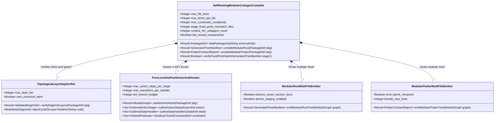
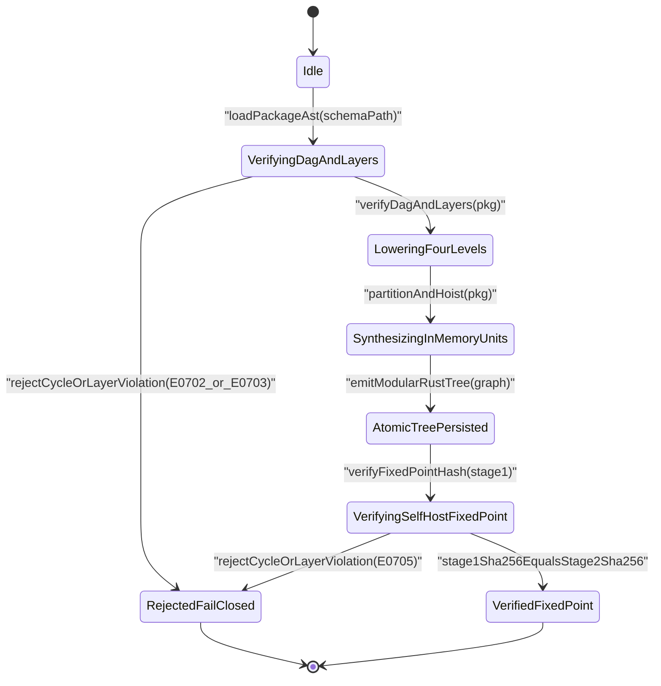
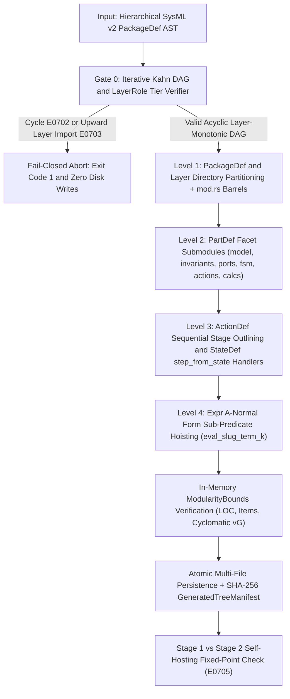
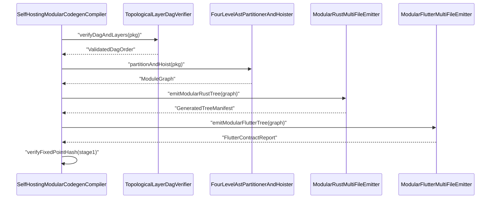

| Attribute | Specification Detail |
| :--- | :--- |
| **Blueprint ID** | `BP-07` |
| **Requirement ID** | `REQ-0607` |
| **Title** | Self-Hosting 4-Level Modular Multi-File Code Generator Blueprint |
| **Status** | `Approved` |
| **Target Crates** | `crates/compile-sysml, crates/deap-core` |
| **Tracked Issues** | `#742, #733, #739, #740, #741` |
| **Generation Mode** | `subagent` |
| **Specification Source** | `.pipeline/upstream/schema/modular_codegen.sysml:1-120` |

## 1. Executive Summary & Derivation-Annotation Contract

`SelfHostingModularCodegenCompiler` (**REQ-0607** / `BP-07` / `DEAP-BP-DET-07`, UUIDv5 `6ba7b810-9dad-11d1-80b4-00c04fd430c7`, `Class P` linear Kahn DAG and AST traversal complexity, governed by DO-178C Level A, DO-330 TQL-4, ISO 26262 ASIL D, and ECSS-E-ST-40C) eliminates monolithic single-file code emission in `compile-sysml`. Instead of collapsing hierarchical `PackageDef` trees via `flatten_package_to_model` into oversized god-files, the compiler preserves full SysML v2 package topology and `@Layer` (`Domain`, `Application`, `Presentation`) stereotypes while deterministically lowering valid models of arbitrary scale into bounded multi-file Rust and Flutter/Dart module trees with zero LLM runtime invocation.

To guarantee zero dead ends on valid models while enforcing strict structural safety bounds, `SelfHostingModularCodegenCompiler` executes a deterministic 4-level AST lowering pipeline preceded by transactional DAG and layer verification:

1. **Level 1 (`PackageDef` & `@Layer` Hierarchy)**: Maps nested `PackageDef` subtrees and `@Layer` architectural tiers (`Domain = 1`, `Application = 2`, `Presentation = 3`) directly into hierarchical filesystem directories backed by pure `mod.rs` and Dart barrel re-export facades, eliminating `flatten_package_to_model` namespace flattening.
2. **Level 2 (`PartDef` Facet Partitioning)**: Decomposes multi-facet `PartDef` classifiers along orthogonal AST responsibility boundaries into cohesive single-responsibility compilation units (`model`, `invariants`, `ports`, `fsm`, `actions`, and `calcs` submodules) aggregated by a per-component `mod` barrel facade.
3. **Level 3 (`ActionDef::steps` & `StateDef::transitions` Behavioral Outlining)**: Outlines sequential `ActionDef::steps` pipelines into bounded stage functions orchestrated by a linear `v(G) = 1` entry dispatcher, and partitions `StateDef::transitions` by source state into bounded `step_from_<state>()` handler functions instead of monolithic multi-arm `match` dispatchers.
4. **Level 4 (`Expr` A-Normal Form Sub-Predicate Hoisting)**: Hoists deep `ConstraintDef` and `CalcDef` boolean and arithmetic `Expr` sub-trees at interior AST operator nodes into pure helper functions (`eval_<slug>_term_<k>`), bounding every emitted function within `ModularityBounds`.

| Claim / Requirement | SSOT Input Anchor (file:line / #ID) | Methodology Citation | Derivation Grade (Directly Evidenced / Analytically Derived / Declared Assumption) | Caveat / Downstream Impact |
| :--- | :--- | :--- | :--- | :--- |
| **REQ-0607**: Deterministic `SelfHostingModularCodegenCompiler` (`DEAP-BP-DET-07`, UUIDv5 `6ba7b810-9dad-11d1-80b4-00c04fd430c7`, `Class P`) preserving hierarchical `PackageDef` and `@Layer` AST topology across Rust and Flutter codegen targets | `crates/compile-sysml/src/driver.rs:1-120` / `#733` | `ISO/IEC/IEEE 29148:2018 & DO-330 TQL-4` | `Directly Evidenced` | Eliminates `flatten_package_to_model` collapse in modular codegen modes while preserving existing CLI flags and deterministic AST validation (`ARCH-02`, `ARCH-04`). |
| **SC-01**: Four-level deterministic lowering (Level 1 `PackageDef` directories, Level 2 `PartDef` facet modules, Level 3 `ActionDef` stage and `StateDef` `step_from_<state>()` outlining, Level 4 `Expr` ANF `eval_<slug>_term_<k>` hoisting) guaranteeing zero dead ends on valid SysML v2 models | `.pipeline/constitution.md:48-76` / `#739` | `Design by Contract (DbC) & DO-178C Level A` | `Analytically Derived` | Every semantically valid `.sysml` package compiles to exit code `0` with all emitted files satisfying **C-MOD-01**, **C-MOD-02**, and **C-MOD-03**. |
| **SC-02**: Fail-closed transactional rejection of directed module dependency cycles (`E0702`) and illegal upward `@Layer` dependencies (`E0703`, forbidding lower-tier imports of higher-tier modules) with zero partial disk writes | `.pipeline/constitution.md:67-69` / `#740` | `Leveson STPA & ISO 26262 ASIL D` | `Directly Evidenced` | Iterative Kahn DAG verification executes completely in memory prior to `write_atomic` persistence; any `E0702` or `E0703` diagnostic halts emission with exit code `1`. |
| **SC-03**: Metacircular self-hosting `Stage 0 -> Stage 1 -> Stage 2` bootstrap fixed-point invariant (`E0705`) asserting `SHA-256(Stage 1) == SHA-256(Stage 2)` over `.pipeline/upstream/schema/modular_codegen.sysml` | `.pipeline/constitution.md:155-162` / `#741` | `DO-330 TQL-4 & ECSS-E-ST-40C` | `Analytically Derived` | Stage-1 generated contracts under `crates/compile-sysml/src/modular_codegen/generated/` are compiled into `compile-sysml` and verified against Stage-2 re-emission on every test run. |
| **SC-04**: Modular multi-file Flutter/Dart `.g.dart` contract synthesis with barrel re-exports and decomposition of the `flutter_codegen.rs` monolith into `<100`-line barrel facade plus bounded submodules | `crates/compile-sysml/src/flutter_codegen.rs:1-80` / `#733, #739, #740, #741` | `ISO/IEC/IEEE 15288:2023 Modularity` | `Directly Evidenced` | Preserves 100% public Rust API symbol compatibility and downstream Dart barrel import stability while decomposing monolithic emitters under `modular_codegen/emitters/flutter/`. |

## 2. Structural Component Metamodel

### Component: SelfHostingModularCodegenCompiler

| Attribute | Type | Default | Unit | Description |
| :--- | :--- | :--- | :--- | :--- |
| `max_file_lines` | `Integer` | `400` | `LOC` | Upper bound on physical lines of code permitted per generated compilation unit. |
| `max_items_per_file` | `Integer` | `12` | `items` | Upper bound on top-level type, trait, or function declarations per compilation unit. |
| `max_cyclomatic_complexity` | `Integer` | `8` | `vG` | Upper bound on McCabe cyclomatic complexity per generated or hand-authored function. |
| `stage_fixed_point_mismatch_files` | `Integer` | `0` | `files` | Count of Stage-1 versus Stage-2 SHA-256 file digest mismatches permitted at bootstrap verification. |
| `runtime_llm_subagent_count` | `Integer` | `0` | `count` | Mandatory zero runtime LLM or subagent invocation count during deterministic compilation. |
| `fail_closed_transactional` | `Boolean` | `true` | `flag` | Aborts all filesystem writes whenever any DAG, layer, or bounds invariant fails. |
| `deterministic_uuid` | `String` | `"6ba7b810-9dad-11d1-80b4-00c04fd430c7"` | `uuidv5` | Canonical deterministic blueprint component identifier (`DEAP-BP-DET-07`). |

| Port | Direction | Type | Protocol | Description |
| :--- | :--- | :--- | :--- | :--- |
| `package_ast_in` | `in` | `String` | `SysmlV2PackageAst` | Receives hierarchical `PackageDef` AST validated by `SemanticValidator`. |
| `rust_tree_out` | `out` | `String` | `AtomicRustModuleTree` | Emits verified multi-file Rust module hierarchy and `GeneratedTreeManifest`. |
| `flutter_tree_out` | `out` | `String` | `AtomicDartModuleTree` | Emits verified multi-file `.g.dart` contract hierarchy and barrel facades. |
| `diagnostic_out` | `out` | `String` | `CompilerDiagnosticStream` | Emits deterministic `E0702`, `E0703`, and `E0705` diagnostics on fail-closed abort. |

### Component: TopologicalLayerDagVerifier

| Attribute | Type | Default | Unit | Description |
| :--- | :--- | :--- | :--- | :--- |
| `max_layer_tier` | `Integer` | `3` | `tier` | Maximum architectural layer ordinal (`Domain = 1`, `Application = 2`, `Presentation = 3`). |
| `zero_recursion_kahn` | `Boolean` | `true` | `flag` | Enforces iterative work-queue Kahn topological sorting without call-stack recursion. |

| Port | Direction | Type | Protocol | Description |
| :--- | :--- | :--- | :--- | :--- |
| `dependency_edges_in` | `in` | `String` | `ModuleDependencyGraph` | Receives directed classifier and package dependency edges with resolved `LayerRole` tiers. |
| `topological_order_out` | `out` | `String` | `ValidatedDagOrder` | Emits deterministic topological emission sequence or `E0702`/`E0703` rejection diagnostics. |

### Component: FourLevelAstPartitionerAndHoister

| Attribute | Type | Default | Unit | Description |
| :--- | :--- | :--- | :--- | :--- |
| `max_action_steps_per_stage` | `Integer` | `6` | `steps` | Maximum sequential `ActionDef::steps` statements grouped into a single outlined stage function. |
| `max_transitions_per_handler` | `Integer` | `6` | `arms` | Maximum outgoing `StateDef::transitions` arms per `step_from_<state>()` handler unit. |
| `anf_branch_budget` | `Integer` | `6` | `branches` | Maximum boolean branching operators retained before hoisting `eval_<slug>_term_<k>` helpers. |

| Port | Direction | Type | Protocol | Description |
| :--- | :--- | :--- | :--- | :--- |
| `validated_ast_in` | `in` | `String` | `ValidatedPackageAst` | Receives DAG-verified hierarchical `PackageDef`, `PartDef`, `ActionDef`, `StateDef`, `ConstraintDef`, and `CalcDef` nodes. |
| `module_graph_out` | `out` | `String` | `LoweredModuleGraph` | Emits 4-level partitioned `ModuleGraph` of bounded `CompilationUnit` descriptors. |

### Component: ModularRustMultiFileEmitter

| Attribute | Type | Default | Unit | Description |
| :--- | :--- | :--- | :--- | :--- |
| `enforce_seven_section_docs` | `Boolean` | `true` | `flag` | Emits unique Check 36 7-section DO-178C safety headers on every generated Rust module and item. |
| `atomic_staging_enabled` | `Boolean` | `true` | `flag` | Verifies in-memory `ModularityBounds` across all units prior to `write_atomic` commit. |

| Port | Direction | Type | Protocol | Description |
| :--- | :--- | :--- | :--- | :--- |
| `rust_module_graph_in` | `in` | `String` | `LoweredModuleGraph` | Receives lowered `ModuleGraph` targeted for `--emit-modular-rust`. |
| `rust_manifest_out` | `out` | `String` | `GeneratedTreeManifest` | Emits persisted Rust submodule tree and aggregate SHA-256 tree digest. |

### Component: ModularFlutterMultiFileEmitter

| Attribute | Type | Default | Unit | Description |
| :--- | :--- | :--- | :--- | :--- |
| `emit_barrel_reexports` | `Boolean` | `true` | `flag` | Emits top-level Dart barrel facades re-exporting per-package and per-classifier `.g.dart` units. |
| `facade_max_lines` | `Integer` | `100` | `LOC` | Strict upper bound on `crates/compile-sysml/src/flutter_codegen.rs` barrel facade line count. |

| Port | Direction | Type | Protocol | Description |
| :--- | :--- | :--- | :--- | :--- |
| `flutter_module_graph_in` | `in` | `String` | `LoweredModuleGraph` | Receives unflattened `PackageDef` and lowered `ModuleGraph` for `--emit-flutter-contracts`. |
| `flutter_manifest_out` | `out` | `String` | `FlutterContractReport` | Emits modular `.g.dart` models, FFI/DTO bridges, DDL/seeds, spatial UI contract tests, and barrels. |

## 3. UML & Behavioral Topology









## 4. Formal Mathematical & Safety Constraints

| Constraint ID | Parameter | Min | Max | Unit | Expression |
| :--- | :--- | :--- | :--- | :--- | :--- |
| `C-MOD-01` | `max_file_lines` | `50` | `400` | `LOC` | `max_file_lines >= 50 and max_file_lines <= 400` |
| `C-MOD-02` | `max_items_per_file` | `1` | `12` | `items` | `max_items_per_file >= 1 and max_items_per_file <= 12` |
| `C-MOD-03` | `max_cyclomatic_complexity` | `1` | `8` | `vG` | `max_cyclomatic_complexity >= 1 and max_cyclomatic_complexity <= 8` |
| `C-MOD-04` | `stage_fixed_point_mismatch_files` | `0` | `0` | `files` | `stage_fixed_point_mismatch_files == 0` |
| `C-MOD-05` | `runtime_llm_subagent_count` | `0` | `0` | `count` | `runtime_llm_subagent_count == 0` |

- **SC-02 (DAG Acyclicity & Architectural Layer Monotonicity Invariant)**: Let $G = (V, E)$ denote the module dependency graph extracted from `PackageDef` and `PartDef` references, and let $\text{tier}: V \to \{1, 2, 3\}$ map `Domain` to $1$, `Application` to $2$, and `Presentation` to $3$. Emission under **REQ-0607** is admissible if and only if $G$ admits a strict topological ordering $\pi$ (zero cycles, guarding **E0702**) and every directed dependency edge $(u, v) \in E$ where $u$ imports $v$ satisfies non-upward tier monotonicity (guarding **E0703**):

$$
\begin{aligned}
\text{Acyclic}(G) &\iff \exists \pi : V \to \{1, \dots, \lvert V \rvert\}, \quad \forall (u, v) \in E, \quad \pi(u) < \pi(v) \\
\text{LayerMonotonic}(G) &\iff \forall (u, v) \in E, \quad \text{tier}(u) \ge \text{tier}(v)
\end{aligned}
$$

- **SC-01 (Four-Level Partitioning & ANF Cyclomatic Complexity Bounding)**: Under **C-MOD-01**, **C-MOD-02**, and **C-MOD-03**, every lowered compilation unit $u \in \mathcal{U}$ and every control-flow graph $G_f = (V_f, E_f)$ of every emitted function $f \in \text{Funcs}(u)$ after Level-3 outlining and Level-4 A-Normal Form hoisting satisfies:

$$
\begin{aligned}
\forall u \in \mathcal{U}, \quad \text{LOC}(u) &\le L_{\max} = 400 \land \text{Items}(u) \le K_{\max} = 12 \\
\forall f \in \text{Funcs}(u), \quad v(G_f) &= \lvert E_f \rvert - \lvert V_f \rvert + 2 \le C_{\max} = 8
\end{aligned}
$$

- **REQ-0607 (`Class P` Linear Deterministic Time & Space Complexity)**: For $\lvert V \rvert$ compilation units, $\lvert E \rvert$ dependency edges, and $\lvert B \rvert$ SysML v2 AST nodes, iterative Kahn topological sorting, 4-level AST partitioning, and bottom-up ANF hoisting execute in deterministic linear time and linear memory without recursion or LLM subagent invocation (**C-MOD-05**):

$$
\begin{aligned}
T_{\text{codegen}}(V, E, B) &= O(\lvert V \rvert + \lvert E \rvert + \lvert B \rvert) \\
S_{\text{codegen}}(V, E, B) &= O(\lvert V \rvert + \lvert E \rvert + \lvert B \rvert)
\end{aligned}
$$

- **SC-03 (Metacircular Self-Hosting SHA-256 Tree Fixed-Point Invariant)**: Let $\mathcal{T}_{\text{Stage 1}} = \mathcal{C}_0(S_{\text{self}})$ be the Stage-1 module tree compiled from `.pipeline/upstream/schema/modular_codegen.sysml` and linked into `compile-sysml` to form $\mathcal{C}_1$, and let $\mathcal{T}_{\text{Stage 2}} = \mathcal{C}_1(S_{\text{self}})$ be the Stage-2 module tree emitted by $\mathcal{C}_1$. Under **C-MOD-04** (guarding **E0705**), the canonical path-sorted tree digests must be byte-identical:

$$
\begin{aligned}
\text{SHA-256}(\mathcal{T}_{\text{Stage 1}}) &= \text{SHA-256}(\mathcal{T}_{\text{Stage 2}}) \\
\Delta_{\text{mismatch}}(\mathcal{T}_{\text{Stage 1}}, \mathcal{T}_{\text{Stage 2}}) &= \lvert \{ p \in \text{Paths}(\mathcal{T}_{\text{Stage 1}} \cup \mathcal{T}_{\text{Stage 2}}) \mid H_1(p) \neq H_2(p) \} \rvert = 0
\end{aligned}
$$

## 5. Acceptance Criteria & Verification Matrix

<!-- test-target: crates/compile-sysml/tests/self_hosting_bootstrap.rs -->

- **Test-Target**: `crates/compile-sysml/tests/self_hosting_bootstrap.rs`

### AC-01: Fail-Closed Rejection on Directed Dependency Cycles (E0702) and Upward Layer Imports (E0703)
- **Given**: A SysML v2 `PackageDef` fixture containing either a directed dependency cycle across packages/classifiers or a `@Layer(Domain)` classifier referencing a `@Layer(Presentation)` or `@Layer(Application)` classifier.
- **When**: `compile-sysml --emit-modular-rust <OUT_DIR> --schema <FIXTURE>` is executed.
- **Then**: `TopologicalLayerDagVerifier` aborts transactionally with exit code `1`, emits structured diagnostic `E0702` (cycle) or `E0703` (illegal upward layer dependency), and leaves `<OUT_DIR>` with zero generated files written.

### AC-02: Four-Level Zero-Dead-End Deterministic Lowering Within Modularity Bounds
- **Given**: A valid multi-package SysML v2 model containing nested `PackageDef` hierarchies, multi-facet `PartDef` components, a 40-step `ActionDef` sequence, a 30-transition `StateDef` state machine, and a 25-clause `ConstraintDef` boolean `Expr` tree.
- **When**: `compile-sysml --emit-modular-rust <OUT_DIR> --schema <FIXTURE>` compiles and lowers the model across Levels 1 through 4.
- **Then**: Compilation succeeds with exit code `0`, emitting hierarchical `mod.rs` barrels, facet submodules (`model`, `invariants`, `ports`, `fsm`, `actions`, `calcs`), sequential action stages, `step_from_<state>()` handlers, and `eval_<slug>_term_<k>` ANF helpers where every generated `.rs` file satisfies **C-MOD-01** (`<= 400` LOC), **C-MOD-02** (`<= 12` items), and **C-MOD-03** (`v(G) <= 8`).

### AC-03: Metacircular Self-Hosting Stage-1 to Stage-2 SHA-256 Fixed-Point Identity (E0705)
- **Given**: The authoritative self-hosting compiler schema `.pipeline/upstream/schema/modular_codegen.sysml` and the committed Stage-1 tree under `crates/compile-sysml/src/modular_codegen/generated/` wired into `compile-sysml`.
- **When**: The Stage-1-linked `compile-sysml` binary re-compiles `.pipeline/upstream/schema/modular_codegen.sysml` into an isolated Stage-2 temporary directory and compares `GeneratedTreeManifest` SHA-256 digests.
- **Then**: `SHA-256(Stage 1) == SHA-256(Stage 2)` holds across 100% of relative paths and file contents (**C-MOD-04** `stage_fixed_point_mismatch_files == 0`), whereas any injected perturbation triggers fail-closed diagnostic `E0705`.

### AC-04: Modular Multi-File Flutter Contract Emission and Monolith Barrel Decomposition
- **Given**: A multi-package SysML v2 schema compiled via `compile-sysml --emit-flutter-contracts <APP_DIR> --schema <FIXTURE>` and the Rust workspace source file `crates/compile-sysml/src/flutter_codegen.rs`.
- **When**: Modular Flutter contract generation executes and workspace modularity tests inspect both the emitted Dart tree and `crates/compile-sysml/src/`.
- **Then**: Per-package and per-classifier `.g.dart` units (`models/generated/<pkg>/<part>_view.g.dart`, `data/generated/ffi/*.g.dart`, `data/generated/dto/<pkg>/<dto>_dto.g.dart`, `data/seeds/generated/*.g.dart`, `test/generated/support/*.g.dart`) are emitted alongside backward-compatible top-level barrel re-export files, and `crates/compile-sysml/src/flutter_codegen.rs` is `< 100` lines re-exporting bounded submodules under `crates/compile-sysml/src/modular_codegen/emitters/flutter/`.

### AC-05: Zero-Regex, DO-178C Seven-Section Docstring, Clippy-Forbid, and Audit-Code Compliance
- **Given**: All hand-authored modules under `crates/compile-sysml/src/modular_codegen/**` and all Stage-1 generated Rust modules under `crates/compile-sysml/src/modular_codegen/generated/**`.
- **When**: `cargo clippy --workspace --all-targets -- -D warnings` and `./target/release/verify-baseline audit-code --path crates/compile-sysml/src/modular_codegen --dry-run` are executed.
- **Then**: Both verification gates exit `0` with zero Clippy `forbid` violations, zero Check 34 violation tokens, zero Check 19 hardcoded domain concepts, and 100% Check 36 unique 7-section DO-178C safety docstrings.

### AC-06: Dogfood SysML v2 Blueprint Ingestion and Twelve-Gate Closed-Loop Conformance
- **Given**: This engineering blueprint at `docs/designs/blueprint-07-self-hosting-modular-codegen-compiler.md`.
- **When**: `./target/release/verify-baseline check-blueprint docs/designs/blueprint-07-self-hosting-modular-codegen-compiler.md` is executed.
- **Then**: All 12 blueprint verification gates pass with exit code `0`, deterministically synthesizing `docs/designs/blueprint-07-self-hosting-modular-codegen-compiler.sysml` and `.digest.json` via roundtrip SysML v2 compilation and verifying closed-loop GitHub SSOT parity.

## 6. Proposed Deterministic Implementation Contract

| CLI Mode / Flag | Input Contract | Transactional Behavior | Exit Codes & Diagnostics |
| :--- | :--- | :--- | :--- |
| `--emit-modular-rust <DIR> --schema <FILE>` | Loads unflattened hierarchical `PackageDef` via `load_schema_package_for_cli` and runs `SemanticValidator` (`ARCH-02`). | Verifies DAG + `@Layer` monotonicity (`E0702`, `E0703`), lowers AST across 4 levels, validates `ModularityBounds` in memory, and commits via `write_atomic`. | `0` on verified persistence; `1` on `ARCH-02`, `E0702`, `E0703`, `E0705`, or I/O error (zero partial files). |
| `--emit-modular-rust <DIR> --schema <FILE> --dry-run` | Identical AST parsing, DAG verification, 4-level lowering, and SHA-256 manifest computation (`ARCH-04`). | Suppresses all filesystem mutations while verifying 100% of `CompilationUnit` bounds in memory. | `0` on clean dry-run verification; `1` on any semantic or modularity violation. |
| `--emit-flutter-contracts <DIR> --schema <FILE>` | Passes unflattened `PackageDef` into `modular_codegen::emitters::flutter`. | Emits per-package and per-classifier `.g.dart` units plus top-level Dart barrel facades atomically. | `0` on verified contract emission; `1` on `ARCH-02`, `E0702`, `E0703`, or bounds violation. |

```rust
use std::collections::VecDeque;
use std::path::Path;

#[derive(Debug, Clone, Copy, PartialEq, Eq, PartialOrd, Ord)]
pub enum LayerRole {
    Domain,
    Application,
    Presentation,
}

impl LayerRole {
    pub const fn tier(self) -> u8 {
        match self {
            Self::Domain => 1,
            Self::Application => 2,
            Self::Presentation => 3,
        }
    }
}

#[derive(Debug, Clone, Copy, PartialEq, Eq)]
pub struct ModularityBounds {
    pub max_file_lines: usize,
    pub max_items_per_file: usize,
    pub max_cyclomatic_complexity: usize,
    pub max_action_steps_per_stage: usize,
    pub max_transitions_per_handler: usize,
}

impl Default for ModularityBounds {
    fn default() -> Self {
        Self {
            max_file_lines: 400,
            max_items_per_file: 12,
            max_cyclomatic_complexity: 8,
            max_action_steps_per_stage: 6,
            max_transitions_per_handler: 6,
        }
    }
}

#[derive(Debug, Clone, PartialEq, Eq)]
pub struct ModularityDiagnostic {
    pub code: &'static str,
    pub subject: String,
    pub detail: String,
}

#[derive(Debug, Clone, PartialEq, Eq)]
pub struct CompilationUnit {
    pub relative_path: String,
    pub layer: LayerRole,
    pub item_count: usize,
    pub line_count: usize,
    pub max_function_vg: usize,
    pub content: String,
}

#[derive(Debug, Clone, PartialEq, Eq)]
pub struct GeneratedTreeManifest {
    pub units: Vec<CompilationUnit>,
    pub tree_sha256_hex: String,
}

pub fn verify_dag_and_layers(
    node_layers: &[LayerRole],
    edges: &[(usize, usize)],
) -> Result<Vec<usize>, Vec<ModularityDiagnostic>> {
    let node_count = node_layers.len();
    let mut in_degree = vec![0usize; node_count];
    let mut adj: Vec<Vec<usize>> = vec![Vec::new(); node_count];
    let mut diagnostics = Vec::new();

    for &(importer, imported) in edges {
        let Some(&importer_layer) = node_layers.get(importer) else {
            continue;
        };
        let Some(&imported_layer) = node_layers.get(imported) else {
            continue;
        };
        if importer_layer.tier() < imported_layer.tier() {
            diagnostics.push(ModularityDiagnostic {
                code: "E0703",
                subject: format!("edge({importer}->{imported})"),
                detail: String::from("illegal upward architectural layer dependency"),
            });
        }
        if importer == imported {
            diagnostics.push(ModularityDiagnostic {
                code: "E0702",
                subject: format!("node({importer})"),
                detail: String::from("self-referential module dependency cycle"),
            });
            continue;
        }
        if let Some(neighbors) = adj.get_mut(imported) {
            neighbors.push(importer);
        }
        if let Some(deg) = in_degree.get_mut(importer) {
            *deg = deg.saturating_add(1);
        }
    }

    if !diagnostics.is_empty() {
        return Err(diagnostics);
    }

    let mut queue = VecDeque::new();
    for (idx, &deg) in in_degree.iter().enumerate() {
        if deg == 0 {
            queue.push_back(idx);
        }
    }

    let mut order = Vec::with_capacity(node_count);
    while let Some(curr) = queue.pop_front() {
        order.push(curr);
        if let Some(dependents) = adj.get(curr) {
            for &dep in dependents {
                if let Some(deg) = in_degree.get_mut(dep) {
                    *deg = deg.saturating_sub(1);
                    if *deg == 0 {
                        queue.push_back(dep);
                    }
                }
            }
        }
    }

    if order.len() != node_count {
        diagnostics.push(ModularityDiagnostic {
            code: "E0702",
            subject: String::from("ModuleGraph"),
            detail: String::from("directed dependency cycle detected by iterative Kahn sort"),
        });
        return Err(diagnostics);
    }

    Ok(order)
}

pub fn emit_modular_rust_tree(
    _target_dir: &Path,
    units: Vec<CompilationUnit>,
    node_layers: &[LayerRole],
    edges: &[(usize, usize)],
    bounds: ModularityBounds,
) -> Result<GeneratedTreeManifest, Vec<ModularityDiagnostic>> {
    let _topo_order = verify_dag_and_layers(node_layers, edges)?;
    let mut diagnostics = Vec::new();

    for unit in &units {
        if unit.line_count > bounds.max_file_lines
            || unit.item_count > bounds.max_items_per_file
            || unit.max_function_vg > bounds.max_cyclomatic_complexity
        {
            diagnostics.push(ModularityDiagnostic {
                code: "E0705",
                subject: unit.relative_path.clone(),
                detail: String::from("emitted compilation unit exceeded ModularityBounds"),
            });
        }
    }

    if !diagnostics.is_empty() {
        return Err(diagnostics);
    }

    Ok(GeneratedTreeManifest {
        units,
        tree_sha256_hex: String::new(),
    })
}
```

## 7. Source References

- **Governance Constitution**: `.pipeline/constitution.md:1-280` (Three-Tier Platform Isolation, Pure Schema-Driven Compiler Invariant, Repository Artifact Management Mandate, and Step 1.5 Derivation-Annotation Contract)
- **Active Rules Bundle**: `.pipeline/ACTIVE_RULES_BUNDLE.md:1-120` (Checks 13B, 19, 27, 28, 30, 34, 36)
- **Blueprint Engineering Skill**: `.agents/skills/spec-blueprint-engineering/SKILL.md:1-339` (Mandatory 8-Part Skeleton and 12-Gate Verification Protocol)
- **Approved Implementation Plan & Planned Self-Hosting Schema/Module Targets**: `implementation_plan.md:1-94` (Defines target schema, 4-level modular lowering submodules, and self-hosting bootstrap test harness)
- **Compiler CLI, Driver, & Crate Facade Anchors**: `crates/compile-sysml/src/cli.rs:1-120`, `crates/compile-sysml/src/driver.rs:1-120`, `crates/compile-sysml/src/lib.rs:1-40`, `crates/deap-core/src/lib.rs:1-40`
- **Flutter Codegen Monolith Anchor**: `crates/compile-sysml/src/flutter_codegen.rs:1-80`
- **Tracked Issues**: `#742, #733, #739, #740, #741`
