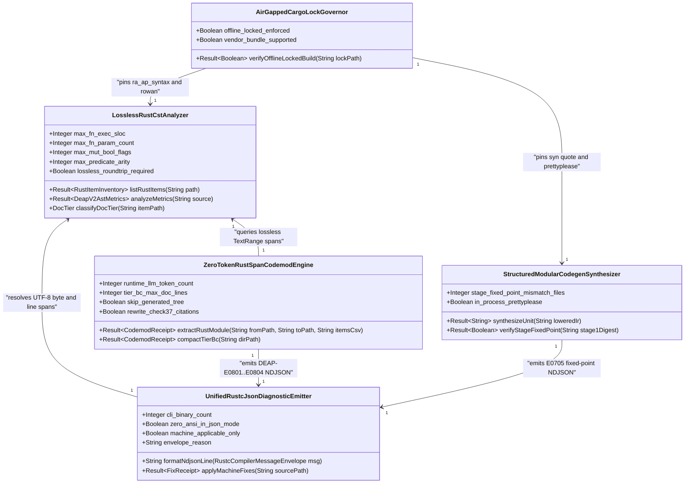
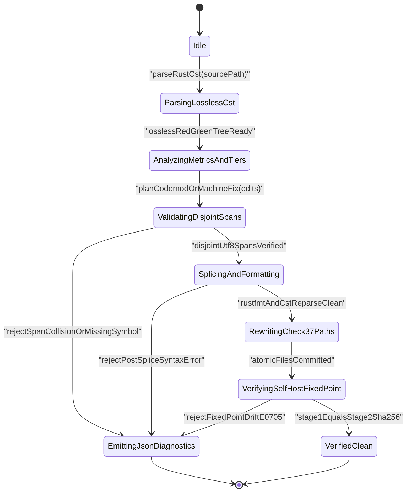
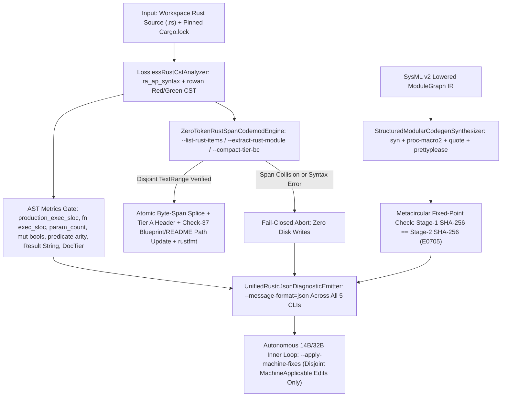
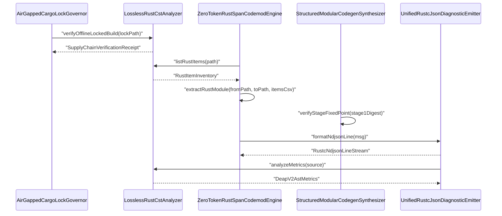

| Attribute | Specification Detail |
| :--- | :--- |
| **Blueprint ID** | `BP-08` |
| **Requirement ID** | `REQ-0608` |
| **Title** | Lossless Rust CST Codemod Engine and Unified rustc-Compatible JSON Diagnostics |
| **Status** | `Draft` |
| **Target Crates** | `crates/deap-core, crates/compile-sysml, crates/verify-baseline, crates/ingest-sysml, crates/assemble-conops, crates/reconcile-backlog` |
| **Tracked Issues** | `#742` |
| **Generation Mode** | `subagent` |
| **Specification Source** | `crates/deap-core/src/source_ast.rs:1-80` |

## 1. Executive Summary & Derivation-Annotation Contract

`LosslessRustCstAndJsonDiagnosticsEngine` (**REQ-0608** / `BP-08` / `DEAP-BP-DET-08`, UUIDv5 `6ba7b810-9dad-11d1-80b4-00c04fd430c8`, `Class P` linear syntax-tree traversal and byte-span splicing complexity, governed by DO-178C Level A, DO-330 TQL-4, ISO 26262 ASIL D, and ECSS-E-ST-40C) replaces approximately 19,700+ production lines (20,154 physical lines) of hand-rolled character-by-character and line-by-line Rust lexical scanners across `crates/deap-core/src/source_ast.rs` (7,558 LOC), `crates/compile-sysml/src/docstring.rs` (5,631 LOC), `crates/verify-baseline/src/checks/docstring_gate.rs` (3,751 LOC), and `crates/verify-baseline/src/audit_code.rs` (3,214 LOC) with a compiler-grade hybrid concrete syntax tree (CST), deterministic code-emission, zero-token span-codemod, and unified machine-readable JSON diagnostic stack.

To eliminate heuristic delimiter drift, macro/raw-string lexical edge cases, high-token LLM refactoring edits, and unstructured ANSI terminal output across autonomous 14B/32B coding-agent inner loops, **BP-08** enforces four orthogonal architectural boundaries:

1. **Lossless Rust Concrete Syntax Tree (`ra_ap_syntax` + `rowan`) & Structured Codegen Boundary**: Parses `.rs` source buffers in `crates/deap-core` into lossless Red/Green syntax trees preserving 100% of whitespace trivia, line/block comments, outer/inner docblocks (`///`, `//!`), attributes (`#[cfg(test)]`, `#[rt_loop]`), visibility qualifiers (`pub` vs `pub(crate)` vs inherited private), typed parameter lists, and exact UTF-8 byte spans (`TextRange`), even on partially incomplete syntax. Drives an exact AST-based DEAP v2.0 metrics analyzer computing `production_exec_sloc` (excluding `#[cfg(test)]` modules, comments, and blank lines), per-`fn` `exec_sloc`, `param_count` (excluding `self`, `&self`, and `&mut self` receivers), mutable boolean flag count (`let mut flag: bool`), compound boolean predicate arity, `Result<T, String>` return-type detection, and `DocTier::RustTierA` versus `DocTier::RustTierBC` classification. Pairs `ra_ap_syntax` + `rowan` (for lossless inspection and exact UTF-8 byte-span splicing on existing Rust files) with `syn` + `proc-macro2` + `quote` + `prettyplease` (for deterministic typed AST code emission in `crates/compile-sysml/src/modular_codegen/`), strictly preserving the `E0705` Stage-1 == Stage-2 metacircular SHA-256 fixed-point invariant.
2. **Deterministic Zero-LLM-Token Span Codemod Operations (`compile-sysml` / `deap-core`)**: Provides `--list-rust-items <path>` (`BTreeMap`-ordered AST item inventory), `--extract-rust-module --from <mod.rs> --to <sub.rs> --items <A,B,...>` (exact CST byte-range slicing with leading docblocks and attributes, Tier A `//!` header + `use super::*;` synthesis, parent `mod <sub>; pub use <sub>::*;` injection, deterministic Check-37 path citation updates across `docs/architecture/blueprints/*.md` and `README.md` whenever `<name>.rs` transitions to `<name>/mod.rs`, and `rustfmt` verification), and `--compact-tier-bc <dir>` (losslessly compacting legacy 28-line 7-section docblocks on `DocTier::RustTierBC` items down to 2-line `/// <summary>` + `/// Realises: [REQ-*]` contracts while skipping `crates/compile-sysml/src/modular_codegen/generated/`).
3. **Unified `rustc`-Compatible Machine-Readable JSON Diagnostics (`--message-format=json`)**: Upgrades `crates/deap-core/src/diagnostics.rs` and all five workspace CLI binaries (`compile-sysml`, `verify-baseline`, `ingest-sysml`, `assemble-conops`, `reconcile-backlog`) to emit single-line NDJSON diagnostic envelopes matching `rustc` and `cargo check --message-format=json` (`reason: "compiler-message"`, `code: { code: "DEAP-E..." }`, `level`, exact `byte_start`/`byte_end` and `line_start`/`line_end` `spans`, and `children` carrying `suggested_replacement` plus `suggestion_applicability: "MachineApplicable" | "MaybeIncorrect"`), enabling a zero-ANSI `--apply-machine-fixes` auto-remediation loop.
4. **Supply Chain & Air-Gapped Dependency Lock**: Pins exact crate versions (`ra_ap_syntax`, `rowan`, `syn`, `proc-macro2`, `quote`, `prettyplease`) in `Cargo.lock` via `cargo fetch`, guaranteeing reproducible `--offline --locked` builds and `cargo vendor` compatibility for air-gapped environments.

| Claim / Requirement | SSOT Input Anchor (file:line / #ID) | Methodology Citation | Derivation Grade (Directly Evidenced / Analytically Derived / Declared Assumption) | Caveat / Downstream Impact |
| :--- | :--- | :--- | :--- | :--- |
| **REQ-0608**: Hybrid lossless Rust CST (`ra_ap_syntax` + `rowan`) and structured modular codegen (`syn` + `proc-macro2` + `quote` + `prettyplease`) replacing ~19,700+ production lines of hand-rolled Rust character/line scanners | `crates/deap-core/src/source_ast.rs:1-80` / `#742` | `ISO/IEC/IEEE 29148:2018 & DO-330 TQL-4` | `Directly Evidenced` | Retires hand-rolled Rust delimiter/line scanners across `deap-core`, `compile-sysml`, and `verify-baseline` while isolating existing Dart `.dart` AST extraction without regression. |
| **SC-01**: Exact lossless Red/Green CST full-fidelity roundtrip and AST-driven DEAP v2.0 metrics (`production_exec_sloc`, per-`fn` `exec_sloc`, receiver-excluded `param_count`, mutable boolean flag count, compound predicate arity, `Result<T, String>` return detection, and `DocTier` classification) | `crates/verify-baseline/src/checks/docstring_gate.rs:1-80` | `Design by Contract (DbC) & DO-178C Level A` | `Analytically Derived` | Eliminates comment, macro, and raw-string lexical misclassifications across Check 36 and `verify-baseline audit-code` (`crates/verify-baseline/src/audit_code.rs:1-80`), deterministic even on partially incomplete `.rs` files. |
| **SC-02**: Structured codegen representation boundary preserving Stage-1 == Stage-2 metacircular SHA-256 fixed-point identity (`E0705`) in `crates/compile-sysml/src/modular_codegen/` | `crates/compile-sysml/src/modular_codegen/mod.rs:32-80` / `#742` | `DO-330 TQL-4 & ECSS-E-ST-40C` | `Directly Evidenced` | `ra_ap_syntax` governs lossless splicing on existing workspace `.rs` files while `quote` + `prettyplease` format newly emitted SysML v2 codegen trees in-process without external subprocess formatting drift. |
| **SC-03**: Fail-closed zero-LLM-token CST span codemods (`--list-rust-items`, `--extract-rust-module`, `--compact-tier-bc`) with atomic Check-37 path citation updates across `docs/architecture/blueprints/*.md` and `README.md` | `crates/compile-sysml/src/docstring.rs:1-80` | `Leveson STPA & ISO 26262 ASIL D` | `Analytically Derived` | Aborts with zero partial disk writes on overlapping `TextRange` selections, missing symbols, or post-splice CST syntax errors, and skips `crates/compile-sysml/src/modular_codegen/generated/` during Tier B/C compaction. |
| **SC-04**: Unified single-line `rustc`-compatible JSON diagnostics (`--message-format=json`) and disjoint `MachineApplicable` auto-fix (`--apply-machine-fixes`) across `deap-core` and all 5 CLI binaries | `crates/deap-core/src/diagnostics.rs:1-100` | `MIL-STD-1629A / SAE ARP4761 & ISO/IEC/IEEE 15288:2023` | `Directly Evidenced` | Unifies `compile-sysml`, `verify-baseline`, `ingest-sysml`, `assemble-conops`, and `reconcile-backlog` on zero-ANSI NDJSON envelopes so 14B/32B coding agents consume one parser across `cargo` and DEAP gates. |
| **SC-05**: Air-gapped supply-chain reproducibility via exact crate version pinning in `Cargo.lock`, `cargo fetch`, `--offline --locked` builds, and `cargo vendor` support | `Cargo.toml:1-34` | `DO-330 TQL-4 Configuration Management` | `Declared Assumption` | Current workspace `Cargo.toml` does not yet declare `ra_ap_syntax`, `rowan`, `syn`, `quote`, or `prettyplease`; exact MSRV-compatible versions must be pinned in `Cargo.lock` during initial dependency onboarding before air-gapped CI execution. |

## 2. Structural Component Metamodel

### Component: LosslessRustCstAnalyzer

| Attribute | Type | Default | Unit | Description |
| :--- | :--- | :--- | :--- | :--- |
| `max_fn_exec_sloc` | `Integer` | `50` | `SLOC` | Upper bound on executable lines of code per Rust function excluding comments, docblocks, attributes, and blank lines. |
| `max_fn_param_count` | `Integer` | `5` | `params` | Upper bound on formal parameters per Rust callable excluding `self`, `&self`, and `&mut self` receivers. |
| `max_mut_bool_flags` | `Integer` | `0` | `flags` | Permitted count of mutable boolean local state flags (`let mut flag: bool`) within a single function body. |
| `max_predicate_arity` | `Integer` | `3` | `clauses` | Maximum boolean operator clause count permitted in a single unhoisted compound predicate expression. |
| `lossless_roundtrip_required` | `Boolean` | `true` | `flag` | Requires root `rowan` GreenNode byte projection to equal the input UTF-8 `.rs` source buffer bit-for-bit. |
| `deterministic_uuid` | `String` | `"6ba7b810-9dad-11d1-80b4-00c04fd430c8"` | `uuidv5` | Canonical deterministic blueprint component identifier (`DEAP-BP-DET-08`). |

| Port | Direction | Type | Protocol | Description |
| :--- | :--- | :--- | :--- | :--- |
| `rust_source_in` | `in` | `String` | `Utf8RustSourceBuffer` | Receives raw `.rs` UTF-8 bytes for lossless `ra_ap_syntax::SourceFile::parse` Red/Green tree construction. |
| `item_inventory_out` | `out` | `String` | `BTreeOrderedItemInventory` | Emits deterministic `BTreeMap`-ordered AST item descriptors with `TextRange` byte/line spans and `DocTier`. |
| `metrics_report_out` | `out` | `String` | `DeapV2AstMetricsReport` | Emits `production_exec_sloc`, per-`fn` `exec_sloc`, `param_count`, mutable bool count, predicate arity, and `Result<T, String>` flags. |

### Component: StructuredModularCodegenSynthesizer

| Attribute | Type | Default | Unit | Description |
| :--- | :--- | :--- | :--- | :--- |
| `stage_fixed_point_mismatch_files` | `Integer` | `0` | `files` | Permitted Stage-1 versus Stage-2 SHA-256 file digest mismatch count across self-hosted modular codegen (`E0705`). |
| `in_process_prettyplease` | `Boolean` | `true` | `flag` | Formats `quote` `TokenStream` ASTs deterministically via `syn::parse2` and `prettyplease::unparse` without external subprocesses. |

| Port | Direction | Type | Protocol | Description |
| :--- | :--- | :--- | :--- | :--- |
| `lowered_ir_in` | `in` | `String` | `LoweredModuleGraphIr` | Receives 4-level lowered SysML v2 `ModuleGraph` descriptors inside `crates/compile-sysml/src/modular_codegen/`. |
| `formatted_rust_out` | `out` | `String` | `PrettypleaseRustUnit` | Emits deterministic formatted Rust compilation units preserving `E0705` Stage-1 == Stage-2 SHA-256 identity. |

### Component: ZeroTokenRustSpanCodemodEngine

| Attribute | Type | Default | Unit | Description |
| :--- | :--- | :--- | :--- | :--- |
| `runtime_llm_token_count` | `Integer` | `0` | `tokens` | Mandatory zero runtime LLM token consumption across item listing, module extraction, and Tier B/C docstring compaction. |
| `tier_bc_max_doc_lines` | `Integer` | `2` | `lines` | Target compacted docstring line count (`/// <summary>` + `/// Realises: [REQ-*]`) on `DocTier::RustTierBC` items. |
| `skip_generated_tree` | `Boolean` | `true` | `flag` | Excludes `crates/compile-sysml/src/modular_codegen/generated/` from `--compact-tier-bc` docstring rewriting. |
| `rewrite_check37_citations` | `Boolean` | `true` | `flag` | Deterministically updates `<name>.rs` citations to `<name>/mod.rs` across `docs/architecture/blueprints/*.md` and `README.md`. |

| Port | Direction | Type | Protocol | Description |
| :--- | :--- | :--- | :--- | :--- |
| `codemod_command_in` | `in` | `String` | `CstCodemodCommand` | Receives `--list-rust-items`, `--extract-rust-module`, or `--compact-tier-bc` CLI invocation payloads. |
| `atomic_patch_out` | `out` | `String` | `AtomicWorkspacePatch` | Commits non-overlapping CST byte-span splices, Tier A `//!` headers, `rustfmt` formatting, and Check-37 path updates atomically. |
| `codemod_error_out` | `out` | `String` | `RustcJsonDiagnosticStream` | Emits fail-closed `DEAP-E0801`..`DEAP-E0804` diagnostics on syntax errors, missing items, or span collisions. |

### Component: UnifiedRustcJsonDiagnosticEmitter

| Attribute | Type | Default | Unit | Description |
| :--- | :--- | :--- | :--- | :--- |
| `cli_binary_count` | `Integer` | `5` | `binaries` | Count of workspace CLI binaries unified on `--message-format=json` (`compile-sysml`, `verify-baseline`, `ingest-sysml`, `assemble-conops`, `reconcile-backlog`). |
| `zero_ansi_in_json_mode` | `Boolean` | `true` | `flag` | Suppresses all ANSI escape sequences and multi-line unstructured banner logs when `--message-format=json` is active. |
| `machine_applicable_only` | `Boolean` | `true` | `flag` | Restricts `--apply-machine-fixes` exclusively to disjoint child suggestions tagged `"MachineApplicable"`. |
| `envelope_reason` | `String` | `"compiler-message"` | `schema` | Canonical top-level JSON discriminator matching `rustc` and `cargo check --message-format=json`. |

| Port | Direction | Type | Protocol | Description |
| :--- | :--- | :--- | :--- | :--- |
| `finding_in` | `in` | `String` | `DeapDiagnosticFinding` | Receives structured compiler, baseline check, ingestion, ConOps, or backlog findings with exact UTF-8 `TextRange` spans. |
| `ndjson_out` | `out` | `String` | `RustcNdjsonLineStream` | Emits single-line newline-delimited `rustc`-compatible JSON diagnostic objects to standard output. |
| `machine_fix_inout` | `inout` | `String` | `AtomicSpanFixTransaction` | Applies reverse-byte-ordered `MachineApplicable` replacements and re-verifies lossless CST syntax integrity. |

### Component: AirGappedCargoLockGovernor

| Attribute | Type | Default | Unit | Description |
| :--- | :--- | :--- | :--- | :--- |
| `offline_locked_enforced` | `Boolean` | `true` | `flag` | Mandates reproducible `--offline --locked` workspace builds against pinned `Cargo.lock` dependency checksums. |
| `vendor_bundle_supported` | `Boolean` | `true` | `flag` | Supports deterministic `cargo vendor` source bundling for zero-network air-gapped DO-330 TQL-4 build runners. |

| Port | Direction | Type | Protocol | Description |
| :--- | :--- | :--- | :--- | :--- |
| `manifest_lock_in` | `in` | `String` | `CargoTomlAndLockfile` | Reads workspace `Cargo.toml` and `Cargo.lock` crate versions and SHA-256 package checksums. |
| `lock_receipt_out` | `out` | `String` | `SupplyChainVerificationReceipt` | Emits verified offline dependency lock and vendoring readiness status. |

## 3. UML & Behavioral Topology









## 4. Formal Mathematical & Safety Constraints

| Constraint ID | Parameter | Min | Max | Unit | Expression |
| :--- | :--- | :--- | :--- | :--- | :--- |
| `C-CST-01` | `max_fn_exec_sloc` | `1` | `50` | `SLOC` | `max_fn_exec_sloc >= 1 and max_fn_exec_sloc <= 50` |
| `C-CST-02` | `max_fn_param_count` | `0` | `5` | `params` | `max_fn_param_count >= 0 and max_fn_param_count <= 5` |
| `C-CST-03` | `max_mut_bool_flags` | `0` | `0` | `flags` | `max_mut_bool_flags == 0` |
| `C-CST-04` | `stage_fixed_point_mismatch_files` | `0` | `0` | `files` | `stage_fixed_point_mismatch_files == 0` |
| `C-CST-05` | `runtime_llm_token_count` | `0` | `0` | `tokens` | `runtime_llm_token_count == 0` |
| `C-CST-06` | `tier_bc_max_doc_lines` | `2` | `2` | `lines` | `tier_bc_max_doc_lines == 2` |

- **SC-01 (Lossless Red/Green Full-Fidelity Roundtrip & Exact DEAP v2.0 Metric Projection)**: Let $S \in \Sigma^*$ be any valid UTF-8 `.rs` source byte buffer of byte length $\lvert S \rvert$, and let $T_{\text{red}}(S) = \text{SourceFile::parse}(S)$ denote its `rowan` Red/Green concrete syntax tree with ordered leaf token sequence $\tau(T_{\text{red}}(S)) = (t_1, \dots, t_k)$. Lossless full fidelity requires exact byte concatenation recovery and contiguous `TextRange` coverage, while `production_exec_sloc` excludes all tokens inside `#[cfg(test)]` subtrees $T_{\text{test}}$, trivia tokens $\mathcal{K}_{\text{trivia}} = \{\text{WHITESPACE}, \text{COMMENT}\}$, and attribute subtrees, and receiver-excluded `param_count(f)` enforces **C-CST-01**, **C-CST-02**, and **C-CST-03**:

$$
\begin{aligned}
\text{Lossless}(S) &\iff \bigoplus_{i=1}^{k} \text{bytes}(t_i) = S \land \sum_{i=1}^{k} \lvert \text{range}(t_i) \rvert = \lvert S \rvert \\
\text{ProductionExecSloc}(S) &= \lvert \{ \ell \in \text{Lines}(S) \mid \exists t \in \tau(T_{\text{red}}(S) \setminus T_{\text{test}}), \quad \text{kind}(t) \notin \mathcal{K}_{\text{trivia}} \land \ell \cap \text{lines}(t) \neq \emptyset \} \rvert \\
\forall f \in \text{Fns}(T_{\text{red}}(S) \setminus T_{\text{test}}), \quad \text{ExecSloc}(f) &\le 50 \land \lvert \text{Params}(f) \setminus \{\text{self}, \&\text{self}, \&\text{mut self}\} \rvert \le 5 \land \text{MutBools}(f) = 0
\end{aligned}
$$

- **SC-03 (Pairwise Disjoint Byte-Span Splicing & Post-Splice Syntax Soundness)**: Let $\mathcal{E} = (([a_1, b_1), r_1), \dots, ([a_m, b_m), r_m))$ be a byte-ascending sequence of CST span edits on source buffer $S$ produced by `--extract-rust-module`, `--compact-tier-bc`, or `--apply-machine-fixes`. Execution under **REQ-0608** is admissible if and only if every span aligns to valid UTF-8 code-point boundaries, all intervals are strictly pairwise disjoint (`DEAP-E0802`), and the resulting spliced buffer $S'$ parses with zero CST syntax errors (`DEAP-E0803`) prior to `write_atomic` persistence:

$$
\begin{aligned}
\text{DisjointValid}(S, \mathcal{E}) &\iff \forall i \in \{1, \dots, m\}, \quad 0 \le a_i \le b_i \le \lvert S \rvert \land \text{is\_char\_boundary}(S, a_i) \land \text{is\_char\_boundary}(S, b_i) \\
&\land \forall i \in \{1, \dots, m - 1\}, \quad b_i \le a_{i+1} \\
\text{AdmissibleCommit}(S, \mathcal{E}) &\iff \text{DisjointValid}(S, \mathcal{E}) \land \lvert \text{errors}(\text{SourceFile::parse}(\text{Splice}(S, \mathcal{E}))) \rvert = 0
\end{aligned}
$$

- **SC-02 (Hybrid CST/Codegen Representation Boundary & Metacircular Fixed-Point Preservation)**: While `ra_ap_syntax` + `rowan` performs trivia-preserving edits on workspace `.rs` files, `crates/compile-sysml/src/modular_codegen/` lowers SysML v2 IR via typed `proc_macro2::TokenStream` (`quote`) -> `syn::parse2::<syn::File>` -> `prettyplease::unparse`. Under **C-CST-04** (`E0705`), the Stage-1 and Stage-2 self-hosted trees compiled from `.pipeline/upstream/schema/modular_codegen.sysml` satisfy exact SHA-256 tree equivalence:

$$
\begin{aligned}
\text{Emit}_{\text{modular}}(M) &= \text{prettyplease::unparse}(\text{syn::parse2}(\text{quote}(M))) \\
\text{SHA-256}(\mathcal{T}_{\text{Stage 1}}) &= \text{SHA-256}(\mathcal{T}_{\text{Stage 2}}) \iff \Delta_{\text{mismatch}}(\mathcal{T}_{\text{Stage 1}}, \mathcal{T}_{\text{Stage 2}}) = 0
\end{aligned}
$$

- **SC-04 & REQ-0608 (NDJSON Framing, MachineApplicable Filtering & `Class P` Linear Complexity)**: Every diagnostic object $d_j$ emitted across the 5 unified CLIs under `--message-format=json` serializes to a single newline-free UTF-8 JSON record with zero ANSI escape bytes (`0x1B`), `--apply-machine-fixes` selects strictly $\mathcal{E}_{\text{auto}} = \{ c \in \text{children}(d_j) \mid \text{applicability}(c) = \text{MachineApplicable} \}$, and CST parsing plus `BTreeMap` inventory construction over $N$ source bytes and $M$ AST items execute in deterministic polynomial time with zero runtime LLM tokens (**C-CST-05**):

$$
\begin{aligned}
\forall d_j \in \mathcal{D}_{\text{json}}, \quad \text{count}(\text{encode}(d_j), \text{0x0A}) &= 0 \land \text{count}(\text{encode}(d_j), \text{0x1B}) = 0 \\
T_{\text{cst}}(N, M) &= O(N + M \log M), \quad S_{\text{cst}}(N, M) = O(N + M), \quad K_{\text{LLM}} = 0
\end{aligned}
$$

## 5. Acceptance Criteria & Verification Matrix

<!-- test-target: crates/deap-core/tests/rust_cst_codemod_and_json_diagnostics.rs -->

- **Test-Target**: `crates/deap-core/tests/rust_cst_codemod_and_json_diagnostics.rs`

### AC-01: Lossless Red-Green CST Roundtrip and Exact DEAP v2.0 AST Metrics Extraction
- **Given**: A Rust `.rs` fixture containing outer/inner docblocks, inline and block comments, raw strings containing braces, `#[rt_loop]` and `#[cfg(test)]` modules, methods taking `&self` and `&mut self`, a function with `let mut flag: bool = false`, a 4-clause compound boolean predicate, a `pub fn` returning `Result<usize, String>`, and a `pub(crate) fn` helper (plus a second fixture with an incomplete trailing expression).
- **When**: `LosslessRustCstAnalyzer` parses both fixtures into `ra_ap_syntax` + `rowan` Red/Green syntax trees and computes DEAP v2.0 metrics and `DocTier` classifications.
- **Then**: Root `SyntaxNode` text equals the original UTF-8 input byte-for-byte on both complete and partially incomplete files, `#[cfg(test)]` items are excluded from `production_exec_sloc`, `self`/`&self`/`&mut self` receivers are excluded from `param_count`, mutable boolean flags, compound predicate arity, and `Result<T, String>` returns are reported at exact UTF-8 `TextRange` offsets, and `pub` API items classify as `DocTier::RustTierA` while private/`pub(crate)` and trait-impl methods classify as `DocTier::RustTierBC`.

### AC-02: Deterministic BTreeMap Item Inventory and Atomic Module Extraction with Check-37 Path Rewriting
- **Given**: An existing workspace module `<name>.rs` referenced in `docs/architecture/blueprints/*.md` and `README.md`, containing multiple top-level structs and functions with leading `///` docblocks and `#[...]` outer attributes inside an isolated temporary workspace fixture.
- **When**: `compile-sysml --list-rust-items <name>.rs` followed by `compile-sysml --extract-rust-module --from <name>/mod.rs --to <name>/<sub>.rs --items <ItemA,ItemB>` is executed after transitioning `<name>.rs` to `<name>/mod.rs`.
- **Then**: `--list-rust-items` emits a deterministic `BTreeMap`-ordered inventory (`kind`, `name`, `visibility`, `byte_range`, `line_range`, `exec_sloc`, `param_count`, `doc_tier`), `--extract-rust-module` slices the exact lossless CST byte ranges (including leading docblocks and attributes) into `<name>/<sub>.rs` with a compliant Tier A `//!` header and `use super::*;`, injects `mod <sub>; pub use <sub>::*;` into `<name>/mod.rs`, deterministically updates Check-37 repository path citations across `docs/architecture/blueprints/*.md` and `README.md` from `<name>.rs` to `<name>/mod.rs`, formats via `rustfmt`, and exits `0`.

### AC-03: Fail-Closed Rejection on Span Collisions, Missing Symbols, or Post-Splice Syntax Errors
- **Given**: An `--extract-rust-module` or `--apply-machine-fixes` invocation targeting either an overlapping pair of `TextRange` byte intervals, a non-existent AST item identifier, or a replacement payload that introduces a CST syntax error.
- **When**: `ZeroTokenRustSpanCodemodEngine` or `UnifiedRustcJsonDiagnosticEmitter` evaluates the proposed `SpanSpliceEdit` transaction.
- **Then**: Execution fails closed with exit code `1`, emits a single-line `rustc`-compatible JSON diagnostic (`DEAP-E0801` missing item, `DEAP-E0802` overlapping span collision, or `DEAP-E0803` post-splice syntax error), and leaves all target `.rs` and `.md` files on disk completely unmodified.

### AC-04: Lossless Tier B/C Docblock Compaction Skipping Self-Hosted Generated Modules
- **Given**: A Rust directory tree containing `DocTier::RustTierA` public items with 7-section docstrings, `DocTier::RustTierBC` private/`pub(crate)` items carrying legacy 28-line 7-section docblocks with `Realises: [REQ-*]` bindings, and a `crates/compile-sysml/src/modular_codegen/generated/` subtree.
- **When**: `compile-sysml --compact-tier-bc <DIR>` executes across the directory tree.
- **Then**: Legacy 28-line docblocks on `DocTier::RustTierBC` items outside `generated/` are losslessly compacted to 2-line `/// <summary>` + `/// Realises: [REQ-*]` contracts (**C-CST-06**) without mutating executable tokens or attributes, while `DocTier::RustTierA` items and 100% of files under `crates/compile-sysml/src/modular_codegen/generated/` remain byte-for-byte identical.

### AC-05: Structured Codegen Boundary Preserving Stage-1 to Stage-2 Metacircular SHA-256 Fixed Point (E0705)
- **Given**: The self-hosting modular codegen schema `.pipeline/upstream/schema/modular_codegen.sysml` lowered through `syn` + `proc-macro2` + `quote` + `prettyplease` inside `crates/compile-sysml/src/modular_codegen/`.
- **When**: Stage-1 generated sources under `crates/compile-sysml/src/modular_codegen/generated/` are re-emitted into an isolated Stage-2 directory and verified for SHA-256 tree parity.
- **Then**: `SHA-256(Stage 1) == SHA-256(Stage 2)` holds across all generated relative paths (**C-CST-04** `stage_fixed_point_mismatch_files == 0`), whereas any injected formatting or AST divergence fails closed with diagnostic code `E0705`.

### AC-06: Unified rustc-Compatible Single-Line JSON Diagnostics and MachineApplicable Auto-Fix Across All Five CLIs
- **Given**: Validation failures triggered across `compile-sysml`, `verify-baseline`, `ingest-sysml`, `assemble-conops`, and `reconcile-backlog` with `--message-format=json`, including diagnostics carrying both `"MachineApplicable"` and `"MaybeIncorrect"` child replacement spans.
- **When**: Standard output is parsed line-by-line as JSON and `--apply-machine-fixes` is subsequently invoked on the offending workspace fixture.
- **Then**: Every CLI emits strictly single-line NDJSON objects with `reason: "compiler-message"`, `message.code.code` prefixed with `"DEAP-E"`, exact UTF-8 `byte_start`/`byte_end` and 1-indexed `line_start`/`line_end` spans, and zero ANSI escape sequences; `--apply-machine-fixes` applies 100% of disjoint `"MachineApplicable"` replacements while leaving `"MaybeIncorrect"` spans untouched.

### AC-07: Air-Gapped Offline Cargo Lock Reproducibility and Twelve-Gate Blueprint Conformance
- **Given**: Workspace `Cargo.toml` and `Cargo.lock` populated via `cargo fetch` alongside `docs/designs/blueprint-08-rust-analyzer-cst-refactoring-and-json-diagnostics.md`.
- **When**: `cargo check --workspace --offline --locked` and `./target/release/verify-baseline check-blueprint docs/designs/blueprint-08-rust-analyzer-cst-refactoring-and-json-diagnostics.md` are executed.
- **Then**: Offline locked dependency resolution succeeds without network access (`cargo vendor`-compatible), and all 12 mechanical blueprint verification gates pass with exit code `0`, persisting `docs/designs/blueprint-08-rust-analyzer-cst-refactoring-and-json-diagnostics.sysml` and `.digest.json`.

## 6. Proposed Deterministic Implementation Contract

| CLI Mode / Flag | Target Binary Scope | Deterministic Transactional Behavior | Exit Codes & JSON Diagnostics |
| :--- | :--- | :--- | :--- |
| `--list-rust-items <PATH>` | `compile-sysml` (`deap_core::rust_cst`) | Parses `.rs` file or directory via `ra_ap_syntax`, emitting a `BTreeMap`-ordered inventory (`kind`, `name`, `visibility`, `byte_range`, `line_range`, `exec_sloc`, `param_count`, `doc_tier`). | `0` on valid inventory output; `1` with `DEAP-E0800` I/O or UTF-8 failure. |
| `--extract-rust-module --from <MOD> --to <SUB> --items <CSV>` | `compile-sysml` (`deap_core::rust_cst`) | Slices exact lossless CST byte ranges (docblocks + attributes + body) into `<SUB>` with Tier A `//!` header + `use super::*;`, injects `mod <sub>; pub use <sub>::*;`, updates Check-37 path citations in `docs/architecture/blueprints/*.md` and `README.md` on `<name>.rs` -> `<name>/mod.rs`, and runs `rustfmt`. | `0` on atomic commit; `1` on missing item (`DEAP-E0801`), span collision (`DEAP-E0802`), or CST syntax failure (`DEAP-E0803`) with zero partial writes. |
| `--compact-tier-bc <DIR>` | `compile-sysml` (`deap_core::rust_cst`) | Compacts legacy 28-line 7-section docblocks on `DocTier::RustTierBC` items to 2-line `/// <summary>` + `/// Realises: [REQ-*]`, skipping `crates/compile-sysml/src/modular_codegen/generated/`. | `0` on idempotent atomic compaction; `1` on CST syntax error (`DEAP-E0803`) or missing `Realises:` tag (`DEAP-E0804`). |
| `--message-format=json [--apply-machine-fixes]` | `compile-sysml`, `verify-baseline`, `ingest-sysml`, `assemble-conops`, `reconcile-backlog` | Emits single-line `rustc`-compatible `reason: "compiler-message"` NDJSON envelopes with zero ANSI bytes; `--apply-machine-fixes` applies disjoint `"MachineApplicable"` child span replacements in reverse byte order. | `0` when zero error-level diagnostics remain after verified fixes; `1` when unfixed error diagnostics or span collisions persist. |

```rust
use serde::{Deserialize, Serialize};
use std::collections::BTreeMap;

#[derive(Debug, Clone, Copy, PartialEq, Eq, PartialOrd, Ord, Serialize, Deserialize)]
pub struct ByteSpan {
    pub byte_start: usize,
    pub byte_end: usize,
    pub line_start: usize,
    pub line_end: usize,
    pub column_start: usize,
    pub column_end: usize,
}

#[derive(Debug, Clone, Copy, PartialEq, Eq, PartialOrd, Ord, Serialize, Deserialize)]
pub enum DocTier {
    RustTierA,
    RustTierBC,
}

#[derive(Debug, Clone, Copy, PartialEq, Eq, PartialOrd, Ord, Serialize, Deserialize)]
pub enum RustVisibility {
    Pub,
    PubCrate,
    PubSuper,
    Inherited,
}

#[derive(Debug, Clone, Copy, PartialEq, Eq, PartialOrd, Ord, Serialize, Deserialize)]
pub enum RustAstItemKind {
    Fn,
    Struct,
    Enum,
    Trait,
    Impl,
    TypeAlias,
    Const,
    Static,
    Mod,
}

#[derive(Debug, Clone, Copy, PartialEq, Eq, Serialize, Deserialize)]
pub struct RustItemMetrics {
    pub exec_sloc: usize,
    pub param_count: usize,
    pub mut_bool_flag_count: usize,
    pub max_predicate_arity: usize,
    pub returns_result_string: bool,
}

#[derive(Debug, Clone, PartialEq, Eq, Serialize, Deserialize)]
pub struct RustItemInventoryEntry {
    pub kind: RustAstItemKind,
    pub name: String,
    pub visibility: RustVisibility,
    pub span: ByteSpan,
    pub metrics: RustItemMetrics,
    pub doc_tier: DocTier,
}

pub type RustItemInventory = BTreeMap<String, RustItemInventoryEntry>;

#[derive(Debug, Clone, Copy, PartialEq, Eq, Serialize, Deserialize)]
pub enum SuggestionApplicability {
    MachineApplicable,
    MaybeIncorrect,
    HasPlaceholders,
    Unspecified,
}

#[derive(Debug, Clone, PartialEq, Eq, Serialize, Deserialize)]
pub struct RustcDiagnosticCode {
    pub code: String,
    pub explanation: Option<String>,
}

#[derive(Debug, Clone, PartialEq, Eq, Serialize, Deserialize)]
pub struct RustcDiagnosticSpan {
    pub file_name: String,
    pub byte_start: usize,
    pub byte_end: usize,
    pub line_start: usize,
    pub line_end: usize,
    pub column_start: usize,
    pub column_end: usize,
    pub is_primary: bool,
    pub label: Option<String>,
    pub suggested_replacement: Option<String>,
    pub suggestion_applicability: Option<SuggestionApplicability>,
}

#[derive(Debug, Clone, PartialEq, Eq, Serialize, Deserialize)]
pub struct RustcDiagnosticChild {
    pub message: String,
    pub level: String,
    pub spans: Vec<RustcDiagnosticSpan>,
}

#[derive(Debug, Clone, PartialEq, Eq, Serialize, Deserialize)]
pub struct RustcDiagnosticMessage {
    pub message: String,
    pub code: Option<RustcDiagnosticCode>,
    pub level: String,
    pub spans: Vec<RustcDiagnosticSpan>,
    pub children: Vec<RustcDiagnosticChild>,
    pub rendered: Option<String>,
}

#[derive(Debug, Clone, PartialEq, Eq, Serialize, Deserialize)]
pub struct RustcCompilerMessageEnvelope {
    pub reason: String,
    pub message: RustcDiagnosticMessage,
}

#[derive(Debug, Clone, PartialEq, Eq)]
pub struct SpanSpliceEdit {
    pub byte_start: usize,
    pub byte_end: usize,
    pub replacement: String,
}

pub fn build_diagnostic_envelope(
    code: &str,
    level: &str,
    text: &str,
    file_name: &str,
    span: ByteSpan,
) -> RustcCompilerMessageEnvelope {
    RustcCompilerMessageEnvelope {
        reason: String::from("compiler-message"),
        message: RustcDiagnosticMessage {
            message: text.to_owned(),
            code: Some(RustcDiagnosticCode {
                code: code.to_owned(),
                explanation: None,
            }),
            level: level.to_owned(),
            spans: vec![RustcDiagnosticSpan {
                file_name: file_name.to_owned(),
                byte_start: span.byte_start,
                byte_end: span.byte_end,
                line_start: span.line_start,
                line_end: span.line_end,
                column_start: span.column_start,
                column_end: span.column_end,
                is_primary: true,
                label: None,
                suggested_replacement: None,
                suggestion_applicability: None,
            }],
            children: Vec::new(),
            rendered: None,
        },
    }
}

pub fn extract_machine_applicable_edits(
    envelope: &RustcCompilerMessageEnvelope,
) -> Vec<SpanSpliceEdit> {
    let mut edits = Vec::new();
    for child in &envelope.message.children {
        for span in &child.spans {
            if span.suggestion_applicability == Some(SuggestionApplicability::MachineApplicable) {
                if let Some(replacement) = &span.suggested_replacement {
                    edits.push(SpanSpliceEdit {
                        byte_start: span.byte_start,
                        byte_end: span.byte_end,
                        replacement: replacement.clone(),
                    });
                }
            }
        }
    }
    edits
}

pub fn apply_disjoint_byte_splices(
    file_name: &str,
    source: &str,
    edits: &[SpanSpliceEdit],
) -> Result<String, RustcCompilerMessageEnvelope> {
    let mut ordered: Vec<&SpanSpliceEdit> = edits.iter().collect();
    ordered.sort_by_key(|edit| (edit.byte_start, edit.byte_end));

    let zero_span = ByteSpan {
        byte_start: 0,
        byte_end: 0,
        line_start: 1,
        line_end: 1,
        column_start: 1,
        column_end: 1,
    };

    let mut prev_end = 0usize;
    for (idx, edit) in ordered.iter().enumerate() {
        if edit.byte_start > edit.byte_end
            || edit.byte_end > source.len()
            || !source.is_char_boundary(edit.byte_start)
            || !source.is_char_boundary(edit.byte_end)
        {
            return Err(build_diagnostic_envelope(
                "DEAP-E0802",
                "error",
                "invalid or non-UTF-8 byte span boundary in CST splice transaction",
                file_name,
                zero_span,
            ));
        }
        if idx > 0 && edit.byte_start < prev_end {
            return Err(build_diagnostic_envelope(
                "DEAP-E0802",
                "error",
                "overlapping TextRange collision detected in CST splice transaction",
                file_name,
                zero_span,
            ));
        }
        prev_end = edit.byte_end;
    }

    let mut output = String::with_capacity(source.len());
    let mut cursor = 0usize;
    for edit in ordered {
        let Some(prefix) = source.get(cursor..edit.byte_start) else {
            return Err(build_diagnostic_envelope(
                "DEAP-E0802",
                "error",
                "failed to slice prefix range during CST splice transaction",
                file_name,
                zero_span,
            ));
        };
        output.push_str(prefix);
        output.push_str(&edit.replacement);
        cursor = edit.byte_end;
    }

    let Some(tail) = source.get(cursor..source.len()) else {
        return Err(build_diagnostic_envelope(
            "DEAP-E0802",
            "error",
            "failed to slice trailing suffix during CST splice transaction",
            file_name,
            zero_span,
        ));
    };
    output.push_str(tail);
    Ok(output)
}
```

## 7. Source References

- **Blueprint Engineering Skill**: `.agents/skills/spec-blueprint-engineering/SKILL.md:1-339` (Mandatory 8-Part Skeleton, 5-Column Derivation-Annotation Contract, and 12-Gate Verification Protocol)
- **Preceding Self-Hosting Modular Codegen Blueprint**: `docs/designs/blueprint-07-self-hosting-modular-codegen-compiler.md:1-100` (`REQ-0607` / `BP-07` Stage-1 == Stage-2 SHA-256 Fixed-Point Invariant `E0705`)
- **Workspace Cargo Manifest & Lint Governance**: `Cargo.toml:1-34` (Workspace crate membership and `[workspace.lints.clippy]` `"forbid"` safety rules)
- **Hand-Rolled Source AST Scanner Target (`deap-core`)**: `crates/deap-core/src/source_ast.rs:1-80` (7,558-line zero-regex character/token AST scanner slated for lossless `ra_ap_syntax` + `rowan` CST replacement on Rust sources)
- **Core Diagnostics & JSON Serialization Target (`deap-core`)**: `crates/deap-core/src/diagnostics.rs:1-100` (645-line diagnostic and dossier module upgraded to `rustc`-compatible `--message-format=json` NDJSON envelopes)
- **Tiered Docstring Synthesizer & Compactor Target (`compile-sysml`)**: `crates/compile-sysml/src/docstring.rs:1-80` (5,631-line docstring injector/compactor upgraded to lossless CST span operations and `--compact-tier-bc`)
- **Self-Hosted Modular Codegen Subsystem (`compile-sysml`)**: `crates/compile-sysml/src/modular_codegen/mod.rs:1-80` (`syn` + `proc-macro2` + `quote` + `prettyplease` structured emission boundary and `generated/` exclusion root)
- **Check 36 Safety Docstring Gate Target (`verify-baseline`)**: `crates/verify-baseline/src/checks/docstring_gate.rs:1-80` (3,751-line tiered docstring completeness verifier migrated to `LosslessRustCstAnalyzer` `DocTier` classification)
- **5-Pillar Static Code Auditor Target (`verify-baseline`)**: `crates/verify-baseline/src/audit_code.rs:1-80` (3,214-line AST auditor migrated to lossless CST metrics and `DEAP-E*` JSON diagnostics)
- **Blueprint Verification Gate (`verify-baseline`)**: `crates/verify-baseline/src/blueprint_gate.rs:1-120` (12-gate mechanical blueprint verifier and SysML v2 roundtrip persistence engine)
- **Unified Five-CLI Binary Entrypoints**: `crates/compile-sysml/src/cli.rs:1-60`, `crates/verify-baseline/src/main.rs:1-60`, `crates/ingest-sysml/src/main.rs:1-60`, `crates/assemble-conops/src/main.rs:1-60`, `crates/reconcile-backlog/src/main.rs:1-60`
- **Tracked Issues**: `#742`
