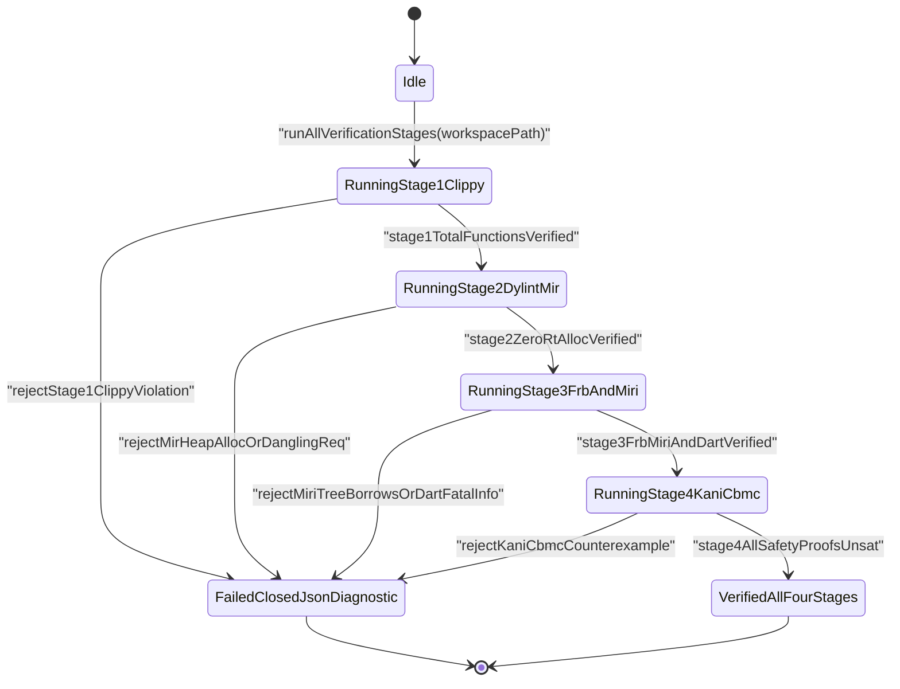
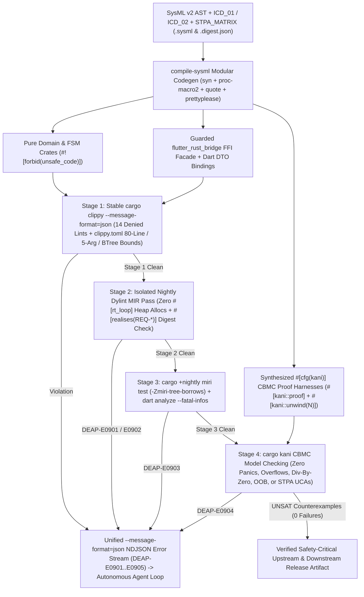
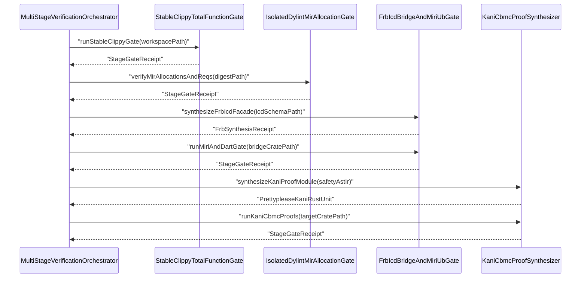

| Attribute | Specification Detail |
| :--- | :--- |
| **Blueprint ID** | `BP-09` |
| **Requirement ID** | `REQ-0609` |
| **Title** | Multi-Stage Compiler and Formal Verification Gatekeeper (Clippy, Dylint MIR, Miri Tree Borrows, Kani CBMC, and flutter_rust_bridge FFI Synthesis) |
| **Status** | `Draft` |
| **Target Crates** | `crates/deap-core, crates/compile-sysml, crates/verify-baseline` |
| **Tracked Issues** | `#742` |
| **Generation Mode** | `subagent` |
| **Specification Source** | `Cargo.toml:12-25` |

## 1. Executive Summary & Derivation-Annotation Contract

`MultiStageFormalVerificationGatekeeper` (**REQ-0609** / `BP-09` / `DEAP-BP-DET-09`, UUIDv5 `6ba7b810-9dad-11d1-80b4-00c04fd430c9`, `Class P` static HIR/THIR/MIR linear pass complexity paired with bounded CBMC state-space unwinding, governed by DO-178C Level A, DO-330 TQL-4, DO-333 Formal Methods Supplement, ISO 26262 ASIL D, and ECSS-E-ST-40C) establishes DEAP's four-stage compiler-native formal verification and FFI boundary-synthesis pipeline across both upstream Tier-0 compiler crates (`crates/*`) and downstream schema-generated Rust + Flutter targets.

Rather than relying on heuristic text linting or post-hoc manual code review to catch partial functions, hidden real-time heap allocations, FFI memory-aliasing defects, or reachable arithmetic/state-machine hazards, **BP-09** couples `compile-sysml` (`BP-07` / `BP-08` `syn` + `proc-macro2` + `quote` + `prettyplease` structured codegen) directly to four progressive formal compiler gates emitting unified `rustc`-compatible JSON diagnostics (`--message-format=json`):

1. **Stage 1 -- Universal Stable HIR/THIR Total-Function Gate (`[workspace.lints.clippy]` + `clippy.toml`)**: Enforces a 14-lint total-function and structural-bound profile across workspace `Cargo.toml` manifests (`unwrap_used = "deny"`, `expect_used = "deny"`, `panic = "deny"`, `todo = "deny"`, `unimplemented = "deny"`, `unreachable = "deny"`, `indexing_slicing = "deny"`, `arithmetic_side_effects = "deny"`, `cast_possible_truncation = "deny"`, `cast_sign_loss = "deny"`, `undocumented_unsafe_blocks = "deny"`, `too_many_lines = "deny"`, `too_many_arguments = "deny"`, `fn_params_excessive_bools = "deny"`), paired with root `clippy.toml` thresholds (`too-many-lines-threshold = 80`, `too-many-arguments-threshold = 5`, and `disallowed-types` banning non-deterministic `std::collections::HashMap` / `std::collections::HashSet` and NFA/backtracking regular-expression engine types with deterministic `BTreeMap` / `BTreeSet` / structural-token replacement reasons). Streams `cargo clippy --message-format=json` diagnostics directly into the autonomous agent remediation loop.
2. **Stage 2 -- Isolated Nightly `Dylint` MIR Control-Flow & Real-Time Allocation Gate**: Executes a standalone nightly `rustc_lint` / `rustc_middle::mir` Dylint plugin workspace completely decoupled from the root stable `Cargo.toml` so stable builds never link `rustc_private`. Traverses `rustc_middle::mir::Body` basic-block `TerminatorKind::Call` and `TerminatorKind::Drop` graphs transitively from every `#[rt_loop]` real-time entrypoint to prove **zero heap allocations** (rejecting `exchange_malloc`, `__rust_alloc`, `__rust_realloc`, `Vec` capacity growth, `Box::new`, `String` formatting, and dynamic drop-glue heap deallocations on hot control paths) while verifying type-checked `#[realises("REQ-*")]` and doc-contract bindings against active `.sysml` requirement digests.
3. **Stage 3 -- `Miri` Abstract-Machine UB Gate & `compile-sysml` to `flutter_rust_bridge` FFI Synthesis**: Enforces `#![forbid(unsafe_code)]` on all pure domain and lowering crates (`@Layer(Domain)` and `@Layer(Application)`) while isolating FFI, HAL, and lock-free ring-buffer marshaling into dedicated bridge crates and modules (`#![deny(unsafe_code)]` + `undocumented_unsafe_blocks = "deny"`). Extends `crates/compile-sysml/src/modular_codegen/` to deterministically synthesize `flutter_rust_bridge`-compatible Rust boundary facades and strongly-typed Dart binding contracts directly from SysML `port def` and `item flow` Interface Control Documents (`ICD_01` / `ICD_02`), wrapping every inbound HMI call in fail-closed domain, `[min..max]` interval, IEEE-754 finiteness, and active FSM state guards, and gating FFI tests under `cargo +nightly miri test` (`-Zmiri-tree-borrows` aliasing, alignment, initialization, and data-race verification) plus `dart analyze --fatal-infos` on the Dart side.
4. **Stage 4 -- Deterministic `#[kani::proof]` CBMC Bounded Model-Checking Synthesis (`syn` + `quote` + `prettyplease`)**: Compiles SysML `constraint def`, `port def` `[min..max]` range intervals, `state def` transition tables, and STPA `**UCA-***` / `**SC-***` safety constraints directly into `#[cfg(kani)]` verification modules (`kani::any()` symbolic inputs constrained by `kani::assume(...)` port/domain bounds, `assert!(...)` postconditions, and `#[kani::unwind(N)]` loop bounds), proving mathematical absence of reachable panics, arithmetic overflows, division-by-zero, out-of-bounds accesses, and STPA unsafe control actions across both upstream DEAP core parsers (`crates/deap-core`, `crates/compile-sysml`) and downstream safety-critical Rust crates.

| Claim / Requirement | SSOT Input Anchor (file:line / #ID) | Methodology Citation | Derivation Grade (Directly Evidenced / Analytically Derived / Declared Assumption) | Caveat / Downstream Impact |
| :--- | :--- | :--- | :--- | :--- |
| **REQ-0609**: Four-stage compiler-native formal verification pipeline (`Clippy` HIR/THIR, isolated nightly `Dylint` MIR, `flutter_rust_bridge` + `Miri` Tree Borrows, and `Kani` CBMC proof synthesis) across upstream `crates/*` and downstream generated Rust + Flutter workspaces | `Cargo.toml:12-25` / `#742` | `ISO/IEC/IEEE 29148:2018 & DO-178C Level A / DO-333` | `Directly Evidenced` | Unifies upstream compiler self-verification and downstream codegen target verification behind single-line `rustc`-compatible `--message-format=json` NDJSON diagnostics (`BP-08`). |
| **SC-01**: Stage 1 universal stable total-function lint gate enforcing 14 `[workspace.lints.clippy]` denials alongside `clippy.toml` `too-many-lines-threshold = 80`, `too-many-arguments-threshold = 5`, and deterministic `disallowed-types` replacements | `Cargo.toml:15-25` / `#742` | `Design by Contract (DbC) & ISO 26262 ASIL D` | `Directly Evidenced` | Upstream pure crates retain `unsafe_code = "forbid"`, whereas isolated Stage-3 FFI/HAL bridge modules use `deny` + `undocumented_unsafe_blocks = "deny"` requiring explicit `// SAFETY:` proof comments. |
| **SC-02**: Stage 2 isolated nightly `Dylint` `rustc_middle::mir::Body` call-graph verifier proving zero heap allocations across `#[rt_loop]` functions and validating `#[realises("REQ-*")]` bindings against compiled `.sysml` requirement sets | `crates/verify-baseline/src/audit_code.rs:1-80` | `DO-178C Level A WCET / Resource Determinism & DO-330 TQL-4` | `Analytically Derived` | Resides in a standalone nightly plugin manifest outside root `Cargo.toml` `[workspace.members]` so stable `cargo build --release` never links `rustc_private`. |
| **SC-03**: Stage 3 `#![forbid(unsafe_code)]` domain partitioning, `compile-sysml` -> `flutter_rust_bridge` FFI synthesis from `ICD_01`/`ICD_02` `port def` and `item flow` contracts with fail-closed inbound guards, `cargo +nightly miri test` (`-Zmiri-tree-borrows`), and `dart analyze --fatal-infos` | `crates/compile-sysml/src/modular_codegen/emitters/flutter/bridge_emitter.rs:1-80` | `Leveson STPA & MIL-STD-1629A / SAE ARP4761` | `Analytically Derived` | Rejects out-of-range, non-finite (`NaN`/`Inf`), or illegal-state HMI inputs at the FFI boundary before pure domain invocation and proves zero Rust Abstract Machine UB across marshaling/ring-buffer code. |
| **SC-04**: Stage 4 deterministic `#[cfg(kani)]` CBMC bounded model-checking harness synthesis via `syn` + `quote` + `prettyplease` from SysML `constraint def`, `port def` `[min..max]`, `state def`, and STPA `**UCA-***` / `**SC-***` safety constraints | `crates/compile-sysml/src/modular_codegen/emitters/rust_emitter.rs:1-60` | `DO-333 Formal Methods & Leveson STPA` | `Analytically Derived` | Emits byte-deterministic `#[kani::proof]` and `#[kani::unwind(N)]` modules preserving `BP-07`/`BP-08` `E0705` Stage-1 == Stage-2 SHA-256 fixed-point equivalence. |
| **SC-05**: Pinned air-gapped nightly toolchain provisioning (`rustc_private` for `Dylint`, `miri` component, and `kani-verifier` CBMC backend) invoked by `verify-baseline` without mutating stable Cargo lockfiles | `Cargo.toml:1-34` | `DO-330 TQL-4 Configuration Management` | `Declared Assumption` | Nightly `cargo-dylint`, `miri`, and `cargo-kani` binaries are provisioned as external pinned workstation/CI toolchains rather than Cargo library dependencies of the stable compiler workspace. |

## 2. Structural Component Metamodel

### Component: StableClippyTotalFunctionGate

| Attribute | Type | Default | Unit | Description |
| :--- | :--- | :--- | :--- | :--- |
| `denied_clippy_lint_count` | `Integer` | `14` | `lints` | Mandatory count of total-function, cast-safety, arithmetic, unsafe-doc, and structural complexity Clippy lints set to `deny` or `forbid`. |
| `too_many_lines_threshold` | `Integer` | `80` | `lines` | Maximum HIR function body line count enforced in root `clippy.toml` (`too-many-lines-threshold`). |
| `too_many_arguments_threshold` | `Integer` | `5` | `params` | Maximum callable parameter count enforced in root `clippy.toml` (`too-many-arguments-threshold`). |
| `disallowed_types_count` | `Integer` | `3` | `types` | Minimum banned non-deterministic hash container and backtracking pattern-engine entries in `clippy.toml`. |
| `json_diagnostic_stream` | `Boolean` | `true` | `flag` | Emits single-line `cargo clippy --message-format=json` NDJSON diagnostics into the autonomous remediation loop. |
| `deterministic_uuid` | `String` | `"6ba7b810-9dad-11d1-80b4-00c04fd430c9"` | `uuidv5` | Canonical deterministic blueprint identifier (`DEAP-BP-DET-09`). |

| Port | Direction | Type | Protocol | Description |
| :--- | :--- | :--- | :--- | :--- |
| `workspace_manifest_in` | `in` | `String` | `CargoAndClippyTomlBundle` | Receives workspace `Cargo.toml`, `clippy.toml`, and target Rust crate source trees. |
| `clippy_ndjson_out` | `out` | `String` | `RustcCompilerMessageNdjson` | Streams machine-applicable `cargo clippy --message-format=json` lint findings and exit status. |

### Component: IsolatedDylintMirAllocationGate

| Attribute | Type | Default | Unit | Description |
| :--- | :--- | :--- | :--- | :--- |
| `max_rt_heap_allocations` | `Integer` | `0` | `allocs` | Permitted transitive heap allocation or dynamic drop-deallocation terminators reachable from any `#[rt_loop]` function. |
| `max_unverified_req_links` | `Integer` | `0` | `links` | Permitted dangling `#[realises("REQ-*")]` or doc-contract requirement identifiers absent from compiled `.sysml` digests. |
| `isolated_nightly_workspace` | `Boolean` | `true` | `flag` | Isolates `rustc_lint` and `rustc_middle::mir` plugin manifest from stable workspace `Cargo.toml`. |
| `plugin_toolchain_channel` | `String` | `"nightly-pinned"` | `toolchain` | Pinned nightly `rustc_private` toolchain channel executing the standalone Dylint MIR analysis library. |

| Port | Direction | Type | Protocol | Description |
| :--- | :--- | :--- | :--- | :--- |
| `mir_body_graph_in` | `in` | `String` | `RustcMiddleMirStream` | Receives lowered `rustc_middle::mir::Body` basic blocks, terminators, and `DefId` attributes alongside `.digest.json`. |
| `dylint_ndjson_out` | `out` | `String` | `RustcCompilerMessageNdjson` | Emits `DEAP-E0901` real-time heap-allocation violations and `DEAP-E0902` broken requirement-binding diagnostics. |

### Component: FrbIcdBridgeAndMiriUbGate

| Attribute | Type | Default | Unit | Description |
| :--- | :--- | :--- | :--- | :--- |
| `max_miri_ub_violations` | `Integer` | `0` | `violations` | Permitted Rust Abstract Machine undefined-behavior findings under `cargo +nightly miri test` with Tree Borrows. |
| `max_dart_analyze_infos` | `Integer` | `0` | `diagnostics` | Permitted static analysis errors, warnings, or info findings under `dart analyze --fatal-infos`. |
| `forbid_unsafe_in_domain` | `Boolean` | `true` | `flag` | Enforces `#![forbid(unsafe_code)]` across all pure domain, lowering, and FSM crates outside isolated FFI/HAL bridges. |
| `miri_aliasing_model` | `String` | `"-Zmiri-tree-borrows"` | `flag` | Active Miri pointer-provenance and aliasing operational semantics flag enforced on FFI and ring-buffer test suites. |

| Port | Direction | Type | Protocol | Description |
| :--- | :--- | :--- | :--- | :--- |
| `sysml_icd_ast_in` | `in` | `String` | `SysmlPortAndItemFlowIcd` | Receives validated SysML `port def`, `item flow`, `state def`, and `ICD_01`/`ICD_02` signal bounds in `compile-sysml`. |
| `frb_facade_and_dart_out` | `out` | `String` | `FrbRustAndDartContractTree` | Emits fail-closed guarded `flutter_rust_bridge` Rust facades and strongly-typed Dart binding modules. |
| `miri_and_dart_receipt_out` | `out` | `String` | `MiriAndDartVerificationReceipt` | Emits `DEAP-E0903` boundary-guard, Miri Tree Borrows UB, or `dart analyze --fatal-infos` failure diagnostics. |

### Component: KaniCbmcProofSynthesizer

| Attribute | Type | Default | Unit | Description |
| :--- | :--- | :--- | :--- | :--- |
| `max_kani_counterexamples` | `Integer` | `0` | `counterexamples` | Permitted reachable CBMC property failures (panics, overflows, div-by-zero, OOB, or STPA `UCA-*` breaches). |
| `default_kani_unwind_bound` | `Integer` | `16` | `iterations` | Deterministic loop unwinding ceiling emitted into `#[kani::unwind(N)]` when AST loops carry finite static bounds. |
| `structured_prettyplease_codegen` | `Boolean` | `true` | `flag` | Emits `#[cfg(kani)]` proof modules via `syn` + `quote` + `prettyplease` without raw string-template concatenation. |

| Port | Direction | Type | Protocol | Description |
| :--- | :--- | :--- | :--- | :--- |
| `sysml_safety_ast_in` | `in` | `String` | `SysmlConstraintStateStpaIr` | Receives SysML `constraint def`, `port def` `[min..max]` ranges, `state def` transitions, and STPA `UCA-*`/`SC-*` specs. |
| `kani_proof_module_out` | `out` | `String` | `PrettypleaseKaniRustUnit` | Emits deterministic `#[cfg(kani)]` modules containing `kani::any()`, `kani::assume(...)`, and `assert!(...)` harnesses. |
| `cbmc_proof_receipt_out` | `out` | `String` | `KaniVerificationReceipt` | Emits CBMC verification status and `DEAP-E0904` counterexample traces in `rustc`-compatible JSON format. |

### Component: MultiStageVerificationOrchestrator

| Attribute | Type | Default | Unit | Description |
| :--- | :--- | :--- | :--- | :--- |
| `verification_stage_count` | `Integer` | `4` | `stages` | Ordered verification stage count (`Stage 1 Clippy` -> `Stage 2 Dylint MIR` -> `Stage 3 FRB + Miri` -> `Stage 4 Kani CBMC`). |
| `fail_closed_short_circuit` | `Boolean` | `true` | `flag` | Halts downstream stage promotion whenever any preceding verification stage exits non-zero. |

| Port | Direction | Type | Protocol | Description |
| :--- | :--- | :--- | :--- | :--- |
| `gate_invocation_in` | `in` | `String` | `VerificationGateCommand` | Receives upstream or downstream target workspace verification commands in `verify-baseline` and `compile-sysml`. |
| `unified_gate_ndjson_out` | `out` | `String` | `RustcCompilerMessageNdjson` | Emits consolidated single-line NDJSON diagnostics (`DEAP-E0900`..`DEAP-E0905`) and final 4-stage verification receipt. |

## 3. UML & Behavioral Topology

```mermaid
classDiagram
    class MultiStageVerificationOrchestrator {
        +Integer verification_stage_count
        +Boolean fail_closed_short_circuit
        +Result~PipelineGateReceipt~ runAllVerificationStages(String workspacePath)
    }
    class StableClippyTotalFunctionGate {
        +Integer denied_clippy_lint_count
        +Integer too_many_lines_threshold
        +Integer too_many_arguments_threshold
        +Integer disallowed_types_count
        +Boolean json_diagnostic_stream
        +Result~StageGateReceipt~ runStableClippyGate(String workspacePath)
    }
    class IsolatedDylintMirAllocationGate {
        +Integer max_rt_heap_allocations
        +Integer max_unverified_req_links
        +Boolean isolated_nightly_workspace
        +String plugin_toolchain_channel
        +Result~StageGateReceipt~ verifyMirAllocationsAndReqs(String digestPath)
    }
    class FrbIcdBridgeAndMiriUbGate {
        +Integer max_miri_ub_violations
        +Integer max_dart_analyze_infos
        +Boolean forbid_unsafe_in_domain
        +String miri_aliasing_model
        +Result~FrbSynthesisReceipt~ synthesizeFrbIcdFacade(String icdSchemaPath)
        +Result~StageGateReceipt~ runMiriAndDartGate(String bridgeCratePath)
    }
    class KaniCbmcProofSynthesizer {
        +Integer max_kani_counterexamples
        +Integer default_kani_unwind_bound
        +Boolean structured_prettyplease_codegen
        +Result~String~ synthesizeKaniProofModule(String safetyAstIr)
        +Result~StageGateReceipt~ runKaniCbmcProofs(String targetCratePath)
    }

    MultiStageVerificationOrchestrator "1" *-- "1" StableClippyTotalFunctionGate : "executes Stage 1 HIR/THIR gate"
    MultiStageVerificationOrchestrator "1" *-- "1" IsolatedDylintMirAllocationGate : "executes Stage 2 MIR gate"
    MultiStageVerificationOrchestrator "1" *-- "1" FrbIcdBridgeAndMiriUbGate : "executes Stage 3 FFI + Miri gate"
    MultiStageVerificationOrchestrator "1" *-- "1" KaniCbmcProofSynthesizer : "executes Stage 4 Kani CBMC gate"
```









## 4. Formal Mathematical & Safety Constraints

| Constraint ID | Parameter | Min | Max | Unit | Expression |
| :--- | :--- | :--- | :--- | :--- | :--- |
| `C-VER-01` | `too_many_lines_threshold` | `1` | `80` | `lines` | `too_many_lines_threshold >= 1 and too_many_lines_threshold <= 80` |
| `C-VER-02` | `too_many_arguments_threshold` | `0` | `5` | `params` | `too_many_arguments_threshold >= 0 and too_many_arguments_threshold <= 5` |
| `C-VER-03` | `max_rt_heap_allocations` | `0` | `0` | `allocs` | `max_rt_heap_allocations == 0` |
| `C-VER-04` | `max_miri_ub_violations` | `0` | `0` | `violations` | `max_miri_ub_violations == 0` |
| `C-VER-05` | `max_kani_counterexamples` | `0` | `0` | `counterexamples` | `max_kani_counterexamples == 0` |
| `C-VER-06` | `default_kani_unwind_bound` | `1` | `64` | `iterations` | `default_kani_unwind_bound >= 1 and default_kani_unwind_bound <= 64` |

- **SC-01 (Stage 1 Stable HIR/THIR Total-Function & Structural Complexity Soundness)**: Let $\mathcal{L}_{\text{deny}}$ denote the 14 mandatory Clippy lint predicates (`unwrap_used`, `expect_used`, `panic`, `todo`, `unimplemented`, `unreachable`, `indexing_slicing`, `arithmetic_side_effects`, `cast_possible_truncation`, `cast_sign_loss`, `undocumented_unsafe_blocks`, `too_many_lines`, `too_many_arguments`, `fn_params_excessive_bools`), and let $\mathcal{T}_{\text{banned}}$ denote the `clippy.toml` `disallowed-types` set banning randomized-seed hash containers (`HashMap`, `HashSet`) and backtracking pattern-matching types. Every function $f$ in workspace crate set $\mathcal{W}$ passes Stage 1 under **C-VER-01** and **C-VER-02** if and only if zero lint violations occur and structural thresholds hold across all HIR bodies:

$$
\begin{aligned}
\text{Stage1Pass}(\mathcal{W}) &\iff \forall C \in \mathcal{W}, \quad \forall \ell \in \mathcal{L}_{\text{deny}}, \quad \text{Violations}_{\ell}(C) = \emptyset \land \text{Types}(C) \cap \mathcal{T}_{\text{banned}} = \emptyset \\
\forall f \in \text{Fns}(\mathcal{W}), \quad \text{Lines}_{\text{HIR}}(f) &\le 80 \land \lvert \text{Args}_{\text{HIR}}(f) \rvert \le 5 \land \text{BoolParams}_{\text{HIR}}(f) \le 3
\end{aligned}
$$

- **SC-02 (Stage 2 Isolated MIR Transitive Zero-Allocation & Requirement Traceability Invariant)**: Let $G_{\text{MIR}} = (V_{\text{def}}, E_{\text{term}})$ be the directed inter-procedural call and drop-glue graph extracted from `rustc_middle::mir::Body` basic-block terminators (`TerminatorKind::Call` and `TerminatorKind::Drop`), let $\mathcal{R}^*(f_{\text{rt}})$ denote the reflexive transitive closure of callees reachable from any `#[rt_loop]` entrypoint $f_{\text{rt}}$, and let $\mathcal{A}_{\text{heap}} = \{\text{exchange\_malloc}, \text{\_\_rust\_alloc}, \text{\_\_rust\_realloc}, \text{\_\_rust\_dealloc}, \text{RawVec::grow}, \text{Box::new}, \text{fmt::format}\}$ denote the forbidden heap-allocator symbol family. Under **C-VER-03** and active SysML digest requirement set $\mathcal{Q}_{\text{sysml}}$, Stage 2 holds if and only if:

$$
\begin{aligned}
\text{ZeroRtHeap}(G_{\text{MIR}}) &\iff \forall f_{\text{rt}} \in V_{\text{rt\_loop}}, \quad \mathcal{R}^*(f_{\text{rt}}) \cap \mathcal{A}_{\text{heap}} = \emptyset \\
\text{TraceableMIR}(V_{\text{def}}, \mathcal{Q}_{\text{sysml}}) &\iff \forall d \in V_{\text{def}}, \quad \text{Realises}(d) \neq \emptyset \implies \text{Realises}(d) \subseteq \mathcal{Q}_{\text{sysml}}
\end{aligned}
$$

- **SC-03 (Stage 3 FFI Boundary Total Guard Projection & Miri Tree Borrows Abstract-Machine Safety)**: Let $\mathcal{W}_{\text{domain}} \subset \mathcal{W}$ denote pure `@Layer(Domain)` and `@Layer(Application)` crates compiled under `#![forbid(unsafe_code)]`, and let $\mathcal{B}_{\text{FFI}}$ denote the `compile-sysml`-synthesized `flutter_rust_bridge` facade derived from `ICD_01` and `ICD_02` `port def` / `item flow` contracts. Every inbound HMI payload $u \in \mathcal{U}_{\text{raw}}$ on port $p$ with declared interval $[p_{\min}, p_{\max}]$ and admissible FSM state set $S_p \subseteq S_{\text{FSM}}$ is gated by total guard predicate $G_p(u, s)$ before entering pure domain transition $\delta_{\text{domain}}$, while every execution trace $\sigma \in \text{Traces}_{\text{Miri}}(\mathcal{B}_{\text{FFI}})$ under `-Zmiri-tree-borrows` satisfies **C-VER-04**:

$$
\begin{aligned}
G_p(u, s) &\iff \text{is\_finite}(u) \land (p_{\min} \le u \le p_{\max}) \land (s \in S_p) \\
\text{Facade}_p(u, s) &= \begin{cases} \text{Ok}(\delta_{\text{domain}}(u, s)) & \text{if } G_p(u, s) \\ \text{Err}(\text{DEAP\_E0903}) & \text{if } \neg G_p(u, s) \end{cases} \\
\text{Stage3Pass}(\mathcal{W}_{\text{domain}}, \mathcal{B}_{\text{FFI}}) &\iff \text{UnsafeBlocks}(\mathcal{W}_{\text{domain}}) = 0 \land \forall \sigma \in \text{Traces}_{\text{Miri}}(\mathcal{B}_{\text{FFI}}), \quad \text{UB}_{\text{TreeBorrows}}(\sigma) = 0
\end{aligned}
$$

- **SC-04 (Stage 4 CBMC Bounded Model-Checking Verification Condition & STPA Non-Occurrence Proof)**: For each pure domain function or `state def` transition handler $f : X \to Y$ with lowered SysML `port def` / `constraint def` precondition $\text{Pre}_{\text{sysml}}(x)$, postcondition $\text{Post}_{\text{sysml}}(x, y)$, loop unwind bound $N \in [1, 64]$ (**C-VER-06**), and linked STPA unsafe control action predicates $\{\text{UCA}_1(x, y), \dots, \text{UCA}_m(x, y)\}$ negated by safety constraints $\{\text{SC}_1, \dots, \text{SC}_m\}$, the `compile-sysml` `#[kani::proof]` synthesizer constructs a CBMC verification condition whose SAT query for counterexamples must be unsatisfiable (**C-VER-05** `max_kani_counterexamples == 0`):

$$
\begin{aligned}
\text{VC}_f(x) &\equiv \text{Pre}_{\text{sysml}}(x) \implies \Big( \neg \text{Panic}_N(f, x) \land \neg \text{ArithOverflow}_N(f, x) \land \neg \text{OutOfBounds}_N(f, x) \\
&\land \text{Post}_{\text{sysml}}(x, f(x)) \land \bigwedge_{j=1}^{m} \neg \text{UCA}_j(x, f(x)) \Big) \\
\text{Stage4Pass}(f, N) &\iff \text{SAT}\big(\exists x \in \Sigma_{\text{CBMC}}, \quad \neg \text{VC}_f(x)\big) = \text{UNSAT}
\end{aligned}
$$

## 5. Acceptance Criteria & Verification Matrix

<!-- test-target: crates/compile-sysml/tests/formal_verification_gatekeeper.rs -->

- **Test-Target**: `crates/compile-sysml/tests/formal_verification_gatekeeper.rs`

### AC-01: Stage 1 Universal Stable Clippy Total-Function and clippy.toml Threshold Enforcement
- **Given**: An upstream or generated downstream Rust workspace configured with `[workspace.lints.clippy]` enforcing all 14 total-function, arithmetic, cast, unsafe-doc, and complexity denials plus root `clippy.toml` (`too-many-lines-threshold = 80`, `too-many-arguments-threshold = 5`, and `disallowed-types` banning non-deterministic `HashMap` / `HashSet` and backtracking pattern-matching types), alongside a negative fixture containing unchecked `+` arithmetic, direct slice indexing, an 81-line function, a 6-argument function, or `std::collections::HashMap`.
- **When**: `StableClippyTotalFunctionGate` executes `cargo clippy --workspace --all-targets --message-format=json`.
- **Then**: Clean total-function crates pass with exit code `0`, while the negative fixture fails closed with non-zero exit status and emits single-line `reason: "compiler-message"` JSON diagnostics citing the exact offending span and deterministic replacement reason.

### AC-02: Stage 2 Isolated Nightly Dylint MIR Zero-Allocation Proof on Real-Time Control Loops
- **Given**: A standalone nightly `Dylint` MIR lint workspace isolated from root stable `Cargo.toml`, evaluating two `#[rt_loop]` control functions: one pure stack-only total function and one negative fixture that transitively invokes `Box::new`, `Vec::push` growth, `format!` heap allocation, or dynamic drop-glue deallocation through an indirect helper function.
- **When**: `IsolatedDylintMirAllocationGate` traverses `rustc_middle::mir::Body` basic-block call and drop terminators across the `#[rt_loop]` call graph while stable `cargo check --workspace --offline --locked` runs independently on the root workspace.
- **Then**: Stable workspace builds succeed with zero `rustc_private` coupling, the stack-only `#[rt_loop]` function passes Stage 2 with `0` allocations (**C-VER-03**), and the transitive heap-allocating `#[rt_loop]` fixture is rejected fail-closed with JSON diagnostic `DEAP-E0901` identifying the exact MIR call chain to `exchange_malloc` / allocator symbols.

### AC-03: Stage 2 Compile-Time MIR Requirement Binding Verification Against Active SysML Digests
- **Given**: Rust items annotated with `#[realises("REQ-0609")]` or `/// Realises: [REQ-0609]` verified against an active `.digest.json` compiled from `.sysml`, plus a negative fixture referencing a non-existent or retired identifier `REQ-9999`.
- **When**: `IsolatedDylintMirAllocationGate` cross-checks extracted HIR/MIR `DefId` requirement bindings against the active SysML requirement digest inventory.
- **Then**: Valid `REQ-0609` bindings pass cleanly, whereas the dangling `REQ-9999` annotation fails closed with non-zero exit status and single-line JSON diagnostic `DEAP-E0902`.

### AC-04: Stage 3 Deterministic flutter_rust_bridge FFI Synthesis with Fail-Closed ICD Boundary Guards
- **Given**: A SysML v2 package and `ICD_01` / `ICD_02` specification declaring `port def` and `item flow` signals with numeric `[min..max]` bounds and admissible `state def` operational modes, lowered by `crates/compile-sysml/src/modular_codegen/`.
- **When**: `compile-sysml` synthesizes the `#![forbid(unsafe_code)]` pure domain crate, the isolated `flutter_rust_bridge` FFI boundary facade, and the Dart DTO/binding modules, and executes inbound FFI boundary tests alongside `dart analyze --fatal-infos`.
- **Then**: Pure domain modules contain `#![forbid(unsafe_code)]`, synthesized Dart bindings pass `dart analyze --fatal-infos` with `0` diagnostics, valid in-range HMI inputs dispatch cleanly into domain logic, and out-of-range, `NaN`/`Inf`, or illegal-FSM-state HMI inputs are rejected fail-closed at the FFI facade with `DEAP-E0903` before reaching domain state.

### AC-05: Stage 3 Miri Tree Borrows Abstract-Machine Undefined-Behavior Rejection on FFI and Ring-Buffer Bridges
- **Given**: An isolated Stage-3 FFI marshaling and lock-free SPSC ring-buffer bridge module containing documented `// SAFETY:` blocks, paired with a negative mutation probe introducing a Tree Borrows pointer-aliasing violation or uninitialized byte read.
- **When**: `FrbIcdBridgeAndMiriUbGate` executes `cargo +nightly miri test` with `MIRIFLAGS="-Zmiri-tree-borrows"`.
- **Then**: The compliant FFI/ring-buffer bridge passes Miri with `0` undefined-behavior findings (**C-VER-04**) and `0` leaked allocations, whereas the mutated aliasing/uninitialized probe fails closed with a non-zero exit code and structured `DEAP-E0903` diagnostic trace.

### AC-06: Stage 4 Deterministic Kani CBMC Proof Synthesis and STPA Unsafe Control Action Falsification
- **Given**: SysML `constraint def` invariants, `port def` `[min..max]` intervals, `state def` transition tables, and STPA `**UCA-01**` / `**SC-01**` safety constraints lowered into `#[cfg(kani)]` modules via `syn` + `quote` + `prettyplease` across `deap-core`, `compile-sysml`, and a generated downstream crate, plus a negative mutation weakening an overflow check or STPA state guard.
- **When**: `KaniCbmcProofSynthesizer` emits the `#[kani::proof]` + `#[kani::unwind(N)]` harnesses (`kani::any()` + `kani::assume(...)` + `assert!(...)`) and executes `cargo kani`.
- **Then**: Emitted `#[cfg(kani)]` source files are byte-deterministic (`E0705`-compliant), all compliant upstream parser and downstream domain harnesses prove `UNSAT` for panics, arithmetic overflows, division-by-zero, OOB accesses, and STPA UCAs (**C-VER-05**), and the mutated guard fails closed with `DEAP-E0904` reporting the concrete CBMC counterexample witness.

### AC-07: Fail-Closed Four-Stage Orchestration and Twelve-Gate Blueprint Bijective SysML Persistence
- **Given**: `docs/designs/blueprint-09-clippy-dylint-miri-kani-formal-verification-gate.md` specifying all 4 stages across `deap-core`, `compile-sysml`, and `verify-baseline`.
- **When**: `./target/release/verify-baseline check-blueprint docs/designs/blueprint-09-clippy-dylint-miri-kani-formal-verification-gate.md` and `./target/release/compile-sysml` execute over the blueprint and emitted `.sysml` metamodel.
- **Then**: All 12 mechanical blueprint verification gates pass with exit code `0`, bijective SysML v2 roundtrip parity holds with zero semantic errors, and `docs/designs/blueprint-09-clippy-dylint-miri-kani-formal-verification-gate.sysml` plus `.digest.json` are atomically persisted on disk.

## 6. Proposed Deterministic Implementation Contract

| Verification Stage | Enforcing Tool & Workspace Scope | Enforced Contract & Thresholds | Fail-Closed Diagnostic Code |
| :--- | :--- | :--- | :--- |
| `Stage 1: HIR/THIR Total-Function Gate` | `cargo clippy --workspace --all-targets --message-format=json` (`Cargo.toml` + `clippy.toml`) | 14 denied Clippy lints (`unwrap_used`, `expect_used`, `panic`, `todo`, `unimplemented`, `unreachable`, `indexing_slicing`, `arithmetic_side_effects`, `cast_possible_truncation`, `cast_sign_loss`, `undocumented_unsafe_blocks`, `too_many_lines`, `too_many_arguments`, `fn_params_excessive_bools`); `too-many-lines-threshold = 80`; `too-many-arguments-threshold = 5`; deterministic `disallowed-types`. | `DEAP-E0900` (Clippy total-function or complexity lint denial in NDJSON) |
| `Stage 2: Nightly Dylint MIR Gate` | Standalone nightly `cargo dylint` plugin workspace (`rustc_lint` + `rustc_middle::mir`) | Transitive `rustc_middle::mir::Body` call/drop-glue traversal proving `0` heap allocations on `#[rt_loop]` paths + `#[realises("REQ-*")]` verification against `.digest.json`; zero `rustc_private` coupling in stable `Cargo.toml`. | `DEAP-E0901` (`#[rt_loop]` MIR heap allocation) / `DEAP-E0902` (unverified `REQ-*` binding) |
| `Stage 3: FRB FFI & Miri UB Gate` | `compile-sysml` FRB emitter + `cargo +nightly miri test` (`-Zmiri-tree-borrows`) + `dart analyze --fatal-infos` | `#![forbid(unsafe_code)]` on pure domain crates; `flutter_rust_bridge` Rust/Dart synthesis from `ICD_01`/`ICD_02` `port def` & `item flow` with fail-closed `[min..max]`/NaN/FSM guards; Tree Borrows UB = `0`; Dart infos = `0`. | `DEAP-E0903` (ICD FFI guard rejection, Miri Tree Borrows UB, or Dart fatal info) |
| `Stage 4: Kani CBMC Model-Checking Gate` | `compile-sysml` (`syn` + `quote` + `prettyplease`) + `cargo kani` CBMC | Deterministic `#[cfg(kani)]` synthesis from `constraint def`, `port def` `[min..max]`, `state def`, and STPA `UCA-*`/`SC-*` (`kani::any()` + `kani::assume` + `assert!` + `#[kani::unwind(N)]`); `0` counterexamples. | `DEAP-E0904` (Kani CBMC counterexample or unwind assertion failure) / `DEAP-E0905` (missing pinned toolchain) |

```rust
use serde::{Deserialize, Serialize};
use std::collections::{BTreeMap, BTreeSet};

#[derive(Debug, Clone, Copy, PartialEq, Eq, PartialOrd, Ord, Serialize, Deserialize)]
pub enum VerificationStage {
    Stage1StableClippy,
    Stage2NightlyDylintMir,
    Stage3FrbAndMiriTreeBorrows,
    Stage4KaniCbmcProofs,
}

#[derive(Debug, Clone, PartialEq, Eq, Serialize, Deserialize)]
pub struct Stage1ClippyPolicy {
    pub too_many_lines_threshold: usize,
    pub too_many_arguments_threshold: usize,
    pub denied_lints: BTreeSet<String>,
    pub deterministic_disallowed_types: BTreeMap<String, String>,
}

impl Stage1ClippyPolicy {
    #[must_use]
    pub fn canonical() -> Self {
        let required = [
            "unwrap_used",
            "expect_used",
            "panic",
            "todo",
            "unimplemented",
            "unreachable",
            "indexing_slicing",
            "arithmetic_side_effects",
            "cast_possible_truncation",
            "cast_sign_loss",
            "undocumented_unsafe_blocks",
            "too_many_lines",
            "too_many_arguments",
            "fn_params_excessive_bools",
        ];
        let mut denied_lints = BTreeSet::new();
        for lint in required {
            denied_lints.insert(String::from(lint));
        }

        let mut deterministic_disallowed_types = BTreeMap::new();
        deterministic_disallowed_types.insert(
            String::from("std::collections::HashMap"),
            String::from("Non-deterministic traversal: use std::collections::BTreeMap"),
        );
        deterministic_disallowed_types.insert(
            String::from("std::collections::HashSet"),
            String::from("Non-deterministic traversal: use std::collections::BTreeSet"),
        );

        Self {
            too_many_lines_threshold: 80,
            too_many_arguments_threshold: 5,
            denied_lints,
            deterministic_disallowed_types,
        }
    }

    pub fn verify_manifest_lints(
        &self,
        configured_lints: &BTreeMap<String, String>,
    ) -> Result<(), String> {
        if self.too_many_lines_threshold == 0 || self.too_many_lines_threshold > 80 {
            return Err(String::from(
                "DEAP-E0900: clippy.toml too-many-lines-threshold must reside in 1..=80",
            ));
        }
        if self.too_many_arguments_threshold > 5 {
            return Err(String::from(
                "DEAP-E0900: clippy.toml too-many-arguments-threshold must reside in 0..=5",
            ));
        }
        for required_lint in &self.denied_lints {
            let Some(level) = configured_lints.get(required_lint) else {
                return Err(format!(
                    "DEAP-E0900: missing mandatory [workspace.lints.clippy] entry '{required_lint}'"
                ));
            };
            if level != "deny" && level != "forbid" {
                return Err(format!(
                    "DEAP-E0900: lint '{required_lint}' must be 'deny' or 'forbid', found '{level}'"
                ));
            }
        }
        Ok(())
    }
}

#[derive(Debug, Clone, Copy, PartialEq, Eq, Serialize, Deserialize)]
pub enum MirHeapAllocationKind {
    ExchangeMalloc,
    RustAllocOrRealloc,
    VecCapacityGrowth,
    BoxHeapAllocation,
    FormattedStringAllocation,
    DynamicDropGlueDealloc,
}

#[derive(Debug, Clone, PartialEq, Eq, Serialize, Deserialize)]
pub struct MirRtAllocationViolation {
    pub rt_entrypoint_def_path: String,
    pub callee_chain: Vec<String>,
    pub allocation_kind: MirHeapAllocationKind,
    pub source_file: String,
    pub line_number: usize,
}

#[derive(Debug, Clone, PartialEq, Eq, Serialize, Deserialize)]
pub struct DylintMirVerificationInput {
    pub isolated_from_stable_workspace: bool,
    pub rt_allocations: Vec<MirRtAllocationViolation>,
    pub item_realises_bindings: BTreeMap<String, Vec<String>>,
    pub active_sysml_requirements: BTreeSet<String>,
}

pub fn evaluate_stage2_dylint_mir(input: &DylintMirVerificationInput) -> Result<(), Vec<String>> {
    let mut diagnostics = Vec::new();
    if !input.isolated_from_stable_workspace {
        diagnostics.push(String::from(
            "DEAP-E0901: nightly Dylint rustc_private workspace must remain isolated from root stable Cargo.toml",
        ));
    }
    for violation in &input.rt_allocations {
        diagnostics.push(format!(
            "DEAP-E0901: #[rt_loop] '{}' performs forbidden MIR heap operation {:?} at {}:{} via [{}]",
            violation.rt_entrypoint_def_path,
            violation.allocation_kind,
            violation.source_file,
            violation.line_number,
            violation.callee_chain.join(" -> "),
        ));
    }
    for (item_path, req_ids) in &input.item_realises_bindings {
        for req_id in req_ids {
            if !input.active_sysml_requirements.contains(req_id) {
                diagnostics.push(format!(
                    "DEAP-E0902: item '{item_path}' binds unverified requirement '{req_id}' absent from active SysML digest"
                ));
            }
        }
    }
    if diagnostics.is_empty() {
        Ok(())
    } else {
        Err(diagnostics)
    }
}

#[derive(Debug, Clone, PartialEq, Serialize, Deserialize)]
pub struct FrbIcdPortGuardSpec {
    pub port_id: String,
    pub signal_name: String,
    pub min_value: f64,
    pub max_value: f64,
    pub allowed_fsm_states: BTreeSet<String>,
}

#[derive(Debug, Clone, PartialEq, Eq, Serialize, Deserialize)]
pub enum FrbBoundaryError {
    NonFinitePayload { port_id: String, signal_name: String },
    OutOfIcdRange { port_id: String, signal_name: String },
    IllegalFsmState { port_id: String, active_state: String },
}

pub fn guard_inbound_frb_f64(
    spec: &FrbIcdPortGuardSpec,
    raw_value: f64,
    active_fsm_state: &str,
) -> Result<f64, FrbBoundaryError> {
    if !raw_value.is_finite() {
        return Err(FrbBoundaryError::NonFinitePayload {
            port_id: spec.port_id.clone(),
            signal_name: spec.signal_name.clone(),
        });
    }
    if raw_value < spec.min_value || raw_value > spec.max_value {
        return Err(FrbBoundaryError::OutOfIcdRange {
            port_id: spec.port_id.clone(),
            signal_name: spec.signal_name.clone(),
        });
    }
    if !spec.allowed_fsm_states.is_empty() && !spec.allowed_fsm_states.contains(active_fsm_state) {
        return Err(FrbBoundaryError::IllegalFsmState {
            port_id: spec.port_id.clone(),
            active_state: active_fsm_state.to_owned(),
        });
    }
    Ok(raw_value)
}

#[derive(Debug, Clone, PartialEq, Eq, Serialize, Deserialize)]
pub struct KaniSymbolicBound {
    pub param_ident: String,
    pub rust_type: String,
    pub min_expr: String,
    pub max_expr: String,
}

#[derive(Debug, Clone, PartialEq, Eq, Serialize, Deserialize)]
pub struct KaniProofHarnessSpec {
    pub harness_ident: String,
    pub target_fn_path: String,
    pub unwind_bound: u32,
    pub symbolic_bounds: Vec<KaniSymbolicBound>,
    pub postcondition_exprs: Vec<String>,
    pub stpa_safety_constraint_ids: Vec<String>,
}

pub fn validate_kani_harness_spec(spec: &KaniProofHarnessSpec) -> Result<(), String> {
    if spec.harness_ident.trim().is_empty() || spec.target_fn_path.trim().is_empty() {
        return Err(String::from(
            "DEAP-E0904: Kani proof harness identifier and target function path must be non-empty",
        ));
    }
    if spec.unwind_bound == 0 || spec.unwind_bound > 64 {
        return Err(format!(
            "DEAP-E0904: #[kani::unwind({})] must reside within 1..=64",
            spec.unwind_bound
        ));
    }
    if spec.postcondition_exprs.is_empty() {
        return Err(format!(
            "DEAP-E0904: Kani harness '{}' requires at least one postcondition or STPA SC-* assertion",
            spec.harness_ident
        ));
    }
    Ok(())
}

#[derive(Debug, Clone, PartialEq, Eq, Serialize, Deserialize)]
pub struct StageGateReceipt {
    pub stage: VerificationStage,
    pub passed: bool,
    pub diagnostic_codes: Vec<String>,
}

pub fn evaluate_four_stage_gatekeeper(
    receipts: &[StageGateReceipt],
) -> Result<(), VerificationStage> {
    let expected = [
        VerificationStage::Stage1StableClippy,
        VerificationStage::Stage2NightlyDylintMir,
        VerificationStage::Stage3FrbAndMiriTreeBorrows,
        VerificationStage::Stage4KaniCbmcProofs,
    ];
    for (idx, required_stage) in expected.iter().enumerate() {
        let Some(receipt) = receipts.get(idx) else {
            return Err(*required_stage);
        };
        if receipt.stage != *required_stage || !receipt.passed || !receipt.diagnostic_codes.is_empty() {
            return Err(*required_stage);
        }
    }
    Ok(())
}
```

## 7. Source References

- **Blueprint Engineering Skill**: `.agents/skills/spec-blueprint-engineering/SKILL.md:1-339` (Mandatory 8-Part Skeleton, 5-Column Derivation-Annotation Contract, and 12-Gate Verification Protocol)
- **Project Constitution & Phase 0 STPA Safety Gate**: `.pipeline/constitution.md:194-213` (8-Pillar STPA/FMECA Safety Schema, Derivation-Annotation Contract, and Forbidden Math Delimiters on Alphanumeric IDs)
- **Logical Interface Specification & ICD Engineering Skill**: `.agents/skills/spec-icd-engineering/SKILL.md:40-80` (`port def`, `item flow`, `ICD_01_SYSTEM_INTERFACE_MATRIX.md`, and `ICD_02_MASTER_SIGNAL_DICTIONARY.md` AST extraction contract)
- **Preceding Self-Hosting Modular Codegen Blueprint (`BP-07`)**: `docs/designs/blueprint-07-self-hosting-modular-codegen-compiler.md:1-30` (`REQ-0607` 4-Level Modular Codegen and Stage-1 == Stage-2 SHA-256 Fixed-Point Invariant `E0705`)
- **Preceding Lossless CST & Unified JSON Diagnostics Blueprint (`BP-08`)**: `docs/designs/blueprint-08-rust-analyzer-cst-refactoring-and-json-diagnostics.md:1-35` (`REQ-0608` `syn` + `proc-macro2` + `quote` + `prettyplease` codegen boundary and `--message-format=json` NDJSON diagnostics)
- **Workspace Cargo Manifest & Lint Governance**: `Cargo.toml:1-34` (`[workspace.lints.rust]` `unsafe_code = "forbid"` and `[workspace.lints.clippy]` total-function lint baseline)
- **Core AST & Diagnostics Library (`deap-core`)**: `crates/deap-core/src/lib.rs:1-80`, `crates/deap-core/src/diagnostics.rs:1-80` (SysML v2 AST nodes `ConstraintDef`, `PortDef`, `StateDef` and diagnostic structures)
- **Modular Codegen Orchestrator & Rust Emitter (`compile-sysml`)**: `crates/compile-sysml/src/modular_codegen/mod.rs:1-80`, `crates/compile-sysml/src/modular_codegen/emitters/mod.rs:1-36`, `crates/compile-sysml/src/modular_codegen/emitters/rust_emitter.rs:1-60` (Target insertion points for `#[cfg(kani)]` CBMC harness emission and `#![forbid(unsafe_code)]` domain crate emission)
- **Modular Flutter & FFI Bridge Emitter (`compile-sysml`)**: `crates/compile-sysml/src/modular_codegen/emitters/flutter/mod.rs:1-80`, `crates/compile-sysml/src/modular_codegen/emitters/flutter/bridge_emitter.rs:1-80` (Target insertion points for `flutter_rust_bridge` FFI boundary facade and fail-closed ICD range/state guard synthesis)
- **Static Auditor, Docstring Gate & Blueprint Verifier (`verify-baseline`)**: `crates/verify-baseline/src/audit_code.rs:1-80`, `crates/verify-baseline/src/checks/docstring_gate.rs:1-80`, `crates/verify-baseline/src/blueprint_gate.rs:1-120` (12-gate blueprint verifier and multi-stage verification orchestration targets)
- **Tracked Issues**: `#742`
