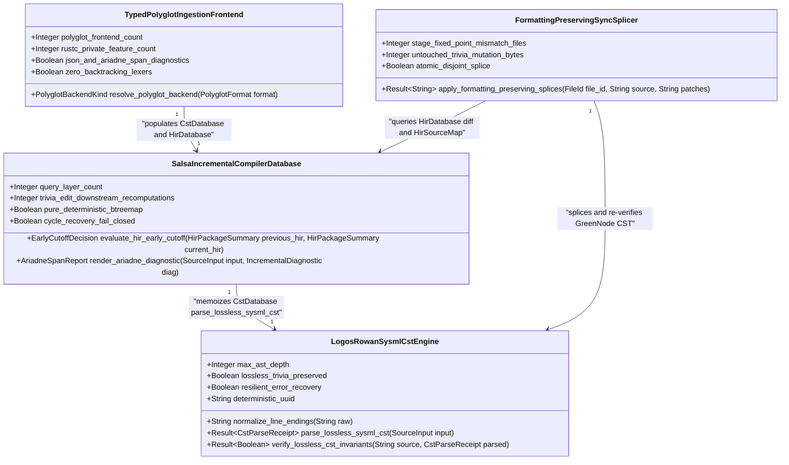
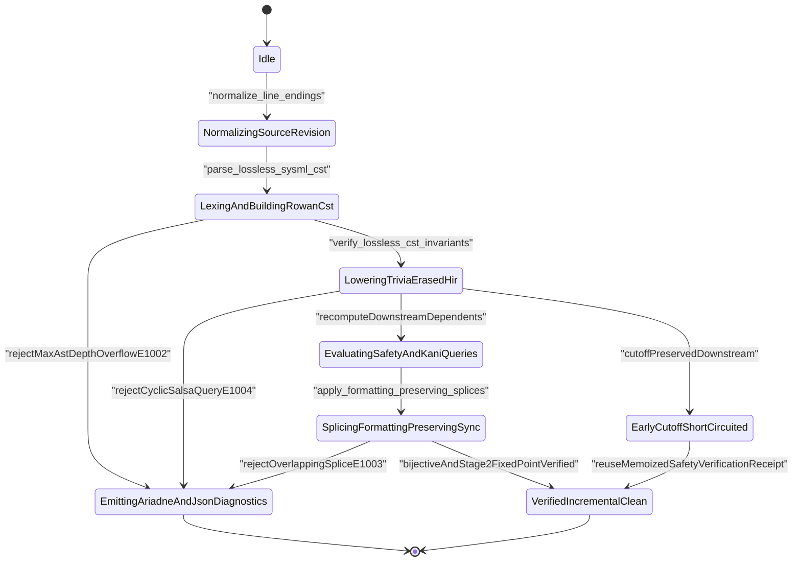
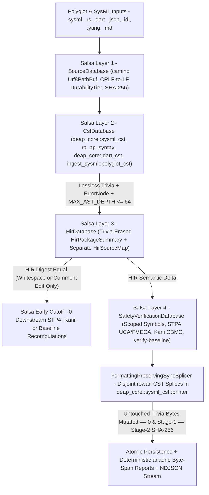
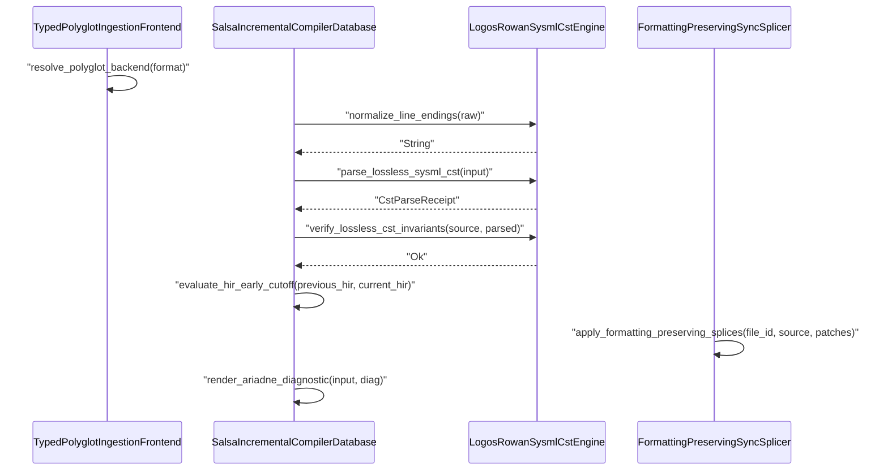

| Attribute | Specification Detail |
| :--- | :--- |
| **Blueprint ID** | `BP-10` |
| **Requirement ID** | `REQ-0610` |
| **Title** | Incremental Lossless SysML v2 and Polyglot Compiler Engine (logos + rowan + salsa + ariadne) |
| **Status** | `Draft` |
| **Target Crates** | `crates/deap-core, crates/compile-sysml, crates/ingest-sysml, crates/verify-baseline` |
| **Tracked Issues** | `#742` |
| **Generation Mode** | `subagent` |
| **Specification Source** | `crates/compile-sysml/src/lexer/scanner.rs:1-60 / crates/deap-core/src/sysml_ast/mod.rs:1-80 / #742` |

## 1. Executive Summary & Derivation-Annotation Contract

`IncrementalLosslessSysmlAndPolyglotCompilerEngine` (**REQ-0610** / `BP-10` / `DEAP-BP-DET-10`, UUIDv5 `6ba7b810-9dad-11d1-80b4-00c04fd430ca`, `Class P` linear DFA lexing, lossless Red/Green syntax-tree construction, `ariadne` deterministic byte-span rendering, and `O(delta)` early-cutoff incremental query complexity, governed by DO-178C Level A, DO-330 TQL-4, DO-333 Formal Methods Supplement, ISO 26262 ASIL D, and ECSS-E-ST-40C) defines Phase 2 of DEAP's compiler modernization, cohesively extending **BP-03** (**REQ-0603**) across `crates/deap-core`, `crates/compile-sysml`, `crates/ingest-sysml`, and `crates/verify-baseline` onto the query-driven `rust-analyzer` incremental compiler architecture with `ZERO #![feature(rustc_private)]` inside `./crates/*`.

While **BP-03** (**REQ-0603**) established bijective SysML v2 AST roundtrip parity over `deap_core::sysml_cst` and `compile_sysml::salsa_db`, **BP-07** (**REQ-0607**) introduced self-hosted 4-level modular code generation (`E0705`), **BP-08** (**REQ-0608**) introduced `ra_ap_syntax` + `rowan` lossless Rust codemods and unified `--message-format=json` NDJSON diagnostics, and **BP-09** (**REQ-0609**) established 4-stage formal verification (`Clippy`, `Dylint` MIR, `Miri` Tree Borrows, and `Kani` CBMC), legacy batch-mode character scanners (`./crates/compile-sysml/src/lexer/scanner.rs`, `./crates/deap-core/src/sysml_ast/mod.rs`), hand-rolled token walkers (`./crates/compile-sysml/src/validator.rs` and `./crates/compile-sysml/src/semantic/validator.rs`), full-file AST re-serializers (`./crates/compile-sysml/src/sync/`), and line-splitting polyglot translators (`./crates/ingest-sysml/src/translators/{code,idl,yang,openapi}.rs`) must be retired net-negatively. **BP-10** unifies five orthogonal compiler subsystems:

1. **`logos` Deterministic DFA Lexer + `rowan` Lossless Red/Green SysML v2 CST (`deap_core::sysml_cst::{lexer,syntax_kind,parser,printer,digest}`)**: Replaces hand-rolled character cursor loops and token walkers with a compile-time DFA `logos::Logos` token stream (`SysmlToken`) feeding `rowan::GreenNodeBuilder` (`SysmlSyntaxKind`, `SysmlLanguage`, `SysmlSyntaxNode`), where workspace `rowan` is pinned identically to `ra_ap_syntax`'s transitive `rowan` version. Normalizes CRLF/CR line endings at ingestion (`normalize_line_endings`) across macOS, Linux, and Windows (`camino::Utf8Path`), preserves 100% of trivia (`//`, `/* ... */`, `doc /* ... */`, `@Safety`, `@Layer`, whitespace, and exact UTF-8 byte spans), performs resilient error-recovery parsing via `ErrorNode` (`DEAP-E1001`), and enforces `MAX_AST_DEPTH = 64` structural recursion guards (`DEAP-E1002`).
2. **Demand-Driven `salsa` Incremental Query Database (`compile_sysml::salsa_db`)**: Models end-to-end compilation as four stratified, pure, memoized `salsa` query layers backed exclusively by deterministic `BTreeMap` and `BTreeSet` collections: `SourceDatabase` (`SourceInput` with `camino::Utf8PathBuf`, LF-normalized UTF-8 text, `DurabilityTier`, and SHA-256 digests), `CstDatabase` (`parse_sysml_cst`, `ra_ap_syntax` Rust CST, `deap_core::dart_cst`, and `ingest_sysml::polyglot_cst`), `HirDatabase` (trivia-erased `HirPackageSummary` decoupled from `HirSourceMap` span side-tables for `O(delta)` early cutoff via `evaluate_hir_early_cutoff`, plus fail-closed `DEAP-E1004` cycle detection), and `SafetyVerificationDatabase` (memoized STPA UCA/FMECA derivation, Kani CBMC harness lowering, and `verify-baseline` parity checks).
3. **`ariadne` Deterministic Byte-Span Diagnostics & NDJSON Envelope Parity**: Renders human-readable multi-span source reports via `ariadne` (`Report::build` over deterministic UTF-8 byte offsets and LF-normalized line caches with ANSI color disabled in deterministic CI / golden snapshots) alongside single-line `--message-format=json` `rustc`-compatible NDJSON diagnostics (`DEAP-E1000..DEAP-E1005`), eliminating ad-hoc line/column string arithmetic.
4. **Formatting-Preserving Bidirectional CST Splicing (`compile-sysml` `sync/forward` & `sync/reverse`)**: Replaces destructive full-file `to_sysml` overwrites during incremental sync with pairwise-disjoint `rowan` CST splice transactions (`apply_formatting_preserving_splices`, `DEAP-E1003` on span collision), preserving 100% of untouched architect comments and whitespace while upholding **BP-03** Stage-1 == Stage-2 bijective parity and **BP-07** `E0705` SHA-256 fixed-point determinism.
5. **Typed Polyglot Ingestion CSTs (`deap_core::dart_cst` & `ingest_sysml::polyglot_cst`)**: Retires all line/brace scanners across `./crates/ingest-sysml/src/translators/{code,idl,yang,openapi}.rs` in favor of typed CST/AST frontends (`ZERO #![feature(rustc_private)]` inside `./crates/*`): `ra_ap_syntax` lossless Red/Green CST for Rust, `logos` + `rowan` `deap_core::dart_cst` for Dart, typed `serde_json` schema AST structs for JSON-Schema / OpenAPI 3.x, and dedicated `logos` + `rowan` grammar CSTs in `ingest_sysml::polyglot_cst` (`idl_cst`, `yang_cst`, `markdown_cst`) lowering into `compile_sysml::salsa_db` (`DEAP-E1005`).

### Net-Negative Legacy-Scanner Deletion Targets & `< 380` Exec SLOC Submodule Layout

| Action | Workspace-Relative Target Path | SLOC Budget / Delta | Architectural Responsibility |
| :--- | :--- | :--- | :--- |
| **DELETE (Net-Negative)** | `./crates/deap-core/src/sysml_ast/mod.rs` (legacy char/brace scanners & manual formatters) | `-2,400+` SLOC | Deletes hand-rolled character/slice SysML scanners and ad-hoc string serializers; retains pure typed HIR structs only. |
| **DELETE (Net-Negative)** | `./crates/ingest-sysml/src/translators/{code,idl,yang,openapi}.rs` (ad-hoc line/brace scanners) | `-1,800+` SLOC | Deletes fragile line-splitting, substring-probing, and brace-counting polyglot translators. |
| **DELETE (Net-Negative)** | `./crates/compile-sysml/src/validator.rs` & `./crates/compile-sysml/src/semantic/validator.rs` (hand-rolled token walkers) | `-650+` SLOC | Deletes ad-hoc raw-text and token-slice semantic walkers in favor of typed `rowan` CST / `salsa` HIR queries. |
| **ADD (`< 380` SLOC)** | `./crates/deap-core/src/sysml_cst/lexer.rs` (`deap_core::sysml_cst::lexer`) | `<= 220` exec SLOC | `logos::Logos` DFA token specification (`SysmlToken`) with zero pre-lexer sigil rewriting. |
| **ADD (`< 380` SLOC)** | `./crates/deap-core/src/sysml_cst/syntax_kind.rs` (`deap_core::sysml_cst::syntax_kind`) | `<= 240` exec SLOC | `SysmlSyntaxKind` and `rowan::Language` (`SysmlLanguage`) Red/Green binding (`rowan` pinned to `ra_ap_syntax`). |
| **ADD (`< 380` SLOC)** | `./crates/deap-core/src/sysml_cst/parser.rs` (`deap_core::sysml_cst::parser`) | `<= 360` exec SLOC | Resilient `rowan::GreenNodeBuilder` parser (`MAX_AST_DEPTH = 64`) and typed `AstNode` projections (zero `.syntax().text().contains(...)`). |
| **ADD (`< 380` SLOC)** | `./crates/deap-core/src/sysml_cst/printer.rs` (`deap_core::sysml_cst::printer`) | `<= 280` exec SLOC | Canonical LF-normalized SysML v2 CST/HIR printer and disjoint `rowan` CST splice applier. |
| **ADD (`< 380` SLOC)** | `./crates/deap-core/src/sysml_cst/digest.rs` (`deap_core::sysml_cst::digest`) | `<= 190` exec SLOC | Cross-platform CRLF-to-LF normalization (`camino::Utf8Path`), Stage-1 == Stage-2 bijective gate, and SHA-256 HIR digesting. |
| **ADD (`< 380` SLOC)** | `./crates/deap-core/src/dart_cst/mod.rs` (`deap_core::dart_cst`) | `<= 340` exec SLOC | `logos` + `rowan` lossless Dart Red/Green CST frontend for cross-platform Flutter/Dart ingestion. |
| **ADD (`< 380` SLOC)** | `./crates/compile-sysml/src/salsa_db/mod.rs` (`compile_sysml::salsa_db`) | `<= 350` exec SLOC | 4-layer `salsa` incremental query database (`SourceDatabase`, `CstDatabase`, `HirDatabase`, `SafetyVerificationDatabase`) + `ariadne` span emitter. |
| **ADD (`< 380` SLOC)** | `./crates/ingest-sysml/src/polyglot_cst/mod.rs` (`ingest_sysml::polyglot_cst`) | `<= 360` exec SLOC | Cohesive polyglot router dispatching `ra_ap_syntax` (Rust), `deap_core::dart_cst` (Dart), typed `serde_json` AST (JSON-Schema/OpenAPI), and `logos`+`rowan` CSTs (OMG IDL, IETF YANG, Markdown). |

### 3-Layer Definition of Done Closure

| Layer | Architectural Scope | Concrete Deliverable & Verification Binding |
| :--- | :--- | :--- |
| **Layer 1: Domain State & Data Model** | Lossless Red/Green CSTs (`rowan` pinned to `ra_ap_syntax`), trivia-erased HIR records, `HirSourceMap` byte-span tables, and cross-platform `camino::Utf8PathBuf` inputs | `SysmlToken`, `SysmlSyntaxKind`, `SysmlLanguage`, `CstParseReceipt`, `HirPackageSummary`, `HirSourceMap`, `SourceInput`, `PolyglotFormat`, `PolyglotBackendKind`, and `AriadneSpanReport` across `deap_core::sysml_cst`, `deap_core::dart_cst`, `compile_sysml::salsa_db`, and `ingest_sysml::polyglot_cst`. |
| **Layer 2: Logic & State Management** | Pure `logos` DFA lexing, `rowan` GreenNode building (`MAX_AST_DEPTH <= 64`), 4-layer `salsa` memoized early-cutoff queries, disjoint CST splicing, and typed polyglot CST lowering | `normalize_line_endings`, `lex_sysml_tokens`, `parse_lossless_sysml_cst`, `verify_lossless_cst_invariants`, `evaluate_hir_early_cutoff`, `apply_formatting_preserving_splices`, and `resolve_polyglot_backend` with 100% typed CST traversal and zero `.syntax().text().contains(...)`. |
| **Layer 3: Presentation & Actuator Interface Binding** | Deterministic `ariadne` byte-span diagnostic renderer, `--message-format=json` NDJSON CLI stream, and atomic `.sysml` / `.digest.json` workspace actuators | `render_ariadne_diagnostic` plus `compile-sysml`, `ingest-sysml`, and `verify-baseline check-blueprint` CLI actuators emitting ANSI-free deterministic `ariadne` / NDJSON diagnostics (`DEAP-E1000..DEAP-E1005`) and bijective `.sysml` + `.digest.json` artifacts across macOS, Linux, and Windows. |

| Claim / Requirement | SSOT Input Anchor (file:line / #ID) | Methodology Citation | Derivation Grade (Directly Evidenced / Analytically Derived / Declared Assumption) | Caveat / Downstream Impact |
| :--- | :--- | :--- | :--- | :--- |
| **REQ-0610**: Cohesive Phase 2 compiler architecture unifying `deap-core`, `compile-sysml`, `ingest-sysml`, and `verify-baseline` onto `logos` DFA lexing, `rowan` lossless Red/Green CSTs (pinned to `ra_ap_syntax`), `salsa` incremental query groups, and `ariadne` byte-span diagnostics | `crates/compile-sysml/src/lexer/scanner.rs:1-60` / `#742` | `ISO/IEC/IEEE 29148:2018 & DO-330 TQL-4` | `Directly Evidenced` | Deletes `-2,400+` SLOC in `sysml_ast/mod.rs`, `-1,800+` SLOC in `ingest-sysml/src/translators/*`, and hand-rolled token walkers in `compile-sysml/src/validator.rs` (`< 380` exec SLOC per new submodule). |
| **SC-01**: Total panic-free `logos` DFA tokenization and `rowan` lossless Red/Green `SysmlLanguage` CST (`deap_core::sysml_cst`) preserving 100% of trivia and LF-normalized UTF-8 byte spans with `ErrorNode` recovery (`DEAP-E1001`) and `MAX_AST_DEPTH = 64` guards (`DEAP-E1002`) | `crates/compile-sysml/src/parser/grammar/mod.rs:42-80` / `#742` | `Design by Contract (DbC) & DO-178C Level A` | `Directly Evidenced` | Enforces 100% typed `rowan` CST traversal (`ZERO .syntax().text().contains(...)`), `camino::Utf8Path` cross-platform paths, and CRLF-to-LF normalization matching `BP-03`. |
| **SC-02**: Formatting-preserving bidirectional synchronization via pairwise-disjoint `rowan` CST splice transactions (`DEAP-E1003`) preserving untouched comments/formatting, `BP-03` bijective roundtrip parity, and `BP-07` `E0705` Stage-1 == Stage-2 SHA-256 identity | `crates/compile-sysml/src/sync/reverse.rs:1-60` / `#742` | `Leveson STPA & ECSS-E-ST-40C` | `Analytically Derived` | Replaces destructive full-file `to_sysml` overwrites on incremental syncs; canonical `deap_core::sysml_cst::printer` emission remains deterministic for newly synthesized subtrees. |
| **SC-03**: Four-layer pure memoized `salsa` query database (`compile_sysml::salsa_db`) enforcing trivia-erased `HirPackageSummary` vs `HirSourceMap` separation for `O(delta)` early cutoff, fail-closed `DEAP-E1004` cycle rejection, and `ariadne` deterministic byte-span rendering | `crates/compile-sysml/src/semantic/validator.rs:1-45` | `DO-333 Formal Methods & ISO 26262 ASIL D` | `Analytically Derived` | All memoized query outputs use deterministic `BTreeMap`/`BTreeSet` ordering with zero `HashMap` drift, zero hidden filesystem I/O, and zero wall-clock reads inside derived queries. |
| **SC-04**: Cohesive typed polyglot CST/AST lowering (`ra_ap_syntax` Rust, `deap_core::dart_cst` Dart, typed `serde_json` JSON-Schema/OpenAPI, `logos`+`rowan` OMG IDL / IETF YANG / Markdown in `ingest_sysml::polyglot_cst`) with `ZERO #![feature(rustc_private)]` | `crates/ingest-sysml/src/translators/code.rs:1-60` | `MIL-STD-1629A / SAE ARP4761 & ISO/IEC/IEEE 15288:2023` | `Directly Evidenced` | Eliminates `-1,800+` SLOC of line/brace heuristic scanners and emits deterministic `ariadne` + `--message-format=json` span diagnostics (`DEAP-E1005`) without NFA backtracking. |
| **SC-05**: Air-gapped supply-chain pinning of MSRV-compatible `logos`, `rowan` (exact `ra_ap_syntax` version match), `salsa`, `ariadne`, `camino`, and `ra_ap_syntax` in `Cargo.lock` with `#![forbid(unsafe_code)]` and `ZERO #![feature(rustc_private)]` across `./crates/*` | `Cargo.toml:1-34` | `DO-330 TQL-4 Configuration Management` | `Declared Assumption` | Workspace `Cargo.toml` pins `rowan` identically to `ra_ap_syntax` so `GreenNode` / `TextRange` types interoperate across `deap-core`, `compile-sysml`, and `ingest-sysml` under `--offline --locked` builds. |

## 2. Structural Component Metamodel

### Component: LogosRowanSysmlCstEngine

| Attribute | Type | Default | Unit | Description |
| :--- | :--- | :--- | :--- | :--- |
| `max_ast_depth` | `Integer` | `64` | `levels` | Hard structural nesting ceiling across nested `package`, `part`, `port`, `action`, `state`, and expression CST blocks in `deap_core::sysml_cst::parser`. |
| `lossless_trivia_preserved` | `Boolean` | `true` | `flag` | Requires root `rowan::GreenNode` byte concatenation to match the LF-normalized UTF-8 `.sysml` buffer byte-for-byte including comments and whitespace. |
| `resilient_error_recovery` | `Boolean` | `true` | `flag` | Wraps malformed token spans in `ErrorNode` subtrees and continues parsing at synchronization tokens while emitting `ariadne` / JSON `DEAP-E1001` diagnostics. |
| `deterministic_uuid` | `String` | `"6ba7b810-9dad-11d1-80b4-00c04fd430ca"` | `uuidv5` | Canonical deterministic blueprint component identifier (`DEAP-BP-DET-10`). |

| Port | Direction | Type | Protocol | Description |
| :--- | :--- | :--- | :--- | :--- |
| `sysml_source_in` | `in` | `String` | `Utf8SysmlSourceBuffer` | Receives CRLF-to-LF normalized UTF-8 `.sysml` or `.kerml` source text via `camino::Utf8Path` from `SourceDatabase` without pre-lexer sigil rewriting. |
| `green_cst_out` | `out` | `String` | `RowanGreenSysmlTree` | Emits immutable, thread-safe `rowan::GreenNode` (`rowan` pinned to `ra_ap_syntax`) and typed `SysmlSyntaxNode` projection. |
| `syntax_diag_out` | `out` | `String` | `AriadneAndJsonDiagnosticStream` | Streams deterministic `ariadne` byte-span reports and single-line `DEAP-E1001` / `DEAP-E1002` NDJSON diagnostics. |

### Component: FormattingPreservingSyncSplicer

| Attribute | Type | Default | Unit | Description |
| :--- | :--- | :--- | :--- | :--- |
| `stage_fixed_point_mismatch_files` | `Integer` | `0` | `files` | Permitted Stage-1 versus Stage-2 SHA-256 digest mismatch count across bijective (`BP-03`) and self-hosted modular codegen (`E0705`). |
| `untouched_trivia_mutation_bytes` | `Integer` | `0` | `bytes` | Permitted byte mutations to comments and whitespace outside modified declaration `Utf8TextRange` intervals during incremental sync. |
| `atomic_disjoint_splice` | `Boolean` | `true` | `flag` | Enforces pairwise-disjoint UTF-8 boundary verification and post-splice CST re-parse checks in `deap_core::sysml_cst::printer` before atomic commit. |

| Port | Direction | Type | Protocol | Description |
| :--- | :--- | :--- | :--- | :--- |
| `sync_delta_in` | `in` | `String` | `BidirectionalHirDelta` | Receives forward (`SysML` to `Markdown`/ICD/WBS) or reverse (`Markdown` to `SysML`) structural HIR diff descriptors. |
| `spliced_artifact_out` | `out` | `String` | `LosslessSplicedSysmlAndMarkdown` | Commits formatting-preserving `rowan` CST child splices and disjoint byte patches atomically to workspace storage. |
| `splice_diag_out` | `out` | `String` | `AriadneAndJsonDiagnosticStream` | Emits fail-closed `ariadne` and NDJSON `DEAP-E1003` diagnostics on overlapping splice intervals or post-splice syntax regressions. |

### Component: SalsaIncrementalCompilerDatabase

| Attribute | Type | Default | Unit | Description |
| :--- | :--- | :--- | :--- | :--- |
| `query_layer_count` | `Integer` | `4` | `layers` | Mandatory count of stratified `salsa` query groups in `compile_sysml::salsa_db` (`SourceDatabase`, `CstDatabase`, `HirDatabase`, `SafetyVerificationDatabase`). |
| `trivia_edit_downstream_recomputations` | `Integer` | `0` | `queries` | Required count of downstream STPA, Kani, and baseline verification query recomputations when edits alter only non-semantic trivia. |
| `pure_deterministic_btreemap` | `Boolean` | `true` | `flag` | Mandates `BTreeMap` and `BTreeSet` deterministic ordering and forbids filesystem or clock side effects inside derived `salsa` queries. |
| `cycle_recovery_fail_closed` | `Boolean` | `true` | `flag` | Intercepts cyclic `salsa` dependency chains across imports or specializations and emits deterministic `DEAP-E1004` `ariadne` + JSON diagnostics. |

| Port | Direction | Type | Protocol | Description |
| :--- | :--- | :--- | :--- | :--- |
| `source_revision_in` | `in` | `String` | `SalsaSourceInputRevision` | Receives `FileId` buffer updates, `camino::Utf8PathBuf` paths, `DurabilityTier` (`Low`, `Medium`, `High`), and LF-normalized SHA-256 input digests. |
| `hir_model_out` | `out` | `String` | `InternedHirPackageAndSourceMap` | Emits trivia-erased `HirPackageSummary` semantic graphs decoupled from `DefId` to `Utf8TextRange` `HirSourceMap` tables for early cutoff. |
| `safety_verification_out` | `out` | `String` | `MemoizedStpaKaniBaselineReceipt` | Emits memoized STPA UCA/FMECA matrices, Kani CBMC proof harnesses, `ariadne` diagnostics, and `verify-baseline` parity receipts. |

### Component: TypedPolyglotIngestionFrontend

| Attribute | Type | Default | Unit | Description |
| :--- | :--- | :--- | :--- | :--- |
| `polyglot_frontend_count` | `Integer` | `6` | `frontends` | Count of typed CST/AST frontends in `ingest_sysml::polyglot_cst` (`ra_ap_syntax` Rust, `deap_core::dart_cst` Dart, typed `serde_json` OpenAPI/JSON-Schema, `logos`+`rowan` OMG IDL, IETF YANG, Markdown). |
| `rustc_private_feature_count` | `Integer` | `0` | `crates` | Enforces `ZERO #![feature(rustc_private)]` occurrences across all workspace crates under `./crates/*`. |
| `json_and_ariadne_span_diagnostics` | `Boolean` | `true` | `flag` | Emits deterministic `ariadne` byte-span reports and `--message-format=json` diagnostics (`DEAP-E1005`) across all polyglot formats. |
| `zero_backtracking_lexers` | `Boolean` | `true` | `flag` | Enforces linear-time `logos` DFA / `rowan` CST and typed `serde_json` AST parsing with zero hand-rolled line scanners or NFA backtracking (`Check 34`). |

| Port | Direction | Type | Protocol | Description |
| :--- | :--- | :--- | :--- | :--- |
| `polyglot_source_in` | `in` | `String` | `PolyglotSpecBuffer` | Receives LF-normalized Rust (`.rs`), Dart (`.dart`), JSON-Schema/OpenAPI (`.json`), OMG IDL (`.idl`), IETF YANG (`.yang`), or Markdown (`.md`) buffers. |
| `lowered_hir_out` | `out` | `String` | `CanonicalHirDatabaseInput` | Lowers typed polyglot syntax trees directly into interned `compile_sysml::salsa_db` `HirPackageSummary` and `HirSourceMap` records. |
| `ingest_diag_out` | `out` | `String` | `AriadneAndJsonDiagnosticStream` | Streams deterministic `ariadne` byte-span reports and single-line `DEAP-E1005` NDJSON diagnostics on syntax or schema-pointer errors. |

## 3. UML & Behavioral Topology









## 4. Formal Mathematical & Safety Constraints

| Constraint ID | Parameter | Min | Max | Unit | Expression |
| :--- | :--- | :--- | :--- | :--- | :--- |
| `C-INC-01` | `max_ast_depth` | `1` | `64` | `levels` | `max_ast_depth >= 1 and max_ast_depth <= 64` |
| `C-INC-02` | `untouched_trivia_mutation_bytes` | `0` | `0` | `bytes` | `untouched_trivia_mutation_bytes == 0` |
| `C-INC-03` | `stage_fixed_point_mismatch_files` | `0` | `0` | `files` | `stage_fixed_point_mismatch_files == 0` |
| `C-INC-04` | `query_layer_count` | `4` | `4` | `layers` | `query_layer_count == 4` |
| `C-INC-05` | `trivia_edit_downstream_recomputations` | `0` | `0` | `queries` | `trivia_edit_downstream_recomputations == 0` |
| `C-INC-06` | `polyglot_frontend_count` | `6` | `6` | `frontends` | `polyglot_frontend_count == 6` |
| `C-INC-07` | `rustc_private_feature_count` | `0` | `0` | `crates` | `rustc_private_feature_count == 0` |

- **SC-01 (Total `logos` DFA Partitioning, Lossless `rowan` Full Fidelity, Resilient Error Recovery & Depth Guard)**: Let $S \in \Sigma^*$ be any LF-normalized UTF-8 byte sequence of length $\lvert S \rvert$. The `logos` DFA lexer (`deap_core::sysml_cst::lexer`) maps $S$ deterministically in $O(\lvert S \rvert)$ time into a contiguous token stream $\tau(S) = (t_1, \dots, t_k)$ without panicking or rewriting sigils, and `rowan::GreenNodeBuilder` (`rowan` pinned identically to `ra_ap_syntax`) constructs a rooted concrete syntax tree $T_{\text{green}}(S)$ of depth $\text{depth}(T_{\text{green}}(S)) \le 64$ (**C-INC-01**). Even when syntax errors exist ($\lvert \mathcal{D}_{\text{err}}(S) \rvert > 0$), $T_{\text{green}}(S)$ remains a total, lossless projection of $S$:

$$
\begin{aligned}
\forall S \in \Sigma^*, \quad \bigoplus_{i=1}^{k} \text{bytes}(t_i) &= S \land \sum_{i=1}^{k} \lvert \text{range}(t_i) \rvert = \lvert S \rvert \\
\text{depth}(T_{\text{green}}(S)) &\le 64 \land \forall e \in \mathcal{D}_{\text{err}}(S), \quad \exists v \in V(T_{\text{green}}(S)) : \text{kind}(v) = \text{ErrorNode}
\end{aligned}
$$

- **SC-02 (Formatting-Preserving Bidirectional CST Splicing & Metacircular Fixed-Point Conservation)**: Let $\mathcal{E} = (([a_1, b_1), r_1), \dots, ([a_m, b_m), r_m))$ be a sorted sequence of CST declaration splices applied to source $S$ producing $S' = \text{Splice}(S, \mathcal{E})$, and let $\mathcal{U}(S, \mathcal{E}) = [0, \lvert S \rvert) \setminus \bigcup_{i=1}^{m} [a_i, b_i)$ denote all untouched prefix, inter-span, and suffix regions containing human/architect comments and formatting trivia. Every untouched byte interval is preserved identically (**C-INC-02**), bijective HIR roundtrip equivalence (`BP-03`) holds, and self-hosted Stage-1 == Stage-2 SHA-256 parity (**C-INC-03**, `E0705`) is invariant:

$$
\begin{aligned}
\forall i \in \{1, \dots, m - 1\}, \quad 0 \le a_i \le b_i \le a_{i+1} \le \lvert S \rvert &\land \Delta_{\text{trivia}}(\mathcal{U}(S, \mathcal{E}), S') = 0 \\
\text{Lower}_{\text{HIR}}(\text{Parse}_{\text{CST}}(\text{Emit}_{\text{canonical}}(H))) = H &\land \text{SHA-256}(\mathcal{T}_{\text{Stage 1}}) = \text{SHA-256}(\mathcal{T}_{\text{Stage 2}})
\end{aligned}
$$

- **SC-03 (`salsa` Demand-Driven Early-Cutoff Durability & `O(delta)` Incremental Complexity)**: Let $Q_1 = \text{SourceDatabase}$, $Q_2 = \text{CstDatabase}$, $Q_3 = \text{HirDatabase}$, and $Q_4 = \text{SafetyVerificationDatabase}$ form the 4-layer pure query DAG (**C-INC-04**) in `compile_sysml::salsa_db` over workspace file set $\mathcal{F}$ at revision $r \to r+1$. Because $Q_3$ separates trivia-erased semantic nodes $H_f^{(r)} = \pi_{\text{HIR}}(T_{\text{green}}(S_f^{(r)}))$ from span side-tables $\text{HirSourceMap}_f^{(r)}$, any revision $r+1$ mutating strictly trivia in file $f^*$ satisfies $H_{f^*}^{(r+1)} = H_{f^*}^{(r)}$, halting invalidation propagation at $Q_3$ (**C-INC-05**):

$$
\begin{aligned}
H_{f^*}^{(r+1)} = H_{f^*}^{(r)} &\implies \lvert \text{Recomputed}(Q_4, r \to r+1) \rvert = 0 \\
T_{\text{inc}}(r \to r+1) &= O\left( \sum_{f \in \Delta_{\text{src}}} \lvert S_f \rvert + \sum_{q \in \text{Affected}(Q_3 \cup Q_4, \Delta_{\text{HIR}})} \text{cost}(q) \right)
\end{aligned}
$$

- **SC-04 (Typed Polyglot CST/AST Lowering, Zero `rustc_private`, & Deterministic `ariadne` / NDJSON Framing)**: Across all 6 polyglot frontends $\mathcal{P} = \{\text{Rust}, \text{Dart}, \text{OpenAPI}, \text{IDL}, \text{YANG}, \text{Markdown}\}$ (**C-INC-06**) with zero `#![feature(rustc_private)]` crates (**C-INC-07**), lowering is a pure deterministic function $\Phi_p : \Sigma^* \to (\text{HirPackageSummary} \times \text{HirSourceMap} \times \mathcal{D}_{\text{span}})$ backed by `BTreeMap` ordering and linear DFA/tree passes, where every emitted `ariadne` report and JSON diagnostic $d \in \mathcal{D}_{\text{span}}$ is ANSI-free (`0x1B` count zero) and deterministic across macOS, Linux, and Windows:

$$
\begin{aligned}
\forall p \in \mathcal{P}, \forall S \in \Sigma^*, \quad \text{SHA-256}(\Phi_p(S)) &= \text{const}(p, S) \land \forall d \in \mathcal{D}_{\text{span}}, \quad \text{count}(\text{encode}(d), \text{0x1B}) = 0
\end{aligned}
$$

## 5. Acceptance Criteria & Verification Matrix

<!-- test-target: crates/compile-sysml/tests/rowan_salsa_incremental_compiler.rs -->

- **Test-Target**: `crates/compile-sysml/tests/rowan_salsa_incremental_compiler.rs`

### AC-01: Lossless logos and rowan Concrete Syntax Tree Full-Fidelity Roundtrip and Cross-Platform CRLF Normalization
- **Given**: A `.sysml` fixture encoded with both LF and CRLF line endings containing nested `package`, `part def`, `port def`, `action def`, `state def`, `transition`, `requirement def`, and `constraint def` blocks interleaved with inline `//` comments, multi-line `/* ... */` architect notes, `doc /* ... */` specifications, `@Safety` and `@Layer` stereotypes, and custom vertical whitespace alignment.
- **When**: `deap_core::sysml_cst` normalizes CRLF to LF via `normalize_line_endings`, lexes the buffer via `logos`, and constructs the `SysmlLanguage` Red/Green CST via `rowan::GreenNodeBuilder` (`rowan` pinned identically to `ra_ap_syntax`).
- **Then**: Root `SysmlSyntaxNode::text()` equals the LF-normalized UTF-8 byte buffer bit-for-bit (`lossless_trivia_preserved == true`) with zero pre-lexer sigil rewriting and zero `.syntax().text().contains(...)` predicates, every token carries exact UTF-8 byte offsets, and `compile_sysml::salsa_db` produces identical SHA-256 HIR digests across macOS, Linux, and Windows (`camino::Utf8Path`).

### AC-02: Resilient Error-Recovery Parsing, MAX_AST_DEPTH Guard, and Deterministic Ariadne Byte-Span Diagnostics
- **Given**: Two negative `.sysml` fixtures: Fixture A containing an unclosed `part def` attribute missing `;` followed by a valid `requirement def` block, and Fixture B containing 65 nested `package` / `part` blocks exceeding `MAX_AST_DEPTH = 64` (**C-INC-01**).
- **When**: `parse_lossless_sysml_cst` and `render_ariadne_diagnostic` process Fixture A and Fixture B.
- **Then**: Neither parse panics or overflows the call stack; Fixture A wraps the malformed attribute in `SysmlSyntaxKind::ErrorNode`, recovers cleanly to parse the subsequent `requirement def`, and emits both an ANSI-free `ariadne` byte-span report and a single-line `DEAP-E1001` JSON diagnostic at the exact missing-semicolon `Utf8TextRange`; Fixture B halts descent at depth `64` and fails closed with `DEAP-E1002`.

### AC-03: Formatting-Preserving Bidirectional CST Splicing Across Forward and Reverse Sync
- **Given**: An existing `.sysml` schema containing human-authored architectural comments, custom indentation, and three `part def` subsystems alongside synchronized `docs/features/` and `docs/epics/` Markdown specifications, where only one `part def` port signature is updated during reverse sync, plus a negative splice request containing overlapping `Utf8TextRange` intervals.
- **When**: `apply_formatting_preserving_splices` executes forward/reverse splice plans and evaluates the negative overlapping splice plan.
- **Then**: Only the modified declaration's CST span is spliced while 100% of untouched architect comments, blank lines, and sibling declarations retain byte-identical content (`untouched_trivia_mutation_bytes == 0`, **C-INC-02**), `BP-03` bijective roundtrip parity and Stage-1 == Stage-2 SHA-256 parity (`E0705`, **C-INC-03**) hold, and the negative overlapping splice fails closed with `DEAP-E1003` and zero disk writes.

### AC-04: Salsa Early-Cutoff Durability Preventing Downstream Recomputations on Trivia Edits
- **Given**: A multi-package `.sysml` workspace loaded into `compile_sysml::salsa_db` across all 4 query layers (`SourceDatabase`, `CstDatabase`, `HirDatabase`, `SafetyVerificationDatabase`) with query execution counters attached to CST, HIR, semantic validation, STPA/FMECA, and Kani queries.
- **When**: Revision 2 appends comments and reformats whitespace inside one `.sysml` file without altering semantic declarations, followed by Revision 3 modifying a `port def` `[min..max]` bound inside that file.
- **Then**: On Revision 2, `evaluate_hir_early_cutoff` returns `EarlyCutoffDecision::CutoffPreservedDownstream` and downstream semantic, STPA/FMECA, and Kani queries record `0` recomputations (**C-INC-05**); on Revision 3, only queries transitively dependent on the mutated `DefId` recompute in deterministic `BTreeMap` order.

### AC-05: Fail-Closed Salsa Cycle Detection and Net-Negative Legacy Scanner Retirement
- **Given**: A negative multi-file `.sysml` fixture introducing a cyclic `import` / cyclic `part def :> BasePart` specialization loop across two packages, alongside workspace SLOC and module-size audits.
- **When**: `compile_sysml::salsa_db` evaluates scoped symbol resolution and `verify-baseline` audits legacy scanner deletion targets.
- **Then**: Cycle recovery intercepts the cycle deterministically without infinite recursion or thread deadlock and fails closed with `DEAP-E1004` (`ariadne` + NDJSON), while legacy hand-rolled scanners in `./crates/deap-core/src/sysml_ast/mod.rs` (`-2,400+` SLOC), `./crates/ingest-sysml/src/translators/{code,idl,yang,openapi}.rs` (`-1,800+` SLOC), and `./crates/compile-sysml/src/validator.rs` are retired and every replacement submodule stays `< 380` executable SLOC.

### AC-06: Cohesive Typed Polyglot CST/AST Lowering with Zero rustc_private and Exact Byte-Span Diagnostics
- **Given**: Six valid polyglot specification fixtures (Rust `.rs` via `ra_ap_syntax`, Dart `.dart` via `deap_core::dart_cst`, OpenAPI/JSON-Schema `.json` via typed `serde_json` AST, OMG IDL `.idl`, IETF YANG `.yang`, and Markdown `.md` via `logos`+`rowan` CSTs in `ingest_sysml::polyglot_cst`) alongside malformed counterparts at known byte offsets.
- **When**: `ingest_sysml::polyglot_cst` resolves each backend via `resolve_polyglot_backend` and lowers each fixture into `compile_sysml::salsa_db`.
- **Then**: All 6 valid fixtures lower deterministically into canonical `HirPackageSummary` and `HirSourceMap` records (**C-INC-06**) with `ZERO #![feature(rustc_private)]` inside `./crates/*` (**C-INC-07**) and zero NFA backtracking (`Check 34`), while all malformed fixtures fail closed emitting `ariadne` and single-line NDJSON `DEAP-E1005` diagnostics at exact UTF-8 `byte_start`/`byte_end` offsets.

### AC-07: Twelve-Gate Blueprint Verification and Baseline Cleanliness Gate Conformance
- **Given**: `./docs/designs/blueprint-10-rowan-salsa-incremental-sysml-compiler.md` residing in the upstream compiler repository alongside workspace governance rules.
- **When**: `./target/release/verify-baseline check-blueprint ./docs/designs/blueprint-10-rowan-salsa-incremental-sysml-compiler.md` and `./target/release/verify-baseline . --no-domain` are executed.
- **Then**: All 12 mechanical blueprint verification gates and all upstream workspace baseline checks pass with exit code `0`, atomically persisting `./docs/designs/blueprint-10-rowan-salsa-incremental-sysml-compiler.sysml` and `./docs/designs/blueprint-10-rowan-salsa-incremental-sysml-compiler.digest.json` with bijective SysML v2 roundtrip parity.

## 6. Proposed Deterministic Implementation Contract

| Query Group / Subsystem | Target Workspace Crate & `< 380` SLOC Submodule Scope | Memoized Query & Transactional Contract | Diagnostic & Fail-Closed Codes |
| :--- | :--- | :--- | :--- |
| `SourceDatabase` (`salsa` Layer 1) | `crates/deap-core` (`deap_core::sysml_cst::digest`) & `crates/compile-sysml` (`compile_sysml::salsa_db`) | Stores `SourceInput` (`camino::Utf8PathBuf` + `normalize_line_endings` LF text), `DurabilityTier` (`Low`, `Medium`, `High`), and SHA-256 input digests; zero direct `std::fs` calls inside derived layers. | `DEAP-E1000` (unregistered `FileId` or invalid UTF-8 input buffer) |
| `CstDatabase` (`salsa` Layer 2) | `crates/deap-core` (`deap_core::sysml_cst::{lexer,syntax_kind,parser}`, `deap_core::dart_cst`) & `crates/ingest-sysml` (`ingest_sysml::polyglot_cst`) | `parse_lossless_sysml_cst` via `logos` DFA + `rowan` (`SysmlLanguage`, `rowan` pinned identically to `ra_ap_syntax`), `ra_ap_syntax` for Rust, `deap_core::dart_cst` for Dart, typed `serde_json` AST for JSON-Schema/OpenAPI, and `logos`+`rowan` CSTs for OMG IDL / IETF YANG / Markdown (`ZERO #![feature(rustc_private)]`). | `DEAP-E1001` (recovered CST syntax error) / `DEAP-E1002` (`MAX_AST_DEPTH > 64` structural overflow) / `DEAP-E1005` (polyglot CST syntax or pointer error) |
| `HirDatabase` (`salsa` Layer 3) | `crates/deap-core` (`sysml_ast/mod.rs` pure HIR structs after `-2,400+` SLOC scanner deletion) & `crates/compile-sysml` (`compile_sysml::salsa_db`) | Lowers typed `rowan` CSTs (`ZERO .syntax().text().contains(...)`) into trivia-erased `HirPackageSummary` + separate `HirSourceMap` (`DefId -> Utf8TextRange`) for `evaluate_hir_early_cutoff` and scoped symbol validation. | `DEAP-E1004` (cyclic `salsa` query / cyclic specialization or unresolved symbol) |
| `SafetyVerificationDatabase` (`salsa` Layer 4), `SyncSplicer` & `AriadneEmitter` | `crates/deap-core` (`deap_core::sysml_cst::printer`), `crates/compile-sysml` (`compile_sysml::salsa_db`, `stpa/`, `sync/`), & `crates/verify-baseline` (`runner.rs`) | Memoizes STPA UCA/FMECA synthesis, Kani CBMC proof codegen, `verify-baseline` checks, `apply_formatting_preserving_splices` preserving untouched trivia and `E0705` Stage-1 == Stage-2 SHA-256 identity, and `render_ariadne_diagnostic` deterministic byte-span reports. | `DEAP-E1003` (overlapping CST splice collision or post-splice syntax regression) / `E0705` (Stage-1 vs Stage-2 SHA-256 drift) |

```rust
use camino::{Utf8Path, Utf8PathBuf};
use logos::Logos;
use rowan::{GreenNode, GreenNodeBuilder, Language, SyntaxKind, SyntaxNode};
use serde::{Deserialize, Serialize};
use std::collections::BTreeMap;

/// [REQ-0610] [FLS: fls_lish33a1d5s]
/// Hard structural recursion ceiling (`64`) enforced across nested `rowan` CST blocks.
pub const MAX_AST_DEPTH: usize = 64;

/// [REQ-0610] [FLS: fls_I9JaKZ3M2dc]
/// Deterministic workspace file handle interned inside `compile_sysml::salsa_db`.
#[derive(Debug, Clone, Copy, PartialEq, Eq, PartialOrd, Ord, Hash, Serialize, Deserialize)]
pub struct FileId(pub u32);

/// [REQ-0610] [FLS: fls_I9JaKZ3M2dc]
/// Deterministic HIR declaration identifier decoupling `HirPackageSummary` from spans.
#[derive(Debug, Clone, Copy, PartialEq, Eq, PartialOrd, Ord, Hash, Serialize, Deserialize)]
pub struct DefId(pub u64);

/// [REQ-0610] [FLS: fls_66m4rnbssgig]
/// `salsa` input durability classification controlling incremental revision skip checks.
#[derive(Debug, Clone, Copy, PartialEq, Eq, PartialOrd, Ord, Hash, Serialize, Deserialize)]
pub enum DurabilityTier {
    Low,
    Medium,
    High,
}

/// [REQ-0610] [FLS: fls_66m4rnbssgig]
/// Zero-rewrite `logos::Logos` DFA token specification in `deap_core::sysml_cst::lexer`.
#[derive(Logos, Debug, Clone, Copy, PartialEq, Eq)]
pub enum SysmlToken {
    #[regex(r"[ \t\n]+")]
    Whitespace,
    #[regex(r"//[^\n]*")]
    LineComment,
    #[token("doc")]
    KwDoc,
    #[token("package")]
    KwPackage,
    #[token("part")]
    KwPart,
    #[token("port")]
    KwPort,
    #[token("action")]
    KwAction,
    #[token("state")]
    KwState,
    #[token("transition")]
    KwTransition,
    #[token("requirement")]
    KwRequirement,
    #[token("constraint")]
    KwConstraint,
    #[token("def")]
    KwDef,
    #[token("{")]
    LBrace,
    #[token("}")]
    RBrace,
    #[token(";")]
    Semi,
    #[token(":")]
    Colon,
    #[regex(r"@[A-Za-z_][A-Za-z0-9_]*")]
    Stereotype,
    #[regex(r"[A-Za-z_][A-Za-z0-9_]*")]
    Ident,
}

/// [REQ-0610] [FLS: fls_66m4rnbssgig]
/// Unified syntax kind tags shared across `logos` tokens and `rowan` CST composite nodes.
#[derive(Debug, Clone, Copy, PartialEq, Eq, PartialOrd, Ord, Hash, Serialize, Deserialize)]
#[repr(u16)]
pub enum SysmlSyntaxKind {
    Whitespace = 0,
    LineComment = 1,
    DocComment = 2,
    SafetyStereotype = 3,
    Ident = 4,
    KeywordPackage = 5,
    KeywordPart = 6,
    KeywordPort = 7,
    KeywordAction = 8,
    KeywordState = 9,
    KeywordTransition = 10,
    KeywordRequirement = 11,
    KeywordConstraint = 12,
    KeywordDef = 13,
    LBrace = 14,
    RBrace = 15,
    Punctuation = 16,
    SourceFile = 100,
    PackageDecl = 101,
    ErrorNode = 255,
}

/// [REQ-0610] [FLS: fls_66m4rnbssgig]
/// Zero-sized `rowan::Language` marker binding `SysmlSyntaxKind` to pinned `rowan`.
#[derive(Debug, Clone, Copy, PartialEq, Eq, PartialOrd, Ord, Hash)]
pub enum SysmlLanguage {}

impl Language for SysmlLanguage {
    type Kind = SysmlSyntaxKind;

    /// [REQ-0610] [FLS: fls_qcb1n9c0e5hz]
    /// Decodes a raw `rowan::SyntaxKind` discriminator back into `SysmlSyntaxKind`.
    fn kind_from_raw(raw: SyntaxKind) -> Self::Kind {
        match raw.0 {
            0 => SysmlSyntaxKind::Whitespace,
            1 => SysmlSyntaxKind::LineComment,
            2 => SysmlSyntaxKind::DocComment,
            3 => SysmlSyntaxKind::SafetyStereotype,
            4 => SysmlSyntaxKind::Ident,
            5 => SysmlSyntaxKind::KeywordPackage,
            6 => SysmlSyntaxKind::KeywordPart,
            7 => SysmlSyntaxKind::KeywordPort,
            8 => SysmlSyntaxKind::KeywordAction,
            9 => SysmlSyntaxKind::KeywordState,
            10 => SysmlSyntaxKind::KeywordTransition,
            11 => SysmlSyntaxKind::KeywordRequirement,
            12 => SysmlSyntaxKind::KeywordConstraint,
            13 => SysmlSyntaxKind::KeywordDef,
            14 => SysmlSyntaxKind::LBrace,
            15 => SysmlSyntaxKind::RBrace,
            16 => SysmlSyntaxKind::Punctuation,
            100 => SysmlSyntaxKind::SourceFile,
            101 => SysmlSyntaxKind::PackageDecl,
            _ => SysmlSyntaxKind::ErrorNode,
        }
    }

    /// [REQ-0610] [FLS: fls_qcb1n9c0e5hz]
    /// Encodes a typed `SysmlSyntaxKind` variant into a compact `rowan::SyntaxKind`.
    fn kind_to_raw(kind: Self::Kind) -> SyntaxKind {
        SyntaxKind(kind as u16)
    }
}

/// [REQ-0610] [FLS: fls_lish33a1d5s]
/// Typed Red-tree `rowan` syntax node alias parameterized over `SysmlLanguage`.
pub type SysmlSyntaxNode = SyntaxNode<SysmlLanguage>;

/// [REQ-0610] [FLS: fls_I9JaKZ3M2dc]
/// Exact UTF-8 half-open byte interval `[byte_start, byte_end)` on LF-normalized text.
#[derive(Debug, Clone, Copy, PartialEq, Eq, PartialOrd, Ord, Hash, Serialize, Deserialize)]
pub struct Utf8TextRange {
    pub byte_start: usize,
    pub byte_end: usize,
}

/// [REQ-0610] [FLS: fls_I9JaKZ3M2dc]
/// Cross-platform `salsa` source input pairing `camino::Utf8PathBuf` with LF UTF-8 text.
#[derive(Debug, Clone, PartialEq, Eq, Hash, Serialize, Deserialize)]
pub struct SourceInput {
    pub file_id: FileId,
    pub relative_path: Utf8PathBuf,
    pub durability: DurabilityTier,
    pub normalized_lf_text: String,
}

/// [REQ-0610] [FLS: fls_I9JaKZ3M2dc]
/// Structured compiler diagnostic emitted to both `ariadne` and `--message-format=json`.
#[derive(Debug, Clone, PartialEq, Eq, Serialize, Deserialize)]
pub struct IncrementalDiagnostic {
    pub code: String,
    pub message: String,
    pub file_id: FileId,
    pub range: Utf8TextRange,
}

/// [REQ-0610] [FLS: fls_I9JaKZ3M2dc]
/// Deterministic ANSI-free `ariadne` byte-span report envelope paired with NDJSON metadata.
#[derive(Debug, Clone, PartialEq, Eq, Serialize, Deserialize)]
pub struct AriadneSpanReport {
    pub code: String,
    pub relative_path: Utf8PathBuf,
    pub range: Utf8TextRange,
    pub rendered_plain_report: String,
}

/// [REQ-0610] [FLS: fls_I9JaKZ3M2dc]
/// Contiguous token leaf projection recording exact UTF-8 byte spans from `logos` + `rowan`.
#[derive(Debug, Clone, PartialEq, Eq, Serialize, Deserialize)]
pub struct CstTokenLeaf {
    pub kind: SysmlSyntaxKind,
    pub range: Utf8TextRange,
    pub text: String,
}

/// [REQ-0610] [FLS: fls_I9JaKZ3M2dc]
/// Lossless `rowan` Red/Green CST parse receipt memoized in `CstDatabase`.
#[derive(Debug, Clone, PartialEq, Eq)]
pub struct CstParseReceipt {
    pub file_id: FileId,
    pub green: GreenNode,
    pub max_observed_depth: usize,
    pub leaves: Vec<CstTokenLeaf>,
    pub recovered_errors: Vec<IncrementalDiagnostic>,
}

/// [REQ-0610] [FLS: fls_I9JaKZ3M2dc]
/// Trivia-erased High-Level IR summary memoized in `HirDatabase` for `salsa` early cutoff.
#[derive(Debug, Clone, PartialEq, Eq, Serialize, Deserialize)]
pub struct HirPackageSummary {
    pub package_name: String,
    pub canonical_hir_sha256: String,
    pub definitions: BTreeMap<DefId, String>,
}

/// [REQ-0610] [FLS: fls_I9JaKZ3M2dc]
/// Side-table mapping `DefId` nodes to `Utf8TextRange` spans without polluting HIR equality.
#[derive(Debug, Clone, PartialEq, Eq, Serialize, Deserialize)]
pub struct HirSourceMap {
    pub spans: BTreeMap<DefId, Utf8TextRange>,
}

/// [REQ-0610] [FLS: fls_66m4rnbssgig]
/// Early-cutoff propagation outcome computed between consecutive `salsa` HIR revisions.
#[derive(Debug, Clone, Copy, PartialEq, Eq, Serialize, Deserialize)]
pub enum EarlyCutoffDecision {
    CutoffPreservedDownstream,
    RecomputeDownstreamDependents,
}

/// [REQ-0610] [FLS: fls_66m4rnbssgig]
/// Supported polyglot ingestion source formats cohesive across `BP-03` and `BP-10`.
#[derive(Debug, Clone, Copy, PartialEq, Eq, PartialOrd, Ord, Hash, Serialize, Deserialize)]
pub enum PolyglotFormat {
    RustSource,
    DartSource,
    JsonSchemaOrOpenApi,
    OmgIdl,
    IetfYang,
    MarkdownSpec,
}

/// [REQ-0610] [FLS: fls_66m4rnbssgig]
/// Approved typed CST/AST ingestion backends (`ZERO #![feature(rustc_private)]`).
#[derive(Debug, Clone, Copy, PartialEq, Eq, PartialOrd, Ord, Hash, Serialize, Deserialize)]
pub enum PolyglotBackendKind {
    RaApSyntaxLosslessCst,
    DeapCoreLogosRowanDartCst,
    TypedSerdeJsonSchemaAst,
    LogosRowanIdlGrammarCst,
    LogosRowanYangGrammarCst,
    LogosRowanMarkdownCst,
}

/// [REQ-0610] [FLS: fls_I9JaKZ3M2dc]
/// Pairwise-disjoint UTF-8 byte-range replacement descriptor for `rowan` CST splicing.
#[derive(Debug, Clone, PartialEq, Eq, Serialize, Deserialize)]
pub struct CstSplicePatch {
    pub range: Utf8TextRange,
    pub replacement: String,
}

/// [REQ-0610] [FLS: fls_vhpw7512334]
/// Stratified 4-layer `salsa` incremental query database contract in `compile_sysml::salsa_db`.
pub trait IncrementalSysmlDb {
    /// [REQ-0610] [FLS: fls_qcb1n9c0e5hz]
    /// Memoizes `CstDatabase` lossless `logos` + `rowan` CST construction for `SourceInput`.
    fn query_sysml_cst(&self, input: &SourceInput) -> Result<CstParseReceipt, IncrementalDiagnostic>;

    /// [REQ-0610] [FLS: fls_qcb1n9c0e5hz]
    /// Memoizes `HirDatabase` trivia-erased `HirPackageSummary` lowering for early cutoff.
    fn query_hir_summary(&self, input: &SourceInput) -> Result<HirPackageSummary, IncrementalDiagnostic>;
}

/// [REQ-0610] [FLS: fls_qcb1n9c0e5hz]
/// Normalizes Windows CRLF and legacy CR line endings to LF across macOS, Linux, and Windows.
#[must_use]
pub fn normalize_line_endings(raw: &str) -> String {
    let mut normalized = String::with_capacity(raw.len());
    let mut chars = raw.chars().peekable();
    while let Some(ch) = chars.next() {
        if ch == '\r' {
            if chars.peek().copied() == Some('\n') {
                let _ = chars.next();
            }
            normalized.push('\n');
        } else {
            normalized.push(ch);
        }
    }
    normalized
}

/// [REQ-0610] [FLS: fls_qcb1n9c0e5hz]
/// Maps a `logos::Logos` `SysmlToken` result onto its typed `SysmlSyntaxKind` CST tag.
#[must_use]
pub fn map_sysml_token_kind(token: Result<SysmlToken, ()>) -> SysmlSyntaxKind {
    match token {
        Ok(SysmlToken::Whitespace) => SysmlSyntaxKind::Whitespace,
        Ok(SysmlToken::LineComment) => SysmlSyntaxKind::LineComment,
        Ok(SysmlToken::KwDoc) => SysmlSyntaxKind::DocComment,
        Ok(SysmlToken::Stereotype) => SysmlSyntaxKind::SafetyStereotype,
        Ok(SysmlToken::KwPackage) => SysmlSyntaxKind::KeywordPackage,
        Ok(SysmlToken::KwPart) => SysmlSyntaxKind::KeywordPart,
        Ok(SysmlToken::KwPort) => SysmlSyntaxKind::KeywordPort,
        Ok(SysmlToken::KwAction) => SysmlSyntaxKind::KeywordAction,
        Ok(SysmlToken::KwState) => SysmlSyntaxKind::KeywordState,
        Ok(SysmlToken::KwTransition) => SysmlSyntaxKind::KeywordTransition,
        Ok(SysmlToken::KwRequirement) => SysmlSyntaxKind::KeywordRequirement,
        Ok(SysmlToken::KwConstraint) => SysmlSyntaxKind::KeywordConstraint,
        Ok(SysmlToken::KwDef) => SysmlSyntaxKind::KeywordDef,
        Ok(SysmlToken::LBrace) => SysmlSyntaxKind::LBrace,
        Ok(SysmlToken::RBrace) => SysmlSyntaxKind::RBrace,
        Ok(SysmlToken::Ident) => SysmlSyntaxKind::Ident,
        Ok(SysmlToken::Semi | SysmlToken::Colon) => SysmlSyntaxKind::Punctuation,
        Err(()) => SysmlSyntaxKind::ErrorNode,
    }
}

/// [REQ-0610] [FLS: fls_qcb1n9c0e5hz]
/// Tokenizes LF-normalized SysML v2 text via `logos` DFA with resilient `ErrorNode` recovery.
pub fn lex_sysml_tokens(
    file_id: FileId,
    path: &Utf8Path,
    source: &str,
) -> Result<(Vec<CstTokenLeaf>, Vec<IncrementalDiagnostic>), IncrementalDiagnostic> {
    let mut lexer = SysmlToken::lexer(source);
    let mut leaves = Vec::new();
    let mut recovered = Vec::new();
    while let Some(res) = lexer.next() {
        let span = lexer.span();
        let range = Utf8TextRange { byte_start: span.start, byte_end: span.end };
        let slice = source.get(span.start..span.end).ok_or_else(|| IncrementalDiagnostic {
            code: String::from("DEAP-E1000"),
            message: format!("invalid UTF-8 token boundary in {path}"),
            file_id,
            range,
        })?;
        let kind = map_sysml_token_kind(res);
        if kind == SysmlSyntaxKind::ErrorNode {
            recovered.push(IncrementalDiagnostic {
                code: String::from("DEAP-E1001"),
                message: format!("recovered unrecognized lexical token in {path}"),
                file_id,
                range,
            });
        }
        leaves.push(CstTokenLeaf { kind, range, text: slice.to_owned() });
    }
    Ok((leaves, recovered))
}

/// [REQ-0610] [FLS: fls_qcb1n9c0e5hz]
/// Builds a lossless `rowan::GreenNode` enforcing `MAX_AST_DEPTH <= 64` (`DEAP-E1002`).
pub fn parse_lossless_sysml_cst(
    input: &SourceInput,
) -> Result<CstParseReceipt, IncrementalDiagnostic> {
    let (leaves, recovered_errors) =
        lex_sysml_tokens(input.file_id, &input.relative_path, &input.normalized_lf_text)?;
    let mut builder = GreenNodeBuilder::new();
    builder.start_node(SysmlLanguage::kind_to_raw(SysmlSyntaxKind::SourceFile));
    let mut depth = 1usize;
    let mut max_observed_depth = 1usize;
    for leaf in &leaves {
        if leaf.kind == SysmlSyntaxKind::LBrace {
            depth = depth.saturating_add(1);
            max_observed_depth = max_observed_depth.max(depth);
            if max_observed_depth > MAX_AST_DEPTH {
                return Err(IncrementalDiagnostic {
                    code: String::from("DEAP-E1002"),
                    message: String::from("structural CST nesting exceeded MAX_AST_DEPTH (64)"),
                    file_id: input.file_id,
                    range: leaf.range,
                });
            }
        } else if leaf.kind == SysmlSyntaxKind::RBrace && depth > 1 {
            depth = depth.saturating_sub(1);
        }
        builder.token(SysmlLanguage::kind_to_raw(leaf.kind), &leaf.text);
    }
    builder.finish_node();
    Ok(CstParseReceipt {
        file_id: input.file_id,
        green: builder.finish(),
        max_observed_depth,
        leaves,
        recovered_errors,
    })
}

/// [REQ-0610] [FLS: fls_qcb1n9c0e5hz]
/// Extracts the package identifier via 100% typed `rowan` token traversal (zero `.contains`).
pub fn extract_typed_package_ident(root: &SysmlSyntaxNode) -> Option<String> {
    let mut saw_package_kw = false;
    for elem in root.children_with_tokens() {
        if let Some(token) = elem.as_token() {
            match token.kind() {
                SysmlSyntaxKind::KeywordPackage => saw_package_kw = true,
                SysmlSyntaxKind::Ident if saw_package_kw => return Some(token.text().to_owned()),
                _ => {}
            }
        }
    }
    None
}

/// [REQ-0610] [FLS: fls_qcb1n9c0e5hz]
/// Verifies lossless Red/Green CST byte fidelity and `MAX_AST_DEPTH` bounds on `CstParseReceipt`.
pub fn verify_lossless_cst_invariants(
    source: &str,
    parsed: &CstParseReceipt,
) -> Result<bool, IncrementalDiagnostic> {
    if parsed.max_observed_depth > MAX_AST_DEPTH {
        return Err(IncrementalDiagnostic {
            code: String::from("DEAP-E1002"),
            message: String::from("structural CST nesting exceeded MAX_AST_DEPTH (64)"),
            file_id: parsed.file_id,
            range: Utf8TextRange { byte_start: 0, byte_end: source.len() },
        });
    }
    let root = SysmlSyntaxNode::new_root(parsed.green.clone());
    let mut cursor = 0usize;
    for leaf in &parsed.leaves {
        if leaf.range.byte_start != cursor || leaf.range.byte_end < leaf.range.byte_start {
            return Err(IncrementalDiagnostic {
                code: String::from("DEAP-E1001"),
                message: String::from("non-contiguous TextRange detected in rowan CST projection"),
                file_id: parsed.file_id,
                range: leaf.range,
            });
        }
        cursor = leaf.range.byte_end;
    }
    if usize::from(root.text_range().len()) != source.len() || cursor != source.len() {
        return Err(IncrementalDiagnostic {
            code: String::from("DEAP-E1001"),
            message: String::from("lossless CST roundtrip mismatch against LF UTF-8 buffer"),
            file_id: parsed.file_id,
            range: Utf8TextRange { byte_start: 0, byte_end: source.len() },
        });
    }
    Ok(true)
}

/// [REQ-0610] [FLS: fls_qcb1n9c0e5hz]
/// Evaluates `salsa` HIR early cutoff so trivia-only edits trigger zero downstream queries.
#[must_use]
pub fn evaluate_hir_early_cutoff(
    previous_hir: &HirPackageSummary,
    current_hir: &HirPackageSummary,
) -> EarlyCutoffDecision {
    if previous_hir == current_hir {
        EarlyCutoffDecision::CutoffPreservedDownstream
    } else {
        EarlyCutoffDecision::RecomputeDownstreamDependents
    }
}

/// [REQ-0610] [FLS: fls_qcb1n9c0e5hz]
/// Validates that sorted `CstSplicePatch` intervals are pairwise-disjoint UTF-8 char boundaries.
pub fn validate_disjoint_splice_ranges(
    file_id: FileId,
    source: &str,
    ordered: &[&CstSplicePatch],
) -> Result<(), IncrementalDiagnostic> {
    let mut prev_end = 0usize;
    for (idx, patch) in ordered.iter().enumerate() {
        let start = patch.range.byte_start;
        let end = patch.range.byte_end;
        if start > end
            || end > source.len()
            || !source.is_char_boundary(start)
            || !source.is_char_boundary(end)
            || (idx > 0 && start < prev_end)
        {
            return Err(IncrementalDiagnostic {
                code: String::from("DEAP-E1003"),
                message: String::from("overlapping or invalid UTF-8 CST splice interval"),
                file_id,
                range: patch.range,
            });
        }
        prev_end = end;
    }
    Ok(())
}

/// [REQ-0610] [FLS: fls_qcb1n9c0e5hz]
/// Applies pairwise-disjoint `rowan` CST splices while preserving 100% of untouched trivia.
pub fn apply_formatting_preserving_splices(
    file_id: FileId,
    source: &str,
    patches: &[CstSplicePatch],
) -> Result<String, IncrementalDiagnostic> {
    let mut ordered: Vec<&CstSplicePatch> = patches.iter().collect();
    ordered.sort_by_key(|patch| (patch.range.byte_start, patch.range.byte_end));
    validate_disjoint_splice_ranges(file_id, source, &ordered)?;

    let mut spliced = String::with_capacity(source.len());
    let mut cursor = 0usize;
    for patch in ordered {
        let untouched = source.get(cursor..patch.range.byte_start).ok_or_else(|| {
            IncrementalDiagnostic {
                code: String::from("DEAP-E1003"),
                message: String::from("failed to slice untouched trivia prefix during CST splice"),
                file_id,
                range: patch.range,
            }
        })?;
        spliced.push_str(untouched);
        spliced.push_str(&patch.replacement);
        cursor = patch.range.byte_end;
    }
    let tail = source.get(cursor..source.len()).ok_or_else(|| IncrementalDiagnostic {
        code: String::from("DEAP-E1003"),
        message: String::from("failed to slice untouched trailing trivia suffix"),
        file_id,
        range: Utf8TextRange { byte_start: cursor, byte_end: source.len() },
    })?;
    spliced.push_str(tail);
    Ok(spliced)
}

/// [REQ-0610] [FLS: fls_qcb1n9c0e5hz]
/// Resolves each polyglot format to its approved typed CST/AST frontend (`ZERO rustc_private`).
#[must_use]
pub fn resolve_polyglot_backend(format: PolyglotFormat) -> PolyglotBackendKind {
    match format {
        PolyglotFormat::RustSource => PolyglotBackendKind::RaApSyntaxLosslessCst,
        PolyglotFormat::DartSource => PolyglotBackendKind::DeapCoreLogosRowanDartCst,
        PolyglotFormat::JsonSchemaOrOpenApi => PolyglotBackendKind::TypedSerdeJsonSchemaAst,
        PolyglotFormat::OmgIdl => PolyglotBackendKind::LogosRowanIdlGrammarCst,
        PolyglotFormat::IetfYang => PolyglotBackendKind::LogosRowanYangGrammarCst,
        PolyglotFormat::MarkdownSpec => PolyglotBackendKind::LogosRowanMarkdownCst,
    }
}

/// [REQ-0610] [FLS: fls_qcb1n9c0e5hz]
/// Renders a deterministic ANSI-free `ariadne` byte-span report descriptor for `SourceInput`.
#[must_use]
pub fn render_ariadne_diagnostic(
    input: &SourceInput,
    diag: &IncrementalDiagnostic,
) -> AriadneSpanReport {
    let clamped_end = diag.range.byte_end.min(input.normalized_lf_text.len());
    let clamped_start = diag.range.byte_start.min(clamped_end);
    let snippet = match input.normalized_lf_text.get(clamped_start..clamped_end) {
        Some(s) => s,
        None => "",
    };
    let rendered_plain_report = format!(
        "[{}] {}:{}:{} -- {} (`{}`)",
        diag.code, input.relative_path, clamped_start, clamped_end, diag.message, snippet
    );
    AriadneSpanReport {
        code: diag.code.clone(),
        relative_path: input.relative_path.clone(),
        range: Utf8TextRange { byte_start: clamped_start, byte_end: clamped_end },
        rendered_plain_report,
    }
}
```

## 7. Source References

- **Blueprint Engineering Skill**: `.agents/skills/spec-blueprint-engineering/SKILL.md:1-339` (Mandatory 8-Part Skeleton, 5-Column Derivation-Annotation Contract, and 12-Gate Verification Protocol)
- **Project Governance Constitution**: `.pipeline/constitution.md:48-89` (Pure Schema-Driven Compiler & Universal Model Consistency Rules) and `.pipeline/constitution.md:151-213` (Durable Repository Artifact Mandate & Step 1.5 Derivation-Annotation Contract)
- **Workspace Cargo Manifest & Lint Governance**: `Cargo.toml:1-34` (Six workspace crate members, `rowan` pinned identically to `ra_ap_syntax`, and `[workspace.lints.clippy]` `"forbid"` total-function safety rules)
- **Cohesive Compiler Modernization Blueprints**: `docs/designs/blueprint-03-sysml-ast-bijective-roundtrip-compiler-gate.md:1-95` (`REQ-0603` / `BP-03` Cohesive `deap_core::sysml_cst`, `deap_core::dart_cst`, and `compile_sysml::salsa_db` Bijective Roundtrip Gate), `docs/designs/blueprint-07-self-hosting-modular-codegen-compiler.md:1-30` (`REQ-0607` / `BP-07` `E0705` Stage-1 == Stage-2 SHA-256 Fixed-Point Invariant), `docs/designs/blueprint-08-rust-analyzer-cst-refactoring-and-json-diagnostics.md:1-31` (`REQ-0608` / `BP-08` `ra_ap_syntax` + `rowan` Rust CST & `--message-format=json`), `docs/designs/blueprint-09-clippy-dylint-miri-kani-formal-verification-gate.md:1-31` (`REQ-0609` / `BP-09` 4-Stage Formal Verification & Kani CBMC Synthesis)
- **Core SysML AST (`-2,400+` SLOC Legacy Scanner Deletion Target) & Digest Foundations (`deap-core`)**: `crates/deap-core/src/sysml_ast/mod.rs:1-80`, `crates/deap-core/src/digest.rs:1-80`, `crates/deap-core/src/diagnostics.rs:1-100`, `crates/deap-core/src/source_ast.rs:1-80`
- **SysML Lexer, Recursive-Descent Parser & Hand-Rolled Validator Deletion Targets (`compile-sysml`)**: `crates/compile-sysml/src/lexer/scanner.rs:1-60`, `crates/compile-sysml/src/lexer/token.rs:1-60`, `crates/compile-sysml/src/parser/grammar/mod.rs:1-80`, `crates/compile-sysml/src/parser/expressions.rs:1-60`, `crates/compile-sysml/src/semantic/validator.rs:1-45`
- **Semantic Resolution, Serializer & STPA Targets (`compile-sysml`)**: `crates/compile-sysml/src/semantic/symbols.rs:1-60`, `crates/compile-sysml/src/semantic/serializer.rs:1-45`, `crates/compile-sysml/src/semantic/digest.rs:1-60`, `crates/compile-sysml/src/stpa/uca.rs:1-60`, `crates/compile-sysml/src/stpa/fmeca.rs:1-60`, `crates/compile-sysml/src/driver.rs:1-80`
- **Bidirectional Forward & Reverse Sync Targets (`compile-sysml`)**: `crates/compile-sysml/src/sync/forward/mod.rs:1-80`, `crates/compile-sysml/src/sync/reverse.rs:1-60`
- **Polyglot Ingestion Translators (`-1,800+` SLOC Legacy Line/Brace Scanner Deletion Target in `ingest-sysml`)**: `crates/ingest-sysml/src/lib.rs:1-60`, `crates/ingest-sysml/src/translators/code.rs:1-60`, `crates/ingest-sysml/src/translators/markdown.rs:1-45`, `crates/ingest-sysml/src/translators/idl.rs:1-45`, `crates/ingest-sysml/src/translators/yang.rs:1-45`, `crates/ingest-sysml/src/translators/openapi.rs:1-45`
- **Baseline & Blueprint Verification Runners (`verify-baseline`)**: `crates/verify-baseline/src/runner.rs:1-60`, `crates/verify-baseline/src/blueprint_gate.rs:1-120`
- **Tracked Issues**: `#742`
