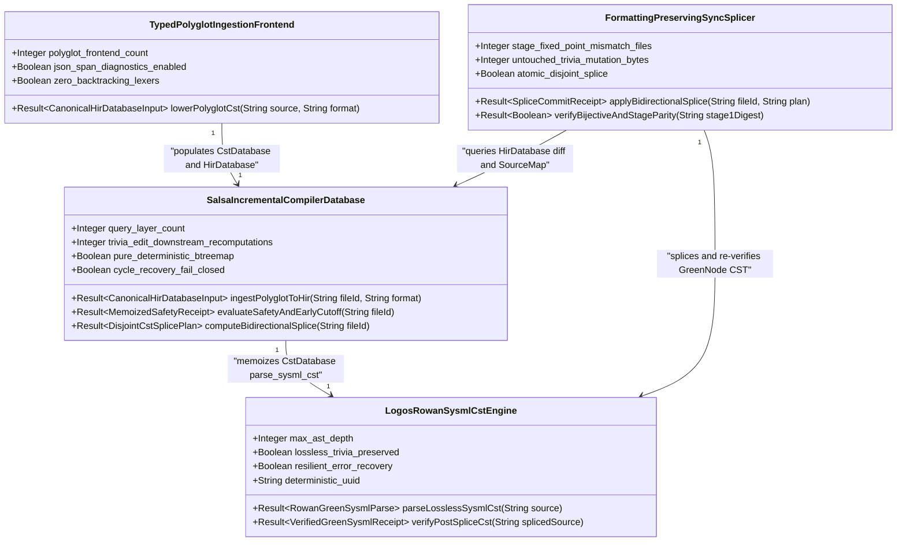
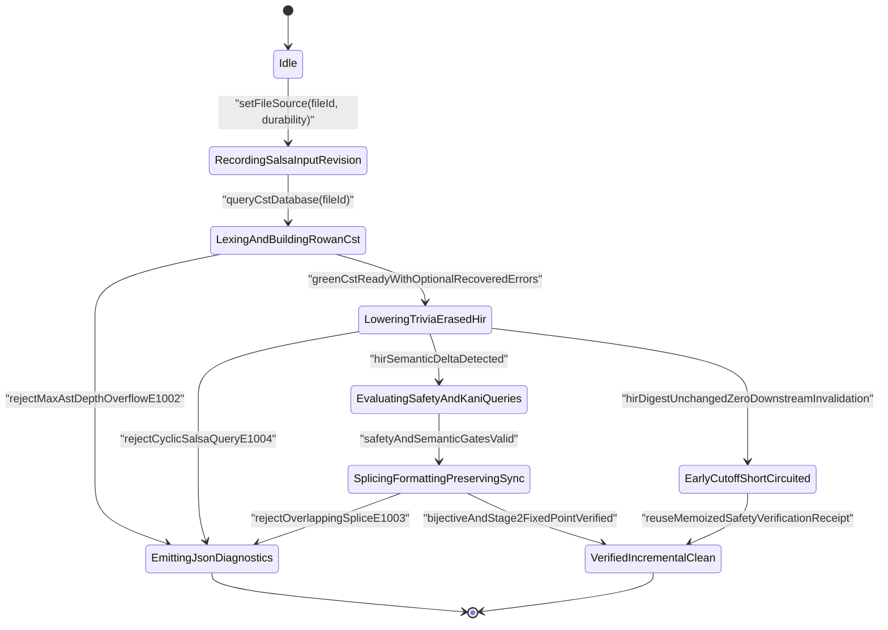
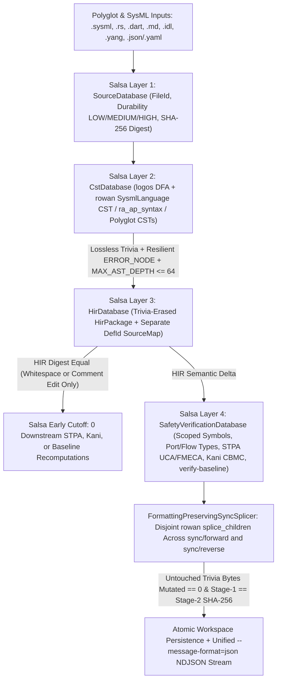
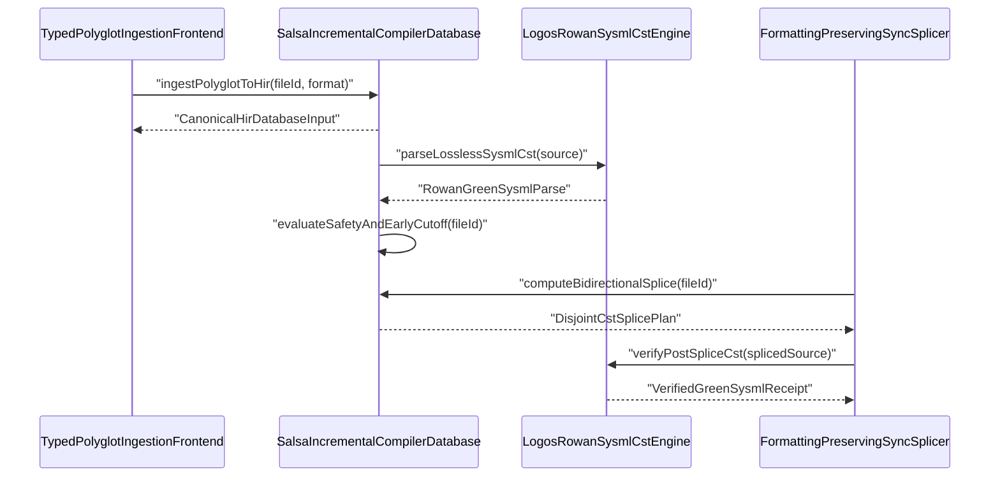

| Attribute | Specification Detail |
| :--- | :--- |
| **Blueprint ID** | `BP-10` |
| **Requirement ID** | `REQ-0610` |
| **Title** | Incremental Lossless SysML v2 and Polyglot Compiler Engine (logos + rowan + salsa) |
| **Status** | `Draft` |
| **Target Crates** | `crates/deap-core, crates/compile-sysml, crates/ingest-sysml, crates/verify-baseline` |
| **Tracked Issues** | `#742` |
| **Generation Mode** | `subagent` |
| **Specification Source** | `crates/compile-sysml/src/lexer/scanner.rs:1-60` |

## 1. Executive Summary & Derivation-Annotation Contract

`IncrementalLosslessSysmlAndPolyglotCompilerEngine` (**REQ-0610** / `BP-10` / `DEAP-BP-DET-10`, UUIDv5 `6ba7b810-9dad-11d1-80b4-00c04fd430ca`, `Class P` linear DFA lexing, lossless Red/Green syntax-tree construction, and `O(delta)` early-cutoff incremental query complexity, governed by DO-178C Level A, DO-330 TQL-4, DO-333 Formal Methods Supplement, ISO 26262 ASIL D, and ECSS-E-ST-40C) defines Phase 2 of DEAP's compiler modernization, re-architecting `crates/compile-sysml`, `crates/ingest-sysml`, `crates/deap-core`, and `crates/verify-baseline` onto the query-driven `rust-analyzer` and `rustc` incremental compiler architecture.

While **BP-03** (**REQ-0603**) established bijective SysML v2 AST roundtrip parity, **BP-07** (**REQ-0607**) introduced self-hosted 4-level modular code generation (`E0705`), **BP-08** (**REQ-0608**) introduced `ra_ap_syntax` + `rowan` lossless Rust codemods and unified `--message-format=json` NDJSON diagnostics, and **BP-09** (**REQ-0609**) established 4-stage formal verification (`Clippy`, `Dylint` MIR, `Miri` Tree Borrows, and `Kani` CBMC), the core SysML v2 and polyglot compiler frontends still rely on batch-mode stateful character scanners (`crates/compile-sysml/src/lexer/scanner.rs`), fail-first AST-only recursive-descent parsers (`crates/compile-sysml/src/parser/grammar/mod.rs`), full-file AST re-serializers (`crates/compile-sysml/src/sync/`), and whole-workspace batch recomputation. **BP-10** eliminates these bottlenecks across four orthogonal compiler subsystems:

1. **Zero-Copy Deterministic Lexing & Lossless Green/Red Concrete Syntax Tree (`logos` + `rowan`)**: Replaces hand-rolled stateful character cursor loops in `crates/compile-sysml/src/lexer/` and fail-first token consumers in `crates/compile-sysml/src/parser/` (plus legacy brace scanners in `crates/deap-core/src/sysml_ast/mod.rs`) with a compile-time deterministic finite-automaton (DFA) `logos` token stream feeding a `rowan::GreenNodeBuilder` lossless Concrete Syntax Tree (`SysmlSyntaxKind`, `SysmlLanguage`). Preserves 100% of trivia (inline/block comments, `doc /* ... */` contracts, `@Safety` and `@Layer` stereotypes, whitespace, and exact UTF-8 `rowan::TextRange` byte spans), performs resilient error-recovery parsing (wrapping malformed syntax inside explicit `ERROR_NODE` CST subtrees while emitting structured `--message-format=json` `DEAP-E1001` diagnostics so IDE/LSP servers and 14B/32B coding agents receive partial typed red `SyntaxNode` trees on incomplete edits), and enforces `MAX_AST_DEPTH = 64` structural recursion guards (`DEAP-E1002`) across nested `package`, `part`, `port`, `action`, `state`, and expression blocks.
2. **Formatting-Preserving Bidirectional Synchronization (`crates/compile-sysml/src/sync/forward/` & `crates/compile-sysml/src/sync/reverse.rs`)**: Upgrades SysML v2 to and from Markdown, Backlog, ICD, and WBS bidirectional synchronization from destructive full-file `PackageDef::to_sysml` re-serialization to surgical `rowan` CST splice transactions (`SyntaxNode::splice_children` and pairwise-disjoint UTF-8 byte-range patches). Preserves 100% of untouched human and systems-architect comments, section layout, and vertical whitespace outside modified declaration spans (`DEAP-E1003` on span collision), while strictly maintaining **BP-03** bijective semantic roundtrip parity and **BP-07** `E0705` Stage-1 == Stage-2 SHA-256 fixed-point determinism.
3. **Demand-Driven Incremental Query Database (`salsa`)**: Models end-to-end compilation across `crates/deap-core`, `crates/ingest-sysml`, `crates/compile-sysml`, and `crates/verify-baseline` as four layered, pure, memoized `salsa` query groups backed exclusively by deterministic `BTreeMap` and `BTreeSet` collections: `SourceDatabase` (virtualized file inputs, workspace manifests, `Durability` tiers, and SHA-256 digests), `CstDatabase` (`parse_sysml_cst`, `parse_rust_cst` via `ra_ap_syntax`, and polyglot CST frontends), `HirDatabase` (trivia-erased `deap_core::sysml_ast` HIR lowering separated from `SourceMap` span tables, scoped symbol resolution in `crates/compile-sysml/src/semantic/`, port/flow type checking, and fail-closed `DEAP-E1004` cycle detection), and `SafetyVerificationDatabase` (deterministic STPA UCA/FMECA derivation in `crates/compile-sysml/src/stpa/`, Kani CBMC harness lowering, and `verify-baseline` parity gates). Guarantees early-cutoff durability (`O(delta)` incremental recomputation: whitespace or non-semantic comment edits in one `.sysml` package never invalidate downstream HIR, STPA, Kani, or baseline queries when lowered HIR digests match).
4. **Typed Polyglot Ingestion Frontends (`crates/ingest-sysml/src/translators/`)**: Upgrades all five `crates/ingest-sysml` translators (`code.rs`, `markdown.rs`, `idl.rs`, `yang.rs`, `openapi.rs`) to lower through typed concrete syntax trees (`ra_ap_syntax` for Rust source ingestion, typed AST nodes for Dart, hierarchical table/section CSTs for Markdown, `logos` + `rowan` lossless CSTs for OMG IDL and RFC 7950 YANG, and span-indexed document CSTs for OpenAPI 3.0/3.1) into canonical `HirDatabase` inputs emitting unified `--message-format=json` UTF-8 span diagnostics (`DEAP-E1005`).

| Claim / Requirement | SSOT Input Anchor (file:line / #ID) | Methodology Citation | Derivation Grade (Directly Evidenced / Analytically Derived / Declared Assumption) | Caveat / Downstream Impact |
| :--- | :--- | :--- | :--- | :--- |
| **REQ-0610**: Phase 2 compiler architecture unifying `crates/compile-sysml`, `crates/ingest-sysml`, `crates/deap-core`, and `crates/verify-baseline` onto `logos` DFA lexing, `rowan` lossless Red/Green CSTs, and `salsa` demand-driven incremental query groups | `crates/compile-sysml/src/lexer/scanner.rs:1-60` / `#742` | `ISO/IEC/IEEE 29148:2018 & DO-330 TQL-4` | `Directly Evidenced` | Retires ad-hoc character scanners and batch whole-workspace re-parsing while preserving CLI backward compatibility and unified `--message-format=json` NDJSON output (`BP-08`). |
| **SC-01**: Total panic-free `logos` DFA tokenization and `rowan` lossless Red/Green `SysmlLanguage` CST preserving 100% of trivia and UTF-8 `TextRange` spans with resilient `ERROR_NODE` recovery (`DEAP-E1001`) and `MAX_AST_DEPTH = 64` structural recursion guards (`DEAP-E1002`) | `crates/compile-sysml/src/parser/grammar/mod.rs:42-80` / `#742` | `Design by Contract (DbC) & DO-178C Level A` | `Directly Evidenced` | Eliminates silent inner-block token erasure (`BP-03` `#504`) and stack-overflow hazards on malformed or deeply nested `.sysml` inputs during interactive LSP and agent editing. |
| **SC-02**: Formatting-preserving bidirectional synchronization in `crates/compile-sysml/src/sync/forward/` and `crates/compile-sysml/src/sync/reverse.rs` via disjoint `rowan` CST splice transactions (`DEAP-E1003`) preserving untouched comments/formatting, bijective roundtrip parity (`BP-03`), and `E0705` Stage-1 == Stage-2 SHA-256 identity (`BP-07`) | `crates/compile-sysml/src/sync/reverse.rs:1-60` / `#742` | `Leveson STPA & ECSS-E-ST-40C` | `Analytically Derived` | Replaces full-file `to_sysml` overwrites on incremental syncs; canonical `to_sysml` emission remains deterministic for newly synthesized CST subtrees and clean bootstrap emission. |
| **SC-03**: Four-layer pure memoized `salsa` query database (`SourceDatabase`, `CstDatabase`, `HirDatabase`, `SafetyVerificationDatabase`) enforcing trivia-erased `HirPackage` vs `SourceMap` separation for `O(delta)` early cutoff and fail-closed `DEAP-E1004` cycle rejection | `crates/compile-sysml/src/semantic/validator.rs:1-45` | `DO-333 Formal Methods & ISO 26262 ASIL D` | `Analytically Derived` | All memoized query outputs use deterministic `BTreeMap`/`BTreeSet` ordering with zero `HashMap` iteration drift, zero hidden I/O, and zero wall-clock reads inside derived queries. |
| **SC-04**: Typed CST lowering across all 5 polyglot ingestion frontends (`code.rs`, `markdown.rs`, `idl.rs`, `yang.rs`, `openapi.rs`) into canonical `HirDatabase` inputs with exact `TextRange` provenance and `--message-format=json` diagnostics (`DEAP-E1005`) | `crates/ingest-sysml/src/translators/code.rs:1-60` | `MIL-STD-1629A / SAE ARP4761 & ISO/IEC/IEEE 15288:2023` | `Directly Evidenced` | Eliminates line-splitting heuristic drift across Rust (`ra_ap_syntax`), Dart, Markdown, OMG IDL, RFC 7950 YANG, and OpenAPI 3.0/3.1 translators without NFA backtracking engines. |
| **SC-05**: Air-gapped supply-chain pinning of MSRV-compatible `logos`, `rowan`, `salsa`, and `ra_ap_syntax` crates in `Cargo.lock` with `#![forbid(unsafe_code)]` preserved across upstream compiler crates | `Cargo.toml:1-34` | `DO-330 TQL-4 Configuration Management` | `Declared Assumption` | Workspace `Cargo.toml` does not yet declare `logos` or `salsa`; exact versions free of unsound `unsafe` consumer wrappers must be pinned via `cargo fetch` for `--offline --locked` builds. |

## 2. Structural Component Metamodel

### Component: LogosRowanSysmlCstEngine

| Attribute | Type | Default | Unit | Description |
| :--- | :--- | :--- | :--- | :--- |
| `max_ast_depth` | `Integer` | `64` | `levels` | Hard structural nesting ceiling across nested `package`, `part`, `port`, `action`, `state`, and expression CST blocks. |
| `lossless_trivia_preserved` | `Boolean` | `true` | `flag` | Requires root `rowan::GreenNode` byte concatenation to match the input UTF-8 `.sysml` buffer byte-for-byte including comments and whitespace. |
| `resilient_error_recovery` | `Boolean` | `true` | `flag` | Wraps malformed token spans in `ERROR_NODE` subtrees and continues parsing at recovery synchronization tokens rather than aborting on first error. |
| `deterministic_uuid` | `String` | `"6ba7b810-9dad-11d1-80b4-00c04fd430ca"` | `uuidv5` | Canonical deterministic blueprint component identifier (`DEAP-BP-DET-10`). |

| Port | Direction | Type | Protocol | Description |
| :--- | :--- | :--- | :--- | :--- |
| `sysml_source_in` | `in` | `String` | `Utf8SysmlSourceBuffer` | Receives raw UTF-8 `.sysml` or `.kerml` source text from `SourceDatabase` without pre-lexer sigil rewriting. |
| `green_cst_out` | `out` | `String` | `RowanGreenSysmlTree` | Emits immutable, thread-safe `rowan::GreenNode` concrete syntax tree and typed red `SyntaxNode` projection. |
| `syntax_diag_out` | `out` | `String` | `RustcJsonDiagnosticStream` | Streams single-line `DEAP-E1001` syntax-recovery and `DEAP-E1002` depth-overflow NDJSON diagnostics with exact UTF-8 `TextRange` spans. |

### Component: FormattingPreservingSyncSplicer

| Attribute | Type | Default | Unit | Description |
| :--- | :--- | :--- | :--- | :--- |
| `stage_fixed_point_mismatch_files` | `Integer` | `0` | `files` | Permitted Stage-1 versus Stage-2 SHA-256 digest mismatch count across self-hosted modular codegen (`E0705`). |
| `untouched_trivia_mutation_bytes` | `Integer` | `0` | `bytes` | Permitted byte mutations to comments and whitespace outside modified declaration `TextRange` intervals during incremental sync. |
| `atomic_disjoint_splice` | `Boolean` | `true` | `flag` | Enforces pairwise-disjoint UTF-8 boundary verification and post-splice CST re-parse checks before atomic file commit. |

| Port | Direction | Type | Protocol | Description |
| :--- | :--- | :--- | :--- | :--- |
| `sync_delta_in` | `in` | `String` | `BidirectionalHirDelta` | Receives forward (`SysML` to `Markdown`/ICD/WBS) or reverse (`Markdown` to `SysML`) structural HIR diff descriptors. |
| `spliced_artifact_out` | `out` | `String` | `LosslessSplicedSysmlAndMarkdown` | Commits formatting-preserving `rowan` CST child splices and disjoint byte patches atomically to workspace storage. |
| `splice_diag_out` | `out` | `String` | `RustcJsonDiagnosticStream` | Emits fail-closed `DEAP-E1003` diagnostics on overlapping splice intervals, non-UTF-8 boundaries, or post-splice syntax regressions. |

### Component: SalsaIncrementalCompilerDatabase

| Attribute | Type | Default | Unit | Description |
| :--- | :--- | :--- | :--- | :--- |
| `query_layer_count` | `Integer` | `4` | `layers` | Mandatory count of stratified `salsa` query groups (`SourceDatabase`, `CstDatabase`, `HirDatabase`, `SafetyVerificationDatabase`). |
| `trivia_edit_downstream_recomputations` | `Integer` | `0` | `queries` | Required count of downstream STPA, Kani, and baseline verification query recomputations when edits alter only non-semantic trivia. |
| `pure_deterministic_btreemap` | `Boolean` | `true` | `flag` | Mandates `BTreeMap` and `BTreeSet` deterministic ordering and forbids filesystem or clock side effects inside derived queries. |
| `cycle_recovery_fail_closed` | `Boolean` | `true` | `flag` | Intercepts cyclic `salsa` dependency chains across imports or specializations and emits deterministic `DEAP-E1004` diagnostics. |

| Port | Direction | Type | Protocol | Description |
| :--- | :--- | :--- | :--- | :--- |
| `source_revision_in` | `in` | `String` | `SalsaSourceInputRevision` | Receives `FileId` buffer updates, `Durability` classifications (`LOW`, `MEDIUM`, `HIGH`), and SHA-256 input digests. |
| `hir_model_out` | `out` | `String` | `InternedHirPackageAndSourceMap` | Emits trivia-erased `HirPackage` semantic graphs decoupled from `DefId` to `TextRange` `SourceMap` tables for early cutoff. |
| `safety_verification_out` | `out` | `String` | `MemoizedStpaKaniBaselineReceipt` | Emits memoized STPA UCA/FMECA matrices, Kani CBMC proof harnesses, and `verify-baseline` parity verification results. |

### Component: TypedPolyglotIngestionFrontend

| Attribute | Type | Default | Unit | Description |
| :--- | :--- | :--- | :--- | :--- |
| `polyglot_frontend_count` | `Integer` | `5` | `frontends` | Count of typed CST translator frontends in `crates/ingest-sysml/src/translators/` (`code.rs`, `markdown.rs`, `idl.rs`, `yang.rs`, `openapi.rs`). |
| `json_span_diagnostics_enabled` | `Boolean` | `true` | `flag` | Emits unified `rustc`-compatible `--message-format=json` span diagnostics (`DEAP-E1005`) across all polyglot ingestion formats. |
| `zero_backtracking_lexers` | `Boolean` | `true` | `flag` | Enforces linear-time DFA/CST scanning across polyglot frontends with zero NFA backtracking engines (`Check 34`). |

| Port | Direction | Type | Protocol | Description |
| :--- | :--- | :--- | :--- | :--- |
| `polyglot_source_in` | `in` | `String` | `PolyglotSpecBuffer` | Receives Rust (`.rs`), Dart (`.dart`), Markdown (`.md`), OMG IDL (`.idl`), RFC 7950 YANG (`.yang`), or OpenAPI 3.x (`.json`/`.yaml`) buffers. |
| `lowered_hir_out` | `out` | `String` | `CanonicalHirDatabaseInput` | Lowers typed polyglot syntax trees directly into interned `HirDatabase` `PackageDef` and `SourceMap` records. |
| `ingest_diag_out` | `out` | `String` | `RustcJsonDiagnosticStream` | Streams `DEAP-E1005` ingestion syntax, schema-reference, and type-mapping diagnostics with exact source byte/line spans. |

## 3. UML & Behavioral Topology









## 4. Formal Mathematical & Safety Constraints

| Constraint ID | Parameter | Min | Max | Unit | Expression |
| :--- | :--- | :--- | :--- | :--- | :--- |
| `C-INC-01` | `max_ast_depth` | `1` | `64` | `levels` | `max_ast_depth >= 1 and max_ast_depth <= 64` |
| `C-INC-02` | `untouched_trivia_mutation_bytes` | `0` | `0` | `bytes` | `untouched_trivia_mutation_bytes == 0` |
| `C-INC-03` | `stage_fixed_point_mismatch_files` | `0` | `0` | `files` | `stage_fixed_point_mismatch_files == 0` |
| `C-INC-04` | `query_layer_count` | `4` | `4` | `layers` | `query_layer_count == 4` |
| `C-INC-05` | `trivia_edit_downstream_recomputations` | `0` | `0` | `queries` | `trivia_edit_downstream_recomputations == 0` |
| `C-INC-06` | `polyglot_frontend_count` | `5` | `5` | `frontends` | `polyglot_frontend_count == 5` |

- **SC-01 (Total `logos` DFA Partitioning, Lossless `rowan` Full Fidelity, Resilient Error Recovery & Depth Guard)**: Let $S \in \Sigma^*$ be any arbitrary UTF-8 byte sequence of length $\lvert S \rvert$. The `logos` DFA lexer maps $S$ deterministically in $O(\lvert S \rvert)$ time into a contiguous token stream $\tau(S) = (t_1, \dots, t_k)$ without panicking or rewriting sigils, and `rowan::GreenNodeBuilder` constructs a rooted concrete syntax tree $T_{\text{green}}(S)$ of depth $\text{depth}(T_{\text{green}}(S)) \le 64$ (**C-INC-01**). Even when syntax errors exist ($\lvert \mathcal{D}_{\text{err}}(S) \rvert > 0$), $T_{\text{green}}(S)$ remains a total, lossless projection of $S$:

$$
\begin{aligned}
\forall S \in \Sigma^*, \quad \bigoplus_{i=1}^{k} \text{bytes}(t_i) &= S \land \sum_{i=1}^{k} \lvert \text{range}(t_i) \rvert = \lvert S \rvert \\
\text{depth}(T_{\text{green}}(S)) &\le 64 \land \forall e \in \mathcal{D}_{\text{err}}(S), \quad \exists v \in V(T_{\text{green}}(S)) : \text{kind}(v) = \text{ERROR\_NODE}
\end{aligned}
$$

- **SC-02 (Formatting-Preserving Bidirectional CST Splicing & Metacircular Fixed-Point Conservation)**: Let $\mathcal{E} = (([a_1, b_1), r_1), \dots, ([a_m, b_m), r_m))$ be a sorted sequence of CST declaration splices applied to source $S$ producing $S' = \text{Splice}(S, \mathcal{E})$, and let $\mathcal{U}(S, \mathcal{E}) = [0, \lvert S \rvert) \setminus \bigcup_{i=1}^{m} [a_i, b_i)$ denote all untouched prefix, inter-span, and suffix regions containing human/architect comments and formatting trivia. Every untouched byte interval is preserved identically (**C-INC-02**), bijective HIR roundtrip equivalence (**REQ-0603**) holds, and self-hosted Stage-1 == Stage-2 SHA-256 parity (**C-INC-03**, `E0705`) is invariant:

$$
\begin{aligned}
\forall i \in \{1, \dots, m - 1\}, \quad 0 \le a_i \le b_i \le a_{i+1} \le \lvert S \rvert &\land \Delta_{\text{trivia}}(\mathcal{U}(S, \mathcal{E}), S') = 0 \\
\text{Lower}_{\text{HIR}}(\text{Parse}_{\text{CST}}(\text{Emit}_{\text{canonical}}(H))) = H &\land \text{SHA-256}(\mathcal{T}_{\text{Stage 1}}) = \text{SHA-256}(\mathcal{T}_{\text{Stage 2}})
\end{aligned}
$$

- **SC-03 (`salsa` Demand-Driven Early-Cutoff Durability & `O(delta)` Incremental Complexity)**: Let $Q_1 = \text{SourceDatabase}$, $Q_2 = \text{CstDatabase}$, $Q_3 = \text{HirDatabase}$, and $Q_4 = \text{SafetyVerificationDatabase}$ form the 4-layer pure query DAG (**C-INC-04**) over workspace file set $\mathcal{F}$ at revision $r \to r+1$. Because $Q_3$ separates trivia-erased semantic nodes $H_f^{(r)} = \pi_{\text{HIR}}(T_{\text{green}}(S_f^{(r)}))$ from span side-tables $\text{SourceMap}_f^{(r)}$, any revision $r+1$ mutating strictly trivia in file $f^*$ satisfies $H_{f^*}^{(r+1)} = H_{f^*}^{(r)}$, halting invalidation propagation at $Q_3$ (**C-INC-05**):

$$
\begin{aligned}
H_{f^*}^{(r+1)} = H_{f^*}^{(r)} &\implies \lvert \text{Recomputed}(Q_4, r \to r+1) \rvert = 0 \\
T_{\text{inc}}(r \to r+1) &= O\left( \sum_{f \in \Delta_{\text{src}}} \lvert S_f \rvert + \sum_{q \in \text{Affected}(Q_3 \cup Q_4, \Delta_{\text{HIR}})} \text{cost}(q) \right)
\end{aligned}
$$

- **SC-04 (Typed Polyglot CST Lowering Determinism & Zero-ANSI NDJSON Diagnostic Framing)**: Across all 5 polyglot CST translators $\mathcal{P} = \{\text{Code}, \text{Markdown}, \text{IDL}, \text{YANG}, \text{OpenAPI}\}$ (**C-INC-06**), lowering is a pure deterministic function $\Phi_p : \Sigma^* \to (\text{HirPackage} \times \text{SourceMap} \times \mathcal{D}_{\text{json}})$ backed by `BTreeMap` ordering and linear DFA/tree passes, where every emitted diagnostic $d \in \mathcal{D}_{\text{json}}$ is a single-line ANSI-free `rustc`-compatible JSON envelope:

$$
\begin{aligned}
\forall p \in \mathcal{P}, \forall S \in \Sigma^*, \quad \text{SHA-256}(\Phi_p(S)) &= \text{const}(p, S) \land \forall d \in \mathcal{D}_{\text{json}}, \quad \text{count}(\text{encode}(d), \text{0x1B}) = 0
\end{aligned}
$$

## 5. Acceptance Criteria & Verification Matrix

<!-- test-target: crates/compile-sysml/tests/rowan_salsa_incremental_compiler.rs -->

- **Test-Target**: `crates/compile-sysml/tests/rowan_salsa_incremental_compiler.rs`

### AC-01: Lossless logos and rowan Concrete Syntax Tree Full-Fidelity Roundtrip and Trivia Preservation
- **Given**: A `.sysml` fixture containing nested `package`, `part def`, `port def`, `action def`, `state def`, `transition`, `requirement def`, and `constraint def` blocks interleaved with inline `//` comments, multi-line `/* ... */` architect notes, `doc /* ... */` specifications, `@Safety` and `@Layer` stereotypes, composite generic types, and custom vertical whitespace alignment.
- **When**: `LogosRowanSysmlCstEngine` lexes the buffer via `logos` and constructs the `SysmlLanguage` Red/Green concrete syntax tree via `rowan::GreenNodeBuilder`.
- **Then**: Root `SyntaxNode::text()` equals the input UTF-8 byte buffer bit-for-bit (`lossless_trivia_preserved == true`) with zero pre-lexer sigil rewriting, every token and composite declaration carries exact UTF-8 `TextRange` byte offsets, and `HirDatabase` lowering produces a `PackageDef` identical to **BP-03** canonical semantics.

### AC-02: Resilient Error-Recovery Parsing on Incomplete Syntax and Fail-Closed MAX_AST_DEPTH Guard
- **Given**: Two negative `.sysml` fixtures: Fixture A containing an unclosed `part def` attribute missing `;` followed by a valid `requirement def` block (simulating mid-keystroke IDE/agent editing), and Fixture B containing 65 nested `package` / `part` blocks exceeding `MAX_AST_DEPTH = 64` (**C-INC-01**).
- **When**: `LogosRowanSysmlCstEngine` parses Fixture A and Fixture B under `--message-format=json`.
- **Then**: Neither parse panics or overflows the call stack; Fixture A wraps the malformed attribute in `SysmlSyntaxKind::ERROR_NODE`, recovers cleanly to parse the subsequent `requirement def` into a valid red `SyntaxNode` subtree, and emits a single-line `DEAP-E1001` JSON diagnostic at the exact missing-semicolon `TextRange`; Fixture B halts descent at depth `64` and fails closed with `DEAP-E1002`.

### AC-03: Formatting-Preserving Bidirectional CST Splicing Across Forward and Reverse Sync
- **Given**: An existing `.sysml` schema containing human-authored architectural comments, custom indentation, and three `part def` subsystems alongside synchronized `docs/features/` and `docs/epics/` Markdown specifications, where only one `part def` port signature is updated in Markdown during reverse sync (and reciprocally one `constraint def` bound is updated in `.sysml` during forward sync), plus a negative splice request containing overlapping `TextRange` intervals.
- **When**: `FormattingPreservingSyncSplicer` executes `crates/compile-sysml/src/sync/reverse.rs` and `crates/compile-sysml/src/sync/forward/` splice plans, and evaluates the negative overlapping splice plan.
- **Then**: Only the modified declaration's `SyntaxNode` subtree is spliced while 100% of untouched architect comments, blank lines, and sibling declarations retain byte-identical content (`untouched_trivia_mutation_bytes == 0`, **C-INC-02**), bijective roundtrip parity (**BP-03**) and Stage-1 == Stage-2 SHA-256 parity (`E0705`, **C-INC-03**) hold, and the negative overlapping splice fails closed with `DEAP-E1003` and zero disk writes.

### AC-04: Salsa Early-Cutoff Durability Preventing Downstream Recomputations on Trivia Edits
- **Given**: A multi-package `.sysml` workspace loaded into `SalsaIncrementalCompilerDatabase` across all 4 query layers (`SourceDatabase`, `CstDatabase`, `HirDatabase`, `SafetyVerificationDatabase`) with query execution counters attached to `parse_sysml_cst`, `lower_sysml_hir`, `validate_semantics`, `derive_stpa_fmeca`, and `emit_kani_harnesses`.
- **When**: Revision 2 appends comments and reformats whitespace inside one `.sysml` file without altering semantic declarations, followed by Revision 3 modifying a `port def` `[min..max]` bound inside that file.
- **Then**: On Revision 2, `parse_sysml_cst` and `lower_sysml_hir` execute for the edited `FileId` only, `HirPackage` equality triggers `salsa` early cutoff, and downstream `validate_semantics`, `derive_stpa_fmeca`, and `emit_kani_harnesses` record `0` recomputations (**C-INC-05**); on Revision 3, only queries transitively dependent on the mutated `DefId` recompute in deterministic `BTreeMap` order.

### AC-05: Fail-Closed Salsa Cycle Detection and Referential Integrity Verification
- **Given**: A negative multi-file `.sysml` fixture introducing a cyclic `import` / cyclic `part def :> BasePart` specialization loop across two packages in `HirDatabase`.
- **When**: `SalsaIncrementalCompilerDatabase` evaluates scoped symbol resolution and HIR lowering for the cyclic workspace.
- **Then**: Cycle recovery intercepts the cycle deterministically without infinite recursion or thread deadlock, fails closed with non-zero exit code, and emits a single-line `--message-format=json` diagnostic `DEAP-E1004` listing the ordered cycle `DefId` chain and primary `TextRange` spans.

### AC-06: Typed CST Lowering and Unified JSON Span Diagnostics Across All Five Polyglot Frontends
- **Given**: Five valid polyglot specification fixtures (Rust `.rs`, Markdown `.md` BOM/Port/Constraint tables, OMG IDL `.idl`, RFC 7950 YANG `.yang`, and OpenAPI 3.1 `.json`) alongside five malformed counterparts containing a syntax or unresolved schema-pointer error at a known byte offset.
- **When**: `TypedPolyglotIngestionFrontend` lowers each fixture through its typed syntax tree (`ra_ap_syntax`, `MdSyntaxKind`, `IdlSyntaxKind`, `YangSyntaxKind`, `OpenApiSyntaxKind`) into `HirDatabase` with `--message-format=json`.
- **Then**: All 5 valid fixtures lower deterministically into canonical `HirPackage` and `SourceMap` records (**C-INC-06**) with zero NFA backtracking engines (`Check 34`), while all 5 malformed fixtures fail closed emitting single-line `reason: "compiler-message"` JSON diagnostics (`DEAP-E1005`) pointing to the exact offending UTF-8 `byte_start`/`byte_end` and 1-indexed `line_start`/`line_end` spans.

### AC-07: Twelve-Gate Blueprint Verification and Baseline Cleanliness Gate Conformance
- **Given**: `docs/designs/blueprint-10-rowan-salsa-incremental-sysml-compiler.md` residing in the upstream compiler repository alongside workspace governance rules.
- **When**: `./target/release/verify-baseline check-blueprint docs/designs/blueprint-10-rowan-salsa-incremental-sysml-compiler.md` and `./target/release/verify-baseline . --no-domain` are executed.
- **Then**: All 12 mechanical blueprint verification gates and all upstream workspace baseline checks pass with exit code `0`, atomically persisting `docs/designs/blueprint-10-rowan-salsa-incremental-sysml-compiler.sysml` and `docs/designs/blueprint-10-rowan-salsa-incremental-sysml-compiler.digest.json` with bijective SysML v2 roundtrip parity.

## 6. Proposed Deterministic Implementation Contract

| Query Group / Subsystem | Target Workspace Crate Scope | Memoized Query & Transactional Contract | Diagnostic & Fail-Closed Codes |
| :--- | :--- | :--- | :--- |
| `SourceDatabase` (`salsa` Layer 1) | `crates/deap-core` (`digest.rs`, `workspace.rs`) | Stores `file_text(FileId) -> Arc<str>`, `file_durability(FileId) -> DurabilityTier` (`Low`, `Medium`, `High`), and `file_sha256(FileId) -> [u8; 32]`; zero direct `std::fs` calls inside derived layers. | `DEAP-E1000` (unregistered `FileId` or invalid UTF-8 input buffer) |
| `CstDatabase` (`salsa` Layer 2) | `crates/compile-sysml` (`lexer/`, `parser/`) & `crates/ingest-sysml` (`translators/`) | `parse_sysml_cst(FileId)` via `logos` DFA + `rowan` (`SysmlLanguage`), `parse_rust_cst(FileId)` via `ra_ap_syntax`, and typed polyglot CST parsers; preserves 100% trivia, recovers via `ERROR_NODE`, and caps nesting at `MAX_AST_DEPTH = 64`. | `DEAP-E1001` (recovered CST syntax error) / `DEAP-E1002` (`MAX_AST_DEPTH > 64` structural overflow) / `DEAP-E1005` (polyglot CST syntax or pointer error) |
| `HirDatabase` (`salsa` Layer 3) | `crates/deap-core` (`sysml_ast/mod.rs`) & `crates/compile-sysml` (`semantic/`) | `lower_hir(FileId) -> Arc<HirPackage>` (trivia-erased for early cutoff) + `source_map(FileId) -> Arc<HirSourceMap>` (`DefId -> TextRange`), scoped `resolve_symbols`, and port/flow type validation. | `DEAP-E1004` (cyclic `salsa` query / cyclic specialization or unresolved symbol) |
| `SafetyVerificationDatabase` (`salsa` Layer 4) & `SyncSplicer` | `crates/compile-sysml` (`stpa/`, `sync/`, `modular_codegen/`) & `crates/verify-baseline` (`runner.rs`) | Memoizes STPA UCA/FMECA synthesis, Kani CBMC proof codegen, `verify-baseline` checks, and disjoint `rowan` CST `splice_children` bidirectional sync preserving untouched trivia and `E0705` Stage-1 == Stage-2 SHA-256 identity. | `DEAP-E1003` (overlapping CST splice collision or post-splice syntax regression) / `E0705` (Stage-1 vs Stage-2 SHA-256 drift) |

```rust
use serde::{Deserialize, Serialize};
use std::collections::BTreeMap;

pub const MAX_AST_DEPTH: usize = 64;

#[derive(Debug, Clone, Copy, PartialEq, Eq, PartialOrd, Ord, Hash, Serialize, Deserialize)]
pub struct FileId(pub u32);

#[derive(Debug, Clone, Copy, PartialEq, Eq, PartialOrd, Ord, Hash, Serialize, Deserialize)]
pub struct DefId(pub u64);

#[derive(Debug, Clone, Copy, PartialEq, Eq, PartialOrd, Ord, Serialize, Deserialize)]
pub enum DurabilityTier {
    Low,
    Medium,
    High,
}

#[derive(Debug, Clone, Copy, PartialEq, Eq, PartialOrd, Ord, Serialize, Deserialize)]
#[repr(u16)]
pub enum SysmlSyntaxKind {
    Whitespace = 0,
    LineComment = 1,
    BlockComment = 2,
    DocComment = 3,
    SafetyStereotype = 4,
    Ident = 5,
    KeywordPackage = 6,
    KeywordPart = 7,
    KeywordPort = 8,
    KeywordAction = 9,
    KeywordState = 10,
    KeywordTransition = 11,
    KeywordRequirement = 12,
    KeywordConstraint = 13,
    Punctuation = 14,
    Literal = 15,
    SourceFile = 100,
    PackageDecl = 101,
    PartDef = 102,
    PortDef = 103,
    ActionDef = 104,
    StateDef = 105,
    TransitionDecl = 106,
    RequirementDef = 107,
    ConstraintDef = 108,
    ErrorNode = 255,
}

#[derive(Debug, Clone, Copy, PartialEq, Eq, PartialOrd, Ord, Serialize, Deserialize)]
pub struct Utf8TextRange {
    pub byte_start: usize,
    pub byte_end: usize,
}

#[derive(Debug, Clone, PartialEq, Eq, Serialize, Deserialize)]
pub struct IncrementalDiagnostic {
    pub code: String,
    pub message: String,
    pub file_id: FileId,
    pub range: Utf8TextRange,
}

#[derive(Debug, Clone, PartialEq, Eq, Serialize, Deserialize)]
pub struct CstTokenLeaf {
    pub kind: SysmlSyntaxKind,
    pub range: Utf8TextRange,
    pub text: String,
}

#[derive(Debug, Clone, PartialEq, Eq, Serialize, Deserialize)]
pub struct GreenSysmlParse {
    pub file_id: FileId,
    pub max_observed_depth: usize,
    pub leaves: Vec<CstTokenLeaf>,
    pub recovered_errors: Vec<IncrementalDiagnostic>,
}

#[derive(Debug, Clone, PartialEq, Eq, Serialize, Deserialize)]
pub struct HirPackageSummary {
    pub package_name: String,
    pub canonical_hir_sha256: String,
    pub definitions: BTreeMap<DefId, String>,
}

#[derive(Debug, Clone, PartialEq, Eq, Serialize, Deserialize)]
pub struct HirSourceMap {
    pub spans: BTreeMap<DefId, Utf8TextRange>,
}

#[derive(Debug, Clone, Copy, PartialEq, Eq, Serialize, Deserialize)]
pub enum EarlyCutoffDecision {
    CutoffPreservedDownstream,
    RecomputeDownstreamDependents,
}

#[derive(Debug, Clone, Copy, PartialEq, Eq, PartialOrd, Ord, Serialize, Deserialize)]
pub enum PolyglotFormat {
    RustRaApSyntax,
    DartTypedAst,
    MarkdownCst,
    OmgIdlRowanCst,
    YangRfc7950RowanCst,
    OpenApi3StructuredCst,
}

#[derive(Debug, Clone, PartialEq, Eq, Serialize, Deserialize)]
pub struct CstSplicePatch {
    pub range: Utf8TextRange,
    pub replacement: String,
}

pub fn verify_lossless_cst_invariants(
    source: &str,
    parsed: &GreenSysmlParse,
) -> Result<(), IncrementalDiagnostic> {
    if parsed.max_observed_depth > MAX_AST_DEPTH {
        return Err(IncrementalDiagnostic {
            code: String::from("DEAP-E1002"),
            message: String::from("structural CST nesting exceeded MAX_AST_DEPTH (64)"),
            file_id: parsed.file_id,
            range: Utf8TextRange {
                byte_start: 0,
                byte_end: source.len(),
            },
        });
    }

    let mut reconstructed = String::with_capacity(source.len());
    let mut cursor = 0usize;
    for leaf in &parsed.leaves {
        if leaf.range.byte_start != cursor || leaf.range.byte_end < leaf.range.byte_start {
            return Err(IncrementalDiagnostic {
                code: String::from("DEAP-E1001"),
                message: String::from("non-contiguous TextRange detected in rowan CST projection"),
                file_id: parsed.file_id,
                range: leaf.range,
            });
        }
        reconstructed.push_str(&leaf.text);
        cursor = leaf.range.byte_end;
    }

    if reconstructed != source || cursor != source.len() {
        return Err(IncrementalDiagnostic {
            code: String::from("DEAP-E1001"),
            message: String::from("lossless CST roundtrip mismatch against input UTF-8 buffer"),
            file_id: parsed.file_id,
            range: Utf8TextRange {
                byte_start: 0,
                byte_end: source.len(),
            },
        });
    }
    Ok(())
}

#[must_use]
pub fn evaluate_hir_early_cutoff(
    previous_hir: &HirPackageSummary,
    current_hir: &HirPackageSummary,
) -> EarlyCutoffDecision {
    if previous_hir == current_hir {
        EarlyCutoffDecision::CutoffPreservedDownstream
    } else {
        EarlyCutoffDecision::RecomputeDownstreamDependents
    }
}

pub fn apply_formatting_preserving_splices(
    file_id: FileId,
    source: &str,
    patches: &[CstSplicePatch],
) -> Result<String, IncrementalDiagnostic> {
    let mut ordered: Vec<&CstSplicePatch> = patches.iter().collect();
    ordered.sort_by_key(|patch| (patch.range.byte_start, patch.range.byte_end));

    let mut prev_end = 0usize;
    for (idx, patch) in ordered.iter().enumerate() {
        let start = patch.range.byte_start;
        let end = patch.range.byte_end;
        if start > end
            || end > source.len()
            || !source.is_char_boundary(start)
            || !source.is_char_boundary(end)
            || (idx > 0 && start < prev_end)
        {
            return Err(IncrementalDiagnostic {
                code: String::from("DEAP-E1003"),
                message: String::from("overlapping or invalid UTF-8 CST splice interval"),
                file_id,
                range: patch.range,
            });
        }
        prev_end = end;
    }

    let mut spliced = String::with_capacity(source.len());
    let mut cursor = 0usize;
    for patch in ordered {
        let Some(untouched) = source.get(cursor..patch.range.byte_start) else {
            return Err(IncrementalDiagnostic {
                code: String::from("DEAP-E1003"),
                message: String::from("failed to slice untouched trivia prefix during CST splice"),
                file_id,
                range: patch.range,
            });
        };
        spliced.push_str(untouched);
        spliced.push_str(&patch.replacement);
        cursor = patch.range.byte_end;
    }

    let Some(tail) = source.get(cursor..source.len()) else {
        return Err(IncrementalDiagnostic {
            code: String::from("DEAP-E1003"),
            message: String::from("failed to slice untouched trailing trivia suffix"),
            file_id,
            range: Utf8TextRange {
                byte_start: cursor,
                byte_end: source.len(),
            },
        });
    };
    spliced.push_str(tail);
    Ok(spliced)
}
```

## 7. Source References

- **Blueprint Engineering Skill**: `.agents/skills/spec-blueprint-engineering/SKILL.md:1-339` (Mandatory 8-Part Skeleton, 5-Column Derivation-Annotation Contract, and 12-Gate Verification Protocol)
- **Project Governance Constitution**: `.pipeline/constitution.md:48-89` (Pure Schema-Driven Compiler & Universal Model Consistency Rules) and `.pipeline/constitution.md:151-213` (Durable Repository Artifact Mandate & Step 1.5 Derivation-Annotation Contract)
- **Workspace Cargo Manifest & Lint Governance**: `Cargo.toml:1-34` (Six workspace crate members and `[workspace.lints.clippy]` `"forbid"` total-function safety rules)
- **Preceding Compiler Modernization Blueprints**: `docs/designs/blueprint-03-sysml-ast-bijective-roundtrip-compiler-gate.md:1-35` (`REQ-0603` / `BP-03` Bijective SysML v2 Roundtrip Gate), `docs/designs/blueprint-07-self-hosting-modular-codegen-compiler.md:1-30` (`REQ-0607` / `BP-07` `E0705` Stage-1 == Stage-2 SHA-256 Fixed-Point Invariant), `docs/designs/blueprint-08-rust-analyzer-cst-refactoring-and-json-diagnostics.md:1-31` (`REQ-0608` / `BP-08` `ra_ap_syntax` + `rowan` Rust CST & `--message-format=json`), `docs/designs/blueprint-09-clippy-dylint-miri-kani-formal-verification-gate.md:1-31` (`REQ-0609` / `BP-09` 4-Stage Formal Verification & Kani CBMC Synthesis)
- **Core SysML AST, Digest & Diagnostic Foundations (`deap-core`)**: `crates/deap-core/src/sysml_ast/mod.rs:1-80`, `crates/deap-core/src/digest.rs:1-80`, `crates/deap-core/src/diagnostics.rs:1-100`, `crates/deap-core/src/source_ast.rs:1-80`
- **SysML Lexer & Recursive-Descent Parser Targets (`compile-sysml`)**: `crates/compile-sysml/src/lexer/scanner.rs:1-60`, `crates/compile-sysml/src/lexer/token.rs:1-60`, `crates/compile-sysml/src/parser/grammar/mod.rs:1-80`, `crates/compile-sysml/src/parser/expressions.rs:1-60`
- **Semantic Resolution, Serializer & STPA Targets (`compile-sysml`)**: `crates/compile-sysml/src/semantic/symbols.rs:1-60`, `crates/compile-sysml/src/semantic/validator.rs:1-45`, `crates/compile-sysml/src/semantic/serializer.rs:1-45`, `crates/compile-sysml/src/semantic/digest.rs:1-60`, `crates/compile-sysml/src/stpa/uca.rs:1-60`, `crates/compile-sysml/src/stpa/fmeca.rs:1-60`, `crates/compile-sysml/src/driver.rs:1-80`
- **Bidirectional Forward & Reverse Sync Targets (`compile-sysml`)**: `crates/compile-sysml/src/sync/forward/mod.rs:1-80`, `crates/compile-sysml/src/sync/reverse.rs:1-60`
- **Polyglot Ingestion Translator Targets (`ingest-sysml`)**: `crates/ingest-sysml/src/lib.rs:1-60`, `crates/ingest-sysml/src/translators/code.rs:1-60`, `crates/ingest-sysml/src/translators/markdown.rs:1-45`, `crates/ingest-sysml/src/translators/idl.rs:1-45`, `crates/ingest-sysml/src/translators/yang.rs:1-45`, `crates/ingest-sysml/src/translators/openapi.rs:1-45`
- **Baseline & Blueprint Verification Runners (`verify-baseline`)**: `crates/verify-baseline/src/runner.rs:1-60`, `crates/verify-baseline/src/blueprint_gate.rs:1-120`
- **Tracked Issues**: `#742`
