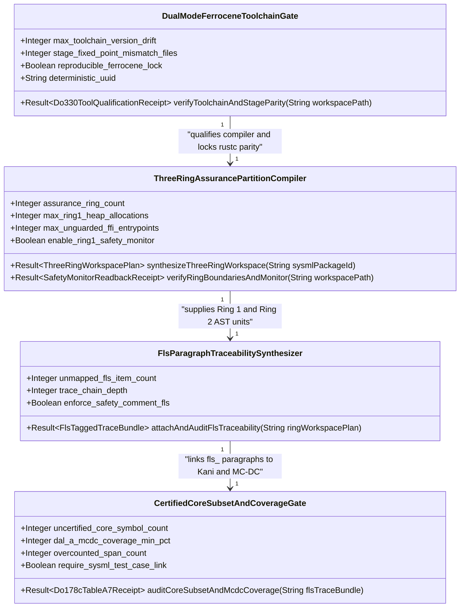
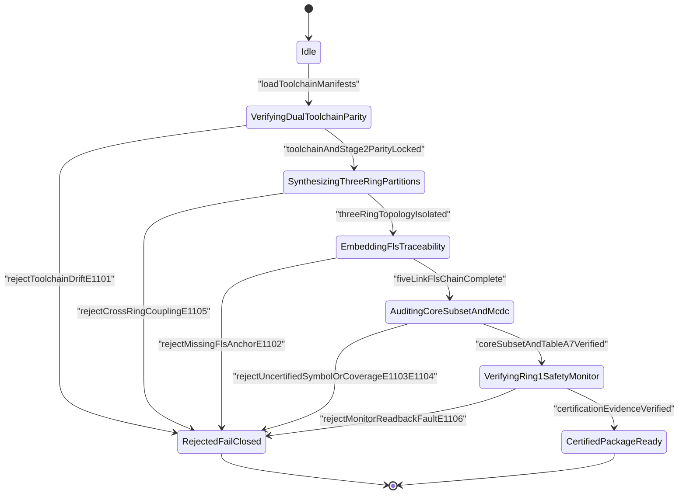
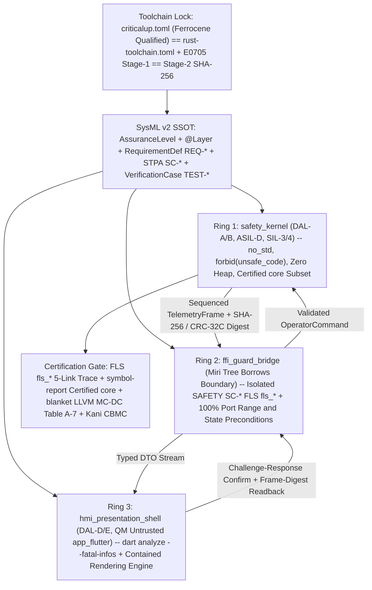
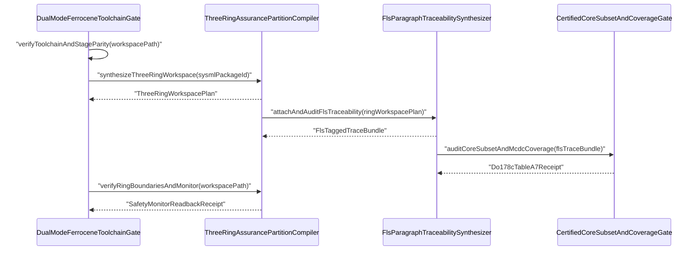

| Attribute | Specification Detail |
| :--- | :--- |
| **Blueprint ID** | `BP-11` |
| **Requirement ID** | `REQ-0611` |
| **Title** | Ferrocene Qualified Toolchain, FLS Traceability, Structural Coverage, and 3-Ring Rust/Flutter DO-178C & DO-330 Certification Architecture |
| **Status** | `Draft` |
| **Target Crates** | `crates/deap-core, crates/compile-sysml, crates/verify-baseline` |
| **Tracked Issues** | `#742` |
| **Generation Mode** | `subagent` |
| **Specification Source** | `docs/architecture/blueprints/DEAP_MULTI_TOOLCHAIN_SYNTHESIS_ARCHITECTURE.md:1-30` |

## 1. Executive Summary & Derivation-Annotation Contract

`FerroceneThreeRingCertificationArchitecture` (**REQ-0611** / `BP-11` / `DEAP-BP-DET-11`, UUIDv5 `6ba7b810-9dad-11d1-80b4-00c04fd430cb`, `Class P` linear AST, ELF symbol-table, and LLVM coverage-profile verification complexity, governed by RTCA DO-178C DAL-A through DAL-E, RTCA DO-330 TQL-1 and TQL-5, RTCA DO-333 Formal Methods Supplement, ISO 26262-6/8 ASIL D / TCL3, IEC 61508 SIL-3/4, and IEC 62304 Class C) specifies Stage 5 of DEAP's compiler-native formal verification and multi-toolchain certification architecture across `crates/deap-core`, `crates/compile-sysml`, `crates/verify-baseline`, and schema-generated downstream Rust + Flutter workspaces.

Whereas **BP-07** (**REQ-0607**) established 4-level modular multi-file code generation and `E0705` Stage-1 == Stage-2 metacircular SHA-256 parity, **BP-09** (**REQ-0609**) established 4-stage formal verification (`Clippy` HIR/THIR, isolated nightly `Dylint` MIR zero-allocation proofs, `Miri` Tree Borrows FFI checks, and `Kani` CBMC bounded model checking), and **BP-10** (**REQ-0610**) established lossless `logos` + `rowan` + `salsa` incremental SysML v2 compilation, safety certification authorities additionally require: (a) a qualified production compiler toolchain (`rustc`) with tool operational requirements and qualification artifacts, (b) normative language-semantics traceability from generated source constructs to a baseline language specification, (c) proof that compiled object binaries link exclusively certified standard-library symbols and achieve DO-178C Table A-7 Statement, Decision, and Modified Condition/Decision Coverage (MC/DC), and (d) architectural containment isolating uncertified GUI runtimes (such as the Dart VM and GPU rendering engine) from high-assurance control logic. **BP-11** closes all four certification requirements deterministically:

1. **Dual-Mode Drop-In Qualified Toolchain Parity (`criticalup.toml` + `rust-toolchain.toml`)**: Integrates Ferrocene (ISO 26262 ASIL D, IEC 61508 SIL-3/4, IEC 62304 Class C, and DO-178C / DO-330 qualified `rustc` toolchain managed via `criticalup.toml`) alongside an exact version-matched `rust-toolchain.toml` (`DEAP-E1101` on `rustc` upstream version or target-triple drift). Token-free developer workstations and sandboxed CI runners build with the pinned open-source `rust-toolchain.toml`, while air-gapped certification runners execute `criticalup run cargo build --release --locked --offline` over the identical `Cargo.lock` and source tree with zero conditional compilation divergence. Qualifies DEAP's own upstream Tier-0 binaries (`compile-sysml` under DO-330 TQL-1 / TQL-5 and `verify-baseline` under DO-330 TQL-5 / ISO 26262-8 TCL3) by combining reproducible Ferrocene builds, **BP-07** `E0705` Stage-1 == Stage-2 SHA-256 fixed-point parity, and independent multi-gate output verification in `crates/verify-baseline` completely decoupled from `crates/compile-sysml` code emission.
2. **Ferrocene Language Specification (`FLS` `fls_*`) Normative Paragraph Traceability**: Embeds deterministic paragraph identifiers (`[FLS: fls_*]`) from the open-source Ferrocene Language Specification directly into `crates/compile-sysml/src/modular_codegen/` emitters (`rust_emitter.rs` and `flutter/bridge_emitter.rs`) and `crates/verify-baseline/src/audit_code.rs` AST verification passes. Establishes an unbroken five-link machine-verifiable certification chain (`SysML Requirement [REQ-*] -> STPA Safety Constraint [SC-*] -> Rust AST Item -> FLS Language Semantics [fls_*] -> Kani Proof & Structural Coverage Artifact`), failing closed (`DEAP-E1102`) whenever any Ring-1 generated item or Ring-2 `// SAFETY: [SC-*] [FLS: fls_*]` FFI justification omits a registered `fls_*` paragraph anchor.
3. **Certified `core` Subset Verification (`symbol-report`) & Zero-Overcount Structural/MC-DC Coverage (`blanket` / LLVM MC-DC)**: Integrates ELF and MIR symbol-table auditing modeled on Ferrocene's `symbol-report` so Ring-1 `#![no_std]` safety packages fail closed (`DEAP-E1103`) if any linked object symbol falls outside the certified `core` library subset (banning `std::*`, heap `alloc::*`, `__rust_alloc`, dynamic `core::fmt::Formatter` machinery, and uncertified compiler intrinsics). Pairs `symbol-report` auditing with zero-overcount structural coverage collection (`blanket` / `llvm-profdata` / `-C instrument-coverage` and LLVM MC/DC condition-vector instrumentation) mapped bijectively back to SysML `verification case def` / `test case def` (`TEST-*` -> `REQ-*`) to satisfy DO-178C Table A-7 objectives (100% Statement, Decision, and MC/DC at DAL-A; 100% Statement and Decision at DAL-B; 100% Statement at DAL-C; `DEAP-E1104` on coverage shortfall, overcounted macro spans, or orphaned `TEST-*` verification cases).
4. **Schema-Driven 3-Ring Assurance Partitioning Across `SysML` + `Rust` + `Flutter`**: Solves HMI certification containment by extending `crates/compile-sysml/src/modular_codegen/` to synthesize downstream workspaces into three strictly isolated assurance rings (`safety_kernel/`, `ffi_guard_bridge/`, `app_flutter/`) derived deterministically from SysML `AssuranceLevel` and `@Layer` stereotypes:
   - **Ring 1 (`safety_kernel` -- DAL-A/B / ASIL-D / SIL-3-4)**: `#![no_std]`, `#![forbid(unsafe_code)]`, Ferrocene certified `core` subset only, zero heap allocation (`max_ring1_heap_allocations == 0`), proven via Kani CBMC (**BP-09**) and 100% MC/DC structural coverage.
   - **Ring 2 (`ffi_guard_bridge` -- Miri-Verified C-ABI / `flutter_rust_bridge` Boundary)**: Isolates all FFI marshaling `unsafe` blocks (`#![deny(unsafe_code)]` + `undocumented_unsafe_blocks = "deny"` requiring `// SAFETY: [SC-*] [FLS: fls_*]`), validates 100% of inbound `OperatorConsole` command payloads against SysML `port def` `[min..max]` ranges, IEEE-754 finiteness, monotonic sequence counters, and `state def` preconditions before entering Ring 1 (`DEAP-E1105` on illegal cross-ring coupling or unguarded entrypoints), and attaches monotonic sequence numbers plus deterministic FIPS 180-4 SHA-256 / CRC-32C digests to outbound `TelemetryFrame` structures.
   - **Ring 3 (`hmi_presentation_shell` -- DAL-D/E / QM Untrusted Flutter Shell + Ring-1 Independent `SafetyMonitor`)**: Segregates the Dart VM and rendering engine (`app_flutter/`) outside the DAL-A/B certification perimeter via DO-178C Section 2.3 architectural partitioning, pairing `dart analyze --fatal-infos` static checks with a Ring-1 two-step challenge-response arm-and-confirm interlock and `TelemetryFrame` digest readback `SafetyMonitor` (`DEAP-E1106` on stale frame sequence, digest readback mismatch, or unconfirmed critical `ActuatorCommand`).

| Claim / Requirement | SSOT Input Anchor (file:line / #ID) | Methodology Citation | Derivation Grade (Directly Evidenced / Analytically Derived / Declared Assumption) | Caveat / Downstream Impact |
| :--- | :--- | :--- | :--- | :--- |
| **REQ-0611**: Stage 5 certification architecture unifying Ferrocene dual-mode toolchain parity, FLS `fls_*` paragraph traceability, `symbol-report` certified `core` subset + Table A-7 MC/DC coverage, and 3-Ring Rust/Flutter assurance partitioning across `crates/deap-core`, `crates/compile-sysml`, and `crates/verify-baseline` | `docs/architecture/blueprints/DEAP_MULTI_TOOLCHAIN_SYNTHESIS_ARCHITECTURE.md:1-30` / `#742` | `RTCA DO-178C, DO-330 TQL-1/TQL-5 & ISO/IEC/IEEE 29148:2018` | `Directly Evidenced` | Extends **BP-07** (`REQ-0607`), **BP-09** (`REQ-0609`), and **BP-10** (`REQ-0610`) without introducing domain-specific concepts (`Check 19`) or NFA regular-expression engines (`Check 34`). |
| **SC-01**: Dual-mode version-locked `criticalup.toml` + `rust-toolchain.toml` parity (`DEAP-E1101`) combined with `E0705` Stage-1 == Stage-2 metacircular SHA-256 identity and orthogonal `compile-sysml` (TQL-1/TQL-5) versus `verify-baseline` (TQL-5 / TCL3) output verification | `crates/compile-sysml/src/modular_codegen/mod.rs:38-80` / `#742` | `RTCA DO-330 Sections 6-10 & ISO 26262-8 Clause 11 TCL3` | `Analytically Derived` | Token-free sandboxes build with `rust-toolchain.toml` while air-gapped certification runners build with `criticalup`; independent AST/MIR/coverage checks in `verify-baseline` prevent single-point compiler fault masking. |
| **SC-02**: Deterministic 5-link FLS normative paragraph traceability (`REQ-* -> SC-* -> Rust AST Item -> [FLS: fls_*] -> Kani & Coverage`) emitted by `modular_codegen` and audited fail-closed (`DEAP-E1102`) by `verify-baseline` | `crates/compile-sysml/src/modular_codegen/emitters/rust_emitter.rs:28-40` / `#742` | `RTCA DO-178C Section 6.3.4 & Ferrocene Language Specification` | `Analytically Derived` | Extends `push_doc7` 7-section safety docstrings (`Check 36`) and Ring-2 `// SAFETY:` comments with machine-checked `[FLS: fls_*]` paragraph IDs validated against a pinned offline FLS paragraph catalog digest. |
| **SC-03**: Fail-closed ELF/MIR `symbol-report` certified `core` subset gate (`DEAP-E1103`) rejecting `std`, `alloc`, and uncertified symbols in Ring 1, paired with zero-overcount `blanket` / LLVM MC/DC structural coverage (`DEAP-E1104`) linked to SysML `TEST-*` verification cases | `crates/deap-core/src/sysml_ast/requirements.rs:16-45` / `#742` | `RTCA DO-178C Table A-7 & IEC 61508-3 Table B.2` | `Analytically Derived` | Enforces 100% Statement + Decision + MC/DC at DAL-A (`uncertified_core_symbol_count == 0`, `overcounted_span_count == 0`) with bijective `TEST-* -> REQ-*` `verified_by` closure. |
| **SC-04**: Schema-driven 3-Ring Rust/Flutter assurance partitioning (`Ring 1 safety_kernel`, `Ring 2 ffi_guard_bridge`, `Ring 3 hmi_presentation_shell`) with unidirectional coupling (`DEAP-E1105`), Ring-2 inbound range/state guards, and Ring-1 challenge-response + SHA-256/CRC frame-digest readback `SafetyMonitor` (`DEAP-E1106`) | `crates/compile-sysml/src/modular_codegen/domain/layer_role.rs:20-45` / `#742` | `Leveson STPA, RTCA DO-178C Section 2.3 Partitioning & ASTM F3269-17 RTA` | `Directly Evidenced` | Contains the Dart VM and GPU engine in Ring 3 (DAL-D/E / QM) outside the DAL-A/B certification perimeter while ensuring corrupted renders or spurious UI events cannot trigger unvalidated Ring-1 `ActuatorCommand` outputs. |
| **SC-05**: Air-gapped provisioning of offline `criticalup` Ferrocene bundles, pinned FLS paragraph index JSON, `symbol-report` binary, and `blanket` / `llvm-profdata` coverage tools alongside root `criticalup.toml` and `rust-toolchain.toml` manifests | `Cargo.toml:1-34` | `RTCA DO-330 Section 7.2 Configuration Management` | `Declared Assumption` | Root `Cargo.toml` does not yet sit beside committed `criticalup.toml` or `rust-toolchain.toml` files; external Ferrocene archives are provisioned offline in qualified CI runners while local sandboxes execute standard `rustc` parity mode. |

## 2. Structural Component Metamodel

### Component: DualModeFerroceneToolchainGate

| Attribute | Type | Default | Unit | Description |
| :--- | :--- | :--- | :--- | :--- |
| `max_toolchain_version_drift` | `Integer` | `0` | `versions` | Permitted semantic `rustc` version or target-triple delta between `criticalup.toml` and `rust-toolchain.toml`. |
| `stage_fixed_point_mismatch_files` | `Integer` | `0` | `files` | Permitted Stage-1 versus Stage-2 SHA-256 digest mismatch count under Ferrocene and standard `rustc` bootstrap (`E0705`). |
| `reproducible_ferrocene_lock` | `Boolean` | `true` | `flag` | Enforces `--locked --offline` deterministic compilation and independent `verify-baseline` TQL-5 cross-checking. |
| `deterministic_uuid` | `String` | `"6ba7b810-9dad-11d1-80b4-00c04fd430cb"` | `uuidv5` | Canonical deterministic blueprint component identifier (`DEAP-BP-DET-11`). |

| Port | Direction | Type | Protocol | Description |
| :--- | :--- | :--- | :--- | :--- |
| `toolchain_manifests_in` | `in` | `String` | `CriticalupAndRustToolchainToml` | Receives workspace `criticalup.toml`, `rust-toolchain.toml`, `Cargo.lock`, and Stage-1/Stage-2 tree digests. |
| `qualification_dossier_out` | `out` | `String` | `Do330ToolQualificationReceipt` | Emits DO-330 TQL-1/TQL-5 and ISO 26262-8 TCL3 qualification parity evidence and reproducible build SHA-256 receipts. |
| `toolchain_diag_out` | `out` | `String` | `RustcJsonDiagnosticStream` | Streams fail-closed `DEAP-E1101` toolchain drift and `E0705` fixed-point mismatch diagnostics in `--message-format=json`. |

### Component: FlsParagraphTraceabilitySynthesizer

| Attribute | Type | Default | Unit | Description |
| :--- | :--- | :--- | :--- | :--- |
| `unmapped_fls_item_count` | `Integer` | `0` | `items` | Permitted count of Ring-1 AST items or Ring-2 `unsafe` blocks lacking a verified `[FLS: fls_*]` normative paragraph tag. |
| `trace_chain_depth` | `Integer` | `5` | `links` | Mandatory end-to-end traceability link count (`REQ-*`, `SC-*`, `RustItem`, `fls_*`, `KaniAndCoverage`). |
| `enforce_safety_comment_fls` | `Boolean` | `true` | `flag` | Requires every Ring-2 FFI `unsafe` block to carry `// SAFETY: [SC-*] [FLS: fls_*]` matching the pinned FLS catalog. |

| Port | Direction | Type | Protocol | Description |
| :--- | :--- | :--- | :--- | :--- |
| `lowered_module_graph_in` | `in` | `String` | `SysmlAndRustModuleGraph` | Receives lowered `ModuleGraph` compilation units, `RequirementDef` / `SC-*` links, and pinned FLS paragraph catalog IDs. |
| `fls_annotated_units_out` | `out` | `String` | `FlsTaggedRustAndTraceMatrix` | Emits 7-section documented Rust items stamped with `[FLS: fls_*]` anchors and deterministic FLS traceability matrices. |
| `fls_diag_out` | `out` | `String` | `RustcJsonDiagnosticStream` | Emits fail-closed `DEAP-E1102` diagnostics on missing, malformed, or unregistered `fls_*` paragraph identifiers. |

### Component: CertifiedCoreSubsetAndCoverageGate

| Attribute | Type | Default | Unit | Description |
| :--- | :--- | :--- | :--- | :--- |
| `uncertified_core_symbol_count` | `Integer` | `0` | `symbols` | Permitted count of linked Ring-1 ELF or MIR symbols resolving outside the Ferrocene certified `core` subset. |
| `dal_a_mcdc_coverage_min_pct` | `Integer` | `100` | `percent` | Minimum Statement, Decision, and MC/DC structural coverage percentage required for Ring-1 DAL-A units (DO-178C Table A-7). |
| `overcounted_span_count` | `Integer` | `0` | `spans` | Permitted macro-duplicated or inlined source-span coverage overcount anomalies in `blanket` / `llvm-profdata` reports. |
| `require_sysml_test_case_link` | `Boolean` | `true` | `flag` | Requires every structural coverage record to resolve via a SysML `TEST-*` verification case to at least one `REQ-*`. |

| Port | Direction | Type | Protocol | Description |
| :--- | :--- | :--- | :--- | :--- |
| `elf_and_profdata_in` | `in` | `String` | `SymbolReportAndLlvmProfdata` | Receives Ring-1 ELF/MIR `symbol-report` inventories, `llvm-profdata` MC/DC bitmaps, and SysML `TestCaseDef` bindings. |
| `table_a7_evidence_out` | `out` | `String` | `Do178cTableA7CoverageMatrix` | Emits certified `core` symbol attestation and zero-overcount Statement, Decision, and MC/DC traceability evidence. |
| `coverage_diag_out` | `out` | `String` | `RustcJsonDiagnosticStream` | Streams `DEAP-E1103` uncertified symbol violations and `DEAP-E1104` Table A-7 coverage or `TEST-*` linkage failures. |

### Component: ThreeRingAssurancePartitionCompiler

| Attribute | Type | Default | Unit | Description |
| :--- | :--- | :--- | :--- | :--- |
| `assurance_ring_count` | `Integer` | `3` | `rings` | Mandatory count of isolated downstream assurance rings (`Ring 1 safety_kernel`, `Ring 2 ffi_guard_bridge`, `Ring 3 hmi_presentation_shell`). |
| `max_ring1_heap_allocations` | `Integer` | `0` | `allocs` | Permitted heap allocation primitives (`alloc`, `Box`, `Vec`, `String`) inside Ring-1 `#![no_std]` safety kernels. |
| `max_unguarded_ffi_entrypoints` | `Integer` | `0` | `entrypoints` | Permitted Ring-2 C-ABI or `flutter_rust_bridge` entrypoints bypassing SysML port range, finiteness, or FSM state preconditions. |
| `enable_ring1_safety_monitor` | `Boolean` | `true` | `flag` | Synthesizes Ring-1 challenge-response command interlocks and SHA-256/CRC-32C `TelemetryFrame` digest readback monitors. |

| Port | Direction | Type | Protocol | Description |
| :--- | :--- | :--- | :--- | :--- |
| `sysml_assurance_ast_in` | `in` | `String` | `SysmlAssuranceAndIcdPackage` | Receives validated SysML `PackageDef`, `AssuranceLevel` / `@Layer` annotations, `PortDef` bounds, and `StateDef` machines. |
| `partitioned_workspace_out` | `out` | `String` | `ThreeRingRustAndFlutterTree` | Emits partitioned `safety_kernel/`, `ffi_guard_bridge/`, and `app_flutter/` artifacts with Ring-1 `SafetyMonitor` contracts. |
| `partition_diag_out` | `out` | `String` | `RustcJsonDiagnosticStream` | Emits `DEAP-E1105` cross-ring coupling / guard violations and `DEAP-E1106` challenge-response or frame-digest monitor faults. |

## 3. UML & Behavioral Topology









## 4. Formal Mathematical & Safety Constraints

| Constraint ID | Parameter | Min | Max | Unit | Expression |
| :--- | :--- | :--- | :--- | :--- | :--- |
| `C-CERT-01` | `max_toolchain_version_drift` | `0` | `0` | `versions` | `max_toolchain_version_drift == 0` |
| `C-CERT-02` | `stage_fixed_point_mismatch_files` | `0` | `0` | `files` | `stage_fixed_point_mismatch_files == 0` |
| `C-CERT-03` | `unmapped_fls_item_count` | `0` | `0` | `items` | `unmapped_fls_item_count == 0` |
| `C-CERT-04` | `uncertified_core_symbol_count` | `0` | `0` | `symbols` | `uncertified_core_symbol_count == 0` |
| `C-CERT-05` | `dal_a_mcdc_coverage_min_pct` | `100` | `100` | `percent` | `dal_a_mcdc_coverage_min_pct == 100` |
| `C-CERT-06` | `assurance_ring_count` | `3` | `3` | `rings` | `assurance_ring_count == 3` |

- **SC-01 (Dual-Mode Qualified Toolchain Equivalence & DO-330 TQL-1/TQL-5 Metacircular Qualification Invariant)**: Let $M_{\text{crit}}$ denote the Ferrocene toolchain specification in `criticalup.toml` with upstream compiler version $v(M_{\text{crit}})$ and qualified target set $T(M_{\text{crit}})$, and let $M_{\text{rust}}$ denote `rust-toolchain.toml` with version $v(M_{\text{rust}})$ and target set $T(M_{\text{rust}})$. Dual-mode parity (**C-CERT-01**) requires exact semantic version identity and target containment, metacircular bootstrap conservation (**C-CERT-02**, `E0705`), and orthogonal fault-detection independence between generator $G_{\text{TQL1}} =$ `compile-sysml` and verifier $V_{\text{TQL5}} =$ `verify-baseline`:

$$
\begin{aligned}
v(M_{\text{crit}}) = v(M_{\text{rust}}) &\land T_{\text{cert}} \subseteq T(M_{\text{crit}}) \cap T(M_{\text{rust}}) \\
\text{SHA-256}(\mathcal{A}_{\text{Stage 1}}^{\text{Ferrocene}}) = \text{SHA-256}(\mathcal{A}_{\text{Stage 2}}^{\text{Ferrocene}}) &\land \text{Codebase}(G_{\text{TQL1}}) \cap \text{RuleEngine}(V_{\text{TQL5}}) = \emptyset
\end{aligned}
$$

- **SC-02 (Total 5-Link Ferrocene Language Specification Paragraph Traceability Closure)**: Let $\mathcal{I}_{R_1 \cup R_2}$ be the finite set of generated Ring-1 Rust AST items and Ring-2 `// SAFETY:` FFI marshaling blocks, and let $\mathcal{P}_{\text{FLS}}$ be the pinned set of normative paragraph identifiers (`fls_*`) in the Ferrocene Language Specification. Every item $u \in \mathcal{I}_{R_1 \cup R_2}$ carries a non-empty subset of valid FLS paragraphs $\pi_{\text{FLS}}(u) \subseteq \mathcal{P}_{\text{FLS}}$ (**C-CERT-03**) closing the 5-link relation $\mathcal{T}_5 \subseteq \mathcal{R}_{\text{SysML}} \times \mathcal{S}_{\text{STPA}} \times \mathcal{I}_{R_1 \cup R_2} \times \mathcal{P}_{\text{FLS}} \times (\mathcal{K}_{\text{Kani}} \times \mathcal{C}_{\text{cov}})$:

$$
\begin{aligned}
\forall u \in \mathcal{I}_{R_1 \cup R_2}, \quad \emptyset \neq \pi_{\text{FLS}}(u) \subseteq \mathcal{P}_{\text{FLS}} &\implies N_{\text{unmapped}}(\mathcal{I}_{R_1 \cup R_2}) = 0 \\
\forall u \in \mathcal{I}_{R_1}, \quad \exists (r, s, p, k, c) \in \mathcal{T}_5 &: \text{item}(r, s, p, k, c) = u
\end{aligned}
$$

- **SC-03 (Certified `core` Symbol-Subset Closure & Zero-Overcount DO-178C Table A-7 MC/DC Coverage)**: Let $\mathcal{S}_{\text{ELF}}(R_1)$ denote all external and monomorphized symbols present in the linked Ring-1 `#![no_std]` artifact inspected by `symbol-report`, and let $\mathcal{S}_{\text{core}}^{\text{cert}}$ denote Ferrocene's certified `core` subset (strictly disjoint from $\mathcal{S}_{\text{std}} \cup \mathcal{S}_{\text{alloc}} \cup \mathcal{S}_{\text{fmt-dyn}}$). Furthermore, for every boolean decision $d \in \mathcal{D}(R_1)$ composed of atomic conditions $(c_1, \dots, c_m)$ evaluated over deduplicated physical source spans ($N_{\text{overcount}} = 0$), structural verification driven by SysML `TEST-*` cases satisfies **C-CERT-04** and **C-CERT-05**:

$$
\begin{aligned}
\mathcal{S}_{\text{ELF}}(R_1) \subseteq \mathcal{S}_{\text{core}}^{\text{cert}} &\iff \lvert \mathcal{S}_{\text{ELF}}(R_1) \setminus \mathcal{S}_{\text{core}}^{\text{cert}} \rvert = 0 \\
\text{DAL}(R_1) = \text{DAL-A} \implies C_{\text{stmt}}(R_1) = 100\% \land C_{\text{dec}}(R_1) = 100\% &\land \forall d \in \mathcal{D}(R_1), \forall i \in \{1, \dots, m\}, \exists (v^+, v^-) \in \mathcal{V}_{\text{TEST}}(d) : \\
(v_i^+ \neq v_i^-) \land (\forall j \neq i, \; v_j^+ = v_j^-) &\land (d(v^+) \neq d(v^-))
\end{aligned}
$$

- **SC-04 (3-Ring Assurance Partitioning, Guarded Ring-2 Preconditions & Ring-1 Challenge-Response Frame-Digest Safety Monitor)**: Partition the generated downstream system into ordered assurance rings $\mathcal{R} = (R_1, R_2, R_3)$ (**C-CERT-06**) where $R_1 =$ `safety_kernel` (`#![no_std]`, `#![forbid(unsafe_code)]`, $N_{\text{heap}}(R_1) = 0$), $R_2 =$ `ffi_guard_bridge` (Miri-verified boundary), and $R_3 =$ `hmi_presentation_shell` (untrusted Flutter VM). Direct dependency edges obey $(R_a \to R_b) \implies (b = a - 1 \lor b = a)$ with zero direct $R_1 \to R_2$, $R_1 \to R_3$, or $R_3 \to R_1$ edges. Every inbound `OperatorConsole` payload $x$ traverses total Ring-2 guard $\Gamma_{R_2}(x, \sigma)$ checking port bounds $[x_{\min}, x_{\max}]$, IEEE-754 finiteness, and active FSM state $\sigma$, while critical `ActuatorCommand` commit and `TelemetryFrame` display integrity are enforced inside $R_1$'s `SafetyMonitor` via challenge nonce $\eta_t$ and frame digest $h_t = \text{SHA-256}(\text{seq}_t \parallel \text{payload}_t)$:

$$
\begin{aligned}
\Gamma_{R_2}(x, \sigma) = 1 &\iff \text{finite}(x) \land x \in [x_{\min}, x_{\max}] \land \text{Precond}_{\text{FSM}}(\sigma, x) \\
\text{Commit}_{R_1}(u_{\text{crit}}, \hat{\eta}_t, \hat{h}_t, \widehat{\text{seq}}_t) = 1 &\iff \Gamma_{R_2}(u_{\text{crit}}, \sigma_t) = 1 \land (\hat{\eta}_t = \eta_t) \land (\hat{h}_t = h_t) \land (\widehat{\text{seq}}_t = \text{seq}_t)
\end{aligned}
$$

## 5. Acceptance Criteria & Verification Matrix

<!-- test-target: crates/verify-baseline/tests/ferrocene_three_ring_certification.rs -->

- **Test-Target**: `crates/verify-baseline/tests/ferrocene_three_ring_certification.rs`

### AC-01: Dual-Mode criticalup.toml and rust-toolchain.toml Parity and DO-330 Stage-2 Fixed-Point Qualification
- **Given**: A workspace containing paired `criticalup.toml` (`ferrocene-stable` pinned to an exact qualified release and target triple set) and `rust-toolchain.toml` (pinned to the matching upstream `rustc` semantic version and target set), alongside a negative fixture where `rust-toolchain.toml` drifts by one minor version or omits a qualified target triple.
- **When**: `DualModeFerroceneToolchainGate` executes `verify_dual_toolchain_parity` and evaluates Stage-1 versus Stage-2 self-hosted modular codegen SHA-256 digests (`E0705`) under `--message-format=json`.
- **Then**: The version-matched workspace passes with `max_toolchain_version_drift == 0` (**C-CERT-01**), `stage_fixed_point_mismatch_files == 0` (**C-CERT-02**), and emits a DO-330 TQL-1/TQL-5 and ISO 26262-8 TCL3 qualification receipt, whereas the drifted fixture fails closed with non-zero exit status and emits a single-line JSON diagnostic `DEAP-E1101`.

### AC-02: End-to-End FLS Normative Paragraph Traceability Emission and Fail-Closed Orphan Detection
- **Given**: A SysML v2 package declaring `RequirementDef` (`REQ-*`), STPA safety constraint (`SC-*`), Ring-1 `PartDef` / `StateDef` / `ConstraintDef` constructs, and Ring-2 FFI `PortDef` contracts compiled through `FlsParagraphTraceabilitySynthesizer`, plus a negative fixture containing a Ring-1 function missing its `[FLS: fls_*]` docstring tag and a Ring-2 `unsafe` block citing an unknown paragraph `fls_nonexistent999`.
- **When**: `crates/compile-sysml/src/modular_codegen/` emits the annotated Rust units and `crates/verify-baseline` audits the 5-link FLS traceability chain against the pinned FLS paragraph catalog.
- **Then**: Every generated Ring-1 item and Ring-2 `// SAFETY: [SC-*] [FLS: fls_*]` block in the valid workspace resolves cleanly across all 5 links (`REQ-* -> SC-* -> RustItem -> fls_* -> Kani/Coverage`, `unmapped_fls_item_count == 0`, **C-CERT-03**), while both negative mutations fail closed emitting `DEAP-E1102` with exact file and item spans.

### AC-03: Certified core Library Subset Symbol-Report Gate Rejecting std, alloc, and Dynamic Formatting Symbols
- **Given**: Two Ring-1 `#![no_std]` `safety_kernel` symbol-report fixtures: Fixture A linking exclusively certified `core::option`, `core::result`, `core::num`, and fixed-size array operations, and Fixture B inadvertently linking `__rust_alloc`, `alloc::vec::Vec`, or `std::io::stdio::_print`.
- **When**: `CertifiedCoreSubsetAndCoverageGate` audits both symbol inventories against the certified `core` allowlist prefix catalog.
- **Then**: Fixture A passes with `uncertified_core_symbol_count == 0` (**C-CERT-04**), whereas Fixture B fails closed immediately with `DEAP-E1103` enumerating every prohibited `std`, `alloc`, or uncertified symbol present in the Ring-1 binary.

### AC-04: Zero-Overcount Structural and MC-DC Coverage Verification Mapped to SysML Verification Cases
- **Given**: A DAL-A Ring-1 `SafetyKernel` module exercised by `blanket` / `llvm-profdata` MC/DC condition-vector profiles linked to SysML `TestCaseDef` declarations (`TEST-01` -> `REQ-0611`), alongside three negative fixtures: (1) a boolean decision `a && (b || c)` missing independent flip coverage for condition `c` (`99%` MC/DC), (2) an overcounted macro-duplicated source span, and (3) a coverage test lacking a SysML `TEST-* -> REQ-*` `verified_by` binding.
- **When**: `CertifiedCoreSubsetAndCoverageGate` evaluates DO-178C Table A-7 coverage thresholds for `DalLevel::DalA`.
- **Then**: The fully covered, deduplicated, requirement-linked profile passes with `100%` Statement, `100%` Decision, and `100%` MC/DC coverage (**C-CERT-05**), while all three negative fixtures fail closed emitting `DEAP-E1104`.

### AC-05: Schema-Driven 3-Ring Workspace Partitioning and Ring-2 Miri-Guarded FFI Precondition Enforcement
- **Given**: A SysML v2 system model annotated with `AssuranceLevel` and `@Layer` stereotypes (`Domain`, `Application`, `Presentation`) and `PortDef` `[min..max]` ranges, plus two negative probes: Probe A introducing an illegal `safety_kernel -> ffi_guard_bridge` or `safety_kernel -> app_flutter` dependency edge, and Probe B injecting an out-of-range or `NaN` `OperatorConsole` payload across the Ring-2 FFI boundary.
- **When**: `ThreeRingAssurancePartitionCompiler` synthesizes the 3-ring workspace (`safety_kernel/`, `ffi_guard_bridge/`, `app_flutter/`) and executes the Ring-2 boundary verification suite.
- **Then**: The valid model emits 3 isolated assurance rings (**C-CERT-06**) with `#![no_std]` + `#![forbid(unsafe_code)]` + zero heap allocations in Ring 1, Probe A is rejected fail-closed at compile/verification time with `DEAP-E1105`, and Probe B is intercepted at Ring 2 before reaching Ring 1 while preserving zero Miri Tree Borrows undefined behavior.

### AC-06: Ring-1 Challenge-Response Command Interlock and TelemetryFrame Digest Readback SafetyMonitor Against Ring-3 Faults
- **Given**: An active Ring-1 `SafetyMonitor` issuing sequenced `TelemetryFrame` envelopes (`seq_t`, FIPS 180-4 SHA-256 digest `h_t`) and two-step challenge nonces (`eta_t`) through Ring 2 to the untrusted Ring-3 Flutter `OperatorConsole`, tested against three Ring-3 fault injections: (1) corrupted display frame-digest readback (`hat_h_t != h_t`), (2) stale frame sequence counter (`hat_seq_t < seq_t`), and (3) spurious single-step critical `ActuatorCommand` lacking matching challenge nonce `eta_t`.
- **When**: `verify_three_ring_edge_and_monitor_readback` evaluates the inbound confirmation and readback envelope inside Ring 1.
- **Then**: Nominal matching challenge-response and frame-digest readbacks authorize the transition deterministically, whereas all three Ring-3 fault injections are rejected fail-closed with `DEAP-E1106` and transition Ring 1 into its deterministic fail-safe hold state without trusting Ring 3.

### AC-07: Twelve-Gate Blueprint Verification and Upstream Baseline Cleanliness Conformance
- **Given**: `docs/designs/blueprint-11-ferrocene-do178c-do330-3ring-certification-architecture.md` persisted in the upstream `DEAP01-spec-core` repository.
- **When**: `./target/release/verify-baseline check-blueprint docs/designs/blueprint-11-ferrocene-do178c-do330-3ring-certification-architecture.md` and `./target/release/verify-baseline . --no-domain` are executed.
- **Then**: All 12 mechanical blueprint verification gates and all upstream workspace baseline gates (`Check 10` through `Check 41`) exit with code `0`, atomically persisting `docs/designs/blueprint-11-ferrocene-do178c-do330-3ring-certification-architecture.sysml` and `docs/designs/blueprint-11-ferrocene-do178c-do330-3ring-certification-architecture.digest.json` with bijective SysML v2 roundtrip parity.

## 6. Proposed Deterministic Implementation Contract

| Certification Subsystem | Target Workspace Crate Scope | Deterministic Synthesis & Verification Contract | Fail-Closed Diagnostic Codes |
| :--- | :--- | :--- | :--- |
| `DualModeFerroceneToolchainGate` | `crates/verify-baseline` (`runner.rs`, `checks/structural.rs`) & `crates/deap-core` (`digest.rs`) | Parses `criticalup.toml` and `rust-toolchain.toml` via linear key-value scanning, asserts exact `rustc` version and target-triple parity, and verifies `E0705` Stage-1 == Stage-2 SHA-256 parity across `compile-sysml` (TQL-1/TQL-5) and `verify-baseline` (TQL-5). | `DEAP-E1101` (`criticalup.toml` vs `rust-toolchain.toml` version or target mismatch) / `E0705` (Stage-1 vs Stage-2 SHA-256 drift) |
| `FlsParagraphTraceabilitySynthesizer` | `crates/compile-sysml` (`modular_codegen/emitters/rust_emitter.rs`, `emitters/flutter/bridge_emitter.rs`) & `crates/verify-baseline` (`audit_code.rs`) | Stamps deterministic `[FLS: fls_*]` normative paragraph anchors onto generated 7-section item docstrings and Ring-2 `// SAFETY: [SC-*] [FLS: fls_*]` comments, verifying 5-link closure (`REQ-* -> SC-* -> RustItem -> fls_* -> Kani/Coverage`) against a `BTreeSet` FLS catalog. | `DEAP-E1102` (missing, empty, or unregistered `fls_*` paragraph identifier in Ring-1 or Ring-2 source) |
| `CertifiedCoreSubsetAndCoverageGate` | `crates/verify-baseline` (`audit_code.rs`, `spec_audit.rs`) & `crates/deap-core` (`sysml_ast/requirements.rs`) | Audits Ring-1 ELF/MIR `symbol-report` outputs against the certified `core` prefix subset (rejecting `std`, `alloc`, and dynamic formatting symbols) and verifies zero-overcount `blanket` / `llvm-profdata` Statement, Decision, and MC/DC metrics linked to SysML `TEST-*` cases. | `DEAP-E1103` (uncertified non-`core` symbol linked in Ring 1) / `DEAP-E1104` (DO-178C Table A-7 coverage shortfall, overcounted span, or orphaned `TEST-*`) |
| `ThreeRingAssurancePartitionCompiler` | `crates/compile-sysml` (`modular_codegen/domain/layer_role.rs`, `lowering/`, `emitters/`) | Lowers SysML `AssuranceLevel` and `@Layer` metadata into `safety_kernel/` (Ring 1 `#![no_std]` + `#![forbid(unsafe_code)]`), `ffi_guard_bridge/` (Ring 2 Miri-verified preconditions + frame digests), and `app_flutter/` (Ring 3 untrusted HMI + Ring-1 `SafetyMonitor` readback). | `DEAP-E1105` (illegal cross-ring dependency edge or unguarded Ring-2 FFI entrypoint) / `DEAP-E1106` (challenge-response nonce or `TelemetryFrame` digest readback failure) |

```rust
use serde::{Deserialize, Serialize};
use std::collections::{BTreeMap, BTreeSet};

#[derive(Debug, Clone, Copy, PartialEq, Eq, PartialOrd, Ord, Hash, Serialize, Deserialize)]
pub enum AssuranceRing {
    Ring1SafetyKernel = 1,
    Ring2FfiGuardBridge = 2,
    Ring3HmiPresentationShell = 3,
}

#[derive(Debug, Clone, Copy, PartialEq, Eq, PartialOrd, Ord, Hash, Serialize, Deserialize)]
pub enum DalLevel {
    DalA,
    DalB,
    DalC,
    DalD,
    DalE,
}

#[derive(Debug, Clone, PartialEq, Eq, Serialize, Deserialize)]
pub struct CertificationDiagnostic {
    pub code: String,
    pub message: String,
    pub artifact_path: String,
}

#[derive(Debug, Clone, PartialEq, Eq, Serialize, Deserialize)]
pub struct DualToolchainLockSpec {
    pub ferrocene_upstream_rustc: String,
    pub rust_toolchain_channel: String,
    pub ferrocene_targets: BTreeSet<String>,
    pub rust_toolchain_targets: BTreeSet<String>,
    pub stage1_manifest_sha256: String,
    pub stage2_manifest_sha256: String,
}

#[derive(Debug, Clone, PartialEq, Eq, Serialize, Deserialize)]
pub struct FlsTraceRecord {
    pub req_id: String,
    pub safety_constraint_id: String,
    pub rust_item_path: String,
    pub ring: AssuranceRing,
    pub fls_paragraphs: BTreeSet<String>,
    pub kani_proof_id: Option<String>,
    pub verification_case_id: String,
}

#[derive(Debug, Clone, PartialEq, Eq, Serialize, Deserialize)]
pub struct TableA7CoverageSummary {
    pub dal_level: DalLevel,
    pub linked_symbols: BTreeSet<String>,
    pub statement_pct: u8,
    pub decision_pct: u8,
    pub mcdc_pct: u8,
    pub overcounted_spans: usize,
    pub verified_req_links: BTreeMap<String, BTreeSet<String>>,
}

#[derive(Debug, Clone, PartialEq, Eq, Serialize, Deserialize)]
pub struct MonitorReadbackEnvelope {
    pub expected_challenge_nonce: u64,
    pub received_challenge_nonce: u64,
    pub expected_frame_seq: u64,
    pub received_frame_seq: u64,
    pub expected_frame_sha256: String,
    pub received_frame_sha256: String,
    pub ring2_preconditions_passed: bool,
}

pub fn verify_dual_toolchain_parity(
    spec: &DualToolchainLockSpec,
) -> Result<(), CertificationDiagnostic> {
    if spec.ferrocene_upstream_rustc.trim().is_empty()
        || spec.ferrocene_upstream_rustc.trim() != spec.rust_toolchain_channel.trim()
        || !spec
            .ferrocene_targets
            .is_subset(&spec.rust_toolchain_targets)
    {
        return Err(CertificationDiagnostic {
            code: String::from("DEAP-E1101"),
            message: String::from(
                "criticalup.toml and rust-toolchain.toml rustc version or target-triple drift detected",
            ),
            artifact_path: String::from("criticalup.toml"),
        });
    }

    if spec.stage1_manifest_sha256.is_empty()
        || spec.stage1_manifest_sha256 != spec.stage2_manifest_sha256
    {
        return Err(CertificationDiagnostic {
            code: String::from("E0705"),
            message: String::from(
                "DO-330 metacircular Stage-1 vs Stage-2 SHA-256 fixed-point parity mismatch",
            ),
            artifact_path: String::from("crates/compile-sysml/src/modular_codegen/mod.rs"),
        });
    }
    Ok(())
}

pub fn verify_fls_traceability_chain(
    records: &[FlsTraceRecord],
    pinned_fls_catalog: &BTreeSet<String>,
) -> Result<(), CertificationDiagnostic> {
    for rec in records {
        if matches!(
            rec.ring,
            AssuranceRing::Ring1SafetyKernel | AssuranceRing::Ring2FfiGuardBridge
        ) {
            if rec.req_id.trim().is_empty()
                || rec.safety_constraint_id.trim().is_empty()
                || rec.verification_case_id.trim().is_empty()
                || rec.fls_paragraphs.is_empty()
            {
                return Err(CertificationDiagnostic {
                    code: String::from("DEAP-E1102"),
                    message: format!(
                        "incomplete 5-link FLS traceability chain on item '{}'",
                        rec.rust_item_path
                    ),
                    artifact_path: rec.rust_item_path.clone(),
                });
            }
            for para in &rec.fls_paragraphs {
                if !para.starts_with("fls_") || !pinned_fls_catalog.contains(para) {
                    return Err(CertificationDiagnostic {
                        code: String::from("DEAP-E1102"),
                        message: format!(
                            "unregistered or malformed FLS paragraph '{}' on '{}'",
                            para, rec.rust_item_path
                        ),
                        artifact_path: rec.rust_item_path.clone(),
                    });
                }
            }
        }
    }
    Ok(())
}

pub fn verify_certified_core_and_table_a7_coverage(
    summary: &TableA7CoverageSummary,
    certified_core_prefixes: &BTreeSet<String>,
) -> Result<(), CertificationDiagnostic> {
    for sym in &summary.linked_symbols {
        let is_forbidden_alloc_or_std = sym.starts_with("std::")
            || sym.starts_with("alloc::")
            || sym.contains("__rust_alloc")
            || sym.starts_with("core::fmt::Formatter");
        let in_certified_core = certified_core_prefixes
            .iter()
            .any(|prefix| sym.starts_with(prefix.as_str()));
        if is_forbidden_alloc_or_std || !in_certified_core {
            return Err(CertificationDiagnostic {
                code: String::from("DEAP-E1103"),
                message: format!(
                    "Ring-1 symbol '{}' falls outside the Ferrocene certified core subset",
                    sym
                ),
                artifact_path: String::from("safety_kernel"),
            });
        }
    }

    if summary.overcounted_spans > 0
        || summary.verified_req_links.is_empty()
        || summary
            .verified_req_links
            .values()
            .any(BTreeSet::is_empty)
    {
        return Err(CertificationDiagnostic {
            code: String::from("DEAP-E1104"),
            message: String::from(
                "overcounted coverage span or orphaned SysML TEST-* verification case detected",
            ),
            artifact_path: String::from("safety_kernel"),
        });
    }

    let coverage_ok = match summary.dal_level {
        DalLevel::DalA => {
            summary.statement_pct == 100
                && summary.decision_pct == 100
                && summary.mcdc_pct == 100
        }
        DalLevel::DalB => summary.statement_pct == 100 && summary.decision_pct == 100,
        DalLevel::DalC => summary.statement_pct == 100,
        DalLevel::DalD | DalLevel::DalE => true,
    };

    if !coverage_ok {
        return Err(CertificationDiagnostic {
            code: String::from("DEAP-E1104"),
            message: format!(
                "DO-178C Table A-7 coverage shortfall (stmt={}%, dec={}%, mcdc={}%)",
                summary.statement_pct, summary.decision_pct, summary.mcdc_pct
            ),
            artifact_path: String::from("safety_kernel"),
        });
    }
    Ok(())
}

pub fn verify_three_ring_edge_and_monitor_readback(
    from_ring: AssuranceRing,
    to_ring: AssuranceRing,
    envelope: &MonitorReadbackEnvelope,
) -> Result<(), CertificationDiagnostic> {
    let valid_edge = matches!(
        (from_ring, to_ring),
        (AssuranceRing::Ring1SafetyKernel, AssuranceRing::Ring1SafetyKernel)
            | (AssuranceRing::Ring2FfiGuardBridge, AssuranceRing::Ring2FfiGuardBridge)
            | (AssuranceRing::Ring2FfiGuardBridge, AssuranceRing::Ring1SafetyKernel)
            | (
                AssuranceRing::Ring3HmiPresentationShell,
                AssuranceRing::Ring3HmiPresentationShell
            )
            | (
                AssuranceRing::Ring3HmiPresentationShell,
                AssuranceRing::Ring2FfiGuardBridge
            )
    );

    if !valid_edge || !envelope.ring2_preconditions_passed {
        return Err(CertificationDiagnostic {
            code: String::from("DEAP-E1105"),
            message: String::from(
                "illegal cross-ring dependency edge or unguarded Ring-2 FFI precondition violation",
            ),
            artifact_path: String::from("ffi_guard_bridge"),
        });
    }

    if envelope.received_challenge_nonce != envelope.expected_challenge_nonce
        || envelope.received_frame_seq != envelope.expected_frame_seq
        || envelope.expected_frame_sha256.is_empty()
        || envelope.received_frame_sha256 != envelope.expected_frame_sha256
    {
        return Err(CertificationDiagnostic {
            code: String::from("DEAP-E1106"),
            message: String::from(
                "Ring-1 SafetyMonitor rejected stale frame sequence, digest readback mismatch, or unconfirmed command nonce",
            ),
            artifact_path: String::from("safety_kernel"),
        });
    }
    Ok(())
}
```

## 7. Source References

- **Blueprint Engineering Skill**: `.agents/skills/spec-blueprint-engineering/SKILL.md:1-339` (Mandatory 8-Part Skeleton, 5-Column Derivation-Annotation Contract, and 12-Gate Verification Protocol)
- **Project Governance Constitution**: `.pipeline/constitution.md:48-89` (Pure Schema-Driven Compiler & Universal Model Consistency Rules), `.pipeline/constitution.md:151-213` (Durable Repository Artifact Mandate & Step 1.5 Derivation-Annotation Contract), and `.pipeline/constitution.md:238-254` (Downstream Binary-Only Distribution & Black-Box Source Firewall)
- **Active Governance Rules Bundle**: `.pipeline/ACTIVE_RULES_BUNDLE.md:1-80` (Checks 12, 13B, 19, 27, 28, 30, 34)
- **Workspace Cargo Manifest & Total-Function Lint Governance**: `Cargo.toml:1-34` (Six upstream workspace crates and `[workspace.lints.clippy]` `"forbid"` safety profile)
- **Master Multi-Toolchain & Safety UI Architecture Blueprints**: `docs/architecture/blueprints/DEAP_MULTI_TOOLCHAIN_SYNTHESIS_ARCHITECTURE.md:1-30` (`DEAP-BLUEPRINT-TOOLCHAIN-001` DO-178C / DO-330 / DO-333 / ISO 26262 ASIL D / IEC 61508 SIL 4 multi-toolchain synthesis) and `docs/architecture/blueprints/SAFETY_CRITICAL_REALTIME_UI_FRAMEWORK.md:1-30` (`DEAP-BLUEPRINT-SAFETY-UI-001` deterministic state-machine and UI assurance tier architecture)
- **Preceding Compiler & Verification Blueprints**: `docs/designs/blueprint-07-self-hosting-modular-codegen-compiler.md:1-45` (`REQ-0607` / `BP-07` `E0705` Stage-1 == Stage-2 SHA-256 Fixed-Point Invariant), `docs/designs/blueprint-09-clippy-dylint-miri-kani-formal-verification-gate.md:1-31` (`REQ-0609` / `BP-09` 4-Stage `Clippy`, `Dylint` MIR, `Miri` Tree Borrows, and `Kani` CBMC Gatekeeper), and `docs/designs/blueprint-10-rowan-salsa-incremental-sysml-compiler.md:1-31` (`REQ-0610` / `BP-10` `logos` + `rowan` + `salsa` Incremental SysML v2 Compiler)
- **Core SysML AST, Requirement Traceability & FIPS 180-4 SHA-256 Digest (`deap-core`)**: `crates/deap-core/src/sysml_ast/mod.rs:1-80`, `crates/deap-core/src/sysml_ast/requirements.rs:1-45`, `crates/deap-core/src/digest.rs:1-45`
- **Modular Codegen Layering, Rust Emitter & Flutter C-ABI Bridge Emitter (`compile-sysml`)**: `crates/compile-sysml/src/modular_codegen/mod.rs:1-80`, `crates/compile-sysml/src/modular_codegen/domain/mod.rs:1-41`, `crates/compile-sysml/src/modular_codegen/domain/layer_role.rs:1-45`, `crates/compile-sysml/src/modular_codegen/lowering/mod.rs:1-40`, `crates/compile-sysml/src/modular_codegen/emitters/mod.rs:1-36`, `crates/compile-sysml/src/modular_codegen/emitters/rust_emitter.rs:1-80`, `crates/compile-sysml/src/modular_codegen/emitters/flutter/mod.rs:1-45`, `crates/compile-sysml/src/modular_codegen/emitters/flutter/bridge_emitter.rs:1-80`
- **Baseline Runner, Static AST Code Auditor & Blueprint Gatekeeper (`verify-baseline`)**: `crates/verify-baseline/src/lib.rs:1-80`, `crates/verify-baseline/src/runner.rs:1-120`, `crates/verify-baseline/src/audit_code.rs:1-80`, `crates/verify-baseline/src/blueprint_gate.rs:1-120`, `crates/verify-baseline/src/output_integrity.rs:1-45`, `crates/verify-baseline/src/checks/mod.rs:1-50`, `crates/verify-baseline/src/checks/structural.rs:2116-2241`
- **Tracked Issues**: `#742`
