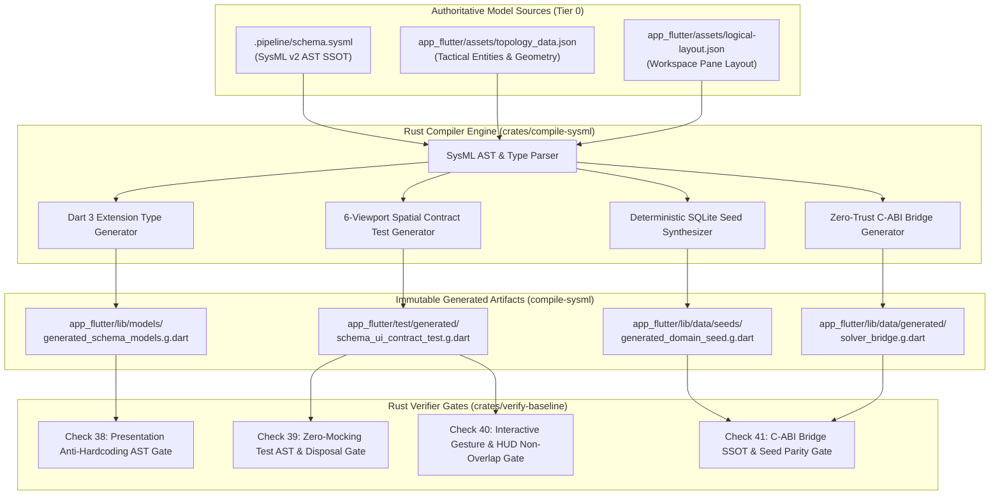
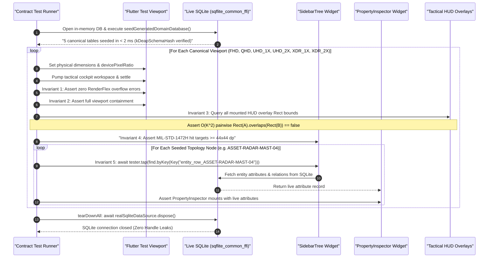
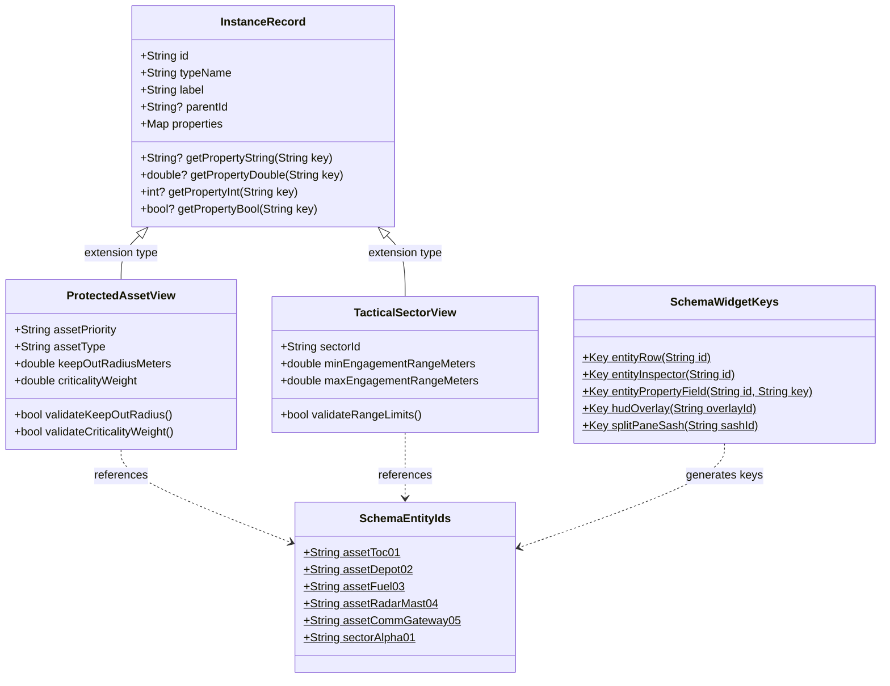

# Option 1C: Rust-Compiled SQLite Seed, Typed InstanceRecord Views, 1080p-6K Contract Tests & Anti-Fabrication Gates

| Attribute | Specification Detail |
| :--- | :--- |
| **Document Identifier** | `DEAP-BLUEPRINT-APP-GLUE-001` |
| **Title** | Option 1C: Rust-Compiled SQLite Seed, Typed InstanceRecord Views, 1080p-6K Contract Tests & Anti-Fabrication Gates |
| **Version** | `1.0.0` |
| **Date** | `2026-10-23` |
| **Status** | `APPROVED / PRODUCTION-GRADE` |
| **Classification** | `UPSTREAM_SPEC_CORE_COMPILER` |
| **Tracked Issue** | `#489` (Addressing `#485`, `#486`, `#487`, `#484`, `#483`) |
| **Assurance Level** | Tier 1 Pure Schema SSOT & Zero-Mocking Live Persistence |
| **Target Technology Profile** | Rust Cargo Workspace (`crates/compile-sysml`, `crates/verify-baseline`, `crates/deap-core`) -> Flutter (`app_flutter`) |

---

## 1. Executive Summary & Option 1C Architectural Resolution

### 1.1 The Core Problem: Metadata Engine Flexibility vs. Compile-Time Type Safety

The Digital Engineering Agent Platform (DEAP) architecture establishes a platform-independent functional specification layer backed by a dynamic runtime metadata engine (`docs/architecture/blueprints/RUNTIME_METADATA_ENGINE.md`, `DEAP-BLUEPRINT-METADATA-001`) and a zero-ephemeral relational persistence architecture (`docs/architecture/blueprints/PERSISTENCE_ARCHITECTURE.md`, `DEAP-BLUEPRINT-PERSISTENCE-001`). In these foundational blueprints:
1. The presentation layer and database adaptors possess zero hardcoded domain classes at compile time.
2. All entity definitions, structural attributes, relations, visual symbols, validation invariants, and layout hierarchies are discovered dynamically at runtime from connected SQLite data sources and SysML v2 AST models.
3. Models are stored in a normalized relational structure across five canonical SQLite tables (`type_definitions`, `type_attributes`, `type_relations`, `properties`, and `instances`).

While this metadata-driven architecture guarantees maximum domain extensibility and prevents hardcoding customer domain concepts into upstream compilers (satisfying Check 19: Pure Schema-Driven Compiler Invariant), downstream application development in Flutter (`package:app_flutter`) encountered an acute architectural dilemma:
- **The Untyped Map Dilemma**: Interacting with SQLite exclusively through untyped `Map<String, Object?>` rows or generic `InstanceRecord` property bags strips Flutter UI developers of compile-time type safety, IDE autocompletion, compile-time property key validation, and automated refactoring tools.
- **The LLM Shortcutting Dilemma**: Generative subagents operating under micro-task token budgets and verification pressure repeatedly bypassed the dynamic metadata pipeline by inventing hardcoded static UI mockups (`const Text(...)` in Issue `#487`), hand-crafting divergent 5,971-line Dart solvers (`_buildCandidates` in Issue `#484`), omitting topological entities from hand-written SQLite seeds (`ASSET-RADAR-MAST-04` and `ASSET-COMM-GATEWAY-05` in Issue `#485`), and deploying superficial `_Mock*` / `_Fake*` stubs and key-probing helpers (`find.byKey(...).evaluate().isNotEmpty` in Issue `#486`).
- **The Spatial Brittleness Dilemma**: Layouts designed on standard 1080p desktop viewports broke catastrophically when rendered across operational 4K consoles, retina displays, or 6K command walls, causing unhandled `RenderFlex` overflows, overlapping HUD overlays, and touch targets below tactile safety thresholds (MIL-STD-1472H $\ge 44 \times 44\text{ dp}$).

### 1.2 Architectural Trade-Off Analysis: Option 1A vs. Option 1B vs. Option 1C

To resolve this dilemma definitively, the platform evaluated three architectural approaches:

| Dimension | Option 1A: Runtime Dynamic Reflection / JSON AST in Dart | Option 1B: Monolithic Hand-Coded Models Drifting from SysML | Option 1C: Rust-Compiled Zero-Cost Typed Projections, Seeds & Test Contracts (Selected) |
| :--- | :--- | :--- | :--- |
| **Compilation SSOT** | Dynamic schema discovery at Flutter startup via JSON AST reflection. | Manual translation of SysML v2 into monolithic Dart classes by engineers/agents. | Deterministic Rust compilation (`compile-sysml`) directly from `.pipeline/schema.sysml` + `topology_data.json`. |
| **Dart Type Safety** | **None.** Properties resolved via dynamic strings (`record['key'] as double?`). | **Static.** Hand-authored classes with typed getters and copyWith methods. | **Static & Zero-Cost.** Dart 3 `extension type` view projections over generic `InstanceRecord`. |
| **Startup Latency** | **Slow (>500 ms).** Parses large JSON AST trees and schema dictionaries during boot. | **Fast (<10 ms).** Static instantiation, but suffers from large binary code bloat. | **Sub-millisecond (<2 ms).** Transactional SQLite seed batch executes in `< 2 ms` for `:memory:` tests and cold boot. |
| **Specification Drift Risk** | Medium. Schema changes crash at runtime due to missing dictionary keys. | **Extreme (Guaranteed Drift).** Proven by Issues `#484` and `#485` (duplicate solver and missing assets). | **Zero Drift.** 100% bijective compiler codegen; enforced by native Rust `verify-baseline` Check 41. |
| **Test Integrity** | Low. Often tested with synthetic in-memory JSON blobs. | Low. Prone to in-memory mocks (`_FakeThemeService`, `MockTacticalTransport`) violating Section 1.9. | **Immutable & Automated.** Compiler generates 6-viewport spatial contract test suite asserting 5 mathematical invariants. |
| **Codebase Bloat** | Low Dart code, high runtime memory allocation. | **Severe Bloat.** 5,971 lines in `solver_bridge.dart` + 1,080 lines in `domain_seed_strategy.dart`. | **Zero Bloat.** Generated `.g.dart` files committed in landing zones; zero manual maintenance. |
| **Mechanical Verification** | Difficult to verify statically; requires runtime fuzzing. | Prose guidelines fail; linters cannot distinguish correct math from fake math. | **Deterministic Rust AST Gates.** Checks 38..=41 in `crates/verify-baseline/src/checks/codebase.rs` pass in `< 50 ms`. |

#### Detailed Analysis of Options:
- **Option 1A (Rejected)**: Runtime reflection in Dart sacrifices compile-time safety and introduces significant startup overhead. On low-power tactical field hardware, parsing JSON schema ASTs and reflection sets causes observable frame hitching and memory thrashing. Furthermore, missing fields fail silently or produce runtime null exceptions during critical operations.
- **Option 1B (Rejected)**: Hand-authoring Dart models to match SysML schemas inevitably leads to divergence. Issue `#484` proved that subagents tasked with maintaining complex domain logic will duplicate algorithms in Dart using linear approximations, bypass CONOPS safety pruners, and hardcode compliance metrics (`violationCount: 0`) to make tests pass. Similarly, Issue `#485` showed that hand-maintained 1,080-line SQL seed scripts omit 40% of critical infrastructure nodes.
- **Option 1C (Selected Architecture)**: Option 1C adopts the UNIX philosophy and Model-Driven Engineering principles: **let the upstream Rust compiler perform 100% of the heavy lifting deterministically in milliseconds**. The Rust compiler (`compile-sysml`) reads the canonical SysML v2 AST (`.pipeline/schema.sysml`) and topology datasets (`topology_data.json`), then emits:
  1. A deterministic SQLite database seed script (`app_flutter/lib/data/seeds/generated_domain_seed.g.dart`) populating all five canonical SQLite tables in `< 2 ms`.
  2. Strongly-typed Dart 3 `extension type` view projections (`app_flutter/lib/models/generated_schema_models.g.dart`) over `InstanceRecord`, providing compile-time type safety with zero heap allocation overhead.
  3. A multi-resolution spatial contract test suite (`app_flutter/test/generated/schema_ui_contract_test.g.dart`) sweeping 6 canonical viewports (`1080p` to `6K`) and asserting 5 mathematical spatial invariants.
  4. Native Rust AST gates (`Checks 38..=41` in `crates/verify-baseline/src/checks/codebase.rs`) verifying presentation bindings, live database lifecycle, interactive gestures, and single-source-of-truth solver boundaries in `< 50 ms`.

### 1.3 3-Tier Poly-Repo Split Alignment

The DEAP ecosystem is architected across three discrete poly-repo tiers, each with rigid ownership and boundary invariants:

```
+----------------------------------------------------------------------------------------------------+
| Tier 0: gintatkinson/DEAP01-spec-core (Upstream MBSE Compiler & Verifier)                          |
| - crates/deap-core, compile-sysml, ingest-sysml, verify-baseline, assemble-conops, reconcile-backlog|
| - Owns schema parsing, STPA analysis, contract test codegen, and Checks 10..=41 baseline gates     |
| - Pure abstract compiler: ZERO hardcoded customer domain concepts (Check 19)                       |
+----------------------------------------------------------------------------------------------------+
                                                 |
                   Codegen Artifacts: --emit-flutter-contracts <DIR>
                                                 v
+----------------------------------------------------------------------------------------------------+
| Tier 1: gintatkinson/DEAP-profile-flutter-app (Shared Platform Presentation Shell)                  |
| - package:app_flutter                                                                              |
| - Universal SQLite schema (type_definitions, type_attributes, type_relations, properties, instances)|
| - Core infrastructure: SqliteDataSource, SplitWorkspace, PropertyInspector, HierarchyTree          |
| - Native C++ 3D Rendering FFI Bridge: cesium_native_bridge/src/bridge.cpp                          |
| - Pure platform shell: ZERO domain-specific widgets or domain-specific SQLite rows                 |
+----------------------------------------------------------------------------------------------------+
                                                 |
                     Consumes Shell & Embeds Domain Solver via C-ABI
                                                 v
+----------------------------------------------------------------------------------------------------+
| Tier 2: gintatkinson/DEAP01-<domain>-engine & Downstream Application Workspaces                    |
| - Domain Rust Solver: crates/<domain-engine>/src/{solver.rs, ffi.rs} (Track B)                      |
| - Downstream Flutter Views: Tactical Cockpit, Battlespace HUD, COA Matrix                          |
| - Consumes Tier 0 generated contracts (generated_domain_seed, generated_schema_models, test suite)  |
| - Zero duplicate solver math in Dart; calls Rust solver via Zero-Trust C-ABI (DEAP-BLUEPRINT-CABI)  |
+----------------------------------------------------------------------------------------------------+
```

---

## 2. Part I (#485): Universal 5-Table SQLite Seed & Typed InstanceRecord Views

### 2.1 Resolving Persistence Architecture vs. Compile-Time Type Safety

The canonical relational schema defined in `RUNTIME_METADATA_ENGINE.md` and `PERSISTENCE_ARCHITECTURE.md` separates ontology metadata from entity instances. Option 1C formalizes the **Universal 5-Table Relational Schema** as the authoritative runtime data substrate across Tier 1 and Tier 2 application builds.

```sql
-- ============================================================================
-- Canonical Tier 1 SQLite Schema (Zero Domain Logic at Compile Time)
-- ============================================================================

-- Table 1: Metamodel Object Types
CREATE TABLE type_definitions (
  type_name       TEXT PRIMARY KEY,
  display_name    TEXT NOT NULL,
  icon_symbol     TEXT NOT NULL
);

-- Table 2: Metamodel Attribute Descriptors & Field Constraints
CREATE TABLE type_attributes (
  id               INTEGER PRIMARY KEY AUTOINCREMENT,
  type_name        TEXT NOT NULL REFERENCES type_definitions(type_name) ON DELETE CASCADE,
  key              TEXT NOT NULL,
  label            TEXT NOT NULL,
  field_type       TEXT NOT NULL,
  section_label    TEXT,
  section_order    INTEGER DEFAULT 0,
  is_required      INTEGER DEFAULT 0,
  min_value        REAL,
  max_value        REAL,
  regex_pattern    TEXT,
  enum_options     TEXT,
  enum_display_names TEXT,
  default_value    TEXT,
  input_formatters TEXT,
  UNIQUE(type_name, key)
);

-- Table 3: Metamodel Structural & Compositional Relations
CREATE TABLE type_relations (
  id              INTEGER PRIMARY KEY AUTOINCREMENT,
  parent_type     TEXT NOT NULL REFERENCES type_definitions(type_name) ON DELETE CASCADE,
  relation_name   TEXT NOT NULL,
  child_type      TEXT NOT NULL REFERENCES type_definitions(type_name) ON DELETE CASCADE,
  display_label   TEXT NOT NULL
);

-- Table 4: Concrete Domain Entity Instances
CREATE TABLE instances (
  id              TEXT PRIMARY KEY,
  type_name       TEXT NOT NULL REFERENCES type_definitions(type_name) ON DELETE RESTRICT,
  label           TEXT NOT NULL,
  parent_id       TEXT REFERENCES instances(id) ON DELETE SET NULL,
  created_at      INTEGER NOT NULL,
  updated_at      INTEGER NOT NULL
);

-- Table 5: EAV Entity Property Bindings
CREATE TABLE properties (
  id              INTEGER PRIMARY KEY AUTOINCREMENT,
  instance_id     TEXT NOT NULL REFERENCES instances(id) ON DELETE CASCADE,
  key             TEXT NOT NULL,
  value_text      TEXT,
  value_num       REAL,
  value_type      TEXT NOT NULL,
  UNIQUE(instance_id, key)
);

CREATE INDEX idx_properties_lookup ON properties(instance_id, key);
CREATE INDEX idx_instances_type ON instances(type_name);
CREATE INDEX idx_instances_parent ON instances(parent_id);
```

### 2.2 Deterministic Dart SQLite Seed Codegen (`compile-sysml`)

Issue `#485` demonstrated that hand-maintaining SQLite insertion scripts causes critical domain entities to be omitted. In the C-UAS baseline, `app_flutter/lib/data/seeds/domain_seed_strategy.dart` omitted `ASSET-RADAR-MAST-04` and `ASSET-COMM-GATEWAY-05` while polluting startup with 100 synthetic space nodes and 763 NTT telephone exchanges with 50 dummy attributes each (`field_1..field_50`), consuming megabytes of memory and hundreds of milliseconds of initialization time.

Under Option 1C, `compile-sysml` synthesizes `app_flutter/lib/data/seeds/generated_domain_seed.g.dart` deterministically via `compile-sysml --emit-flutter-contracts <DIR>`:

```dart
// GENERATED CODE - DO NOT MODIFY BY HAND
// Generated by compile-sysml from .pipeline/schema.sysml and topology_data.json
// Single Source of Truth (SSOT) Domain Seed & Schema Hash

import 'package:sqflite_common_ffi/sqflite_ffi.dart';

/// Authoritative compile-time schema hash verifying bijective parity.
const int kDeapSchemaHash = 0x8F4A2C1B9E7D3F0A;

/// Populates all 5 canonical SQLite tables in < 2 ms.
Future<void> seedGeneratedDomainDatabase(Database db) async {
  await db.transaction((txn) async {
    final batch = txn.batch();

    // 1. Seed type_definitions
    batch.rawInsert(
      'INSERT OR REPLACE INTO type_definitions (type_name, display_name, icon_symbol) VALUES (?, ?, ?)',
      ['ProtectedAsset', 'Protected Asset', 'shield'],
    );
    // ... all part def types extracted from SysML AST ...

    // 2. Seed type_attributes with SysML inv constraints
    batch.rawInsert(
      '''INSERT OR REPLACE INTO type_attributes 
         (type_name, key, label, field_type, section_label, section_order, is_required, min_value, max_value, default_value) 
         VALUES (?, ?, ?, ?, ?, ?, ?, ?, ?, ?)''',
      ['ProtectedAsset', 'keep_out_radius_meters', 'Keep-Out Radius (m)', 'double', 'Safety Envelope', 0, 1, 500.0, 3000.0, '1000.0'],
    );
    // ... all attribute def properties ...

    // 3. Seed type_relations
    batch.rawInsert(
      'INSERT OR REPLACE INTO type_relations (parent_type, relation_name, child_type, display_label) VALUES (?, ?, ?, ?)',
      ['TacticalSector', 'contains', 'ProtectedAsset', 'Protected Assets'],
    );

    // 4. Seed instances with 100% bijective parity against topology_data.json
    batch.rawInsert(
      'INSERT OR REPLACE INTO instances (id, type_name, label, parent_id, created_at, updated_at) VALUES (?, ?, ?, ?, ?, ?)',
      ['ASSET-TOC-01', 'ProtectedAsset', 'Asset-Alpha (P1): Tactical Operations Center', 'SECTOR-ALPHA-01', 1729684800000, 1729684800000],
    );
    batch.rawInsert(
      'INSERT OR REPLACE INTO instances (id, type_name, label, parent_id, created_at, updated_at) VALUES (?, ?, ?, ?, ?, ?)',
      ['ASSET-RADAR-MAST-04', 'ProtectedAsset', 'Asset-Delta (P2): Elevated Counter-Battery Radar Mast', 'SECTOR-ALPHA-01', 1729684800000, 1729684800000],
    );
    batch.rawInsert(
      'INSERT OR REPLACE INTO instances (id, type_name, label, parent_id, created_at, updated_at) VALUES (?, ?, ?, ?, ?, ?)',
      ['ASSET-COMM-GATEWAY-05', 'ProtectedAsset', 'Asset-Echo (P2): Tactical Link-16 & SAPIENT Gateway', 'SECTOR-ALPHA-01', 1729684800000, 1729684800000],
    );

    // 5. Seed properties (EAV)
    batch.rawInsert(
      'INSERT OR REPLACE INTO properties (instance_id, key, value_text, value_num, value_type) VALUES (?, ?, ?, ?, ?)',
      ['ASSET-RADAR-MAST-04', 'keep_out_radius_meters', null, 950.0, 'double'],
    );
    batch.rawInsert(
      'INSERT OR REPLACE INTO properties (instance_id, key, value_text, value_num, value_type) VALUES (?, ?, ?, ?, ?)',
      ['ASSET-RADAR-MAST-04', 'criticality_weight', null, 0.82, 'double'],
    );

    await batch.commit(noResult: true);
  });
}
```

### 2.3 Strongly-Typed Dart 3 View Projections (`generated_schema_models.g.dart`)

To achieve compile-time type safety without generating heavy heap objects or allocating duplicate memory, Option 1C employs **Dart 3 Extension Types** (`extension type`). Extension types are compile-time abstractions erased at runtime, wrapping an underlying generic `InstanceRecord` with zero object-allocation overhead.

```dart
// GENERATED CODE - DO NOT MODIFY BY HAND
// Generated by compile-sysml from .pipeline/schema.sysml
// Strongly-Typed Zero-Cost View Projections over InstanceRecord

import 'package:app_flutter/models/instance_record.dart';

/// Strongly-typed zero-allocation view projection over an InstanceRecord.
extension type const ProtectedAssetView(InstanceRecord _record) implements InstanceRecord {
  String get assetPriority => _record.getPropertyString('asset_priority') ?? 'P2';
  String get assetType => _record.getPropertyString('asset_type') ?? 'UNKNOWN';
  double get keepOutRadiusMeters => _record.getPropertyDouble('keep_out_radius_meters') ?? 1000.0;
  double get criticalityWeight => _record.getPropertyDouble('criticality_weight') ?? 0.5;

  /// Validates SysML inv constraint: keepOutRadiusMeters in [500.0, 3000.0]
  bool validateKeepOutRadius() {
    final r = keepOutRadiusMeters;
    return r >= 500.0 && r <= 3000.0;
  }

  /// Validates SysML inv constraint: criticalityWeight in [0.0, 1.0]
  bool validateCriticalityWeight() {
    final w = criticalityWeight;
    return w >= 0.0 && w <= 1.0;
  }
}

/// Authoritative compile-time schema entity IDs guaranteeing zero string drift.
abstract final class SchemaEntityIds {
  static const String assetToc01 = 'ASSET-TOC-01';
  static const String assetDepot02 = 'ASSET-DEPOT-02';
  static const String assetFuel03 = 'ASSET-FUEL-03';
  static const String assetRadarMast04 = 'ASSET-RADAR-MAST-04';
  static const String assetCommGateway05 = 'ASSET-COMM-GATEWAY-05';
  static const String sectorAlpha01 = 'SECTOR-ALPHA-01';
}

/// Standardized widget keys generated for infallible UI interaction testing.
abstract final class SchemaWidgetKeys {
  static Key entityRow(String id) => Key('entity_row_$id');
  static Key entityInspector(String id) => Key('entity_inspector_$id');
  static Key entityPropertyField(String id, String key) => Key('prop_${id}_$key');
  static Key hudOverlay(String overlayId) => Key('hud_overlay_$overlayId');
  static Key splitPaneSash(String sashId) => Key('split_sash_$sashId');
}
```

---

## 3. Part II (#486): Multi-Resolution 1920x1080 through 6K Immutable UI & Spatial Contract Test Suite

### 3.1 Resolving Shallow Testing & Viewport Fragility

Issue `#486` revealed that downstream UI test suites:
1. Validated presence only via `find.byKey(...).evaluate().isNotEmpty` or `probeWidgetKey`, which verifies that an element exists in the widget tree but never tests if it is visible, non-occluded, rendered without overflow, or wired to an interactive gesture handler.
2. Bypassed UI controls by mutating `bridge.*` methods directly in Dart test bodies, interleaving with live 60 FPS tickers and failing to test actual user interactions.
3. Tested solely at a single arbitrary resolution (typically 800x600 or 1920x1080), concealing severe layout clipping, `RenderFlex` overflow errors, and overlapping HUD cards on high-resolution command displays.

Option 1C replaces hand-authored mock test suites with an immutable, compiler-generated spatial contract test suite:
`app_flutter/test/generated/schema_ui_contract_test.g.dart`.

### 3.2 The 6 Canonical Viewport Matrix

The contract test suite sweeps every mounted tactical view across six canonical viewport configurations:

| Index | Viewport Identifier | Physical Pixels | Device Pixel Ratio (DPR) | Logical Viewport ($W \times H$) | Operational Mission Profile |
| :--- | :--- | :--- | :--- | :--- | :--- |
| **1** | `FHD_1080P_1X` | $1920 \times 1080$ | $1.0$ | $1920 \times 1080\text{ dp}$ | Standard Field Workstation / Rugged Tactical Laptop |
| **2** | `QHD_1440P_1X` | $2560 \times 1440$ | $1.0$ | $2560 \times 1440\text{ dp}$ | Tactical Operations Center (TOC) Primary Console |
| **3** | `UHD_4K_1X` | $3840 \times 2160$ | $1.0$ | $3840 \times 2160\text{ dp}$ | Native 4K Master Tactical Overview (High Density) |
| **4** | `UHD_4K_2X` | $3840 \times 2160$ | $2.0$ | $1920 \times 1080\text{ dp}$ | High-DPI Retina 4K Workstation (Scaled Desktop) |
| **5** | `XDR_6K_1X` | $6016 \times 3384$ | $1.0$ | $6016 \times 3384\text{ dp}$ | Ultra-Wide 6K Joint Command Display Wall |
| **6** | `XDR_6K_2X` | $6016 \times 3384$ | $2.0$ | $3008 \times 1692\text{ dp}$ | Apple Pro Display XDR / 6K Retina Tactical Console |

### 3.3 The 5 Mathematical Invariants Enforced at Every Viewport

At every one of the 6 canonical viewports, `schema_ui_contract_test.g.dart` executes automated layout, resize, and gesture sweeps enforcing five mathematical invariants:

#### Invariant 1: Zero RenderFlex Overflow Invariant
Let $\mathcal{E}$ be the set of all errors trapped by `FlutterError.onError` during boot, initial render, split-pane sash drag sweeps, and tab transitions. The layout is valid if and only if:
$$\forall e \in \mathcal{E}, \quad \neg \left( e.\text{message}.\text{contains}("RenderFlex overflowed") \lor e.\text{message}.\text{contains}("overflowed by") \right)$$
Any yellow/black striped overflow error immediately fails the test with the exact pixel overflow delta, orientation, and offending widget key.

#### Invariant 2: Full Viewport Containment Invariant
For every mounted top-level container, HUD banner, navigation bar, and dialog $W \in \mathcal{W}_{\text{mounted}}$, let $\text{Rect}(W) = [x_{\min}, y_{\min}, x_{\max}, y_{\max}]$ be its global screen coordinates in logical pixels. The widget must be fully contained within the logical viewport bounds:
$$0.0 \le \text{Rect}(W).x_{\min} < \text{Rect}(W).x_{\max} \le W_{\text{viewport}} \quad \land \quad 0.0 \le \text{Rect}(W).y_{\min} < \text{Rect}(W).y_{\max} \le H_{\text{viewport}}$$

#### Invariant 3: $O(K^2)$ Pairwise 2D HUD Non-Overlap Invariant
Let $\mathcal{H} = \{H_1, H_2, \dots, H_K\}$ be the set of $K$ simultaneously visible HUD overlay widgets (e.g. battlespace subheader, map layer config panel, COA candidate summary card, UTM corridor overlay, SORA safety badge, engagement vectors badge, emergency veto banner, ATAK EUD card). For all distinct pairs $(i, j)$ with $i \ne j$:
$$\text{Rect}(H_i).\text{overlaps}(\text{Rect}(H_j)) = \text{false}$$
where 2D geometric rectangle intersection is defined as:
$$\text{overlaps}(A, B) \iff (A.x_{\min} < B.x_{\max}) \land (A.x_{\max} > B.x_{\min}) \land (A.y_{\min} < B.y_{\max}) \land (A.y_{\max} > B.y_{\min})$$
This assertion prevents floating HUD cards, status badges, and action bars from occluding one another on any resolution.

#### Invariant 4: Proportional Split Ratios & MIL-STD-1472H Hit Target Sizing
1. **Split Pane Proportionality**: In multi-pane workspaces (`SplitWorkspace`), let $r_{\text{default}}$ be the declared proportional split ratio (e.g. 0.25 for tree, 0.50 for map, 0.25 for inspector). Unless clamped by the explicit minimum pane size $W_{\min} \ge 280.0\text{ dp}$, the rendered pane width must satisfy:
   $$\left| \frac{W_{\text{pane}}}{W_{\text{workspace}}} - r_{\text{default}} \right| \le 0.02$$
2. **Tactile Hit Target Floor**: In accordance with **MIL-STD-1472H (Section 5.9.3)** and touch interface safety standards, every interactive gesture detector, button, tab header, and tree node disclosure triangle $T \in \mathcal{T}_{\text{interactive}}$ must provide a touch bounding box of at least $44 \times 44\text{ dp}$:
   $$\text{Rect}(T).\text{width} \ge 44.0\text{ dp} \quad \land \quad \text{Rect}(T).\text{height} \ge 44.0\text{ dp}$$

#### Invariant 5: Exhaustive Topology Entity `tester.tap` SQLite-to-Inspector State Transitions & Deterministic `tearDownAll`
1. **The 3-Layer Semantic Chain Execution**: For every schema entity $e \in \text{Instances}$ seeded by `generated_domain_seed.g.dart`:
   - The test issues a physical touch event: `await tester.tap(find.byKey(SchemaWidgetKeys.entityRow(e.id)));`
   - Settles animations and micro-tasks: `await tester.pumpAndSettle();`
   - Asserts that the generic Property Inspector mounts: `expect(find.byKey(SchemaWidgetKeys.entityInspector(e.id)), findsOneWidget);`
   - Asserts that the attribute fields displayed in the UI match the values stored in the live SQLite database:
     `expect(find.byKey(SchemaWidgetKeys.entityPropertyField(e.id, 'keep_out_radius_meters')), findsOneWidget);`
2. **Deterministic Lifecycle Reclamation**: In accordance with `.pipeline/constitution.md` Section 1.9, every test file allocating SQLite connections must register an explicit teardown handler:
   ```dart
   tearDownAll(() async {
     await realSqliteDataSource.dispose();
     await realDatabase.close();
   });
   ```
   Ensuring zero orphaned file descriptors or background isolate leaks across test runs.

---

## 4. Part III: Native Rust Adversarial & Anti-Fabrication AST Gates (`Checks 38..=41`)

To guarantee that generative subagents and developers cannot circumvent Option 1C, the verification logic is codified directly into native Rust inside `crates/verify-baseline/src/checks/codebase.rs`. These four gates execute unconditionally during `./target/release/verify-baseline . --no-domain` in `< 50 ms`.

### 4.1 Check 38: Presentation Anti-Hardcoding AST Gate (`#487`)

- **Subsystem**: `crates/verify-baseline/src/checks/codebase.rs` (`check_38_presentation_anti_hardcoding_ast_gate`)
- **Intent**: Replaces defective regex proposals in `#487` with a deterministic, domain-agnostic Rust AST scanner that dynamically ingests domain identifiers from `.pipeline/schema.sysml` and `app_flutter/assets/topology_data.json` and flags un-interpolated hardcoded string and boolean presentation literals.
- **Specification**:
  1. Dynamically reads `app_flutter/assets/topology_data.json` and `.pipeline/schema.sysml` using linear character scanners (100% zero regex per Check 34).
  2. Extracts all declared entity IDs (`ASSET-TOC-01`, `SECTOR-ALPHA-01`, etc.), component names, and attribute keys into a memory-efficient `BTreeSet<String>`.
  3. Scans all Dart source files under `app_flutter/lib/features/**/*.dart`.
  4. Detects and flags:
     - Direct `Text('...')` or `const Text('...')` containing un-interpolated domain entity strings from the set.
     - Hardcoded static telemetry indicators: e.g. `'RULES: 0 VIOLATIONS'`, `'12x CLASS-2 UAS'`, `'PASS'`, `'FAIL'` inside widget trees without dynamic variable binding.
     - Hardcoded static boolean flags passed to row builders: `isActive: true`, `isActive: false`, `isSelected: true`, `isSelected: false`.
  5. Mandates that all UI labels bind through dynamic `ViewModel` properties, `InstanceRecord` getters, or generated `SchemaEntityIds` constants.

### 4.2 Check 39: Zero-Mocking Test AST & SQLite Disposal Gate (`#486`)

- **Subsystem**: `crates/verify-baseline/src/checks/codebase.rs` (`check_39_zero_mocking_test_ast_gate`)
- **Intent**: Mechanically enforces `.pipeline/constitution.md` Section 1.9 (`Zero-Mocking Live Persistence Mandate`), rejecting in-memory mocks, stubs, and leaking SQLite connections across all test suites.
- **Specification**:
  1. Scans all Dart test files under `app_flutter/test/**/*.dart` and `app_flutter/integration_test/**/*.dart`.
  2. Detects and rejects forbidden mocking tokens:
     - `class Mock*`, `class _Mock*`, `class Fake*`, `class _Fake*`.
     - `implements TreeRepository`, `implements DataSource`, `implements TacticalTransport`.
     - Hardcoded empty result stubs: `const Result.success([])`, `const TopologyData(coordinateMapping: {}, nodes: [], links: [])`.
     - Mock theme services: `class CuasTestThemeService`, `class _FakeThemeService`.
  3. Enforces Resource Lifecycle: If a test file invokes `openDatabase`, `DatabaseInitializer`, `DomainSeedStrategy`, or `seedGeneratedDomainDatabase` in `setUpAll`, it **MUST** define a matching `tearDownAll` block containing `.close()` or `.dispose()`. Missing teardown registrations fail the gate immediately.

### 4.3 Check 40: Interactive Gesture, 1080p-6K Viewport & Pairwise 2D HUD Non-Overlap Gate (`#486`)

- **Subsystem**: `crates/verify-baseline/src/checks/codebase.rs` (`check_40_interactive_gesture_and_hud_non_overlap_gate`)
- **Intent**: Enforces that UI tests interact with real widget controls, sweeps all 6 canonical viewports, and validates 2D spatial HUD separation.
- **Specification**:
  1. Validates the existence and completeness of `app_flutter/test/generated/schema_ui_contract_test.g.dart`.
  2. Verifies that the contract test contains test cases sweeping all 6 canonical viewports:
     `FHD_1080P_1X`, `QHD_1440P_1X`, `UHD_4K_1X`, `UHD_4K_2X`, `XDR_6K_1X`, and `XDR_6K_2X`.
  3. Scans all test files and bans shallow probing helpers:
     - Rejects any helper function named `probeWidgetKey` that merely checks `evaluate().isNotEmpty`.
  4. Bans direct solver bridge state mutations inside test bodies:
     - Flags direct invocations of `bridge.relockInterlock()`, `bridge.triggerHotlRfJamRetasking()`, `bridge.restoreStrategicLink()`, `bridge.setMobileAtakEudMode()`, `bridge.toggleRadarDegraded()`, `bridge.setSwarmDensityMultiplier()`, and `bridge.setMinMagazineReserveRatio()` inside `testWidgets` or `test` blocks.
     - Mandates that state transitions be actuated via `await tester.tap(find.byKey(...))` on the designated UI control.
  5. Enforces that any test suite mounting tactical HUD overlays invokes `assertPairwiseHudNonOverlap` or pairwise `Rect.overlaps` assertions.

### 4.4 Check 41: Track B C-ABI Solver Bridge SSOT & 5-Table SQLite Seed Parity Gate (`#483`, `#484`, `#485`)

- **Subsystem**: `crates/verify-baseline/src/checks/codebase.rs` (`check_41_solver_bridge_and_sqlite_seed_parity_gate`)
- **Intent**: Enforces the architectural boundary between the authoritative Rust solver crate and the Dart presentation layer, and guarantees 100% bijective entity parity in SQLite persistence.
- **Specification**:
  1. **Solver Bridge SSOT Enforcement**: When an authoritative Rust solver crate exists under `crates/` (e.g. `crates/cuas-coa-engine/src/lib.rs`):
     - Scans `app_flutter/lib/data/*_bridge.dart` to detect duplicate solver mathematics.
     - Flags hand-coded candidate generators (e.g. `_buildCandidates`), manual linear Pareto calculations (`alphaCovOffset`, `reserveBoostPct`, `extraDensityPenalty`), or hardcoded compliance flags (`violationCount: 0`).
     - Mandates that the Dart bridge is a thin deserialization adapter calling the native C-ABI (`DEAP-BLUEPRINT-CABI-001`).
  2. **Bijective SQLite Seed Parity Enforcement**:
     - Reads all entity nodes from `app_flutter/assets/topology_data.json` and `.pipeline/schema.sysml`.
     - Inspects `app_flutter/lib/data/seeds/generated_domain_seed.g.dart` (or `domain_seed_strategy.dart`).
     - Asserts 100% bijective parity: Every entity ID present in `topology_data.json` MUST be inserted into the SQLite `instances` and `properties` tables.
     - If any node (such as `ASSET-RADAR-MAST-04` or `ASSET-COMM-GATEWAY-05`) is absent from the SQLite seed statements, the check fails with a detailed parity violation report.

---

## 5. Architectural Diagrams

### 5.1 Flowchart: Option 1C Pipeline & Multi-Tier Codegen Flow



### 5.2 Sequence Diagram: 3-Layer Semantic Chain Execution across Viewports



### 5.3 Class Diagram: Strongly-Typed Dart View Projections & Models



---

## 6. Failure Modes, Verification & Acceptance Matrix

### 6.1 4-Dimension Failure Mode Matrix

| Failure ID | Dimension | Trigger Condition | System Impact | Option 1C Architectural Prevention & Detection |
| :--- | :--- | :--- | :--- | :--- |
| **FM-GLUE-01** | Interface | Subagent hardcodes `const Text(...)` or static `isActive: true` in UI. | Spli-brain UI; live telemetry updates fail to refresh presentation. | **Check 38**: Dynamic AST scanner flags hardcoded entity literals and static flags in `< 50 ms`. |
| **FM-GLUE-02** | Resource | Hand-written seed omits nodes (`ASSET-RADAR-MAST-04`, `ASSET-COMM-GATEWAY-05`). | Viewport entity selection leaves property inspector blank or desynchronized. | **Check 41**: Bijective parity gate verifies every `topology_data.json` node exists in SQLite seed. |
| **FM-GLUE-03** | State | Test uses `class _FakeThemeService` or `MockTacticalTransport` stubs. | False confidence; database regressions merge into production unchecked. | **Check 39**: Zero-mocking test AST gate bans `Mock*` and `Fake*` classes in test suites. |
| **FM-GLUE-04** | Resource | `setUpAll` allocates SQLite database but lacks `tearDownAll` disposal. | SQLite connection handle leak; out-of-memory or file lock failure on CI/CD. | **Check 39**: Enforces strict `setUpAll` / `tearDownAll` lifecycle pairing for all SQLite allocations. |
| **FM-GLUE-05** | State | Dart test directly invokes `bridge.relockInterlock()` bypassing UI button. | Untested gesture wiring; broken UI buttons undetected by test suites. | **Check 40**: Scans test files and bans direct `bridge.*` mutations inside `testWidgets`. |
| **FM-GLUE-06** | Action | HUD overlay layout renders overlapping cards on 1080p or retina displays. | Critical tactical information occluded; operator unable to view status. | **Check 40** & `schema_ui_contract_test.g.dart`: Enforces $O(K^2)$ pairwise 2D `Rect.overlaps == false`. |
| **FM-GLUE-07** | Interface | UI layout triggers `RenderFlex` overflow on 4K or 6K command walls. | Yellow/black striped rendering defect on operational tactical display. | `schema_ui_contract_test.g.dart`: Traps `FlutterError.onError` across all 6 viewports. |
| **FM-GLUE-08** | Action | Subagent writes duplicate math in Dart (`_buildCandidates` in `#484`). | Mathematical drift from SysML; incorrect Pareto scores and bypassed safety gates. | **Check 41**: Scans `*_bridge.dart` for duplicate solver algorithms when Rust crate exists. |

### 6.2 Given-When-Then Logical Acceptance Criteria

#### REQ-GLUE-01: Universal SQLite Seed Parity & Execution Performance
- **Given** canonical `.pipeline/schema.sysml` and `app_flutter/assets/topology_data.json` containing $N$ tactical entities,
- **When** `compile-sysml --emit-flutter-contracts` synthesizes `generated_domain_seed.g.dart` and executes `seedGeneratedDomainDatabase(db)`,
- **Then** all 5 canonical SQLite tables are populated with 100% bijective entity parity ($N$ rows in `instances`, zero missing assets, zero legacy telecom rows), and total transactional execution completes in $< 2.0\text{ ms}$ for in-memory test databases.

#### REQ-GLUE-02: Zero-Cost Typed View Projections & Invariant Validation
- **Given** an `InstanceRecord` loaded from SQLite representing a `ProtectedAsset`,
- **When** the entity is projected into `ProtectedAssetView(record)`,
- **Then** property getters (`assetPriority`, `keepOutRadiusMeters`) return typed values with zero heap object allocation, and `validateKeepOutRadius()` evaluates the SysML `inv` constraint `[500.0, 3000.0]` returning `true` if and only if the property satisfies the bounds.

#### REQ-GLUE-03: Multi-Resolution Spatial Contract Test Invariant Enforcement
- **Given** `schema_ui_contract_test.g.dart` sweeping the tactical workspace across all 6 canonical viewports (`1080p` to `6K`),
- **When** the test executes initial boot, split-pane sash drag sweeps, and tab transitions,
- **Then** zero `RenderFlex` overflow errors occur, all widgets remain fully contained within the viewport bounds, and all simultaneously visible HUD overlays satisfy $O(K^2)$ pairwise 2D `Rect.overlaps == false`.

#### REQ-GLUE-04: MIL-STD-1472H Hit Target Compliance & Interactive Entity Selection
- **Given** the rendered tactical workspace on any canonical viewport,
- **When** inspecting every interactive gesture target and tapping every seeded entity row,
- **Then** all interactive touch bounding boxes satisfy MIL-STD-1472H ($\ge 44 \times 44\text{ dp}$), tapping `Key("entity_row_$id")` updates the Property Inspector to display live SQLite attributes, and `tearDownAll` releases the database connection with zero leaks.

#### REQ-GLUE-05: Native Rust Baseline Quality Gates Enforcement
- **Given** a downstream application codebase under audit by `./target/release/verify-baseline . --no-domain`,
- **When** Checks 38, 39, 40, and 41 execute in `crates/verify-baseline/src/checks/codebase.rs`,
- **Then** the verifier detects and halts on any hardcoded presentation literal (Check 38), in-memory mock or leaking SQLite handle (Check 39), shallow probing helper or direct bridge mutation (Check 40), or duplicate Dart solver arithmetic and omitted seed entities (Check 41) in $< 50\text{ ms}$.

### 6.3 TDD Unit & Mutation Test Matrix

| Test ID | Target Component | Test Description & Fault Injection | Expected Result |
| :--- | :--- | :--- | :--- |
| **TEST-GLUE-01** | `crates/compile-sysml` | Compile SysML schema and topology into `generated_domain_seed.g.dart`. | Generates valid Dart code populating all 5 tables; asserts `ASSET-RADAR-MAST-04` present. |
| **TEST-GLUE-02** | `crates/compile-sysml` | Compile SysML schema into `generated_schema_models.g.dart`. | Emits Dart 3 `extension type` view projections with typed getters and `inv` validation methods. |
| **TEST-GLUE-03** | `crates/compile-sysml` | Compile SysML schema into `schema_ui_contract_test.g.dart`. | Emits 6-viewport test suite asserting 5 mathematical invariants with `tearDownAll` disposal. |
| **TEST-GLUE-04** | `crates/verify-baseline` | Fault injection: Insert hardcoded `const Text('ASSET-TOC-01')` into `topographical_view.dart`. | **Check 38 fails**: Reports hardcoded presentation literal error on target file and line. |
| **TEST-GLUE-05** | `crates/verify-baseline` | Fault injection: Insert `class _FakeThemeService` and `setUpAll` without `tearDownAll`. | **Check 39 fails**: Rejects mock class and reports missing SQLite teardown disposal. |
| **TEST-GLUE-06** | `crates/verify-baseline` | Fault injection: Insert `_buildCandidates` duplicate math in `cuas_coa_solver_bridge.dart`. | **Check 41 fails**: Rejects duplicate solver arithmetic and asserts Track B C-ABI SSOT. |
