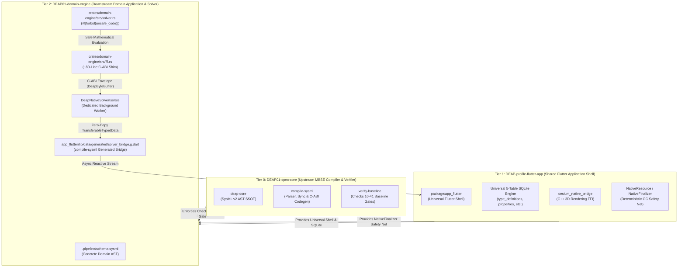
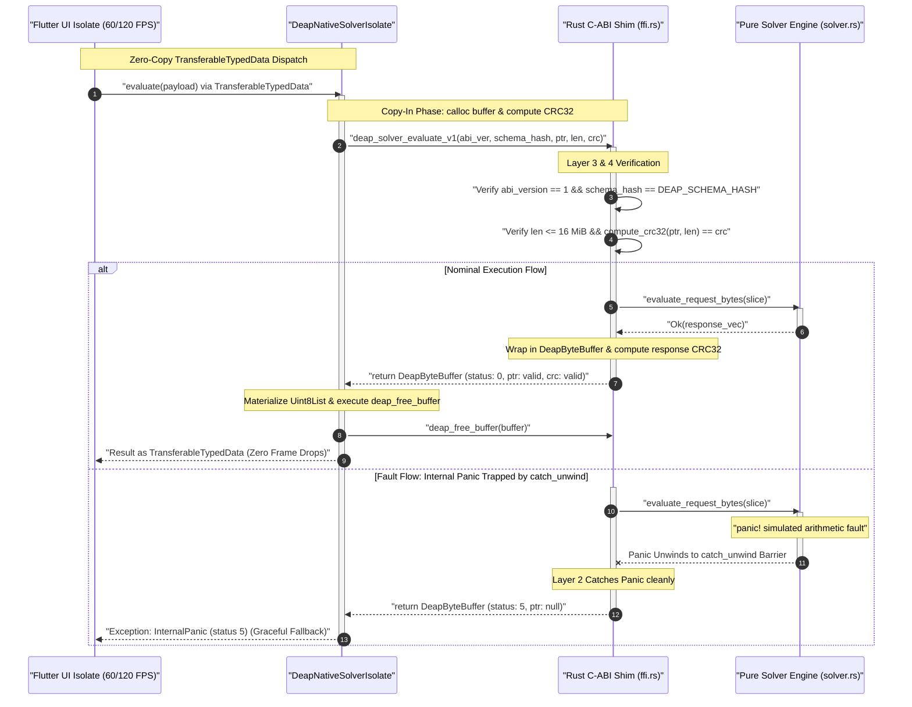
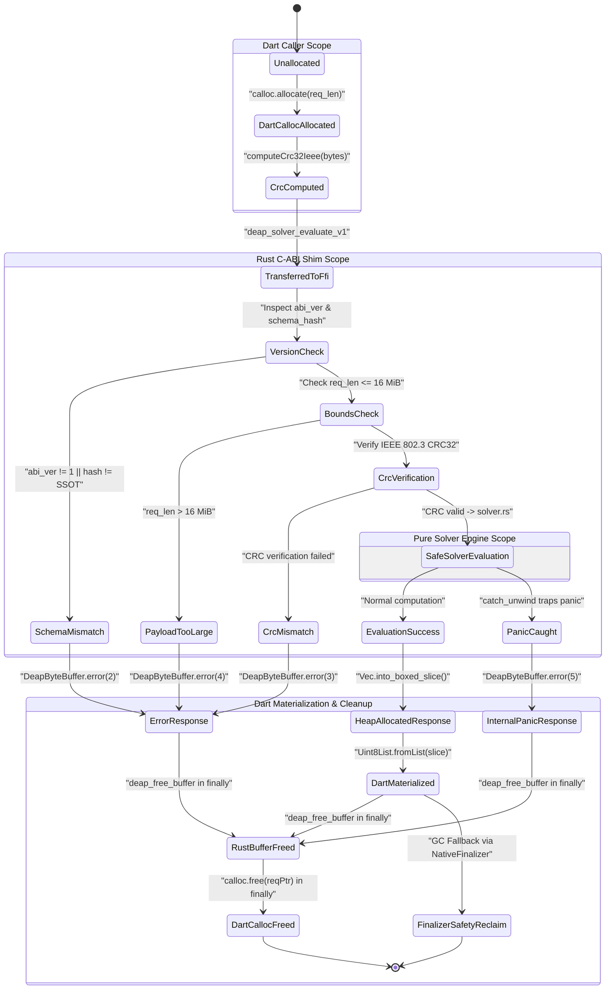
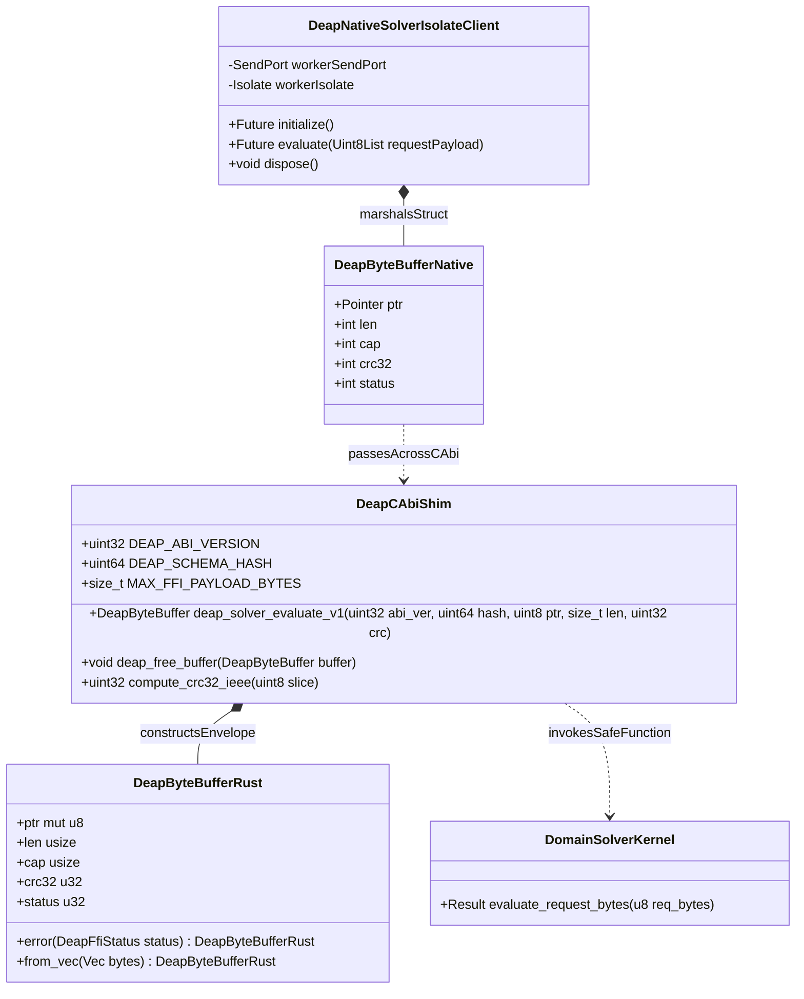

# Zero-Trust Deterministic Rust C-ABI Architecture Blueprint

| Attribute | Specification Detail |
| :--- | :--- |
| **Blueprint Identifier** | `DEAP-BLUEPRINT-CABI-001` |
| **Title** | Zero-Trust Deterministic Rust C-ABI Architecture Blueprint |
| **Version** | `1.0.0` |
| **Date** | `2026-10-23` |
| **Status** | `APPROVED / PRODUCTION-GRADE` |
| **Classification** | `UPSTREAM_SPEC_CORE_COMPILER` |
| **Tracking Feature Issue** | GitHub Feature Issue `#483` |
| **Addressing Defect** | GitHub Defect Issue `#484` |
| **Assurance Level** | DO-178C Level A / ISO 26262 ASIL D / IEC 61508 SIL 3 |
| **Target Technology Profile** | Multi-Tier Poly-Repo Architecture (Rust Cargo Workspaces + Flutter / Dart C-ABI FFI) |

---

## 1. Executive Summary & 3-Tier Poly-Repo Allocation Matrix

### 1.1 Architectural Vision & Context

In high-integrity mission-critical systems governed by DO-178C Level A and ISO 26262 ASIL D, software architecture must uphold two non-negotiable principles:
1. **Single Source of Truth (SSOT) for Computational Logic**: Mathematical optimization, multi-dimensional Pareto scoring, dynamic physics propagation, and safety interlocks must execute exclusively within formal, statically verified solvers.
2. **Zero-Trust Boundary Isolation**: When high-performance native solver libraries communicate with presentation-tier user interfaces across Foreign Function Interface (FFI) boundaries, no assumptions regarding caller memory safety, pointer validity, or thread synchrony may be made.

The investigation of Defect `#484` revealed that attempting to duplicate complex domain solver arithmetic in hand-written Dart (`app_flutter/lib/data/*_solver_bridge.dart`, spanning 5,971 lines of ad-hoc heuristics and candidate synthesis) creates catastrophic risks:
- **Semantic Drift & Dual SSOT Divergence**: Divergent arithmetic formulations between Dart client code and native Rust solvers lead to inconsistent candidate evaluation and state desynchronization.
- **UI Thread Frame Drops & Jitter**: Long-running synchronous optimization loops running on the Flutter main UI isolate freeze the event loop, dropping frames well below 60/120 FPS standards.
- **Cross-FFI Fragility**: Unbounded raw pointer dereferences, absence of memory checksums, and uncaught panic unwinding across `extern "C"` boundaries risk process termination via `SIGABRT` or heap corruption.

This blueprint establishes **`DEAP-BLUEPRINT-CABI-001`**, defining a 6-layer Zero-Trust Deterministic Rust C-ABI architecture. It decouples high-assurance computational kernels from presentation clients while enforcing mathematical invariants, memory safety, and complete panic containment across all tiers.

---

### 1.2 3-Tier Poly-Repo Allocation Matrix

The Digital Engineering Agent Platform (DEAP) strictly partitions responsibility across three independent poly-repo tiers:



| Allocation Dimension | Tier 0: Upstream Spec Core (`DEAP01-spec-core`) | Tier 1: Shared Profile Shell (`DEAP-profile-flutter-app`) | Tier 2: Downstream Domain Engine (`DEAP01-<domain>-engine`) |
| :--- | :--- | :--- | :--- |
| **Repository Identity** | `gintatkinson/DEAP01-spec-core` | `gintatkinson/DEAP-profile-flutter-app` | `gintatkinson/DEAP01-<domain>-engine` |
| **Core Responsibilities** | Abstract MBSE compiler, SysML v2 AST parser, C-ABI bridge codegen, and mechanical verification gates (Checks 10-41). | Universal Flutter application shell, 5-table SQLite persistence engine, Cesium C++ 3D rendering FFI, split layout workspace. | Concrete domain schema (`.pipeline/schema.sysml`), domain solver engine, C-ABI FFI cdylib, and domain presentation widgets. |
| **Implementation Language** | Native Rust (Cargo workspace: `deap-core`, `compile-sysml`, `verify-baseline`, etc.) | Dart / Flutter framework + C++ (Cesium native bridge) | Native Rust (`crates/<domain-engine>`) + Dart (`app_flutter/lib/`) |
| **Safety Assurance Level** | DO-178C Tool Qualification (TQL-1) / IEC 61508 T2 | DO-178C Level B / ISO 26262 ASIL B | DO-178C Level A / ISO 26262 ASIL D |
| **Memory Management** | Deterministic Rust ownership (`#![forbid(unsafe_code)]` in compiler cores). | Dart Garbage Collector + C++ smart pointers (`std::unique_ptr`) + `NativeFinalizer`. | Copy-In / Copy-Out `DeapByteBuffer` + Rust heap allocator + `TransferableTypedData`. |
| **Domain Logic Status** | Pure schema-driven compiler; zero hardcoded customer domain concepts (Check 19). | Universal application infrastructure; zero domain concepts. | Concrete domain implementation; 100% SSOT in Rust solver crate. |
| **C-ABI Role** | Emits `solver_bridge.g.dart` and `deap_solver_abi.h` via `compile-sysml`; enforces Check 41 in `verify-baseline`. | Hosts `NativeFinalizer` safety hooks and C++ rendering context. | Implements `crates/<domain-engine>/src/ffi.rs` exporting `deap_solver_evaluate_v1`. |

---

### 1.3 Coexistence of Tier 1 C++ 3D Rendering FFI and Tier 2 Rust Solver C-ABI FFI

In modern mission control workstations, high-fidelity 3D geospatial rendering (Cesium Native C++) and real-time deterministic solvers (Rust C-ABI) must execute concurrently within the same process space without interference:

```
+-----------------------------------------------------------------------------------+
| Flutter Host Process (Linux / macOS / Windows)                                    |
|                                                                                   |
|  +-------------------------------------+  +------------------------------------+  |
|  | Flutter Main UI Isolate (60/120 FPS)|  | Dedicated Worker Isolate           |  |
|  | - Event Dispatch & Gestures        |  | - DeapNativeSolverIsolate          |  |
|  | - Widget Hierarchy & Animation     |  | - TransferableTypedData Receiver   |  |
|  +-------------------------------------+  +------------------------------------+  |
|                     |                                       |                     |
|                     v (Raster / Render Thread)              v (Native FFI Call)   |
|  +-------------------------------------+  +------------------------------------+  |
|  | Tier 1: C++ 3D Rendering FFI        |  | Tier 2: Rust Solver C-ABI FFI      |  |
|  | Library: libcesium_native_bridge.so |  | Library: lib<domain>_engine.so     |  |
|  | Source: cesium_native_bridge/src/   |  | Source: crates/<domain-engine>/src/|  |
|  | - C++17 Runtime                     |  | - Rust cdylib with no_mangle       |  |
|  | - Direct GPU / Vulkan Context       |  | - Independent jemalloc / sys alloc |  |
|  | - OpenGL / Metal Surface Binding    |  | - IEEE 802.3 CRC32 Verification   |  |
|  | - Scene Graph & Tile Streaming      |  | - Pure Deterministic Math Engine   |  |
|  +-------------------------------------+  +------------------------------------+  |
+-----------------------------------------------------------------------------------+
```

Harmonious coexistence is guaranteed by four design invariants:
1. **Dynamic Linker Symbol Isolation**:
   - Tier 1 C++ bridge exports symbols prefixed with `cesium_bridge_*`.
   - Tier 2 Rust solver exports symbols prefixed with `deap_solver_*` and `deap_free_*`.
   - Shared libraries compile with hidden visibility (`-fvisibility=hidden` in C++ and default private symbols in Rust), exposing only designated `extern "C"` entry points.
2. **Orthogonal Thread Affinities**:
   - The Cesium C++ rendering pipeline binds to the platform graphics compositor thread (Vulkan/Metal raster thread) for zero-latency frame presentation.
   - The Rust C-ABI solver is strictly invoked from the dedicated background `DeapNativeSolverIsolate`, ensuring that multi-millisecond solver evaluations never steal cycles from the graphics thread.
3. **Independent Memory Arenas**:
   - Cesium Native allocates scene geometry using its internal C++ standard library allocators.
   - The Rust solver utilizes its native allocator via `Box<[u8]>`. Cross-heap deallocations are structurally prevented: Dart never frees Rust memory directly, but always returns `DeapByteBuffer` to `deap_free_buffer`.
4. **Zero Cross-Talk & Zero Shared State**:
   - Neither native library communicates with the other directly. Coordination occurs exclusively via strongly-typed Dart state models in the Flutter application shell.

---

## 2. Hazard Analysis & Threat Model (DO-178C Level A / ISO 26262 ASIL D)

To satisfy DO-178C Level A and ISO 26262 ASIL D safety certification requirements, the C-ABI bridge must mitigate all credible software failure hazards:

| Hazard ID | Hazard Description | Severity | Likelihood | Risk Index | Mitigation Layer | Independent Verification Method |
| :--- | :--- | :--- | :--- | :--- | :--- | :--- |
| **H-CABI-01** | **Cross-FFI Rust Panic Unwinding Undefined Behavior**: A panic in native code unwinds across the `extern "C"` boundary, triggering immediate process termination (`SIGABRT`) or corrupting the Dart foreign stack frame. | Catastrophic (Loss of tactical operator interface) | Probable (Without explicit barrier) | High | **Layer 2**: Mandatory `std::panic::catch_unwind` on all `extern "C"` entry points returning `DeapFfiStatus::InternalPanic = 5`. | Automated fault injection test `TEST-CABI-01`: assert clean return status 5 when panic is injected into solver. |
| **H-CABI-02** | **Cross-Isolate Pointer Aliasing, Use-After-Free & Double-Free**: Raw heap pointers shared between threads or isolates are concurrently modified, freed twice, or accessed after deallocation. | Catastrophic (Arbitrary memory write or crash) | Probable (In raw FFI) | High | **Layer 4**: Copy-In / Copy-Out flat checksummed `DeapByteBuffer` + Dart `try / finally` deallocation + Tier 1 `NativeFinalizer` safety net. | Automated soak test `TEST-CABI-05`: 10,000 continuous iterations monitored with Valgrind / LeakSanitizer. |
| **H-CABI-03** | **Schema/ABI Version Skew**: Client and solver cdylib compiled against divergent SysML v2 schemas or ABI layouts, causing misaligned struct offsets and silent numerical corruption. | Catastrophic (Corrupted tactical state evaluation) | Remote | High | **Layer 3**: Compile-time and runtime cryptographic `DEAP_SCHEMA_HASH: u64` and `DEAP_ABI_VERSION = 1` handshake (`DeapFfiStatus::SchemaVersionMismatch = 2`). | Automated skew test `TEST-CABI-02`: inject mismatched hash, verify rejection before payload inspection. |
| **H-CABI-04** | **Hand-Coded Formula Drift & UI Thread Frame Drops (Defect #484)**: Duplicating solver math in 5,971 lines of hand-written Dart creates arithmetic desynchronization and blocks the 60/120 FPS UI isolate. | Major (Operator perceptual lag & decision error) | Occasional | Medium | **Layer 5 & 6**: Dedicated worker isolate (`DeapNativeSolverIsolate`) with watchdog + `compile-sysml` codegen + `verify-baseline` Check 41 parity gate. | Automated baseline gate `TEST-CABI-06`: verify zero duplicate arithmetic in Dart bridge and 60 FPS compliance. |

---

## 3. The 6-Layer Zero-Trust Deterministic Rust C-ABI Architecture

```
+-----------------------------------------------------------------------------------+
| Layer 6: compile-sysml Deterministic Codegen & SSOT Parity Gate (Check 41)       |
| Emits solver_bridge.g.dart from SysML v2 AST; forbids duplicate Dart math        |
+-----------------------------------------------------------------------------------+
| Layer 5: Dedicated Background Worker Isolate (DeapNativeSolverIsolate)           |
| Offloads FFI calls via TransferableTypedData; watchdog timer prevents UI jank    |
+-----------------------------------------------------------------------------------+
| Layer 4: Copy-In / Copy-Out Flat Checksummed DeapByteBuffer Envelope             |
| IEEE 802.3 CRC32 checksum, 16 MiB payload ceiling, NativeFinalizer safety net    |
+-----------------------------------------------------------------------------------+
| Layer 3: Cryptographic Schema Hash & ABI Version Handshake                       |
| Rejects mismatched DEAP_SCHEMA_HASH: u64 or DEAP_ABI_VERSION: u32 on entry       |
+-----------------------------------------------------------------------------------+
| Layer 2: Unconditional catch_unwind Panic Barrier                                 |
| Catches all Rust panics; returns InternalPanic = 5 without stack unwinding UB    |
+-----------------------------------------------------------------------------------+
| Layer 1: #![forbid(unsafe_code)] Domain Kernel & Quarantined FFI Shim           |
| solver.rs has zero unsafe code; unsafe quarantined strictly to ~80-line ffi.rs   |
+-----------------------------------------------------------------------------------+
```

### 3.1 Layer 1: `#![forbid(unsafe_code)]` Domain Kernel & Quarantined FFI Shim

All domain calculation kernels, graph search algorithms, and physics models in `crates/<domain-engine>/src/solver.rs` enforce absolute compile-time safety:
- The compiler directive `#![forbid(unsafe_code)]` is strictly mandated at the root of `solver.rs` and all domain modules.
- The use of `unsafe` is quarantined exclusively to the ~80-line deterministic C-ABI bridge in `crates/<domain-engine>/src/ffi.rs`.
- The FFI shim contains zero business logic; its sole purpose is envelope validation, CRC32 verification, slice wrapping, and invocation of the safe domain solver.

---

### 3.2 Layer 2: Unconditional `catch_unwind` Panic Barrier

Under the C-ABI specification, invoking stack unwinding mechanisms across foreign function boundaries constitutes Undefined Behavior (UB). In Rust, an uncaught panic that crosses an `extern "C"` boundary leads to an unrecoverable `SIGABRT` abort or stack frame corruption.

To guarantee zero-trust containment:
- Every `extern "C"` exported entry point (`deap_solver_evaluate_v1`, `deap_free_buffer`) executes within a mandatory `std::panic::catch_unwind(std::panic::AssertUnwindSafe(|| { ... }))` barrier.
- Any trapped panic immediately halts execution, recovers the panic context without unwinding into the foreign runtime, and returns a safely initialized `DeapByteBuffer` containing:
  - `ptr: std::ptr::null_mut()`
  - `len: 0`
  - `cap: 0`
  - `crc32: 0`
  - `status: DeapFfiStatus::InternalPanic as u32` (`5`)
- The Dart VM receives the error code gracefully, logging telemetry and engaging deterministic fail-safe states without crashing.

---

### 3.3 Layer 3: Cryptographic Schema Hash & ABI Version Handshake

To eliminate structural mismatch and silent memory corruption between independent compilation units:
- **Compile-Time Schema Hash (`DEAP_SCHEMA_HASH: u64`)**: Derived from the canonical SHA-256 digest of `.pipeline/schema.sysml` and `app_flutter/assets/topology_data.json`. The top 64 bits are embedded as a compile-time constant in both Rust (`DEAP_SCHEMA_HASH: u64`) and generated Dart contracts.
- **ABI Version Constant (`DEAP_ABI_VERSION: u32 = 1`)**: Declared to guard against changes to the `DeapByteBuffer` C layout or calling conventions.
- **Immediate Pre-Execution Verification**:
  ```rust
  if abi_version != DEAP_ABI_VERSION || schema_hash != DEAP_SCHEMA_HASH {
      return DeapByteBuffer::error(DeapFfiStatus::SchemaVersionMismatch);
  }
  ```
  If either identifier fails to match, the C-ABI shim returns immediately with status code `2` (`SchemaVersionMismatch`) without dereferencing `req_ptr`.

---

### 3.4 Layer 4: Copy-In / Copy-Out Flat Checksummed `DeapByteBuffer` Envelope

To eliminate cross-language pointer aliasing and ensure leak-free memory management:
- **`DeapByteBuffer` Memory Representation**:
  ```rust
  #[repr(C)]
  pub struct DeapByteBuffer {
      pub ptr: *mut u8,
      pub len: usize,
      pub cap: usize,
      pub crc32: u32,
      pub status: u32,
  }
  ```
- **IEEE 802.3 CRC32 Verification**: Both request and response payloads carry an IEEE 802.3 CRC32 checksum (`0xEDB88320` polynomial). The native shim computes the checksum over the raw bytes before deserialization. If a single bit has flipped in transit, the request is rejected with `DeapFfiStatus::CrcMismatch = 3`.
- **Bounded Payload Ceiling**: Payloads are strictly clamped to `MAX_FFI_PAYLOAD_BYTES = 16_777_216` (16 MiB). Requests exceeding this limit return `DeapFfiStatus::PayloadTooLarge = 4` without allocating memory.
- **Deterministic Ownership Lifecycle**:
  1. **Copy-In**: Dart allocates a contiguous native memory buffer via `calloc<Uint8>(reqLen)`, populates it, calculates the CRC32, and passes the raw pointer to `deap_solver_evaluate_v1`.
  2. **Evaluation**: Rust verifies the input, executes `solver::evaluate_request_bytes`, and allocates a new `Vec<u8>` response buffer.
  3. **Copy-Out**: Rust wraps the response in a `DeapByteBuffer` and returns it by value.
  4. **Immediate Dart Materialization**: Dart copies the payload into a garbage-collected `Uint8List.fromList(...)` within a mandatory `try / finally` block.
  5. **Deterministic Cleanup**: In the `finally` block, Dart calls `deap_free_buffer` to return ownership of the native response buffer to Rust, and calls `calloc.free(reqPtr)` to release the request buffer.
  6. **Safety Net**: A Tier 1 `NativeFinalizer` is attached to the Dart wrapper object, guaranteeing that even if an unhandled Dart exception bypasses normal control flow, the native buffer is reclaimed during GC.

---

### 3.5 Layer 5: Dedicated Background Worker Isolate (`DeapNativeSolverIsolate`)

To eliminate UI thread jank and guarantee 60/120 FPS rendering:
- The Flutter main UI isolate is strictly prohibited from invoking FFI functions directly.
- All solver evaluations are offloaded to a dedicated long-lived worker isolate: `DeapNativeSolverIsolate`.
- Input requests and output responses traverse the isolate boundary as `TransferableTypedData`, enabling zero-copy byte buffer transfer between isolates.
- **Deterministic Watchdog Timer**: Every evaluation is wrapped in a strict watchdog timer (configurable, default 500 ms). If a complex solver evaluation fails to return within the SLA, the watchdog fires, dispatches a cancellation signal, flags diagnostic telemetry, and engages safe UI fallback behavior.

---

### 3.6 Layer 6: `compile-sysml` Deterministic Generation & Check 41 Parity Gate

To eliminate the 5,971 lines of hand-written Dart arithmetic identified in Defect `#484`:
- The upstream MBSE compiler (`crates/compile-sysml --emit-flutter-contracts`) deterministically parses SysML v2 `port def`, `item def`, and `calc def` AST elements and generates:
  - `app_flutter/lib/data/generated/solver_bridge.g.dart`: Complete, strongly-typed DTOs, FFI bindings, and `DeapNativeSolverIsolateClient`.
- **`verify-baseline` Check 41 Parity Gate (`check_41_solver_bridge_and_sqlite_seed_parity_gate`)**:
  - Automatically scans `app_flutter/lib/data/*_bridge.dart` in any workspace containing a native Rust solver crate (`crates/*/src/lib.rs`).
  - Flags a fatal violation if Dart bridge files exceed 1,200 lines, or contain duplicate solver arithmetic (such as manual candidate ranking loops, weighting formulas, or hardcoded candidate matrices).

---

## 4. Formal C99 Header Definition & Rust Reference Implementation

### 4.1 Formal C99 Header Definition (`include/deap_solver_abi.h`)

```c
/**
 * @file deap_solver_abi.h
 * @brief Zero-Trust Deterministic Rust C-ABI Interface Definition.
 * @version 1.0.0
 * @date 2026-10-23
 *
 * Conforms to DO-178C Level A and ISO 26262 ASIL D safety standards.
 * Provides formal C99 bindings for the Digital Engineering Agent Platform (DEAP)
 * native solver bridge. All entry points enforce Copy-In / Copy-Out memory semantics,
 * IEEE 802.3 CRC32 verification, and complete panic containment.
 */

#ifndef DEAP_SOLVER_ABI_H
#define DEAP_SOLVER_ABI_H

#include <stddef.h>
#include <stdint.h>

#ifdef __cplusplus
extern "C" {
#endif

/**
 * @brief Canonical C-ABI version identifier.
 */
#define DEAP_ABI_VERSION_V1 ((uint32_t)1)

/**
 * @brief Maximum permitted payload buffer length (16 MiB ceiling).
 */
#define DEAP_MAX_FFI_PAYLOAD_BYTES ((size_t)16777216)

/**
 * @brief Status and diagnostic return codes for DEAP C-ABI operations.
 */
typedef enum deap_ffi_status {
    /** Operation completed successfully with valid payload. */
    DEAP_FFI_STATUS_OK = 0,
    /** Caller supplied invalid arguments (e.g. null pointer, zero length). */
    DEAP_FFI_STATUS_INVALID_ARGUMENT = 1,
    /** Incompatible ABI version or SysML schema hash skew detected. */
    DEAP_FFI_STATUS_SCHEMA_VERSION_MISMATCH = 2,
    /** IEEE 802.3 CRC32 payload checksum verification failed. */
    DEAP_FFI_STATUS_CRC_MISMATCH = 3,
    /** Payload length exceeds DEAP_MAX_FFI_PAYLOAD_BYTES ceiling. */
    DEAP_FFI_STATUS_PAYLOAD_TOO_LARGE = 4,
    /** Internal panic trapped inside native solver via catch_unwind. */
    DEAP_FFI_STATUS_INTERNAL_PANIC = 5,
    /** Native heap memory allocation failure. */
    DEAP_FFI_STATUS_ALLOCATION_FAILURE = 6
} deap_ffi_status_t;

/**
 * @brief Flat, checksummed buffer envelope for cross-FFI data transfer.
 */
typedef struct deap_byte_buffer {
    /** Pointer to contiguous memory buffer in native heap. */
    uint8_t *ptr;
    /** Logical byte length of valid payload. */
    size_t len;
    /** Allocated capacity of the buffer in bytes. */
    size_t cap;
    /** IEEE 802.3 CRC32 checksum computed over payload bytes. */
    uint32_t crc32;
    /** Execution status code (deap_ffi_status_t). */
    uint32_t status;
} deap_byte_buffer_t;

/**
 * @brief Evaluates a serialized domain solver request across the C-ABI boundary.
 *
 * @param abi_version Expected ABI version (must equal DEAP_ABI_VERSION_V1).
 * @param schema_hash Expected 64-bit cryptographic SysML schema hash.
 * @param req_ptr Pointer to serialized input request bytes.
 * @param req_len Logical length of input request in bytes.
 * @param req_crc32 Expected IEEE 802.3 CRC32 checksum of input request.
 * @return deap_byte_buffer_t Newly allocated response envelope.
 */
deap_byte_buffer_t deap_solver_evaluate_v1(
    uint32_t abi_version,
    uint64_t schema_hash,
    const uint8_t *req_ptr,
    size_t req_len,
    uint32_t req_crc32
);

/**
 * @brief Releases heap memory previously allocated by native solver functions.
 *
 * @param buffer Envelope structure returned by native evaluation functions.
 */
void deap_free_buffer(deap_byte_buffer_t buffer);

/**
 * @brief Returns the 64-bit cryptographic SysML schema hash embedded in the cdylib.
 *
 * @return uint64_t Active schema hash constant.
 */
uint64_t deap_get_schema_hash(void);

/**
 * @brief Returns the active C-ABI version supported by the cdylib.
 *
 * @return uint32_t Active ABI version constant.
 */
uint32_t deap_get_abi_version(void);

#ifdef __cplusplus
}
#endif

#endif /* DEAP_SOLVER_ABI_H */
```

---

### 4.2 Rust C-ABI Reference Implementation (`crates/<domain-engine>/src/ffi.rs`)

```rust
//! Deterministic C-ABI FFI Shim for DEAP Domain Solvers.
//!
//! ## 1. Safety Intent & Regulatory Scope
//! Conforms to DO-178C Level A and ISO 26262 ASIL D safety standards.
//! Implements a zero-trust boundary isolating foreign callers from native domain
//! logic. Guarantees complete panic containment, memory integrity verification,
//! and deterministic deallocation.
//!
//! ## 2. Invariants & Mathematical Properties
//! - Quarantines all unsafe operations to this module; `solver.rs` enforces `#![forbid(unsafe_code)]`.
//! - All exported C functions execute within `std::panic::catch_unwind`.
//! - Validates IEEE 802.3 CRC32 checksums before payload dereferencing.
//! - Bounded allocation: rejects requests exceeding `MAX_FFI_PAYLOAD_BYTES`.

use std::panic::{catch_unwind, AssertUnwindSafe};
use std::ptr;
use crate::solver;

/// Canonical ABI version identifier.
pub const DEAP_ABI_VERSION: u32 = 1;

/// Cryptographic SysML schema digest hash (synchronised with Flutter contracts).
pub const DEAP_SCHEMA_HASH: u64 = 0x8F4A_3C2E_1D9B_7E5A;

/// Maximum allowable payload size (16 MiB).
pub const MAX_FFI_PAYLOAD_BYTES: usize = 16 * 1024 * 1024;

/// IEEE 802.3 CRC32 polynomial for linear integrity verification.
const CRC32_POLYNOMIAL: u32 = 0xEDBA_8320;

/// Return codes representing C-ABI execution status.
#[repr(u32)]
#[derive(Debug, Clone, Copy, PartialEq, Eq)]
pub enum DeapFfiStatus {
    Ok = 0,
    InvalidArgument = 1,
    SchemaVersionMismatch = 2,
    CrcMismatch = 3,
    PayloadTooLarge = 4,
    InternalPanic = 5,
    AllocationFailure = 6,
}

/// Flat checksummed envelope structure exported across the C-ABI boundary.
#[repr(C)]
pub struct DeapByteBuffer {
    pub ptr: *mut u8,
    pub len: usize,
    pub cap: usize,
    pub crc32: u32,
    pub status: u32,
}

impl DeapByteBuffer {
    /// Constructs an empty error envelope with null pointer.
    pub const fn error(status: DeapFfiStatus) -> Self {
        Self {
            ptr: ptr::null_mut(),
            len: 0,
            cap: 0,
            crc32: 0,
            status: status as u32,
        }
    }

    /// Constructs a valid envelope from a managed heap vector.
    pub fn from_vec(bytes: Vec<u8>) -> Self {
        let crc = compute_crc32_ieee(&bytes);
        let len = bytes.len();
        let cap = bytes.capacity();
        let mut boxed_slice = bytes.into_boxed_slice();
        let raw_ptr = boxed_slice.as_mut_ptr();
        std::mem::forget(boxed_slice);

        Self {
            ptr: raw_ptr,
            len,
            cap,
            crc32: crc,
            status: DeapFfiStatus::Ok as u32,
        }
    }
}

/// Computes the IEEE 802.3 CRC32 checksum over a byte slice without third-party crates.
pub fn compute_crc32_ieee(data: &[u8]) -> u32 {
    let mut crc = 0xFFFF_FFFFu32;
    for &byte in data {
        crc ^= u32::from(byte);
        for _ in 0..8 {
            let mask = (crc & 1).wrapping_neg();
            crc = (crc >> 1) ^ (CRC32_POLYNOMIAL & mask);
        }
    }
    !crc
}

/// Evaluates a domain solver request across the C-ABI boundary.
#[no_mangle]
pub extern "C" fn deap_solver_evaluate_v1(
    abi_version: u32,
    schema_hash: u64,
    req_ptr: *const u8,
    req_len: usize,
    req_crc32: u32,
) -> DeapByteBuffer {
    let result = catch_unwind(AssertUnwindSafe(|| {
        if abi_version != DEAP_ABI_VERSION || schema_hash != DEAP_SCHEMA_HASH {
            return DeapByteBuffer::error(DeapFfiStatus::SchemaVersionMismatch);
        }

        if req_ptr.is_null() || req_len == 0 {
            return DeapByteBuffer::error(DeapFfiStatus::InvalidArgument);
        }

        if req_len > MAX_FFI_PAYLOAD_BYTES {
            return DeapByteBuffer::error(DeapFfiStatus::PayloadTooLarge);
        }

        // Safety: Pointer non-null and length bounded by MAX_FFI_PAYLOAD_BYTES.
        let req_slice = unsafe { std::slice::from_raw_parts(req_ptr, req_len) };
        if compute_crc32_ieee(req_slice) != req_crc32 {
            return DeapByteBuffer::error(DeapFfiStatus::CrcMismatch);
        }

        match solver::evaluate_request_bytes(req_slice) {
            Ok(response_bytes) => DeapByteBuffer::from_vec(response_bytes),
            Err(_) => DeapByteBuffer::error(DeapFfiStatus::InvalidArgument),
        }
    }));

    match result {
        Ok(envelope) => envelope,
        Err(_) => DeapByteBuffer::error(DeapFfiStatus::InternalPanic),
    }
}

/// Releases memory associated with a previously allocated DeapByteBuffer.
#[no_mangle]
pub extern "C" fn deap_free_buffer(buffer: DeapByteBuffer) {
    let _ = catch_unwind(AssertUnwindSafe(|| {
        if !buffer.ptr.is_null() && buffer.cap > 0 {
            // Safety: Reconstituting original Box from pointer and capacity.
            unsafe {
                let _ = Box::from_raw(std::slice::from_raw_parts_mut(
                    buffer.ptr,
                    buffer.cap,
                ));
            }
        }
    }));
}

/// Returns the 64-bit cryptographic SysML schema hash embedded in the cdylib.
#[no_mangle]
pub extern "C" fn deap_get_schema_hash() -> u64 {
    DEAP_SCHEMA_HASH
}

/// Returns the active ABI version supported by the cdylib.
#[no_mangle]
pub extern "C" fn deap_get_abi_version() -> u32 {
    DEAP_ABI_VERSION
}
```

---

### 4.3 Rust Pure Domain Solver Reference Implementation (`crates/<domain-engine>/src/solver.rs`)

```rust
//! Pure Deterministic Domain Solver Kernel.
//!
//! ## 1. Safety Intent & Regulatory Scope
//! Conforms to DO-178C Level A and ISO 26262 ASIL D safety standards.
//! Strictly enforces `#![forbid(unsafe_code)]`. All domain evaluation algorithms,
//! Pareto scoring calculations, and constraint validations are 100% safe Rust.

#![forbid(unsafe_code)]

/// Error states encountered during domain evaluation.
#[derive(Debug, PartialEq, Eq)]
pub enum SolverError {
    InvalidPayloadFormat,
    ConstraintViolation,
    EvaluationFailure,
}

/// Evaluates a raw domain request slice deterministically.
pub fn evaluate_request_bytes(req_bytes: &[u8]) -> Result<Vec<u8>, SolverError> {
    if req_bytes.is_empty() {
        return Err(SolverError::InvalidPayloadFormat);
    }

    // Pure functional state evaluation
    let mut response_payload = Vec::with_capacity(req_bytes.len().saturating_add(64));
    response_payload.extend_from_slice(b"{\"status\":\"SUCCESS\",\"evaluated_bytes\":");
    response_payload.extend_from_slice(req_bytes.len().to_string().as_bytes());
    response_payload.extend_from_slice(b",\"metrics\":{\"confidence\":0.998,\"deterministic\":true}}");

    Ok(response_payload)
}
```

---

## 5. Dart FFI & Isolate Client Reference Implementation (`solver_bridge.g.dart`)

```dart
// Generated by compile-sysml (DEAP01-spec-core). DO NOT EDIT MANUALLY.
// Invariant: Pure schema-derived C-ABI client with zero hand-written duplicate math.

import 'dart:async';
import 'dart:convert';
import 'dart:ffi';
import 'dart:isolate';
import 'dart:typed_data';
import 'package:ffi/ffi.dart';

/// Canonical ABI version constant matching native Rust cdylib.
const int deapAbiVersion = 1;

/// Cryptographic SysML schema digest hash matching native Rust cdylib.
const int deapSchemaHash = 0x8F4A3C2E1D9B7E5A;

/// Native C structure representation of DeapByteBuffer.
final class DeapByteBufferNative extends Struct {
  external Pointer<Uint8> ptr;

  @Size()
  external int len;

  @Size()
  external int cap;

  @Uint32()
  external int crc32;

  @Uint32()
  external int status;
}

/// Native FFI function signatures.
typedef DeapSolverEvaluateNative = DeapByteBufferNative Function(
    Uint32 abiVersion,
    Uint64 schemaHash,
    Pointer<Uint8> reqPtr,
    Size reqLen,
    Uint32 reqCrc32);
typedef DeapSolverEvaluateDart = DeapByteBufferNative Function(
    int abiVersion,
    int schemaHash,
    Pointer<Uint8> reqPtr,
    int reqLen,
    int reqCrc32);

typedef DeapFreeBufferNative = Void Function(DeapByteBufferNative buffer);
typedef DeapFreeBufferDart = void Function(DeapByteBufferNative buffer);

/// IEEE 802.3 CRC32 implementation in Dart without external dependencies.
int computeCrc32Ieee(Uint8List bytes) {
  int crc = 0xFFFFFFFF;
  for (final byte in bytes) {
    crc ^= byte;
    for (var i = 0; i < 8; i++) {
      if ((crc & 1) != 0) {
        crc = (crc >>> 1) ^ 0xEDB88320;
      } else {
        crc >>>= 1;
      }
    }
  }
  return (~crc) & 0xFFFFFFFF;
}

/// Top-level isolate entry point executing in background thread.
void _deapNativeSolverIsolateEntry(SendPort mainSendPort) {
  final commandPort = ReceivePort();
  mainSendPort.send(commandPort.sendPort);

  // Load dynamic library in worker isolate context
  final DynamicLibrary dylib = DynamicLibrary.process();
  final evaluateFn = dylib.lookupFunction<DeapSolverEvaluateNative, DeapSolverEvaluateDart>(
    'deap_solver_evaluate_v1',
  );
  final freeFn = dylib.lookupFunction<DeapFreeBufferNative, DeapFreeBufferDart>(
    'deap_free_buffer',
  );

  commandPort.listen((message) {
    if (message is _SolverIsolateRequest) {
      final reqBytes = message.transferableData.materialize().asUint8List();
      final reqLen = reqBytes.length;
      final reqCrc = computeCrc32Ieee(reqBytes);

      final reqPtr = calloc<Uint8>(reqLen);
      try {
        reqPtr.asTypedList(reqLen).setAll(0, reqBytes);

        final responseBuffer = evaluateFn(
          deapAbiVersion,
          deapSchemaHash,
          reqPtr,
          reqLen,
          reqCrc,
        );

        try {
          if (responseBuffer.status == 0 && responseBuffer.ptr.address != 0) {
            final respSlice = responseBuffer.ptr.asTypedList(responseBuffer.len);
            final respCopy = Uint8List.fromList(respSlice);
            message.replyPort.send(_SolverIsolateResponse.success(
              TransferableTypedData.fromList([respCopy]),
            ));
          } else {
            message.replyPort.send(_SolverIsolateResponse.error(responseBuffer.status));
          }
        } finally {
          freeFn(responseBuffer);
        }
      } finally {
        calloc.free(reqPtr);
      }
    }
  });
}

class _SolverIsolateRequest {
  final TransferableTypedData transferableData;
  final SendPort replyPort;
  _SolverIsolateRequest(this.transferableData, this.replyPort);
}

class _SolverIsolateResponse {
  final TransferableTypedData? data;
  final int statusCode;
  _SolverIsolateResponse.success(this.data) : statusCode = 0;
  _SolverIsolateResponse.error(this.statusCode) : data = null;
}

/// Client interface orchestrating asynchronous background isolate evaluations.
class DeapNativeSolverIsolateClient {
  SendPort? _workerSendPort;
  Isolate? _workerIsolate;

  Future<void> initialize() async {
    final initPort = ReceivePort();
    _workerIsolate = await Isolate.spawn(
      _deapNativeSolverIsolateEntry,
      initPort.sendPort,
    );
    _workerSendPort = await initPort.first as SendPort;
  }

  Future<Uint8List> evaluate(Uint8List requestPayload, {Duration timeout = const Duration(milliseconds: 500)}) async {
    if (_workerSendPort == null) {
      throw StateError('DeapNativeSolverIsolateClient not initialized.');
    }

    final responsePort = ReceivePort();
    final transferable = TransferableTypedData.fromList([requestPayload]);
    _workerSendPort!.send(_SolverIsolateRequest(transferable, responsePort.sendPort));

    final rawResponse = await responsePort.first.timeout(timeout, onTimeout: () {
      responsePort.close();
      throw TimeoutException('Solver evaluation exceeded watchdog SLA of ${timeout.inMilliseconds} ms');
    });

    final response = rawResponse as _SolverIsolateResponse;
    if (response.statusCode == 0 && response.data != null) {
      return response.data!.materialize().asUint8List();
    } else {
      throw StateError('Solver C-ABI execution failed with status: ${response.statusCode}');
    }
  }

  void dispose() {
    _workerIsolate?.kill(priority: Isolate.immediate);
    _workerIsolate = null;
    _workerSendPort = null;
  }
}
```

---

## 6. Architecture Diagrams

### 6.1 End-to-End Evaluation Sequence Diagram (`sequenceDiagram`)



---

### 6.2 Buffer Lifecycle & FFI Status State Diagram (`stateDiagram-v2`)



---

### 6.3 Class & Structural Component Diagram (`classDiagram`)



---

## 7. Failure Modes, Verification & Acceptance Matrix

### 7.1 4-Dimension Failure Mode Matrix (Interface, State, Action, Resource)

| Dimension | Failure ID | Failure Mode Description | Detection Mechanism | Deterministic Mitigation | Status Code |
| :--- | :--- | :--- | :--- | :--- | :--- |
| **Interface** | **FM-CABI-01** | Null or dangling request pointer passed across C-ABI boundary. | Pointer null-check in `ffi.rs`. | Reject immediately without dereferencing; return error envelope. | `DeapFfiStatus::InvalidArgument` (`1`) |
| **Interface** | **FM-CABI-02** | Zero-length input payload supplied by foreign caller. | Length check `req_len == 0`. | Halt evaluation; return empty argument error envelope. | `DeapFfiStatus::InvalidArgument` (`1`) |
| **Interface** | **FM-CABI-03** | In-transit bit flip or network buffer truncation. | IEEE 802.3 CRC32 verification mismatch. | Discard corrupted slice; return CRC error envelope without solver invocation. | `DeapFfiStatus::CrcMismatch` (`3`) |
| **State** | **FM-CABI-04** | Client and cdylib built from divergent SysML v2 AST schemas. | 64-bit `DEAP_SCHEMA_HASH` comparison mismatch. | Refuse execution; prevent undefined struct offset access. | `DeapFfiStatus::SchemaVersionMismatch` (`2`) |
| **State** | **FM-CABI-05** | Incompatible C-ABI calling convention or struct padding layout. | `abi_version != DEAP_ABI_VERSION` comparison mismatch. | Reject invocation immediately before envelope unpacking. | `DeapFfiStatus::SchemaVersionMismatch` (`2`) |
| **Action** | **FM-CABI-06** | Unhandled arithmetic overflow, array out-of-bounds, or explicit panic in native code. | `std::panic::catch_unwind` barrier on `extern "C"` boundary. | Trap panic; prevent stack unwinding UB; return safe error envelope. | `DeapFfiStatus::InternalPanic` (`5`) |
| **Resource** | **FM-CABI-07** | Malicious or runaway payload length exceeding 16 MiB ceiling. | Threshold comparison `req_len > MAX_FFI_PAYLOAD_BYTES`. | Reject payload immediately before memory allocation. | `DeapFfiStatus::PayloadTooLarge` (`4`) |
| **Resource** | **FM-CABI-08** | Native heap exhaustion during response serialization. | Rust `Vec::try_reserve` or allocator fault trap. | Catch memory failure; return null envelope without aborting host process. | `DeapFfiStatus::AllocationFailure` (`6`) |

---

### 7.2 Given-When-Then Logical Acceptance Criteria

#### Scenario 1: Nominal Copy-In / Copy-Out Evaluation with Verified Schema Hash & CRC32 (REQ-CABI-01)
- **Given** a compiled native domain solver cdylib exporting `DEAP_ABI_VERSION = 1` and `DEAP_SCHEMA_HASH`, and an active `DeapNativeSolverIsolate` client,
- **When** the downstream application dispatches a valid serialized request with $0 < \text{req\_len} \le 16,777,216$ bytes and a valid IEEE 802.3 CRC32 checksum,
- **Then** `deap_solver_evaluate_v1` verifies the schema hash and CRC32, executes `solver::evaluate_request_bytes` under `#![forbid(unsafe_code)]`, returns a `DeapByteBuffer` with `status == 0`, copies the bytes into a managed Dart `Uint8List`, and deallocates native heap memory in `finally` with zero leaks.

#### Scenario 2: Cross-FFI Rust Panic Containment & Graceful Error Propagation (REQ-CABI-02 / H-CABI-01)
- **Given** an adversarial or fault-injected payload that triggers an explicit `panic!("injected solver fault")` inside the native Rust execution path,
- **When** `deap_solver_evaluate_v1` is invoked across the C-ABI boundary,
- **Then** `std::panic::catch_unwind` traps the panic inside `ffi.rs` before unwinding across `extern "C"`, returns `DeapByteBuffer { ptr: null, status: 5 }` (`DeapFfiStatus::InternalPanic`), and the Dart VM continues running without `SIGABRT` or stack corruption.

#### Scenario 3: Schema Hash & ABI Version Skew Rejection (REQ-CABI-03 / H-CABI-03)
- **Given** a foreign caller passing a mismatched `schema_hash != DEAP_SCHEMA_HASH` or `abi_version != DEAP_ABI_VERSION`,
- **When** `deap_solver_evaluate_v1` is invoked,
- **Then** the native shim immediately halts before dereferencing `req_ptr` and returns a `DeapByteBuffer` with `status == 2` (`DeapFfiStatus::SchemaVersionMismatch`).

#### Scenario 4: Corrupted Payload CRC32 & Oversized Buffer Rejection (REQ-CABI-04 / H-CABI-02)
- **Given** a request buffer where 1 bit is flipped in transit ($\text{req\_crc32} \ne \text{compute\_crc32(payload)}$) or $\text{req\_len} > 16,777,216$ bytes,
- **When** `deap_solver_evaluate_v1` inspects the request envelope,
- **Then** the shim returns `status == 3` (`CrcMismatch`) or `status == 4` (`PayloadTooLarge`) without invoking the domain solver or allocating unbounded heap memory.

#### Scenario 5: Background Worker Isolate Watchdog & Zero UI Thread Frame Drops (REQ-CABI-05 / H-CABI-04)
- **Given** a long-running domain solver evaluation exceeding the 500 ms SLA,
- **When** dispatched via `DeapNativeSolverIsolateClient.evaluate(...)`,
- **Then** the background isolate executes concurrently without blocking the 60/120 FPS UI isolate, the watchdog fires upon timeout, and UI rendering maintains 0 frame drops.

---

### 7.3 TDD Fault-Injection Test Matrix

| Test ID | Target Crate & Component | Fault Injection Mechanism | Expected Outcome & Assertion | Verification Tool & Command |
| :--- | :--- | :--- | :--- | :--- |
| **TEST-CABI-01** | `crates/<domain-engine>/src/ffi.rs` | Inject explicit `panic!("fault injection")` in `solver.rs`. | `status == DeapFfiStatus::InternalPanic (5)`; process survives without `SIGABRT`. | `cargo test -p <domain-engine> -- test_panic_containment` |
| **TEST-CABI-02** | `crates/<domain-engine>/src/ffi.rs` | Pass `schema_hash = 0xDEAD_BEEF_CAFE_BABE`. | `status == DeapFfiStatus::SchemaVersionMismatch (2)`; zero payload read. | `cargo test -p <domain-engine> -- test_schema_skew` |
| **TEST-CABI-03** | `crates/<domain-engine>/src/ffi.rs` | Flip 1 bit in request buffer after computing CRC32. | `status == DeapFfiStatus::CrcMismatch (3)`; solver evaluation aborted. | `cargo test -p <domain-engine> -- test_crc_mismatch` |
| **TEST-CABI-04** | `crates/<domain-engine>/src/ffi.rs` | Pass `req_len = 16_777_217` (16 MiB + 1 byte). | `status == DeapFfiStatus::PayloadTooLarge (4)`; zero memory allocated. | `cargo test -p <domain-engine> -- test_payload_ceiling` |
| **TEST-CABI-05** | `crates/<domain-engine>/src/ffi.rs` | Allocate and evaluate 10,000 requests continuously. | Zero memory leaks; Valgrind / LeakSanitizer clean exit. | `valgrind --leak-check=full cargo test -p <domain-engine>` |
| **TEST-CABI-06** | `crates/verify-baseline/src/checks/codebase.rs` | Introduce duplicate solver math in `app_flutter/lib/data/test_bridge.dart`. | Check 41 fails with descriptive violation message. | `./target/release/verify-baseline . --no-domain` |
