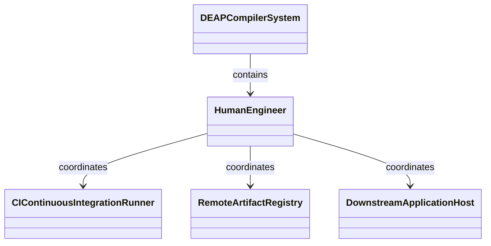
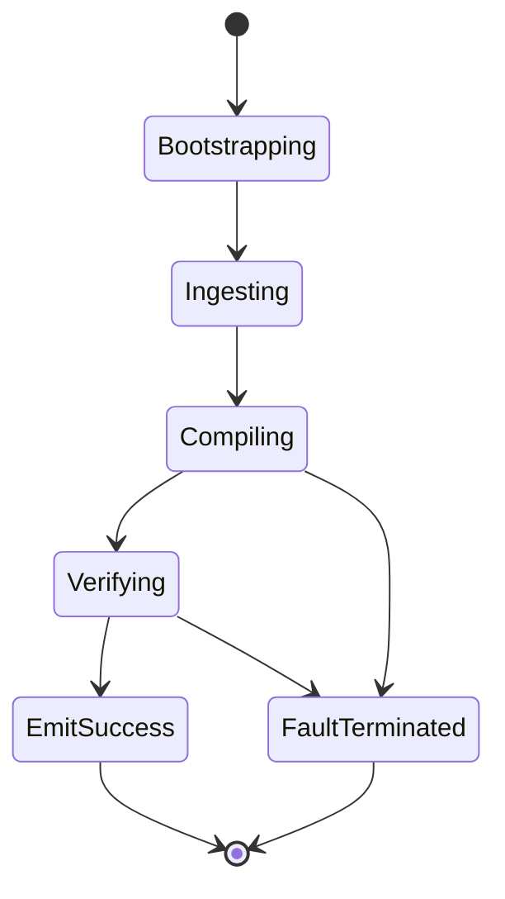

| Attribute | Specification Detail |
| :--- | :--- |
| **Issue ID** | #102 |
| **Title** | Epic 02: Concept of Operations Operational Activities |
| **Type** | epic |
| **Package** | ConOps |
| **Subsystem** | Con Ops |
| **Generation Mode** | subagent |
| **Specification Source** | [schema/model.sysml](../../schema/model.sysml) |

# Epic 02: Concept of Operations Operational Activities

## 1. Context
ConOps Operational Activities pursuant to ISO/IEC/IEEE 29148

## 2. Requirements & Checklist
- [ ] #10 - Feature 01: [Con Ops] HumanEngineer
- [ ] #11 - Feature 02: [Con Ops] CIContinuousIntegrationRunner
- [ ] #12 - Feature 03: [Con Ops] RemoteArtifactRegistry
- [ ] #13 - Feature 04: [Con Ops] DownstreamApplicationHost
- [ ] #14 - Feature 05: [System Architecture] DEAPCompilerSystem

### Associated Use Cases & User Stories

#### Associated Use Cases
- [ ] #95 - [Use Case 01: System Vision and Foundational Invariants](../use-cases/UC-01-System_Vision_and_Foundational_Invariants.md)
- [ ] #96 - [Use Case 02: Universal Schema Ingestion Workflow](../use-cases/UC-02-Universal_Schema_Ingestion_Workflow.md)
- [ ] #97 - [Use Case 03: Node Arena Memory Management Workflow](../use-cases/UC-03-Node_Arena_Memory_Management_Workflow.md)
- [ ] #98 - [Use Case 04: Sys ML Grammar Lowering Workflow](../use-cases/UC-04-SysML_Grammar_Lowering_Workflow.md)
- [ ] #99 - [Use Case 05: Physical Metrology and Flow Conservation Workflow](../use-cases/UC-05-Physical_Metrology_and_Flow_Conservation_Workflow.md)
- [ ] #100 - [Use Case 06: State Machine Solver Workflow](../use-cases/UC-06-State_Machine_Solver_Workflow.md)
- [ ] #101 - [Use Case 07: Safety Assurance and Traceability Workflow](../use-cases/UC-07-Safety_Assurance_and_Traceability_Workflow.md)
- [ ] #102 - [Use Case 08: ICD Interconnect Contract Generation Workflow](../use-cases/UC-08-ICD_Interconnect_Contract_Generation_Workflow.md)
- [ ] #103 - [Use Case 09: Agile Specification Projection Workflow](../use-cases/UC-09-Agile_Specification_Projection_Workflow.md)
- [ ] #104 - [Use Case 10: Multi Target Code Gen Workflow](../use-cases/UC-10-Multi_Target_CodeGen_Workflow.md)
- [ ] #105 - [Use Case 11: Diagnostic Catalog Triage Workflow](../use-cases/UC-11-Diagnostic_Catalog_Triage_Workflow.md)
- [ ] #106 - [Use Case 12: Compiler Performance Assurance Workflow](../use-cases/UC-12-Compiler_Performance_Assurance_Workflow.md)

#### Associated User Stories
- [ ] #89 - [User Story 01: Bootstrap System Vision Action](../user-stories/US-01-BootstrapSystemVisionAction.md)
- [ ] #90 - [User Story 02: Classify Format Action](../user-stories/US-02-ClassifyFormatAction.md)
- [ ] #91 - [User Story 03: Allocate Node Action](../user-stories/US-03-AllocateNodeAction.md)
- [ ] #92 - [User Story 04: Lower Sys MLAction](../user-stories/US-04-LowerSysMLAction.md)
- [ ] #93 - [User Story 05: Solve Flows Action](../user-stories/US-05-SolveFlowsAction.md)
- [ ] #94 - [User Story 06: Solve State Dynamics Action](../user-stories/US-06-SolveStateDynamicsAction.md)
- [ ] #95 - [User Story 07: Verify Safety Traceability Action](../user-stories/US-07-VerifySafetyTraceabilityAction.md)
- [ ] #96 - [User Story 08: Synthesize ICDContracts Action](../user-stories/US-08-SynthesizeICDContractsAction.md)
- [ ] #97 - [User Story 09: Project Agile Specifications Action](../user-stories/US-09-ProjectAgileSpecificationsAction.md)
- [ ] #98 - [User Story 10: Synthesize Code Action](../user-stories/US-10-SynthesizeCodeAction.md)
- [ ] #99 - [User Story 11: Triage Diagnostic Action](../user-stories/US-11-TriageDiagnosticAction.md)
- [ ] #100 - [User Story 12: Verify Compiler Assurance Action](../user-stories/US-12-VerifyCompilerAssuranceAction.md)

## 3. Architecture
Subsystem structural composition, port allocations, and directional data connectors realized by HumanEngineer.

## 4. Operational Considerations
Deterministic compilation passes, error containment, and provable polynomial complexity execution.

## 5. Security & Governance
Safety-critical invariant satisfaction, formal trace matrix closure, and zero hardcoded domain semantics.

## 6. Source References
- ConOps Operational Activities: `schema/conops/activities.sysml`
- ConOps External Actors: `schema/conops/actors.sysml`
- Normative Systems Engineering Standard: ISO/IEC/IEEE 29148:2018 §6.4.2 Concept of Operations

Operational activity definitions and actor models derive from `schema/conops/activities.sysml` pursuant to ISO/IEC/IEEE 29148.

## System-Level UML Class Diagram

## System State Machine Diagram

