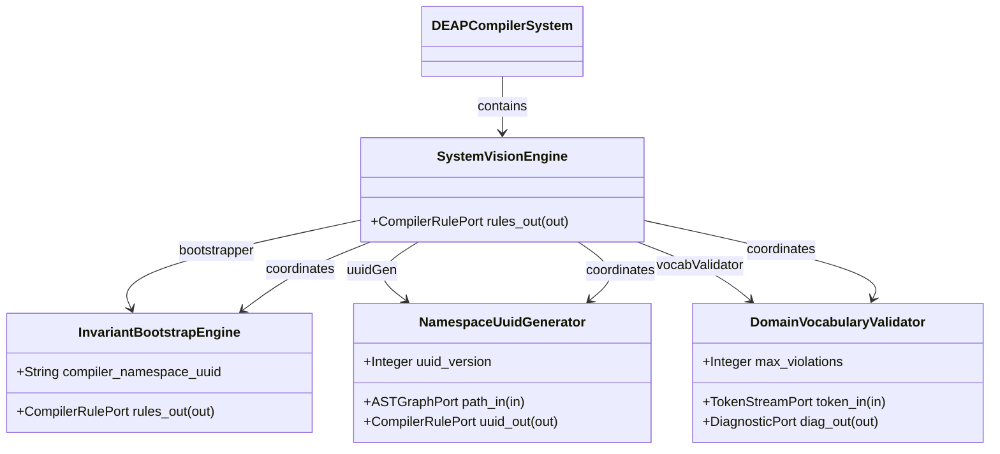
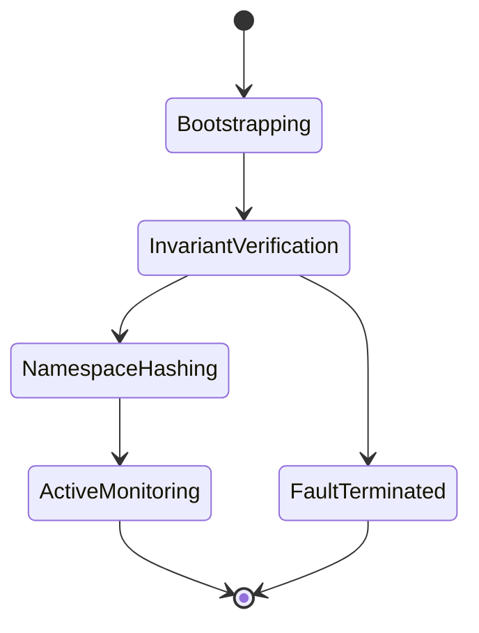

| Attribute | Specification Detail |
| :--- | :--- |
| **Issue ID** | #103 |
| **Title** | Epic 03: System Vision |
| **Type** | epic |
| **Package** | SystemVision |
| **Subsystem** | System Vision |
| **Generation Mode** | subagent |
| **Specification Source** | [schema/model.sysml](../../schema/model.sysml) |

# Epic 03: System Vision

## 1. Context
Structural Architecture for Subsystem 1 System Vision

## 2. Requirements & Checklist
- [ ] #15 - Feature 06: [System Vision] SystemVisionEngine
- [ ] #16 - Feature 07: [System Vision] InvariantBootstrapEngine
- [ ] #17 - Feature 08: [System Vision] NamespaceUuidGenerator
- [ ] #18 - Feature 09: [System Vision] DomainVocabularyValidator

### Associated Use Cases & User Stories

#### Associated Use Cases
- [ ] #95 - [Use Case 01: System Vision and Foundational Invariants](../use-cases/UC-01-System_Vision_and_Foundational_Invariants.md)

#### Associated User Stories
- [ ] #89 - [User Story 01: Bootstrap System Vision Action](../user-stories/US-01-BootstrapSystemVisionAction.md)

## 3. Architecture
Subsystem structural composition, port allocations, and directional data connectors realized by SystemVisionEngine.

## 4. Operational Considerations
Deterministic compilation passes, error containment, and provable polynomial complexity execution.

## 5. Security & Governance
Safety-critical invariant satisfaction, formal trace matrix closure, and zero hardcoded domain semantics.

## 6. Source References
- System Architecture Model: `schema/model.sysml`
- Subsystem Specification Model: `schema/subsystems/system_vision/architecture.sysml`
- Subsystem Requirements Model: `schema/subsystems/system_vision/requirements.sysml`
- Normative Systems Engineering Standard: ISO/IEC/IEEE 15288:2023 §6.4.3 Architecture Definition Process

Subsystem architectural composition and formal invariants derive from `schema/model.sysml` pursuant to ISO/IEC/IEEE 15288.

## System-Level UML Class Diagram

## System State Machine Diagram

