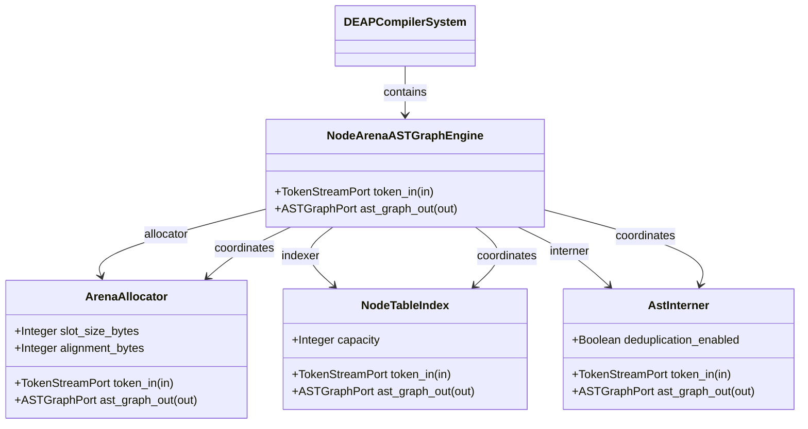
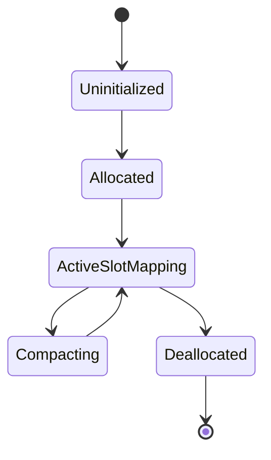

| Attribute | Specification Detail |
| :--- | :--- |
| **Issue ID** | #105 |
| **Title** | Epic 05: Core Metamodel Node Arena |
| **Type** | epic |
| **Package** | CoreMetamodelNodeArena |
| **Subsystem** | Core Metamodel Node Arena |
| **Generation Mode** | subagent |
| **Specification Source** | [schema/model.sysml](../../schema/model.sysml) |

# Epic 05: Core Metamodel Node Arena

## 1. Context
Structural Architecture for Subsystem 3 Core Metamodel Node Arena

## 2. Requirements & Checklist
- [ ] #24 - Feature 15: [Core Metamodel Node Arena] NodeArenaASTGraphEngine
- [ ] #25 - Feature 16: [Core Metamodel Node Arena] ArenaAllocator
- [ ] #26 - Feature 17: [Core Metamodel Node Arena] NodeTableIndex
- [ ] #27 - Feature 18: [Core Metamodel Node Arena] AstInterner

### Associated Use Cases & User Stories

#### Associated Use Cases
- [ ] #97 - [Use Case 03: Node Arena Memory Management Workflow](../use-cases/UC-03-Node_Arena_Memory_Management_Workflow.md)

#### Associated User Stories
- [ ] #91 - [User Story 03: Allocate Node Action](../user-stories/US-03-AllocateNodeAction.md)

## 3. Architecture
Subsystem structural composition, port allocations, and directional data connectors realized by NodeArenaASTGraphEngine.

## 4. Operational Considerations
Deterministic compilation passes, error containment, and provable polynomial complexity execution.

## 5. Security & Governance
Safety-critical invariant satisfaction, formal trace matrix closure, and zero hardcoded domain semantics.

## 6. Source References
- System Architecture Model: `schema/model.sysml`
- Subsystem Specification Model: `schema/subsystems/core_metamodel_node_arena/architecture.sysml`
- Subsystem Requirements Model: `schema/subsystems/core_metamodel_node_arena/requirements.sysml`
- Normative Systems Engineering Standard: ISO/IEC/IEEE 15288:2023 §6.4.3 Architecture Definition Process

Subsystem architectural composition and formal invariants derive from `schema/model.sysml` pursuant to ISO/IEC/IEEE 15288.

## System-Level UML Class Diagram

## System State Machine Diagram

