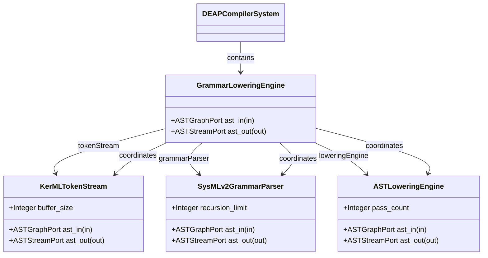
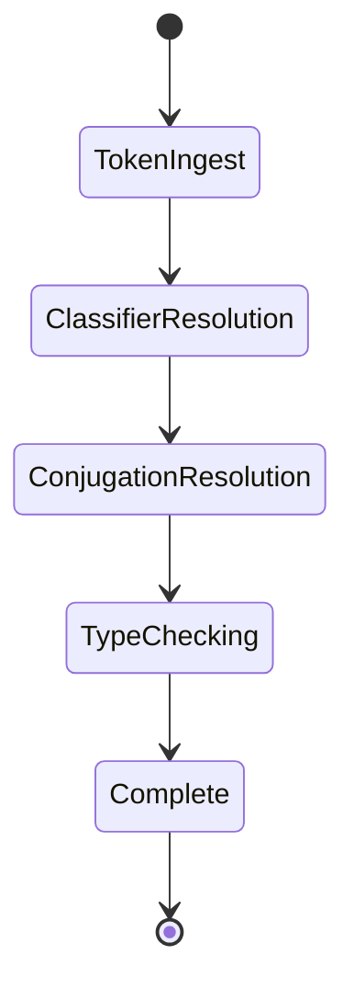

| Attribute | Specification Detail |
| :--- | :--- |
| **Issue ID** | #106 |
| **Title** | Epic 06: Sysml Grammar Lowering |
| **Type** | epic |
| **Package** | SysmlGrammarLowering |
| **Subsystem** | Sysml Grammar Lowering |
| **Generation Mode** | subagent |
| **Specification Source** | [schema/model.sysml](../../schema/model.sysml) |

# Epic 06: Sysml Grammar Lowering

## 1. Context
Structural Architecture for Subsystem 4 Complete SysMLv2 KerML Grammar

## 2. Requirements & Checklist
- [ ] #28 - Feature 19: [Sysml Grammar Lowering] GrammarLoweringEngine
- [ ] #29 - Feature 20: [Sysml Grammar Lowering] KerMLTokenStream
- [ ] #30 - Feature 21: [Sysml Grammar Lowering] SysMLv2GrammarParser
- [ ] #31 - Feature 22: [Sysml Grammar Lowering] ASTLoweringEngine

### Associated Use Cases & User Stories

#### Associated Use Cases
- [ ] #98 - [Use Case 04: Sys ML Grammar Lowering Workflow](../use-cases/UC-04-SysML_Grammar_Lowering_Workflow.md)

#### Associated User Stories
- [ ] #92 - [User Story 04: Lower Sys MLAction](../user-stories/US-04-LowerSysMLAction.md)

## 3. Architecture
Subsystem structural composition, port allocations, and directional data connectors realized by GrammarLoweringEngine.

## 4. Operational Considerations
Deterministic compilation passes, error containment, and provable polynomial complexity execution.

## 5. Security & Governance
Safety-critical invariant satisfaction, formal trace matrix closure, and zero hardcoded domain semantics.

## 6. Source References
- System Architecture Model: `schema/model.sysml`
- Subsystem Specification Model: `schema/subsystems/sysml_grammar_lowering/architecture.sysml`
- Subsystem Requirements Model: `schema/subsystems/sysml_grammar_lowering/requirements.sysml`
- Normative Systems Engineering Standard: ISO/IEC/IEEE 15288:2023 §6.4.3 Architecture Definition Process

Subsystem architectural composition and formal invariants derive from `schema/model.sysml` pursuant to ISO/IEC/IEEE 15288.

## System-Level UML Class Diagram

## System State Machine Diagram

