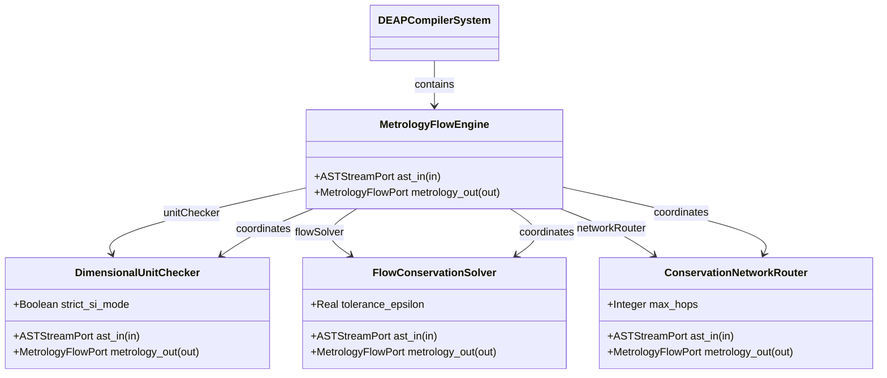
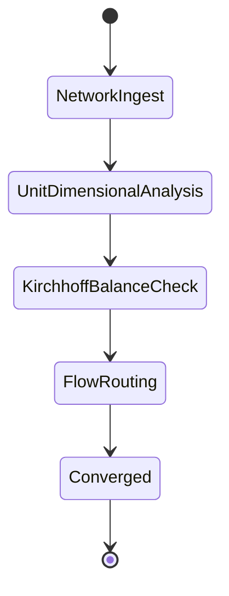

| Attribute | Specification Detail |
| :--- | :--- |
| **Issue ID** | #107 |
| **Title** | Epic 07: Physical Metrology Flows |
| **Type** | epic |
| **Package** | PhysicalMetrologyFlows |
| **Subsystem** | Physical Metrology Flows |
| **Generation Mode** | subagent |
| **Specification Source** | [schema/model.sysml](../../schema/model.sysml) |

# Epic 07: Physical Metrology Flows

## 1. Context
Structural Architecture for Subsystem 5 7D Physical Metrology Flow Networks

## 2. Requirements & Checklist
- [ ] #32 - Feature 23: [Physical Metrology Flows] MetrologyFlowEngine
- [ ] #33 - Feature 24: [Physical Metrology Flows] DimensionalUnitChecker
- [ ] #34 - Feature 25: [Physical Metrology Flows] FlowConservationSolver
- [ ] #35 - Feature 26: [Physical Metrology Flows] ConservationNetworkRouter

### Associated Use Cases & User Stories

#### Associated Use Cases
- [ ] #99 - [Use Case 05: Physical Metrology and Flow Conservation Workflow](../use-cases/UC-05-Physical_Metrology_and_Flow_Conservation_Workflow.md)

#### Associated User Stories
- [ ] #93 - [User Story 05: Solve Flows Action](../user-stories/US-05-SolveFlowsAction.md)

## 3. Architecture
Subsystem structural composition, port allocations, and directional data connectors realized by MetrologyFlowEngine.

## 4. Operational Considerations
Deterministic compilation passes, error containment, and provable polynomial complexity execution.

## 5. Security & Governance
Safety-critical invariant satisfaction, formal trace matrix closure, and zero hardcoded domain semantics.

## 6. Source References
- System Architecture Model: `schema/model.sysml`
- Subsystem Specification Model: `schema/subsystems/physical_metrology_flows/architecture.sysml`
- Subsystem Requirements Model: `schema/subsystems/physical_metrology_flows/requirements.sysml`
- Normative Systems Engineering Standard: ISO/IEC/IEEE 15288:2023 §6.4.3 Architecture Definition Process

Subsystem architectural composition and formal invariants derive from `schema/model.sysml` pursuant to ISO/IEC/IEEE 15288.

## System-Level UML Class Diagram

## System State Machine Diagram

