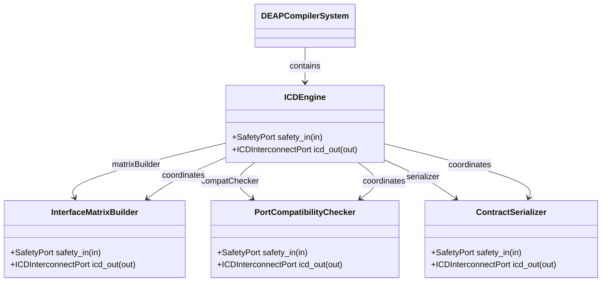
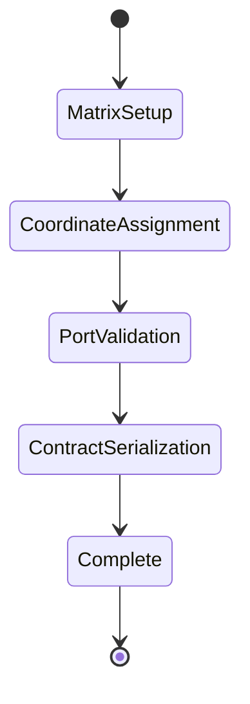

| Attribute | Specification Detail |
| :--- | :--- |
| **Issue ID** | #110 |
| **Title** | Epic 10: Interconnect Contracts |
| **Type** | epic |
| **Package** | InterconnectContracts |
| **Subsystem** | Interconnect Contracts |
| **Generation Mode** | subagent |
| **Specification Source** | [schema/model.sysml](../../schema/model.sysml) |

# Epic 10: Interconnect Contracts

## 1. Context
Structural Architecture for Subsystem 8 Level 1C ICD Interconnect Contracts

## 2. Requirements & Checklist
- [ ] #45 - Feature 36: [Interconnect Contracts] ICDEngine
- [ ] #46 - Feature 37: [Interconnect Contracts] InterfaceMatrixBuilder
- [ ] #47 - Feature 38: [Interconnect Contracts] PortCompatibilityChecker
- [ ] #48 - Feature 39: [Interconnect Contracts] ContractSerializer

### Associated Use Cases & User Stories

#### Associated Use Cases
- [ ] #102 - [Use Case 08: ICD Interconnect Contract Generation Workflow](../use-cases/UC-08-ICD_Interconnect_Contract_Generation_Workflow.md)

#### Associated User Stories
- [ ] #96 - [User Story 08: Synthesize ICDContracts Action](../user-stories/US-08-SynthesizeICDContractsAction.md)

## 3. Architecture
Subsystem structural composition, port allocations, and directional data connectors realized by ICDEngine.

## 4. Operational Considerations
Deterministic compilation passes, error containment, and provable polynomial complexity execution.

## 5. Security & Governance
Safety-critical invariant satisfaction, formal trace matrix closure, and zero hardcoded domain semantics.

## 6. Source References
- System Architecture Model: `schema/model.sysml`
- Subsystem Specification Model: `schema/subsystems/interconnect_contracts/architecture.sysml`
- Subsystem Requirements Model: `schema/subsystems/interconnect_contracts/requirements.sysml`
- Normative Systems Engineering Standard: ISO/IEC/IEEE 15288:2023 §6.4.3 Architecture Definition Process

Subsystem architectural composition and formal invariants derive from `schema/model.sysml` pursuant to ISO/IEC/IEEE 15288.

## System-Level UML Class Diagram

## System State Machine Diagram

