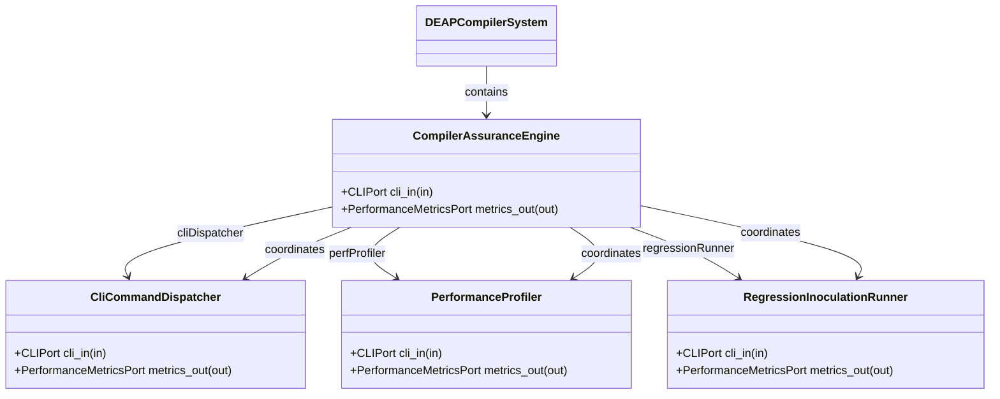
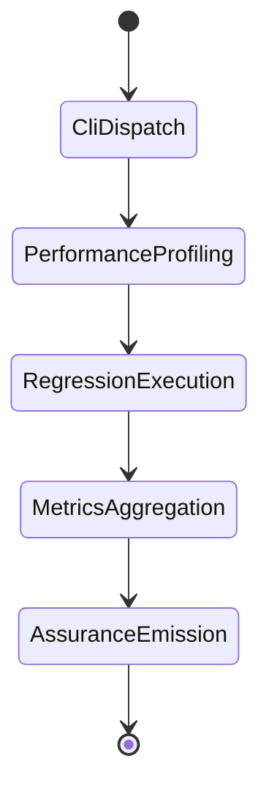

| Attribute | Specification Detail |
| :--- | :--- |
| **Issue ID** | #114 |
| **Title** | Epic 14: Compiler Assurance |
| **Type** | epic |
| **Package** | CompilerAssurance |
| **Subsystem** | Compiler Assurance |
| **Generation Mode** | subagent |
| **Specification Source** | [schema/model.sysml](../../schema/model.sysml) |

# Epic 14: Compiler Assurance

## 1. Context
Structural Architecture for Subsystem 12 Compiler Performance CLI Assurance

## 2. Requirements & Checklist
- [ ] #61 - Feature 52: [Compiler Assurance] CompilerAssuranceEngine
- [ ] #62 - Feature 53: [Compiler Assurance] CliCommandDispatcher
- [ ] #63 - Feature 54: [Compiler Assurance] PerformanceProfiler
- [ ] #64 - Feature 55: [Compiler Assurance] RegressionInoculationRunner

### Associated Use Cases & User Stories

#### Associated Use Cases
- [ ] #106 - [Use Case 12: Compiler Performance Assurance Workflow](../use-cases/UC-12-Compiler_Performance_Assurance_Workflow.md)

#### Associated User Stories
- [ ] #100 - [User Story 12: Verify Compiler Assurance Action](../user-stories/US-12-VerifyCompilerAssuranceAction.md)

## 3. Architecture
Subsystem structural composition, port allocations, and directional data connectors realized by CompilerAssuranceEngine.

## 4. Operational Considerations
Deterministic compilation passes, error containment, and provable polynomial complexity execution.

## 5. Security & Governance
Safety-critical invariant satisfaction, formal trace matrix closure, and zero hardcoded domain semantics.

## 6. Source References
- System Architecture Model: `schema/model.sysml`
- Subsystem Specification Model: `schema/subsystems/compiler_assurance/architecture.sysml`
- Subsystem Requirements Model: `schema/subsystems/compiler_assurance/requirements.sysml`
- Normative Systems Engineering Standard: ISO/IEC/IEEE 15288:2023 §6.4.3 Architecture Definition Process

Subsystem architectural composition and formal invariants derive from `schema/model.sysml` pursuant to ISO/IEC/IEEE 15288.

## System-Level UML Class Diagram

## System State Machine Diagram

