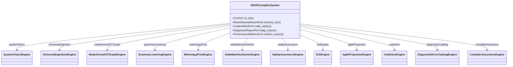

| Attribute | Specification Detail |
| :--- | :--- |
| **Issue ID** | #14 |
| **Title** | Feature 05: [System Architecture] DEAPCompilerSystem |
| **Type** | feature |
| **Parent Epic** | [EPIC-01-SysML_Model](../epics/EPIC-01-SysML_Model.md) |
| **Interface Type** | Physical / Structural / Internal Bus |
| **Schema Containers** | `DEAP_Compiler_System::DEAPCompilerSystem` |
| **Generation Mode** | subagent |
| **Specification Source** | [schema/model.sysml](../../schema/model.sysml) |

# Feature 05: [System Architecture] DEAPCompilerSystem

## UML Class Diagram



## Interface Requirements
### 1. Test Data Shape
```json
{
  "$schema": "https://json-schema.org/draft/2020-12/schema",
  "title": "DEAPCompilerSystemPayloadSchema",
  "type": "object",
  "properties": {
    "part": {
      "type": "string",
      "const": "DEAPCompilerSystem"
    },
    "status": {
      "type": "string",
      "enum": ["nominal", "degraded", "fault"]
    },
    "cli_in": {
      "type": "object",
      "properties": {
        "direction": { "type": "string", "const": "in" },
        "port_type": { "type": "string", "const": "CLIPort" }
      },
      "required": ["direction", "port_type"]
    },
    "schema_in": {
      "type": "object",
      "properties": {
        "direction": { "type": "string", "const": "in" },
        "port_type": { "type": "string", "const": "RawSchemaStreamPort" }
      },
      "required": ["direction", "port_type"]
    },
    "code_out": {
      "type": "object",
      "properties": {
        "direction": { "type": "string", "const": "out" },
        "port_type": { "type": "string", "const": "CodeArtifactPort" }
      },
      "required": ["direction", "port_type"]
    },
    "diag_out": {
      "type": "object",
      "properties": {
        "direction": { "type": "string", "const": "out" },
        "port_type": { "type": "string", "const": "DiagnosticReportPort" }
      },
      "required": ["direction", "port_type"]
    },
    "metrics_out": {
      "type": "object",
      "properties": {
        "direction": { "type": "string", "const": "out" },
        "port_type": { "type": "string", "const": "PerformanceMetricsPort" }
      },
      "required": ["direction", "port_type"]
    }
  },
  "required": [
    "part",
    "status",
    "cli_in",
    "schema_in",
    "code_out",
    "diag_out",
    "metrics_out"
  ],
  "additionalProperties": false
}
```

### 2. Validation & Constraints
Formal constraints and invariant guarantees enforced by DEAPCompilerSystem.

### 3. Visual Layout & Arrangement
Logical layout, viewport containment, and container structure for DEAPCompilerSystem conforming to platform design tokens. Container boundaries enforce @container isolation rules.

### 4. Interactive Flow & States
Operational lifecycle events and discrete state transitions for DEAPCompilerSystem.

### Layer 1: Domain State & Signal Model
Domain state vector representing DEAPCompilerSystem status, AST references, and typed signal models.

### Layer 2: Logic & Safety State Management
Deterministic state machine solver and safety monitor logic for DEAPCompilerSystem.

### Layer 3: Presentation & Actuator Interface Binding
Presentation interface binding and diagnostic event routing for DEAPCompilerSystem.

## Acceptance Criteria (BDD)
- [ ] AC-01: Given nominal DEAPCompilerSystem domain state, When command or input signals are received, Then updates internal state and signal outputs within declared bounds.
- [ ] AC-02: Given operational state, When DEAPCompilerSystem evaluates constraint 'Invariant_REQ_0195_Headless_CLI_dispatch_stream_partitioning_and_diagnostic_triggers_satisfy', Then asserts invariant satisfaction without violation.
- [ ] AC-03: Given operational state, When DEAPCompilerSystem evaluates constraint 'Invariant_REQ_0128_Traceability_graph_partitioning_edge_relations_and_reachability_satisfy', Then asserts invariant satisfaction without violation.
- [ ] AC-04: Given operational state, When DEAPCompilerSystem evaluates constraint 'Invariant_REQ_0141_The_synthesized_RTA_architecture_arbitration_laws_and_diagnostic_trigger_rules_satisfy', Then asserts invariant satisfaction without violation.
- [ ] AC-05: Given operational state, When DEAPCompilerSystem evaluates constraint 'Invariant_REQ_0182_FormalInvariant', Then asserts invariant satisfaction without violation.
- [ ] AC-06: Given operational state, When DEAPCompilerSystem evaluates constraint 'Invariant_REQ_0013_Upon_encountering_a_syntax_fault_at_token_index_in_state_the_skipping_operator_is_defined_as', Then asserts invariant satisfaction without violation.
- [ ] AC-07: Given operational state, When DEAPCompilerSystem evaluates constraint 'Invariant_REQ_0013_FormalInvariant', Then asserts invariant satisfaction without violation.
- [ ] AC-08: Given operational state, When DEAPCompilerSystem evaluates constraint 'Invariant_REQ_0013_The_Monotonic_Forward_Stream_Progress_Invariant_mandates', Then asserts invariant satisfaction without violation.
- [ ] AC-09: Given operational state, When DEAPCompilerSystem evaluates constraint 'Invariant_REQ_0013_Strict_monotonicity_guarantees_bounded_termination', Then asserts invariant satisfaction without violation.
- [ ] AC-10: Given malformed input signals or boundary condition violation, When DEAPCompilerSystem error handling is invoked, Then transitions safely to failsafe fallback state without corruption.

## Source References
Formal component specifications and normative systems engineering requirements:
- System Architecture Model: `schema/model.sysml`
- ConOps Operational Activities: `schema/conops/activities.sysml`
- Normative Systems Engineering Standard: ISO/IEC/IEEE 15288:2023 §6.4.3 Architecture Definition Process

Component behavior and interface definitions derive from `schema/model.sysml` pursuant to ISO/IEC/IEEE 15288.
