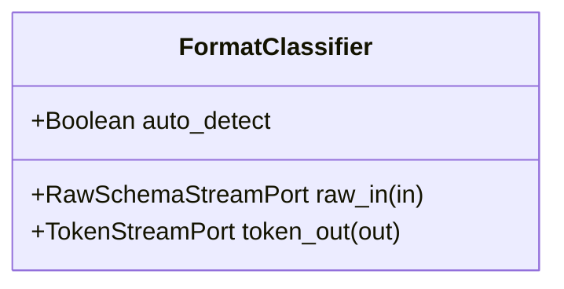

| Attribute | Specification Detail |
| :--- | :--- |
| **Issue ID** | #20 |
| **Title** | Feature 11: [Universal Schema Ingestion] FormatClassifier |
| **Type** | feature |
| **Parent Epic** | [EPIC-04-UniversalSchemaIngestion](../epics/EPIC-04-UniversalSchemaIngestion.md) |
| **Interface Type** | Physical / Structural / Internal Bus |
| **Schema Containers** | `UniversalSchemaIngestion::FormatClassifier` |
| **Generation Mode** | subagent |
| **Specification Source** | [schema/subsystems/universal_schema_ingestion/architecture.sysml](../../schema/subsystems/universal_schema_ingestion/architecture.sysml) |

# Feature 11: [Universal Schema Ingestion] FormatClassifier

## UML Class Diagram



## Interface Requirements
### 1. Test Data Shape
```json
{
  "$schema": "https://json-schema.org/draft/2020-12/schema",
  "title": "FormatClassifierPayloadSchema",
  "type": "object",
  "properties": {
    "part": {
      "type": "string",
      "const": "FormatClassifier"
    },
    "status": {
      "type": "string",
      "enum": ["nominal", "degraded", "fault"]
    },
    "auto_detect": {
      "type": "boolean",
      "description": "Subsystem attribute auto_detect"
    },
    "raw_in": {
      "type": "object",
      "properties": {
        "direction": { "type": "string", "const": "in" },
        "port_type": { "type": "string", "const": "RawSchemaStreamPort" }
      },
      "required": ["direction", "port_type"]
    },
    "token_out": {
      "type": "object",
      "properties": {
        "direction": { "type": "string", "const": "out" },
        "port_type": { "type": "string", "const": "TokenStreamPort" }
      },
      "required": ["direction", "port_type"]
    }
  },
  "required": [
    "part",
    "status",
    "auto_detect",
    "raw_in",
    "token_out"
  ],
  "additionalProperties": false
}
```

### 2. Validation & Constraints
Formal constraints and invariant guarantees enforced by FormatClassifier.

### 3. Visual Layout & Arrangement
Logical layout, viewport containment, and container structure for FormatClassifier conforming to platform design tokens. Container boundaries enforce @container isolation rules.

### 4. Interactive Flow & States
Operational lifecycle events and discrete state transitions for FormatClassifier.

### Layer 1: Domain State & Signal Model
Domain state vector representing FormatClassifier status, AST references, and typed signal models.

### Layer 2: Logic & Safety State Management
Deterministic state machine solver and safety monitor logic for FormatClassifier.

### Layer 3: Presentation & Actuator Interface Binding
Presentation interface binding and diagnostic event routing for FormatClassifier.

## Acceptance Criteria (BDD)
- [ ] AC-01: Given nominal FormatClassifier domain state, When command or input signals are received, Then updates internal state and signal outputs within declared bounds.
- [ ] AC-02: Given operational state, When FormatClassifier evaluates constraint 'operational_invariants', Then asserts invariant satisfaction without violation.
- [ ] AC-03: Given malformed input signals or boundary condition violation, When FormatClassifier error handling is invoked, Then transitions safely to failsafe fallback state without corruption.

## Source References
Formal component specifications and normative systems engineering requirements:
- Subsystem Requirements: `schema/subsystems/universal_schema_ingestion/requirements.sysml`
- Subsystem Architecture: `schema/subsystems/universal_schema_ingestion/architecture.sysml`
- Normative Systems Engineering Standard: ISO/IEC/IEEE 15288:2023 §6.4.3 Architecture Definition Process

Component behavior and interface definitions derive from `schema/model.sysml` pursuant to ISO/IEC/IEEE 15288.
