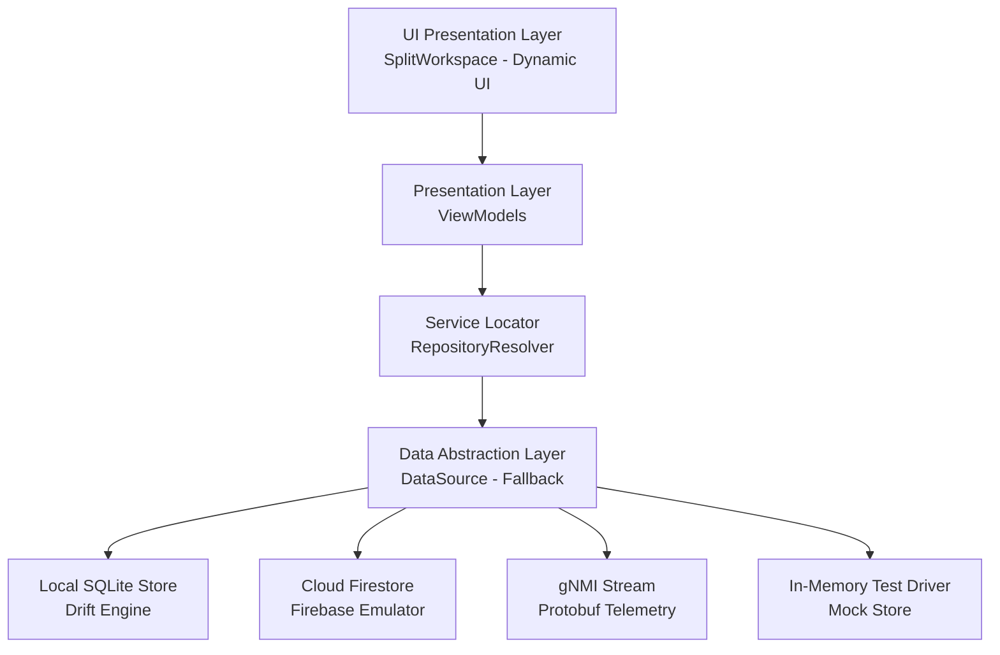
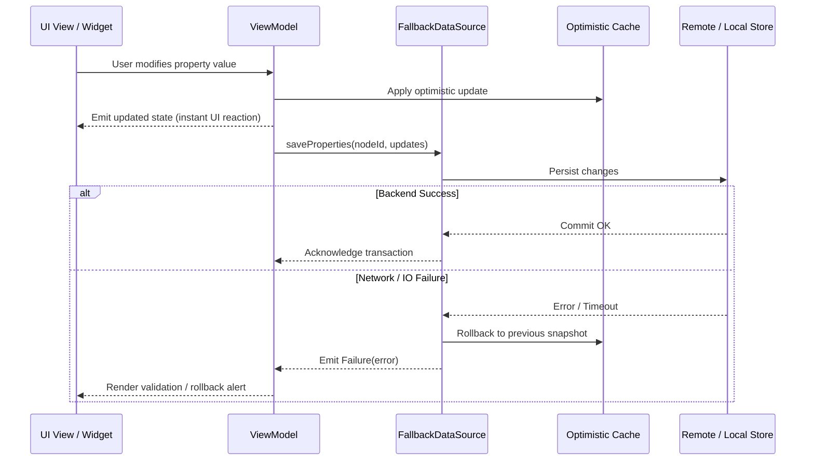

# API Reference

| Attribute | Specification Detail |
| :--- | :--- |
| **Title** | API Reference |
| **Version** | 1.0.0 |
| **Date** | 2026-09-16 |
| **Lifecycle Standard** | ISO/IEC/IEEE 15288:2023 §6.4.13 |
| **Classification** | UPSTREAM_SPEC_CORE_COMPILER |

> Public interfaces, core data contracts, architecture specifications, and verification extension points for the Digital Engineering Agent Platform (DEAP), conforming to ISO/IEC/IEEE 15288:2023 §6.4.13 (Maintenance and Operations Documentation).

---

## Table of Contents

1. [Architectural Overview & Platform Contracts](#1-architectural-overview--platform-contracts)
2. [Core Data Contracts & Backends](#2-core-data-contracts--backends)
   - [2.1 DataSource Interface](#21-datasource-interface)
   - [2.2 FallbackDataSource & Resilient Failover](#22-fallbackdatasource--resilient-failover)
   - [2.3 Query & Mutation Lifecycle](#23-query--mutation-lifecycle)
   - [2.4 Type & Relation Descriptors](#24-type--relation-descriptors)
3. [Service & Repository Resolvers](#3-service--repository-resolvers)
   - [3.1 RepositoryResolver (IoC Container)](#31-repositoryresolver-ioc-container)
   - [3.2 Dynamic Platform Profile Injection](#32-dynamic-platform-profile-injection)
4. [Persistence & State Management](#4-persistence--state-management)
   - [4.1 DatabaseInitializer](#41-databaseinitializer)
   - [4.2 Concrete Storage Drivers](#42-concrete-storage-drivers)
   - [4.3 Schema Migrations & DDL Transitions](#43-schema-migrations--ddl-transitions)
5. [Presentation Architecture & ViewModels](#5-presentation-architecture--viewmodels)
   - [5.1 TreeViewModel](#51-treeviewmodel)
   - [5.2 PropertiesViewModel](#52-propertiesviewmodel)
   - [5.3 TablesViewModel](#53-tablesviewmodel)
   - [5.4 TopologyViewModel](#54-topologyviewmodel)
   - [5.5 Reactive Data Bindings & Event Echo Guard](#55-reactive-data-bindings--event-echo-guard)
6. [UI Layout Components](#6-ui-layout-components)
   - [6.1 SplitWorkspace (Multi-Pane Docking)](#61-splitworkspace-multi-pane-docking)
   - [6.2 LayoutConfig & Responsive Breakpoints](#62-layoutconfig--responsive-breakpoints)
   - [6.3 ComponentFactory](#63-componentfactory)
   - [6.4 BreadcrumbOverflow & Navigation](#64-breadcrumboverflow--navigation)
   - [6.5 Specialized Domain Widgets](#65-specialized-domain-widgets)
7. [Quality Gate Interfaces (Parity Auditor)](#7-quality-gate-interfaces-parity-auditor)
   - [7.1 IValidator Contract](#71-ivalidator-contract)
   - [7.2 WorkspaceRepository](#72-workspacerepository)
   - [7.3 Finding Diagnostic Record](#73-finding-diagnostic-record)
   - [7.4 Rule Configuration Schemas](#74-rule-configuration-schemas)

---

## 1. Architectural Overview & Platform Contracts

The DEAP framework defines abstract data contracts, service resolvers, view models, and layout components that decouple high-level systems engineering specifications from concrete platform runtimes. In downstream applications, implementations conform to the Model-View-ViewModel (MVVM) architecture with unidirectional data flow and strict null safety.



### Primary Commercial Toolchain Integration Context

All data contracts, safety state models, and control law synthesis pipelines across the DEAP framework declare:

> **Primary Commercial Toolchain Integration Context:**
> **MATLAB / Simulink / Stateflow / Embedded Coder** (Model-Based Design, Control Law Synthesis, DO-178C C/SPARK Ada code generation).

---

## 2. Core Data Contracts & Backends

### 2.1 DataSource Interface

**File:** `app_flutter/lib/domain/data_source.dart`

The `DataSource` abstract class defines the canonical contract for all data access, discovery, queries, mutations, and reactive streaming.

```dart
abstract class DataSource {
  /// Discovers all object types registered in the active backend schema.
  Future<List<TypeDescriptor>> discoverTypes();

  /// Retrieves a specific type descriptor by unique type name.
  Future<TypeDescriptor?> typeFor(String typeName);

  /// Discovers structural parent-child hierarchy tuples: (parentName, childName).
  Future<List<(String, String)>> discoverHierarchy();

  /// Fetches element property key-value map for the specified node identifier.
  Future<Map<String, dynamic>> fetchProperties(String nodeId);

  /// Persists element property key-value updates for the specified node.
  Future<void> saveProperties(String nodeId, Map<String, dynamic> properties);

  /// Subscribes to a real-time stream of property updates for a node.
  Stream<Map<String, dynamic>> watchProperties(String nodeId);

  /// Fetches child element records associated with the specified parent node.
  Future<List<Map<String, dynamic>>> fetchElements(String nodeId);

  /// Fetches alarm records active on or associated with the specified node.
  Future<List<Map<String, dynamic>>> fetchAlarms(String nodeId);

  /// Fetches time-series historical events for the specified node.
  Future<List<Map<String, dynamic>>> fetchEvents(String nodeId);

  /// Disposes underlying database connections or network sockets.
  Future<void> dispose();
}
```

### 2.2 FallbackDataSource & Resilient Failover

**File:** `app_flutter/lib/domain/data_sources/fallback_data_source.dart`

`FallbackDataSource` implements the Composite Pattern over two or more `DataSource` instances (typically Primary: Cloud Firestore, Secondary: Local SQLite, Tertiary: In-Memory Cache). It guarantees uninterrupted operation during network degradation.

#### Failover Policy & Behavior:
- **Read Operations (`fetchProperties`, `discoverHierarchy`, etc.)**: The primary data source is attempted with a configurable timeout (default: 3000 ms). Upon timeout, socket disconnect, or HTTP 5xx, the call falls back transparently to the secondary data source, logging a non-blocking diagnostic.
- **Write Operations (`saveProperties`)**: Executes an optimistic update locally, enqueues the mutation into an offline write buffer, and attempts synchronization against the primary backend with exponential backoff.
- **Reactive Streams (`watchProperties`)**: Combines a local change notifier with the remote stream; when offline, emits local cache updates until connectivity is re-established.

```dart
class FallbackDataSource implements DataSource {
  final DataSource primary;
  final DataSource fallback;
  final Duration timeout;

  FallbackDataSource({
    required this.primary,
    required this.fallback,
    this.timeout = const Duration(seconds: 3),
  });
  ...
}
```

### 2.3 Query & Mutation Lifecycle

Every data operation across the DEAP framework passes through four lifecycle phases:



1. **Dispatch & Validation**: ViewModels execute client-side schema validation against `FieldDescriptor` constraints prior to dispatch.
2. **Optimistic Mutation**: State changes are immediately applied to the presentation layer cache, preventing input lag.
3. **Execution & Fallback**: Transactions run against the primary data source; on failure, failover routes the query to local SQLite.
4. **Resolution & Invalidation**: Successful commits update revision timestamps; failures trigger cache rollbacks and notify registered listeners.

### 2.4 Type & Relation Descriptors

**File:** `app_flutter/lib/domain/type_descriptor.dart`

Metadata models define the shape of domain entities without requiring hardcoded Dart classes:

```dart
@immutable
class TypeDescriptor {
  final String typeName;
  final String displayName;
  final String iconName;
  final List<FieldDescriptor> fields;
  final List<String> childTypes;
  final List<TypeRelationDescriptor> relatedTypes;
  final List<String> parentTypes;

  const TypeDescriptor({
    required this.typeName,
    required this.displayName,
    required this.iconName,
    this.fields = const [],
    this.childTypes = const [],
    this.relatedTypes = const [],
    this.parentTypes = const [],
  });
}

@immutable
class FieldDescriptor {
  final String key;
  final String label;
  final String type; // 'string', 'int', 'double', 'boolean', 'enum'
  final String sectionLabel;
  final int sectionOrder;
  final num? minValue;
  final num? maxValue;
  final String? pattern;
  final bool required;
  final List<String>? enumOptions;
  final dynamic defaultValue;

  const FieldDescriptor({
    required this.key,
    required this.label,
    required this.type,
    this.sectionLabel = 'General',
    this.sectionOrder = 0,
    this.minValue,
    this.maxValue,
    this.pattern,
    this.required = false,
    this.enumOptions,
    this.defaultValue,
  });
}
```

---

## 3. Service & Repository Resolvers

### 3.1 RepositoryResolver (IoC Container)

**File:** `app_flutter/lib/domain/repository_resolver.dart`

`RepositoryResolver` acts as a centralized Inversion-of-Control (IoC) locator and dependency lifecycle manager.

```dart
class RepositoryResolver {
  static final RepositoryResolver _instance = RepositoryResolver._internal();
  factory RepositoryResolver() => _instance;
  RepositoryResolver._internal();

  final Map<Type, dynamic> _services = {};
  DataSource? _activeDataSource;

  /// Registers a service singleton for type T.
  void register<T>(T service) => _services[T] = service;

  /// Resolves the registered singleton for type T.
  T resolve<T>() {
    final service = _services[T];
    if (service == null) {
      throw StateError('Service of type $T has not been registered in RepositoryResolver.');
    }
    return service as T;
  }

  /// Sets the active global DataSource.
  void setDataSource(DataSource dataSource) {
    _activeDataSource = dataSource;
    register<DataSource>(dataSource);
  }

  /// Returns the current active DataSource.
  DataSource get dataSource {
    if (_activeDataSource == null) {
      throw StateError('No DataSource configured. Call setDataSource() during bootstrap.');
    }
    return _activeDataSource!;
  }

  /// Resets all registered services (used in test teardown).
  void reset() {
    _services.clear();
    _activeDataSource = null;
  }
}
```

### 3.2 Dynamic Platform Profile Injection

`RepositoryResolver` configures concrete providers dynamically at bootstrap based on platform configuration profiles or `--dart-define` flags:

```dart
void bootstrapPlatform({String mode = 'sqlite'}) {
  final resolver = RepositoryResolver();

  switch (mode.toLowerCase()) {
    case 'firebase':
      final fb = FirebaseDataSource();
      resolver.setDataSource(fb);
      break;
    case 'fallback':
      final primary = FirebaseDataSource();
      final secondary = SqliteDataSource();
      resolver.setDataSource(FallbackDataSource(primary: primary, fallback: secondary));
      break;
    case 'mock':
      resolver.setDataSource(InMemoryMockDataSource());
      break;
    case 'sqlite':
    default:
      resolver.setDataSource(SqliteDataSource());
      break;
  }
}
```

---

## 4. Persistence & State Management

### 4.1 DatabaseInitializer

**File:** `app_flutter/lib/domain/database_initializer.dart`

`DatabaseInitializer` manages offline SQLite database initialization, pre-packaged asset extraction, and schema creation.

#### Key Operations:
- **Asset Extraction**: On first launch, copies `assets/properties_db.db` to the platform application support directory (`path_provider`).
- **Database Bootstrapping**: Opens the database using `sqflite_common_ffi` on desktop/test environments and native SQLite drivers on mobile.
- **Table Schema Creation**: Creates `type_definitions`, `type_attributes`, and `type_relations` tables if absent.

```dart
class DatabaseInitializer {
  static const int currentSchemaVersion = 2;

  /// Initializes the SQLite database file and verifies table integrity.
  static Future<Database> initializeDatabase({
    String dbName = 'properties_db.db',
    bool forceRecreate = false,
  }) async { ... }

  /// Seeds default schema definition records if database is empty.
  static Future<void> seedInitialData(Database db) async { ... }
}
```

### 4.2 Concrete Storage Drivers

| Driver Class | File Path | Target Environment | Storage Mechanism |
| :--- | :--- | :--- | :--- |
| `SqliteDataSource` | `lib/domain/data_sources/sqlite_data_source.dart` | Desktop (macOS, Linux, Windows), Mobile | Relational SQLite database (`sqflite_common_ffi`) |
| `FirebaseDataSource` | `lib/domain/data_sources/firebase_data_source.dart` | Web, Cloud-Connected Deployments | Google Cloud Firestore collections & real-time snapshots |
| `FallbackDataSource` | `lib/domain/data_sources/fallback_data_source.dart` | Hybrid / Air-Gapped Field Deployments | Two-tier composite with automatic failover |
| `InMemoryMockDataSource` | `test/mocks/mock_data_source.dart` | CI/CD Unit & Widget Test Harnesses | In-memory hash maps with zero disk/network dependencies |

### 4.3 Schema Migrations & DDL Transitions

When the underlying schema evolves across versions:
1. `DatabaseInitializer` reads `PRAGMA user_version`.
2. Executes incremental upgrade statements inside an atomic database transaction.
3. Updates `PRAGMA user_version` upon successful commit; rolls back on error.

---

## 5. Presentation Architecture & ViewModels

The presentation layer utilizes `ChangeNotifier` and reactive MVVM bindings.

### 5.1 TreeViewModel

**File:** `app_flutter/lib/features/tree/view_models/tree_view_model.dart`

Manages hierarchy tree navigation, branch expansion, node selection, and search filtering:

```dart
class TreeViewModel extends ChangeNotifier {
  final DataSource dataSource;

  List<TreeNode> _roots = [];
  String? _selectedNodeId;
  bool _isLoading = false;

  TreeViewModel({required this.dataSource});

  List<TreeNode> get roots => _roots;
  String? get selectedNodeId => _selectedNodeId;
  bool get isLoading => _isLoading;

  /// Loads root nodes from the active DataSource hierarchy.
  Future<void> loadHierarchy() async { ... }

  /// Toggles expansion of a specific tree node branch.
  void toggleNodeExpanded(String nodeId) { ... }

  /// Selects a node and notifies listening view models.
  void selectNode(String nodeId) {
    _selectedNodeId = nodeId;
    notifyListeners();
  }
}
```

### 5.2 PropertiesViewModel

**File:** `app_flutter/lib/features/properties/view_models/properties_view_model.dart`

Manages property inspection and editing for the currently selected node:

```dart
class PropertiesViewModel extends ChangeNotifier {
  final DataSource dataSource;
  Map<String, dynamic> _properties = {};
  TypeDescriptor? _typeDescriptor;
  bool _isSaving = false;

  PropertiesViewModel({required this.dataSource});

  Map<String, dynamic> get properties => _properties;
  TypeDescriptor? get typeDescriptor => _typeDescriptor;
  bool get isSaving => _isSaving;

  /// Loads properties and type schema for the specified node.
  Future<void> loadNode(String nodeId, String typeName) async { ... }

  /// Commits updated field values to the backend.
  Future<Result<void>> updateProperty(String nodeId, String key, dynamic value) async { ... }
}
```

### 5.3 TablesViewModel

**File:** `app_flutter/lib/features/tables/view_models/tables_view_model.dart`

Controls tabbed tabular presentation of child elements, active alarms, and historical events:

- `loadElements(String nodeId)`: Fetches child elements table data.
- `loadAlarms(String nodeId)`: Fetches active alarms table data.
- `loadEvents(String nodeId)`: Fetches historical events table data.
- `setFilter(String column, String query)`: Column-level query filtering.

### 5.4 TopologyViewModel

**File:** `app_flutter/lib/features/topology/view_models/topology_view_model.dart`

Binds 2D/3D topological canvas nodes, link coordinates, zoom/pan transforms, and drag-and-drop spatial updates.

### 5.5 Reactive Data Bindings & Event Echo Guard

To prevent infinite mutation feedback loops across decoupled widgets, mutations pass through an **Event Echo Guard**:
- Outgoing mutations emit a unique transaction token `(txId, timestamp)`.
- Incoming reactive stream events carrying an identical `txId` are recognized as local echoes and discarded without triggering redundant layout reflows.

---

## 6. UI Layout Components

### 6.1 SplitWorkspace (Multi-Pane Docking)

**File:** `app_flutter/lib/features/layout/split_workspace.dart`

`SplitWorkspace` implements a high-density, multi-pane docking desktop container featuring resizable splitters.

#### Architectural Mandates:
- Splitter widgets **must** attach pointer gesture event listeners (`Listener` or `GestureDetector`) to support smooth horizontal/vertical dragging.
- Resizable pane ratios are persisted across user sessions in local settings.
- CSS container queries (`@container`) and flexible fraction constraints maintain layout stability during window resizing.

### 6.2 LayoutConfig & Responsive Breakpoints

**File:** `app_flutter/lib/features/layout/layout_config.dart`

Defines screen width thresholds, pane visibility policies, and collapsible sidebars:

```dart
class LayoutConfig {
  static const double compactBreakpoint = 768.0;
  static const double mediumBreakpoint = 1024.0;
  static const double expandedBreakpoint = 1440.0;

  final double sidebarWidth;
  final double detailsHeight;
  final bool isSidebarVisible;
  final bool isDetailsVisible;

  const LayoutConfig({
    this.sidebarWidth = 280.0,
    this.detailsHeight = 320.0,
    this.isSidebarVisible = true,
    this.isDetailsVisible = true,
  });
}
```

### 6.3 ComponentFactory

**File:** `app_flutter/lib/features/layout/component_factory.dart`

Dynamically instantiates UI widgets based on component identifiers declared in `.pipeline/logical-ui/logical-layout.json`:

```dart
class ComponentFactory {
  /// Resolves and instantiates a widget by string container ID.
  static Widget buildComponent(String componentId, {Map<String, dynamic>? params}) {
    switch (componentId) {
      case 'navigation_sidebar':
        return const SidebarTree();
      case 'property_grid':
        return const PropertyGrid();
      case 'topology_canvas':
        return const TopographicalView();
      case 'tabular_details':
        return const TabbedContainer();
      default:
        return Center(child: Text('Unknown component: $componentId'));
    }
  }
}
```

### 6.4 BreadcrumbOverflow & Navigation

**File:** `app_flutter/lib/features/layout/breadcrumbs.dart`

Renders an adaptive breadcrumb trail reflecting the active hierarchy depth. Truncates leading items into a popover overflow dropdown when container width is constrained.

### 6.5 Specialized Domain Widgets

- **`PropertyGrid`** (`features/properties/property_grid.dart`): Zero code-gen dynamic form rendering fields grouped by section with live validation.
- **`TopographicalView`** (`features/topology/topographical_view.dart`): Multi-dimensional topological layout canvas with canvas pan, zoom, and node selection.
- **`TableViewWidget`** (`features/tables/table_view_widget.dart`): High-density data grid supporting column sorting, text filtering, and pagination.

---

## 7. Quality Gate Interfaces (Parity Auditor)

The DEAP static analysis and verification framework (`skills/spec-orchestrator/parity_auditor`) provides extensible auditing interfaces.

### 7.1 IValidator Contract

**File:** `skills/spec-orchestrator/parity_auditor/src/parity_auditor/validators/base.py`

Every parity auditor quality gate extends `IValidator`:

```python
from abc import ABC, abstractmethod
from typing import List
from ..core.findings import Finding
from ..core.workspace import WorkspaceRepository

class IValidator(ABC):
    """Abstract base class for all Parity Auditor validators."""

    @property
    @abstractmethod
    def name(self) -> str:
        """Unique identifier for this validator."""
        pass

    @property
    @abstractmethod
    def description(self) -> str:
        """Human-readable explanation of the validation rule."""
        pass

    @abstractmethod
    def validate(self, repo: WorkspaceRepository) -> List[Finding]:
        """Executes the validation rule against the workspace repository."""
        pass
```

### 7.2 WorkspaceRepository

**File:** `skills/spec-orchestrator/parity_auditor/src/parity_auditor/core/workspace.py`

Provides cached access to workspace files, schema models, markdown documentation, and configuration files:

```python
class WorkspaceRepository:
    def __init__(self, workspace_dir: str):
        self.workspace_dir = workspace_dir
        self.repo_root = workspace_dir

    def get_markdown_files(self, subdirectory: str = "") -> List[str]:
        """Returns all .md files in the workspace or subdirectory."""
        ...

    def get_sysml_files(self) -> List[str]:
        """Returns all .sysml and .kerml files in schema/."""
        ...

    def read_file(self, relative_path: str) -> str:
        """Reads file content from workspace path."""
        ...
```

### 7.3 Finding Diagnostic Record

**File:** `skills/spec-orchestrator/parity_auditor/src/parity_auditor/core/findings.py`

Standardized diagnostic record emitted on rule violations:

```python
from dataclasses import dataclass
from typing import Optional

@dataclass(frozen=True)
class Finding:
    rule_id: str
    message: str
    path: str
    line_number: Optional[int] = None
    severity: str = "error"  # 'error', 'warning', 'info'
```

### 7.4 Rule Configuration Schemas

- **`.pipeline/logical-ui/codebase_rules.json`**: Declares target framework directories, mandated domain classes, and UI binding rules.
- **`.pipeline/profiles/<platform>.md`**: Governs platform-specific build, lint, and test commands.
- **`rules/*.md`**: Authoritative systems engineering discipline invariants.
