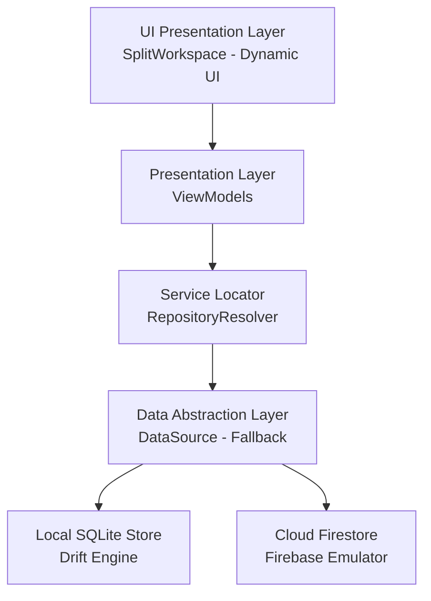

# API Reference

| Attribute | Specification Detail |
| :--- | :--- |
| **Title** | API Reference |
| **Version** | 1.0.0 |
| **Date** | 2026-09-16 |
| **Lifecycle Standard** | ISO/IEC/IEEE 15288:2023 §6.4.13 |
| **Classification** | UPSTREAM_SPEC_CORE_COMPILER |

> Public interfaces, core data contracts, architecture specifications, compiler engines, and verification extension points for the Digital Engineering Agent Platform (DEAP), conforming to ISO/IEC/IEEE 15288:2023 §6.4.13 (Maintenance and Operations Documentation).

---

## Table of Contents

1. [Architectural Overview & Platform Contracts](#1-architectural-overview--platform-contracts)
   - [Primary Commercial Toolchain Integration Context](#primary-commercial-toolchain-integration-context)
2. [Core Data Contracts & Backends](#2-core-data-contracts--backends)
   - [2.1 DataSource Interface](#21-datasource-interface)
   - [2.2 FallbackDataSource & Resilient Failover](#22-fallbackdatasource--resilient-failover)
   - [2.3 Query & Mutation Lifecycle](#23-query--mutation-lifecycle)
   - [2.4 Type & Relation Descriptors](#24-type--relation-descriptors)
3. [Service & Repository Resolvers](#3-service--repository-resolvers)
   - [3.1 RepositoryResolver (IoC Container)](#31-repositoryresolver-ioc-container)
   - [3.2 Dynamic Platform Profile Injection](#32-dynamic-platform-profile-injection)
4. [Persistence & State Management](#4-persistence--state-management)
   - [4.1 DatabaseInitializer](#41-databaseinitializer)
   - [4.2 Concrete Storage Drivers](#42-concrete-storage-drivers)
   - [4.3 Schema Migrations & DDL Transitions](#43-schema-migrations--ddl-transitions)
5. [Presentation Architecture & ViewModels](#5-presentation-architecture--viewmodels)
   - [5.1 TreeViewModel](#51-treeviewmodel)
   - [5.2 PropertiesViewModel](#52-propertiesviewmodel)
   - [5.3 TablesViewModel](#53-tablesviewmodel)
   - [5.4 TopologyViewModel](#54-topologyviewmodel)
   - [5.5 Reactive Data Bindings & Event Echo Guard](#55-reactive-data-bindings--event-echo-guard)
6. [UI Layout Components](#6-ui-layout-components)
   - [6.1 SplitWorkspace (Multi-Pane Docking)](#61-splitworkspace-multi-pane-docking)
   - [6.2 LayoutConfig & Responsive Breakpoints](#62-layoutconfig--responsive-breakpoints)
   - [6.3 ComponentFactory](#63-componentfactory)
   - [6.4 BreadcrumbOverflow & Navigation](#64-breadcrumboverflow--navigation)
   - [6.5 Specialized Domain Widgets](#65-specialized-domain-widgets)
7. [Core Compiler APIs](#7-core-compiler-apis)
   - [7.1 SysML v2 AST Metamodel (crates/deap-core)](#71-sysml-v2-ast-metamodel-cratesdeap-core)
   - [7.2 SysML Compiler & STPA Transpiler (crates/compile-sysml)](#72-sysml-compiler--stpa-transpiler-cratescompile-sysml)
   - [7.3 ConOps & Mission Intent Assembly Engine (crates/assemble-conops)](#73-conops--mission-intent-assembly-engine-cratesassemble-conops)
   - [7.4 Mechanical Baseline Verifier (crates/verify-baseline)](#74-mechanical-baseline-verifier-cratesverify-baseline)
   - [7.5 Backlog Reconciler Engine (crates/reconcile-backlog)](#75-backlog-reconciler-engine-cratesreconcile-backlog)
8. [Native Baseline Quality Gates & Invariant Validators (crates/verify-baseline)](#8-native-baseline-quality-gates--invariant-validators-cratesverify-baseline)
   - [8.1 Baseline Verification Architecture](#81-baseline-verification-architecture)
   - [8.2 Gate 21: SemanticDiagramASTValidator](#82-gate-21-semanticdiagramastvalidator)
   - [8.3 Gate 22: SemanticProseInvariantValidator](#83-gate-22-semanticproseinvariantvalidator)
   - [8.4 Gate 23: FactualGroundingValidator](#84-gate-23-factualgroundingvalidator)
   - [8.5 Gate 24: OperationalAllocationValidator](#85-gate-24-operationalallocationvalidator)
   - [8.6 Gate 25: StandardsAndMeasurementValidator](#86-gate-25-standardsandmeasurementvalidator)
   - [8.7 Gate 26: ConopsCompletenessValidator & MissionIntentCompletenessValidator](#87-gate-26-conopscompletenessvalidator--missionintentcompletenessvalidator)
   - [8.8 Gate 27: ResearchInventoryValidator](#88-gate-27-researchinventoryvalidator)
   - [8.9 Gate 28: CoverageDigestValidator](#89-gate-28-coveragedigestvalidator)
   - [8.10 Gate 29: ObligationWitnessValidator](#810-gate-29-obligationwitnessvalidator)
   - [8.11 Gate 30: ArchitectureViewpointValidator](#811-gate-30-architectureviewpointvalidator)

---

## 1. Architectural Overview & Platform Contracts

The DEAP framework defines abstract data contracts, service resolvers, view models, and layout components that decouple high-level systems engineering specifications from concrete platform runtimes. In downstream applications, implementations conform to the Model-View-ViewModel (MVVM) architecture with unidirectional data flow and strict null safety.



### Primary Commercial Toolchain Integration Context

All engineering workflows, control law synthesis models, safety statecharts, and software generation across the DEAP framework declare:

> **Primary Commercial Toolchain Integration Context:**
> **MATLAB / Simulink / Stateflow / Embedded Coder** (Model-Based Design, Control Law Synthesis, DO-178C C/SPARK Ada code generation).

In downstream workspaces, physical and control features maintain dual-track Model-Based Design (MBD):
- **Track A (Native MATLAB/Simulink Synthesis)**: Programmatic model scripts (`.m`), parameter dictionaries (`.m`), and Simulink Data Dictionaries (`.sldd`) configured for deterministic discrete solvers (`FixedStepDiscrete`).
- **Track B (Headless CI Digital Twin Engine)**: Standalone, license-free discrete-time Python execution engines validating identical loop rates, polynomial curves, and transition guards offline.

---

## 2. Core Data Contracts & Backends

### 2.1 DataSource Interface

**File:** `app_flutter/lib/domain/data_source.dart`

`DataSource` defines the unified asynchronous contract for querying and persisting domain entities across heterogeneous backends (SQLite, Firebase, gRPC, and REST):

```dart
abstract class DataSource {
  Future<List<TypeDescriptor>> discoverTypes();
  Future<TypeDescriptor?> typeFor(String typeName);
  Future<List<(String, String)>> discoverHierarchy();
  Future<Map<String, dynamic>> fetchProperties(String nodeId);
  Future<void> saveProperties(String nodeId, Map<String, dynamic> properties);
  Stream<Map<String, dynamic>> watchProperties(String nodeId);
  Future<List<Map<String, dynamic>>> fetchElements(String nodeId);
  Future<List<Map<String, dynamic>>> fetchAlarms(String nodeId);
  Future<List<Map<String, dynamic>>> fetchEvents(String nodeId);
}
```

| Method Signature | Return Type | Description |
| :--- | :--- | :--- |
| `discoverTypes()` | `Future<List<TypeDescriptor>>` | Discovers all domain metamodel classifiers recognized by the active backend. |
| `typeFor(String typeName)` | `Future<TypeDescriptor?>` | Retrieves structural field and relationship descriptors for a specific type. |
| `discoverHierarchy()` | `Future<List<(String, String)>>` | Returns structural parent-child tuples `(parentId, childId)` representing the tree. |
| `fetchProperties(String nodeId)` | `Future<Map<String, dynamic>>` | Loads all key-value attributes and operational parameters for a node. |
| `saveProperties(String nodeId, Map)` | `Future<void>` | Persists mutated attribute values to storage with validation. |
| `watchProperties(String nodeId)` | `Stream<Map<String, dynamic>>` | Emits real-time attribute update streams. |
| `fetchElements(String nodeId)` | `Future<List<Map<String, dynamic>>>` | Retrieves immediate children records for tabular display. |
| `fetchAlarms(String nodeId)` | `Future<List<Map<String, dynamic>>>` | Queries active safety invariants, alerts, and alarm records. |
| `fetchEvents(String nodeId)` | `Future<List<Map<String, dynamic>>>` | Returns historical event sequence logs. |

### 2.2 FallbackDataSource & Resilient Failover

**File:** `app_flutter/lib/domain/data_sources/fallback_data_source.dart`

Provides guaranteed offline operation when primary persistence backends are unseeded, disconnected, or encounter schema mismatch errors.

#### Failover Policy & Behavior:
1. When `SqliteDataSource` or `FirebaseDataSource` returns zero rows from `discoverTypes()`, `RepositoryResolver` transparently promotes `FallbackDataSource`.
2. Serves a baseline in-memory schema descriptor (`Item`) containing universal identity, name, status, and timestamp fields.
3. Allows continuous UI execution, manual inspection, and testing without throwing unhandled connection exceptions.

### 2.3 Query & Mutation Lifecycle

Every data mutation travels through a deterministic three-phase cycle:
1. **Client-side Validation**: Evaluates regex patterns, range limits, and mandatory attributes defined in `FieldDescriptor`.
2. **Atomic Store Commit**: Commits updates via ACID transaction (SQLite) or batch write (Firestore).
3. **Reactive Stream Notification**: Triggers `watchProperties` emission to update all active UI subscribers without full page reloads.

### 2.4 Type & Relation Descriptors

- **`TypeDescriptor`** (`domain/type_descriptor.dart`): Encapsulates object type identity, display icons, constituent `FieldDescriptor` lists, and hierarchy linkages.
- **`FieldDescriptor`** (`domain/field_descriptor.dart`): Specifies individual property keys, display labels, primitive types (`string`, `int`, `double`, `boolean`, `enum`), section groupings, and validation rules.
- **`TypeRelationDescriptor`** (`domain/type_relation_descriptor.dart`): Represents semantic relations between classifiers (e.g. `contains`, `controls`, `monitors`).

---

## 3. Service & Repository Resolvers

### 3.1 RepositoryResolver (IoC Container)

**File:** `app_flutter/lib/domain/repository_resolver.dart`

`RepositoryResolver` acts as the Inversion of Control (IoC) service locator for runtime storage bindings:

```dart
class RepositoryResolver {
  static Future<(AbstractRepository, DataSource)> resolve({
    String? dataSourceType,
    bool useEmulator = true,
  }) async {
    final effectiveType = dataSourceType ??
        Platform.environment["DATA_SOURCE"] ??
        "sqlite";

    switch (effectiveType) {
      case "firebase":
        final ds = FirebaseDataSource(useEmulator: useEmulator);
        return (AbstractRepository(ds), ds);
      case "sqlite":
      default:
        final ds = SqliteDataSource();
        final types = await ds.discoverTypes();
        if (types.isEmpty) {
          final fallback = FallbackDataSource();
          return (AbstractRepository(fallback), fallback);
        }
        return (AbstractRepository(ds), ds);
    }
  }
}
```

### 3.2 Dynamic Platform Profile Injection

`RepositoryResolver` reads configuration parameters from `assets/persistence-config.json` and environmental profiles in `.pipeline/profiles/`. This ensures the UI presentation code remains completely independent of low-level driver implementations.

---

## 4. Persistence & State Management

### 4.1 DatabaseInitializer

**File:** `app_flutter/lib/domain/database_initializer.dart`

Coordinates schema creation, pragma configuration, table indexing, and initial data seeding for local relational storage:

```dart
class DatabaseInitializer {
  static Future<void> initialize(Database db, {bool isTest = false}) async {
    await db.execute("PRAGMA journal_mode = WAL;");
    await db.execute("PRAGMA busy_timeout = 5000;");
    await db.execute("PRAGMA foreign_keys = ON;");

    await db.execute("""
      CREATE INDEX IF NOT EXISTS idx_instances_parent_type
      ON instances(parent_node_id, type_name);
    """);

    await db.execute("""
      CREATE INDEX IF NOT EXISTS idx_instances_type_name
      ON instances(type_name);
    """);

    final limit = isTest ? 20 : 1000;
    await _seedDatabase(db, limit: limit);
  }
}
```

#### Key Operations:
- **Write-Ahead Logging (WAL)**: Configures concurrent reader-writer transactions.
- **Index Optimization**: Maintains composite index `(parent_node_id, type_name)` accelerating tree traversal queries.
- **Dynamic Seeding**: Clamps seed batch size during testing runs (`FLUTTER_TEST`) to ensure sub-second startup.

### 4.2 Concrete Storage Drivers

- **`SqliteDataSource`**: Embedded relational database operating over `sqflite` / `drift`.
- **`FirebaseDataSource`**: Cloud Firestore driver supporting offline caching and reactive document snapshots.
- **`GrpcDataSource`**: High-performance binary RPC driver connecting to real-time simulation backends.

### 4.3 Schema Migrations & DDL Transitions

Database schema versions are tracked monotonically in `sys_schema_version`. Migrations execute within an explicit database transaction with rollback safety.

---

## 5. Presentation Architecture & ViewModels

The presentation tier uses ViewModels extending `ChangeNotifier` to bridge domain repositories with declarative widgets.

### 5.1 TreeViewModel

**File:** `app_flutter/lib/features/tree/view_models/tree_view_model.dart`

Manages hierarchical navigation, multi-level tree expansion, node selection, and breadcrumb path resolution:
- `selectedNodeId`: Currently focused tree node.
- `expandedNodes`: Set of node identifiers currently expanded.
- `selectNode(String nodeId)`: Updates active selection, emits telemetry event, and notifies listeners.
- `toggleExpanded(String nodeId)`: Toggles collapsible subtree branch.

### 5.2 PropertiesViewModel

**File:** `app_flutter/lib/features/properties/view_models/properties_view_model.dart`

Controls the active attribute inspector:
- `loadProperties(String nodeId)`: Asynchronously queries node attributes.
- `updateProperty(String key, dynamic value)`: Validates mutated value and dispatches persistence save.
- `isDirty`: Flag indicating unsaved local modifications.

### 5.3 TablesViewModel

**File:** `app_flutter/lib/features/tables/view_models/tables_view_model.dart`

Manages tabular data collections across child elements, active alarms, and historical events:
- `selectedTab`: Active table category (`elements`, `alarms`, `events`).
- `filterText`: Column search filter.
- `sortColumn`, `sortAscending`: Sorting state.

### 5.4 TopologyViewModel

**File:** `app_flutter/lib/features/topology/view_models/topology_view_model.dart`

Coordinates multi-dimensional topological rendering, spatial node coordinates, and interconnect flows:
- `nodes`: List of topological entities with positions `(x, y, z)`.
- `edges`: Directed interconnect connections with flow rates and protocols.
- `focusNode(String nodeId)`: Centers the 2D/3D viewport on the specified node.

### 5.5 Reactive Data Bindings & Event Echo Guard

ViewModels implement an **Event Echo Guard** to prevent circular update cascades:
When a ViewModel updates local state from a user gesture, it temporarily disables inbound stream listener notifications until the remote mutation is acknowledged.

---

## 6. UI Layout Components

### 6.1 SplitWorkspace (Multi-Pane Docking)

**File:** `app_flutter/lib/features/layout/split_workspace.dart`

`SplitWorkspace` implements a high-density, multi-pane docking desktop container featuring resizable splitters.

#### Architectural Mandates:
- Splitter widgets attach pointer gesture event listeners (`Listener` or `GestureDetector`) to support smooth horizontal/vertical dragging.
- Resizable pane ratios are persisted across user sessions in local settings.
- CSS container queries (`@container`) and flexible fraction constraints maintain layout stability during window resizing.
- Supports orientation toggle (`Axis.horizontal` / `Axis.vertical`).

### 6.2 LayoutConfig & Responsive Breakpoints

**File:** `app_flutter/lib/features/layout/layout.dart`

Defines screen width thresholds, pane visibility policies, and collapsible sidebars:

```dart
class LayoutConfig {
  static const double compactBreakpoint = 768.0;
  static const double mediumBreakpoint = 1024.0;
  static const double expandedBreakpoint = 1440.0;

  final double sidebarWidth;
  final double detailsHeight;
  final bool isSidebarVisible;
  final bool isDetailsVisible;

  const LayoutConfig({
    this.sidebarWidth = 280.0,
    this.detailsHeight = 320.0,
    this.isSidebarVisible = true,
    this.isDetailsVisible = true,
  });
}
```

### 6.3 ComponentFactory

**File:** `app_flutter/lib/features/layout/component_factory.dart`

Dynamically instantiates UI widgets based on component identifiers declared in layout configuration files:

```dart
class ComponentFactory {
  final Axis? preferredSplitAxis;

  const ComponentFactory({this.preferredSplitAxis});

  Widget build(String componentId, {Map<String, dynamic>? params}) {
    switch (componentId) {
      case "SidebarTree":
        return const SidebarTree();
      case "PropertyGrid":
        return const PropertyGrid();
      case "TopographicalView":
        return TopographicalView(splitAxis: preferredSplitAxis);
      case "SplitWorkspace":
        return SplitWorkspace(axis: preferredSplitAxis ?? Axis.horizontal);
      case "TableViewWidget":
        return const TableViewWidget();
      default:
        return Center(child: Text("Component: $componentId"));
    }
  }
}
```

### 6.4 BreadcrumbOverflow & Navigation

**File:** `app_flutter/lib/features/layout/breadcrumbs.dart`

`BreadcrumbOverflow` renders an adaptive breadcrumb trail reflecting the active hierarchy depth. When container width is constrained, leading crumbs are truncated into an overflow dropdown menu while preserving root and leaf visibility.

### 6.5 Specialized Domain Widgets

- **`PropertyGrid`** (`features/properties/property_grid.dart`): Zero code-gen dynamic form rendering fields grouped by section with live regex validation.
- **`TopographicalView`** (`features/topology/topographical_view.dart`): Multi-dimensional topological layout canvas with canvas pan, zoom, and node selection.
- **`TableViewWidget`** (`features/tables/table_view_widget.dart`): High-density data grid supporting column sorting, text filtering, and pagination.

---

## 7. Core Compiler APIs

### 7.1 SysML v2 AST Metamodel (crates/deap-core)

**Crate:** `crates/deap-core` (`deap_core::sysml_ast`)

The canonical parser and metamodel for textual SysML v2 and KerML specification models.

#### Core Rust Structs:

| Struct | Fields | Description |
| :--- | :--- | :--- |
| `AttributeDef` | `name: String`, `type_name: String`, `doc: Option<String>`, `default_value: Option<String>` | Primitive data attribute definition. |
| `PortDef` | `name: String`, `type_name: String`, `direction: String`, `is_conjugated: bool`, `port_category: String`, `protocol_family: String`, `flow_defs: Vec<FlowDef>` | Physical or logical port with protocol bindings. |
| `FlowDef` | `name: String`, `direction: String`, `item_type: String`, `rate_hz: Option<f64>`, `unit: String`, `valid_range: Option<String>` | Directed data flow or item stream across ports. |
| `ActionDef` | `name: String`, `doc: Option<String>`, `params: Vec<AttributeDef>`, `return_type: Option<String>` | Discrete action or functional method. |
| `OperationDef` | `name: String`, `doc: Option<String>`, `parameters: Vec<AttributeDef>`, `return_type: Option<String>`, `direction: String` | Operation signature with directional parameters. |
| `CapabilityDef` | `name: String`, `doc: Option<String>`, `capability_id: String`, `inputs: Vec<PortDef>`, `outputs: Vec<PortDef>` | High-level system operational capability. |
| `InteractionDef` | `name: String`, `doc: Option<String>`, `lifelines: Vec<String>`, `messages: Vec<InteractionMessage>` | Scenario sequence diagram and messaging lifeline. |
| `ConstraintDef` | `name: String`, `expression: String`, `constraint_type: String`, `doc: Option<String>` | Formal safety assertion or mathematical invariant. |
| `TestCaseDef` | `name: String`, `doc: Option<String>`, `test_id: String`, `subject: String`, `verification_links: Vec<String>` | Formal verification test case definition. |
| `RequirementDef` | `name: String`, `req_id: String`, `text: String`, `doc: Option<String>`, `derived_from: Vec<String>` | Traceable engineering requirement. |
| `StateDef` | `name: String`, `doc: Option<String>`, `entry_actions: Vec<String>`, `exit_actions: Vec<String>`, `transitions: Vec<TransitionDef>` | Formal state machine / statechart classifier. |
| `UseCaseDef` | `name: String`, `doc: Option<String>`, `actors: Vec<String>`, `includes: Vec<String>`, `extends: Vec<String>` | Formal use case specification. |
| `ItemDef` | `name: String`, `doc: Option<String>`, `properties: Vec<AttributeDef>` | Data payload or message structure definition. |
| `HazardDef` | `name: String`, `doc: Option<String>`, `hazard_id: String`, `severity: String`, `port_bindings: Vec<String>` | STPA hazard definition with severity and bindings. |
| `ConnectionDef` | `name: String`, `source_port: String`, `target_port: String`, `doc: Option<String>` | Topological connection linking two ports. |
| `PartDef` | `name: String`, `doc: Option<String>`, `parts: Vec<PartDef>`, `ports: Vec<PortDef>`, `attributes: Vec<AttributeDef>`, `actions: Vec<ActionDef>`, `operations: Vec<OperationDef>`, `constraints: Vec<ConstraintDef>`, `requirements: Vec<RequirementDef>` | Structural subsystem part or block classifier. |
| `PackageDef` | `name: String`, `doc: Option<String>`, `parts: Vec<PartDef>`, `sub_packages: Vec<PackageDef>`, `connections: Vec<ConnectionDef>`, `requirements: Vec<RequirementDef>`, `constraints: Vec<ConstraintDef>` | Top-level or nested package container. |

### 7.2 SysML Compiler & STPA Transpiler (crates/compile-sysml)

**Crate:** `crates/compile-sysml`

Compiles SysML v2 models into structured ASTs, transpiles STPA/FMECA safety tables into formal `constraint def` expressions, and performs bidirectional closed-loop synchronization.

#### Key Functions:

- `parse_sysml(source: &str) -> Result<PackageDef, ParseError>`: Parses textual SysML v2 source into a strongly-typed `PackageDef` AST.
- `to_sysml(package: &PackageDef) -> String`: Serializes compiled AST structures directly to canonical SysML v2 syntax.
- `compile_stpa_to_constraints(uca: &UnsafeControlAction) -> ConstraintDef`: Transforms an STPA UCA into a formal SysML v2 `constraint def` and `assert constraint` expression.
- `generate_fmeca_matrix(content: &str, config: &FmecaScoringConfig) -> Vec<FmecaRow>`: Synthesizes formal fault containment constraints from FMECA failure modes.
- `forward_sync_sysml_to_specs(options: &ForwardSyncOptions) -> Result<(), SyncError>`: Projects SysML v2 model definitions into downstream specification units.
- `reverse_sync_specs_to_sysml(options: &ReverseSyncOptions) -> Result<(), SyncError>`: Closed-loop reverse synchronization extracting ConOps, Use Cases, User Stories, Features, Epics, and Safety Matrices into SysML AST nodes.

### 7.3 ConOps & Mission Intent Assembly Engine (crates/assemble-conops)

**Crate:** `crates/assemble-conops`

Assembles modular ConOps and Mission Intent units into canonical systems engineering specifications conforming to ISO/IEC/IEEE 29148, ISO/IEC/IEEE 15288, and OMG UAF.

#### Core Contracts & Functions:

```rust
pub struct SubsystemPart {
    pub name: String,
    pub doc: Option<String>,
    pub ports: Vec<SubsystemPort>,
}

pub struct SubsystemPort {
    pub name: String,
    pub port_type: String,
    pub direction: String,
}
```

- `assemble_document(units_dir: &Path, doc_title: Option<&str>, doc_version: Option<&str>, doc_date: Option<&str>, params: Option<&ConopsParams>, canonical_whitelist: Option<&[&str]>) -> Result<String, AssembleError>`: Compiles modular markdown units into a unified document with automated AST parameter substitution, TOC generation, and anchor validation.
- `assemble_conops(input_dir: &Path, output_dir: &Path, verify_only: bool, params: Option<&ConopsParams>) -> Result<(), AssembleError>`: Orchestrates end-to-end assembly, validation, and domain-aware routing of `CONOPS.md` and `MISSION_INTENT.md`.

### 7.4 Mechanical Baseline Verifier (crates/verify-baseline)

**Crate:** `crates/verify-baseline`

Native Rust baseline validation engine executing Checks 10 through 35 to guarantee fail-closed governance, structural integrity, and zero script drift.

### 7.5 Backlog Reconciler Engine (crates/reconcile-backlog)

**Crate:** `crates/reconcile-backlog`

Synchronizes local specification frontmatter, checklists, and diagram traceability matrices with remote issue trackers (GitHub Issues / GitLab Work Items).

---

## 8. Native Baseline Quality Gates & Invariant Validators (crates/verify-baseline)

The native Rust baseline verifier (`crates/verify-baseline`) executes a comprehensive suite of static quality gates enforcing architectural parity, metrology invariants, and traceability.

### 8.1 Baseline Verification Architecture

The verification suite is organized into modular check suites under `crates/verify-baseline/src/checks/`:
- **`hygiene.rs`**: Checks 10, 11 (Gitignore, zero `.DS_Store` or artifact drift).
- **`structural.rs`**: Checks 12-19, 31-35 (Blueprint cleanliness, schema clean landing zones, zero shell scripts, zero python scripts, zero regex, handoff integrity).
- **`wbs.rs`**: Checks 20-23 (WBS hierarchy and SysML AST element coverage).
- **`conops.rs`**: Checks 24, 26, 27 (Operational allocation, ConOps/Mission Intent completeness, research inventory grounding).
- **`metrology.rs`**: Checks 25, 28, 29, 30 (SI 7D metrology, coverage digest, obligation witness registry, architecture viewpoints).

### 8.2 Gate 21: SemanticDiagramASTValidator

**Module:** `crates/verify-baseline/src/checks/metrology.rs`

Enforces 1:1 topological alignment between Mermaid class/component diagrams and SysML v2 AST nodes:
- Validates that every class, subsystem block, or component rendered in Mermaid diagrams resolves to a defined AST `PartDef`.
- Verifies that diagram attributes and operations match the structural types declared in schema.

### 8.3 Gate 22: SemanticProseInvariantValidator

**Module:** `crates/verify-baseline/src/checks/conops.rs`

Validates that physical invariants and safety constraints described in natural language prose adhere to unambiguous modal verbs (RFC 2119 / ISO 29148) and maintain mathematical alignment with formal safety rules.

### 8.4 Gate 23: FactualGroundingValidator

**Module:** `crates/verify-baseline/src/checks/structural.rs`

Enforces factual grounding and parametric Single Source of Truth (SSOT) integrity against SysML v2 AST models and OEM Level 0 schemas:
- **Structural Descriptors & Counts**: Verifies component counts against schema ground truth (`factual-grounding-numeric-drift`).
- **Numeric Limits**: Detects fabricated physical limits or operating parameters.
- **Recognized Protocols**: Verifies that communication and electrical protocols (e.g. STANAG 4586, ARINC 429, CAN-FD, MAVLink) are substantiated in schema (`factual-grounding-unverified-protocol`).
- **Temporal Safety in Sequences**: Validates that physical arming/firing/motor-enable signals in Mermaid sequence diagrams are preceded by human-in-the-loop (HITL) C2 commands (`factual-grounding-temporal-safety-violation`).

### 8.5 Gate 24: OperationalAllocationValidator

**Module:** `crates/verify-baseline/src/checks/conops.rs`

Verifies the operational-to-resource allocation matrix:
- Ensures every operational activity defined in Operational Views (OV-5b / ConOps) is allocated to at least one structural subsystem resource in System Views (SV-1).
- Enforces DoDAF 2.02 and OMG UAF traceability rules.

### 8.6 Gate 25: StandardsAndMeasurementValidator

**Module:** `crates/verify-baseline/src/checks/metrology.rs`

Enforces dimensional metrology and standards taxonomy lattice compliance:
- **SI 7-Dimensional Exponent Vectors**: Represents physical quantities in $\mathbb{Z}^7$:
  $$D(Q) = [d_L, d_M, d_T, d_I, d_{\Theta}, d_N, d_J] \in \mathbb{Z}^7$$
- **Theorem 3 (Dimensional Homogeneity)**: Asserts that for every port connection $c = (p_{src}, p_{dst})$, the dimensional vectors match: $D(e_{src}) = D(e_{dst})$.
- **Nyquist-Shannon Sampling Frequency**: Enforces sampling rate bounds: $f_{sample} \ge 2 \cdot f_{max}$.
- **OMG UAF Standards Lattice**: Validates standard authority bodies (RTCA, SAE, ISO, IEC, ASTM) and monotonic assurance levels (DAL-A..E, ASIL-A..D, SAIL I..VI, SIL 1..4).

### 8.7 Gate 26: ConopsCompletenessValidator & MissionIntentCompletenessValidator

**Module:** `crates/verify-baseline/src/checks/conops.rs`

Verifies that Concept of Operations and Mission Intent specifications contain all mandatory structural sections, Mission Essential Task Lists (METL), environmental envelopes, and tactical Go/No-Go decision matrices.

### 8.8 Gate 27: ResearchInventoryValidator

**Module:** `crates/verify-baseline/src/checks/conops.rs`

Enforces 100% citation grounding for technical, regulatory, and architectural claims against declared research inventories under `docs/research/`.

### 8.9 Gate 28: CoverageDigestValidator

**Module:** `crates/verify-baseline/src/checks/metrology.rs`

Validates that `.pipeline/schema-digest.json` accounts for 100% of input schema nodes and confirms bidirectional mapping to downstream specifications.

### 8.10 Gate 29: ObligationWitnessValidator

**Module:** `crates/verify-baseline/src/checks/metrology.rs`

Enforces the obligation-witness registry invariant:
- Asserts that every contractual requirement, safety constraint, and interface obligation is linked to an empirical verification witness (unit test, simulation model, or inspection test).

### 8.11 Gate 30: ArchitectureViewpointValidator

**Module:** `crates/verify-baseline/src/checks/metrology.rs`

Enforces fail-closed verification of the 11 canonical architecture diagrams across 5 viewpoints:
1. **Operational Viewpoint (OV)**:
   - OV-1: System Context
   - OV-2: Operational Node Connectivity
   - OV-5b: Operational Activity Functional Flow
   - OV-6c: Scenario Lifeline Sequences
2. **System Viewpoint (SV)**:
   - SV-1: Super-System Segment Allocation
   - SV-2: Subsystem Interconnect & Bus Architecture (IBD)
   - SV-10b: Master System Lifecycle State Machine
3. **Interface Viewpoint (ICD)**:
   - Diagram 5: $N^2$ Physical Interface Matrix
4. **Safety Viewpoint (STPA)**:
   - Diagram 9: Hierarchical Safety Control Structure
   - Diagram 10: Run-Time Assurance (RTA) Statechart
5. **Spatial / Environmental Viewpoint (SORA)**:
   - Diagram 11: 4D Spatial Volume & Ground Risk Buffer Containment
