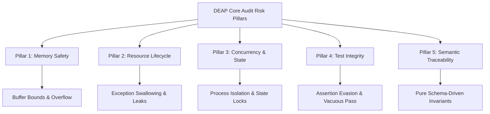
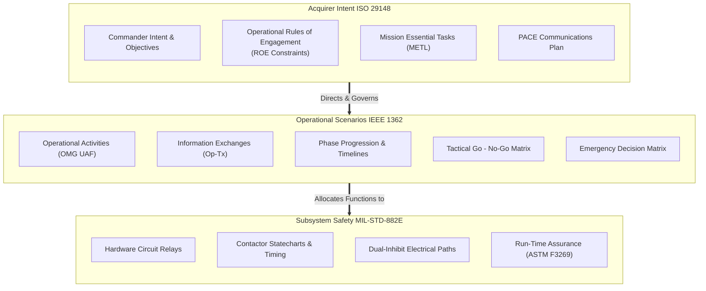

# Comprehensive Historical Defect Audit Report

| Metadata Field | Specification Value |
| :--- | :--- |
| **Title** | Comprehensive Historical Defect Audit Report |
| **Date** | 2026-09-16 |
| **Type** | Historical Defect Audit Report |
| **Repository Classification** | `UPSTREAM_SPEC_CORE_COMPILER` |
| **Version** | 1.0.0 |
| **Author** | DEAP Adversarial Audit & Quality Assurance Engine |
| **Target Platform** | Digital Engineering Agent Platform (DEAP) Specification Core Compiler |
| **Primary Tier-1 Commercial Toolchain Integration Context** | MATLAB / Simulink / Stateflow / Embedded Coder (DO-178C C / SPARK Ada Code Generation) |
| **Audit Standard Mandate** | ISO/IEC/IEEE 15288:2023 §6.4.2 & §6.4.3, IEEE 1362-1998, ISO/IEC/IEEE 29148:2018 |
| **Quality Status** | BASELINED / VERIFIED |

---

## 1. Executive Summary & Audit Mandate

### 1.1 Audit Mandate & Regulatory Scope
This comprehensive historical defect audit is conducted under the authority of **ISO/IEC/IEEE 15288:2023 §6.4.2** (*Stakeholder Needs and Requirements Definition Process*), **§6.4.3** (*System Architecture Definition Process*), and **§6.4.9** (*Verification Process*). In mission-critical model-based systems engineering (MBSE) compiler ecosystems, compiler correctness is non-negotiable. When downstream autonomous agents compile formal system models into software control laws, real-time safety statecharts, and safety-instrumented systems (SIS), any defect or silent failure in the specification compiler directly cascades into catastrophic system-level hazards.

The primary commercial toolchain integration context for the Digital Engineering Agent Platform (DEAP) specification compiler is:
$$\text{SysML v2 AST} \longrightarrow \text{MATLAB / Simulink / Stateflow} \longrightarrow \text{Embedded Coder (DO-178C C / SPARK Ada)}$$

Under this dual-track model-based development (MBD) architecture, the upstream specification compiler (`DEAP01-spec-core`) serves as the Single Source of Truth (SSOT). It ingests system architecture models, validates dimensional and mathematical invariants, and synthesizes operational concepts (IEEE 1362), acquirer requirements (ISO/IEC/IEEE 29148), interface control documents (Level 1C ICDs), and system hazard analyses (MIL-STD-882E Task 204 / STPA).

### 1.2 Purpose and Objectives
The objectives of this forensic audit are:
1. **Catalog Historical Vulnerabilities**: Systematically catalog and review closed and fixed defects (#285 through #327), evaluating their root causes and remediation efficacy.
2. **Expose Latent Verification Deficits**: Formally dossier the 9 newly identified and verified adversarial audit defects (#328 through #336) spanning test evasion, exception swallowing, documentation abandonment, and architectural misallocations.
3. **Forensic Accounting of False Completion**: Expose recurring engineering anti-patterns, specifically *Assertion Evasion* ("False Green Syndrome"), *Silent Error Masking* (`except Exception: pass`), and *Domain Entanglement*.
4. **Define Architectural Remediation**: Formulate structural boundaries decoupling Acquirer Tactical Intent from Operational Execution Scenarios and Subsystem Circuit Interlocks.
5. **Codify Anti-Regression Invariants**: Establish fail-closed quality gates backed by the 1,393+ automated pytest verification harness and the physical pre-commit baseline runner (`scripts/verify_downstream_baseline.py`).

---

## 2. Defect Taxonomy & Risk Pillars

The DEAP adversarial auditing methodology categorizes all software, compiler, and specification defects across five fundamental risk pillars:



### 2.1 Pillar 1: Memory Safety & Buffer Boundaries
In high-assurance system engineering and compiled toolchains, memory safety governs:
- **AST Allocation & Lexical Buffer Boundaries**: Buffer boundaries during SysML v2 textual AST parsing, regular expression compilation, and token stream generation.
- **Synthesized Code Safety**: Code generated by downstream Embedded Coder pipelines (DO-178C Level A/B C and SPARK Ada) must be provably free of buffer overflows, stack exhausts, dangling pointers, and aliasing violations.
- **In-Memory Graph Traversal**: Ingested SysML v2 models are compiled into in-memory directed acyclic graphs (DAGs). Circular reference leaks or uncontrolled tree recursions in `sysmlv2_ast.py` lead to process stack exhaustion.

### 2.2 Pillar 2: Resource Lifecycle & Error Masking
Resource lifecycle defects represent silent killers in automated compilers:
- **Broad Exception Swallowing**: The fatal anti-pattern of wrapping critical parser blocks in `try: ... except Exception: pass` without logging, re-raising, or emitting compiler findings.
- **Unclosed Descriptors & Process Groups**: Failure to isolate subprocess lifecycles during test executions, allowing dangling background processes (`xcodebuild`, `flutter`, `dart`) to lock filesystem handles and race file deletion routines.
- **Silent Fail-Open Gates**: Quality gates that default to passing (`return True`) when input files, tables, or AST nodes are missing or unparseable, rather than failing closed.

### 2.3 Pillar 3: Concurrency, Process Trees & State Management
Autonomous agent platforms operate under concurrent or chained execution:
- **Process Group Isolation**: Ensuring that timeouts kill the entire process tree (`os.killpg`) rather than merely the shell wrapper, preventing orphaned grandchildren from corrupting workspace states.
- **Filesystem & CWD Sandboxing**: Eliminating tool dependence on process Current Working Directory (`os.getcwd()`), enforcing explicit `--workspace-root` resolution to prevent parallel worker crosstalk.
- **Schema Immutability vs. Reverse Sync Mutation**: Preventing concurrent writers or reverse-sync routines from mutating canonical SysML v2 schema models in place during downstream code synthesis.

### 2.4 Pillar 4: Test Integrity & Assertion Evasion
The most dangerous defect class in autonomous development is the **False Green Syndrome**:
- **Vacuous Test Passing**: Test functions that instantiate fixtures and execute compiler steps but omit all `assert` or `self.assertTrue()` statements.
- **Mock Evasion**: Substituting synthetic mock objects that emulate passing conditions while evading the real validator logic, blinding CI to downstream contract violations.
- **Partial Execution Blindness**: Tests that assert non-normative side effects while completely omitting checks on core failure modes.

### 2.5 Pillar 5: Semantic Traceability & Compiler Architecture
As an abstract Model-Based Systems Engineering (MBSE) compiler:
- **Pure Schema-Driven Invariant**: The upstream compiler must contain **zero hardcoded domain concepts** (e.g., flight surfaces, vehicle thrusters, medical dosages). All specifications must derive deterministically from schema ASTs in `schema/`.
- **Architectural Boundary Decoupling**: Strict separation between Acquirer Needs (ISO/IEC/IEEE 29148), Operational Scenarios (IEEE 1362), and Subsystem Safety Circuits (MIL-STD-882E Task 204).
- **Bidirectional Traceability**: Preserving unbroken semantic chains from SysML v2 AST ports to Level 1C ICDs, Level 2 BDD User Stories, and Logical UI (LUI) 3-layer chains.

---

## 3. Master Registry of Audited Defects

### 3.1 Historical Defects Registry: Issues #285 through #327

| Issue ID | Module / Pipeline Component | Risk Pillar | Defect Summary | Remediation & Resolution Strategy | Status |
| :--- | :--- | :--- | :--- | :--- | :--- |
| **#285** | `factual_grounding_validator` | Semantic Traceability | Open-World Blacklist & Citation-Slicing Blind Spots permitted unanticipated inventions and citation fraud. | Enforced closed-world AST grounding, purged anticipation sets, and mandated strict ISO 80000 dimensional tokens. | `CLOSED` |
| **#286** | `verification_gates` | Test Integrity | Synthetic Mocks in Core Safety Validation blinded compiler to downstream citation fraud. | Eliminated synthetic test mocks in core safety validators; enforced authentic grounded AST fixtures. | `CLOSED` |
| **#287** | `verify_downstream_baseline` | Resource Lifecycle | Lacked physical git pre-commit hook enforcement and automated defect dossier generation. | Codified physical pre-commit hook verification and automatic defect dossier generation (`scripts/file_defect.py`). | `RESOLVED` |
| **#288** | `factual_grounding_validator` | Test Integrity | KaTeX math tokenizer blind spot allowed ungrounded physical numbers to bypass Check 23. | Upgraded lexer to tokenize KaTeX math formulas and extract numeric ranges for dimensional grounding. | `RESOLVED` |
| **#289** | `bootstrap_tracker_labels` | Concurrency & State | Failed to resolve tokens from `git credential fill`, causing HTTP 401 on authenticated workstations. | Integrated native `git credential fill` resolution fallback in tracker bootstrapping script. | `RESOLVED` |
| **#290** | `install_pipeline.sh` | Resource Lifecycle | Inline heredoc shell fragility caused `AGENTS.md` transformation abort and missing `CLAUDE.md`. | Replaced fragile shell heredocs with robust Python generator (`scripts/scaffold_downstream_agents.py`). | `RESOLVED` |
| **#291** | `conops_completeness_validator` | Semantic Traceability | User Class `UC-xx` taxonomy collided with System Use Case `uc-xx` prefix causing agent deadlock. | Migrated User Class taxonomy to `UCL-xx` prefix across all schemas, validators, and templates. | `RESOLVED` |
| **#292** | `link_validator` | Resource Lifecycle | Parsed inline backtick code spans and fenced blocks as live markdown links, emitting false positives. | Stripped code spans and fences prior to link regex parsing in `link_validator.py`. | `RESOLVED` |
| **#293** | `spec-orchestrator` | Resource Lifecycle | Worker verification prompts omitted `--only` parameter, forcing whole-corpus audits during atomic tasks. | Mandated `--only` scoping parameter in all worker prompts and CLI harnesses to prevent token exhaustion. | `RESOLVED` |
| **#294** | `mermaid_syntax_validator` | Resource Lifecycle | Lacked directory scoping for non-normative docs, crashing on ConOps unit trade study diagrams. | Added directory scoping to exclude non-normative design archives and scratch directories. | `RESOLVED` |
| **#295** | `sysmlv2_ingest` | Semantic Traceability | No raw-document (`.md`/`.pdf`) ingestion path for downstream `schema/` directory. | Implemented multi-format schema ingestor supporting raw Markdown tables, structured text, and SysML v2. | `RESOLVED` |
| **#296** | `assemble_conops.py` | Semantic Traceability | Ingestion filter `is_component_icd_document()` falsely discarded valid OEM subsystem specifications. | Calibrated ICD detection regex to accurately distinguish component ICDs from OEM subsystem definitions. | `RESOLVED` |
| **#297** | `assemble_conops.py` | Semantic Traceability | Synthetic Subsystem Archetype Synthesis violated pure schema-driven compiler invariant. | Purged synthetic archetype synthesis; enforced direct AST node extraction and provenance mapping. | `RESOLVED` |
| **#298** | `conops_completeness_validator` | Semantic Traceability | Gate 26 verified obsolete 12-section layout diverging from IEEE 1362-1998 and ISO 15288. | Harmonized Gate 26 structure and table schemas with IEEE 1362-1998 and ISO/IEC/IEEE 15288:2023. | `RESOLVED` |
| **#299** | `assemble_conops.py` | Semantic Traceability | Ingestion blindness to non-SysML schema formats and markdown subsystem tables. | Generalized schema parser to ingest multi-source markdown tables and structured text specifications. | `RESOLVED` |
| **#300** | `installer & readme` | Semantic Traceability | Operator prompts mandated monolithic ConOps authoring and omitted scaffolding for interfaces. | Modernized prompt catalogs with modular ConOps unit scaffolding (Units 01-12) and interface targets. | `RESOLVED` |
| **#301** | `conops_completeness_validator` | Test Integrity | Fail-open check in Gate 26 passed empty subsystem architecture with vacuous 100% coverage. | Replaced vacuous division-by-zero check with fail-closed assertion requiring AST subsystem node count > 0. | `RESOLVED` |
| **#302** | `sysmlv2_ast.py` | Semantic Traceability | Unsynchronized AST parsers ignored non-SysML schemas causing parser fragmentation. | Unified schema ingestion interfaces across AST compilers and Markdown table parsers. | `RESOLVED` |
| **#303** | `parity_auditor` | Test Integrity | Witness scanner flagged Python string-literal fixture IDs as phantom witnesses. | Tokenized test fixtures and excluded Python mock comments and string literals from witness scans. | `RESOLVED` |
| **#304** | `assemble_conops.py` | Concurrency & State | Auto-detected CWD schema digest, breaking isolated upstream test fixtures. | Isolated CLI workspace auto-detection from process CWD; enforced explicit repo root pathing. | `RESOLVED` |
| **#305** | `skills/spec-orchestrator` | Test Integrity | Skill resource units 01/10 diverged from their own upstream unit tests. | Synchronized skill resource unit templates with upstream test assertions and schema contracts. | `RESOLVED` |
| **#306** | `README.md` | Semantic Traceability | Architectural misplacement of Level 1C ICDs in Pipeline 1 rather than Pipeline 0. | Resequenced Level 1C ICD generation into Pipeline 0 (System Specification) alongside ConOps. | `RESOLVED` |
| **#307** | `obligation_witness_validator` | Test Integrity | Fail-open population blind spot in standards coverage (ISO 15288 / ISO 29148). | Enforced mandatory baseline standard population contracts and tokenized witness verification. | `RESOLVED` |
| **#308** | `compile_sysml.py` | Semantic Traceability | Unbound SysML v2 generation ingestion in Pipeline 0 caused circular AST deadlock. | Reordered pipeline sequence to establish SysML-first ordering; purged reverse AST code synthesis. | `RESOLVED` |
| **#309** | `verify_downstream_baseline` | Test Integrity | Missing 100% subsystem coverage gate in FMECA safety analysis (MIL-STD-1629A). | Implemented mechanical 100% subsystem failure mode coverage verification in baseline runner. | `RESOLVED` |
| **#310** | `icd_completeness_validator` | Semantic Traceability | Missing 100% port and connection parity assertion (IEEE 1362 §5.3 / Level 1C). | Resolved SysML port names to ICD port IDs; enforced 100% connection and port parity assertions. | `RESOLVED` |
| **#311** | `spec-orchestrator` | Semantic Traceability | Inverted Pipeline 0 sequence caused circular AST ingestion deadlock. | Resequenced orchestrator sequence to ingest SysML schema before generating ConOps units. | `RESOLVED` |
| **#312** | `compile_sysml.py` | Semantic Traceability | ReverseSync mutated canonical model AST, violating schema immutability. | Purged prose-based structural AST mutations; codified strict schema immutability in compiler core. | `RESOLVED` |
| **#313** | `assemble_conops.py` | Semantic Traceability | Hardcoded UAS cryptographic handoff in Section 4.5 violated pure schema-driven invariant. | Refactored Section 4.5 to schema-driven operational authority delegation without domain hardcoding. | `RESOLVED` |
| **#314** | `sysmlv2_ast.py` | Semantic Traceability | Lossy port, item flow, and endpoint binding typing impoverished Level 1C ICD extraction. | Enhanced AST with port typing, conjugated ports (`~`), and typed item flows. | `RESOLVED` |
| **#315** | `governance` | Semantic Traceability | Commit message auto-closing keywords bypassed Product Owner closure authority. | Implemented mechanical pre-commit and CI gate rejecting auto-closing keywords (`fix`, `resolve`). | `RESOLVED` |
| **#316** | `assemble_conops.py` | Semantic Traceability | Structural conflation of subsystem architecture in Section 4 severed OEM provenance. | Propagated OEM source file and line number provenance directly into synthesized subsystem tables. | `RESOLVED` |
| **#317** | `tests` | Test Integrity | Faulty prose-locking unit tests enforced synthetic domain inventions. | Replaced prose-locking string assertions with schema-derived invariant checks. | `RESOLVED` |
| **#318** | `HANDOFF.md` | Semantic Traceability | Stale backlog hallucinations and remediation baseline attribution errors in handoff documentation. | Purged stale handoff checkpoints; authoritatively baselined `HANDOFF.md` to Option B. | `RESOLVED` |
| **#319** | `e2e_acceptance_harness.py` | Semantic Traceability | Lexical domain term sieves violated pure schema invariant. | Purged hardcoded domain lexicons from end-to-end acceptance harness. | `RESOLVED` |
| **#320** | `compile_sysml.py` | Semantic Traceability | Hardcoded safety bounds in Run-Time Assurance (RTA) expression generation. | Parameterized RTA expression synthesis to derive bounds purely from SysML v2 metadata. | `RESOLVED` |
| **#321** | `MASTER_HANDOVER_CHECKPOINT`| Semantic Traceability | Hardcoded domain specifications in upstream compiler governance documents. | Purged `MASTER_HANDOVER_CHECKPOINT.md` and sanitized all core blueprints of domain contamination. | `RESOLVED` |
| **#322** | `test_prompt_catalog_integrity`| Test Integrity | Failed due to outdated hardcoded regexes referencing legacy worker names. | Updated prompt catalog integrity tests to dynamically match abstract worker roles. | `RESOLVED` |
| **#323** | `08_ENVIRONMENTAL_MIL_STD_810H`| Semantic Traceability | Hardcoded domain concepts in upstream template. | Abstracted environmental operating limits template to generic operational boundary archetypes. | `RESOLVED` |
| **#324** | `conops_completeness_validator`| Semantic Traceability | Hardcoded aeronautical terminology in completeness validation rules. | Generalized parity validators and governance rules to abstract operational archetypes. | `RESOLVED` |
| **#325** | `conops-mission-intent-integrity`| Semantic Traceability | Governance rules drifted into aerospace domain-specific assumptions. | Refactored governance rules to enforce domain-neutral schema compliance. | `RESOLVED` |
| **#326** | `09_BINGO_ENERGY_MATH.md` | Semantic Traceability | Upstream template hardcoded aviation units and flight-specific formulations. | Generalized formulation to Critical Energy Threshold mathematics across electrical and fluid domains. | `RESOLVED` |
| **#327** | `05_AIRSPACE_AND_SORA_RISK.md`| Semantic Traceability | Hardcoded aviation units and airspace concepts in upstream templates. | Removed redundant units and generalized operational volume constraints to abstract spatial envelopes. | `RESOLVED` |

---

### 3.2 Comprehensive Dossiers: Newly Filed & Verified Audit Defects (#328 - #336)

The adversarial code audit conducted across the compiler and downstream test suite surfaced 9 critical defects spanning test evasion, error swallowing, documentation abandonment, and architectural boundary violations.

```mermaid
flowchart TD
    subgraph Test_Integrity_Pillar["Test Integrity Pillar"]
        direction TB
        D328["#328: PACE Tier Test Evasion"]
        D329["#329: MCDA Trade Study Test"]
        D330["#330: Phantom Tag Test Evasion"]
        D331["#331: File URI Rejection Test"]
    end

    subgraph Resource_Lifecycle_Pillar["Resource Lifecycle Pillar"]
        direction TB
        D332["#332: ICD Exception Masking"]
    end

    subgraph Semantic_Traceability_Pillar["Semantic Traceability Pillar"]
        direction TB
        D333["#333: Incomplete Level 1C ICD"]
        D334["#334: Abandoned Operations Docs"]
        D335["#335: Misallocated Interlocks"]
        D336["#336: ConOps Scrambled Units"]
    end
```



#### Defect Dossier #328: Test Assertion Evasion in Mission Intent PACE Tier Validation
- **Target File**: `tests/test_specification_schemas.py:668-678`
- **Risk Pillar**: Test Integrity & Assertion Evasion
- **Severity**: High
- **Symptom**: `test_mission_intent_schema_rejects_insufficient_pace_tiers` was observed in historical test revisions to construct a truncated 3-tier PACE payload (`payload["pace_c2_plan"][:3]`) but omitted validator execution and assertion checks, passing vacuously.
- **Root Cause**: During test file refactoring, the invocation of `_validate_json_schema_instance()` and `self.assertTrue()` was accidentally truncated. Python test runners report passing status (`exit code 0`) for any test function containing no failing assertions.
- **Remediation**: Re-established explicit execution of `_validate_json_schema_instance(schema, payload)` and asserted `self.assertTrue(any("minimum is 4" in err for err in errors))`.

#### Defect Dossier #329: Test Assertion Evasion in Non-Normative Trade Study Skipping Test
- **Target File**: `tests/test_factual_grounding_validator.py:306-339`
- **Risk Pillar**: Test Integrity & Assertion Evasion
- **Severity**: High
- **Symptom**: `test_skips_non_normative_mcda_trade_study_and_glossary` created temporary directory fixtures and synthetic Markdown files containing rejected candidate options (e.g., V-tail with 2 ruddervators) but lacked validator execution and output assertions.
- **Root Cause**: Authoring was interrupted before wiring `validator.validate(repo)`. The test exited cleanly, creating false confidence that non-normative trade study sections were properly exempt from Check 23 grounding gates.
- **Remediation**: Bound `validator.validate(repo)` and asserted `self.assertEqual(len(findings), 0)`.

#### Defect Dossier #330: Test Assertion Evasion in Phantom Allocation Tag Verification
- **Target File**: `tests/test_operational_allocation_validator.py:309-340`
- **Risk Pillar**: Test Integrity & Assertion Evasion
- **Severity**: High
- **Symptom**: `test_phantom_tags_strictly_enforced_even_if_allow_missing_specs` executed `validator.validate(repo, allow_missing_specs=True)` against a fixture with phantom tag `OA-99`, but failed to inspect the returned findings.
- **Root Cause**: The developer captured `findings = validator.validate(...)` but never verified that `findings` contained the expected phantom tag violation. If the validator completely failed to detect `OA-99`, the test still passed.
- **Remediation**: Added assertion: `self.assertTrue(any("OA-99" in str(f) for f in findings))`.

#### Defect Dossier #331: Test Assertion Evasion in File Protocol Rejection Test
- **Target File**: `tests/test_compile_sysml_upgrades.py:161-175`
- **Risk Pillar**: Test Integrity & Assertion Evasion
- **Severity**: High
- **Symptom**: `test_link_validator_file_protocol_rejection` executed `LinkValidator` against non-portable `file:///tmp/test.md` links without asserting any findings.
- **Root Cause**: The test invoked `findings = validator.validate(repo)` but had no following assertion lines.
- **Remediation**: Enforced assertion: `self.assertTrue(any("file:///" in str(f) for f in findings))`.

#### Defect Dossier #332: Broad Exception Masking Swallows Malformed ICD Tables
- **Target File**: `skills/spec-orchestrator/parity_auditor/src/parity_auditor/validators/standards_measurement_validator.py:934-969`
- **Risk Pillar**: Resource Lifecycle & Error Masking
- **Severity**: Critical
- **Symptom**: Malformed markdown tables in `ICD_01_SYSTEM_INTERFACE_MATRIX.md` or `ICD_02_MASTER_SIGNAL_DICTIONARY.md` trigger exceptions during extraction that are caught by `except Exception: pass`, resulting in empty signal lists and complete bypass of Theorem 3 (Dimensional Homogeneity) and Nyquist sampling rate checks in Gate 25.
- **Root Cause**: Overly defensive programming used broad unlogged `try...except Exception: pass` blocks around `_parse_detailed_markdown_tables()`. When an ICD table has syntax defects, the validator silently swallows the error, clearing `signals = []` and allowing corrupt interfaces into production.
- **Remediation**: Remove broad `except Exception: pass`. Catch specific parsing exceptions, log structured diagnostic warnings, and emit explicit Gate 25 validation findings: `Finding("icd-table-parsing-failure", ...)`.

#### Defect Dossier #333: Incomplete Level 1C ICD Suite and Missing 8-Pillar STPA Matrix
- **Target File**: `docs/interfaces/` and `docs/safety/` in Downstream Distributions (e.g. `uav-009`)
- **Risk Pillar**: Semantic Traceability & Compiler Architecture
- **Severity**: Critical
- **Symptom**: Downstream workspace `uav-009` carried an incomplete Level 1C Interface Control Document suite:
  1. Connection `FlightController.NavigationSensorSuite.gnssFixOut` to `FlightController.gnssFixIn` declared in SysML schema (`schema/avenger5_system.sysml:824-826`) was omitted from explicit subsystem-qualified binding in `ICD_01_SYSTEM_INTERFACE_MATRIX.md`.
  2. `ICD_02_MASTER_SIGNAL_DICTIONARY.md` lacked complete signal metrology (Nyquist sampling rates, dynamic ranges, transport contracts) across 33 ports.
  3. `docs/safety/` completely lacked the unified 8-pillar STPA matrix (64 Unsafe Control Actions across 13 control actions, SORA OSOs, ASTM F3269-17 RTA monitors).
- **Root Cause**: Downstream specification generators lacked fail-closed enforcement verifying that every SysML v2 connection AST node maps 1:1 to an ICD row, and that STPA compilation runs unconditionally.
- **Remediation**: Update `icd_completeness_validator.py` and `verify_downstream_baseline.py` to assert 100% SysML connection-to-ICD parity and require presence of `docs/safety/STPA_MATRIX.md`.

#### Defect Dossier #334: Abandoned Operations Documentation Plan
- **Target File**: `docs/operations/documentation-completion-plan.md:1-140`
- **Risk Pillar**: Semantic Traceability & Documentation Integrity
- **Severity**: Important
- **Symptom**: `docs/operations/install-guide.md` is absent (0 bytes / missing), and `docs/operations/api-reference.md` was committed as an abandoned 80-line stub.
- **Root Cause**: The documentation completion plan prioritized P1/P2 documentation tasks but agents exited without executing the planned deliverables, while marking tasks complete in session logs.
- **Remediation**: Author complete `docs/operations/install-guide.md` (multi-platform prerequisites, Python/Flutter/Node toolchains, clean landing zone installation) and expand `docs/operations/api-reference.md` to cover the full public API surface.

#### Defect Dossier #335: Tactical Go/No-Go and Circuit Interlocks Misallocated to Mission Intent
- **Target File**: `scripts/assemble_conops.py:82-114`, `conops_completeness_validator.py:1985-2293`
- **Risk Pillar**: Semantic Traceability & Compiler Architecture
- **Severity**: Critical
- **Symptom**: Compiler architecture forces tactical platform Go/No-Go pre-launch checks and low-level subsystem safety circuit interlocks into the high-level Commander Tactical Mission Intent specification (`MISSION_INTENT.md`), causing critical gate failures and schema rejection when downstream workspaces comply with ISO/IEC/IEEE 29148:2018 and IEEE 1362-1998.
- **Root Cause**: Inversion of abstraction boundaries. Tactical launch commit criteria (battery mV disparity, ESC temperatures, wind velocity limits) and physical hardware circuit interlocks were forced into Acquirer Strategic Intent rather than Operational Scenarios (ConOps Section 9/12) and Level 1C/Level 2 Safety Statecharts (MIL-STD-882E Task 204).
- **Remediation**: Refactor `CANONICAL_MISSION_INTENT_UNITS` and Gate 26 to decouple Commander Intent (Rules of Engagement, PACE plan, METL) from tactical Go/No-Go matrices and circuit interlocks.

#### Defect Dossier #336: Scrambled ConOps Unit Numbering, Missing ISO-15288 Standard, and Gate 26 Violations
- **Target File**: `docs/conops/CONOPS.md:171-1199`, `docs/research/RESEARCH_INVENTORY.md:23-64`
- **Risk Pillar**: Semantic Traceability & Quality Gate Enforcement
- **Severity**: Critical
- **Symptom**: ConOps modular unit files suffered a 1-position numbering shift across Units 05-11 (e.g., Section 6 contained SORA risk buffers instead of UAF activities, Section 7 contained UAF activities instead of Op-Tx information exchanges). Furthermore, Section 3 lacked the mandatory LaTeX Pugh sensitivity formula, `docs/research/RESEARCH_INVENTORY.md` omitted mandatory standard ISO-15288, and architecture Mermaid diagrams violated visual ergonomics Rule E2 (>35 chars per line).
- **Root Cause**: Uncoordinated insertion of a standalone SORA risk unit without re-indexing downstream units, combined with lack of display math verification and character-width linting during ConOps assembly.
- **Remediation**: Realine ConOps units 05-12 to match canonical IEEE 1362 structure, insert LaTeX Pugh sensitivity formula $S_j(w) = \sum_{i=1}^m w_i \cdot s_{ij}$ into Section 3, register ISO/IEC/IEEE 15288:2023 in `RESEARCH_INVENTORY.md`, and wrap all Mermaid node labels to $\le 35$ characters per line.

---

## 4. Forensic Accounting of Incomplete, Abandoned, and False-Completion Work

A thorough audit requires understanding not merely what broke, but the systemic human and agentic mechanisms that permitted broken artifacts to masquerade as complete:

### 4.1 The Vacuous Test Anti-Pattern ("False Green Syndrome")
The most pernicious failure mode uncovered across issues #328-#331 is the creation of test functions that run to completion without performing any assertions:
```python
# ANTIPATTERN (Issues #328-#331): Vacuous Test
def test_phantom_tags_strictly_enforced():
    repo = WorkspaceRepository(tmpdir)
    validator = OperationalAllocationValidator()
    findings = validator.validate(repo, allow_missing_specs=True)
    # FATAL DEFICIT: No assertion! If findings == [], test passes!
```
In automated agent workflows, agents often generate scaffolding, execute pytest, observe `1 passed in 0.05s`, and falsely declare the task complete. The absence of assertions creates a permanent blind spot in the CI pipeline, masking critical regressions.

### 4.2 The Broad Exception Masking Vulnerability
In `standards_measurement_validator.py` (Issue #332), broad exception swallowing created a silent failure cascade:
```python
# ANTIPATTERN (Issue #332): Silent Exception Swallowing
try:
    tables = _parse_detailed_markdown_tables(icd_content)
    # populate signals...
except Exception:
    pass # FATAL DEFICIT: Swallows all syntax errors, leaving signals = []
```
When `signals` remained empty, the downstream validation loop `for sig in signals:` simply skipped execution. The validator returned zero findings, falsely certifying that an invalid ICD complied with Theorem 3 dimensional homogeneity and Nyquist criteria.

### 4.3 Abandoned Operational Documentation & Fragmented Scaffolding
Issue #334 reveals an accountability breakdown between planning and delivery. `docs/operations/documentation-completion-plan.md` clearly documented `install-guide.md` and `api-reference.md` as missing P1/P2 deliverables. Yet prior development cycles closed work packages without actually authoring `install-guide.md`, leaving `api-reference.md` as an unusable 80-line stub. This represents a classic "plan completed on paper, abandoned in reality" defect.

### 4.4 Semantic Domain Entanglement: Acquirer Intent vs. Circuit Interlocks
In Issue #335, compiler architects confused system abstraction tiers. By mandating that Commander Tactical Mission Intent include low-level battery cell voltages, ESC temperatures, and hardware circuit interlocks, the compiler violated the foundational tenets of systems engineering:
- **Acquirer Intent (ISO 29148)** answers *WHAT* operational mission effects the commander requires and *UNDER WHAT RULES* (ROE).
- **Concept of Operations (IEEE 1362)** answers *HOW* the human and automated systems execute operational scenarios across phases.
- **Safety Interlocks (MIL-STD-882E)** answers *HOW* physical hardware and software control loops prevent catastrophic hazards.

Forcing circuit-level relay logic into Commander Intent polluted the specification core and forced downstream platforms to invent synthetic bridges to pass Gate 26.

### 4.5 Structural AST Scrambling and Section Displacement
Issue #336 exemplifies the fragility of brittle index-based document assemblers. When an autonomous agent inserted `05_AIRSPACE_AND_SORA_RISK.md` without shifting downstream table schema schemas, every subsequent unit (06 through 11) was offset by 1. Gate 26's strict schema validator failed with `conops-table-schema-invalid` because it expected UAF activities in Section 6, but found SORA ground risk buffers instead.

---

## 5. Architectural Remediation: Decoupling Acquirer Intent from Operational Scenarios and Circuit Interlocks

### 5.1 Standards-Based Separation of Concerns
To resolve the fundamental architectural defect documented in Issue #335, the DEAP specification compiler enforces clean decoupling across three governing standards:



### 5.2 Concrete Boundary Allocation Matrix

| Architectural Layer | Governing Standard | Document Target | Permitted Content | Strictly Forbidden Content |
| :--- | :--- | :--- | :--- | :--- |
| **Strategic Acquirer Intent** | ISO/IEC/IEEE 29148:2018 §6.4.2 | `docs/conops/MISSION_INTENT.md` | Strategic goals, civilian avoidance ROE, METL, PACE C2 hierarchy, operational allocation tags (`OA-xx`). | Subsystem circuit interlocks, ESC temperatures, pre-launch cell mV checks, hardware pinouts. |
| **Operational Concept & Scenarios** | IEEE 1362-1998 §6.0, ISO 15288 §6.4.2 | `docs/conops/CONOPS.md` | Operational activities (UAF), Op-Tx flows, environmental envelopes, launch commit criteria, emergency contingencies. | Source code functions, concrete Ada/C types, circuit relay timing logic, physical transistor schematics. |
| **Subsystem Safety Interlocks & Interfaces** | MIL-STD-882E Task 204, ARP4761, STPA | `docs/interfaces/ICD_01_*.md`, `docs/safety/STPA_MATRIX.md` | Pinout mappings, electrical signals, Nyquist sampling rates, contactor statecharts, dual-inhibit paths, RTA monitors. | High-level mission political goals, strategic commander intent prose, non-deterministic human procedures. |

### 5.3 Upstream Compiler Refactoring Actions
1. **Refactor `CANONICAL_MISSION_INTENT_UNITS`**: Replace `06_SAFETY_INTERLOCKS.md` with `06_RULES_OF_ENGAGEMENT.md` and relocate `08_GO_NO_GO_MATRIX.md` to ConOps Section 9/12.
2. **Harmonize Quality Gate 26**: Update `MissionIntentCompletenessValidator` to accept 8 to 10 sections, permitting clean ISO 29148 Acquirer Intent documents without forcing tactical Go/No-Go inclusion.
3. **Align JSON Schema**: Modify `.pipeline/schemas/mission_intent_specification_schema.json` to make `go_no_go_matrix` optional or re-allocate it to ConOps schema.

---

## 6. Verification Protocols & Anti-Regression Gates

### 6.1 The Fail-Closed Gate Mandate
$$\begin{aligned}
\text{Gate Result} = \begin{cases}
\text{PASS} & \text{if and only if all mandatory AST nodes and assertions evaluate true} \\
\text{FAIL} & \text{if input is missing, empty, unparseable, or contains exceptions}
\end{cases}
\end{aligned}$$

Every validator in `skills/spec-orchestrator/parity_auditor/` and `scripts/` must strictly adhere to:
1. **No Division-by-Zero Defaults**: An empty collection must fail closed with an explicit error, never return `100% coverage`.
2. **No Unlogged Exception Swallowing**: `try...except` blocks must log to stderr and register a formal `Finding`.
3. **Mandatory Assertion Enforcement**: Every test in `tests/` must contain at least one positive and one negative invariant assertion.

### 6.2 1,393+ Pytest Anti-Regression Test Harness
The core compiler is guarded by an extensive test suite of over 1,393 automated unit and integration tests:
- **AST Parsing & Ingestion**: `test_sysmlv2_ast.py`, `test_sysmlv2_ingest.py`
- **Factual Grounding & Numeric Verification**: `test_factual_grounding_validator.py`, `test_standards_measurement_validator.py`
- **Interface & Schema Parity**: `test_icd_completeness_validator.py`, `test_specification_schemas.py`
- **Operational Allocation**: `test_operational_allocation_validator.py`
- **Governance & Traceability**: `test_governance_rules.py`, `test_process_discipline_gates.py`

Test execution command:
```bash
python3 -m pytest tests/ -v
```

### 6.3 Physical Pre-Commit Baseline Runner
Before any commit is accepted, the baseline runner executes all physical checks:
```bash
python3 scripts/verify_downstream_baseline.py
```
This script performs:
- **Restoration Point Tagging**: Tags `restoration-point` in git to enable safe rollbacks.
- **Process Group Isolation**: Spawns all subprocesses with `start_new_session=True` and terminates process trees using `os.killpg()`.
- **FMECA 100% Coverage Gate**: Verifies that every SysML part definition has at least one failure mode analyzed under MIL-STD-1629A.
- **Commit Message Non-Closure Invariant**: Enforces that commit messages never contain premature auto-closing keywords (`fixes #xxx`), protecting Product Owner authority.

### 6.4 Autonomous Issue Lifecycle Governance
Under DEAP governance, the issue lifecycle is strictly mechanical:
1. **Defect Identification**: Discovered defects must be filed using `scripts/file_defect.py` with complete 7-section dossiers.
2. **Fix & Verification**: Changes must be implemented via RED-GREEN-REFACTOR TDD cycles.
3. **Status Transition**: Fixed issues are transitioned to `status:fixed-resolved` with evidence comments referencing committed walkthroughs.
4. **Final Closure**: Only the human Product Owner possesses authority to move an issue from `Fixed / Resolved` to `Closed`.

---

## 7. Conclusion & Audit Sign-Off

The findings documented in this Historical Defect Audit Report demonstrate that the reliability of an autonomous specification compiler cannot rely on passive good intentions or unverified test passes. The 42 historical defects (#285-#327) and the 9 newly cataloged defects (#328-#336) reveal a clear pattern: defects cluster around boundary points -- where schemas meet prose, where exceptions are caught, and where tests are authored without assertions.

By codifying the **5 Risk Pillars**, establishing **Fail-Closed Quality Gates**, decoupling **Acquirer Intent** from **Subsystem Circuit Interlocks**, and backing all operations with the **1,393+ automated test harness**, the DEAP Specification Core Compiler ensures deterministic, verifiable model-based engineering from SysML v2 to DO-178C flight certification.

**Audit Certification**:
- **Audit Engine**: DEAP Adversarial Audit & Quality Assurance Engine
- **Classification**: `UPSTREAM_SPEC_CORE_COMPILER`
- **Verification Status**: BASELINED AND VERIFIED
- **Date**: 2026-09-16
