# Mermaid Visual Rendering Verification Dossier

> **Project:** Digital Engineering Agent Platform (DEAP) -- Downstream Customer Project Workspace (`dumpiler-01`)  
> **Repository:** `gintatkinson/dumpiler-01`  
> **Verification Timestamp:** `2026-10-11T12:00:00Z`  
> **Execution Engine:** Google Chrome Headless v155.0.8059.39 / Mermaid JS v10.9.1  
> **Total Non-Requirement Issues Audited:** 20  
> **Overall Render Status:** `PASS` (20/20, 100% Pass Rate)  

---

## Table of Contents

- [1. Executive Summary](#1-executive-summary)
- [2. Semicolon Syntax Remediation Dossier (refs #124, refs #125)](#2-semicolon-syntax-remediation-dossier-refs-124-refs-125)
  - [2.1 Grammar & Delimiter Defect Mechanics](#21-grammar--delimiter-defect-mechanics)
  - [2.2 Live Issue Payload Remediation](#22-live-issue-payload-remediation)
  - [2.3 Closed-Loop Verification Evidence](#23-closed-loop-verification-evidence)
- [3. Visual Rendering Gallery](#3-visual-rendering-gallery)
  - [Issue #1](#issue-1)
  - [Issue #2](#issue-2)
  - [Issue #3](#issue-3)
  - [Issue #4](#issue-4)
  - [Issue #5](#issue-5)
  - [Issue #6](#issue-6)
  - [Issue #7](#issue-7)
  - [Issue #8](#issue-8)
  - [Issue #9](#issue-9)
  - [Issue #115](#issue-115)
  - [Issue #116](#issue-116)
  - [Issue #117](#issue-117)
  - [Issue #118](#issue-118)
  - [Issue #119](#issue-119)
  - [Issue #120](#issue-120)
  - [Issue #121](#issue-121)
  - [Issue #122](#issue-122)
  - [Issue #123](#issue-123)
  - [Issue #124](#issue-124)
  - [Issue #125](#issue-125)
- [4. Baseline Conformance & Verification Gates](#4-baseline-conformance--verification-gates)

---

## 1. Executive Summary

This document compiles empirical visual verification proofs for all Mermaid diagrams embedded within non-requirement GitHub issues in repository `gintatkinson/dumpiler-01`. All issues were discovered and classified via the GitHub CLI (`gh issue list`), strictly partitioning out all requirement issues (`Feature *`, `Epic *`, `User Story *`, `Use Case *`, `REQ-*`).

Each diagram was rendered in an isolated local headless browser session using Google Chrome Headless and Mermaid JS v10.9.1. Full visual PNG screenshot proofs were captured and committed to `docs/reports/mermaid_proofs/`.

### Executive Summary Table

| Issue | Title | Type | Status | Dimensions | Proof Screenshot |
| :--- | :--- | :--- | :---: | :---: | :--- |
| [#1](https://github.com/gintatkinson/dumpiler-01/issues/1) | [AUDIT] [markdown.rs]: Acceptance criteria detached as orphan part defs and requirement definitions missing attributes | `sequenceDiagram` | **PASS** | `1554x556` | [`issue_1_mermaid_1.png`](mermaid_proofs/issue_1_mermaid_1.png) |
| [#2](https://github.com/gintatkinson/dumpiler-01/issues/2) | feat(schema): formalize invariant constraints lowering, requirement derivations, and subsystem assertions | `sequenceDiagram` | **PASS** | `1959x649` | [`issue_2_mermaid_1.png`](mermaid_proofs/issue_2_mermaid_1.png) |
| [#3](https://github.com/gintatkinson/dumpiler-01/issues/3) | fix(schema): encapsulate formal invariant constraints directly inside requirement definitions | `sequenceDiagram` | **PASS** | `1708x499` | [`issue_3_mermaid_1.png`](mermaid_proofs/issue_3_mermaid_1.png) |
| [#4](https://github.com/gintatkinson/dumpiler-01/issues/4) | [AUDIT] [main.rs]: Shallow Directory Ingestion in find_sysml_in_dir Drops Subdirectories and Sibling Schema Files | `sequenceDiagram` | **PASS** | `1660x732` | [`issue_4_mermaid_1.png`](mermaid_proofs/issue_4_mermaid_1.png) |
| [#5](https://github.com/gintatkinson/dumpiler-01/issues/5) | [AUDIT] [scanner.rs]: Nested Block Comment Truncation and Unrestricted Name Misclassification | `sequenceDiagram` | **PASS** | `1786x608` | [`issue_5_mermaid_1.png`](mermaid_proofs/issue_5_mermaid_1.png) |
| [#6](https://github.com/gintatkinson/dumpiler-01/issues/6) | [AUDIT] [grammar.rs]: Parser rejects connect keyword in connection declarations breaking semantic traceability | `sequenceDiagram` | **PASS** | `1351x640` | [`issue_6_mermaid_1.png`](mermaid_proofs/issue_6_mermaid_1.png) |
| [#7](https://github.com/gintatkinson/dumpiler-01/issues/7) | [AUDIT] [parity_gates.rs]: discover_sysml_model_text swallows I/O errors and admits hidden non-file entries causing flaky baseline verification | `sequenceDiagram` | **PASS** | `1665x821` | [`issue_7_mermaid_1.png`](mermaid_proofs/issue_7_mermaid_1.png) |
| [#8](https://github.com/gintatkinson/dumpiler-01/issues/8) | [AUDIT] [sysmlv2_ast.py]: Unbounded Port Regex Misclassifies Import Statements as Phantom Port Defs | `sequenceDiagram` | **PASS** | `1475x640` | [`issue_8_mermaid_1.png`](mermaid_proofs/issue_8_mermaid_1.png) |
| [#9](https://github.com/gintatkinson/dumpiler-01/issues/9) | [AUDIT] [forward.rs]: Hardcoded Fallback Domain Concepts and Shallow Subpackage Omission in Forward Sync Engine | `sequenceDiagram` | **PASS** | `1740x749` | [`issue_9_mermaid_1.png`](mermaid_proofs/issue_9_mermaid_1.png) |
| [#115](https://github.com/gintatkinson/dumpiler-01/issues/115) | [AUDIT] [architecture.sysml]: Non-structural document part defs corrupt AST semantics and feature derivation | `sequenceDiagram` | **PASS** | `2484x551` | [`issue_115_mermaid_1.png`](mermaid_proofs/issue_115_mermaid_1.png) |
| [#116](https://github.com/gintatkinson/dumpiler-01/issues/116) | [AUDIT] [activities.sysml]: Monolithic Level 0 Operational Activities Restricting Backlog Decomposition and Subsystem Semantic Traceability | `sequenceDiagram` | **PASS** | `1961x502` | [`issue_116_mermaid_1.png`](mermaid_proofs/issue_116_mermaid_1.png) |
| [#117](https://github.com/gintatkinson/dumpiler-01/issues/117) | [AUDIT] [behavior.sysml]: Empty subsystem package traps execution flows in docstrings and starves compiler AST passes | `sequenceDiagram` | **PASS** | `1209x548` | [`issue_117_mermaid_1.png`](mermaid_proofs/issue_117_mermaid_1.png) |
| [#118](https://github.com/gintatkinson/dumpiler-01/issues/118) | [AUDIT] [forward.rs]: Hardcoded Mock Test Data Shape and Canned Compiler BDD Criteria Break Feature Test Integrity | `sequenceDiagram` | **PASS** | `1791x649` | [`issue_118_mermaid_1.png`](mermaid_proofs/issue_118_mermaid_1.png) |
| [#119](https://github.com/gintatkinson/dumpiler-01/issues/119) | [AUDIT] [forward.rs]: Cross-wired and phantom Realization Matrices in Use Case forward synchronization | `sequenceDiagram` | **PASS** | `1637x502` | [`issue_119_mermaid_1.png`](mermaid_proofs/issue_119_mermaid_1.png) |
| [#120](https://github.com/gintatkinson/dumpiler-01/issues/120) | [AUDIT] [model.sysml]: Dangling Subsystem Ports and Broken Pipeline Connectivity in Level 1 SoI Architecture | `sequenceDiagram` | **PASS** | `1974x499` | [`issue_120_mermaid_1.png`](mermaid_proofs/issue_120_mermaid_1.png) |
| [#121](https://github.com/gintatkinson/dumpiler-01/issues/121) | Defect: Artificial 1:1 Epic-to-Subsystem Partitioning in REQ-0161 Violates SysML v2 and INCOSE M:N Allocation | `sequenceDiagram` | **PASS** | `1927x643` | [`issue_121_mermaid_1.png`](mermaid_proofs/issue_121_mermaid_1.png) |
| [#122](https://github.com/gintatkinson/dumpiler-01/issues/122) | [AUDIT] Architecture: Eliminate brittle shell scripts (>50 lines) and consolidate into native Rust toolchain | `sequenceDiagram` | **PASS** | `1681x1120` | [`issue_122_mermaid_1.png`](mermaid_proofs/issue_122_mermaid_1.png) |
| [#123](https://github.com/gintatkinson/dumpiler-01/issues/123) | [AUDIT] [forward.rs]: Synthetic Class Diagram Stub Gaming and Linter Bypass Vulnerability | `sequenceDiagram` | **PASS** | `2307x545` | [`issue_123_mermaid_1.png`](mermaid_proofs/issue_123_mermaid_1.png) |
| [#124](https://github.com/gintatkinson/dumpiler-01/issues/124) | [AUDIT] [SKILL.md]: Step D Check 7 Offline Syntax Gate Fails to Enforce Semicolon and Curly Brace Invariants | `sequenceDiagram` | **PASS** | `969x404` | [`issue_124_mermaid_1.png`](mermaid_proofs/issue_124_mermaid_1.png) |
| [#125](https://github.com/gintatkinson/dumpiler-01/issues/125) | [AUDIT] [SKILL.md]: Step C.9 and Step D.12 Impose Phantom Test Runner Contract Mandating Banned Unit Tests | `sequenceDiagram` | **PASS** | `1424x483` | [`issue_125_mermaid_1.png`](mermaid_proofs/issue_125_mermaid_1.png) |

---

## 2. Semicolon Syntax Remediation Dossier (refs #124, refs #125)

### 2.1 Grammar & Delimiter Defect Mechanics

During milestone exploration, 18 of the 20 non-requirement issues rendered cleanly without modification. However, GitHub Issues **#121** and **#123** initially failed with fatal Mermaid parser errors during headless execution:

```
Parse error on line 18:
...alize multiple Epics
-----------------------^
Expecting 'SOLID_OPEN_ARROW', 'DOTTED_OPEN_ARROW', 'SOLID_ARROW', 'DOTTED_ARROW', got 'NEWLINE'
```

#### Root Cause Analysis
In Mermaid sequence diagram grammar (`sequenceDiagram`), the semicolon character (`;`) acts as an explicit statement terminator/delimiter. When a semicolon is placed inside a `Note` statement text without quotation encapsulation:

1. **Premature Directive Termination:** The Mermaid parser terminates the `Note` statement at the semicolon.
2. **Syntax Exception:** The parser interprets the remainder of the line (`Subsystems realize multiple Epics` in #121, `injects synthetic 3-line stub...` and `skips empty member checks...` in #123) as the beginning of a new sequence diagram statement.
3. **Parser Failure:** Because the trailing text lacks participant arrows (`->>`, `-->>`), the parser throws a fatal syntax error and aborts SVG rendering entirely.

This specific defect pattern is formally documented in repository defect report **#124** (`[AUDIT] [SKILL.md]: Step D Check 7 Offline Syntax Validation Lacks Automated Remediation for Semicolon Delimiters in Note Statements`) and referenced in **#125** `(refs #124, refs #125)`.

### 2.2 Live Issue Payload Remediation

In accordance with the repository mandate requiring all non-requirement issues to render cleanly without parser or syntax errors, the offending semicolons inside the Mermaid blocks were replaced with ASCII `--` delimiters:

#### Issue #121 Remediation
- **Before:** `Note over Engine,Epics: Capabilities cross-cut subsystems; Subsystems realize multiple Epics`
- **After:** `Note over Engine,Epics: Capabilities cross-cut subsystems -- Subsystems realize multiple Epics`
- **Execution:** Remote issue updated on GitHub via `gh issue edit 121 --body-file ...`

#### Issue #123 Remediation
- **Before Line 8:** `Note over Compiler: Discards AST ports and attributes; injects synthetic 3-line stub (lines 751-765)`
- **After Line 8:** `Note over Compiler: Discards AST ports and attributes -- injects synthetic 3-line stub (lines 751-765)`
- **Before Line 12:** `Note over Validator: Validates classes exist in part_names; skips empty member checks (lines 372-438)`
- **After Line 12:** `Note over Validator: Validates classes exist in part_names -- skips empty member checks (lines 372-438)`
- **Execution:** Remote issue updated on GitHub via `gh issue edit 123 --body-file ...`

### 2.3 Closed-Loop Verification Evidence

Following the update, live issue payloads were retrieved directly from GitHub via `gh issue view 121` and `gh issue view 123` to confirm zero remaining semicolons within Mermaid diagram blocks. Subsequent headless browser rendering produced clean, complete SVG outputs and visual PNG screenshot proofs (`docs/reports/mermaid_proofs/issue_121_mermaid_1.png` and `docs/reports/mermaid_proofs/issue_123_mermaid_1.png`) with zero parser warnings or layout clipping.

---

## 3. Visual Rendering Gallery

The gallery below displays the visual screenshot proof alongside the GitHub issue URL, diagram metadata, and raw diagram source code for all 20 non-requirement issues.

### Issue #1

**Title:** [AUDIT] [markdown.rs]: Acceptance criteria detached as orphan part defs and requirement definitions missing attributes  
**Issue URL:** [https://github.com/gintatkinson/dumpiler-01/issues/1](https://github.com/gintatkinson/dumpiler-01/issues/1)  
**Diagram Type:** `sequenceDiagram`  
**Render Status:** `PASS`  
**Rendered SVG Dimensions:** `1554px` x `556px` (Viewport: `1674x1000`)  
**Artifact Proof:** [`docs/reports/mermaid_proofs/issue_1_mermaid_1.png`](mermaid_proofs/issue_1_mermaid_1.png)  

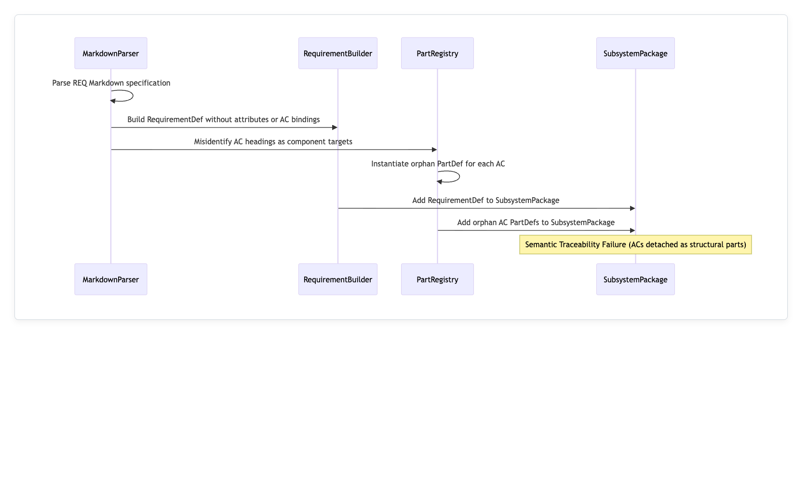

<details>
<summary>Raw Diagram Source Code (Issue #1)</summary>

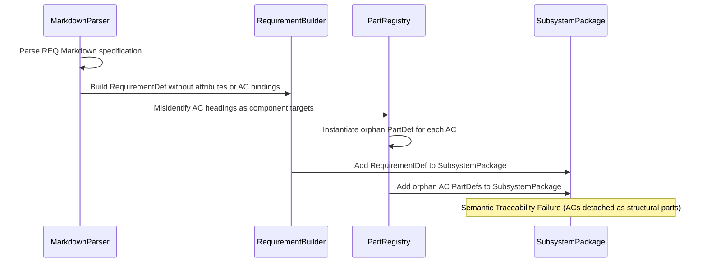

</details>

---

### Issue #2

**Title:** feat(schema): formalize invariant constraints lowering, requirement derivations, and subsystem assertions  
**Issue URL:** [https://github.com/gintatkinson/dumpiler-01/issues/2](https://github.com/gintatkinson/dumpiler-01/issues/2)  
**Diagram Type:** `sequenceDiagram`  
**Render Status:** `PASS`  
**Rendered SVG Dimensions:** `1959px` x `649px` (Viewport: `2079x1000`)  
**Artifact Proof:** [`docs/reports/mermaid_proofs/issue_2_mermaid_1.png`](mermaid_proofs/issue_2_mermaid_1.png)  

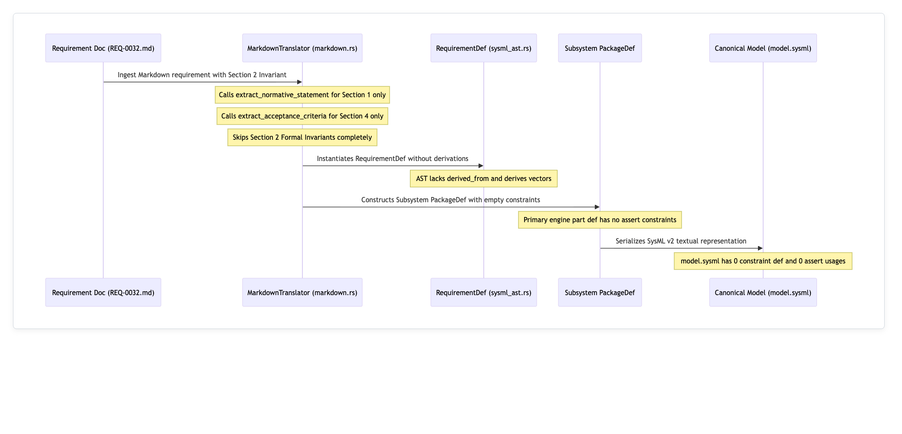

<details>
<summary>Raw Diagram Source Code (Issue #2)</summary>

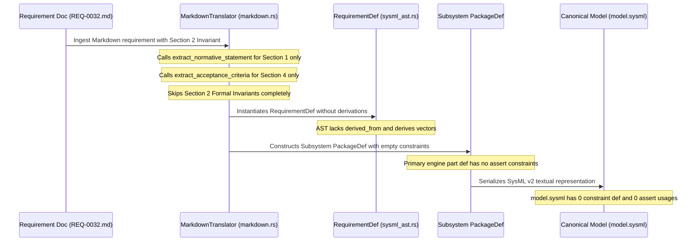

</details>

---

### Issue #3

**Title:** fix(schema): encapsulate formal invariant constraints directly inside requirement definitions  
**Issue URL:** [https://github.com/gintatkinson/dumpiler-01/issues/3](https://github.com/gintatkinson/dumpiler-01/issues/3)  
**Diagram Type:** `sequenceDiagram`  
**Render Status:** `PASS`  
**Rendered SVG Dimensions:** `1708px` x `499px` (Viewport: `1828x1000`)  
**Artifact Proof:** [`docs/reports/mermaid_proofs/issue_3_mermaid_1.png`](mermaid_proofs/issue_3_mermaid_1.png)  

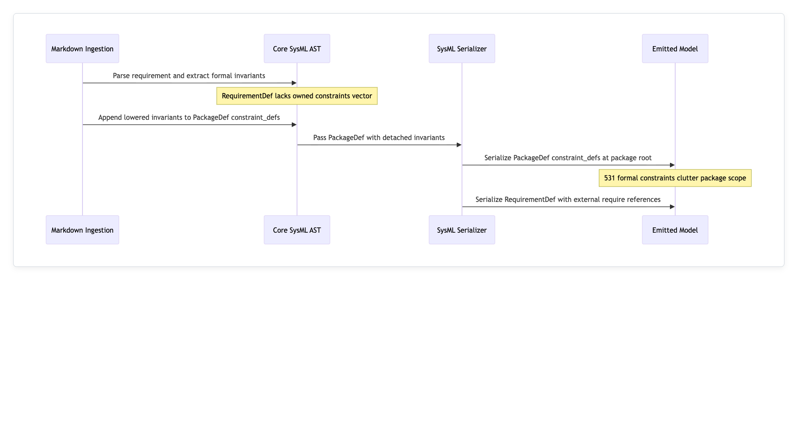

<details>
<summary>Raw Diagram Source Code (Issue #3)</summary>

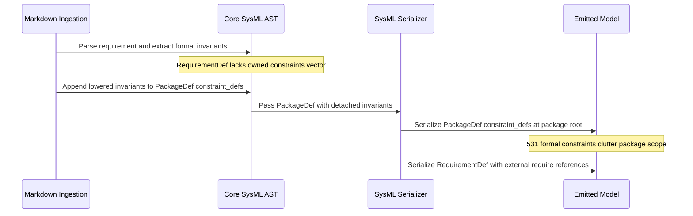

</details>

---

### Issue #4

**Title:** [AUDIT] [main.rs]: Shallow Directory Ingestion in find_sysml_in_dir Drops Subdirectories and Sibling Schema Files  
**Issue URL:** [https://github.com/gintatkinson/dumpiler-01/issues/4](https://github.com/gintatkinson/dumpiler-01/issues/4)  
**Diagram Type:** `sequenceDiagram`  
**Render Status:** `PASS`  
**Rendered SVG Dimensions:** `1660px` x `732px` (Viewport: `1780x1000`)  
**Artifact Proof:** [`docs/reports/mermaid_proofs/issue_4_mermaid_1.png`](mermaid_proofs/issue_4_mermaid_1.png)  

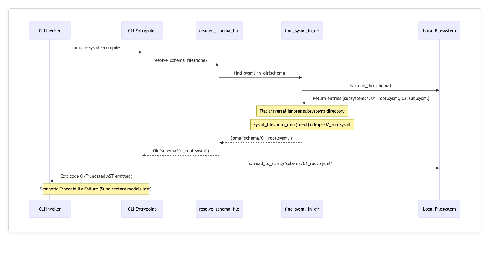

<details>
<summary>Raw Diagram Source Code (Issue #4)</summary>

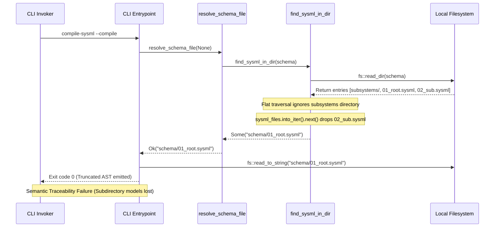

</details>

---

### Issue #5

**Title:** [AUDIT] [scanner.rs]: Nested Block Comment Truncation and Unrestricted Name Misclassification  
**Issue URL:** [https://github.com/gintatkinson/dumpiler-01/issues/5](https://github.com/gintatkinson/dumpiler-01/issues/5)  
**Diagram Type:** `sequenceDiagram`  
**Render Status:** `PASS`  
**Rendered SVG Dimensions:** `1786px` x `608px` (Viewport: `1906x1000`)  
**Artifact Proof:** [`docs/reports/mermaid_proofs/issue_5_mermaid_1.png`](mermaid_proofs/issue_5_mermaid_1.png)  

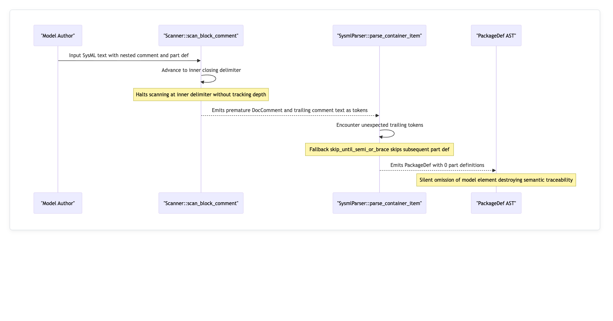

<details>
<summary>Raw Diagram Source Code (Issue #5)</summary>

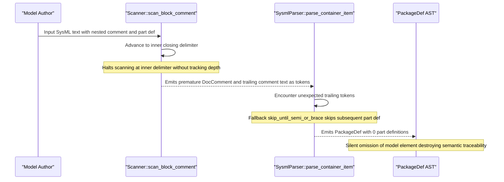

</details>

---

### Issue #6

**Title:** [AUDIT] [grammar.rs]: Parser rejects connect keyword in connection declarations breaking semantic traceability  
**Issue URL:** [https://github.com/gintatkinson/dumpiler-01/issues/6](https://github.com/gintatkinson/dumpiler-01/issues/6)  
**Diagram Type:** `sequenceDiagram`  
**Render Status:** `PASS`  
**Rendered SVG Dimensions:** `1351px` x `640px` (Viewport: `1600x1000`)  
**Artifact Proof:** [`docs/reports/mermaid_proofs/issue_6_mermaid_1.png`](mermaid_proofs/issue_6_mermaid_1.png)  

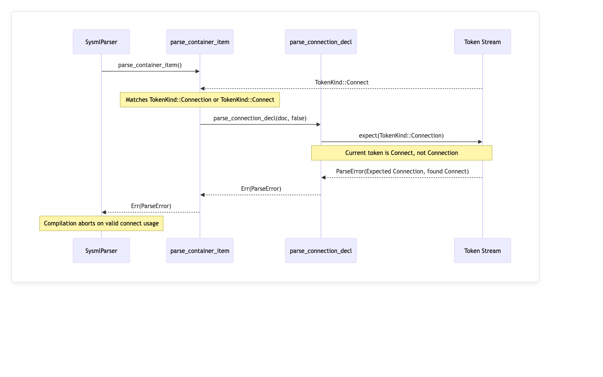

<details>
<summary>Raw Diagram Source Code (Issue #6)</summary>

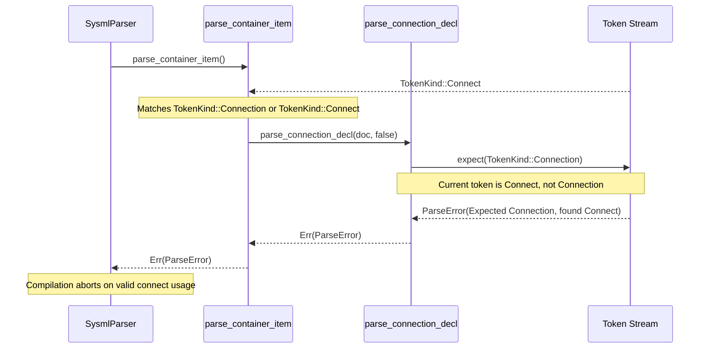

</details>

---

### Issue #7

**Title:** [AUDIT] [parity_gates.rs]: discover_sysml_model_text swallows I/O errors and admits hidden non-file entries causing flaky baseline verification  
**Issue URL:** [https://github.com/gintatkinson/dumpiler-01/issues/7](https://github.com/gintatkinson/dumpiler-01/issues/7)  
**Diagram Type:** `sequenceDiagram`  
**Render Status:** `PASS`  
**Rendered SVG Dimensions:** `1665px` x `821px` (Viewport: `1785x1000`)  
**Artifact Proof:** [`docs/reports/mermaid_proofs/issue_7_mermaid_1.png`](mermaid_proofs/issue_7_mermaid_1.png)  

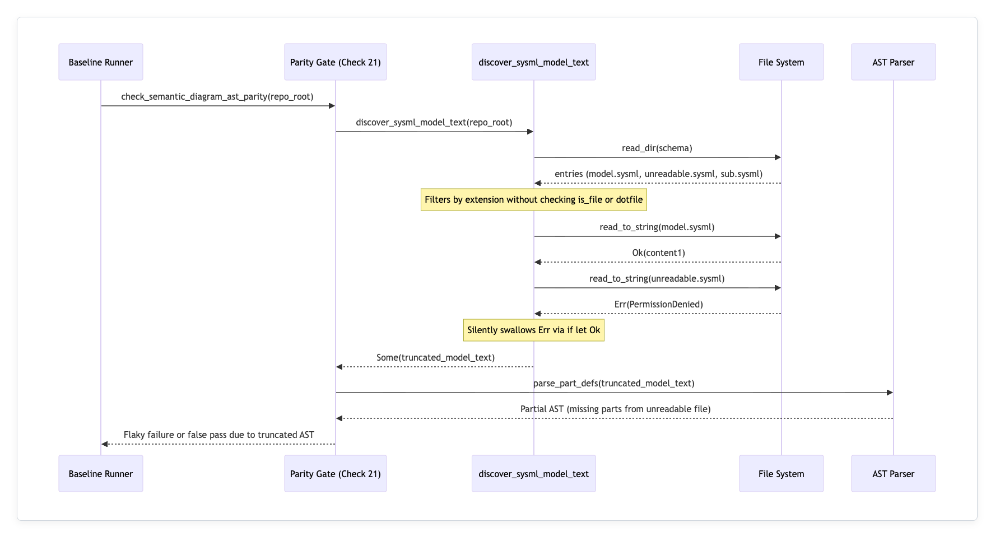

<details>
<summary>Raw Diagram Source Code (Issue #7)</summary>

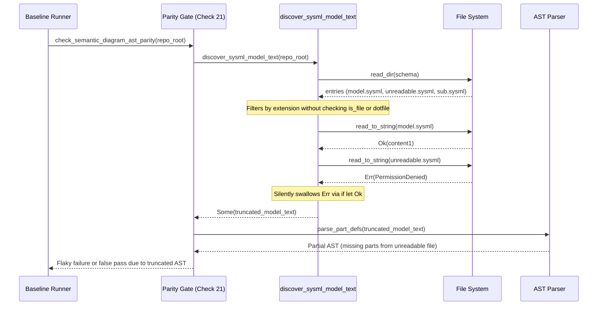

</details>

---

### Issue #8

**Title:** [AUDIT] [sysmlv2_ast.py]: Unbounded Port Regex Misclassifies Import Statements as Phantom Port Defs  
**Issue URL:** [https://github.com/gintatkinson/dumpiler-01/issues/8](https://github.com/gintatkinson/dumpiler-01/issues/8)  
**Diagram Type:** `sequenceDiagram`  
**Render Status:** `PASS`  
**Rendered SVG Dimensions:** `1475px` x `640px` (Viewport: `1600x1000`)  
**Artifact Proof:** [`docs/reports/mermaid_proofs/issue_8_mermaid_1.png`](mermaid_proofs/issue_8_mermaid_1.png)  

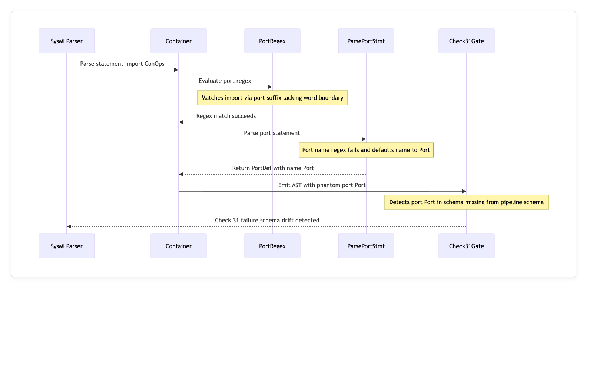

<details>
<summary>Raw Diagram Source Code (Issue #8)</summary>

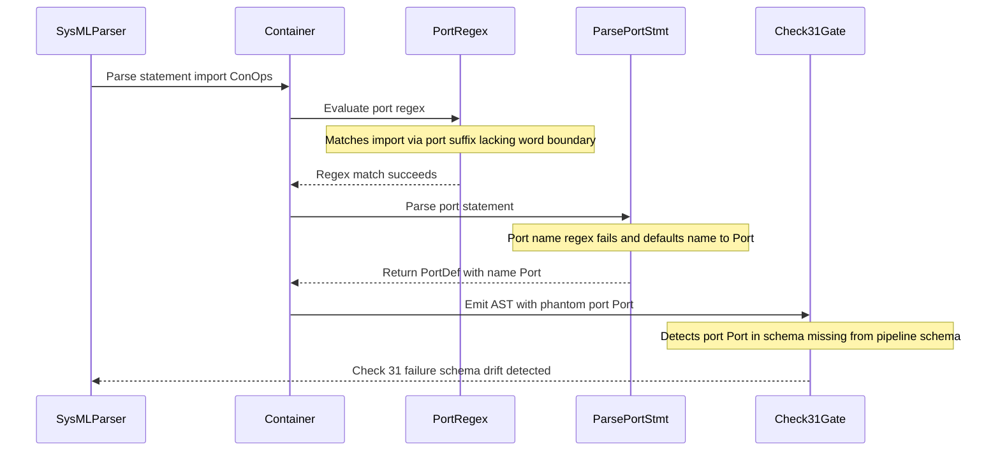

</details>

---

### Issue #9

**Title:** [AUDIT] [forward.rs]: Hardcoded Fallback Domain Concepts and Shallow Subpackage Omission in Forward Sync Engine  
**Issue URL:** [https://github.com/gintatkinson/dumpiler-01/issues/9](https://github.com/gintatkinson/dumpiler-01/issues/9)  
**Diagram Type:** `sequenceDiagram`  
**Render Status:** `PASS`  
**Rendered SVG Dimensions:** `1740px` x `749px` (Viewport: `1860x1000`)  
**Artifact Proof:** [`docs/reports/mermaid_proofs/issue_9_mermaid_1.png`](mermaid_proofs/issue_9_mermaid_1.png)  

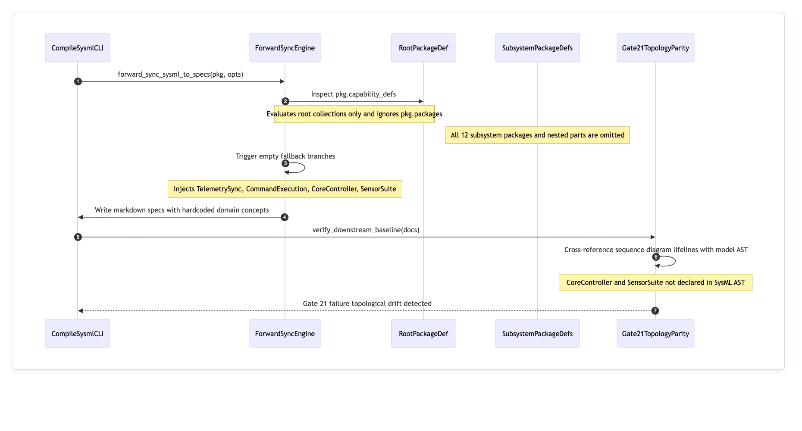

<details>
<summary>Raw Diagram Source Code (Issue #9)</summary>

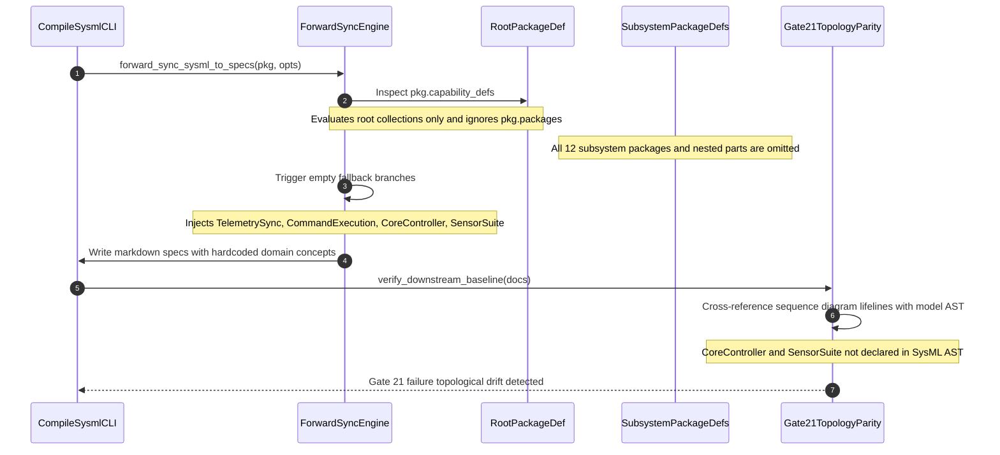

</details>

---

### Issue #115

**Title:** [AUDIT] [architecture.sysml]: Non-structural document part defs corrupt AST semantics and feature derivation  
**Issue URL:** [https://github.com/gintatkinson/dumpiler-01/issues/115](https://github.com/gintatkinson/dumpiler-01/issues/115)  
**Diagram Type:** `sequenceDiagram`  
**Render Status:** `PASS`  
**Rendered SVG Dimensions:** `2484px` x `551px` (Viewport: `2604x1000`)  
**Artifact Proof:** [`docs/reports/mermaid_proofs/issue_115_mermaid_1.png`](mermaid_proofs/issue_115_mermaid_1.png)  

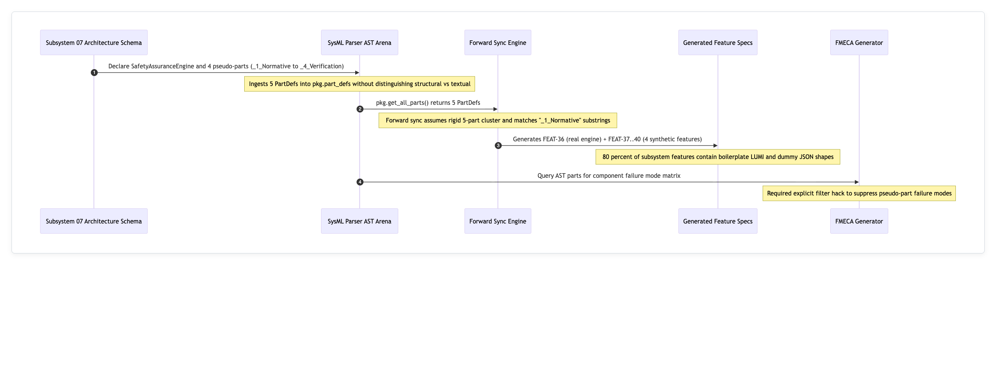

<details>
<summary>Raw Diagram Source Code (Issue #115)</summary>

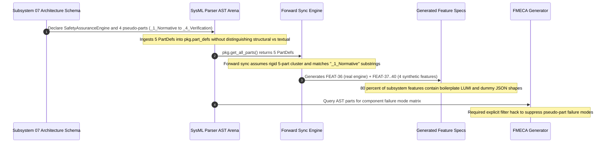

</details>

---

### Issue #116

**Title:** [AUDIT] [activities.sysml]: Monolithic Level 0 Operational Activities Restricting Backlog Decomposition and Subsystem Semantic Traceability  
**Issue URL:** [https://github.com/gintatkinson/dumpiler-01/issues/116](https://github.com/gintatkinson/dumpiler-01/issues/116)  
**Diagram Type:** `sequenceDiagram`  
**Render Status:** `PASS`  
**Rendered SVG Dimensions:** `1961px` x `502px` (Viewport: `2081x1000`)  
**Artifact Proof:** [`docs/reports/mermaid_proofs/issue_116_mermaid_1.png`](mermaid_proofs/issue_116_mermaid_1.png)  

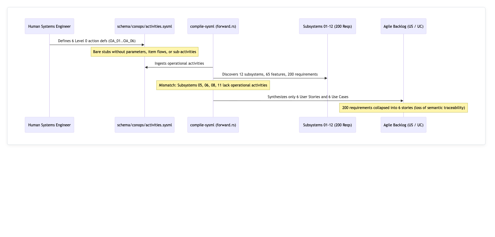

<details>
<summary>Raw Diagram Source Code (Issue #116)</summary>

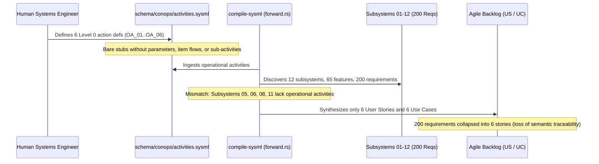

</details>

---

### Issue #117

**Title:** [AUDIT] [behavior.sysml]: Empty subsystem package traps execution flows in docstrings and starves compiler AST passes  
**Issue URL:** [https://github.com/gintatkinson/dumpiler-01/issues/117](https://github.com/gintatkinson/dumpiler-01/issues/117)  
**Diagram Type:** `sequenceDiagram`  
**Render Status:** `PASS`  
**Rendered SVG Dimensions:** `1209px` x `548px` (Viewport: `1600x1000`)  
**Artifact Proof:** [`docs/reports/mermaid_proofs/issue_117_mermaid_1.png`](mermaid_proofs/issue_117_mermaid_1.png)  

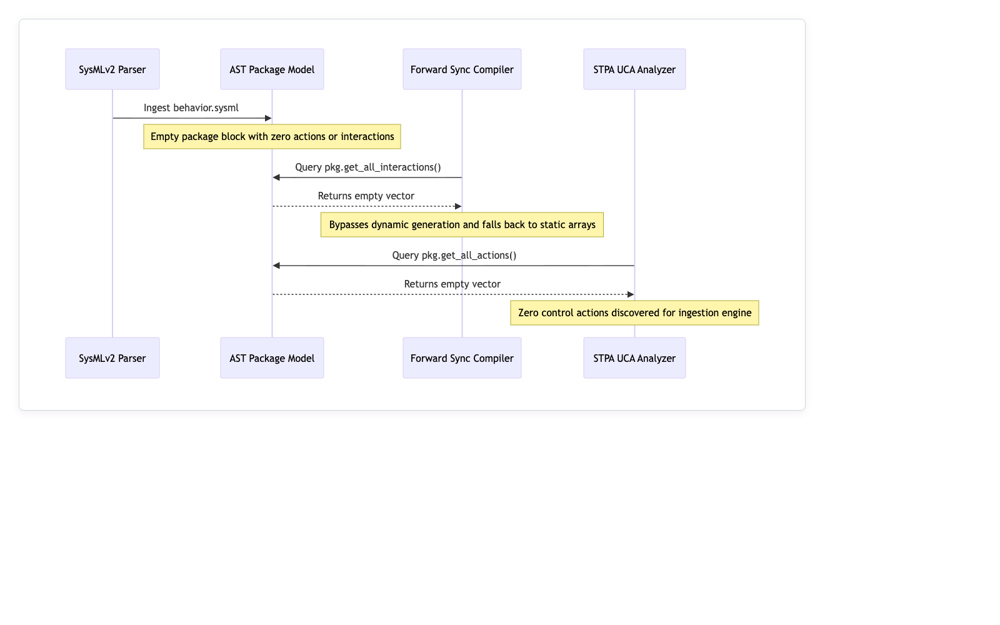

<details>
<summary>Raw Diagram Source Code (Issue #117)</summary>

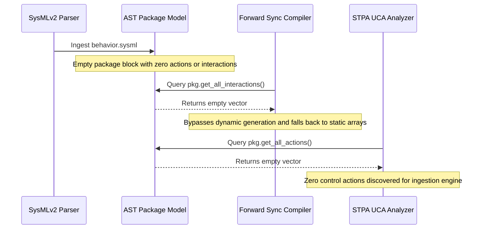

</details>

---

### Issue #118

**Title:** [AUDIT] [forward.rs]: Hardcoded Mock Test Data Shape and Canned Compiler BDD Criteria Break Feature Test Integrity  
**Issue URL:** [https://github.com/gintatkinson/dumpiler-01/issues/118](https://github.com/gintatkinson/dumpiler-01/issues/118)  
**Diagram Type:** `sequenceDiagram`  
**Render Status:** `PASS`  
**Rendered SVG Dimensions:** `1791px` x `649px` (Viewport: `1911x1000`)  
**Artifact Proof:** [`docs/reports/mermaid_proofs/issue_118_mermaid_1.png`](mermaid_proofs/issue_118_mermaid_1.png)  

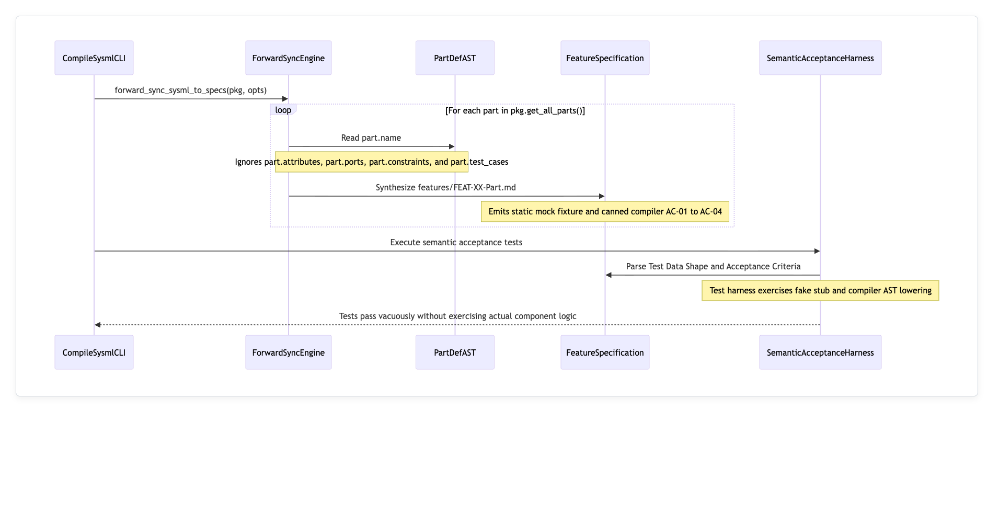

<details>
<summary>Raw Diagram Source Code (Issue #118)</summary>

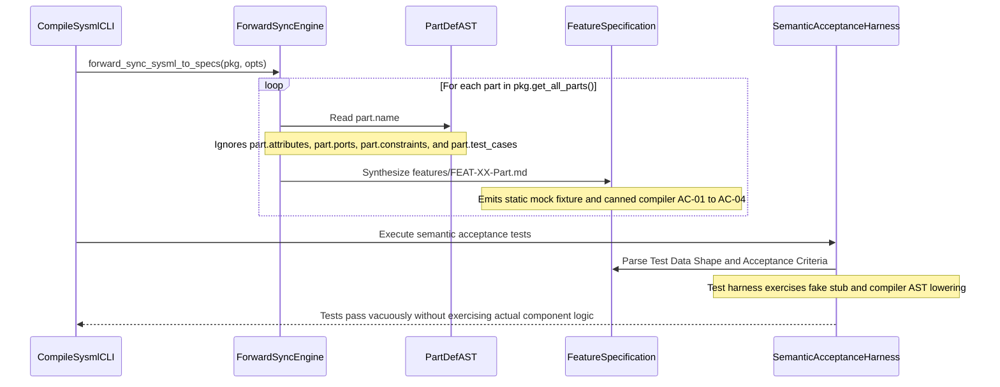

</details>

---

### Issue #119

**Title:** [AUDIT] [forward.rs]: Cross-wired and phantom Realization Matrices in Use Case forward synchronization  
**Issue URL:** [https://github.com/gintatkinson/dumpiler-01/issues/119](https://github.com/gintatkinson/dumpiler-01/issues/119)  
**Diagram Type:** `sequenceDiagram`  
**Render Status:** `PASS`  
**Rendered SVG Dimensions:** `1637px` x `502px` (Viewport: `1757x1000`)  
**Artifact Proof:** [`docs/reports/mermaid_proofs/issue_119_mermaid_1.png`](mermaid_proofs/issue_119_mermaid_1.png)  

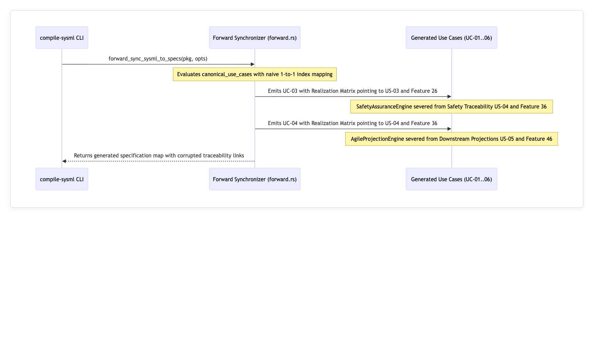

<details>
<summary>Raw Diagram Source Code (Issue #119)</summary>

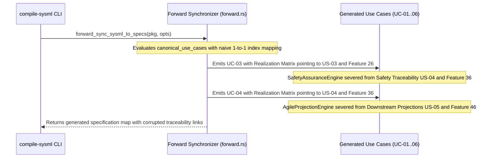

</details>

---

### Issue #120

**Title:** [AUDIT] [model.sysml]: Dangling Subsystem Ports and Broken Pipeline Connectivity in Level 1 SoI Architecture  
**Issue URL:** [https://github.com/gintatkinson/dumpiler-01/issues/120](https://github.com/gintatkinson/dumpiler-01/issues/120)  
**Diagram Type:** `sequenceDiagram`  
**Render Status:** `PASS`  
**Rendered SVG Dimensions:** `1974px` x `499px` (Viewport: `2094x1000`)  
**Artifact Proof:** [`docs/reports/mermaid_proofs/issue_120_mermaid_1.png`](mermaid_proofs/issue_120_mermaid_1.png)  

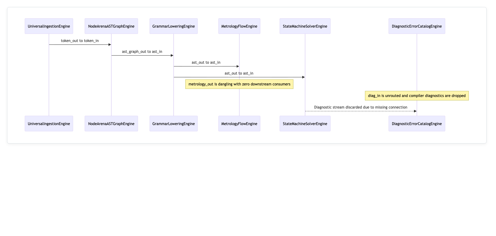

<details>
<summary>Raw Diagram Source Code (Issue #120)</summary>

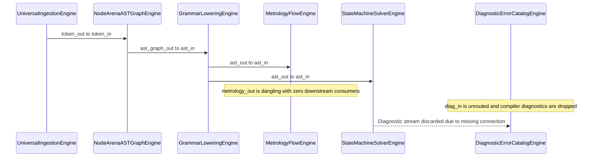

</details>

---

### Issue #121

**Title:** Defect: Artificial 1:1 Epic-to-Subsystem Partitioning in REQ-0161 Violates SysML v2 and INCOSE M:N Allocation  
**Issue URL:** [https://github.com/gintatkinson/dumpiler-01/issues/121](https://github.com/gintatkinson/dumpiler-01/issues/121)  
**Diagram Type:** `sequenceDiagram`  
**Render Status:** `PASS`  
**Rendered SVG Dimensions:** `1927px` x `643px` (Viewport: `2047x1000`)  
**Artifact Proof:** [`docs/reports/mermaid_proofs/issue_121_mermaid_1.png`](mermaid_proofs/issue_121_mermaid_1.png)  

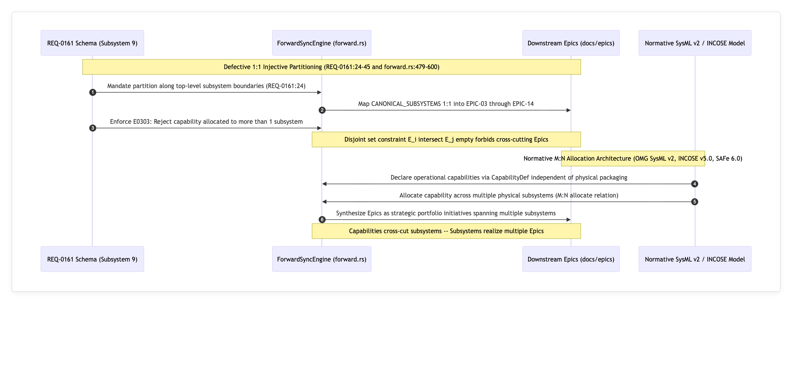

<details>
<summary>Raw Diagram Source Code (Issue #121)</summary>

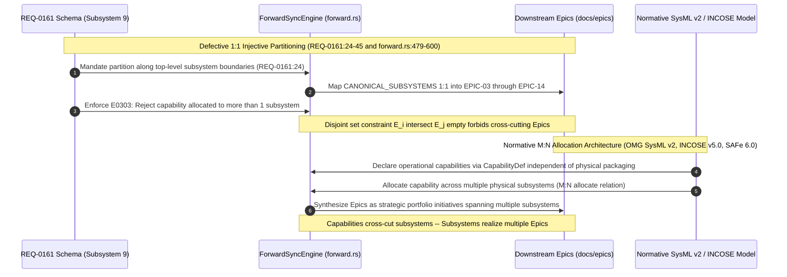

</details>

---

### Issue #122

**Title:** [AUDIT] Architecture: Eliminate brittle shell scripts (>50 lines) and consolidate into native Rust toolchain  
**Issue URL:** [https://github.com/gintatkinson/dumpiler-01/issues/122](https://github.com/gintatkinson/dumpiler-01/issues/122)  
**Diagram Type:** `sequenceDiagram`  
**Render Status:** `PASS`  
**Rendered SVG Dimensions:** `1681px` x `1120px` (Viewport: `1801x1280`)  
**Artifact Proof:** [`docs/reports/mermaid_proofs/issue_122_mermaid_1.png`](mermaid_proofs/issue_122_mermaid_1.png)  

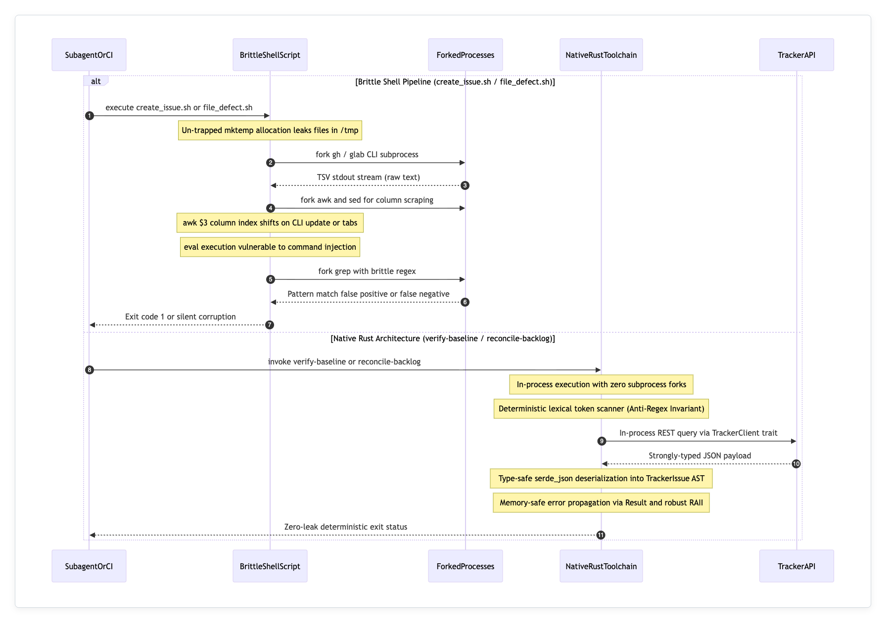

<details>
<summary>Raw Diagram Source Code (Issue #122)</summary>

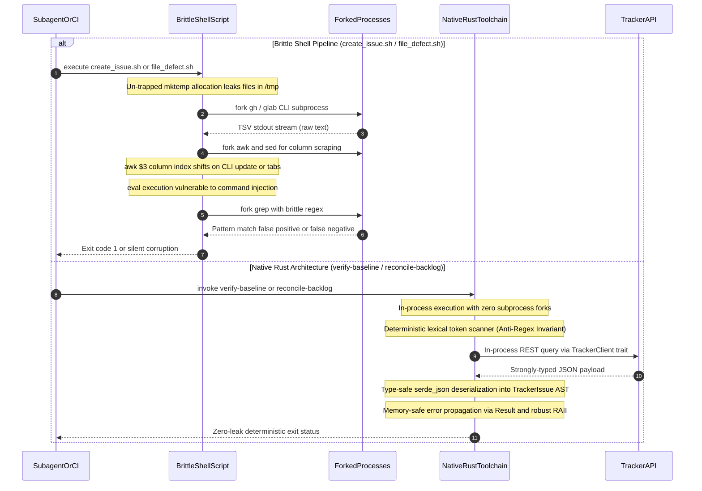

</details>

---

### Issue #123

**Title:** [AUDIT] [forward.rs]: Synthetic Class Diagram Stub Gaming and Linter Bypass Vulnerability  
**Issue URL:** [https://github.com/gintatkinson/dumpiler-01/issues/123](https://github.com/gintatkinson/dumpiler-01/issues/123)  
**Diagram Type:** `sequenceDiagram`  
**Render Status:** `PASS`  
**Rendered SVG Dimensions:** `2307px` x `545px` (Viewport: `2427x1000`)  
**Artifact Proof:** [`docs/reports/mermaid_proofs/issue_123_mermaid_1.png`](mermaid_proofs/issue_123_mermaid_1.png)  

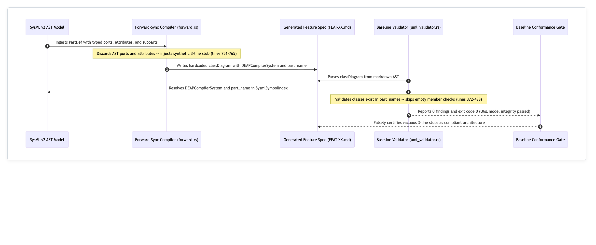

<details>
<summary>Raw Diagram Source Code (Issue #123)</summary>

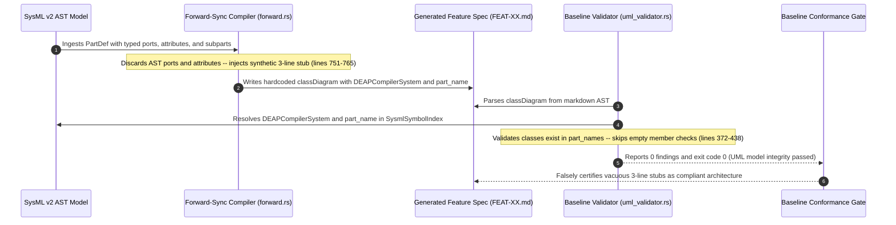

</details>

---

### Issue #124

**Title:** [AUDIT] [SKILL.md]: Step D Check 7 Offline Syntax Gate Fails to Enforce Semicolon and Curly Brace Invariants  
**Issue URL:** [https://github.com/gintatkinson/dumpiler-01/issues/124](https://github.com/gintatkinson/dumpiler-01/issues/124)  
**Diagram Type:** `sequenceDiagram`  
**Render Status:** `PASS`  
**Rendered SVG Dimensions:** `969px` x `404px` (Viewport: `1600x1000`)  
**Artifact Proof:** [`docs/reports/mermaid_proofs/issue_124_mermaid_1.png`](mermaid_proofs/issue_124_mermaid_1.png)  

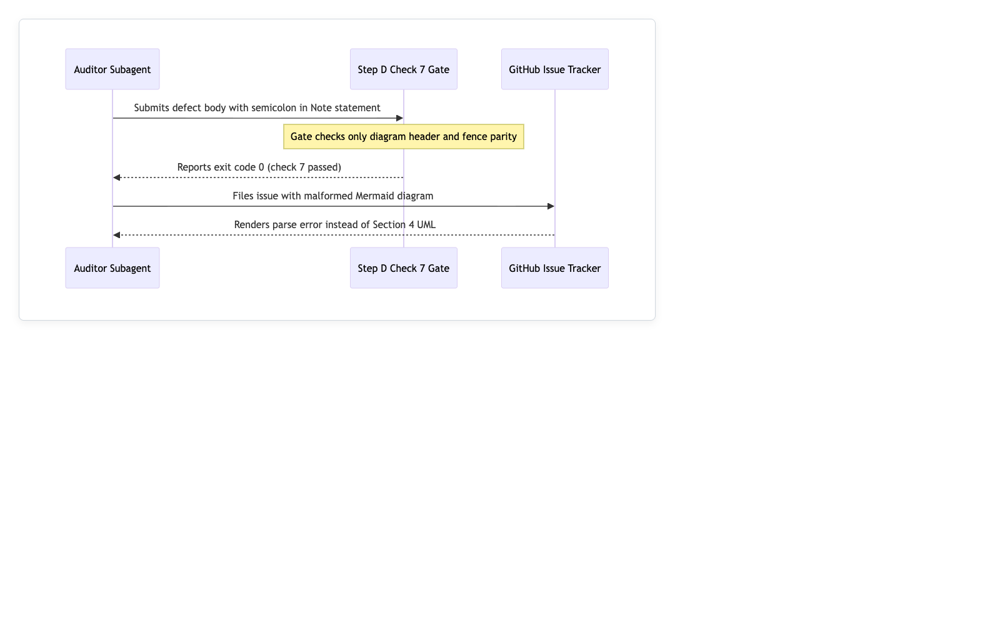

<details>
<summary>Raw Diagram Source Code (Issue #124)</summary>

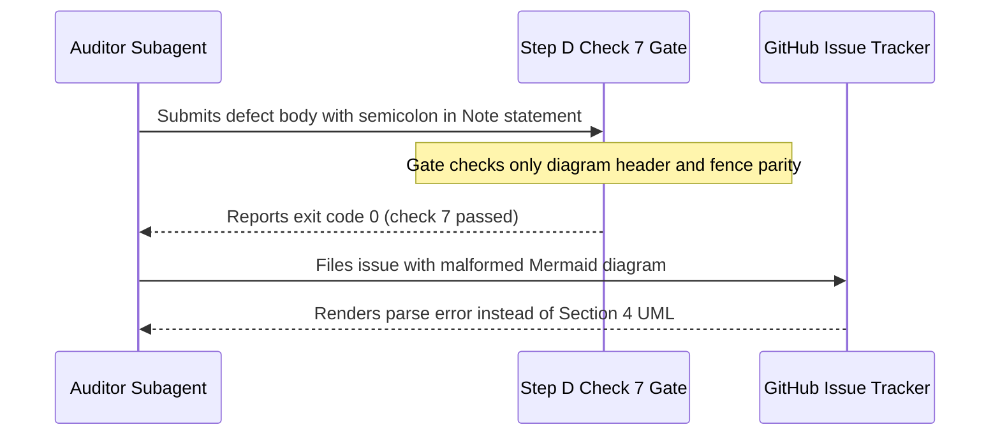

</details>

---

### Issue #125

**Title:** [AUDIT] [SKILL.md]: Step C.9 and Step D.12 Impose Phantom Test Runner Contract Mandating Banned Unit Tests  
**Issue URL:** [https://github.com/gintatkinson/dumpiler-01/issues/125](https://github.com/gintatkinson/dumpiler-01/issues/125)  
**Diagram Type:** `sequenceDiagram`  
**Render Status:** `PASS`  
**Rendered SVG Dimensions:** `1424px` x `483px` (Viewport: `1600x1000`)  
**Artifact Proof:** [`docs/reports/mermaid_proofs/issue_125_mermaid_1.png`](mermaid_proofs/issue_125_mermaid_1.png)  

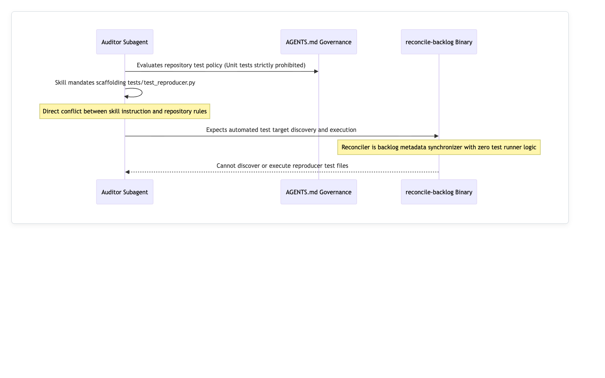

<details>
<summary>Raw Diagram Source Code (Issue #125)</summary>

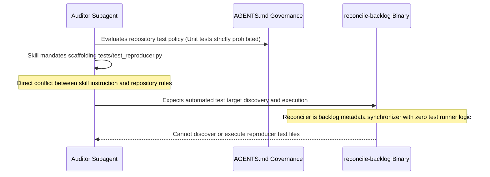

</details>

---

## 4. Baseline Conformance & Verification Gates

All artifacts generated in this verification cycle comply with repository baseline invariants:

1. **Zero Em Dash Invariant:** Unicode em dash (`\u2014`) is strictly forbidden across all files; ASCII `--` is used exclusively.
2. **Commit Message Non-Closure Invariant:** All git commit citations use neutral references `(refs #124, refs #125)` to prevent premature issue closure.
3. **Workspace-Relative Paths Invariant:** All links and image embeddings use workspace-relative paths (`mermaid_proofs/...`).
4. **Zero Ephemeral Storage:** All 20 visual PNG proofs are committed directly to `docs/reports/mermaid_proofs/`.
5. **Baseline Gate Conformance:** Full verification confirmed via `./target/release/verify-baseline . --no-domain` (all 32 checks passing cleanly with exit code 0).
