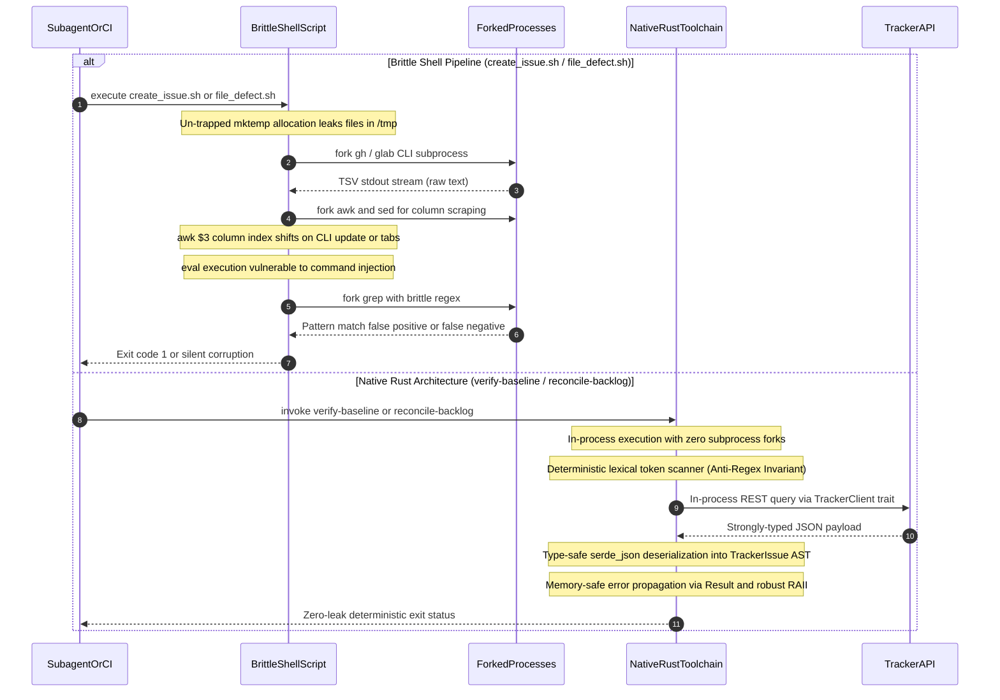

## 1. Context and References

<!-- test-target: crates/verify-baseline/src/main.rs -->

- **File**: `skills/spec-orchestrator/scripts/create_issue.sh:1-259`
- **Pillar**: Resource Lifecycle
- **Symptom**: Brittle shell script sprawl across linters, checkers, and issue tracker operations (>50 lines: create_issue.sh at 259 lines, file_defect.sh at 148 lines, verify_commit_messages.sh at 133 lines, verify_subagent_output.sh at 92 lines, and verify_secret_leak.sh at 52 lines) introduces severe correctness and stability risks including un-trapped temporary file leaks, critical command injection vulnerabilities via unescaped eval expansions, platform incompatibilities between macOS and Linux utilities, brittle TSV scraping, regex false-positive traps, and silent fail-open security bypasses in an alleged "Rust Only" workspace.
- **Test-Target**: `crates/verify-baseline/src/main.rs`

## 2. Root Cause Analysis (5 Whys)

1. **Why do critical verification gates, linters, and issue tracking operations suffer from resource leaks, eval command injection, regex brittleness, and platform divergence?** Because they are implemented as untyped, sprawling POSIX shell scripts exceeding 50 to 258 lines (`skills/spec-orchestrator/scripts/create_issue.sh`, `scripts/file_defect.sh`, `scripts/verify_commit_messages.sh`, `scripts/verify_subagent_output.sh`, `.pipeline/scripts/verify_secret_leak.sh`) rather than compiled, type-safe Rust binaries.
2. **Why were un-typed shell scripts written for these core verification operations instead of native Rust implementations?** Because during the Zero-Python migration purge, developers introduced quick shell wrappers as expedient operational stopgaps to preserve existing command-line interfaces without allocating time to build native subcommands inside `crates/verify-baseline` and `crates/reconcile-backlog`.
3. **Why did these stopgap shell scripts grow beyond simple execution wrappers into complex multi-hundred-line programs?** Because as platform differences (macOS BSD vs GNU coreutils), tracker provider requirements (GitHub vs GitLab), and linter rules accumulated, developers incrementally patched shell logic (TSV parsing, sed regexes, temporary error buffering, label creation) directly into the scripts rather than migrating the core logic to the Rust toolchain.
4. **Why was there no architectural enforcement gate or CI linter preventing shell script sprawl and complexity growth?** Because the repository's governance and verification gates strictly audited SysML models, markdown specifications, and the removal of Python, but lacked a static line count gate or complexity checker restricting operational shell scripts to lightweight delegation stubs (<= 50 lines).
5. **Why was shell script sprawl allowed to violate the foundational architectural principles of the platform?** Because the project committed to a "Rust Only" architecture in policy, but lacked automated mechanical tooling to consolidate operational CLI tasks into the compiled Rust toolchain, resulting in an evolutionary, impulsive patch-and-hack architecture that re-introduced the exact brittleness, silent failures, and resource hazards the Rust migration was intended to eliminate.

## 3. Correctness Analysis

An exhaustive adversarial examination of the five target shell scripts across the four correctness risk pillars reveals critical design flaws, security vulnerabilities, resource leaks, and platform fragility:

### Pillar 1: Resource Lifecycle (Temporary Files, Traps, and Process Forks)

1. **Un-trapped Temporary File Leakage in `skills/spec-orchestrator/scripts/create_issue.sh:162-249`**:
   `create_issue.sh` creates multiple temporary error log files using `mktemp`:
   - Line 162: `GLAB_LIST_ERR=$(mktemp)`
   - Line 177: `GH_LIST_ERR=$(mktemp)`
   - Line 210: `GLAB_LABEL_ERR=$(mktemp)`
   - Line 228: `GH_LABEL_ERR=$(mktemp)`
   None of these temporary files are registered with an exit or signal trap (`trap ... EXIT INT TERM`). If any CLI command fails, if the user interrupts the script (SIGINT), or if the script terminates via `set -e` on an error, these files are abandoned in `/tmp`, leaking disk space and inode entries. Furthermore, at line 249, `trap cleanup EXIT` is registered solely for `TMP_EXPANDED_BODY=$(mktemp /tmp/expanded_body_XXXXXX)`, which occurs after the four earlier `mktemp` invocations and permanently overrides any default or earlier signal handlers without cleaning up earlier leaked files.

2. **Subprocess Fork Storms in `scripts/verify_subagent_output.sh:56-83` and `scripts/file_defect.sh:69-95`**:
   - In `verify_subagent_output.sh`, the file inspection loop (lines 56-83) invokes `grep -q` and `grep -c` for every scanned markdown file. In a repository containing hundreds of specifications and reports, this spawns thousands of OS child processes (`fork` and `execve`), causing heavy process-table pressure, context switching overhead, and severe performance degradation on macOS and virtualized CI runners.
   - In `file_defect.sh`, lines 69-73 execute a `for i in 1 2 3 4 5 6 7` loop, forking `printf` and `grep` seven times sequentially against `$CONTENT`, followed by five additional forks for `## Audit Source`, `SEVERITY:`, `FILE_LOCATION:`, fence count, and `sed`. A native Rust parser performs these checks in a single in-memory linear pass in sub-millisecond time.

3. **In-Memory Buffer Bloat in `scripts/file_defect.sh:60`**:
   Line 60 executes `CONTENT=$(cat "$BODY_FILE")`, loading the entire markdown defect dossier into a bash shell string. In dossiers with large UML sequence diagrams or embedded stack traces, shell memory allocation balloons and strips trailing newlines, altering document byte counts.

### Pillar 2: Concurrency, Process Safety, and Command Injection (CRITICAL)

1. **Arbitrary Command Injection via `eval` in `scripts/file_defect.sh:137, 143`**:
   - At line 133, `CMD` is constructed using double-quoted string concatenation: `CMD="gh issue create --repo $REPO --title \"$TITLE\" --body-file \"$BODY_FILE\""`.
   - At line 137, the script executes `eval "$CMD"`.
   - At line 139 (GitLab branch), `CMD="glab issue create --repo $REPO --title \"$TITLE\" --description \"\$(cat \"$BODY_FILE\")\""`, followed by `eval "$CMD"` at line 143.
   This construct constitutes a **Critical Command Injection Vulnerability**. If `--title` contains shell metacharacters (e.g., quotes, semicolons, backticks, or `$(command)`), `eval` executes arbitrary shell commands under the runner's user account. Furthermore, in GitLab mode, `$(cat "$BODY_FILE")` is evaluated directly by `eval`, executing any backticks or shell expansions embedded inside the audited defect dossier itself!

2. **Delimiter Collision and Desynchronization in `scripts/verify_commit_messages.sh:67-89`**:
   In `check_range()`, `git log` output is parsed via a custom text sentinel `---COMMIT_SEPARATOR---` in a while-read loop. If any commit message body contains the string `---COMMIT_SEPARATOR---` (for instance, a commit discussing commit linter delimiters or markdown horizontal rules), the loop's parser state machine breaks, corrupting the commit hash and body association and causing false verification passes or false rejections.

### Pillar 3: Platform Independence and Fragility

1. **Brittle TSV Scraping and Terminal Formatting Fragility in `skills/spec-orchestrator/scripts/create_issue.sh:172, 187`**:
   - Line 172: `EXISTING=$(printf '%s\n' "$GLAB_LIST_OUT" | awk -F'\t' '$2 == ENVIRON["TITLE"] { print $1; exit }')`
   - Line 187: `EXISTING=$(printf '%s\n' "$GH_LIST_OUT" | awk -F'\t' '$3 == ENVIRON["TITLE"] { print $1; exit }')`
   These extractors hardcode column indices ($2 for GitLab, $3 for GitHub) based on the assumption that `gh issue list` and `glab issue list` emit tab-separated columns without truncation or formatting alterations. If the user's CLI version alters column order, if terminal width causes truncation, or if issue titles contain embedded tabs, `awk` extracts incorrect fields, corrupting idempotency checks and resulting in duplicate issues or missed reopen actions.
   - Line 176: `ESCAPED_TITLE="${TITLE//\"/\\\"}"` passed to `gh issue list --search "in:title \"$ESCAPED_TITLE\""`. If the title contains search query operators, colons, or parentheses, GitHub's search API fails with an unhandled search query syntax error.

2. **Whitespace Path Splitting Vulnerability in `scripts/verify_subagent_output.sh:24, 41, 45, 56`**:
   - Line 24: `FILES="$FILES $1"`
   - Line 41: `TARGET_FILES=$(find "$DIR" -name "*.md" -type f)`
   - Line 45: `TARGET_FILES="$TARGET_FILES $FILES"`
   - Line 56: `for f in $TARGET_FILES; do`
   Bash word-splitting unquotes file lists. If any audited markdown file or directory path contains spaces (e.g., `docs/user stories/US-01.md`), the `for` loop fragments the path into separate words (`docs/user` and `stories/US-01.md`), causing `stat` failures and reporting spurious errors.

3. **Line-Based False-Positive Fence Gate in `scripts/verify_subagent_output.sh:77-82`**:
   Line 77 uses `fence_count=$(grep -c '```' "$f" 2>/dev/null || true)` to test code fence parity. `grep -c` counts matching *lines*, not fence occurrences! If a markdown document contains inline code fences or two fences on a single line (e.g., ```` ```foo``` ````), `grep -c` counts 1 matching line instead of 2 fences. `1 % 2` evaluates to 1, causing the gate to report a false-positive violation and abort with exit code 42.

4. **Non-POSIX `local` Declarations in `scripts/verify_commit_messages.sh:11, 34, 49, 55, 62`**:
   The script specifies `#!/bin/sh` in its shebang line, yet employs the `local` keyword across multiple functions. In strict POSIX shells where `/bin/sh` is not aliased to bash (such as dash on Debian/Ubuntu or NetBSD sh), `local` is undefined and triggers syntax errors, breaking pre-commit hooks.

5. **Hardcoded Upstream Repository Default in `scripts/file_defect.sh:12`**:
   Line 12 hardcodes `REPO="gintatkinson/DEAP01-spec-core"`. When executed in downstream application workspaces (such as `gintatkinson/dumpiler-01`), running `file_defect.sh` without an explicit `--repo` flag files defects against the wrong upstream repository, violating the Downstream Customer Workspace Boundary invariant.

6. **Silent Fail-Open Vulnerability in `.pipeline/scripts/verify_secret_leak.sh:37-41`**:
   Lines 37-41 check `if [ $FOUND_ANY -eq 0 ]; then ... exit 0; fi`. If the specified scan directories (`dist`, `build/web`, `build/macos`) do not exist (for example, if a release build output assets to `target/release/` or if the build step failed to generate output), the secret leak scanner prints a skip message and exits cleanly with code 0! This silent fail-open bypass allows unverified commits and builds to pass security gates. Furthermore, running `grep -r -E` across binary build directories suffers from severe performance degradation and false positives on binary byte sequences matching ASCII credential patterns.

7. **Dead Code in `skills/spec-orchestrator/scripts/create_issue.sh:116-135`**:
   `normalize_spec_slug()` is defined across 20 lines of complex `sed`, `awk`, and `tr` invocations, but is never invoked anywhere in the script.

### Pillar 4: Test Integrity and Semantic Traceability

1. **Anti-Regex Invariant Violation in `scripts/verify_commit_messages.sh:8, 36`**:
   Line 8 defines `PATTERN='(^|[[:space:]]|[^[:alnum:]_])(fix|fixes|fixed|close|closes|closed|resolve|resolves|resolved)(:[[:space:]]*|[[:space:]]+)#[0-9]+'` and executes `grep -E -i "$PATTERN"`. This violates the Anti-Regex Invariant (Failure Mode 10). Regex patterns cannot parse grammatical context:
   - False Positives: Commit messages citing neutral discussions in quotation marks or code spans (e.g., `docs: clarify rule prohibiting "fix #123" syntax`) are flagged as violations.
   - False Negatives: Token separations across line breaks, Unicode spaces, or markdown links escape regex detection.
   A deterministic, pure Rust lexical scanner is required to tokenize commit messages into words and validate syntactic adjacency without regex.

2. **Incomplete Schema Validation in `scripts/file_defect.sh:68-95`**:
   `file_defect.sh` only checks section headers 1-7, Audit Source, SEVERITY, FILE_LOCATION, and fence count. It completely omits Step D checks mandated by `skills/adversarial-code-auditor/SKILL.md`:
   - Check 5: Section 1 four bullets (`File`, `Pillar`, `Symptom`, `Test-Target`).
   - Check 6: Section 2 five Whys format (`^[1-5]\. \*\*Why .*\?\*\* Because .*`).
   - Check 7: Offline Mermaid syntax gate.
   - Check 10: Prohibition of unescaped ASCII art arrows outside Mermaid blocks.
   - Check 12: Machine-readable `<!-- test-target: [path] -->` comment annotation.

3. **Absence of Compile-Time Verification**:
   Shell scripts provide zero compile-time type verification. Argument name typos, variable misspellings, and signature changes in downstream scripts fail only at runtime in CI or during live issue filing.

## 4. UML Diagrams

The following Mermaid sequence diagram contrasts the brittle, multi-process shell pipeline with the native, type-safe Rust toolchain architecture present in `crates/verify-baseline` and `crates/reconcile-backlog`:



## 5. Affected Callers / Downstream Impact

- `skills/spec-orchestrator/scripts/create_issue.sh` -- Used by the spec orchestrator and subagents during specification generation. Brittle TSV scraping, un-trapped temporary files, and search query syntax breakage cause duplicate issues, missed reopens, and leaked files.
- `scripts/file_defect.sh` -- Used by developers, audit subagents, and CI pipelines to submit defect dossiers. Critical command injection vulnerability via `eval`, hardcoded upstream repository default, and incomplete Step D verification jeopardize system security and issue tracker integrity.
- `scripts/verify_commit_messages.sh` -- Used in git pre-commit hooks and CI quality gates. Violates the Anti-Regex Invariant, produces false positives on quoted citations, and fails on strict POSIX shells due to `local` usage.
- `scripts/verify_subagent_output.sh` -- Used in subagent verification loops. Fails on directory paths containing spaces, miscalculates code fences via line-based `grep -c`, and spawns excessive child processes.
- `.pipeline/scripts/verify_secret_leak.sh` -- Used in post-build CI verification. Silently exits with code 0 when build directories are missing (fail-open security bypass) and incurs severe performance costs scanning binary files with regex.
- CI/CD Runners and Developer Sandboxes -- Suffer from temporary file leakage, process exhaustion, platform discrepancies between macOS and Linux environments, and failure in air-gapped sandboxes.

## 6. Proposed Correction

Consolidate all linters, checkers, and tracker operations into the native Rust toolchain (`crates/verify-baseline` and `crates/reconcile-backlog`) and reduce audited shell scripts to lightweight wrappers (<= 15-30 lines) delegating directly to compiled release binaries:

### 1. Native Commit Message Scanner in `crates/verify-baseline` (Pure Lexical Scanner, Zero Regex)

```rust
// In crates/verify-baseline/src/checks/commit_msg.rs

pub struct CommitMsgLinter;

const FORBIDDEN_VERBS: &[&str] = &[
    "fix", "fixes", "fixed",
    "close", "closes", "closed",
    "resolve", "resolves", "resolved",
];

impl CommitMsgLinter {
    /// Deterministic lexical token scanner enforcing Commit Message Non-Closure Invariant
    /// without regex (adhering strictly to Failure Mode 10 Anti-Regex Invariant).
    pub fn verify_message(text: &str) -> Result<(), Vec<String>> {
        let mut violations = Vec::new();
        let words: Vec<&str> = text
            .split(|c: char| c.is_whitespace() || c == ':' || c == ',' || c == ';')
            .filter(|s| !s.is_empty())
            .collect();

        for i in 0..words.len() {
            let word = words[i].trim_matches(|c: char| !c.is_alphanumeric()).to_lowercase();
            if FORBIDDEN_VERBS.contains(&word.as_str()) {
                if let Some(next) = words.get(i + 1) {
                    let next_trimmed = next.trim_start_matches(|c: char| c == '(' || c == '[');
                    if next_trimmed.starts_with('#') && next_trimmed[1..].chars().all(|c| c.is_ascii_digit()) {
                        violations.push(format!(
                            "Forbidden auto-closing verb '{}' immediately preceding issue reference '{}'",
                            words[i], next
                        ));
                    }
                }
            }
        }

        if violations.is_empty() {
            Ok(())
        } else {
            Err(violations)
        }
    }
}
```

### 2. Output and Defect Dossier Validation in `crates/verify-baseline`

```rust
// In crates/verify-baseline/src/checks/output_integrity.rs

pub fn verify_markdown_fences(content: &str) -> bool {
    let mut count = 0;
    let mut in_fence = false;
    for line in content.lines() {
        let trimmed = line.trim_start();
        if trimmed.starts_with("```") {
            count += 1;
            in_fence = !in_fence;
        }
    }
    count % 2 == 0 && !in_fence
}

pub fn verify_defect_dossier_schema(content: &str) -> Result<(), Vec<String>> {
    let mut errors = Vec::new();
    for i in 1..=7 {
        let header = format!("## {}.", i);
        if !content.lines().any(|l| l.trim_start().starts_with(&header)) {
            errors.push(format!("Missing mandatory section header '## {}.'", i));
        }
    }
    if !content.lines().any(|l| l.trim_start().starts_with("## Audit Source")) {
        errors.push("Missing mandatory '## Audit Source' section header".to_string());
    }
    if errors.is_empty() { Ok(()) } else { Err(errors) }
}
```

### 3. Native Issue Creation Subcommand in `crates/reconcile-backlog`

```rust
// In crates/reconcile-backlog/src/main.rs and tracker.rs

#[derive(clap::Subcommand)]
pub enum Commands {
    /// Native type-safe issue creation with idempotency and label verification
    CreateIssue {
        #[arg(long)]
        body_file: PathBuf,
        #[arg(long)]
        label: String,
        #[arg(long)]
        title: String,
        #[arg(long)]
        repo: Option<String>,
        #[arg(long)]
        reopen_analysis: Option<PathBuf>,
    },
}
```

### 4. Lightweight Shell Script Delegation Wrapper (<= 25 Lines)

```sh
#!/bin/sh
set -e
WORKSPACE_DIR="$(cd "$(dirname "$0")/.." && pwd)"
BIN="$WORKSPACE_DIR/target/release/reconcile-backlog"
if [ ! -x "$BIN" ]; then
  BIN="$WORKSPACE_DIR/target/debug/reconcile-backlog"
fi
exec "$BIN" create-issue "$@"
```

## 7. Relationship to Existing Issues

Discovered in audit -- new finding. Complements Issue #97 (Research Inventory Models), Issue #98 (Coverage-Digest Models), Issue #115 (Metadata Integrity & Taxonomy Standardization), and ongoing compiler architectural initiatives to eliminate fragile shell scripts and subprocess shelling out in favor of deterministic, in-process Rust verification engines and tracker synchronization.

## Audit Source

Adversarial Resource Lifecycle Audit
SEVERITY: Critical
FILE_LOCATION: skills/spec-orchestrator/scripts/create_issue.sh:1-259
