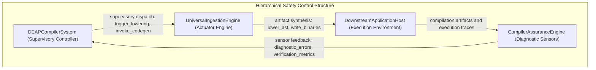

# System Losses, Hazards & Control Structure Topology

## System Losses

| Loss ID | Description |
| :--- | :--- |
| L-1 | Loss of safe function of DEAPCompilerSystem |

## System Hazards

| Hazard ID | Associated Control Action | Controller |
| :--- | :--- | :--- |
| H-1 | OA_01_Ingest_OEM_Artifacts | DEAPCompilerSystem |
| H-2 | OA_01_01_Ingest_System_Vision | DEAPCompilerSystem |
| H-3 | OA_01_02_Ingest_Universal_Schema | DEAPCompilerSystem |
| H-4 | OA_01_1_Format_Detection | DEAPCompilerSystem |
| H-5 | OA_01_2_Token_Lexing | DEAPCompilerSystem |
| H-6 | OA_01_3_Syntax_Normalization | DEAPCompilerSystem |
| H-7 | OA_02_Parse_SysML_AST | DEAPCompilerSystem |
| H-8 | OA_02_01_Construct_Node_Arena | DEAPCompilerSystem |
| H-9 | OA_02_02_Lower_Grammar_Constructs | DEAPCompilerSystem |
| H-10 | OA_02_1_KerML_AST_Build | DEAPCompilerSystem |
| H-11 | OA_02_2_Node_Allocation | DEAPCompilerSystem |
| H-12 | OA_02_3_Topological_Index | DEAPCompilerSystem |
| H-13 | OA_03_Validate_Model_Semantics | DEAPCompilerSystem |
| H-14 | OA_03_01_Verify_Metrology_Flows | DEAPCompilerSystem |
| H-15 | OA_03_02_Solve_State_Transitions | DEAPCompilerSystem |
| H-16 | OA_03_1_Type_Checking | DEAPCompilerSystem |
| H-17 | OA_03_2_Metrology_Verification | DEAPCompilerSystem |
| H-18 | OA_03_3_State_Reachability | DEAPCompilerSystem |
| H-19 | OA_04_Transpile_Safety_Artifacts | DEAPCompilerSystem |
| H-20 | OA_04_01_Verify_Safety_Traceability | DEAPCompilerSystem |
| H-21 | OA_04_02_Verify_ICD_Interconnect_Contracts | DEAPCompilerSystem |
| H-22 | OA_04_1_STPA_Matrix_Synthesis | DEAPCompilerSystem |
| H-23 | OA_04_2_UCA_Derivation | DEAPCompilerSystem |
| H-24 | OA_04_3_FMECA_Generation | DEAPCompilerSystem |
| H-25 | OA_05_Synthesize_Downstream_Projections | DEAPCompilerSystem |
| H-26 | OA_05_01_Project_Agile_Backlog | DEAPCompilerSystem |
| H-27 | OA_05_02_Synthesize_Multi_Target_CodeGen | DEAPCompilerSystem |
| H-28 | OA_05_1_Agile_Backlog_Projection | DEAPCompilerSystem |
| H-29 | OA_05_2_Multi_Target_CodeGen | DEAPCompilerSystem |
| H-30 | OA_05_3_Interface_Binding | DEAPCompilerSystem |
| H-31 | OA_06_Verify_Baseline_Parity | DEAPCompilerSystem |
| H-32 | OA_06_01_Triage_Diagnostic_Catalog | DEAPCompilerSystem |
| H-33 | OA_06_02_Assure_Compiler_Performance_Gates | DEAPCompilerSystem |
| H-34 | OA_06_1_Diagnostic_Catalog_Scan | DEAPCompilerSystem |
| H-35 | OA_06_2_Baseline_Parity_Audit | DEAPCompilerSystem |
| H-36 | OA_06_3_Performance_Benchmarking | DEAPCompilerSystem |
| H-37 | VerifyCompilerAssuranceAction | DEAPCompilerSystem |
| H-38 | AllocateNodeAction | DEAPCompilerSystem |
| H-39 | TriageDiagnosticAction | DEAPCompilerSystem |
| H-40 | ProjectAgileSpecificationsAction | DEAPCompilerSystem |
| H-41 | VerifySafetyTraceabilityAction | DEAPCompilerSystem |
| H-42 | SynthesizeICDContractsAction | DEAPCompilerSystem |
| H-43 | SynthesizeCodeAction | DEAPCompilerSystem |
| H-44 | SolveFlowsAction | DEAPCompilerSystem |
| H-45 | SolveStateDynamicsAction | DEAPCompilerSystem |
| H-46 | LowerSysMLAction | DEAPCompilerSystem |
| H-47 | BootstrapSystemVisionAction | DEAPCompilerSystem |
| H-48 | ClassifyFormatAction | DEAPCompilerSystem |
| H-49 | TokenizeStreamAction | DEAPCompilerSystem |
| H-50 | RecoverSyncAction | DEAPCompilerSystem |
| H-51 | IngestSchemaAction | DEAPCompilerSystem |

## Hierarchical Control Structure Topology

