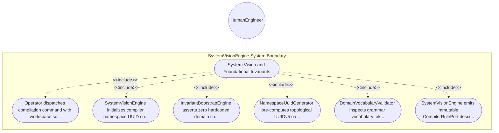

| Attribute | Specification Detail |
| :--- | :--- |
| **Issue ID** | #95 |
| **Title** | Use Case 01: System Vision and Foundational Invariants |
| **Type** | use-case |
| **Primary Actor** | HumanEngineer |
| **Scope** | SystemVisionEngine |
| **Level** | User Goal |
| **Generation Mode** | subagent |
| **Specification Source** | [schema/subsystems/system_vision/behavior.sysml](../../schema/subsystems/system_vision/behavior.sysml) |

# Use Case 01: System Vision and Foundational Invariants

## UML Diagrams

## 1. Actors
- `HumanEngineer`

## 2. Preconditions
- Compiler runtime environment is initialized with valid configuration flags.

## 3. Trigger
- Compilation pipeline startup command dispatched by operator or CI runner.

## 4. Main Success Scenario
1. Operator dispatches compilation command with workspace schema root.
2. SystemVisionEngine initializes compiler namespace UUID constant NS_DEAP.
3. InvariantBootstrapEngine asserts zero hardcoded domain concept rules across runtime context.
4. NamespaceUuidGenerator pre-computes topological UUIDv5 namespace roots.
5. DomainVocabularyValidator inspects grammar vocabulary tokens against prohibited domain ontologies.
6. SystemVisionEngine emits immutable CompilerRulePort descriptor to downstream ingestion engines.

## 5. Alternate and Exception Flows
- 5a. Prohibited domain term detected: SystemVisionEngine halts pipeline and emits diagnostic E0100.
- 5b. Namespace UUID collision: SystemVisionEngine regenerates topological anchor with depth offset and emits E0101.
- 5c. Malformed configuration flags: Compiler logs invalid argument diagnostics and falls back to safe defaults.
- 5d. File permission error on workspace: Execution halts safely emitting file access diagnostic.
- 5e. Invariant verification timeout: Watchdog timer triggers and logs diagnostic E0199 before graceful termination.
- 5f. Non-deterministic execution detected: Checksum validation fails and emits reproducibility diagnostic E0102.
- 5g. Memory allocation failure during bootstrap: Engine triggers emergency page compaction.
- 5h. Missing root namespace configuration: Fallback to fixed RFC 4122 compiler constant.
- 5i. Incompatible schema revision requested: Compiler warns and falls back to backwards-compatible parser mode.
- 5j. Circular dependency detected in rule definitions: Rule topological sorter breaks cycle and reports E0103.

## 6. Postconditions
- Foundational compiler invariants and UUIDv5 namespaces are established deterministically.

## 8. Realization Matrix
| Specification Item | Type | Link / Reference |
| :--- | :--- | :--- |
| **#89** | User Story | [User Story 01: Bootstrap System Vision Action](../user-stories/US-01-BootstrapSystemVisionAction.md) |
| **#15** | Feature | [Feature 06: [System Vision] SystemVisionEngine](../features/FEAT-06-SystemVisionEngine.md) |

## Source References
Use case operational flows and lifecycle activity references:
- Subsystem Behavior Specification: `schema/subsystems/system_vision/behavior.sysml`
- ConOps Operational Activities: `schema/conops/activities.sysml`
- System Architecture Model: `schema/model.sysml`
- Normative Systems Engineering Standard: ISO/IEC/IEEE 29148:2018 §6.4.2 Concept of Operations

Operational use case realization and traceability links derive from `schema/subsystems/system_vision/behavior.sysml` pursuant to ISO/IEC/IEEE 29148.
