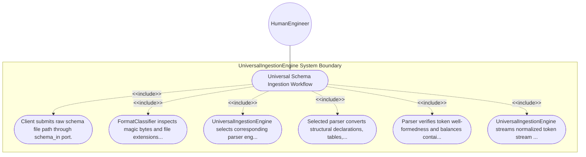

| Attribute | Specification Detail |
| :--- | :--- |
| **Issue ID** | #96 |
| **Title** | Use Case 02: Universal Schema Ingestion Workflow |
| **Type** | use-case |
| **Primary Actor** | HumanEngineer |
| **Scope** | UniversalIngestionEngine |
| **Level** | User Goal |
| **Generation Mode** | subagent |
| **Specification Source** | [schema/subsystems/universal_schema_ingestion/behavior.sysml](../../schema/subsystems/universal_schema_ingestion/behavior.sysml) |

# Use Case 02: Universal Schema Ingestion Workflow

## UML Diagrams

## 1. Actors
- `HumanEngineer`

## 2. Preconditions
- Raw schema files exist on filesystem with read permissions.

## 3. Trigger
- Ingestion command dispatched with path to target schema artifact.

## 4. Main Success Scenario
1. Client submits raw schema file path through schema_in port.
2. FormatClassifier inspects magic bytes and file extensions to identify source type.
3. UniversalIngestionEngine selects corresponding parser engine (CommonMark, Protobuf, OpenAPI, SysML).
4. Selected parser converts structural declarations, tables, and interfaces into typed token representations.
5. Parser verifies token well-formedness and balances container delimiters.
6. UniversalIngestionEngine streams normalized token stream through token_out port to node arena.

## 5. Alternate and Exception Flows
- 5a. Unrecognized schema format: FormatClassifier fails identification and emits diagnostic E0101.
- 5b. Unterminated table cell in CommonMark: Lexer transitions to EscapeState, reports warning, and closes cell safely.
- 5c. Malformed Protobuf descriptor syntax: ProtobufParser recovers on message boundary and emits E0102.
- 5d. Invalid OpenAPI YAML/JSON syntax: OpenApiParser emits line-col syntax diagnostic and halts processing.
- 5e. Empty input file provided: Ingestion engine emits warning and produces empty token stream.
- 5f. Premature EOF encountered: Parser closes open container scopes and logs diagnostic E0103.
- 5g. Character encoding invalid (non-UTF8): Lexer rejects binary input with encoding diagnostic.
- 5h. Extreme token stream depth (> 1024 nested scopes): Parser halts with recursion depth limit error.
- 5i. Ingestion buffer overflow: Engine applies backpressure to raw schema input stream.
- 5j. Circular schema file include: Ingestion preprocessor breaks circular loop and emits cycle diagnostic.

## 6. Postconditions
- Raw schema artifacts are converted into normalized, strongly-typed token streams.

## 8. Realization Matrix
| Specification Item | Type | Link / Reference |
| :--- | :--- | :--- |
| **#90** | User Story | [User Story 02: Classify Format Action](../user-stories/US-02-ClassifyFormatAction.md) |
| **#19** | Feature | [Feature 10: [Universal Schema Ingestion] UniversalIngestionEngine](../features/FEAT-10-UniversalIngestionEngine.md) |

## Source References
Use case operational flows and lifecycle activity references:
- Subsystem Behavior Specification: `schema/subsystems/universal_schema_ingestion/behavior.sysml`
- ConOps Operational Activities: `schema/conops/activities.sysml`
- System Architecture Model: `schema/model.sysml`
- Normative Systems Engineering Standard: ISO/IEC/IEEE 29148:2018 §6.4.2 Concept of Operations

Operational use case realization and traceability links derive from `schema/subsystems/universal_schema_ingestion/behavior.sysml` pursuant to ISO/IEC/IEEE 29148.
