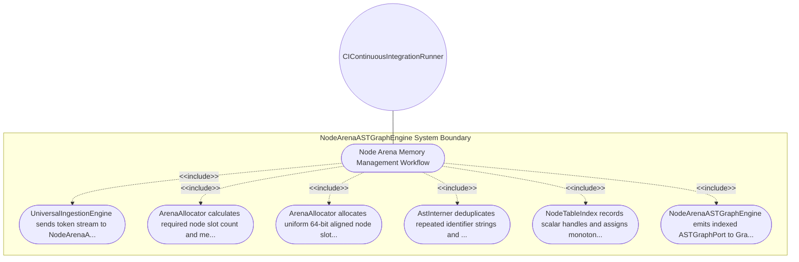

| Attribute | Specification Detail |
| :--- | :--- |
| **Issue ID** | #97 |
| **Title** | Use Case 03: Node Arena Memory Management Workflow |
| **Type** | use-case |
| **Primary Actor** | CIContinuousIntegrationRunner |
| **Scope** | NodeArenaASTGraphEngine |
| **Level** | User Goal |
| **Generation Mode** | subagent |
| **Specification Source** | [schema/subsystems/core_metamodel_node_arena/behavior.sysml](../../schema/subsystems/core_metamodel_node_arena/behavior.sysml) |

# Use Case 03: Node Arena Memory Management Workflow

## UML Diagrams

## 1. Actors
- `CIContinuousIntegrationRunner`

## 2. Preconditions
- Token stream is available from UniversalIngestionEngine.

## 3. Trigger
- Ingestion stream arrives at token_in port.

## 4. Main Success Scenario
1. UniversalIngestionEngine sends token stream to NodeArenaASTGraphEngine.
2. ArenaAllocator calculates required node slot count and memory page boundaries.
3. ArenaAllocator allocates uniform 64-bit aligned node slots in contiguous chunks.
4. AstInterner deduplicates repeated identifier strings and literal expressions.
5. NodeTableIndex records scalar handles and assigns monotonic NodeIndex values.
6. NodeArenaASTGraphEngine emits indexed ASTGraphPort to GrammarLoweringEngine.

## 5. Alternate and Exception Flows
- 5a. Memory chunk exhaustion: ArenaAllocator allocates new contiguous page chunk with exponential growth.
- 5b. Slot alignment fault: ArenaAllocator re-aligns slot offset to 8-byte boundary and logs diagnostic.
- 5c. String interner hash table collision: AstInterner resolves collision via linear probing.
- 5d. NodeIndex scalar handle overflow: Arena expands integer width and logs capacity warning.
- 5e. Fragmented page detected: Compacting state executes in-place slot defragmentation.
- 5f. Invalid token sequence: ArenaAllocator drops partial node and recovers to previous checkpoint.
- 5g. OOM condition encountered: Engine triggers emergency garbage compaction before reporting E0102.
- 5h. Circular parent-child containment handle: Graph indexer rejects cyclic handle and emits E0103.
- 5i. Zero-sized AST token payload: Engine constructs minimal root package placeholder node.
- 5j. Concurrent read-write contention: Lock-free arena page indexer resolves contention deterministically.

## 6. Postconditions
- All AST nodes and containment hierarchies are stored in contiguous memory with O(1) slot access.

## 8. Realization Matrix
| Specification Item | Type | Link / Reference |
| :--- | :--- | :--- |
| **#91** | User Story | [User Story 03: Allocate Node Action](../user-stories/US-03-AllocateNodeAction.md) |
| **#24** | Feature | [Feature 15: [Core Metamodel Node Arena] NodeArenaASTGraphEngine](../features/FEAT-15-NodeArenaASTGraphEngine.md) |

## Source References
Use case operational flows and lifecycle activity references:
- Subsystem Behavior Specification: `schema/subsystems/core_metamodel_node_arena/behavior.sysml`
- ConOps Operational Activities: `schema/conops/activities.sysml`
- System Architecture Model: `schema/model.sysml`
- Normative Systems Engineering Standard: ISO/IEC/IEEE 29148:2018 §6.4.2 Concept of Operations

Operational use case realization and traceability links derive from `schema/subsystems/core_metamodel_node_arena/behavior.sysml` pursuant to ISO/IEC/IEEE 29148.
