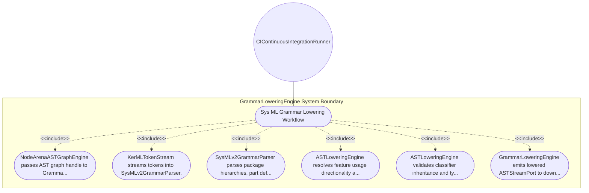

| Attribute | Specification Detail |
| :--- | :--- |
| **Issue ID** | #98 |
| **Title** | Use Case 04: Sys ML Grammar Lowering Workflow |
| **Type** | use-case |
| **Primary Actor** | CIContinuousIntegrationRunner |
| **Scope** | GrammarLoweringEngine |
| **Level** | User Goal |
| **Generation Mode** | subagent |
| **Specification Source** | [schema/subsystems/sysml_grammar_lowering/behavior.sysml](../../schema/subsystems/sysml_grammar_lowering/behavior.sysml) |

# Use Case 04: Sys ML Grammar Lowering Workflow

## UML Diagrams

## 1. Actors
- `CIContinuousIntegrationRunner`

## 2. Preconditions
- Node arena contains populated AST graph nodes.

## 3. Trigger
- Grammar lowering trigger dispatched after successful node allocation.

## 4. Main Success Scenario
1. NodeArenaASTGraphEngine passes AST graph handle to GrammarLoweringEngine.
2. KerMLTokenStream streams tokens into SysMLv2GrammarParser.
3. SysMLv2GrammarParser parses package hierarchies, part defs, and port defs.
4. ASTLoweringEngine resolves feature usage directionality and port conjugation (~).
5. ASTLoweringEngine validates classifier inheritance and type compatibility.
6. GrammarLoweringEngine emits lowered ASTStreamPort to downstream semantic engines.

## 5. Alternate and Exception Flows
- 5a. Incompatible conjugate port pairing: Engine detects type mismatch and emits diagnostic E0200.
- 5b. Undeclared classifier referenced in part usage: Parser logs missing symbol diagnostic and binds unresolved stub.
- 5c. Grammar syntax error in expression: Parser emits precise source line/column error and recovers on semicolon.
- 5d. Cyclic classifier inheritance detected: Lowering engine rejects cyclic hierarchy and reports E0201.
- 5e. Port direction inversion violation: Compiler flags illegal directed connection and reports E0202.
- 5f. Missing mandatory classifier attribute: Engine populates default value and logs informational note.
- 5g. Deep recursion in nested grammar blocks: Parser enforces recursion bound and returns syntax error.
- 5h. Ambiguous symbol resolution: Scoping rules apply lexical shadowing and report disambiguation note.
- 5i. Unsupported KerML construct encountered: Engine safely skips unhandled construct and warns operator.
- 5j. Multiplicity constraint violation: Multiplicity interval check fails and logs E0203.

## 6. Postconditions
- Strongly-typed, normalized SysML v2 / KerML AST stream is emitted.

## 8. Realization Matrix
| Specification Item | Type | Link / Reference |
| :--- | :--- | :--- |
| **#92** | User Story | [User Story 04: Lower Sys MLAction](../user-stories/US-04-LowerSysMLAction.md) |
| **#28** | Feature | [Feature 19: [Sysml Grammar Lowering] GrammarLoweringEngine](../features/FEAT-19-GrammarLoweringEngine.md) |

## Source References
Use case operational flows and lifecycle activity references:
- Subsystem Behavior Specification: `schema/subsystems/sysml_grammar_lowering/behavior.sysml`
- ConOps Operational Activities: `schema/conops/activities.sysml`
- System Architecture Model: `schema/model.sysml`
- Normative Systems Engineering Standard: ISO/IEC/IEEE 29148:2018 §6.4.2 Concept of Operations

Operational use case realization and traceability links derive from `schema/subsystems/sysml_grammar_lowering/behavior.sysml` pursuant to ISO/IEC/IEEE 29148.
