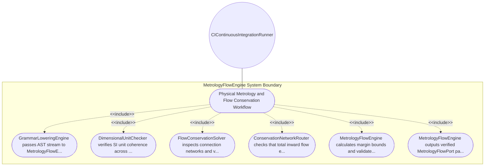

| Attribute | Specification Detail |
| :--- | :--- |
| **Issue ID** | #99 |
| **Title** | Use Case 05: Physical Metrology and Flow Conservation Workflow |
| **Type** | use-case |
| **Primary Actor** | CIContinuousIntegrationRunner |
| **Scope** | MetrologyFlowEngine |
| **Level** | User Goal |
| **Generation Mode** | subagent |
| **Specification Source** | [schema/subsystems/physical_metrology_flows/behavior.sysml](../../schema/subsystems/physical_metrology_flows/behavior.sysml) |

# Use Case 05: Physical Metrology and Flow Conservation Workflow

## UML Diagrams

## 1. Actors
- `CIContinuousIntegrationRunner`

## 2. Preconditions
- AST stream containing port definitions and flow definitions is available.

## 3. Trigger
- Metrology flow verification command dispatched by compiler pipeline.

## 4. Main Success Scenario
1. GrammarLoweringEngine passes AST stream to MetrologyFlowEngine.
2. DimensionalUnitChecker verifies SI unit coherence across feature types (length, mass, time, current, temp, amount, luminous).
3. FlowConservationSolver inspects connection networks and verifies conservation of mass, energy, and data rates.
4. ConservationNetworkRouter checks that total inward flow equals total outward flow across intermediate nodes.
5. MetrologyFlowEngine calculates margin bounds and validates nominal operational tolerances.
6. MetrologyFlowEngine outputs verified MetrologyFlowPort payload to downstream safety engine.

## 5. Alternate and Exception Flows
- 5a. Dimensional incompatibility detected: Unit checker emits diagnostic E0201 for dimension mismatch.
- 5b. Flow conservation violation: Kirchhoff balance solver reports residual flow leak diagnostic.
- 5c. Unrecognized engineering unit: Metrology engine emits unrecognized unit warning and defaults to scalar.
- 5d. Negative flow rate specified on unidirectional port: Router flags illegal direction and reports E0202.
- 5e. Floating-point tolerance divergence: Solver adjusts iterative step size and re-evaluates balance.
- 5f. Missing unit on numeric parameter: Unit checker assigns default SI base unit and logs advisory.
- 5g. Over-constrained flow loop: Solver detects algebraic loop and applies loop-breaking heuristic.
- 5h. Flow capacity overflow: Router flags exceedance of maximum rated port capacity.
- 5i. Zero-flow deadlock condition: Engine identifies dormant branch and warns operator.
- 5j. Non-linear flow curve singularity: Solver activates boundary clipping and logs numerical warning.

## 6. Postconditions
- All physical flows, dimensional units, and conservation laws are formally verified.

## 8. Realization Matrix
| Specification Item | Type | Link / Reference |
| :--- | :--- | :--- |
| **#93** | User Story | [User Story 05: Solve Flows Action](../user-stories/US-05-SolveFlowsAction.md) |
| **#32** | Feature | [Feature 23: [Physical Metrology Flows] MetrologyFlowEngine](../features/FEAT-23-MetrologyFlowEngine.md) |

## Source References
Use case operational flows and lifecycle activity references:
- Subsystem Behavior Specification: `schema/subsystems/physical_metrology_flows/behavior.sysml`
- ConOps Operational Activities: `schema/conops/activities.sysml`
- System Architecture Model: `schema/model.sysml`
- Normative Systems Engineering Standard: ISO/IEC/IEEE 29148:2018 §6.4.2 Concept of Operations

Operational use case realization and traceability links derive from `schema/subsystems/physical_metrology_flows/behavior.sysml` pursuant to ISO/IEC/IEEE 29148.
