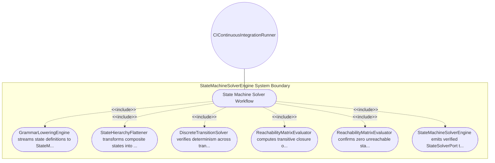

| Attribute | Specification Detail |
| :--- | :--- |
| **Issue ID** | #100 |
| **Title** | Use Case 06: State Machine Solver Workflow |
| **Type** | use-case |
| **Primary Actor** | CIContinuousIntegrationRunner |
| **Scope** | StateMachineSolverEngine |
| **Level** | User Goal |
| **Generation Mode** | subagent |
| **Specification Source** | [schema/subsystems/spatio_temporal_state_solvers/behavior.sysml](../../schema/subsystems/spatio_temporal_state_solvers/behavior.sysml) |

# Use Case 06: State Machine Solver Workflow

## UML Diagrams

## 1. Actors
- `CIContinuousIntegrationRunner`

## 2. Preconditions
- AST stream containing state definitions and transitions is available.

## 3. Trigger
- State machine verification trigger dispatched by compilation pipeline.

## 4. Main Success Scenario
1. GrammarLoweringEngine streams state definitions to StateMachineSolverEngine.
2. StateHierarchyFlattener transforms composite states into equivalent flat automata.
3. DiscreteTransitionSolver verifies determinism across transition guards and events.
4. ReachabilityMatrixEvaluator computes transitive closure of reachability graph.
5. ReachabilityMatrixEvaluator confirms zero unreachable states and zero deadlocks.
6. StateMachineSolverEngine emits verified StateSolverPort to downstream safety assurance.

## 5. Alternate and Exception Flows
- 5a. Deadlock state identified: Reachability evaluator flags terminal sink without exit and reports E0203.
- 5b. Unreachable state detected: Solver logs warning for orphan state unreachable from initial state.
- 5c. Non-deterministic transition guards: Solver flags overlapping boolean guards on same trigger.
- 5d. Cyclic state transition without termination: Livelock detection heuristic logs warning note.
- 5e. Deep statechart nesting exceeds bound: Flattener halts and reports excessive recursion depth.
- 5f. Missing initial transition in region: Solver inserts default entry transition to first state.
- 5g. Undeclared event trigger referenced: Solver logs unresolved signal diagnostic.
- 5h. Conflicting concurrent orthostate transitions: Flattener applies priority ordering.
- 5i. State timeout value missing physical unit: Engine binds default millisecond timing unit.
- 5j. State machine graph size exceeds solver capacity: Evaluator switches to bounded depth search.

## 6. Postconditions
- State machine dynamics, transition determinism, and reachability are formally verified.

## 8. Realization Matrix
| Specification Item | Type | Link / Reference |
| :--- | :--- | :--- |
| **#94** | User Story | [User Story 06: Solve State Dynamics Action](../user-stories/US-06-SolveStateDynamicsAction.md) |
| **#36** | Feature | [Feature 27: [Spatio Temporal State Solvers] StateMachineSolverEngine](../features/FEAT-27-StateMachineSolverEngine.md) |

## Source References
Use case operational flows and lifecycle activity references:
- Subsystem Behavior Specification: `schema/subsystems/spatio_temporal_state_solvers/behavior.sysml`
- ConOps Operational Activities: `schema/conops/activities.sysml`
- System Architecture Model: `schema/model.sysml`
- Normative Systems Engineering Standard: ISO/IEC/IEEE 29148:2018 §6.4.2 Concept of Operations

Operational use case realization and traceability links derive from `schema/subsystems/spatio_temporal_state_solvers/behavior.sysml` pursuant to ISO/IEC/IEEE 29148.
