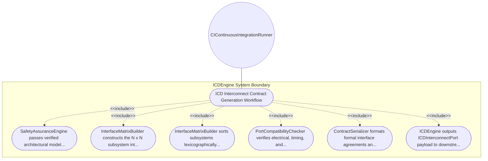

| Attribute | Specification Detail |
| :--- | :--- |
| **Issue ID** | #102 |
| **Title** | Use Case 08: ICD Interconnect Contract Generation Workflow |
| **Type** | use-case |
| **Primary Actor** | CIContinuousIntegrationRunner |
| **Scope** | ICDEngine |
| **Level** | User Goal |
| **Generation Mode** | subagent |
| **Specification Source** | [schema/subsystems/interconnect_contracts/behavior.sysml](../../schema/subsystems/interconnect_contracts/behavior.sysml) |

# Use Case 08: ICD Interconnect Contract Generation Workflow

## UML Diagrams

## 1. Actors
- `CIContinuousIntegrationRunner`

## 2. Preconditions
- Formal safety and architectural model elements are verified.

## 3. Trigger
- ICD generation command dispatched by compilation pipeline.

## 4. Main Success Scenario
1. SafetyAssuranceEngine passes verified architectural model to ICDEngine.
2. InterfaceMatrixBuilder constructs the N x N subsystem interface connectivity matrix.
3. InterfaceMatrixBuilder sorts subsystems lexicographically and assigns deterministic coordinates.
4. PortCompatibilityChecker verifies electrical, timing, and protocol compatibility for each channel.
5. ContractSerializer formats formal interface agreements and signal dictionaries.
6. ICDEngine outputs ICDInterconnectPort payload to downstream agile projection engine.

## 5. Alternate and Exception Flows
- 5a. Interface matrix dimension mismatch: Matrix builder detects missing subsystem index and reports error.
- 5b. Incompatible protocol pairing on interconnect: Port checker reports protocol mismatch diagnostic.
- 5c. Unrouted signal detected in dictionary: Serializer flags dangling signal without source or sink.
- 5d. Duplicate channel coordinate assignment: Indexer re-sorts subsystem list and eliminates collision.
- 5e. Bandwidth limit exceeded on channel: Port checker emits warning for bus saturation.
- 5f. Missing electrical interface attributes: Contract serializer binds standard TTL/CMOS defaults.
- 5g. Asymmetric port definitions without conjugate flag: Checker emits port directionality warning.
- 5h. Latency envelope violated on contract: Checker flags propagation delay exceeding threshold.
- 5i. ICD serialization formatting error: Serializer re-encodes markdown table with canonical fences.
- 5j. Circular contract dependency loop: ICDEngine analyzes loop and emits contract sequencing note.

## 6. Postconditions
- Level 1C ICD matrices and signal dictionaries are generated with 100 percent port contract parity.

## 8. Realization Matrix
| Specification Item | Type | Link / Reference |
| :--- | :--- | :--- |
| **#96** | User Story | [User Story 08: Synthesize ICDContracts Action](../user-stories/US-08-SynthesizeICDContractsAction.md) |
| **#45** | Feature | [Feature 36: [Interconnect Contracts] ICDEngine](../features/FEAT-36-ICDEngine.md) |

## Source References
Use case operational flows and lifecycle activity references:
- Subsystem Behavior Specification: `schema/subsystems/interconnect_contracts/behavior.sysml`
- ConOps Operational Activities: `schema/conops/activities.sysml`
- System Architecture Model: `schema/model.sysml`
- Normative Systems Engineering Standard: ISO/IEC/IEEE 29148:2018 §6.4.2 Concept of Operations

Operational use case realization and traceability links derive from `schema/subsystems/interconnect_contracts/behavior.sysml` pursuant to ISO/IEC/IEEE 29148.
