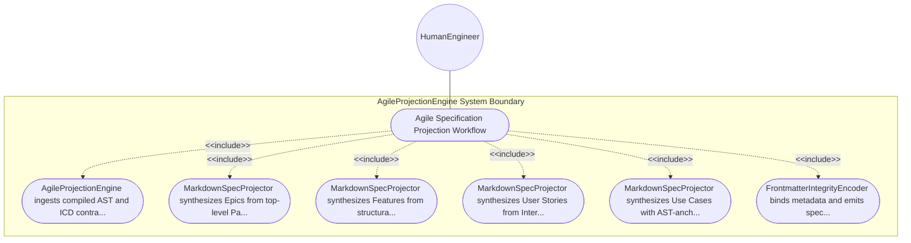

| Attribute | Specification Detail |
| :--- | :--- |
| **Issue ID** | #103 |
| **Title** | Use Case 09: Agile Specification Projection Workflow |
| **Type** | use-case |
| **Primary Actor** | HumanEngineer |
| **Scope** | AgileProjectionEngine |
| **Level** | User Goal |
| **Generation Mode** | subagent |
| **Specification Source** | [schema/subsystems/downstream_agile_projections/behavior.sysml](../../schema/subsystems/downstream_agile_projections/behavior.sysml) |

# Use Case 09: Agile Specification Projection Workflow

## UML Diagrams

## 1. Actors
- `HumanEngineer`

## 2. Preconditions
- Authoritative SysML model and ICD interconnects are compiled and verified.

## 3. Trigger
- Forward specification synchronization command dispatched by compiler CLI.

## 4. Main Success Scenario
1. AgileProjectionEngine ingests compiled AST and ICD contracts.
2. MarkdownSpecProjector synthesizes Epics from top-level PackageDef nodes.
3. MarkdownSpecProjector synthesizes Features from structural PartDef nodes with dynamic JSON Schemas.
4. MarkdownSpecProjector synthesizes User Stories from InteractionDef and ActionDef nodes.
5. MarkdownSpecProjector synthesizes Use Cases with AST-anchored Realization Matrices.
6. FrontmatterIntegrityEncoder binds metadata and emits specification files to docs/ directories.

## 5. Alternate and Exception Flows
- 5a. Output directory not writable: Engine reports filesystem permission error and halts safely.
- 5b. Frontmatter metadata schema validation failure: Encoder repairs missing attributes with safe defaults.
- 5c. Broken cross-reference link detected: Projector verifies target file exists before writing link.
- 5d. Unicode em dash detected in text stream: Projector sanitizes character to ASCII double hyphen.
- 5e. Mermaid diagram syntax error in generated block: Formatter validates fence syntax and escapes labels.
- 5f. Orphan feature detected without parent epic: Projector assigns feature to system root epic.
- 5g. Missing acceptance criteria in requirement: Projector extracts BDD scenario from requirement docstring.
- 5h. Duplicate spec title detected: Metadata validator appends unique subsystem qualifier to title.
- 5i. Dry-run mode enabled: Projector logs simulated file writes without altering disk.
- 5j. Specification cardinality bounds exceeded: Projector emits advisory note for epic feature count.

## 6. Postconditions
- Full Agile specification hierarchy is projected to docs/ conforming to all quality gates.

## 8. Realization Matrix
| Specification Item | Type | Link / Reference |
| :--- | :--- | :--- |
| **#97** | User Story | [User Story 09: Project Agile Specifications Action](../user-stories/US-09-ProjectAgileSpecificationsAction.md) |
| **#49** | Feature | [Feature 40: [Downstream Agile Projections] AgileProjectionEngine](../features/FEAT-40-AgileProjectionEngine.md) |

## Source References
Use case operational flows and lifecycle activity references:
- Subsystem Behavior Specification: `schema/subsystems/downstream_agile_projections/behavior.sysml`
- ConOps Operational Activities: `schema/conops/activities.sysml`
- System Architecture Model: `schema/model.sysml`
- Normative Systems Engineering Standard: ISO/IEC/IEEE 29148:2018 §6.4.2 Concept of Operations

Operational use case realization and traceability links derive from `schema/subsystems/downstream_agile_projections/behavior.sysml` pursuant to ISO/IEC/IEEE 29148.
