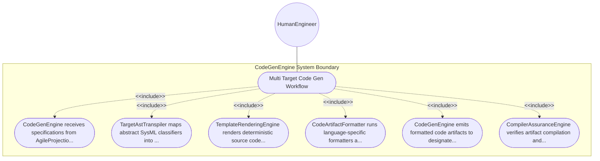

| Attribute | Specification Detail |
| :--- | :--- |
| **Issue ID** | #104 |
| **Title** | Use Case 10: Multi Target Code Gen Workflow |
| **Type** | use-case |
| **Primary Actor** | HumanEngineer |
| **Scope** | CodeGenEngine |
| **Level** | User Goal |
| **Generation Mode** | subagent |
| **Specification Source** | [schema/subsystems/multi_target_codegen/behavior.sysml](../../schema/subsystems/multi_target_codegen/behavior.sysml) |

# Use Case 10: Multi Target Code Gen Workflow

## UML Diagrams

## 1. Actors
- `HumanEngineer`

## 2. Preconditions
- Agile specifications and structural classifiers are loaded and verified.

## 3. Trigger
- Code generation command dispatched by user or automated build pipeline.

## 4. Main Success Scenario
1. CodeGenEngine receives specifications from AgileProjectionEngine via specs_in port.
2. TargetAstTranspiler maps abstract SysML classifiers into language-specific AST structures.
3. TemplateRenderingEngine renders deterministic source code using target language templates.
4. CodeArtifactFormatter runs language-specific formatters and linter checks.
5. CodeGenEngine emits formatted code artifacts to designated workspace target directories.
6. CompilerAssuranceEngine verifies artifact compilation and records performance metrics.

## 5. Alternate and Exception Flows
- 5a. Target language template missing: Engine reports missing template diagnostic and aborts target.
- 5b. Target syntax violation in rendered code: Transpiler flags invalid token and emits diagnostic.
- 5c. Destination file path read-only: Engine logs permission error and halts execution.
- 5d. Unsupported target architecture requested: Engine falls back to reference C++ or Rust implementation.
- 5e. Transpilation timeout: Engine aborts code generation unit and logs timeout diagnostic.
- 5f. Unicode em dash detected in target comments: Formatter replaces with ASCII double hyphen.
- 5g. External linter tool unavailable: Formatter proceeds with built-in AST canonical printer.
- 5h. Circular dependency in target modules: Transpiler topologically sorts dependencies or emits error.
- 5i. Dry-run mode specified: Formatter emits artifact diff to stdout without touching disk.
- 5j. Generation cache hit: Engine skips re-rendering unchanged modules to optimize throughput.

## 6. Postconditions
- Validated multi-target code artifacts are written to disk cleanly.

## 8. Realization Matrix
| Specification Item | Type | Link / Reference |
| :--- | :--- | :--- |
| **#98** | User Story | [User Story 10: Synthesize Code Action](../user-stories/US-10-SynthesizeCodeAction.md) |
| **#53** | Feature | [Feature 44: [Multi Target Codegen] CodeGenEngine](../features/FEAT-44-CodeGenEngine.md) |

## Source References
Use case operational flows and lifecycle activity references:
- Subsystem Behavior Specification: `schema/subsystems/multi_target_codegen/behavior.sysml`
- ConOps Operational Activities: `schema/conops/activities.sysml`
- System Architecture Model: `schema/model.sysml`
- Normative Systems Engineering Standard: ISO/IEC/IEEE 29148:2018 §6.4.2 Concept of Operations

Operational use case realization and traceability links derive from `schema/subsystems/multi_target_codegen/behavior.sysml` pursuant to ISO/IEC/IEEE 29148.
