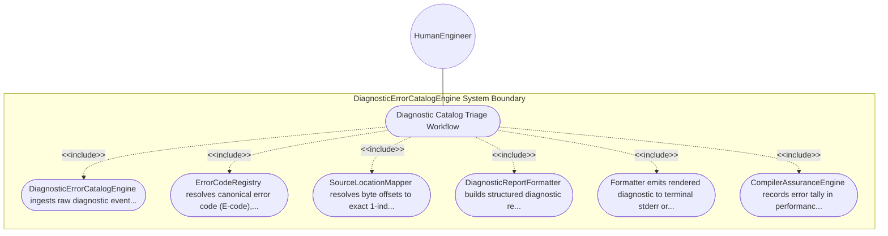

| Attribute | Specification Detail |
| :--- | :--- |
| **Issue ID** | #105 |
| **Title** | Use Case 11: Diagnostic Catalog Triage Workflow |
| **Type** | use-case |
| **Primary Actor** | HumanEngineer |
| **Scope** | DiagnosticErrorCatalogEngine |
| **Level** | User Goal |
| **Generation Mode** | subagent |
| **Specification Source** | [schema/subsystems/diagnostic_error_catalog/behavior.sysml](../../schema/subsystems/diagnostic_error_catalog/behavior.sysml) |

# Use Case 11: Diagnostic Catalog Triage Workflow

## UML Diagrams

## 1. Actors
- `HumanEngineer`

## 2. Preconditions
- Compiler pipeline encounters warning, error, or fatal validation condition.

## 3. Trigger
- Diagnostic signal emitted on diag_in port during compilation run.

## 4. Main Success Scenario
1. DiagnosticErrorCatalogEngine ingests raw diagnostic event via diag_in port.
2. ErrorCodeRegistry resolves canonical error code (E-code), severity level, and guidance.
3. SourceLocationMapper resolves byte offsets to exact 1-indexed line and column numbers.
4. DiagnosticReportFormatter builds structured diagnostic record with code span highlights.
5. Formatter emits rendered diagnostic to terminal stderr or JSON/SARIF diagnostic stream.
6. CompilerAssuranceEngine records error tally in performance and compliance metrics.

## 5. Alternate and Exception Flows
- 5a. Unknown error code encountered: Registry assigns fallback E0999 generic diagnostic code.
- 5b. Source file location out of range: Mapper marks location as synthetic end-of-file.
- 5c. Maximum error limit reached: Engine suppresses further errors and emits fatal E0199 limit notice.
- 5d. Non-UTF8 source character in span: Mapper renders sanitization placeholder for byte offset.
- 5e. Terminal lacks color support: Formatter strips ANSI escape sequences automatically.
- 5f. Em dash detected in diagnostic message: Formatter replaces with ASCII double hyphen.
- 5g. Cascading error suppression active: Engine suppresses follow-on errors on same AST node.
- 5h. SARIF output mode requested: Formatter emits OASIS SARIF v2.1.0 compliant JSON schema payload.
- 5i. Warning treated as error (-Werror): Registry elevates severity from Warning to Error.
- 5j. Quiet mode active: Formatter filters non-fatal warnings and outputs only fatal errors.

## 6. Postconditions
- All compiler diagnostic records are classified, formatted, and delivered deterministically.

## 8. Realization Matrix
| Specification Item | Type | Link / Reference |
| :--- | :--- | :--- |
| **#99** | User Story | [User Story 11: Triage Diagnostic Action](../user-stories/US-11-TriageDiagnosticAction.md) |
| **#57** | Feature | [Feature 48: [Diagnostic Error Catalog] DiagnosticErrorCatalogEngine](../features/FEAT-48-DiagnosticErrorCatalogEngine.md) |

## Source References
Use case operational flows and lifecycle activity references:
- Subsystem Behavior Specification: `schema/subsystems/diagnostic_error_catalog/behavior.sysml`
- ConOps Operational Activities: `schema/conops/activities.sysml`
- System Architecture Model: `schema/model.sysml`
- Normative Systems Engineering Standard: ISO/IEC/IEEE 29148:2018 §6.4.2 Concept of Operations

Operational use case realization and traceability links derive from `schema/subsystems/diagnostic_error_catalog/behavior.sysml` pursuant to ISO/IEC/IEEE 29148.
