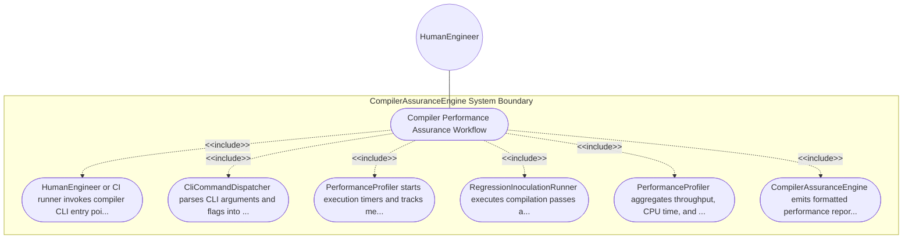

| Attribute | Specification Detail |
| :--- | :--- |
| **Issue ID** | #106 |
| **Title** | Use Case 12: Compiler Performance Assurance Workflow |
| **Type** | use-case |
| **Primary Actor** | HumanEngineer |
| **Scope** | CompilerAssuranceEngine |
| **Level** | User Goal |
| **Generation Mode** | subagent |
| **Specification Source** | [schema/subsystems/compiler_assurance/behavior.sysml](../../schema/subsystems/compiler_assurance/behavior.sysml) |

# Use Case 12: Compiler Performance Assurance Workflow

## UML Diagrams

## 1. Actors
- `HumanEngineer`

## 2. Preconditions
- Compiler CLI binary is built and test suites/schemas are present in workspace.

## 3. Trigger
- Headless CLI command invocation or automated CI regression test trigger.

## 4. Main Success Scenario
1. HumanEngineer or CI runner invokes compiler CLI entry point via cli_in port.
2. CliCommandDispatcher parses CLI arguments and flags into structured execution request.
3. PerformanceProfiler starts execution timers and tracks memory heap allocation rates.
4. RegressionInoculationRunner executes compilation passes across authoritative schemas.
5. PerformanceProfiler aggregates throughput, CPU time, and peak memory figures.
6. CompilerAssuranceEngine emits formatted performance report and verification status via metrics_out.

## 5. Alternate and Exception Flows
- 5a. Invalid CLI flag specified: Dispatcher prints usage help and terminates with exit code 2.
- 5b. Schema path does not exist: Dispatcher emits E0300 invalid path diagnostic.
- 5c. Performance threshold violated: Profiler records latency regression warning in report.
- 5d. Non-zero exit code in compilation pass: Engine halts regression sequence and returns failure status.
- 5e. Environment variable overrides configured: Dispatcher incorporates flags into configuration profile.
- 5f. Unicode em dash in CLI parameter: Dispatcher sanitizes string to ASCII double hyphen.
- 5g. Memory budget exceeded: Profiler issues memory pressure alert and triggers arena compaction.
- 5h. JSON output format requested: Dispatcher serializes metrics as structured JSON telemetry payload.
- 5i. Dry-run mode specified: Dispatcher validates command parameters without invoking full build.
- 5j. Benchmark baseline missing: Engine establishes current run as initial performance reference point.

## 6. Postconditions
- Headless CLI command terminates cleanly and assurance metrics are verified.

## 8. Realization Matrix
| Specification Item | Type | Link / Reference |
| :--- | :--- | :--- |
| **#100** | User Story | [User Story 12: Verify Compiler Assurance Action](../user-stories/US-12-VerifyCompilerAssuranceAction.md) |
| **#61** | Feature | [Feature 52: [Compiler Assurance] CompilerAssuranceEngine](../features/FEAT-52-CompilerAssuranceEngine.md) |

## Source References
Use case operational flows and lifecycle activity references:
- Subsystem Behavior Specification: `schema/subsystems/compiler_assurance/behavior.sysml`
- ConOps Operational Activities: `schema/conops/activities.sysml`
- System Architecture Model: `schema/model.sysml`
- Normative Systems Engineering Standard: ISO/IEC/IEEE 29148:2018 §6.4.2 Concept of Operations

Operational use case realization and traceability links derive from `schema/subsystems/compiler_assurance/behavior.sysml` pursuant to ISO/IEC/IEEE 29148.
