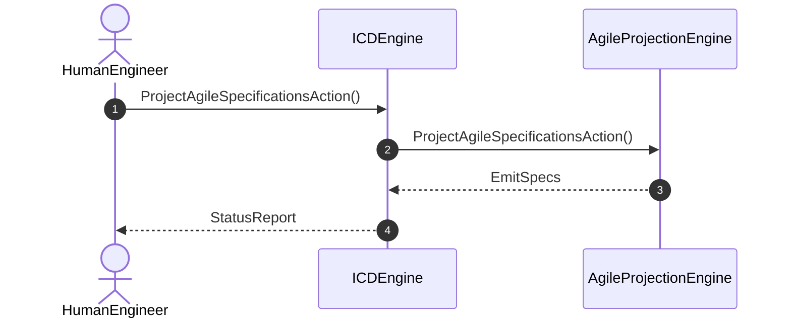

| Attribute | Specification Detail |
| :--- | :--- |
| **Issue ID** | #97 |
| **Title** | User Story 09: Project Agile Specifications Action |
| **Type** | user-story |
| **Parent Epic** | [EPIC-11-DownstreamAgileProjections](../epics/EPIC-11-DownstreamAgileProjections.md) |
| **SysML Interaction** | `AgileProjectionInteraction` |
| **SysML Test Case** | `Test_ProjectAgileSpecificationsAction` |
| **Generation Mode** | subagent |
| **Specification Source** | [schema/subsystems/downstream_agile_projections/behavior.sysml](../../schema/subsystems/downstream_agile_projections/behavior.sysml) |

# User Story 09: Project Agile Specifications Action

## UML Sequence Diagram

## Acceptance Criteria (BDD)
- [ ] AC-US-09-01: Given operational environment initialized, When ProjectAgileSpecificationsAction executes, Then AgileProjectionEngine processes the AST within defined latency envelope.
- [ ] AC-US-09-02: Given formal constraints, When semantic validator executes, Then asserts invariant satisfaction.
- [ ] AC-US-09-03: Given exceptional conditions, When error recovery activates, Then graceful recovery occurs without data loss.

## Required Features
- [ ] [Feature 01: [ConOps] Human Engineer Interface](../features/FEAT-01-HumanEngineer.md)
- [ ] [Feature 36: [Interconnect Contracts] ICDEngine](../features/FEAT-36-ICDEngine.md)
- [ ] [Feature 40: [Downstream Agile Projections] AgileProjectionEngine](../features/FEAT-40-AgileProjectionEngine.md)

## Source References
Operational concept definitions and system sequence interaction models:
- Subsystem Behavior Specification: `schema/subsystems/downstream_agile_projections/behavior.sysml`
- ConOps Operational Activities: `schema/conops/activities.sysml`
- System Architecture Model: `schema/model.sysml`
- Normative Systems Engineering Standard: ISO/IEC/IEEE 29148:2018 §6.4.2 Concept of Operations

Authoritative user story flows and interaction lifelines derive from `schema/subsystems/downstream_agile_projections/behavior.sysml` pursuant to ISO/IEC/IEEE 29148.
