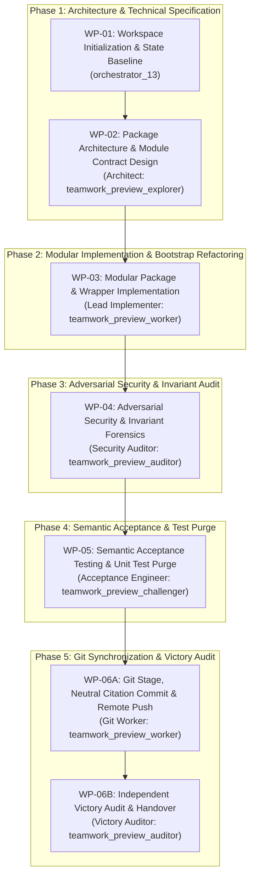

# Implementation Plan: Modular Python Installer Refactoring & Semantic Acceptance Architecture

## 1. Executive Summary & Objective

This implementation plan governs the end-to-end refactoring of `scripts/install_pipeline.sh` from a monolithic, brittle shell script (1,630 lines with multiple inline `python3 -c "..."` script snippets and destructive `rm -rf` operations) into a high-reliability, modular Python package under `scripts/installer/` with:
1. **Lightweight Bootstrap Shell Wrapper**: `scripts/install_pipeline.sh` reduced to <150 lines, validating host prerequisites (Python 3.10+, Git), setting signal traps (`trap cleanup EXIT ERR INT TERM`), and delegating cleanly to `python3 -m scripts.installer.cli "$@"`. Zero inline Python blocks (`python3 -c "..."`).
2. **Modular Python Package (`scripts/installer/`)**: Clean functional separation across `cli.py`, `metadata.py`, `staging.py`, `tracker.py`, `scaffolding.py`, and `rollback.py`.
3. **Atomic Directory Staging & State Preservation**: Asset preparation in `tempfile.TemporaryDirectory()`, non-destructive atomic promotion, and guaranteed 100% preservation of existing downstream metadata (`project_metadata.json`, `profile_config.json`, `schema.sysml`, `schema-digest.json`, `lineage.json`), custom `.gitignore` entries, and customer models.
4. **Adversarial Security Posture**: Zero shell injection vulnerabilities (100% list-style `subprocess.run(["git", ...], shell=False)` invocations), strict URL/input sanitization, and automatic atomic rollback on failure.
5. **Exclusive Semantic Acceptance Testing**: Adherence to the repository invariant forbidding unit tests (`tests/`, `test_*.py`, `pytest`). Pure end-to-end semantic acceptance testing verifying cold installs, upgrade persistence, and full passing execution of `scripts/verify_downstream_baseline.py` on both installed downstream directories and the compiler repo. Purging legacy unit test files so that `find . -name "test_*.py" -not -path "./.git/*"` returns only the existing validator in `parity_auditor/`.

---

## 2. Multi-Agent Team Architecture & Workflow Sequence

---

## 3. Detailed Work Packages

### WP-01: Workspace Initialization & State Baseline
- **Assigned Agent**: `orchestrator_13` (Role: `Project Orchestrator`)
- **Directives & Constraints**:
  - Verify working tree state via `git status --porcelain`.
  - Maintain `BRIEFING.md` and `progress.md` in `.agents/orchestrator_13/`.
  - Record the authoritative user request in `.agents/ORIGINAL_REQUEST.md`.
  - Author and present `implementation_plan.md` at repository root for user review.
  - Halt and enforce Strict Planning Gate until explicit user approval is granted.
- **Completion Criteria**: Workspace initialized, `implementation_plan.md` authored, awaiting approval.

### WP-02: Package Architecture & Module Contract Design
- **Assigned Agent**: `teamwork_preview_explorer` (Role: `System Architect & Package Designer`)
- **Scope & Analysis**:
  - Analyze lines 1-1630 of `scripts/install_pipeline.sh` to extract the complete feature matrix:
    - CLI arguments, aliases, and defaults (`--target`, `-r/--role`, `-p/-t/--platform/--provider`, `--gitlab-url`, `--gitlab-group`, `--github-org`, `--jira-url`, `--jira-project`, `--jira-email`, `--domain-url`, `--domain-name`).
    - Repository classification detection (`UPSTREAM_SPEC_CORE_COMPILER` self-install refusal, `DOMAIN_DISTRIBUTION_TEMPLATE`, `DOWNSTREAM_CUSTOMER_PROJECT`).
    - Git remote URL parsing (SSH and HTTPS variants, namespace/project extraction, host-to-provider detection).
    - Downstream asset copying and clean landing zone rules (preserving `.gitkeep` for domain templates vs. customer specs for customer projects).
    - Metadata extraction and preservation (`project_metadata.json`, `profile_config.json`, `lineage.json`, `schema.sysml`, `schema-digest.json`).
    - Dynamic README generation for both Domain Distribution Templates and Customer Projects, including Operator Prompt Catalogs and correct `${DOMAIN_REMOTE_URL}` embedding.
    - Consolidated rule compilation into `.pipeline/ACTIVE_RULES_BUNDLE.md`.
    - Issue tracker configuration in `codebase_rules.json` and `.gitlab-ci.yml`.
    - Verification of safety integrity test fixtures in `tests/fixtures/safety/`.
    - Automatic git hooks and tracker label bootstrapping.
  - Author a formal architecture specification in `.agents/explorer_r1_1/installer_architecture_spec.md` defining:
    - Package layout under `scripts/installer/`.
    - Function and class contracts for `cli.py`, `metadata.py`, `staging.py`, `tracker.py`, `scaffolding.py`, and `rollback.py`.
    - Staging lifecycle: initialization -> staging build -> metadata merge -> atomic swap / sync -> verification -> rollback on error.
- **Completion Criteria**: Verified specification artifact with complete class/function signatures and data flow contracts.

### WP-03: Modular Package Implementation & Bootstrap Wrapper Refactoring
- **Assigned Agent**: `teamwork_preview_worker` (Role: `Lead Implementer`)
- **Target Files**:
  - `scripts/installer/__init__.py`
  - `scripts/installer/cli.py`
  - `scripts/installer/metadata.py`
  - `scripts/installer/staging.py`
  - `scripts/installer/tracker.py`
  - `scripts/installer/scaffolding.py`
  - `scripts/installer/rollback.py`
  - `scripts/install_pipeline.sh`
- **Implementation Specifications**:
  1. **`scripts/installer/cli.py`**:
     - Use `argparse.ArgumentParser` to replicate 100% of CLI flags, short options, and aliases from `install_pipeline.sh`.
     - Validate input values (reject unknown providers, invalid roles, malformed URLs).
     - Provide standard exit codes (0 for success, 1/2 for syntax or operational errors).
  2. **`scripts/installer/metadata.py`**:
     - Remote URL parser using native `urllib.parse` and regex to safely dissect Git SSH (`git@...`) and HTTPS URLs without shell injection.
     - Role detection logic: detect `uav-*` as customer project, `DEAP-*` as domain template, or check `lineage.json`.
     - Project metadata discovery: safely read `project_metadata.json`, `codebase_rules.json`, `pubspec.yaml`, `package.json`, `pyproject.toml`, and `.pipeline/profile_config.json`.
     - Preservation manifest: capture existing files before staging.
  3. **`scripts/installer/staging.py` & `rollback.py`**:
     - Use `tempfile.TemporaryDirectory()` for non-destructive asset assembly.
     - Copy framework assets (`skills/`, `rules/`, `.pipeline/`, `.agents/`, `scripts/`, `requirements.txt`, `pyproject.toml`, `.gitignore`, `tests/fixtures/`).
     - Exclude upstream-only directories (`.pipeline/upstream`, `.pipeline/diagnostics`) from downstream targets.
     - Safely restore preserved metadata into the staging area.
     - Atomic promotion: copy or sync verified staged tree to target directory.
     - Structured exception handling (`try ... except ... finally`) with automatic snapshot rollback if promotion fails.
  4. **`scripts/installer/scaffolding.py`**:
     - Build `.pipeline/ACTIVE_RULES_BUNDLE.md` directly in Python: generate TOC with anchor links, read all `rules/*.md`, format headers, and output unified bundle.
     - Generate `.env.template` with GitHub, GitLab, and Jira environment variables.
     - Generate downstream `README.md` dynamically based on target role, embedding the verified domain remote URL and complete Operator Prompt Catalogs (matching existing content exactly).
     - Invoke `scripts/scaffold_downstream_agents.py` via `subprocess.run([sys.executable, ...])`.
     - Verify presence of safety fixtures in `tests/fixtures/safety/`.
  5. **`scripts/installer/tracker.py`**:
     - Safely update `codebase_rules.json` and `.gitlab-ci.yml` using `json.dump` (eliminating fragile `python3 -c` inline heredocs).
     - Bootstrap tracker labels via `skills/spec-orchestrator/scripts/bootstrap_tracker_labels.py`.
  6. **`scripts/install_pipeline.sh`**:
     - Rewrite as a clean bootstrap script (<150 lines).
     - `set -euo pipefail`.
     - Signal trapping: `trap cleanup EXIT ERR INT TERM`.
     - Check Python version (`python3 -c "import sys; sys.exit(0 if sys.version_info >= (3, 10) else 1)"`).
     - Check Git availability (`command -v git`).
     - Execute `exec python3 -m scripts.installer.cli "$@"`.
     - Zero inline `python3 -c "..."` application logic snippets.
- **Completion Criteria**: All Python modules and rewritten bootstrap wrapper authored, syntactically clean, and operational.

### WP-04: Adversarial Security & Invariant Forensics Audit
- **Assigned Agent**: `teamwork_preview_auditor` (Role: `Adversarial Security Auditor`)
- **Forensic Checkpoints**:
  1. **Shell Injection Prevention**: Audit all `subprocess.run` / `Popen` calls in `scripts/installer/` to guarantee 100% list-style argument passing with `shell=False`. Ensure zero `os.system` calls.
  2. **Signal Trapping & Atomic Rollback**: Verify that `scripts/install_pipeline.sh` and Python exception handlers properly catch interruptions (SIGINT, SIGTERM, exceptions) and do not leave partial or corrupted files in downstream workspaces.
  3. **Preservation Invariant**: Verify that consecutive runs over an existing downstream workspace (idempotence test) preserve `project_metadata.json`, `profile_config.json`, customer `schema/`, and custom `.gitignore` entries without data loss.
  4. **Zero Inline Python in Shell**: Verify `scripts/install_pipeline.sh` contains zero multi-line inline Python code blocks and is <150 lines.
  5. **Pure Schema-Driven Compiler Invariant**: Verify zero hardcoded customer domain concepts (no aircraft models or customer names) were introduced into installer logic.
- **Completion Criteria**: Formal audit report in `.agents/auditor_m1_1/security_audit_report.md` with explicit pass/fail verdicts on all 5 checkpoints.

### WP-05: Semantic Acceptance Testing & Legacy Unit Test Elimination
- **Assigned Agent**: `teamwork_preview_challenger` (Role: `Acceptance Test Engineer`)
- **Scope & Mandates**:
  1. **Strict Prohibition of Unit Tests Enforcement**:
     - Verify that coordinators and agents have authored zero unit test suites (`tests/`, `test_*.py`, `pytest`).
     - Purge existing legacy unit test files in `tests/` and root/scripts (`test_*.py`), moving them to `archive/unit_tests_legacy/` or deleting them, such that `find . -name "test_*.py" -not -path "./.git/*"` returns **only** `parity_auditor/src/parity_auditor/validators/test_completeness_validator.py` (which is an AST validator, not a unit test).
  2. **Semantic Acceptance Test 1 (Cold Installation)**:
     - Run `bash scripts/install_pipeline.sh <temp_dir>` against a clean, isolated temporary git repository.
     - Assert exit code 0.
     - Inspect the generated directory: verify existence of `.pipeline/ACTIVE_RULES_BUNDLE.md`, `AGENTS.md`, `CLAUDE.md`, `README.md`, `skills/`, `rules/`, `scripts/`.
     - Verify zero unescaped template tokens (`${...}` or `<...>` placeholders) in generated files.
  3. **Semantic Acceptance Test 2 (Upgrade & Idempotence Verification)**:
     - Populate a simulated downstream repository with custom `project_metadata.json`, `profile_config.json`, custom `.gitignore` entries, and custom schema files.
     - Run `bash scripts/install_pipeline.sh <simulated_dir>`.
     - Assert exit code 0.
     - Assert 100% data preservation: custom metadata and configs remain intact and uncorrupted.
  4. **Semantic Acceptance Test 3 (Downstream Baseline Verification)**:
     - Run `python3 scripts/verify_downstream_baseline.py <temp_dir>`.
     - Assert exit code 0 across all downstream checks.
  5. **Semantic Acceptance Test 4 (Compiler Repository Baseline Verification)**:
     - Run `python3 scripts/verify_downstream_baseline.py .` on the `DEAP01-spec-core` workspace.
     - Assert exit code 0 across all checks.
- **Completion Criteria**: Complete semantic acceptance verification dossier confirming exit code 0 on all scenarios and zero forbidden unit tests.

### WP-06: Git Stage, Neutral Citation Commit, Remote Sync & Victory Audit
- **Assigned Workers**: `teamwork_preview_worker` (Git Worker) & `teamwork_preview_auditor` (Victory Auditor)
- **Directives & Constraints**:
  - Clean up any untracked temporary files or scratch directories.
  - Verify commit message neutrality: citation format `(refs #401)` with zero auto-closing keywords (`fix`, `close`, `resolve`).
  - Stage all modified and new files: `git add scripts/install_pipeline.sh scripts/installer/ ...`.
  - Commit: `git commit -m "refactor(installer): modularize install_pipeline.sh into scripts/installer package with atomic staging and semantic acceptance (refs #401)"`.
  - Verify commit message via `python3 scripts/verify_commit_messages.py --head`.
  - Push to remote tracking branch: `git push origin main`.
  - Verify remote synchronization: `git diff origin/main` returns exactly 0 bytes.
  - Victory Auditor performs independent verification of the clean remote diff and passing baseline gates.
- **Completion Criteria**: Remote tracking branch updated; remote diff 0 bytes; victory verified.

---

## 4. Verification Gates Matrix

| Gate | Verification Command | Acceptance Standard |
|---|---|---|
| **Bootstrap Wrapper Line Count** | `wc -l scripts/install_pipeline.sh` | `< 150` lines |
| **Inline Python Elimination** | `grep -c "python3 -c" scripts/install_pipeline.sh` | `0` occurrences |
| **Unit Test Invariant Check** | `find . -name "test_*.py" -not -path "./.git/*"` | Only `parity_auditor/src/parity_auditor/validators/test_completeness_validator.py` |
| **Cold Install Semantic Test** | `bash scripts/install_pipeline.sh <temp_dir>` | Exit code `0`, clean asset tree |
| **Downstream Baseline Gate** | `python3 scripts/verify_downstream_baseline.py <temp_dir>` | Exit code `0`, all checks pass |
| **Compiler Baseline Gate** | `python3 scripts/verify_downstream_baseline.py .` | Exit code `0`, all checks pass |
| **Commit Neutrality Gate** | `python3 scripts/verify_commit_messages.py --head` | Exit code `0`, neutral citations only |
| **Remote Synchronization Gate** | `git diff origin/main` | Exactly `0` bytes |
