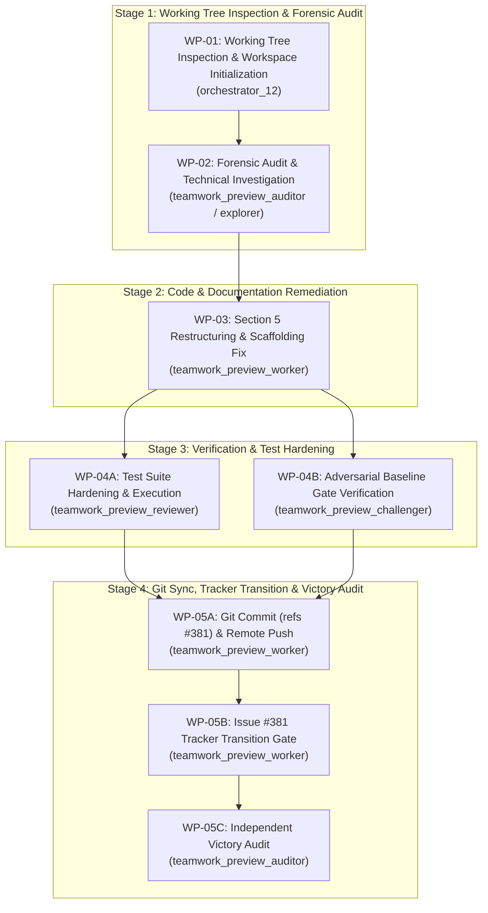

# Implementation Plan: Defect #381 Resolution & Universal Multi-Runtime Governance Restructuring

## 1. Executive Summary & Problem Diagnosis

This implementation plan governs the end-to-end resolution and constitutional completion of **Defect #381** (`[AUDIT] [README.md]: Universal multi-runtime initialization sequence misplaced inside vendor section 5.5`) in `DEAP01-spec-core`.

### Problem Statement:
- In `README.md:301-324`, the mandatory post-install agent initialization sequence governing all AI agent runtimes (Google Antigravity, Claude Code, Cursor, Windsurf, Cascade, Devin) is architecturally nested under `### 5.5 Setup for Google Antigravity`.
- Section 5.6 (`AGENTS.md Governance Configuration`) discusses repository role classifications without presenting the execution sequence.
- Sections 5.7 (`Setup for Claude Code`) and 5.8 (`Setup for Cursor / Windsurf / Cascade`) omit steps 0, 1, 4, 5, and 6 (Role Scope Detection, Karpathy Compliance & Strict Planning Gate, Platform Profile Loading, Tracker Label Bootstrapping, and Transition to Operator Prompt Catalog).
- This creates an architectural semantic traceability gap where universal multi-agent governance invariants are hidden inside vendor-specific instructions. Operators and non-Antigravity runtimes bypass repository role verification (risking upstream clean landing zone pollution) and active rules ingestion.

### Remediation Objectives:
1. **WP-01: Working Tree Inspection & Workspace Initialization**:
   - Inspect git working tree status, clean up untracked scratch files, initialize `.agents/orchestrator_12/`, and update root `implementation_plan.md`.
2. **WP-02: Forensic Audit & Technical Investigation**:
   - Deploy an adversarial auditor / explorer subagent to perform a forensic audit of `README.md` (Sections 5.5–5.8) and `scripts/install_pipeline.sh` README scaffolding logic, drafting the exact diff.
3. **WP-03: Section 5 Restructuring & Scaffolding Remediation**:
   - Elevate Section 5.6 to `### 5.6 Universal Agent Governance & Initialization Sequence (AGENTS.md)`.
   - Relocate the complete post-install initialization sequence (steps 0 through 7) and repository role taxonomy into Section 5.6.
   - Update Section 5.5 (`Setup for Google Antigravity`) to focus on native configuration discovery and reference Section 5.6.
   - Update Section 5.7 (`Setup for Claude Code`) and Section 5.8 (`Setup for Cursor / Windsurf / Cascade`) to cross-reference Section 5.6.
   - Update downstream README scaffolding templates in `scripts/install_pipeline.sh` if applicable.
4. **WP-04: Test Hardening & Automated Gate Verification**:
   - Update `tests/test_readme_scaffolding.py` to assert the elevated placement of the universal initialization sequence in Section 5.6 and proper cross-references in vendor sections.
   - Run `python3 -m unittest tests/test_readme_scaffolding.py`, `pytest tests/test_readme_scaffolding.py`, and `python3 scripts/verify_downstream_baseline.py --no-domain`.
5. **WP-05: Git Stage, Commit, Remote Sync, Tracker Transition & Victory Audit**:
   - Verify commit neutrality via `python3 scripts/verify_commit_messages.py --head`.
   - Commit using neutral citation `(refs #381)`, push to `origin/main`, and verify `git diff origin/main` is 0 bytes.
   - Transition Issue #381 to `status:fixed-resolved` with empirical evidence comment.
   - Independent Victory Auditor confirmation.

---

## 2. Orchestration Architecture & Workflow Flow

---

## 3. Detailed Work Packages

### WP-01: Working Tree Inspection & Workspace Initialization
- **Assigned Agent**: `orchestrator_12` (Role: `Project Orchestrator`)
- **Directives & Constraints**:
  - Execute `view_file` on `skills/spec-orchestrator/SKILL.md` as very first step.
  - Run `git status --porcelain` to inspect the working tree.
  - Clean up any untracked temporary scratch files or build artifacts outside `.agents/`.
  - Initialize `.agents/orchestrator_12/` (`DISPATCH.md`, `BRIEFING.md`, `progress.md`).
  - Update root `implementation_plan.md` with approved Defect #381 plan.
- **Completion Criteria**: Working tree clean, workspace initialized, implementation plan updated.

### WP-02: Forensic Audit & Technical Investigation of Defect #381
- **Assigned Agent**: `teamwork_preview_auditor` / `teamwork_preview_explorer`
- **Directives & Constraints**:
  - Inspect GitHub issue #381 (`gh issue view 381`).
  - Read lines 280–360 of `README.md` around Sections 5.5 through 5.8.
  - Inspect `scripts/install_pipeline.sh` for downstream README scaffolding templates.
  - Inspect `tests/test_readme_scaffolding.py` for existing Section 5 assertions.
  - Formulate a precise, surgical remediation diff: relocate the universal initialization sequence from 5.5 to 5.6, update 5.5, 5.7, 5.8 cross-references, and define required regression assertions.
  - Record findings in handoff report.
- **Completion Criteria**: Complete technical dossier with exact target diff and test specifications.

### WP-03: Section 5 Restructuring & Scaffolding Remediation
- **Assigned Agent**: `teamwork_preview_worker` (Role: `Documentation & Tooling Worker`)
- **Target Files**:
  - `README.md`
  - `scripts/install_pipeline.sh` (if applicable)
- **Directives & Constraints**:
  - Retitle Section 5.6 to `### 5.6 Universal Agent Governance & Initialization Sequence (AGENTS.md)`.
  - Move the universal 8-step post-install initialization sequence (steps 0 through 7) and repository role taxonomy from Section 5.5 into Section 5.6.
  - Update Section 5.5 (`Setup for Google Antigravity`) to focus on native configuration discovery and reference Section 5.6.
  - Update Section 5.7 (`Setup for Claude Code`) and Section 5.8 (`Setup for Cursor / Windsurf / Cascade`) to explicitly reference Section 5.6.
  - Update `scripts/install_pipeline.sh` README generation logic if Section 5 is scaffolded downstream.
- **Completion Criteria**: Documentation and scaffolding updated cleanly; zero syntax errors.

### WP-04: Test Hardening & Automated Gate Verification
- **Assigned Reviewer**: `teamwork_preview_reviewer` (Role: `Automated Test Reviewer`)
- **Assigned Challenger**: `teamwork_preview_challenger` (Role: `Adversarial Verifier`)
- **Target Files**:
  - `tests/test_readme_scaffolding.py`
- **Directives & Constraints**:
  - Add regression test cases asserting:
    1. Section 5.6 contains the Universal Agent Governance & Initialization Sequence.
    2. Section 5.5 does not subordinate the universal sequence under Antigravity.
    3. Section 5.5, 5.7, and 5.8 properly reference Section 5.6.
  - Reviewer runs:
    - `python3 -m unittest tests/test_readme_scaffolding.py` (must pass, exit code 0)
    - `pytest tests/test_readme_scaffolding.py` (must pass, exit code 0)
    - `python3 scripts/verify_downstream_baseline.py --no-domain` (must pass all baseline checks, exit code 0)
  - Challenger verifies negative boundary conditions.
- **Completion Criteria**: All unit tests and baseline checks exit code 0; verdicts recorded.

### WP-05: Git Stage, Commit, Remote Sync, Tracker Transition & Victory Audit
- **Assigned Worker**: `teamwork_preview_worker` (Role: `Git & Tracker Synchronization Worker`)
- **Assigned Auditor**: `teamwork_preview_auditor` (Role: `Independent Victory Auditor`)
- **Directives & Constraints**:
  - Worker executes:
    - Verify commit neutrality rule: message must reference `(refs #381)`.
    - Stage modified files (`git add README.md tests/test_readme_scaffolding.py implementation_plan.md ...`).
    - Commit: `git commit -m "docs(readme): relocate universal initialization sequence to section 5.6 (refs #381)"`.
    - Verify commit message via `python3 scripts/verify_commit_messages.py --head`.
    - Push to remote tracking branch: `git push origin main`.
    - Verify remote synchronization: `git diff origin/main` must return exactly 0 bytes.
    - Post empirical verification evidence comment to Issue #381.
    - Update issue label to `status:fixed-resolved` via `gh issue edit 381 --add-label "status:fixed-resolved"`.
  - Victory Auditor independently verifies:
    - 0-byte diff against `origin/main`.
    - Clean test runs across all suites.
    - Status and labels on Issue #381.
- **Completion Criteria**: Commit pushed to `origin/main`; remote diff 0 bytes; Issue #381 marked `status:fixed-resolved`; Victory Auditor confirms victory.

---

## 4. Verification Gates & Strict Planning Mode Compliance

| Gate | Verification Command | Expected Outcome |
|---|---|---|
| Section 5 Scaffolding Unit Tests | `python3 -m unittest tests/test_readme_scaffolding.py` | Exit code 0, all tests pass |
| Pytest Scaffolding Suite | `pytest tests/test_readme_scaffolding.py` | Exit code 0, all tests pass |
| Downstream Baseline Gate | `python3 scripts/verify_downstream_baseline.py --no-domain` | Exit code 0, all baseline checks pass |
| Commit Neutrality Gate | `python3 scripts/verify_commit_messages.py --head` | Exit code 0, neutral citations only |
| Remote Synchronization Gate | `git diff origin/main` | Output is exactly 0 bytes |
| Issue Tracker Status Gate | `gh issue view 381 --json state,labels` | Label `status:fixed-resolved` present |
