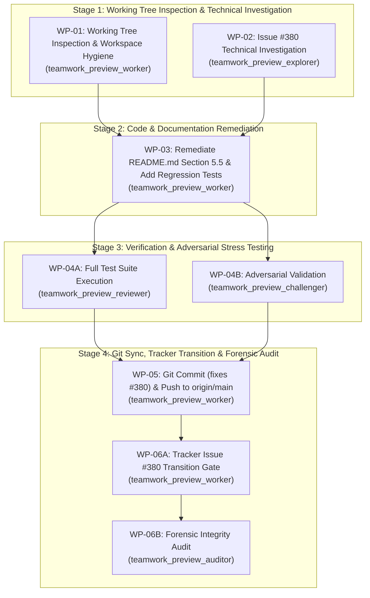

# Implementation Plan: Defect #380 Resolution & Governance Completion

## 1. Executive Summary & Problem Diagnosis

This implementation plan governs the end-to-end resolution and constitutional completion of **Defect #380** (`[AUDIT] [README.md:297-302]: Section 5.5 Prescribes Anti-Pattern Manual Chat Steering Instead of Native Configuration Discovery`) in `DEAP01-spec-core`.

### Problem Statement:
- Lines 297–302 of `README.md` (in Section 5.5 "Setup for Google Antigravity") prescribe manual chat steering instructions:
  e.g., instructing the operator to manually paste or type prompts into the chat box to steer Antigravity, rather than relying on native workspace configuration discovery and automated pipeline directives.
- This represents an anti-pattern that violates project governance principles (pure configuration discovery, autonomous execution, avoidance of interactive manual chat steering).
- The repository requires:
  1. Technical investigation of Issue #380 and the exact anti-pattern lines in `README.md` Section 5.5.
  2. Removal/remediation of manual chat steering in Section 5.5 in favor of native configuration discovery and authoritative directives.
  3. Regression test assertions in `tests/test_readme_scaffolding.py` verifying that Section 5.5 does not prescribe manual chat steering or anti-pattern prompts.
  4. Inspection and purging of any untracked scratch files/artifacts in the working tree.
  5. Clean execution and passing (exit code 0) of all automated test suites:
     - `python3 -m unittest tests/test_readme_scaffolding.py`
     - `pytest tests/test_readme_scaffolding.py`
     - `python3 scripts/verify_downstream_baseline.py --no-domain`
  6. Atomic git commit referencing `(fixes #380)`.
  7. Remote synchronization mandate: push to `origin/main` and verify `git diff origin/main` returns exactly 0 bytes.
  8. Mandatory Tracker Issue Transition Gate: apply `status:fixed-resolved` label to issue #380, post verification evidence comment, and close issue #380 via `gh issue`.
  9. Independent forensic integrity audit confirming zero cheating, full verification, and clean remote diff.

---

## 2. Orchestration Architecture & Workflow Flow

---

## 3. Detailed Work Packages

### WP-01: Working Tree Status Inspection & Scratch File Cleanup
- **Assigned Agent**: `teamwork_preview_worker` (Role: `Workspace Hygiene Worker`)
- **Directives & Constraints**:
  - Run `git status --porcelain` to inspect the working tree.
  - Identify and safely remove untracked temporary scratch files, test dumps, or build artifacts while preserving intentional modifications and agent state in `.agents/`.
  - Report exact status of modified and untracked files in handoff report.
- **Completion Criteria**: Clean working tree with no untracked scratch artifacts outside `.agents/` and expected files.

### WP-02: Issue #380 Technical Investigation
- **Assigned Agent**: `teamwork_preview_explorer` (Role: `Codebase Researcher`)
- **Directives & Constraints**:
  - Inspect GitHub issue #380 (`gh issue view 380`).
  - Read lines 280–320 of `README.md` around Section 5.5 to identify the exact phrasing and prescribed manual chat steering instructions.
  - Inspect `tests/test_readme_scaffolding.py` to examine existing Section 5.5 test coverage.
  - Formulate a precise, minimal remediation plan: how Section 5.5 should be revised to use native configuration discovery rather than manual chat steering, and what regression tests should be added.
  - Deliver detailed report in `handoff.md`.
- **Completion Criteria**: Complete technical dossier with exact line diff proposal and test specification.

### WP-03: Defect #380 Remediation & Test Hardening
- **Assigned Agent**: `teamwork_preview_worker` (Role: `Documentation & Tooling Worker`)
- **Target Files**:
  - `README.md`
  - `tests/test_readme_scaffolding.py`
- **Directives & Constraints**:
  - Apply the verified fix to Section 5.5 of `README.md`: eliminate manual chat steering anti-patterns in favor of native configuration discovery and authoritative instructions.
  - Add regression test cases to `tests/test_readme_scaffolding.py` asserting that Section 5.5 does not prescribe manual chat steering prompts and strictly adheres to native configuration discovery.
  - Run `python3 -m unittest tests/test_readme_scaffolding.py` to verify tests pass.
- **Completion Criteria**: Section 5.5 updated; regression tests added and passing.

### WP-04: Full Automated Test Suite & Baseline Gate Verification
- **Assigned Reviewer**: `teamwork_preview_reviewer` (Role: `Automated Test Reviewer`)
- **Assigned Challenger**: `teamwork_preview_challenger` (Role: `Adversarial Verifier`)
- **Directives & Constraints**:
  - Reviewer runs:
    - `python3 -m unittest tests/test_readme_scaffolding.py` (must pass, exit code 0)
    - `pytest tests/test_readme_scaffolding.py` (must pass, exit code 0)
    - `python3 scripts/verify_downstream_baseline.py --no-domain` (must pass all 30 checks, exit code 0)
  - Challenger tests boundary cases and negative assertions (ensuring any reintroduction of manual chat steering or deprecated CLI patterns is caught).
- **Completion Criteria**: All tests exit code 0; verdicts recorded in `GATE_STATUS.md`.

### WP-05: Git Commit & Remote Synchronization
- **Assigned Agent**: `teamwork_preview_worker` (Role: `Git Synchronization Worker`)
- **Directives & Constraints**:
  - Verify commit neutrality rule: message must reference `(fixes #380)`.
  - Stage target files: `git add README.md tests/test_readme_scaffolding.py implementation_plan.md`.
  - Commit: `git commit -m "docs(readme): eliminate manual chat steering in section 5.5 in favor of native discovery (fixes #380)"`.
  - Verify commit message via `python3 scripts/verify_commit_messages.py --head`.
  - Push to remote tracking branch: `git push origin main`.
  - Verify remote synchronization: `git diff origin/main` must be exactly 0 bytes.
- **Completion Criteria**: Commit pushed to `origin/main`; `git diff origin/main` returns 0 bytes.

### WP-06: Mandatory Tracker Issue Transition Gate & Forensic Audit
- **Assigned Worker**: `teamwork_preview_worker` (Role: `Tracker Transition Worker`)
- **Assigned Auditor**: `teamwork_preview_auditor` (Role: `Forensic Integrity Auditor`)
- **Directives & Constraints**:
  - Worker executes tracker transition:
    - `gh issue edit 380 --add-label "status:fixed-resolved"`
    - `gh issue comment 380 --body "<verification evidence with commit SHA and test logs>"`
    - `gh issue close 380 --comment "Closed as verified fixed in commit <SHA>."`
    - Verify `gh issue view 380 --json state,labels`.
  - Auditor independently verifies:
    - 0-byte diff against `origin/main`.
    - Clean test runs.
    - Zero cheating, mock evasion, or fabricated evidence.
    - Status and labels on issue #380.
- **Completion Criteria**: Issue #380 closed with `status:fixed-resolved` label and evidence comment; Auditor issues CLEAN verdict.

---

## 4. Verification Gates & Strict Planning Mode Compliance

| Gate | Verification Command | Expected Outcome |
|---|---|---|
| Section 5.5 Scaffolding Unit Tests | `python3 -m unittest tests/test_readme_scaffolding.py` | Exit code 0, all tests pass |
| Pytest Scaffolding Suite | `pytest tests/test_readme_scaffolding.py` | Exit code 0, all tests pass |
| Downstream Baseline Gate | `python3 scripts/verify_downstream_baseline.py --no-domain` | Exit code 0, all 30 checks pass |
| Commit Neutrality Gate | `python3 scripts/verify_commit_messages.py --head` | Exit code 0, valid syntax |
| Remote Synchronization Gate | `git diff origin/main` | Output is exactly 0 bytes |
| Issue Tracker Status Gate | `gh issue view 380 --json state,labels` | `state: CLOSED`, label `status:fixed-resolved` present |
