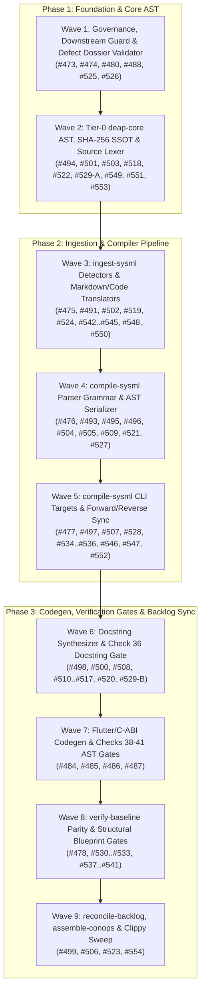

# Implementation Plan: DO-178C Level A / DO-330 TQL-4 `compile-sysml` 3-Layer Humble Object Architecture & Qualification Audit Remediation (`ARCH-01`–`ARCH-07`) + Defect Waves (`#473`–`#554`)

## 0. Priority Work Package: `compile-sysml` 3-Layer Humble Object Refactoring (`main.rs` / `cli.rs` / `driver.rs` / `lib.rs`) & Qualification Audit Remediation (`ARCH-01`–`ARCH-07`)

### 0.1 Software Engineering Metrics, 4-Layer Separation & Target Architecture
Decompose the 778-line monolithic `crates/compile-sysml/src/main.rs` ($v(G) \approx 54$, $C_e = 14$, 26 scattered `process::exit()` calls, and 4 conflated abstraction layers) into a DO-178C Level A / DO-330 TQL-4 Humble Object architecture with Single-Entry/Single-Exit (SESE), zero non-local `process::exit()` jumps inside library logic, and 100% library-encapsulated orchestration while simultaneously remediating `ARCH-01` through `ARCH-07`:

```text
crates/compile-sysml/src/
├── main.rs            (48 lines: SESE OS entrypoint; v(G) = 1 in main; Ce = 2; zero domain logic)
├── cli.rs             (Layer 1 — CLI Presentation: Clap `Cli` definition + `CommandMode` algebraic sum type; v(G) <= 6; Ce = 1)
├── driver.rs          (Layer 2 & 4 — Application Orchestration & Filesystem Target Resolution: SESE pipeline handlers, `execute_cli`, `run_compilation_gate`, `load_schema_package_for_cli` / `load_and_validate_schema`, `resolve_schema_targets`; v(G) <= 8; Ce <= 6)
└── lib.rs             (Layer 3 — AST Metamodel Transformation & Facade Exports: Re-exports `cli`, `driver`, and houses iterative `flatten_package_to_model` alongside `synthesize_mbd_bundle` and `collect_model_parts_recursive`)
```

#### Target Architectural Metrics

| Module | Responsibility (Single Responsibility Principle) | Max Function $v(G)$ | Coupling ($C_e$) | SESE Compliant? |
| :--- | :--- | :--- | :--- | :--- |
| **`src/main.rs`** | Parse OS args (`Cli::parse()`) $\rightarrow$ call `driver::execute_cli(cli)` $\rightarrow$ `process::exit(exit_code)` | **$v(G) = 1$** (`< 55` lines) | **2** (`clap`, `compile_sysml`) | **Yes (1 exit point, zero branching in `main`)** |
| **`src/cli.rs`** | Declarative `Cli` flags & pure conversion `Cli::into_mode` to `enum CommandMode` | **$v(G) \le 6$** | **1** (`clap`) | **Yes (pure functions)** |
| **`src/driver.rs`** | Mode dispatch (`execute_cli`, `execute`) & single-purpose pipeline handlers (`run_compilation_gate`, `load_schema_package_for_cli`, etc.) | **$v(G) \le 8$** | **$\le 6$** (internal facades) | **Yes (`Result<i32, (i32, String)>`)** |
| **`src/lib.rs`** | Pure AST transformation (`flatten_package_to_model` with iterative stack), MBD bundle synthesis, and library re-exports (`pub use cli::*; pub use driver::*;`) | **$v(G) \le 6$** | Internal AST modules | **Yes** |

#### Target Files
- `crates/compile-sysml/src/cli.rs` (**NEW**)
- `crates/compile-sysml/src/driver.rs` (**NEW**)
- `crates/compile-sysml/src/main.rs` (**MODIFIED** — reduced to ~48 lines, 1-page SESE adapter, $v(G) = 1$ in `fn main()`)
- `crates/compile-sysml/src/lib.rs` (**MODIFIED** — houses iterative `flatten_package_to_model`, `escape_matlab_single_quoted`, `BTreeSet` requirement indexing, and re-exports `cli` and `driver`)
- `crates/compile-sysml/src/semantic/digest.rs` (**MODIFIED**)
- `crates/compile-sysml/src/flutter_codegen.rs` (**MODIFIED**)
- `crates/compile-sysml/src/sync/forward.rs` (**MODIFIED**)
- `crates/compile-sysml/src/sync/reverse.rs` (**MODIFIED**)
- `crates/compile-sysml/src/stpa/fmeca.rs` (**MODIFIED**)
- `crates/compile-sysml/src/stpa/safety_suite.rs` (**MODIFIED**)

### 0.2 Sequential Refactoring Tasks & Audit Steps

#### Step 1 (`ARCH-03` — `crates/compile-sysml/src/lib.rs`): Move `flatten_package_to_model` to `src/lib.rs` with Iterative Stack Traversal
- Move `pub fn flatten_package_to_model(pkg: deap_core::sysml_ast::PackageDef, target_pkg: Option<&str>) -> deap_core::sysml_ast::SysmlModel` from `main.rs:668-700` into `crates/compile-sysml/src/lib.rs` (right next to `synthesize_mbd_bundle` and `collect_model_parts_recursive`), as it is a Layer-3 pure AST metamodel transformation over `PackageDef` and `SysmlModel`.
- Replace its shallow 1-level `pkg.packages.iter()` loop with an explicit iterative stack traversal (zero recursion) that flattens arbitrary subpackage nesting depths ($d \ge 2$) and preserves cross-package `requirement_defs`, `port_defs`, and `item_defs`.

#### Step 2 (`ARCH-05` — `crates/compile-sysml/src/cli.rs`): Extract `Cli` & Algebraic `CommandMode` Sum Type
- Move `struct Cli` (`#[derive(Parser, Debug)]`) into `crates/compile-sysml/src/cli.rs` with 100% backwards-compatible CLI flags (`Cli::parse_from` preserved for all existing unit and integration tests).
- Define the strongly-typed algebraic `#[derive(Debug, Clone, PartialEq, Eq)] pub enum CommandMode` to eliminate the 19-field flat `Cli` stamp coupling, primitive obsession, and dead boolean logic:
  - `InjectDocstrings { target_dir: PathBuf, schema: Option<PathBuf>, dry_run: bool, force: bool }`
  - `ExtractSource { extract_dir: PathBuf, out: PathBuf, digest: PathBuf, dry_run: bool }`
  - `ExportMbd { mbd_dir: PathBuf, schema: Option<PathBuf>, dry_run: bool }`
  - `SlicePackage { target_pkg: String, schema: Option<PathBuf> }`
  - `EmitFlutterContracts { target_dir: PathBuf, schema: Option<PathBuf>, dry_run: bool }`
  - `StpaTranspile { schema: Option<PathBuf>, out_dir: PathBuf, scoring_config: Option<PathBuf>, dry_run: bool }`
  - `StpaToConstraints { stpa_file: PathBuf, schema: Option<PathBuf>, out: PathBuf, dry_run: bool }`
  - `ForwardSync { schema: Option<PathBuf>, docs: PathBuf, out_dir: Option<PathBuf>, dry_run: bool, force: bool }`
  - `ReverseSync { schema: Option<PathBuf>, docs: PathBuf, out: PathBuf, digest: PathBuf, force: bool, dry_run: bool }`
  - `Compile { schema: Option<PathBuf>, out: PathBuf, digest: PathBuf, dry_run: bool }`
  - `ShowUsage`
- Implement `impl Cli { pub fn into_mode(self) -> Result<CommandMode, String> }` ($v(G) \le 6$) enforcing strict mutual exclusivity across primary mode flags (`active_modes > 1` returns `Err("Error: Multiple operational mode flags specified. Supply exactly one primary mode flag per invocation.".to_string())`).
- Annotate module (`//!`), `Cli`, `CommandMode`, and `Cli::into_mode` with complete, unique 7-section DO-178C/DO-330 safety docstrings satisfying Check 36.

#### Step 3 (`ARCH-01`, `ARCH-02`, `ARCH-04`, `ARCH-05` — `crates/compile-sysml/src/driver.rs`): Modular, Low-Complexity SESE Handlers ($v(G) \le 8$) & Unified Fail-Closed Schema Gate
- Move `SCHEMA_REMEDIATION_MESSAGE`, `SchemaTarget`, `resolve_schema_targets`, `resolve_schema_file`, `load_schema_package_for_cli`, `load_and_validate_schema`, and `run_compilation_gate` into `crates/compile-sysml/src/driver.rs` and re-export `pub use cli::*; pub use driver::*;` from `crates/compile-sysml/src/lib.rs` so external integration tests (`tests/*.rs`) and sibling crates can import them directly.
- **Unified Fail-Closed Schema Loader & `SemanticValidator` Gate (`ARCH-01` & `ARCH-02`)**:
  - Implement `pub fn load_and_validate_schema(explicit_path: Option<PathBuf>, require_validation: bool) -> Result<(SchemaTarget, deap_core::sysml_ast::PackageDef, String), String>` and `pub fn load_schema_package_for_cli(explicit_path: Option<PathBuf>) -> Result<(SchemaTarget, deap_core::sysml_ast::PackageDef, String), String>`.
  - Eliminate the 5 copy-pasted `match resolve_schema_targets` $\rightarrow$ `fs::read_to_string` $\rightarrow$ `parse_sysml` / `parse_sysml_tree` control diamonds by routing every handler through `load_and_validate_schema` / `load_schema_package_for_cli`.
  - Enforce non-empty file checks (`content.trim().is_empty()`), non-zero structural element counts (`count_structural_elements(&pkg) == 0`), and `SemanticValidator` validation (`require_validation = true`) across `ExportMbd`, `SlicePackage`, `EmitFlutterContracts`, `StpaTranspile`, `ForwardSync`, and `Compile`.
  - Eliminate all silent `.ok()` and `.unwrap_or_default()` fail-open paths across `StpaToConstraints` (`--stpa`), `ReverseSync` (`--reverse-sync`), `SlicePackage` (`--slice-package`), and `EmitFlutterContracts` (`--emit-flutter-contracts`).
- **Single-Purpose Mode Handlers ($v(G) \le 8$, SESE, Zero `process::exit`)**:
  - Implement `pub fn execute(cli: Cli) -> Result<i32, (i32, String)>` and `pub fn execute_cli(cli: Cli) -> i32` (which calls `execute(cli)` and writes any `Err((code, msg))` to `stderr`, returning `code`) dispatching `CommandMode` to dedicated small handlers (`handle_inject_docstrings`, `handle_extract_source`, `handle_export_mbd`, `handle_slice_package`, `handle_emit_flutter_contracts`, `handle_stpa_transpile`, `handle_stpa_to_constraints`, `handle_forward_sync`, `handle_reverse_sync`, `handle_compile`).
  - **Delete Redundant Topology Probing**: In `handle_emit_flutter_contracts`, pass `None` for `topology_json` and let `flutter_codegen::emit_flutter_contracts` use its own built-in fail-closed `assets/topology_data.json` discovery (`flutter_codegen.rs:724`).
  - **Eliminate Duplicated Inline STPA Transpilation**: Delegate `handle_stpa_transpile` to a dedicated `load_scoring_config(path: Option<&Path>) -> Result<Option<FmecaScoringConfig>, String>` helper + `load_and_validate_schema` + `stpa::emit_safety_suite` (or `stpa::transpile_stpa` facade).
  - Honor `dry_run` across all mutating modes (`ExportMbd`, `EmitFlutterContracts`, `StpaTranspile`, `StpaToConstraints`, `ReverseSync`, `Compile`).
- Relocate existing `main.rs` unit tests (plus new RED-GREEN unit tests for `ARCH-01`..`ARCH-07` and `CommandMode` mutual exclusivity) into `driver.rs` / `cli.rs` / `lib.rs` test modules.

#### Step 4 (`crates/compile-sysml/src/main.rs`): Replace Binary Entrypoint with < 1-Page SESE Adapter (~48 Lines, $v(G) = 1$, $C_e = 2$)
- Replace the 778-line `crates/compile-sysml/src/main.rs` with the 48-line Single-Entry/Single-Exit (SESE) Humble Entrypoint ($v(G) = 1$ in `fn main()`, zero branching logic, single `process::exit(exit_code)` call):
  ```rust
  use clap::Parser;
  use compile_sysml::cli::Cli;
  use compile_sysml::driver::execute_cli;
  use std::process;

  fn main() {
      let cli = Cli::parse();
      let exit_code = execute_cli(cli);
      process::exit(exit_code);
  }
  ```
- Preserve complete 7-section DO-178C Level A / DO-330 TQL-4 module (`//!`) and `fn main()` (`///`) safety docstrings (`Realises: [REQ-COMPILER-SYSML-CLI], [REQ-COMPILER-SYSML-MAIN], [DO-330-TQL-4-CLI]`).

#### Step 5 (`ARCH-04` — `crates/compile-sysml/src/semantic/digest.rs`, `driver.rs`, `lib.rs`, `flutter_codegen.rs`, `stpa/safety_suite.rs`): Harden `write_atomic` with PID-Scoped Temp Paths & `File::sync_all()`
- Update `write_atomic(path: &Path, content: &str) -> Result<(), io::Error>` in `crates/compile-sysml/src/semantic/digest.rs` to:
  1. Construct a sibling temporary filename preserving the full target filename and PID: `.{file_name}.tmp.{pid}` (`path.with_file_name(tmp_name)`).
  2. Write bytes to `fs::File::create(&tmp_path)` and flush durability via `file.sync_all()?` before `fs::rename(&tmp_path, path)?`.
- Delegate `SchemaDigest::write_to_file` to `write_atomic(path, &json_text)`.
- Replace raw `fs::write` calls in `driver.rs` (`run_compilation_gate` and `handle_stpa_to_constraints`), `lib.rs` (`export_mbd_artifacts`), `flutter_codegen.rs` (`emit_flutter_contracts`), and `stpa/safety_suite.rs` (`emit_safety_suite`) with `write_atomic`.

#### Step 6 (`ARCH-02`, `ARCH-06`, `ARCH-07` — `flutter_codegen.rs`, `lib.rs`, `sync/forward.rs`, `semantic/digest.rs`, `stpa/fmeca.rs`): Escape Dart/MATLAB Codegen Literals, Bind Full AST in `DEAP_SCHEMA_HASH`, Eliminate `Utc::now()` & Quadratic Lookups
- **`crates/compile-sysml/src/flutter_codegen.rs`**:
  - Add `pub fn escape_dart_single_quoted(s: &str) -> String` (with 7-section safety docstring) escaping `\`, `'`, and `$` (`\$`), and apply it to all single-quoted string interpolations in `generate_domain_seed_dart`, `generate_schema_models_dart`, and `generate_ui_contract_test_dart`.
  - In `emit_flutter_contracts`, compute `schema_hash` over canonical serialized model JSON (`serde_json::to_string(model)?`) combined with `topology_str` so any attribute, port, or invariant change alters `DEAP_SCHEMA_HASH`.
- **`crates/compile-sysml/src/lib.rs`**:
  - Add `pub fn escape_matlab_single_quoted(s: &str) -> String` (with 7-section safety docstring) escaping `'` as `''`, and apply it to all single-quoted MATLAB string interpolations in `synthesize_mbd_bundle`.
  - Index requirement satisfaction and deduplication using `BTreeSet` in `synthesize_mbd_bundle` to eliminate $O(R \cdot P)$ linear `.contains` scans.
  - Fail closed in `export_mbd_artifacts` if `TypeDescriptor` JSON serialization fails, and persist all 4 MBD files via `write_atomic`.
- **`crates/compile-sysml/src/sync/forward.rs`, `crates/compile-sysml/src/semantic/digest.rs`, & `crates/compile-sysml/src/stpa/fmeca.rs`**:
  - Remove `chrono::Utc::now()` wall-clock nondeterminism in `sync/forward.rs`.
  - Normalize manifest paths deterministically in `compute_file_manifest` (`semantic/digest.rs`) so digest entries are independent of arbitrary caller working directories outside the schema root.
  - Precompute negated component names into a `BTreeSet<String>` once in `generate_fmeca_matrix` (`stpa/fmeca.rs`) instead of rescanning the full serialized SysML text per part.

---

## 1. Objective & Scope (Defect Waves `#473`–`#554`)

Execute systematic remediation of all unfixed defect issues in the `#473`–`#554` range using `.agents/skills/debug-protocol/SKILL.md`, organized into **9 dependency-ordered waves** across the DEAP upstream specification core compiler (`UPSTREAM_SPEC_CORE_COMPILER`).

### Triage Summary (`#473`–`#554`, 82 Total Issues)
- **Excluded / Already Closed or Non-Bug (5 issues — no action)**:
  - `#481` (`OPEN`, `bug` + `status:fixed-resolved`), `#482` (`CLOSED`), `#490` (`CLOSED` duplicate of `#487`), `#483` (`feature`), `#489` (`feature`).
- **Already Fixed in `HEAD`, Missing Tracker Transition Only (2 issues — zero builds, zero code edits)**:
  - `#479` (`AGENTS.md`, resolved in `9e1560f` and `b2a08a3`) and `#492` (`crates/deap-core/src/source_ast.rs`, resolved in `0c6b689`, `298d637`, and `2405667`): post commit-reference comment and apply `status:fixed-resolved` via `gh issue edit` without rebuilding or re-running subagents.
  - Stage and commit the 15 untracked `.pipeline/defects/*.md` dossiers created when `#540`–`#554` were filed.
- **Active Unfixed Defects Requiring Code Remediation via `debug-protocol` (75 issues across Waves 1–9)**:
  - Includes `#484`–`#488` (re-opened for genuine remediation after `a97498d` reverted `c9ab2b8`), `#473`–`#478`, `#480`, `#491`, `#493`–`#500`, and `#501`–`#554`.

---

## 2. Dependency Architecture & Wave Ordering



---

## 3. Pre-Wave Tracker Hygiene (Zero Build / Zero Code Edits)

- **Target Files (Git Tracking Only)**:
  - `.pipeline/defects/defect-11-target-scan-dir-omits-docs-designs.md`
  - `.pipeline/defects/defect-12-section-slicer-rejects-sysml-citations.md`
  - `.pipeline/defects/defect-13-detect-format-misclassifies-digest-json-as-openapi.md`
  - `.pipeline/defects/defect-14-find-files-with-ext-includes-digest-json.md`
  - `.pipeline/defects/defect-15-is-output-sysml-masks-markdown-blueprints.md`
  - `.pipeline/defects/defect-16-discover-schema-targets-default-schema-dir-only.md`
  - `.pipeline/defects/defect-17-compile-sysml-resolve-schema-targets-schema-only.md`
  - `.pipeline/defects/defect-18-compile-sysml-merges-blueprint-triplets.md`
  - `.pipeline/defects/defect-19-discover-schema-files-admits-digest-json.md`
  - `.pipeline/defects/defect-20-extract-subsystem-parts-doc-comments-and-digest-json.md`
  - `.pipeline/defects/defect-21-extract-subsystem-parts-md-table-first-column-fallback.md`
  - `.pipeline/defects/forward-sync-hardcoded-issue-id-collision.md`
  - `.pipeline/defects/markdown-blueprint-package-collision.md`
  - `.pipeline/defects/markdown-bom-and-behavioral-ast-omission.md`
  - `.pipeline/defects/reconcile-backlog-unregistered-specs-and-upstream-links.md`
- **Tracker Label-Only Transitions (`#479`, `#492`)**:
  - Post existing commit citations (`9e1560f`/`b2a08a3` for `#479`; `0c6b689`/`298d637`/`2405667` for `#492`) and apply `status:fixed-resolved` via `gh issue edit`.

---

## 4. Detailed Work Packages & Target File Changes

### Wave 1: Governance, Downstream Test Guard, Defect Dossier Validator & Structural Check 34 Gates (`#473`, `#474`, `#480`, `#488`, `#525`, `#526`)

- **Target Files**:
  - `crates/deap-core/src/rules.rs`
  - `crates/verify-baseline/src/defect_dossier.rs`
  - `crates/verify-baseline/tests/defect_dossier_tests.rs`
  - `crates/verify-baseline/src/checks/structural.rs`
  - `AGENTS.md`
  - `rules/subagent-dispatch-standards.md`
  - `skills/adversarial-code-auditor/SKILL.md`
  - `Cargo.toml`
  - `crates/deap-core/Cargo.toml`
  - `crates/ingest-sysml/Cargo.toml`
  - `crates/compile-sysml/Cargo.toml`
  - `crates/verify-baseline/Cargo.toml`
  - `crates/reconcile-backlog/Cargo.toml`
  - `crates/assemble-conops/Cargo.toml`
- **Planned Changes**:
  1. **`#473` (`crates/deap-core/src/rules.rs`)**: Guard `test_canonical_architecture_blueprints_exist_on_disk` with `.pipeline/upstream` existence detection so downstream workspaces (where Check 12 prohibits master blueprints) skip the upstream-only on-disk check instead of panicking.
  2. **`#474` & `#480` (`crates/verify-baseline/src/defect_dossier.rs`, `AGENTS.md`, `rules/subagent-dispatch-standards.md`, `skills/adversarial-code-auditor/SKILL.md`, `crates/verify-baseline/tests/defect_dossier_tests.rs`)**:
     - Inject `SSL_CERT_FILE=/etc/ssl/cert.pem` on `gh` subprocess invocations in `publish_or_edit_github_issue` when `/etc/ssl/cert.pem` exists and `SSL_CERT_FILE` is unset or points to a proxy CA.
     - Synchronize `AGENTS.md` (`Mandatory Upstream Tooling Bug Reporting`) and `rules/subagent-dispatch-standards.md` with single-command `verify-baseline check-defect --body-file .pipeline/defects/<slug>.md` closed-loop publishing.
     - Add unit/integration assertions in `crates/verify-baseline/tests/defect_dossier_tests.rs` covering default publish behavior, `/tmp/` path rejection, and `SSL_CERT_FILE` environment configuration.
  3. **`#488` (`crates/verify-baseline/src/defect_dossier.rs`, `crates/verify-baseline/tests/defect_dossier_tests.rs`)**:
     - Harden `validate_defect_dossier` to skip fenced code blocks when extracting `<!-- test-target: ... -->` and `- **Test-Target**:`, enforce Check 19 domain cleanliness and Check 34 zero-regex inside Section 6 code blocks for upstream crates, and verify `test-target` crate paths exist on disk in `UPSTREAM_SPEC_CORE_COMPILER` workspaces.
  4. **`#525` & `#526` (`crates/verify-baseline/src/checks/structural.rs`, workspace `Cargo.toml` files)**:
     - Configure workspace lint policy (`[lints.clippy]`) in `Cargo.toml` using `deny` for `unwrap_used`, `expect_used`, `indexing_slicing`, `panic` so `clap_derive` `#[allow(clippy::...)]` expansions do not trigger `E0453` under `forbid`.
     - Remove the hardcoded `is_audited` file allowlist in `check_zero_regex` / `check_compiler_ast_purity`, enforce `C-PURITY-01..05` fail-closed I/O across crates, and scan for multi-line `allow(clippy::...)` blocks.

---

### Wave 2: Tier-0 `deap-core` AST Discovery, SHA-256 SSOT & Source AST Lexer (`#494`, `#501`, `#503`, `#518`, `#522`, `#529-A`, `#549`, `#551`, `#553`)

- **Target Files**:
  - `crates/deap-core/src/sysml_ast.rs`
  - `crates/deap-core/src/digest.rs`
  - `crates/deap-core/src/source_ast.rs`
  - `crates/ingest-sysml/src/digest.rs`
- **Planned Changes**:
  1. **`#549` (`crates/deap-core/src/sysml_ast.rs`)**: Exclude `.digest.json` sidecar files in `UnifiedSchemaModelExtractor::discover_schema_files`.
  2. **`#551` & `#553` (`crates/deap-core/src/sysml_ast.rs`)**:
     - Strip `doc /* ... */` block comments before scanning SysML tokens in `extract_subsystem_parts_from_text`, and reject `.digest.json` inputs.
     - Remove the unconditional first-column Markdown table fallback in `extract_subsystem_parts_from_text` so only tables with recognized architectural/component headers yield subsystem parts.
  3. **`#494`, `#503` & `#522` (`crates/deap-core/src/sysml_ast.rs`, `crates/deap-core/src/digest.rs`, `crates/ingest-sysml/src/digest.rs`)**:
     - Consolidate the duplicate manual SHA-256 implementation in `sysml_ast.rs` onto `deap_core::digest::sha256_hex`.
     - Replace `WalkDir::into_iter().flatten()` with fail-closed I/O error propagation in `digest.rs` and `sysml_ast.rs`, and replace vacuous `REQ-0001` tests with concrete digest verification assertions.
  4. **`#501`, `#518` & `#529` (Part A) (`crates/deap-core/src/source_ast.rs`)**:
     - Fix raw string (`r#"..."#`) and nested Dart string interpolation (`"${...}"`) state transitions in `RustDartLexState`.
     - Remove hardcoded `"Controller"` suffix heuristics and Dart `String`/`Key` parameter type assumptions, preserve nested generic type arguments without lossy flattening, and expose `RustDartLexState` and `ScopedItemScannerState` (`REQ-0605` `AC-01..AC-02`).

---

### Wave 3: Level-0 Ingestion Engine (`crates/ingest-sysml`) (`#475`, `#491`, `#502`, `#519`, `#524`, `#542`, `#543`, `#544`, `#545`, `#548`, `#550`)

- **Target Files**:
  - `crates/ingest-sysml/src/detectors.rs`
  - `crates/ingest-sysml/src/translators/markdown.rs`
  - `crates/ingest-sysml/src/translators/yang.rs`
  - `crates/ingest-sysml/src/translators/code.rs`
  - `crates/ingest-sysml/src/lib.rs`
  - `crates/ingest-sysml/src/main.rs`
  - `crates/ingest-sysml/tests/code_ingestion_tests.rs`
  - `crates/ingest-sysml/tests/code_realization_scoping_tests.rs`
- **Planned Changes**:
  1. **`#542` & `#543` (`crates/ingest-sysml/src/detectors.rs`)**: Reject `.digest.json` sidecar files in `detect_format` and exclude `.digest.json` in `find_files_with_ext`.
  2. **`#544` & `#545` (`crates/ingest-sysml/src/detectors.rs`)**:
     - Update `is_output_sysml` to recognize generated `blueprint-*.sysml` (or co-located `.sysml` next to `blueprint-*.md` in `docs/designs/`) so generated `.sysml` files do not mask authoritative Markdown blueprints.
     - Extend `discover_schema_targets` when `path_opt` is `None` to fall back to `docs/designs/` when `schema/` contains only `.gitkeep`.
  3. **`#548`, `#475`, `#550` & `#524` (`crates/ingest-sysml/src/translators/markdown.rs`)**:
     - Derive each blueprint's SysML package name deterministically from its `blueprint_id` or file stem rather than collapsing blueprints sharing `target_crates` frontmatter (`#548`).
     - Extract BOM `- **Subcomponents**:` bullets, Mermaid `stateDiagram-v2` and `sequenceDiagram` behavioral blocks in `translate_blueprint_markdown`, row-per-attribute tables, constraint names, interface latency values, and `UC-XX` use case definitions (`#475`, `#550`).
     - Sanitize `/*` and `*/` inside emitted `doc /* ... */` blocks, track `in_fenced_code_block` state during table extraction, and fix property name/type column ordering (`#524`).
  4. **`#502`, `#519` & `#491` (`crates/ingest-sysml/src/lib.rs`, `main.rs`, `translators/yang.rs`, `translators/code.rs`, tests)**:
     - Fail closed on empty file slices in `MarkdownTranslator::translate_files` and missing files in `YangTranslator::translate_files` (`#502`).
     - Remove hardcoded Flutter widget substrings and magic `UNMAPPED` checks in `translators/code.rs` (`#519`).
     - Remove all blanket `#![allow(clippy::...)]` attributes across `ingest-sysml` and resolve all underlying clippy lints (`#491`).

---

### Wave 4: `compile-sysml` Parser Grammar & Bijective AST Serializer (`#476`, `#493`, `#495`, `#496`, `#504`, `#505`, `#509`, `#521`, `#527`)

- **Target Files**:
  - `crates/compile-sysml/src/parser/grammar.rs`
  - `crates/compile-sysml/src/semantic/serializer.rs`
  - `crates/compile-sysml/src/main.rs`
- **Planned Changes**:
  1. **`#495` & `#521` (`crates/compile-sysml/src/parser/grammar.rs`)**: Remove the pre-scanner `normalize_type_sigils` raw text rewrite and parse composite type sigils (`&`, `[T]`, `(A, B)`, `<T>`, `::`) directly at the token level without shifting `Span.col` offsets or corrupting expressions.
  2. **`#496`, `#509` & `#505` (`crates/compile-sysml/src/parser/grammar.rs`, `crates/compile-sysml/src/semantic/serializer.rs`)**:
     - Update `SysmlParser::parse_state_decl` to capture `self.take_doc_comment()` inside the state body loop and pass it to sub-state and transition parsers instead of skipping documented sub-states via `skip_until_semi_or_brace()`.
     - Preserve token spacing in state `entry`/`do`/`exit` actions, parse transition endpoints without fabricating `{s}_to_{t}` names, and include sub-state transitions in MBD Stateflow `.sfx` export.
  3. **`#504` & `#527` (`crates/compile-sysml/src/parser/grammar.rs`, `crates/compile-sysml/src/main.rs`)**:
     - Fail closed with structured `ParseError` diagnostics on unknown statements across the 12 inner block parsers, align `ConnectionDef`/`RequirementDef`/`CalcDef` grammar and serializer symmetry, and add the bijective AST roundtrip gate in `run_compilation_gate`.
  4. **`#476`, `#493` & `#505` (`crates/compile-sysml/src/semantic/serializer.rs`)**:
     - Serialize `UseCaseDef::includes` (`include use case ...;`) and normalize quotes in `UseCaseDef::to_sysml`.
     - Strip duplicate quotes on `protocol_family`, `part_ref`, and `hazard_ref` in `PortDef::to_sysml`, `HazardDef::to_sysml`, and `RiskDef::to_sysml`; serialize `source_port` and `target_port` in `HazardDef`/`RiskDef`; serialize `TransitionDef::doc`; and serialize `severity`, `item_flow_ref`, `derives`, `parameters`, and sub-0.1ms `latency_ms` precision in `ConnectionDef`, `RequirementDef`, and `ActionDef`.

---

### Wave 5: `compile-sysml` CLI Target Resolution & Bidirectional Sync (`#477`, `#497`, `#507`, `#528`, `#534`, `#535`, `#536`, `#546`, `#547`, `#552`)

- **Target Files**:
  - `crates/compile-sysml/src/main.rs`
  - `crates/compile-sysml/src/sync/reverse.rs`
  - `crates/compile-sysml/src/sync/forward.rs`
  - `crates/verify-baseline/tests/blueprint_gate_tests.rs`
- **Planned Changes**:
  1. **`#546` & `#547` (`crates/compile-sysml/src/main.rs`)**:
     - Extend `resolve_schema_targets` when `explicit_path` is `None` to fall back to `docs/designs/blueprint-*.md` when `schema/` is a clean landing zone.
     - Update `run_compilation_gate` to compile `docs/designs/blueprint-*.md` targets into co-located per-blueprint triplets (`docs/designs/blueprint-XX-<slug>.sysml` and `docs/designs/blueprint-XX-<slug>.digest.json`) rather than merging them into `.pipeline/schema.sysml`.
  2. **`#534`, `#535` & `#536` (`crates/compile-sysml/src/sync/reverse.rs`)**:
     - Scope `reverse_sync_specs_to_sysml` Markdown discovery strictly to backlog directories (`docs/epics`, `docs/features`, `docs/user-stories`, `docs/use-cases`), extract `SC-*` safety constraints from `docs/designs/blueprint-*.md` alongside `docs/safety/STPA_MATRIX.md`, and compute digest `file_manifest` from the active schema/design directory.
  3. **`#477`, `#497`, `#507`, `#528` & `#552` (`crates/compile-sysml/src/sync/forward.rs`, `crates/compile-sysml/src/main.rs`, `crates/verify-baseline/tests/blueprint_gate_tests.rs`)**:
     - Remove hardcoded fallback issue IDs (`#10`, `#89`, `#95`, `#101`) in `forward.rs` (`#552`).
     - Remove hardcoded `EPIC-02-ConOps` User Story parent links, preserve multi-story Use Case realizations, and prevent root AST pollution during forward-to-reverse sync (`#507`).
     - Project Use Case and User Story specifications during forward sync without overwriting authored Epic/Feature prose sections (`#477`, `#497`).
     - Implement `REQ-0604` `AC-01..AC-05` contracts (`--emit-icd` `LogicalIcdMatrixCompiler`, `--emit-wbs` `MilStd881eWbsExporter`, typed `ActionDef` parameter roundtrip helpers, and `blueprint_gate_tests.rs` coverage) (`#528`).

---

### Wave 6: Docstring Synthesizer (`docstring.rs`) & Check 36 Docstring Gate (`docstring_gate.rs`) (`#498`, `#500`, `#508`, `#510`, `#511`, `#512`, `#513`, `#514`, `#515`, `#516`, `#517`, `#520`, `#529-B`)

- **Target Files**:
  - `crates/compile-sysml/src/docstring.rs`
  - `crates/compile-sysml/tests/docstring_injector_tests.rs`
  - `crates/verify-baseline/src/checks/docstring_gate.rs`
  - `crates/verify-baseline/tests/check_36_docstring_gate_tests.rs`
  - `crates/verify-baseline/tests/blueprint_gate_tests.rs`
- **Planned Changes**:
  1. **`#511`, `#513` & `#515` (`crates/compile-sysml/src/docstring.rs`)**: Remove hardcoded workstation path components (`"Users"`, `"jail"`) in `derive_module_req_tag`, remove scanner-evasion `concat` hacks and CWD-dependent self-grep skips, and purge aerospace/military domain strings from `docstring.rs` unit tests.
  2. **`#512`, `#514` & `#516` (`crates/compile-sysml/src/docstring.rs`)**: Replace string-prefix matching for `DocstringExitCode` (`2` vs `1`) with structured error variants, replace fixed line-count windows in `inspect_rust_item_details` and single-line `parse_rust_impl_header` with token/brace-balanced scanning, and eliminate doubled `Realises:` prefixes and hybrid 14-section docblocks.
  3. **`#498`, `#510`, `#520` & `#529` (Part B) (`crates/compile-sysml/src/docstring.rs`, `crates/verify-baseline/tests/blueprint_gate_tests.rs`)**: Implement `resolve_schema_context_strict` without `.first()` fallback truncation, fix cross-entity method attribution, populate Dart item details without magic item caps, and add `REQ-0605` contract verification in `blueprint_gate_tests.rs`.
  4. **`#500`, `#508` & `#517` (`crates/verify-baseline/src/checks/docstring_gate.rs`, `crates/verify-baseline/tests/check_36_docstring_gate_tests.rs`)**: Delegate Rust and Dart lexical scanning to `deap_core::source_ast` (removing the duplicated lexer, magic offset 14, and mid-line comment drop), bound the `in_mod_tests` brace depth latch, classify `unsafe fn` and `extern fn`, and complete Check 17/34/36 test assertions.

---

### Wave 7: Flutter & C-ABI Codegen (`flutter_codegen.rs`) & Checks 38–41 AST Anti-Fabrication Gates (`codebase.rs`) (`#484`, `#485`, `#486`, `#487`)

- **Target Files**:
  - `crates/compile-sysml/src/flutter_codegen.rs`
  - `crates/compile-sysml/tests/flutter_codegen_tests.rs`
  - `crates/verify-baseline/src/checks/codebase.rs`
  - `crates/verify-baseline/tests/codebase_checks_tests.rs`
- **Planned Changes**:
  1. **`#484` (`crates/compile-sysml/src/flutter_codegen.rs`, `crates/verify-baseline/src/checks/codebase.rs`)**: Replace simplified codegen templates in `flutter_codegen.rs` with full 6-layer deterministic Rust C-ABI solver bridge and Dart FFI binding synthesis, and harden Check 41 (`check_41_solver_bridge_and_sqlite_seed_parity_gate`) AST inspection banning duplicate Dart solver math.
  2. **`#485` (`crates/compile-sysml/src/flutter_codegen.rs`, `crates/verify-baseline/src/checks/codebase.rs`)**: Implement deterministic Rust SQLite seed codegen from SysML topology instances and enforce 1:1 topology-to-SQLite AST parity in Check 41.
  3. **`#486` (`crates/compile-sysml/src/flutter_codegen.rs`, `crates/verify-baseline/src/checks/codebase.rs`)**: Harden Check 39 (`check_39_zero_mocking_test_ast_gate`) and Check 40 (`check_40_ui_contract_test_completeness_gate`) AST verification and multi-viewport (1080p–6K) deterministic UI contract test codegen.
  4. **`#487` (`crates/verify-baseline/src/checks/codebase.rs`, `crates/verify-baseline/tests/codebase_checks_tests.rs`)**: Harden Check 38 (`check_38_presentation_anti_hardcoding_ast_gate`) token/AST scanner to catch hardcoded domain instance names, telemetry strings, and static boolean selection flags inside `build()` methods without domain-specific hardcoded word lists.

---

### Wave 8: `verify-baseline` Parity & Structural `docs/designs/` Gates (`#478`, `#530`, `#531`, `#532`, `#533`, `#537`, `#538`, `#539`, `#540`, `#541`)

- **Target Files**:
  - `crates/verify-baseline/src/checks/structural.rs`
  - `crates/verify-baseline/src/checks/parity_gates.rs`
- **Planned Changes**:
  1. **`#530`, `#531`, `#532` & `#533` (`crates/verify-baseline/src/checks/structural.rs`)**:
     - Extend Check 18 to inspect `docs/designs/*.sysml` and validate `.digest.json` model sidecars (`#530`, `#531`).
     - Exclude machine-generated `.digest.json` sidecars in `docs/designs/` from Check 33 prose scanning (`#532`).
     - Extend Check 37 (`check_blueprint_grounding`) to verify `docs/designs/blueprint-*.md` files alongside `docs/architecture/blueprints/` (`#533`).
  2. **`#540`, `#541`, `#537`, `#538`, `#539` & `#478` (`crates/verify-baseline/src/checks/parity_gates.rs`)**:
     - Add `TargetScanDir::Designs` (`docs/designs`) to `TargetScanDir::ALL` (`#540`).
     - Extend `SectionSlicer::extract_section` to resolve SysML v2 structural blocks (`part def`, `requirement def`, `constraint def`, `action def`, `package`) in `.sysml` targets (`#541`).
     - Include `docs/designs/*.sysml` in `discover_sysml_model_text` (`#537`), `discover_architectural_sysml_model_text` (`#538`), and Check 31 `check_dual_schema_ssot_parity` alongside `.digest.json` (`#539`).
     - Enforce fail-closed verification in `parity_gates.rs` when schema `UseCaseDef` nodes lack `docs/use-cases/` specification files (`#478`).

---

### Wave 9: Backlog Reconciler (`reconcile-backlog`), ConOps Assembler (`assemble-conops`) & Workspace Clippy Sweep (`#499`, `#506`, `#523`, `#554`)

- **Target Files**:
  - `crates/reconcile-backlog/src/lib.rs`
  - `crates/reconcile-backlog/src/main.rs`
  - `crates/reconcile-backlog/src/checklist.rs`
  - `crates/reconcile-backlog/src/frontmatter.rs`
  - `crates/assemble-conops/src/lib.rs`
  - `crates/assemble-conops/src/main.rs`
  - `crates/compile-sysml/src/lib.rs`
  - `crates/compile-sysml/src/main.rs`
  - `crates/verify-baseline/src/lib.rs`
  - `crates/verify-baseline/src/main.rs`
- **Planned Changes**:
  1. **`#554` (`crates/reconcile-backlog/src/lib.rs`)**: Implement bottom-up issue registration (`register_unallocated_specs_bottom_up` across tiers `use-case`/`user-story` → `feature` → `epic`) for specs with `issue_id: None`, and prefix generated GitHub blob URLs with `.pipeline/upstream/` when `workspace_root` targets `.pipeline/upstream`.
  2. **`#506` & `#522` (frontmatter portion) (`crates/reconcile-backlog/src/lib.rs`, `checklist.rs`, `frontmatter.rs`)**: Track multi-line HTML comment state (`advance_html_comment_state`) across `frontmatter.rs` and `lib.rs`, fix epic hierarchy inclusive counting (`count_total_epics_inclusive`), and isolate tests.
  3. **`#499` & `#523` (`crates/reconcile-backlog/src/lib.rs`, `main.rs`, `crates/assemble-conops/src/lib.rs`, `main.rs`, and remaining crate roots)**: Remove all remaining crate-level `#![allow(clippy::...)]` suppressions across `reconcile-backlog`, `assemble-conops`, and workspace crates, fixing all underlying clippy findings.

---

## 5. Verification & Completion Gates

1. **Per-Issue `debug-protocol` Gate**:
   - Every remediated defect ships with a native Rust `#[test]` demonstrated RED before the fix and GREEN after the fix.
   - Commit messages use neutral issue references `(refs #<id>)` per the Commit Message Non-Closure Invariant (`.pipeline/constitution.md:279`).
   - Each verified issue receives a forensic verification comment (`grep` proof, raw `cargo test` output, `git diff`) and the `status:fixed-resolved` label on GitHub.
2. **End-of-Wave & Final Workspace Verification Gates**:
   - `cargo test --workspace` passes with zero failures.
   - `cargo clippy --workspace --all-targets -- -D warnings` passes with zero warnings.
   - `./target/release/verify-baseline . --no-domain` exits `0` across all checks.
   - `git diff origin/main` is verified empty.
