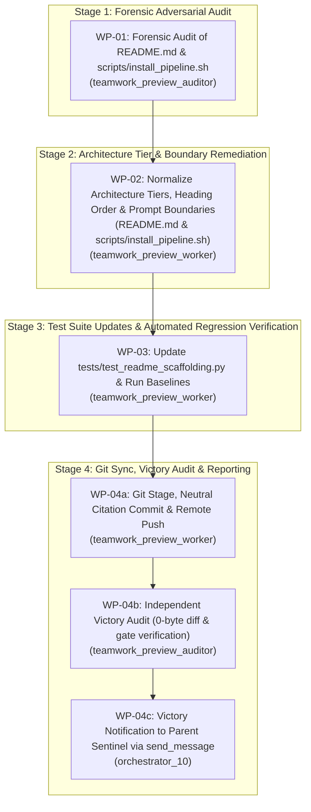

# Implementation Plan: Architecture Tier Normalization & Repository Boundary Hardening

## 1. Executive Summary & Problem Diagnosis

This implementation plan establishes atomic work packages to execute an adversarial audit and remediation of `README.md` and associated installer scaffolding templates in `DEAP01-spec-core` (addressing requirements R1 through R5).

### Root Causes & Structural Defects Identified:
1. **Contradictory Tier Numbering (R2)**:
   - In `README.md` (Sections 1.2 and 5.4) and ASCII topology diagrams, both the Upstream Specification Core Compiler (`DEAP01-spec-core`) and the Domain Distribution Templates (`DEAP-*`) are labeled "Tier 1".
   - In `scripts/install_pipeline.sh` (lines 882 & 953), Domain Distribution Templates are labeled "Tier 1" while Customer Application Workspaces are labeled "Tier 2".
   - This creates confusion between two distinct propagation boundaries (Compiler Propagation vs. Customer Onboarding) and repository tier classifications.
   - **Remediation**: Normalize to a clean, unambiguous three-tier architecture across all files:
     * **Tier 1**: Upstream Specification Core Compiler (`DEAP01-spec-core`, `UPSTREAM_SPEC_CORE_COMPILER`)
     * **Tier 2**: Domain Distribution Templates (`DEAP-*`, `DOMAIN_DISTRIBUTION_TEMPLATE`)
     * **Tier 3**: Customer Application Workspaces (`uav-*`, `DOWNSTREAM_CUSTOMER_PROJECT`)
2. **Inverted Heading Hierarchy in Section 1 (R2)**:
   - In `README.md`, Section 1 begins with `## 1. System Overview`, followed immediately by `### 1.2 Two-Tier Architecture Boundary...`, and only later features `## 1.1 Primary Commercial Toolchain Integration` at line 71.
   - **Remediation**: Correct heading order and hierarchy so `1.1 Primary Commercial Toolchain Integration` logically precedes `1.2 System Architecture & Repository Boundaries`.
3. **Repository Execution Boundary Ambiguity in Pipeline 2 (R3)**:
   - In `README.md` Section 9.4 (lines 1094, 1149, 1180), prompt preambles state: `Repository Classification: DOWNSTREAM_CUSTOMER_PROJECT (or UPSTREAM_SPEC_CORE_COMPILER depending on execution context)`.
   - This implies that concrete application features (Flutter UI, ROS2 nodes, PX4 autopilot modules) and digital twin simulation engines may be executed inside `UPSTREAM_SPEC_CORE_COMPILER`, violating the Pure Schema-Driven Compiler Invariant and Clean Landing Zone mandate.
   - **Remediation**: Clarify Section 9.4 preamble and purge all references suggesting Pipeline 2 can be run in `UPSTREAM_SPEC_CORE_COMPILER`. Restrict Pipeline 2 strictly to downstream customer application workspaces (`DOWNSTREAM_CUSTOMER_PROJECT`).
4. **Automated Test Assertions & Regression Coverage (R4)**:
   - `tests/test_readme_scaffolding.py` contains legacy docstrings and assertions referencing Tier 1 for domain templates and Tier 2 for customer workspaces.
   - **Remediation**: Update test suite to assert the normalized three-tier architecture, correct heading sequence, and absence of contradictory tier labels. Verify `verify_downstream_baseline.py --no-domain` and `test_readme_scaffolding.py` pass with exit code 0.
5. **Git Synchronization & Neutral Commit Mandate (R5)**:
   - Verify commit neutrality via `scripts/verify_commit_messages.py --head`.
   - Commit using neutral citation:
     `git commit -m "docs(readme): normalize architecture tiers, fix heading sequence, and harden repository boundary (refs #371, refs #368)"`
   - Push to GitHub `origin/main` and verify 0-byte remote diff via an independent Victory Auditor.

---

## 2. Orchestration Architecture & Workflow Flow



---

## 3. Detailed Work Packages

### WP-01: Forensic Adversarial Audit of README.md & Installer Scaffolding
- **Assigned Agent**: `teamwork_preview_auditor` (Role: `Adversarial Forensic Auditor`)
- **Target Files**:
  * `README.md`
  * `scripts/install_pipeline.sh`
  * `tests/test_readme_scaffolding.py`
- **Execution Details**:
  1. Audit `README.md` and `scripts/install_pipeline.sh` for:
     - Contradictory "Tier 1" / "Tier 2" labels across upstream compiler, domain distribution templates, and customer workspaces.
     - Heading sequence anomalies (e.g. 1.2 preceding 1.1).
     - Ambiguous repository classification directives in Section 9.4 that permit executing Pipeline 2 inside `UPSTREAM_SPEC_CORE_COMPILER`.
     - Outdated test citations or broken anchor links.
  2. Deliver comprehensive audit report to `.agents/auditor_wp01/handoff.md`.
- **Completion Criteria**: Detailed catalog of all contradictions and defects with exact line numbers and proposed structural fixes.

### WP-02: Architecture Tier Hierarchy, Heading Normalization & Repository Boundary Hardening
- **Assigned Agent**: `teamwork_preview_worker` (Role: `Documentation & Tooling Worker`)
- **Target Files**:
  * `README.md`
  * `scripts/install_pipeline.sh`
- **Execution Details**:
  1. In `README.md`:
     - Move Section 1.1 `## 1.1 Primary Commercial Toolchain Integration` so it precedes Section 1.2.
     - Update Section 1.2 title to `### 1.2 Three-Tier Architecture & Repository Boundaries`.
     - Update Section 1.2 ASCII diagram and text to clean three-tier architecture:
       * **Tier 1**: Upstream Specification Core Compiler (`DEAP01-spec-core`, `UPSTREAM_SPEC_CORE_COMPILER`)
       * **Tier 2**: Domain Distribution Templates (`DEAP-*`, `DOMAIN_DISTRIBUTION_TEMPLATE`)
       * **Tier 3**: Customer Application Workspaces (`uav-*`, `DOWNSTREAM_CUSTOMER_PROJECT`)
     - Update Section 5.4 title and ASCII diagram to reflect the clean three-tier architecture (Tier 1 Compiler -> Tier 2 Domain Templates -> Tier 3 Customer Workspaces).
     - In Section 9.4, add explicit restriction that Pipeline 2 is strictly intended for downstream customer application workspaces (`DOWNSTREAM_CUSTOMER_PROJECT`). Remove all occurrences of `(or UPSTREAM_SPEC_CORE_COMPILER depending on execution context)` from Worker 2A, Worker 2A.2, and Worker 2B prompt preambles.
  2. In `scripts/install_pipeline.sh`:
     - Update Section 1.1 of Domain Distribution Template README template (line 882): replace `As a **Tier 1 Domain Distribution Template**` with `As a **Tier 2 Domain Distribution Template**`.
     - Update Section 1.1 of Customer Application Workspace README template (line 953): replace `As a **Tier 2 Customer Application Workspace**` with `As a **Tier 3 Customer Application Workspace**`.
- **Completion Criteria**: Zero contradictory tier labels; clean 1.1 -> 1.2 sequence; strict customer-only boundary for Pipeline 2.

### WP-03: Automated Regression & Scaffolding Test Verification
- **Assigned Agent**: `teamwork_preview_worker` (Role: `Test Verification Worker`)
- **Target Files**:
  * `tests/test_readme_scaffolding.py`
- **Execution Details**:
  1. Update `tests/test_readme_scaffolding.py`:
     - Update docstrings and assertions to reflect three-tier architecture (Tier 1 Upstream Compiler, Tier 2 Domain Templates, Tier 3 Customer Workspaces).
     - Add assertions verifying that Section 1.1 precedes Section 1.2 in `README.md`.
     - Add assertions verifying that `README.md` and `scripts/install_pipeline.sh` contain zero contradictory "Tier 1" labels for domain templates and zero "Tier 2" labels for customer workspaces.
     - Add assertions verifying that Section 9.4 prompt preambles do not permit `UPSTREAM_SPEC_CORE_COMPILER`.
  2. Execute test suites:
     - `python3 -m unittest tests/test_readme_scaffolding.py` (assert exit code 0).
     - `python3 scripts/verify_downstream_baseline.py --no-domain` (assert exit code 0).
     - `python3 -m pytest tests/` (assert 0 failures).
- **Completion Criteria**: All tests pass cleanly with exit code 0.

### WP-04: Git Stage, Neutral Citation Commit, Remote Synchronization & Victory Audit
- **Assigned Agents**:
  * `teamwork_preview_worker` (Role: `Git Synchronization Worker`)
  * `teamwork_preview_auditor` (Role: `Independent Victory Auditor`)
- **Execution Details**:
  1. Verify zero auto-closing verbs via `python3 scripts/verify_commit_messages.py --head`.
  2. Stage all modified files (`git add README.md scripts/install_pipeline.sh tests/test_readme_scaffolding.py implementation_plan.md`).
  3. Commit with exact neutral citation:
     ```bash
     git commit -m "docs(readme): normalize architecture tiers, fix heading sequence, and harden repository boundary (refs #371, refs #368)"
     ```
  4. Push to remote tracking branch: `git push origin main`.
  5. Deploy Independent Victory Auditor to empirically verify:
     - `git diff origin/main` returns exactly 0 bytes.
     - `python3 -m unittest tests/test_readme_scaffolding.py` passes with exit code 0.
     - `python3 scripts/verify_downstream_baseline.py --no-domain` passes with exit code 0.
     - Commit message neutrality verified.
  6. Orchestrator transmits victory report to Parent Sentinel via `send_message`.
- **Completion Criteria**: Victory confirmed by auditor; remote synchronized at 0 bytes diff; parent sentinel notified.

---

## 4. Team Roster

| Role | Agent Type | Working Directory | Work Packages |
| :--- | :--- | :--- | :--- |
| **Project Orchestrator** | `orchestrator` | `.agents/orchestrator_10/` | Overall coordination, BRIEFING/progress tracking, synthesis, final victory report |
| **Forensic Auditor** | `teamwork_preview_auditor` | `.agents/auditor_wp01/` | WP-01 (Forensic audit of README.md & installer scaffolding) |
| **Remediation Worker** | `teamwork_preview_worker` | `.agents/worker_wp02/` | WP-02 (Normalize tiers, heading order, and boundary hardening) |
| **Test Verification Worker**| `teamwork_preview_worker` | `.agents/worker_wp03/` | WP-03 (Update test suite and run regression gates) |
| **Git Sync Worker** | `teamwork_preview_worker` | `.agents/worker_wp04/` | WP-04a (Git stage, commit, and push to origin/main) |
| **Victory Auditor** | `teamwork_preview_auditor` | `.agents/victory_auditor_8/` | WP-04b (Independent verification of remote diff and gate compliance) |

---

## 5. Acceptance Criteria Checklist

- [ ] **R1 / Audit**: Forensic audit report generated in `.agents/auditor_wp01/handoff.md` cataloging all tier numbering contradictions, heading ordering defects, and boundary ambiguities.
- [ ] **R2 / Tiers**: Clean three-tier architecture normalized across `README.md` (Sections 1.2 & 5.4) and `scripts/install_pipeline.sh`:
  * Tier 1: Upstream Specification Core Compiler (`DEAP01-spec-core`)
  * Tier 2: Domain Distribution Templates (`DEAP-*`)
  * Tier 3: Customer Application Workspaces (`uav-*`)
- [ ] **R2 / Headings**: Section 1.1 logically precedes Section 1.2 in `README.md`.
- [ ] **R3 / Boundaries**: Section 9.4 explicitly restricts Pipeline 2 to downstream customer workspaces (`DOWNSTREAM_CUSTOMER_PROJECT`); ambiguous references permitting `UPSTREAM_SPEC_CORE_COMPILER` purged.
- [ ] **R4 / Tests**: `python3 -m unittest tests/test_readme_scaffolding.py` passes with exit code 0.
- [ ] **R4 / Baseline**: `python3 scripts/verify_downstream_baseline.py --no-domain` passes all checks cleanly with exit code 0.
- [ ] **R5 / Commit**: Commit message strictly matches `docs(readme): normalize architecture tiers, fix heading sequence, and harden repository boundary (refs #371, refs #368)` with zero auto-closing verbs.
- [ ] **R5 / Remote**: `git diff origin/main` returns exactly 0 bytes after `git push origin main`.
- [ ] **R5 / Victory**: Independent Victory Auditor confirms clean remote diff and gate compliance.
- [ ] **Sentinel**: Final victory report delivered to Parent Sentinel via `send_message`.
