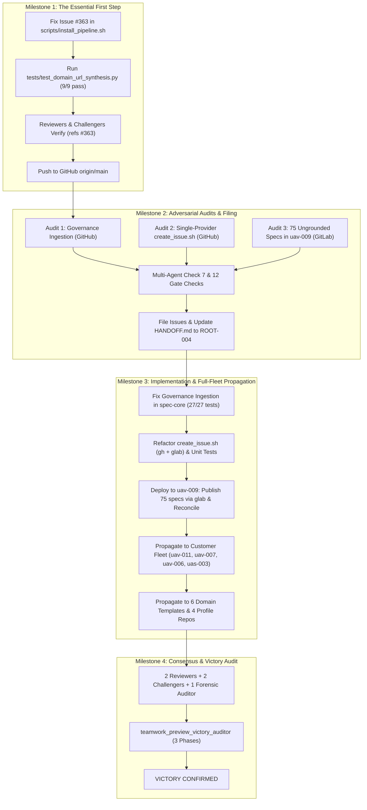

# Implementation Plan: Defect Remediation, Dual-Provider Tooling & Full-Fleet Downstream Propagation (Unabridged)

## 1. Executive Summary & Problem Context

The DEAP specification pipeline is executing an end-to-end defect remediation and full-fleet downstream propagation across upstream compiler, domain distribution templates, and customer application workspaces:

1. **Milestone 1: The Essential First Step — Fix Issue #363 in DEAP01-spec-core (`scripts/install_pipeline.sh`)**:
   - In role detection (`scripts/install_pipeline.sh:324-342`), when `--domain-url` is specified, `TARGET_ROLE` defaults to `DOWNSTREAM_CUSTOMER_PROJECT`.
   - Consequently, the domain template customer onboarding clone command in `README.md` is omitted, causing `test_domain_url_synthesis.py` unit tests to fail.
   - Fix: Update `install_pipeline.sh` role detection logic so that passing `--domain-url` or `--domain-name`, or having a domain template remote, properly classifies the target as `DOMAIN_DISTRIBUTION_TEMPLATE` (unless explicitly overridden by `--role`) and synthesizes the authoritative customer onboarding clone command cleanly.
   - Verify: `python3 -m unittest -v tests/test_domain_url_synthesis.py` passes 9/9 tests with exit code 0.
   - Commit & Push: Convene Reviewer and Challenger subagents to verify diff and neutral citation `(refs #363)`, and push to GitHub `origin/main`.

2. **Milestone 2: Adversarial Defect Audits & Tracker Grounding**:
   - Dispatch context-isolated auditor subagents per `skills/adversarial-code-auditor/SKILL.md`:
     1. Audit Governance Ingestion Defect in `README.md` and `docs/OPERATOR_PROMPT_CATALOG.md` (bare directory reads) -> Post to GitHub `gintatkinson/DEAP01-spec-core`.
     2. Audit Single-Provider Tooling Defect in `skills/spec-orchestrator/scripts/create_issue.sh` (hardcoded `gh` CLI) -> Post to GitHub `gintatkinson/DEAP01-spec-core`.
     3. Audit Downstream Specification Grounding Defect in `/Users/perkunas/jail/uav-009/docs/` (75 ungrounded specs with `#[IssueID]`) -> Post to GitLab `gintatkinson/uav-009`.
   - Multi-Agent Gate: 12 checks + offline Check 7 Mermaid syntax verified before posting.
   - Capture created issue IDs and update `HANDOFF.md` to `DEAP-HANDOFF-ROOT-004`.

3. **Milestone 3: Implementation, Grounding & Full-Fleet Downstream Propagation**:
   - Step 1: Fix governance ingestion in `DEAP01-spec-core` (`README.md`, `docs/OPERATOR_PROMPT_CATALOG.md`, `scripts/scaffold_downstream_agents.py`) to mandate reading `.pipeline/ACTIVE_RULES_BUNDLE.md`. Verify unit tests in `tests/test_readme_scaffolding.py` (27/27 pass) and Check 14.
   - Step 2: Refactor `create_issue.sh` with `gh` + `glab` auto-detection and link rewriting. Add regression tests in `tests/test_create_issue_dual_provider.py`.
   - Step 3: Deploy updated tooling to `/Users/perkunas/jail/uav-009`, publish 75 specs via `glab`, run `reconcile_backlog.py --provider gitlab`, replace `#[IssueID]` tokens with live numeric IDs, and pass 30/30 baseline checks.
   - Step 4: Propagate verified installer to customer workspaces (`/Users/perkunas/jail/uav-011`, `uav-007`, `uav-006`, `uas-003`). Pass 30/30 checks and push to GitLab.
   - Step 5: Propagate verified installer to 6 Tier 1 domain distribution templates (`DEAP-uas-infrastructure-safety`, `DEAP-surgical-robotics-console`, `DEAP-space-cubesat-constellation`, `DEAP-industrial-warehouse-agv`, `DEAP-subsea-oceanographic-auv`, `DEAP-rail-autonomous-locomotive`) and Profile Repositories (`DEAP-profile-flutter-app`, `DEAP-profile-react-web`, `DEAP-profile-backend-api`, `DEAP-profile-vhdl-hardware`). Preserve clean landing zone invariant (`.gitkeep` only), verify 0-byte remote diffs, and push to GitHub.

4. **Milestone 4: Multi-Agent Consensus Gate & Independent Victory Audit**:
   - Convene final multi-agent review gate (2 Reviewers, 2 Challengers, 1 Forensic Auditor).
   - Parent Sentinel dispatches `teamwork_preview_victory_auditor` for 3-phase audit.
   - Issue `VICTORY CONFIRMED`.

---

## 2. Target Repositories & Fleet Inventory

| Repository / Project | Role & Classification | Host Platform & Remote URL | Exact Scope & Tasks |
| :--- | :--- | :--- | :--- |
| **`/Users/perkunas/jail/DEAP01-spec-core`** | `UPSTREAM_SPEC_CORE_COMPILER` | GitHub `https://github.com/gintatkinson/DEAP01-spec-core.git` | 1. Fix #363 role detection in `install_pipeline.sh`. 2. File Defect Dossiers 1 & 2. 3. Fix governance ingestion in `README.md`, `OPERATOR_PROMPT_CATALOG.md`, `scaffold_downstream_agents.py`. 4. Refactor `create_issue.sh` for dual-provider (`gh`/`glab`). |
| **`/Users/perkunas/jail/uav-009`** | `DOWNSTREAM_CUSTOMER_PROJECT` | GitLab `https://gitlab.com/gintatkinson/uav-009.git` | 1. File Defect Dossier 3 on GitLab. 2. Deploy updated tooling. 3. Publish 75 leaf specs via `glab`. 4. Reconcile backlog (`reconcile_backlog.py --provider gitlab`). 5. Pass 30/30 baseline checks & push to GitLab. |
| **`/Users/perkunas/jail/uav-011`** | `DOWNSTREAM_CUSTOMER_PROJECT` | GitLab `https://gitlab.com/gintatkinson/uav-011.git` | Upgrade in-place, verify 30 baseline checks, push to GitLab. |
| **`/Users/perkunas/jail/uav-007`** | `DOWNSTREAM_CUSTOMER_PROJECT` | GitLab `https://gitlab.com/gintatkinson/uav-007.git` | Upgrade in-place, verify 30 baseline checks, push to GitLab. |
| **`/Users/perkunas/jail/uav-006`** | `DOWNSTREAM_CUSTOMER_PROJECT` | GitLab `https://gitlab.com/gintatkinson/uav-006.git` | Upgrade in-place, verify 30 baseline checks, push to GitLab. |
| **`/Users/perkunas/jail/uas-003`** | `DOWNSTREAM_CUSTOMER_PROJECT` | GitLab `https://gitlab.com/gintatkinson/uas-003.git` | Upgrade in-place, verify 30 baseline checks, push to GitLab. |
| **6 Tier 1 Domain Templates** | `DOMAIN_DISTRIBUTION_TEMPLATE` | GitHub (`DEAP-uas-infrastructure-safety`, `DEAP-surgical-robotics-console`, `DEAP-space-cubesat-constellation`, `DEAP-industrial-warehouse-agv`, `DEAP-subsea-oceanographic-auv`, `DEAP-rail-autonomous-locomotive`) | Propagate installer, verify clean landing zones (`.gitkeep` only), commit, push to GitHub. |
| **4 Profile Repositories** | `PROFILE_DISTRIBUTION_TEMPLATE` | GitHub (`DEAP-profile-flutter-app`, `DEAP-profile-react-web`, `DEAP-profile-backend-api`, `DEAP-profile-vhdl-hardware`) | Propagate installer, verify clean landing zones, commit, push to GitHub. |

---

## 3. Work Package Technical Specifications

### WP-01: Fix Issue #363 in `scripts/install_pipeline.sh`
- **Location**: `scripts/install_pipeline.sh:324-342`
- **Changes**: Ensure role auto-detection treats `[ -n "$DOMAIN_URL" ]` or `[ -n "$DOMAIN_NAME" ]` as `DOMAIN_DISTRIBUTION_TEMPLATE` unless overridden by `--role`, properly generating customer onboarding clone commands in `README.md`.
- **Verification**: `python3 -m unittest -v tests/test_domain_url_synthesis.py` (9/9 pass).

### WP-02: Adversarial Defect Audits & Tracker Filing
- **Subagents**: Context-isolated auditors running `skills/adversarial-code-auditor/SKILL.md`.
- **Audits**:
  1. Governance Ingestion Defect (bare directory reads) in `DEAP01-spec-core` -> GitHub issue.
  2. Single-Provider Tooling Defect in `create_issue.sh` -> GitHub issue.
  3. 75 Ungrounded Specs in `uav-009` -> GitLab issue.
- **Verification**: 12 checks + offline Check 7 Mermaid validator.

### WP-03: Governance Ingestion Remediation (`DEAP01-spec-core`)
- **Location**: `README.md`, `docs/OPERATOR_PROMPT_CATALOG.md`, `scripts/scaffold_downstream_agents.py`.
- **Changes**: Replace bare directory references with `.pipeline/ACTIVE_RULES_BUNDLE.md`.
- **Verification**: `python3 -m unittest -v tests/test_readme_scaffolding.py` (27/27 pass) and Check 14.

### WP-04: Dual-Provider `create_issue.sh` Refactor
- **Location**: `skills/spec-orchestrator/scripts/create_issue.sh`.
- **Changes**: Auto-detect `gh` vs `glab`, implement GitLab idempotency, label creation, issue creation, and blob link rewriting (`/-/blob/`).
- **Verification**: `tests/test_create_issue_dual_provider.py`.

### WP-05: `uav-009` Specification Grounding & Reconciliation
- **Location**: `/Users/perkunas/jail/uav-009/`.
- **Changes**: Install pipeline, publish 75 specs via `glab`, run `reconcile_backlog.py --provider gitlab`, replace `#[IssueID]` tokens.
- **Verification**: `python3 scripts/verify_downstream_baseline.py` (30/30 checks pass), 0 ungrounded `#[IssueID]` tokens remaining, push to GitLab.

### WP-06: Full Downstream Fleet Propagation
- **Targets**: Customer workspaces (`uav-011`, `uav-007`, `uav-006`, `uas-003`), 6 Domain Templates, 4 Profile Repositories.
- **Verification**: 30/30 checks in customer repos, clean landing zone invariant in templates, 0-byte remote diffs, all pushed.

### WP-07: Multi-Agent Consensus Gate & Victory Audit
- **Reviewers & Challengers**: Unanimous APPROVE / CLEAN verdicts.
- **Forensic Auditor**: Comprehensive traceability check.
- **Victory Auditor**: 3-Phase audit (Timeline, Integrity, Independent Test Execution).

---

## 4. Team Roster

| Team Role | Agent Type / Subagent Name | Specific Responsibilities |
| :--- | :--- | :--- |
| **Governance Sentinel** | `teamwork_preview_sentinel` | Monitored execution; dispatches Victory Auditor. |
| **Master Orchestrator** | `teamwork_preview_orchestrator` | Coordinates milestones; maintains `BRIEFING.md` & `progress.md`; dispatches workers. |
| **Worker (Issue #363)** | `teamwork_preview_worker_m1` | Fixes role detection in `install_pipeline.sh`; verifies 9/9 tests pass. |
| **Auditor 1, 2, 3** | `teamwork_preview_auditor_1/2/3` | Conducts 5-pillar audits and files issues on GitHub/GitLab. |
| **Worker (Dual-Provider)**| `teamwork_preview_worker_m3` | Refactors `create_issue.sh` and governance bundles. |
| **Worker (uav-009 Grounding)**| `teamwork_preview_worker_uav009` | Publishes 75 specs to GitLab, runs reconciliation, passes 30 checks. |
| **Worker (Fleet Propagator)**| `teamwork_preview_worker_fleet` | Propagates installer to customer workspaces and domain templates. |
| **Worker 1 (Documentation Specialist)** | `worker_1_doc_specialist` | Restores Pipeline 1 & 2 topologies, Grounding Auditor prompt, and Flutter/ROS2 prompts in README.md and OPERATOR_PROMPT_CATALOG.md. |
| **Reviewer 1 & 2** | `reviewer_1`, `reviewer_2` | Verifies code hygiene, non-closure commit invariants `(refs #<id>)`, clean landing zones. |
| **Challenger 1 & 2** | `challenger_1`, `challenger_2` | Tests edge cases, missing binaries, failure paths, rate limits. |
| **Forensic Auditor** | `forensic_auditor` | Audits full traceability and ensures zero mock content. |
| **Victory Auditor** | `teamwork_preview_victory_auditor` | Independent 3-phase audit for `VICTORY CONFIRMED`. |

---

## 5. Track 1: Upstream Core Tooling, Documentation & Tracker Housekeeping

### WP-1A: Audit, File Defect & Remediate README.md Worker Instructions
1. Perform 5-pillar audit on `README.md` and `docs/OPERATOR_PROMPT_CATALOG.md` for incomplete worker instructions.
2. Generate verified 7-section defect dossier and file upstream on GitHub `gintatkinson/DEAP01-spec-core` via `python3 scripts/file_defect.py` (Issue #371 created).
3. Remediate `README.md` and `docs/OPERATOR_PROMPT_CATALOG.md`:
   - Restore Section 8.2 (Pipeline 1 Agile Backlog Subagent Topology: Workers 1A-1D).
   - Restore Section 8.3 (Pipeline 2 Autonomous Feature Implementation & Simulation Subagent Topology: Workers 2A, 2B, Reviewers 1-2, Challengers 1-2, Victory Auditor).
   - Restore Section 9.3 (Pipeline 1 Review & Verification Prompts: Grounding Auditor, Backlog Reconciliation).
   - Expand Section 9.4: Add concrete Section 9.4.1.1 Worker 2A (Flutter Feature Implementation Prompt with `app_flutter/`, MVVM, 15 Domain Standards, `---GOVERNANCE-END---`, and verification commands), Section 9.4.1.2 Worker 2A (ROS2/PX4 Prompt), and step-by-step operator execution guide.
4. Run verification tests:
   `python3 -m unittest -v tests/test_readme_scaffolding.py`
   `python3 scripts/verify_downstream_baseline.py --no-domain`
5. Commit with neutral citation:
   `git commit -m "docs(readme): restore Pipeline 1 & 2 topologies and add concrete Flutter feature prompt (refs #371)"`

### WP-1B: Upstream Tracker Housekeeping (Issues #369, #370, #371)
1. GitHub Issue #369: Add label `status:fixed-resolved` and post verification comment citing commit 2be1a45 and tests/test_readme_scaffolding.py (27/27 pass).
2. GitHub Issue #370: Add label `status:fixed-resolved` and post verification comment citing commits d356aa3, 8d21928, b09431b, f7f9c31, tests/test_create_issue_dual_provider.py (22/22 pass), and verified live deployment in uav-009 (75 specs, 0 ungrounded tokens).
3. GitHub Issue #371: Add label `status:fixed-resolved` and post verification comment citing remediation commit, tests/test_readme_scaffolding.py pass, and inspection evidence.

### WP-1C: Upstream Conformance & Push
1. Run `python3 scripts/verify_downstream_baseline.py --no-domain` (all checks pass, exit code 0).
2. Push changes to GitHub `origin/main`.
3. Verify `git diff origin/main` is 0 bytes.

### Consensus & Victory Audit Gate
- Reviewer 1: Verify documentation integrity, neutral commit citations `(refs #<id>)`, and issue non-closure.
- Challenger 1: Verify 100% boundary confinement to DEAP01-spec-core with zero touches outside.
- Victory Auditor: Confirm GitHub issue statuses, passing baseline checks, 0-byte remote diff, and issue VICTORY CONFIRMED report.

