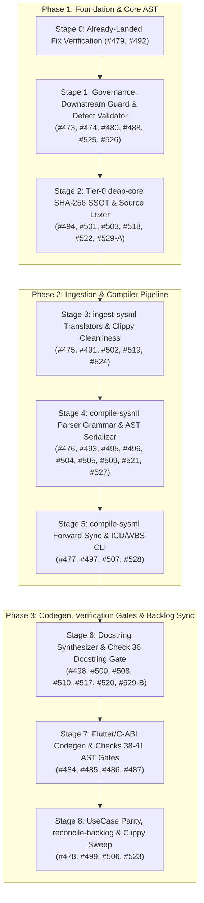
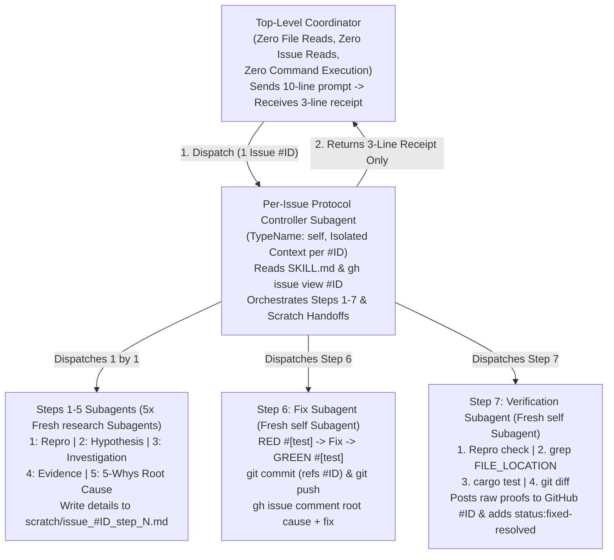

# Implementation Plan: Continuous Remediation of Remaining Unfixed Defects (#473–#529) via Recursive Debugging Protocol

## 1. Objective & Scope

Execute continuous, end-to-end remediation of all **50 remaining unresolved `bug` issues in `#473`–`#529`** in strict compliance with `.agents/skills/debug-protocol/SKILL.md` and a **Zero-Coordinator-Context-Burn Dispatch Architecture**. Once approved with `PROCEED`, execution runs continuously across all stages in dependency order without stopping between stages unless a gate fails.

### Current Triage of `#473`–`#529` against `HEAD` (`daf6229`)
- **Already Resolved / Closed / Non-Bug (`#481`, `#482`, `#483`, `#489`, `#490`, `#530`–`#561`)**: Already complete (`status:fixed-resolved`, `CLOSED`, or `feature`).
- **Already Fixed in `HEAD`, Missing `status:fixed-resolved` Label Only (2 issues — `#479`, `#492`)**:
  - `#479` (`AGENTS.md`, resolved in `9e1560f` and `b2a08a3`) and `#492` (`crates/deap-core/src/source_ast.rs`, resolved in `0c6b689`, `298d637`, and `2405667`): dispatch a single Step 7 Verification Subagent per issue to post the 3 proofs to GitHub, apply `status:fixed-resolved`, and return a 3-line receipt.
- **Active Unfixed Defects Requiring Full 8-Step `debug-protocol` Loop (48 issues across Stages 1–8)**:
  - `#473`–`#478`, `#480`, `#484`–`#488`, `#491`, `#493`–`#529`.

---

## 2. Continuous Execution Dependency Order (Stages 0–8)



---

## 3. Zero-Coordinator-Context-Burn Subagent Dispatching Strategy

### 3.1 Why Flat Dispatching Would Burn Coordinator Context
If the top-level Coordinator directly dispatched 7 subagents per bug across 48 bugs ($48 \times 7 = 336$ subagent round-trips), read `gh issue view` bodies, and received raw `cargo test` and `git diff` outputs in its own conversation history, the Coordinator would exhaust its context window after 4–5 issues.

### 3.2 Two-Tier Hierarchical Subagent Isolation & Scratch-File Handoff

To ensure the **Coordinator burns near-zero context** (~10 lines of prompt out, ~3 lines of receipt back per issue), we use a **Two-Tier Hierarchical Dispatch Architecture**:



1. **Top-Level Coordinator Rules (Zero Context Burn)**:
   - **NEVER** calls `read_file` on repository source files or defect dossiers.
   - **NEVER** calls `gh issue view <ID>` to load 200-line issue bodies into its own context.
   - **NEVER** runs `cargo test`, `git diff`, `git commit`, or `git push` during the issue loop.
   - For each issue `#<ID>` in the serial queue (Section 3.4), the Coordinator invokes **one** `Per-Issue Protocol Controller Subagent` (`TypeName: "self"`, `Role: "Defect #<ID> Debug-Protocol Controller"`), waits for its **3-line completion receipt**, immediately terminates/reclaims it via `manage_subagents` (which automatically garbage-collects all of its child subagents and context), and dispatches the next issue's controller.
2. **Per-Issue Protocol Controller Subagent (`TypeName: "self"`)**:
   - Runs in an **isolated conversation context** dedicated to a single issue `#<ID>`.
   - Reads `.agents/skills/debug-protocol/SKILL.md` and runs `gh issue view <ID>` inside its isolated context.
   - Sequentially dispatches **7 separate, fresh child subagents (`Step 1` through `Step 7`)** as mandated by `.agents/skills/debug-protocol/SKILL.md`:
     - **Step 1 (`research`)**: Reproduction Subagent → writes reproduction & scope report to `<scratch_dir>/issue_<ID>_step1.md` and returns a 3-line summary.
     - **Step 2 (`research`)**: Hypothesis Subagent → reads `step1.md`, writes ranked hypotheses to `<scratch_dir>/issue_<ID>_step2.md`, returns 3-line summary.
     - **Step 3 (`research`)**: Investigation Subagent → reads `step1..2.md`, traces AST/data flow, writes investigation evidence to `<scratch_dir>/issue_<ID>_step3.md`, returns 3-line summary.
     - **Step 4 (`research`)**: Evidence Subagent → compiles structured evidence dossier & ruled-out hypotheses into `<scratch_dir>/issue_<ID>_step4.md`, returns 3-line summary.
     - **Step 5 (`research`)**: Root Cause Subagent → applies 5-Whys, writes exact `file:line` root cause to `<scratch_dir>/issue_<ID>_step5.md`, returns 3-line summary.
     - **Step 6 (`self`)**: Fix Subagent → reads `step5.md`, writes failing native Rust `#[test]` (RED), applies minimal fix (Check 19/34/36 compliant), verifies test passes (GREEN), stages, commits (`git commit -m "fix(<scope>): ... (refs #<ID>)"`), pushes to `origin/main`, comments root cause + fix on GitHub issue `#<ID>`, and returns commit SHA + 3-line summary.
     - **Step 7 (`self`)**: Verification Subagent → confirms original reproduction is fixed, greps `FILE_LOCATION`, runs the test suite, checks `git diff` of the fix commit, **posts the full raw terminal output (`grep`, `cargo test`, `git diff`) directly to GitHub issue `#<ID>` via `gh issue comment <ID>`**, applies `status:fixed-resolved` via `gh issue edit <ID> --add-label "status:fixed-resolved"`, and returns only a 3-line verification receipt (`PROOFS: 3/3 PASS | LABEL: status:fixed-resolved | COMMIT: <sha>`) to the controller.
   - Reclaims its child subagents, deletes `<scratch_dir>/issue_<ID>_step*.md`, and returns **only a 3-line receipt** to the Top-Level Coordinator:
     ```text
     ISSUE: #<ID> | STATUS: status:fixed-resolved | COMMIT: <sha>
     PROOFS: 3/3 posted to GitHub (repro + grep + cargo test + git diff)
     TARGET: <file_location>
     ```

### 3.3 Compact Prompt Template Sent by Coordinator (≤ 15 Lines)

```markdown
Repository Classification: UPSTREAM_SPEC_CORE_COMPILER
Active Skill: .agents/skills/debug-protocol/SKILL.md
Assigned Defect: Issue #<ID>
Allowed Target Files: <target_files>
Scratch Directory: <appDataDir>/brain/<conversation-id>/scratch
---GOVERNANCE-END---

1. Read `.agents/skills/debug-protocol/SKILL.md` in full and inspect `gh issue view <ID>`.
2. Execute the full 8-step `debug-protocol` for Issue #<ID> by sequentially dispatching 7 fresh child subagents (Steps 1–5 `research`, Step 6 `self` Fix Subagent, Step 7 `self` Verification Subagent), reclaiming each via `manage_subagents`.
3. Use `<Scratch Directory>/issue_<ID>_step<1..5>.md` for inter-step handoffs so prompts stay compact.
4. Ensure Step 6 commits with neutral `(refs #<ID>)`, pushes to `origin/main`, and comments root cause + fix on `#<ID>`.
5. Ensure Step 7 posts the raw `grep`, `cargo test`, and `git diff` proofs to `#<ID>` and applies `status:fixed-resolved`.
6. Return ONLY a 3-line receipt (`ISSUE`, `PROOFS`, `TARGET`) to the coordinator. Do NOT paste raw diffs or test logs in your final reply.

PROCEED
```

### 3.4 Serial Dispatch Queue & Parent/Child Sequencing (50 Remaining Issues)

To prevent git index or file-write contention (`rules/serial-execution.md`), the Coordinator dispatches one `Per-Issue Protocol Controller Subagent` at a time in the exact dependency order below:

| Stage | Serial Issue Dispatch Order (1 Isolated Controller Subagent per Issue) | Target File Boundary | Paired Issues on Same Function |
| :--- | :--- | :--- | :--- |
| **Stage 0** | `#479` (Step 7 Verification Subagent only)<br/>`#492` (Step 7 Verification Subagent only) | • `#479`: `AGENTS.md`<br/>• `#492`: `crates/deap-core/src/source_ast.rs` | Already fixed in `b2a08a3` (`#479`) and `2405667` (`#492`) |
| **Stage 1** | `1.` `#473` → `2.` `#480` → `3.` `#474` → `4.` `#488` → `5.` `#525` → `6.` `#526` | • `#473`: `crates/deap-core/src/rules.rs`<br/>• `#480`, `#474`, `#488`: `crates/verify-baseline/src/defect_dossier.rs`, `crates/verify-baseline/tests/defect_dossier_tests.rs`, `AGENTS.md`, `rules/subagent-dispatch-standards.md`, `skills/adversarial-code-auditor/SKILL.md`<br/>• `#525`, `#526`: `crates/verify-baseline/src/checks/structural.rs`, `Cargo.toml` files | `#480` + `#474`; `#525` + `#526` |
| **Stage 2** | `7.` `#494` → `8.` `#503` → `9.` `#522` → `10.` `#501` → `11.` `#518` → `12.` `#529` (Part A) | • `#494`, `#503`, `#522`: `crates/deap-core/src/sysml_ast.rs`, `crates/deap-core/src/digest.rs`, `crates/ingest-sysml/src/digest.rs`<br/>• `#501`, `#518`, `#529-A`: `crates/deap-core/src/source_ast.rs` | `#494` + `#503` + `#522`; `#501` + `#518` + `#529-A` |
| **Stage 3** | `13.` `#475` → `14.` `#524` → `15.` `#502` → `16.` `#519` → `17.` `#491` | • `#475`, `#524`: `crates/ingest-sysml/src/translators/markdown.rs`<br/>• `#502`: `crates/ingest-sysml/src/lib.rs`, `crates/ingest-sysml/src/translators/yang.rs`<br/>• `#519`: `crates/ingest-sysml/src/translators/code.rs`<br/>• `#491`: `crates/ingest-sysml/src/lib.rs`, `crates/ingest-sysml/src/main.rs`, `crates/ingest-sysml/tests/` | `#475` + `#524` |
| **Stage 4** | `18.` `#495` → `19.` `#521` → `20.` `#496` → `21.` `#509` → `22.` `#504` → `23.` `#527` → `24.` `#476` → `25.` `#493` → `26.` `#505` | • `#495`, `#521`, `#496`, `#509`, `#504`, `#527`: `crates/compile-sysml/src/parser/grammar.rs`, `crates/compile-sysml/src/main.rs`<br/>• `#476`, `#493`, `#505`: `crates/compile-sysml/src/semantic/serializer.rs`, `crates/compile-sysml/src/parser/grammar.rs` | `#495` + `#521`; `#496` + `#509`; `#504` + `#527`; `#476` + `#493` + `#505` |
| **Stage 5** | `27.` `#477` → `28.` `#497` → `29.` `#507` → `30.` `#528` | • `#477`, `#497`, `#507`, `#528`: `crates/compile-sysml/src/sync/forward.rs`, `crates/compile-sysml/src/main.rs`, `crates/verify-baseline/tests/blueprint_gate_tests.rs` | `#477` + `#497` + `#507` + `#528` |
| **Stage 6** | `31.` `#511` → `32.` `#515` → `33.` `#513` → `34.` `#512` → `35.` `#514` → `36.` `#516` → `37.` `#498` → `38.` `#510` → `39.` `#520` → `40.` `#500` → `41.` `#508` → `42.` `#517` → `43.` `#529` (Part B) | • `#511`..`#520`, `#498`: `crates/compile-sysml/src/docstring.rs`, `crates/compile-sysml/tests/docstring_injector_tests.rs`<br/>• `#500`, `#508`, `#517`, `#529-B`: `crates/verify-baseline/src/checks/docstring_gate.rs`, `crates/verify-baseline/tests/check_36_docstring_gate_tests.rs`, `crates/verify-baseline/tests/blueprint_gate_tests.rs` | `#498` + `#510` + `#520`; `#500` + `#508` + `#517` + `#529-B` |
| **Stage 7** | `44.` `#484` → `45.` `#485` → `46.` `#486` → `47.` `#487` | • `#484`–`#487`: `crates/compile-sysml/src/flutter_codegen.rs`, `crates/compile-sysml/tests/flutter_codegen_tests.rs`, `crates/verify-baseline/src/checks/codebase.rs`, `crates/verify-baseline/tests/codebase_checks_tests.rs` | `#484` + `#485`; `#486` + `#487` |
| **Stage 8** | `48.` `#478` → `49.` `#506` → `50.` `#499` → `51.` `#523` | • `#478`: `crates/verify-baseline/src/checks/parity_gates.rs`<br/>• `#506`: `crates/reconcile-backlog/src/lib.rs`, `crates/reconcile-backlog/src/checklist.rs`, `crates/reconcile-backlog/src/frontmatter.rs`<br/>• `#499`, `#523`: `crates/reconcile-backlog/src/lib.rs`, `crates/assemble-conops/src/lib.rs`, `crates/compile-sysml/src/lib.rs`, `crates/verify-baseline/src/lib.rs` | `#506` + `#522` (`frontmatter.rs`); `#499` + `#523` |

---

## 4. Target Files & Planned Changes Across All Stages

### Stage 0: Already-Landed Fix Verification (`#479`, `#492`)
- Dispatch Step 7 Verification Subagents for `#479` (`AGENTS.md`, fixed in `9e1560f`/`b2a08a3`) and `#492` (`crates/deap-core/src/source_ast.rs`, fixed in `0c6b689`/`298d637`/`2405667`) to post the three proofs (`grep`, test proof, `git show`) to GitHub, apply `status:fixed-resolved`, and return a 3-line receipt.

### Stage 1: Governance, Downstream Test Guard, Defect Dossier Validator & Structural Check 34 Gates (`#473`, `#474`, `#480`, `#488`, `#525`, `#526`)
- **Target Files**:
  - `crates/deap-core/src/rules.rs`
  - `crates/verify-baseline/src/defect_dossier.rs`
  - `crates/verify-baseline/tests/defect_dossier_tests.rs`
  - `crates/verify-baseline/src/checks/structural.rs`
  - `AGENTS.md`
  - `rules/subagent-dispatch-standards.md`
  - `skills/adversarial-code-auditor/SKILL.md`
  - `Cargo.toml`
  - `crates/deap-core/Cargo.toml`
  - `crates/ingest-sysml/Cargo.toml`
  - `crates/compile-sysml/Cargo.toml`
  - `crates/verify-baseline/Cargo.toml`
  - `crates/reconcile-backlog/Cargo.toml`
  - `crates/assemble-conops/Cargo.toml`
- **Planned Changes**:
  1. **`#473` (`crates/deap-core/src/rules.rs`)**: Guard `test_canonical_architecture_blueprints_exist_on_disk` with `.pipeline/upstream` existence detection so downstream workspaces skip the upstream-only on-disk check instead of panicking.
  2. **`#480` & `#474` (`crates/verify-baseline/src/defect_dossier.rs`, `AGENTS.md`, `rules/subagent-dispatch-standards.md`, `skills/adversarial-code-auditor/SKILL.md`, `crates/verify-baseline/tests/defect_dossier_tests.rs`)**: Inject `SSL_CERT_FILE=/etc/ssl/cert.pem` on `gh` subprocesses when `/etc/ssl/cert.pem` is present, align `AGENTS.md` and `rules/subagent-dispatch-standards.md` with single-command `verify-baseline check-defect`, and add regression tests in `defect_dossier_tests.rs`.
  3. **`#488` (`crates/verify-baseline/src/defect_dossier.rs`, `crates/verify-baseline/tests/defect_dossier_tests.rs`)**: Skip fenced code blocks when extracting `test-target` metadata, enforce Check 19 domain cleanliness and Check 34 zero-regex inside Section 6 code blocks for upstream crates, and verify `test-target` crate paths exist on disk in `UPSTREAM_SPEC_CORE_COMPILER` workspaces.
  4. **`#525` & `#526` (`crates/verify-baseline/src/checks/structural.rs`, workspace `Cargo.toml` files)**: Configure `[lints.clippy]` in `Cargo.toml` (`deny` on safety lints so `clap_derive` `E0453` is avoided), remove the hardcoded `is_audited` file allowlist in Check 34, enforce `C-PURITY-01..05` fail-closed I/O, and detect multi-line `allow(clippy::...)` blocks.

### Stage 2: Tier-0 `deap-core` SHA-256 SSOT & Source AST Lexer (`#494`, `#501`, `#503`, `#518`, `#522`, `#529-A`)
- **Target Files**:
  - `crates/deap-core/src/sysml_ast.rs`
  - `crates/deap-core/src/digest.rs`
  - `crates/deap-core/src/source_ast.rs`
  - `crates/ingest-sysml/src/digest.rs`
- **Planned Changes**:
  1. **`#494`, `#503` & `#522` (`crates/deap-core/src/sysml_ast.rs`, `crates/deap-core/src/digest.rs`, `crates/ingest-sysml/src/digest.rs`)**: Consolidate the duplicate manual SHA-256 implementation in `sysml_ast.rs` onto `deap_core::digest::sha256_hex`, replace `WalkDir::into_iter().flatten()` with fail-closed I/O error propagation, and replace vacuous `REQ-0001` tests with concrete digest verification assertions.
  2. **`#501`, `#518` & `#529` (Part A) (`crates/deap-core/src/source_ast.rs`)**: Fix raw string (`r#"..."#`) and nested Dart string interpolation (`"${...}"`) state transitions in `RustDartLexState`, remove hardcoded `"Controller"` suffix heuristics and Dart `String`/`Key` parameter type assumptions, preserve nested generic type arguments without lossy flattening, and expose `RustDartLexState` and `ScopedItemScannerState` (`REQ-0605` `AC-01..AC-02`).

### Stage 3: Level-0 Ingestion Engine (`crates/ingest-sysml`) (`#475`, `#491`, `#502`, `#519`, `#524`)
- **Target Files**:
  - `crates/ingest-sysml/src/translators/markdown.rs`
  - `crates/ingest-sysml/src/translators/yang.rs`
  - `crates/ingest-sysml/src/translators/code.rs`
  - `crates/ingest-sysml/src/lib.rs`
  - `crates/ingest-sysml/src/main.rs`
  - `crates/ingest-sysml/tests/code_ingestion_tests.rs`
  - `crates/ingest-sysml/tests/code_realization_scoping_tests.rs`
- **Planned Changes**:
  1. **`#475` & `#524` (`crates/ingest-sysml/src/translators/markdown.rs`)**: Fix blueprint heading filter, row-per-attribute extraction, constraint naming, interface latency values, `UC-XX` use case extraction, `/*` / `*/` sanitization in `doc` comments, fenced code block state tracking during table scans, and property name/type column ordering.
  2. **`#502` (`crates/ingest-sysml/src/lib.rs`, `crates/ingest-sysml/src/translators/yang.rs`)**: Fail closed on empty file slices in `MarkdownTranslator::translate_files` and missing files in `YangTranslator::translate_files`.
  3. **`#519` (`crates/ingest-sysml/src/translators/code.rs`)**: Remove hardcoded Flutter widget substrings and magic `UNMAPPED` checks.
  4. **`#491` (`crates/ingest-sysml/src/lib.rs`, `main.rs`, tests)**: Remove all blanket `#![allow(clippy::...)]` attributes across `ingest-sysml` and resolve all underlying clippy lints.

### Stage 4: `compile-sysml` Parser Grammar & Bijective AST Serializer (`#476`, `#493`, `#495`, `#496`, `#504`, `#505`, `#509`, `#521`, `#527`)
- **Target Files**:
  - `crates/compile-sysml/src/parser/grammar.rs`
  - `crates/compile-sysml/src/semantic/serializer.rs`
  - `crates/compile-sysml/src/main.rs`
- **Planned Changes**:
  1. **`#495` & `#521` (`crates/compile-sysml/src/parser/grammar.rs`)**: Remove the pre-scanner `normalize_type_sigils` raw text rewrite and parse composite type sigils (`&`, `[T]`, `(A, B)`, `<T>`, `::`) directly at the token level without shifting `Span.col` offsets or corrupting expressions.
  2. **`#496`, `#509` & `#505` (`crates/compile-sysml/src/parser/grammar.rs`, `crates/compile-sysml/src/semantic/serializer.rs`)**: Capture `self.take_doc_comment()` inside `parse_state_decl` for sub-states and transitions, preserve token spacing in `entry`/`do`/`exit` actions, parse transition endpoints without fabricating `{s}_to_{t}` names, and include sub-state transitions in MBD Stateflow `.sfx` export.
  3. **`#504` & `#527` (`crates/compile-sysml/src/parser/grammar.rs`, `crates/compile-sysml/src/main.rs`)**: Fail closed with structured `ParseError` diagnostics on unknown statements across the 12 inner block parsers, align `ConnectionDef`/`RequirementDef`/`CalcDef` grammar and serializer symmetry, and enforce the bijective AST roundtrip gate in `run_compilation_gate`.
  4. **`#476`, `#493` & `#505` (`crates/compile-sysml/src/semantic/serializer.rs`)**: Serialize `UseCaseDef::includes` (`include use case ...;`), normalize quotes in `UseCaseDef`/`PortDef`/`HazardDef`/`RiskDef`, serialize `source_port`/`target_port` in `HazardDef`/`RiskDef`, serialize `TransitionDef::doc`, and serialize `severity`, `item_flow_ref`, `derives`, `parameters`, and sub-0.1ms `latency_ms` precision in `ConnectionDef`, `RequirementDef`, and `ActionDef`.

### Stage 5: `compile-sysml` Forward Sync & ICD/WBS CLI (`#477`, `#497`, `#507`, `#528`)
- **Target Files**:
  - `crates/compile-sysml/src/sync/forward.rs`
  - `crates/compile-sysml/src/main.rs`
  - `crates/verify-baseline/tests/blueprint_gate_tests.rs`
- **Planned Changes**:
  1. **`#477`, `#497` & `#507` (`crates/compile-sysml/src/sync/forward.rs`)**: Remove hardcoded `EPIC-02-ConOps` User Story parent links, preserve multi-story Use Case realizations, prevent root AST pollution during forward-to-reverse sync, and project Use Case and User Story specifications without overwriting authored Epic/Feature prose sections.
  2. **`#528` (`crates/compile-sysml/src/sync/forward.rs`, `crates/compile-sysml/src/main.rs`, `crates/verify-baseline/tests/blueprint_gate_tests.rs`)**: Wire `REQ-0604` `AC-01..AC-05` contracts (`--emit-icd` `LogicalIcdMatrixCompiler`, `--emit-wbs` `MilStd881eWbsExporter`, typed `ActionDef` parameter roundtrip helpers, and `blueprint_gate_tests.rs` verification).

### Stage 6: Docstring Synthesizer (`docstring.rs`) & Check 36 Docstring Gate (`docstring_gate.rs`) (`#498`, `#500`, `#508`, `#510`, `#511`, `#512`, `#513`, `#514`, `#515`, `#516`, `#517`, `#520`, `#529-B`)
- **Target Files**:
  - `crates/compile-sysml/src/docstring.rs`
  - `crates/compile-sysml/tests/docstring_injector_tests.rs`
  - `crates/verify-baseline/src/checks/docstring_gate.rs`
  - `crates/verify-baseline/tests/check_36_docstring_gate_tests.rs`
  - `crates/verify-baseline/tests/blueprint_gate_tests.rs`
- **Planned Changes**:
  1. **`#511`, `#513` & `#515` (`crates/compile-sysml/src/docstring.rs`)**: Remove hardcoded workstation path components (`"Users"`, `"jail"`) in `derive_module_req_tag`, remove scanner-evasion `concat` hacks and CWD-dependent self-grep skips, and purge aerospace/military domain strings from `docstring.rs` unit tests.
  2. **`#512`, `#514` & `#516` (`crates/compile-sysml/src/docstring.rs`)**: Replace string-prefix matching for `DocstringExitCode` (`2` vs `1`) with structured error variants, replace fixed line-count windows in `inspect_rust_item_details` and single-line `parse_rust_impl_header` with token/brace-balanced scanning, and eliminate doubled `Realises:` prefixes and hybrid 14-section docblocks.
  3. **`#498`, `#510`, `#520` & `#529` (Part B) (`crates/compile-sysml/src/docstring.rs`, `crates/verify-baseline/tests/blueprint_gate_tests.rs`)**: Implement `resolve_schema_context_strict` without `.first()` fallback truncation, fix cross-entity method attribution, populate Dart item details without magic item caps, and add `REQ-0605` contract verification in `blueprint_gate_tests.rs`.
  4. **`#500`, `#508` & `#517` (`crates/verify-baseline/src/checks/docstring_gate.rs`, `crates/verify-baseline/tests/check_36_docstring_gate_tests.rs`)**: Delegate Rust and Dart lexical scanning to `deap_core::source_ast`, bound the `in_mod_tests` brace depth latch, classify `unsafe fn` and `extern fn`, and complete Check 17/34/36 test assertions.

### Stage 7: Flutter & C-ABI Codegen (`flutter_codegen.rs`) & Checks 38–41 AST Anti-Fabrication Gates (`codebase.rs`) (`#484`, `#485`, `#486`, `#487`)
- **Target Files**:
  - `crates/compile-sysml/src/flutter_codegen.rs`
  - `crates/compile-sysml/tests/flutter_codegen_tests.rs`
  - `crates/verify-baseline/src/checks/codebase.rs`
  - `crates/verify-baseline/tests/codebase_checks_tests.rs`
- **Planned Changes**:
  1. **`#484` & `#485` (`crates/compile-sysml/src/flutter_codegen.rs`, `crates/verify-baseline/src/checks/codebase.rs`)**: Synthesize full 6-layer deterministic Rust C-ABI solver bridge, Dart FFI bindings, and deterministic Rust SQLite seed codegen from SysML topology instances, and enforce Check 41 AST parity banning duplicate Dart solver math.
  2. **`#486` & `#487` (`crates/compile-sysml/src/flutter_codegen.rs`, `crates/verify-baseline/src/checks/codebase.rs`, `crates/verify-baseline/tests/codebase_checks_tests.rs`)**: Harden Check 39 (`check_39_zero_mocking_test_ast_gate`), Check 40 (`check_40_ui_contract_test_completeness_gate`), and Check 38 (`check_38_presentation_anti_hardcoding_ast_gate`) AST scanners and multi-viewport (1080p–6K) UI contract test codegen.

### Stage 8: UseCase Parity, Backlog Reconciler (`reconcile-backlog`) & Workspace Clippy Sweep (`#478`, `#499`, `#506`, `#523`)
- **Target Files**:
  - `crates/verify-baseline/src/checks/parity_gates.rs`
  - `crates/reconcile-backlog/src/lib.rs`
  - `crates/reconcile-backlog/src/main.rs`
  - `crates/reconcile-backlog/src/checklist.rs`
  - `crates/reconcile-backlog/src/frontmatter.rs`
  - `crates/assemble-conops/src/lib.rs`
  - `crates/assemble-conops/src/main.rs`
  - `crates/compile-sysml/src/lib.rs`
  - `crates/compile-sysml/src/main.rs`
  - `crates/verify-baseline/src/lib.rs`
  - `crates/verify-baseline/src/main.rs`
- **Planned Changes**:
  1. **`#478` (`crates/verify-baseline/src/checks/parity_gates.rs`)**: Enforce fail-closed verification when schema `UseCaseDef` nodes lack `docs/use-cases/` specification files in downstream workspaces.
  2. **`#506` & `#522` (frontmatter portion) (`crates/reconcile-backlog/src/lib.rs`, `checklist.rs`, `frontmatter.rs`)**: Track multi-line HTML comment state (`advance_html_comment_state`) across `frontmatter.rs` and `lib.rs`, fix epic hierarchy inclusive counting (`count_total_epics_inclusive`), and isolate tests.
  3. **`#499` & `#523` (`crates/reconcile-backlog/src/lib.rs`, `main.rs`, `crates/assemble-conops/src/lib.rs`, `main.rs`, and remaining crate roots)**: Remove all remaining crate-level `#![allow(clippy::...)]` suppressions across `reconcile-backlog`, `assemble-conops`, and workspace crates, fixing all underlying clippy findings.

---

## 5. Verification & Completion Gates

1. **Zero-Coordinator-Context-Burn Per-Issue Gate**:
   - Each issue is orchestrated inside an isolated `Per-Issue Protocol Controller Subagent` (`TypeName: "self"`), which spawns the 7 fresh step subagents (`Steps 1–5` `research`, `Step 6` `self` Fix, `Step 7` `self` Verification), uses scratch files for inter-step handoffs, posts all raw proofs (`grep`, `cargo test`, `git diff`) directly to GitHub, applies `status:fixed-resolved`, and returns **only a 3-line receipt** to the Coordinator.
   - The Coordinator immediately reclaims the controller subagent via `manage_subagents` before dispatching the next issue.
2. **End-of-Session Final Gate**:
   - Once all 50 issues carry `status:fixed-resolved`, dispatch a single final verification subagent to run `./target/release/verify-baseline . --no-domain` and verify `git diff origin/main` is empty, returning a 3-line pass receipt.
