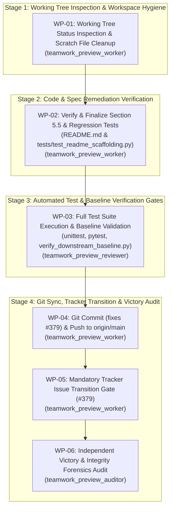

# Implementation Plan: Defect #379 Resolution & Governance Completion

## 1. Executive Summary & Problem Diagnosis

This implementation plan governs the end-to-end resolution and constitutional completion of **Defect #379** (`[AUDIT] [README.md]: Conflation of deprecated Gemini CLI with Antigravity in Section 5.5`) in `DEAP01-spec-core`.

### Problem Statement:
- Section 5.5 of `README.md` previously conflated deprecated "Gemini CLI" directives with Google Antigravity in setup narratives, headings, and agent initialization steps.
- The repository requires:
  1. Authoritative and clean alignment of Section 5.5 strictly with Google Antigravity (0 occurrences of "Gemini CLI").
  2. Rigorous regression assertions in `tests/test_readme_scaffolding.py` (`test_upstream_readme_section_5_5_no_gemini_cli_conflation`) asserting 0 occurrences of "Gemini CLI" in Section 5.5 across AST and raw line slices.
  3. Working tree inspection and purging of any untracked scratch files/artifacts.
  4. Execution and clean passing (exit code 0) of all automated test suites:
     - `python3 -m unittest tests/test_readme_scaffolding.py`
     - `pytest tests/test_readme_scaffolding.py`
     - `python3 scripts/verify_downstream_baseline.py --no-domain`
  5. Atomic git commit referencing `(fixes #379)`.
  6. Remote synchronization mandate: push to `origin/main` and verify `git diff origin/main` returns exactly 0 bytes.
  7. Mandatory Tracker Issue Transition Gate: apply `status:fixed-resolved` label, post verification evidence comment, and close issue #379 via `gh issue`.

---

## 2. Orchestration Architecture & Workflow Flow

---

## 3. Detailed Work Packages

### WP-01: Working Tree Status Inspection & Scratch File Cleanup
- **Assigned Agent**: `teamwork_preview_worker` (Role: `Workspace Hygiene Worker`)
- **Directives & Constraints**:
  - Execute `view_file` on `skills/adversarial-code-auditor/SKILL.md` or relevant skill as mandatory first step.
  - Run `git status --porcelain` to inspect the working tree.
  - Identify and safely remove untracked temporary scratch files, test dumps, or build artifacts while preserving intentional modifications and agent state in `.agents/`.
  - Report exact status of modified and untracked files in handoff.
- **Completion Criteria**: Clean working tree containing only targeted files (`README.md`, `tests/test_readme_scaffolding.py`, `implementation_plan.md`, and `.agents/`).

### WP-02: Defect #379 Remediation Verification & Hardening
- **Assigned Agent**: `teamwork_preview_worker` (Role: `Documentation & Tooling Worker`)
- **Target Files**:
  - `README.md`
  - `tests/test_readme_scaffolding.py`
- **Directives & Constraints**:
  - Confirm Section 5.5 in `README.md` is titled `### 5.5 Setup for Google Antigravity`.
  - Confirm Section 5.5 contains 0 instances of the string `Gemini CLI`.
  - Confirm `tests/test_readme_scaffolding.py` contains `test_upstream_readme_section_5_5_no_gemini_cli_conflation` checking both AST nodes and raw line slices between Section 5.5 and 5.6.
  - Deliver verified state report in handoff.
- **Completion Criteria**: 0 instances of `Gemini CLI` in Section 5.5; test suite assertions present and verified.

### WP-03: Full Automated Test Suite & Baseline Gate Verification
- **Assigned Agent**: `teamwork_preview_reviewer` (Role: `Automated Test Reviewer`)
- **Directives & Constraints**:
  - Run `python3 -m unittest tests/test_readme_scaffolding.py` -> must exit 0.
  - Run `pytest tests/test_readme_scaffolding.py` -> must exit 0.
  - Run `python3 scripts/verify_downstream_baseline.py --no-domain` -> all checks must pass with exit code 0.
  - Verify zero regression across all test suites.
- **Completion Criteria**: All commands exit with code 0 and logs documented in handoff.

### WP-04: Git Commit & Remote Synchronization
- **Assigned Agent**: `teamwork_preview_worker` (Role: `Git Synchronization Worker`)
- **Directives & Constraints**:
  - Stage the verified changes: `git add README.md tests/test_readme_scaffolding.py implementation_plan.md`.
  - Verify commit message format: `docs(readme): eliminate deprecated gemini cli conflation in section 5.5 (fixes #379)`.
  - Execute `git commit -m "docs(readme): eliminate deprecated gemini cli conflation in section 5.5 (fixes #379)"`.
  - Execute `git push origin main`.
  - Execute `git diff origin/main` and verify output is exactly 0 bytes.
- **Completion Criteria**: Commit pushed to `origin/main`; `git diff origin/main` returns 0 bytes.

### WP-05: Mandatory Tracker Issue Transition Gate for #379
- **Assigned Agent**: `teamwork_preview_worker` (Role: `Tracker Transition Worker`)
- **Directives & Constraints**:
  - Execute `gh issue edit 379 --add-label "status:fixed-resolved"`.
  - Post verification evidence comment via `gh issue comment 379 --body "<verification evidence with commit SHA and test output>"`.
  - Execute `gh issue close 379 --comment "Closed as verified fixed in commit <SHA>."`.
  - Verify issue state is `CLOSED` with label `status:fixed-resolved`.
- **Completion Criteria**: Issue #379 closed on GitHub with `status:fixed-resolved` label and evidence comment.

### WP-06: Independent Victory & Forensic Integrity Audit
- **Assigned Agent**: `teamwork_preview_auditor` (Role: `Forensic Integrity Auditor`)
- **Directives & Constraints**:
  - Verify 0-byte diff against `origin/main`.
  - Verify issue #379 status and labels.
  - Verify clean test runs across test suites.
  - Deliver formal audit verdict (CLEAN / APPROVE).
- **Completion Criteria**: Independent audit verdict of CLEAN with zero integrity violations.

---

## 4. Verification Gates & Strict Planning Mode Compliance

| Gate | Verification Command | Expected Outcome |
|---|---|---|
| Section 5.5 AST & Slice | `python3 -m unittest tests/test_readme_scaffolding.py` | Exit code 0, all tests pass |
| Pytest Scaffolding Suite | `pytest tests/test_readme_scaffolding.py` | Exit code 0, all tests pass |
| Downstream Baseline Gate | `python3 scripts/verify_downstream_baseline.py --no-domain` | Exit code 0, all 30 checks pass |
| Remote Synchronization | `git diff origin/main` | Output is exactly 0 bytes |
| Issue Tracker Status | `gh issue view 379 --json state,labels` | `state: CLOSED`, label `status:fixed-resolved` present |
