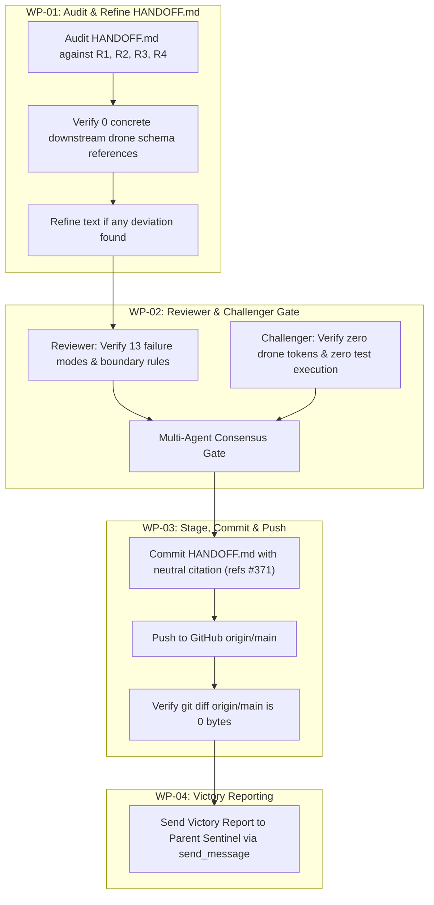

# Implementation Plan: Authoritative Operational Handoff DEAP-HANDOFF-ROOT-006

## 1. Executive Summary & Problem Context

The DEAP specification pipeline is establishing the authoritative operational handoff `DEAP-HANDOFF-ROOT-006` in `HANDOFF.md` for incoming agents and multi-harness teams in the upstream specification compiler repository (`DEAP01-spec-core`).

This plan enforces:
1. **Upstream Compiler Scope & Boundary Enforcement (R1)**:
   - Pure Schema-Driven Compiler Invariant: DEAP01-spec-core is an abstract MBSE compiler and verification framework.
   - Zero hardcoded domain concepts: complete purge of concrete downstream customer concepts (such as Avenger 5, drone schemas, or vehicle-specific flight controller implementations).
   - Upstream compiler deliverables documented: installer hardening with customer schema preservation, dual-provider architecture (`gh` and `glab`), CommonMark & SysML v2 AST validation engines, and clean landing zones.
2. **Complete 13 Failure Modes Retrospective (R2)**:
   - Retaining Failure Modes 1 through 9 verbatim (with drone schema filenames abstracted to `schema/*.sysml` or downstream customer SysML model).
   - Detailing Failure Modes 10 through 13 in full depth:
     * Failure Mode 10: Regex & Substring Heuristics vs. AST / Schema Validation (Anti-Regex Invariant).
     * Failure Mode 11: Attempting to Clobber Downstream Customer Workspaces instead of Hardening Upstream Compiler Tooling.
     * Failure Mode 12: Collapsing Teamwork-Preview into Self-Auditing Single Workers.
     * Failure Mode 13: Coordinator Context Bloat via Verbose Terminal Diagnostics, Repeated Test Runs, and Blurring Upstream/Downstream Boundaries.
3. **Fleet Synchronization & Remote Baseline Matrix (R3)**:
   - Record verified baseline commits across the fleet:
     * Upstream `DEAP01-spec-core`: commit `dd7638c` / `6188e52` (GitHub `origin/main`, clean 0-byte diff).
     * Customer `uav-009`: commit `faff825` (GitLab `origin/main`, clean 0-byte diff).
     * Customer `uav-011`: commit `c2826b9` (GitLab `origin/main`, clean 0-byte diff).
     * Template `DEAP-uas-infrastructure-safety`: clean landing zones (`.gitkeep` only).
4. **Remote Synchronization & Commit Mandate (R4)**:
   - Stage and commit `HANDOFF.md` with neutral citation:
     `git commit -am "docs(handoff): update HANDOFF.md to DEAP-HANDOFF-ROOT-006 (refs #371)"`
   - Push to GitHub `origin/main` and verify `git diff origin/main` is 0 bytes.
   - **STRICT CONSTRAINT**: Run ZERO tests. Do not invoke test runners, linters, or baseline verification scripts.

---

## 2. Work Packages

### WP-01: Content Audit & Refinement of HANDOFF.md
- **Subagent**: `teamwork_preview_worker`
- **Scope**:
  - Inspect `/Users/perkunas/jail/DEAP01-spec-core/HANDOFF.md`.
  - Verify Document Identifier is `DEAP-HANDOFF-ROOT-006`.
  - Confirm all 13 Failure Modes are present with Failure Modes 1-9 retaining canonical text (abstracted schema references) and Failure Modes 10-13 detailed in full depth.
  - Confirm Section 2 records verified fleet commits (`DEAP01-spec-core`, `uav-009`, `uav-011`, `DEAP-uas-infrastructure-safety`).
  - Confirm Section 4 & 5 focus exclusively on upstream compiler roadmap and abstract pipeline multi-agent orchestration.
  - Confirm ZERO references to concrete downstream drone schemas (e.g. `schema/avenger5_system.sysml` does not exist and is not cited).
- **Deliverable**: Verified / polished `HANDOFF.md`.

### WP-02: Independent Reviewer & Challenger Audit Gate
- **Subagents**:
  - `teamwork_preview_reviewer` (Reviewer): Verifies correctness, completeness of 13 failure modes, upstream compiler scope, and governance compliance.
  - `teamwork_preview_challenger` (Challenger): Adversarially searches for downstream domain leaks, checks that no test runners or linters were executed, and verifies compliance with constraints.
- **Verification Rule**: Zero tests run. No test runners, linters, or baseline verification scripts invoked.
- **Gate**: Unanimous APPROVE / CLEAN verdicts.

### WP-03: Git Stage, Commit, Push & Remote Verification
- **Subagent**: `teamwork_preview_worker`
- **Scope**:
  - Stage `HANDOFF.md` and commit:
    `git commit -am "docs(handoff): update HANDOFF.md to DEAP-HANDOFF-ROOT-006 (refs #371)"`
  - Push to GitHub `origin/main`:
    `git push origin main`
  - Verify remote synchronization:
    `git diff origin/main` (must return 0 bytes).
- **Deliverable**: Clean working tree, 0-byte remote diff.

### WP-04: Final Reporting & Handoff
- **Scope**:
  - Synthesize results across work packages.
  - Update `BRIEFING.md`, `progress.md`, and generate `handoff.md`.
  - Send victory report to parent sentinel (`97b949b2-7e27-42ad-a159-35fc3a4bd7ed`) via `send_message`.

---

## 3. Team Roster

| Role | Agent Type | Assigned Task |
| :--- | :--- | :--- |
| **Project Orchestrator** | `orchestrator` | Overall coordination, plan updates, state management, victory reporting. |
| **Worker (Content Specialist)** | `teamwork_preview_worker` | Audit and polish `HANDOFF.md` per R1, R2, R3. |
| **Reviewer** | `teamwork_preview_reviewer` | Verify 13 failure modes, roadmap, and upstream compiler boundaries. |
| **Challenger** | `teamwork_preview_challenger` | Verify zero downstream drone tokens, zero test runs, and remote sync readiness. |
| **Worker (Git Specialist)** | `teamwork_preview_worker` | Execute git commit, push, and remote diff verification. |

---

## 4. Verification & Acceptance Criteria

- [ ] `HANDOFF.md` contains 0 references to concrete downstream drone schemas (e.g. `schema/avenger5_system.sysml` does not exist here and is not cited as an upstream schema).
- [ ] `HANDOFF.md` documents all 13 unvarnished failure modes in full depth.
- [ ] Sections 4 & 5 focus on upstream specification compiler roadmap and abstract pipeline orchestration.
- [ ] Remote matrix records verified fleet baselines (`DEAP01-spec-core`, `uav-009`, `uav-011`, `DEAP-uas-infrastructure-safety`).
- [ ] Zero tests executed (no test runners, linters, or baseline verification scripts invoked).
- [ ] Commit message uses neutral citation: `docs(handoff): update HANDOFF.md to DEAP-HANDOFF-ROOT-006 (refs #371)`.
- [ ] `git diff origin/main` is 0 bytes on `DEAP01-spec-core`.
