# Implementation Plan: Dual-Provider Tooling & Downstream Remediation (Unabridged)

## 1. Executive Summary & Problem Context

The DEAP specification pipeline has encountered an operational blocker during downstream project execution:
1. **Upstream & Propagated Tooling Defect**: `skills/spec-orchestrator/scripts/create_issue.sh` contains hardcoded calls to GitHub's `gh` CLI (`gh issue list`, `gh label list`, `gh label create`, `gh issue create`). It contains zero support for GitLab's `glab` CLI, lacks remote provider auto-detection, and fails closed when executed against GitLab repositories.
2. **Leaf-Level Specification Contamination in `uav-009`**: Because `create_issue.sh` failed to publish specifications to GitLab, exactly **75 specification files** in `/Users/perkunas/jail/uav-009/docs/` (1 Epic, 44 Features, 24 User Stories, 6 Use Cases) remain contaminated with literal ungrounded placeholders `| **Issue ID** | #[IssueID] |`. The GitLab issue tracker for `uav-009` has zero published work items, and downstream baseline checks fail Check 23 numeric provenance and grounding.
3. **Scope Constraint**: Per user directives, all operations, reads, and modifications are **strictly bounded inside `/Users/perkunas/jail`**. All backup archives (`archive_*.tar.gz`) and external test directories (Tier 3B) are **completely excluded**.

```mermaid
flowchart TD
    subgraph JailScope["Strict Boundary: /Users/perkunas/jail"]
        direction TB
        subgraph Tier1["Tier 1: Upstream Specification Core Compiler"]
            Core["DEAP01-spec-core (GitHub)"]
            Tool1["skills/spec-orchestrator/scripts/create_issue.sh (Refactor for Dual-Provider)"]
            Test1["tests/test_create_issue_dual_provider.py (New Regression Suite)"]
            Defect1["GitHub Tracker: File Defect Dossier via scripts/file_defect.py"]
        end

        subgraph Tier2["Tier 2: Domain Distribution Template"]
            Template["DEAP-uas-infrastructure-safety (GitHub)"]
            Tool2["skills/spec-orchestrator/scripts/create_issue.sh (Propagated Dual-Provider)"]
            Landing2["Clean Landing Zones (.gitkeep verification)"]
        end

        subgraph Tier3A_009["Tier 3A: Customer Application Workspace (uav-009 - GitLab)"]
            UAV009["uav-009"]
            Tool009["create_issue.sh (glab execution)"]
            Specs009["75 Contaminated Leaf Specs (1 Epic + 44 Feat + 24 US + 6 UC)"]
            Reconcile009["reconcile_backlog.py (Replace #[IssueID] -> Live GitLab IDs)"]
            Tracker009["GitLab Tracker (Publish 75 Live Work Items)"]
        end

        subgraph Tier3A_011["Tier 3A: Customer Application Workspace (uav-011 - GitLab)"]
            UAV011["uav-011"]
            Tool011["create_issue.sh (glab execution)"]
            Landing011["Clean Landing Zones & 30 Baseline Gates"]
        end

        Core -->|install_pipeline.sh| Template
        Core -->|install_pipeline.sh| UAV009
        Core -->|install_pipeline.sh| UAV011
    end
```



---

## 2. Exhaustive Contamination Inventory (Strictly Within `/Users/perkunas/jail`)

| Repository / Project | Role & Classification | Platform & Remote URL | Exact Contamination & Defect Details |
| :--- | :--- | :--- | :--- |
| **`/Users/perkunas/jail/DEAP01-spec-core`** | `UPSTREAM_SPEC_CORE_COMPILER` | GitHub<br>`https://github.com/gintatkinson/DEAP01-spec-core.git` | `skills/spec-orchestrator/scripts/create_issue.sh` contains hardcoded `gh` CLI commands; zero GitLab `glab` support; lacks provider auto-detection; lacks `--reopen-with-analysis` hook. |
| **`DEAP-uas-infrastructure-safety`** | `DOMAIN_DISTRIBUTION_TEMPLATE` | GitHub<br>`https://github.com/gintatkinson/DEAP-uas-infrastructure-safety.git` | Contains copied, GitHub-locked `create_issue.sh`. Cloned by customer workspaces deploying to GitLab, causing downstream failure. |
| **`/Users/perkunas/jail/uav-009`** | `DOWNSTREAM_CUSTOMER_PROJECT` | GitLab<br>`https://gitlab.com/gintatkinson/uav-009.git` | **Severe Leaf-Level Contamination:**<br>1. Tooling: `create_issue.sh` fails on GitLab.<br>2. **75 leaf specification files** have ungrounded `| **Issue ID** | #[IssueID] |` tokens:<br>&nbsp;&nbsp;• 1 Epic: `docs/epics/epic-01-system-ssot.md`<br>&nbsp;&nbsp;• 44 Features: `docs/features/feat-01*` to `feat-44*`<br>&nbsp;&nbsp;• 24 User Stories: `docs/user-stories/us-01*` to `us-24*`<br>&nbsp;&nbsp;• 6 Use Cases: `docs/use-cases/uc-01*` to `uc-06*`<br>3. GitLab issue tracker has **0 published work items**.<br>4. Fails Check 23 numeric provenance and grounding. |
| **`/Users/perkunas/jail/uav-011`** | `DOWNSTREAM_CUSTOMER_PROJECT` | GitLab<br>`https://gitlab.com/gintatkinson/uav-011.git` | Tooling: `create_issue.sh` contains GitHub-only lock; cannot publish future specifications to GitLab. |

*(All backup archives `archive_DEAP_legacy_*.tar.gz`, `Desktop/`, and external test projects are completely excluded).*

---

## 3. What and Where the Fix Is (Detailed Technical Specifications)

### Fix 1: Upstream Core Tooling Refactor (`DEAP01-spec-core`)
**Target File**: `/Users/perkunas/jail/DEAP01-spec-core/skills/spec-orchestrator/scripts/create_issue.sh`

#### A. Provider Auto-Detection & Environment Overrides
```bash
# Auto-detect tracker provider: command-line flag > environment variable > git remote URL
REMOTE_URL=$(git remote get-url origin 2>/dev/null || echo "")
PROVIDER="${TRACKER_PROVIDER:-auto}"
if [ "$PROVIDER" = "auto" ]; then
    if [[ "$REMOTE_URL" =~ gitlab ]] || [ -n "${GITLAB_CI:-}" ]; then
        PROVIDER="gitlab"
    else
        PROVIDER="github"
    fi
fi
echo "[INFO] Using tracker provider: $PROVIDER"
```

#### B. Dual-Branch CLI Execution Primitives
* **GitLab (`glab`) Branch**:
  - **Idempotency Search**:
    ```bash
    EXISTING=$(glab issue list $REPO_FLAG --all --search "$TITLE" 2>/dev/null \
        | awk -F'\t' -v t="$TITLE" '$2 == t { print $1; exit }')
    if [ -n "$EXISTING" ]; then
        echo "[IDEMPOTENT] Issue #$EXISTING already carries the title '$TITLE'. Not filing duplicate."
        if [ "${REOPEN_WITH_ANALYSIS:-false}" = "true" ] && [ -n "${ANALYSIS_FILE:-}" ]; then
            echo "[REOPEN] Reopening issue #$EXISTING with new defect analysis..."
            glab issue reopen "$EXISTING" $REPO_FLAG
            glab issue note "$EXISTING" $REPO_FLAG --message "$(cat "$ANALYSIS_FILE")"
        fi
        exit 0
    fi
    ```
  - **Label Precondition & Creation**:
    ```bash
    if ! glab label list $REPO_FLAG 2>/dev/null | grep -Fwq "$LABEL"; then
        echo "[GATE] Label '$LABEL' not found on GitLab. Creating..."
        glab label create "$LABEL" $REPO_FLAG --color "#0366d6" --description "${LABEL} specification"
    fi
    ```
  - **Issue Creation**:
    ```bash
    glab issue create $REPO_FLAG --title "$TITLE" --label "$LABEL" --description "$TMP_EXPANDED_BODY"
    ```
* **GitHub (`gh`) Branch**:
  - Preserve existing `gh issue list`, `gh label list`, `gh label create`, and `gh issue create`.

#### C. Link Expansion Mechanics for GitLab vs. GitHub
Ensure `expand_relative_links_for_tracker` formats blob URLs correctly based on active provider:
* **GitHub**: `https://github.com/<owner>/<repo>/blob/<branch>/<path>`
* **GitLab**: `https://gitlab.com/<group>/<project>/-/blob/<branch>/<path>`

#### D. Automated Regression Test Suite
**Target File**: `/Users/perkunas/jail/DEAP01-spec-core/tests/test_create_issue_dual_provider.py`
* Tests provider auto-detection from git remotes (`github.com` vs `gitlab.com`).
* Tests CLI flag overrides (`--provider gitlab`, `--provider github`).
* Tests idempotency search parsing across both `gh` TSV and `glab` formats.
* Tests mock subprocess execution of `glab issue create` and `gh issue create`.

#### E. Upstream Defect Submission
Submit the formal 5-pillar adversarial defect dossier upstream to `gintatkinson/DEAP01-spec-core` via:
```bash
python3 scripts/file_defect.py \
  --repo gintatkinson/DEAP01-spec-core \
  --title "Tooling Defect: create_issue.sh lacks GitLab glab dual-provider support" \
  --body-file /path/to/defect_dossier.md \
  --label "bug"
```

---

### Fix 2: Leaf-Level Specification Remediation in `uav-009`
**Target Directory**: `/Users/perkunas/jail/uav-009/`

1. **Pipeline Tooling Upgrade**:
   ```bash
   bash /Users/perkunas/jail/DEAP01-spec-core/scripts/install_pipeline.sh /Users/perkunas/jail/uav-009 --provider gitlab
   ```
2. **Topological Specification Publication via `glab`**:
   Publish all 75 specification files to the GitLab issue tracker using the refactored `create_issue.sh`:
   - **Step 1: Epic** (1 file):
     `docs/epics/epic-01-system-ssot.md` with label `type::epic` $\rightarrow$ GitLab Issue #N
   - **Step 2: Features** (44 files):
     `docs/features/feat-01*` through `feat-44*` with label `type::feature` $\rightarrow$ GitLab Issues #N+1 to #N+44
   - **Step 3: User Stories** (24 files):
     `docs/user-stories/us-01*` through `us-24*` with label `type::user-story` $\rightarrow$ GitLab Issues #N+45 to #N+68
   - **Step 4: Use Cases** (6 files):
     `docs/use-cases/uc-01*` through `uc-06*` with label `type::use-case` $\rightarrow$ GitLab Issues #N+69 to #N+74
3. **Backlog Reconciliation & Placeholder Injection**:
   Run the reconciliation engine against GitLab:
   ```bash
   python3 scripts/reconcile_backlog.py --provider gitlab
   ```
   - Scans all 75 specification files.
   - Replaces literal `| **Issue ID** | #[IssueID] |` tokens with live assigned GitLab issue numbers (e.g. `| **Issue ID** | #9 |`).
   - Automatically resolves and populates parent/child cross-links and checklists across all features and stories.
4. **Baseline & Quality Gate Verification**:
   ```bash
   python3 scripts/verify_downstream_baseline.py
   ```
   - Confirms all 30 checks pass cleanly with exit code 0.
   - Asserts `grep -rn "\[IssueID\]" docs/` returns 0 matches.
5. **Git Synchronization**:
   Commit and push to GitLab `origin/main` (`git diff origin/main` 0 bytes).

---

### Fix 3: Domain Template & Customer Workspace Synchronization
1. **`DEAP-uas-infrastructure-safety`** (GitHub):
   - Update in temporary scratch space via `scripts/install_pipeline.sh . --role DOMAIN_DISTRIBUTION_TEMPLATE --domain-url https://github.com/gintatkinson/DEAP-uas-infrastructure-safety.git`.
   - Verify clean landing zones (`schema/`, `docs/epics/`, `docs/features/`, `docs/user-stories/`, `docs/use-cases/` contain strictly `.gitkeep`).
   - Commit and push to GitHub `origin/main`.
2. **`uav-011`** (GitLab):
   - Upgrade in-place via `bash /Users/perkunas/jail/DEAP01-spec-core/scripts/install_pipeline.sh /Users/perkunas/jail/uav-011 --provider gitlab`.
   - Verify dual-provider `create_issue.sh` deployed and clean landing zones preserved.
   - Verify `python3 scripts/verify_downstream_baseline.py` passes all 30 checks.
   - Commit and push to GitLab `origin/main`.

---

## 4. Who and How the Fix Will Be Executed (`teamwork_preview` Team Roster)

| Team Role | Agent / Subagent | Execution Scope & Specific Responsibilities |
| :--- | :--- | :--- |
| **Governance Sentinel** | `teamwork_preview_sentinel` | Blocks execution on synthetic hooks; enforces explicit human approval; monitors cross-repo liveness; dispatches Victory Auditor. |
| **Master Orchestrator** | `teamwork_preview_orchestrator` | Establishes `.agents/orchestrator_8/`; partitions tasks across workers; coordinates gate iterations; ensures zero cross-contamination. |
| **Worker 1 (Core Tooling)** | `worker_core_tooling` | Implements dual-provider (`gh` / `glab`) support in `DEAP01-spec-core/skills/spec-orchestrator/scripts/create_issue.sh` and creates `tests/test_create_issue_dual_provider.py`. |
| **Worker 2 (Auditor & Defect Filer)** | `worker_defect_auditor` | Runs 5-pillar adversarial audit (`skills/adversarial-code-auditor/SKILL.md`); generates 7-section defect dossier; files defect upstream via `scripts/file_defect.py`. |
| **Worker 3 (Leaf Spec Publisher - UAV-009)** | `worker_uav009_leaf_fix` | Runs in `/Users/perkunas/jail/uav-009`: executes pipeline installation, publishes 75 items to GitLab via `glab`, reconciles all 75 `#[IssueID]` placeholders, and passes 30/30 baseline checks. |
| **Worker 4 (Template & UAV-011 Propagator)** | `worker_template_propagator` | Upgrades `DEAP-uas-infrastructure-safety` and `uav-011`, verifies clean landing zones, commits, and pushes to remotes. |
| **Reviewer 1 & 2** | `reviewer_1`, `reviewer_2` | Audits bash script hygiene, GitLab API error handling, relative link translation, and git commit citation neutrality (`refs #<id>`). |
| **Challenger 1 & 2** | `challenger_1`, `challenger_2` | Stresses failure paths: missing `glab` binary, unauthenticated tokens, network drops, rate limits, duplicate issue titles. |
| **Independent Victory Auditor** | `teamwork_preview_victory_auditor` | Executes independent 3-phase audit: timeline reconstruction, anti-mocking verification, and independent test execution across all targets before issuing `VICTORY CONFIRMED`. |

---

## 5. Phased Execution Sequence

* **Phase 1: Upstream Core Dual-Provider Refactor & Unit Test Suite**
  - Implement dual-provider `create_issue.sh` in `DEAP01-spec-core`.
  - Add and pass `tests/test_create_issue_dual_provider.py`.
  - File formal defect dossier upstream to GitHub.
  - Verify all tests pass, commit, and push to GitHub `origin/main`.
* **Phase 2: Leaf-Level Specification Remediation in `uav-009`**
  - Install updated tooling into `/Users/perkunas/jail/uav-009`.
  - Publish 75 specification items to GitLab via `glab`.
  - Reconcile backlog with `scripts/reconcile_backlog.py --provider gitlab`.
  - Verify all 75 `#[IssueID]` tokens are replaced and 30/30 baseline checks pass.
  - Commit and push to GitLab `origin/main`.
* **Phase 3: Domain Template & UAV-011 Propagation**
  - Upgrade `DEAP-uas-infrastructure-safety` and push to GitHub `origin/main`.
  - Upgrade `uav-011` in-place, verify clean landing zones, and push to GitLab `origin/main`.
* **Phase 4: Multi-Agent Consensus Gate**
  - Reviewers and Challengers render explicit APPROVE / CLEAN verdicts across all repositories.
* **Phase 5: Independent Victory Audit**
  - Victory Auditor performs 3-phase audit and verifies 0-byte remote diffs across all repositories before issuing `VICTORY CONFIRMED`.
