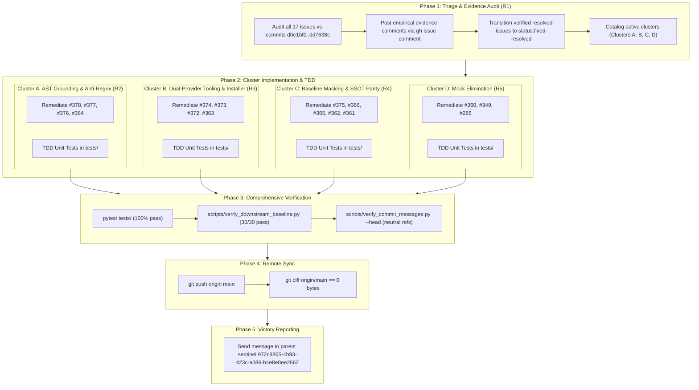

# Implementation Plan: Comprehensive Audit, Triage & Resolution of 17 Defect Issues

## 1. Executive Summary & Problem Context

The DEAP upstream specification compiler repository (`DEAP01-spec-core`) has 17 tracked defect issues (#378, #377, #376, #375, #374, #373, #372, #368, #366, #365, #364, #363, #362, #361, #360, #349, #286) spanning:
- AST factual grounding & anti-regex hardening (evasion tags, negative string matches, Mermaid sequence/code block omissions)
- Dual-provider tooling & installer robustness (ARG_MAX overflow, title indexing, GitLab/GitHub domain template routing)
- Baseline gate masking & SSOT parity (fail-closed behavior when `allow_missing_specs=False`, dual-schema verification)
- Synthetic mock elimination (replacing string mocks in safety validation and diagram parity with genuine test fixtures and AST nodes)

The plan follows a phased execution:
- **Phase 1 (R1)**: Comprehensive Triage & Evidence Audit of all 17 issues against recent commits (`d0e1bf0` down to `dd7638c`). Verification evidence comments posted via `gh issue comment`, label transitioned to `status:fixed-resolved` for verified issues, and remaining defects clustered.
- **Phase 2 Cluster A (R2)**: Positive AST Provenance & Anti-Regex Hardening (#378, #377, #376, #364).
- **Phase 2 Cluster B (R3)**: Dual-Provider Tooling & Installer Hardening (#374, #373, #372, #363).
- **Phase 2 Cluster C (R4)**: Baseline Gate Masking & SSOT Parity (#375, #366, #365, #362, #361).
- **Phase 2 Cluster D (R5)**: Synthetic Mock Elimination in Safety & Parity Tests (#360, #349, #286).
- **Phase 3**: Comprehensive Automated Verification (100% pytest pass, 0 regressions, all 30 baseline checks pass, commit message neutral citation validation).
- **Phase 4**: Remote Synchronization (git push origin main, verify `git diff origin/main` is 0 bytes).
- **Phase 5**: Final Victory Reporting to Parent Sentinel (`972c8805-4b93-423c-a386-b4e8e8ee2662`).

---

## 2. Work Packages & Orchestration Architecture

### WP-01: Phase 1 Triage & Empirical Evidence Audit (R1)
- **Role**: `Codebase Researcher & Auditor` (TypeName: `teamwork_preview_explorer`)
- **Scope**:
  - Audit all 17 issues (#378, #377, #376, #375, #374, #373, #372, #368, #366, #365, #364, #363, #362, #361, #360, #349, #286) against the commit log between `d0e1bf0` and `dd7638c` and existing code files.
  - Determine exact resolution status (already remediated vs. active defect requiring code edits).
  - For each already-remediated issue (e.g., #368 rules bundle, #363 template URLs, #373 duplicate checks):
    * Prepare exact empirical verification evidence (git commit hash, diff inspection, automated test output).
    * Post verification comment to GitHub via `gh issue comment <ID> --body "<evidence>"`.
    * Apply label `status:fixed-resolved` via `gh issue edit <ID> --add-label "status:fixed-resolved"`.
    * Keep issue OPEN (honoring the tracker non-closure invariant; closure is reserved for PO).
  - Formally group the remaining unclosed defects into Clusters A, B, C, D.
- **Deliverable**: Phase 1 Triage & Evidence Report in `.agents/orchestrator_8/triage_report.md`.

### WP-02: Phase 2 - Cluster A Remediation (R2: AST Grounding & Anti-Regex Hardening)
- **Target Issues**: #378, #377, #376, #364.
- **Subagents**: Context-isolated `teamwork_preview_worker` guided by `skills/debug-protocol/SKILL.md`.
- **Scope**:
  - Remove negative-string regex heuristics and exemption tag bypasses in `skills/spec-orchestrator/parity_auditor/src/parity_auditor/validators/factual_grounding_validator.py`.
  - Enforce positive closed-world AST provenance validation against SysML v2 AST (`.pipeline/schema.sysml`, `schema/*.sysml`) and typed parameter dictionaries.
  - Close bypasses where numbers in Mermaid sequence diagrams or code fences evade factual grounding.
  - Write failing regression tests (RED), implement minimal fixes (GREEN), verify zero regressions (REFACTOR).
- **Deliverable**: Hardened grounding validator with passing unit tests in `tests/test_factual_grounding_validator.py`.

### WP-03: Phase 2 - Cluster B Remediation (R3: Dual-Provider Tooling & Installer Hardening)
- **Target Issues**: #374, #373, #372, #363.
- **Subagents**: Context-isolated `teamwork_preview_worker` guided by `skills/debug-protocol/SKILL.md`.
- **Scope**:
  - Fix `skills/spec-orchestrator/scripts/create_issue.sh` to prevent `ARG_MAX` buffer overflow when creating issues by supporting `--body-file <path>` payloads.
  - Fix duplicate issue detection in `create_issue.sh` to accurately index and match the issue title column across provider CLI outputs.
  - Fix `scripts/install_pipeline.sh` domain template repository URL resolution between GitHub and GitLab, preventing non-existent URL synthesis.
  - Write regression tests in `tests/` verifying payload handling, title matching, and provider routing.
- **Deliverable**: Robust issue creator and installer scripts with passing tests.

### WP-04: Phase 2 - Cluster C Remediation (R4: Baseline Gate Masking & SSOT Parity)
- **Target Issues**: #375, #366, #365, #362, #361.
- **Subagents**: Context-isolated `teamwork_preview_worker` guided by `skills/debug-protocol/SKILL.md`.
- **Scope**:
  - Fix `scripts/verify_downstream_baseline.py` Checks 17, 20, 23 and `architecture_viewpoint_validator.py` Gate 30: fail closed when models or specifications are missing if `allow_missing_specs=False`.
  - Implement dual-schema SSOT parity verification ensuring synchrony between SysML v2 and auxiliary schemas.
  - Update `README.md` and verification harnesses to eliminate green-test trap false negatives.
  - Write regression tests confirming failing exit code when specs/models are absent.
- **Deliverable**: Fail-closed baseline validators and regression tests.

### WP-05: Phase 2 - Cluster D Remediation (R5: Synthetic Mock Elimination)
- **Target Issues**: #360, #349, #286.
- **Subagents**: Context-isolated `teamwork_preview_worker` guided by `skills/debug-protocol/SKILL.md`.
- **Scope**:
  - Eliminate synthetic in-memory string mocks in safety validation and diagram parity test suites.
  - Replace them with authentic schema fixtures, AST nodes, and test files under `tests/fixtures/`.
  - Enforce closed-world model verification and eliminate citation fraud.
  - Verify all safety and parity tests pass with real AST nodes.
- **Deliverable**: Clean, unmocked test fixtures and updated test suites.

### WP-06: Phase 3 Verification & Multi-Agent Gate Review
- **Subagents**: `teamwork_preview_reviewer` and `teamwork_preview_challenger`.
- **Scope**:
  - Execute full test suite `pytest tests/` (100% pass rate, 0 regressions).
  - Execute `python3 scripts/verify_downstream_baseline.py` (all checks pass cleanly).
  - Execute `python3 scripts/verify_commit_messages.py --head` (neutral citations only).
  - Independent review and adversarial challenge for any evasion or regressions.
- **Deliverable**: Gate approval in `GATE_STATUS.md`.

### WP-07: Phase 4 Remote Synchronization & Phase 5 Victory Reporting
- **Scope**:
  - Commit all verified changes using neutral citations: e.g. `fix(tooling): resolve defect cluster ... (refs #378, refs #377, ...)`
  - Push to GitHub `origin/main`.
  - Verify `git diff origin/main` returns 0 bytes.
  - Post resolution comments on any newly fixed issues and transition to `status:fixed-resolved`.
  - Send final victory report via `send_message` to parent sentinel (`972c8805-4b93-423c-a386-b4e8e8ee2662`).

---

## 3. Team Roster

| Role | Agent Type | Assigned Scope |
| :--- | :--- | :--- |
| **Project Orchestrator** | `orchestrator` | Pipeline management, state tracking, work package dispatch, synthesis, victory reporting |
| **Triage Auditor** | `teamwork_preview_explorer` | Phase 1 triage & evidence collection for all 17 issues |
| **Cluster A Implementer** | `teamwork_preview_worker` | Positive AST provenance & anti-regex hardening (#378, #377, #376, #364) |
| **Cluster B Implementer** | `teamwork_preview_worker` | Dual-provider tooling & installer hardening (#374, #373, #372, #363) |
| **Cluster C Implementer** | `teamwork_preview_worker` | Baseline gate masking & SSOT parity (#375, #366, #365, #362, #361) |
| **Cluster D Implementer** | `teamwork_preview_worker` | Synthetic mock elimination in safety & parity tests (#360, #349, #286) |
| **Reviewer** | `teamwork_preview_reviewer` | Verification of correctness, spec integrity, and compliance across all clusters |
| **Challenger / Auditor** | `teamwork_preview_challenger` | Adversarial test verification, regression checking, and mock check |

---

## 4. Verification Checklist & Acceptance Criteria

- [ ] Phase 1 Triage Report completed with empirical evidence for all 17 issues.
- [ ] All remediated issues have verification evidence posted and carry `status:fixed-resolved`.
- [ ] Remaining active defects have verified automated unit/integration tests in `tests/`.
- [ ] `pytest tests/` runs with 100% pass rate (0 failures, 0 regressions).
- [ ] `python3 scripts/verify_downstream_baseline.py` passes all baseline checks with exit code 0.
- [ ] `python3 scripts/verify_commit_messages.py --head` passes with neutral citations (`(refs #<id>)`) and zero auto-closing verbs.
- [ ] Clean working tree with `git diff origin/main` returning 0 bytes after remote push.
